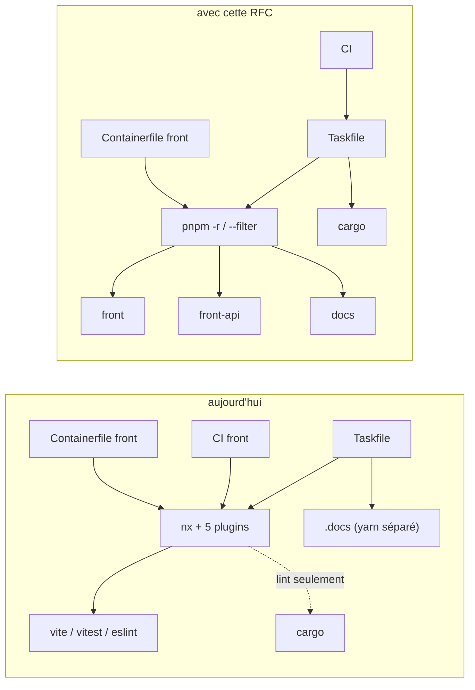
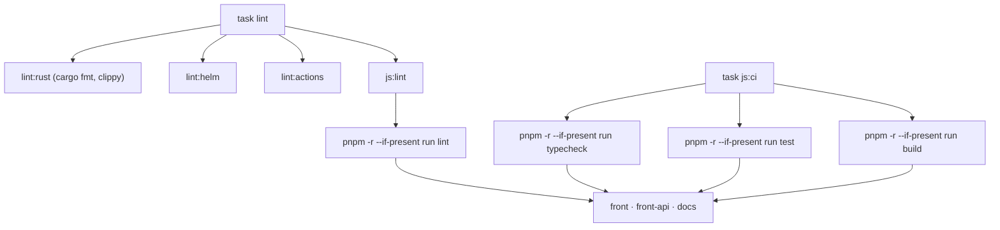
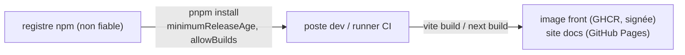

# RFC 0001 — Sortir de NX, workspace pnpm orchestré par Taskfile

| Field       | Value                                                                 |
| ----------- | --------------------------------------------------------------------- |
| Status      | In review                                                             |
| Short       | Sortie de NX, workspace pnpm                                          |
| Settles     | NX et Monodon sont retirés ; un workspace pnpm de paquets autonomes, orchestré par Taskfile, remplace Yarn et NX |
| Author      | Max Batleforc <maxleriche.60@gmail.com>                               |
| Co-author   | Claude Opus 5.5                                                       |
| Created     | 2026-10-17                                                            |
| Supersedes  | —                                                                     |
| Issue       | [#255 — Drop NX or Update](https://github.com/batleforc/ProxyAuthK8S/issues/255) |
| Related     | RFC 0005 (adopter weebo-operator-kit), qui s'appuie sur la structure posée ici |
| Touches     | `package.json`, `pnpm-workspace.yaml`, `apps/front/package.json`, `libs/front/front-api/package.json`, `.docs/package.json`, `nx.json`, `**/project.json`, `apps/front/vite.config.mts`, `tsconfig.base.json`, `eslint.config.mjs`, `openapi-ts.config.ts`, `Taskfile.yaml`, `.tasks/{front,docs,js,lint,gen,audit,tool}.yaml`, `mise.toml`, `.yarnrc.yml`, `.github/workflows/{front-lint,api-lint,docs-deploy,build,postmortem-scan}.y*ml`, `.github/dependabot.yaml`, `deploy/build/front/Containerfile`, docs développeur |
| Risk        | medium                                                                |

---

## 1. Summary

NX (23.3.0) et `@monodon/rust` (3.0.0) sont retirés. Yarn 4 est remplacé par
un **workspace pnpm** de trois paquets autonomes : `@proxy-auth-k8s/front`,
`@proxy-auth-k8s/front-api` et `@proxy-auth-k8s/docs`. Ils sont séparés (chacun
déclare ses dépendances, sans hoisting) mais gérés ensemble (un lockfile, une
installation, un audit). Chaque paquet expose les mêmes noms de scripts
(`dev`, `build`, `lint`, `typecheck`, `test`). Taskfile reste l'unique
orchestrateur : il agrège via `pnpm -r --if-present run <script>`, et la CI
appelle les mêmes tâches. Cargo reste le seul graphe de build Rust, ce qu'il
est déjà en CI et dans l'image back. Aucun comportement runtime ne change.

### Before / after

```text
# aujourd'hui
task dev:front        -> yarn nx run front:dev                -> @nx/vite -> vite
task lint             -> … + lint:all -> yarn nx run-many -t lint (Rust + front)
CI front-lint         -> npx nx run-many -t typecheck test build -p front front-api
Containerfile front   -> yarn install (tout) -> npx nx build front
.docs                 -> yarn.lock séparé, `cd .docs && yarn install`
task audit:js         -> yarn npm audit (racine seulement)

# avec cette RFC
task front:dev        -> pnpm --filter @proxy-auth-k8s/front dev   -> vite
task lint             -> lint:rust + lint:helm + lint:actions + js:lint
CI front              -> task js:ci  -> pnpm -r run typecheck, test, build
Containerfile front   -> pnpm fetch -> install --offline --filter front... -> build
.docs                 -> paquet du workspace, même lockfile
task audit:js         -> pnpm audit (les trois paquets)
```



NX n'est qu'un intermédiaire : aucun chemin ne dépend d'une fonctionnalité
que pnpm, Taskfile ou Cargo n'offrent pas déjà.

---

## 2. Motivation

1. **NX ne reflète plus le graphe Rust.** 3 des 15 membres du workspace Cargo
   (`libs/server/crd_runtime`, `libs/server/virtual_api`,
   `libs/server/jwt_validator`) n'ont pas de `project.json`. Toute la CI Rust
   (`back-cargo-test.yaml`, `back-clippy.yaml`, `back-cargo-machete.yaml`,
   `back-envtest.yaml`) et l'image back (`deploy/build/back/Containerfile`)
   appellent `cargo` directement. Les 12 `project.json` Rust sont une seconde
   déclaration, déjà incomplète, sans consommateur en CI.
2. **Les deux vraies valeurs de NX ne sont pas utilisées.** `nx affected`
   n'apparaît nulle part, il n'y a pas de NX Cloud et `.nx/cache` n'est pas mis
   en cache en CI. Le seul `targetDefaults` (`nx.json:59-63`) concerne
   `@nx/js:tsc` sur une lib consommée en source.
3. **NX coûte en surface CVE et en maintenance.** Trois `resolutions` de
   `package.json` (`nx/brace-expansion`, `nx/smol-toml`, `nx/undici`) n'existent
   que pour corriger des CVE transitives de NX. 13 devDependencies (`nx`,
   `@nx/*`, `@monodon/rust`, `@swc-node/register`, `@swc/core`, `@swc/helpers`)
   alimentent `task audit` sans rien apporter. L'issue #255 est née d'un
   décalage de majeure entre Monodon et NX, et cela se reproduira.
4. **Le monorepo JS n'est pas structuré.** Les dépendances du front (`vue`,
   `maz-ui`, `pinia`…) sont dans le `package.json` racine. `.docs` a son propre
   `yarn.lock`, sa propre installation et échappe à `task audit:js`
   (`.tasks/audit.yaml:27` ne lit que la racine). `libs/front/front-api/package.json`
   existe mais ne sert à rien : pas de `workspaces`, et son `main` pointe vers
   un `./src/index.js` inexistant.
5. **La chaîne d'installation JS n'est pas durcie.** `.yarnrc.yml` a
   `enableScripts: true` (tout postinstall s'exécute) et `npmMinimalAgeGate: 0`
   (une version publiée il y a une minute est installée). La CI modifie le
   lockfile à la volée (`yarn add … -D` dans `front-lint.yaml:51` et
   `api-lint.yaml:49`).
6. **La règle de frontières est un trompe-l'œil.**
   `@nx/enforce-module-boundaries` (`eslint.config.mjs:18-30`) est configurée en
   `* → *` : elle ne contraint rien.

---

## 3. Goals / non-goals

**Goals**

- Plus aucune dépendance `nx`, `@nx/*` ni `@monodon/rust`, plus de `nx.json`,
  de `project.json`, de `yarn.lock`, de `.yarnrc.yml` ni de `.docs/yarn.lock`.
- Un workspace pnpm de trois paquets autonomes, un seul lockfile.
- Un contrat de scripts commun, agrégé par Taskfile : tout nouveau paquet est
  orchestré sans toucher au Taskfile.
- Parité : dev front (avec et sans TLS), dev docs, lint, la CI front (SARIF,
  typecheck, test, build), le déploiement docs et l'image front produisent le
  même résultat qu'avant.
- Installation durcie : délai de publication de 25 heures et allowlist des
  scripts de build.
- `task audit` couvre les trois paquets avec `pnpm audit`.

**Non-goals**

- **Remplacer NX par Moon ou Turborepo** : cela recréerait le doublon avec
  Taskfile (§12).
- **Adopter weebo-operator-kit** (`@weebo/operator-docs`, Taskfiles partagés,
  `checks.yml`) et renommer `.docs` en `docs/` : RFC 0005. Cette RFC garantit
  seulement que la structure le permet.
- **Changer d'outil de lint** (oxlint) et appliquer Prettier : relève de la RFC 0002.
- **Toucher au build Rust** : Cargo reste inchangé.
- **Grouper ou retarder les PRs Dependabot** (`groups`, `cooldown`) ou passer à
  Renovate : sans lien avec NX, issue à part.
- **Cache local Taskfile** (`sources:`/`generates:`) : il n'y a pas de cache en
  CI aujourd'hui, Vite et Cargo ont le leur.
- **Une vraie règle de frontières** : un seul front, une lib générée.
- **Exclure le code généré de `front-api` du lint** : on garde la parité.

---

## 4. User-facing design

### 4.1 Configuration

`pnpm-workspace.yaml` (nouveau) :

```yaml
packages:
  - apps/front
  - libs/front/front-api
  - .docs

# Une version doit être publiée depuis 25 heures pour être installée
# (défaut pnpm ≥ 11 : 1440, soit 1 jour).
minimumReleaseAge: 1500

# Seuls ces paquets exécutent leurs scripts d'installation. Liste établie
# après la première installation (`pnpm ignored-builds`) ; strictDepBuilds
# (défaut true) fait échouer l'installation sur tout paquet non revu.
allowBuilds:
  esbuild: true

overrides:
  "@hey-api/json-schema-ref-parser>js-yaml": "^4.3.2"
  "next>postcss": "8.5.30"
  "next>sharp": "^0.35.4"
  "@scalar/json-magic>undici": "^7.30.0"
  "serve>compression": "^1.8.2"

audit:
  ignore:
    # braces <=3.0.3 (advisory npm 1240992), repris de .yarnrc.yml avec
    # sa justification ; converti en identifiant GHSA.
    - GHSA-…
```

Contrat de scripts, identique dans chaque paquet qui en a l'usage :

| Script | front | front-api | docs |
| --- | --- | --- | --- |
| `dev` | `vite` | — | `next dev` |
| `build` | `vite build` | — | `next build` |
| `typecheck` | `vue-tsc --noEmit -p tsconfig.app.json` | `tsc --noEmit -p tsconfig.lib.json` | `fumadocs-mdx && next typegen && tsc --noEmit` (ex-`types:check`) |
| `test` | `vitest run` | — | — |
| `lint` | `eslint .` | `eslint .` | `eslint` |
| `generate` | — | `openapi-ts` | — |

`package.json` racine : `private`, `packageManager: "pnpm@12.x"` (dernière
12.x publiée depuis au moins 7 jours au moment de la PR1, aujourd'hui 12.10.1),
et uniquement l'outillage transverse : `prettier`, `@stoplight/spectral-cli`,
`@microsoft/eslint-formatter-sarif`, et la config ESLint partagée
(`eslint`, `@eslint/js`, `typescript-eslint`, `eslint-plugin-vue`).

- `minimumReleaseAge` absent vaut 1 jour avec pnpm ≥ 11 ; on le fixe à 25 heures : une heure de plus que le défaut, sans bloquer les correctifs CVE que Dependabot propose dans la journée.
  Défaut de sécurité : le côté sûr.
- `allowBuilds` absent ou vide : aucun script d'installation de dépendance ne
  s'exécute, et `strictDepBuilds` fait échouer l'installation. C'est le côté
  fermé. Les scripts propres aux paquets du workspace (`postinstall:
  fumadocs-mdx` de `.docs`) ne sont pas concernés.

### 4.2 Behaviour rules

- `outDir` reste `dist/apps/front` (`apps/front/vite.config.mts`) pour que la
  copie du Containerfile front ne change pas.
- `@proxy-auth-k8s/front-api` est résolu comme un paquet ordinaire via le lien
  symbolique `node_modules` de `front` (`"workspace:*"`). Son `package.json`
  pointe sur la source (`"exports": "./src/index.ts"`, plus `types` pour les
  outils qui ne lisent pas `exports`). Il n'y a pas d'étape de build.
- `task lint` reste la tâche « tout le dépôt ». Ses `deps` sont `lint:rust`,
  `lint:helm`, `lint:actions` et `js:lint` ; clippy ne tourne qu'une fois.
- `pnpm -r --if-present` saute un paquet sans le script : un paquet sans
  `test` n'est pas une erreur.
- Rien n'est hoisté : un paquet qui importe une dépendance qu'il ne déclare
  pas échoue à la résolution. C'est voulu (paquets autonomes, RFC 0005).

### 4.3 Validation

Bloquant (la PR ne passe pas) :

| Condition | Rationale |
| --- | --- |
| `pnpm install --frozen-lockfile` échoue sur un build script non listé | `strictDepBuilds` : on ne laisse pas passer un postinstall non revu |
| `dist/apps/front` diffère du build NX de `main`, **hashes compris** | Vite est déterministe à config égale ; l'image front est un artefact de release |
| `eslint --print-config` perd une règle sur un `.vue` ou un `.ts` | les configs `flat/*` de NX activent des règles qu'il faut retrouver |
| `git diff --exit-code pnpm-lock.yaml` non vide après un job CI | la CI ne doit jamais modifier le lockfile |

Aucun avertissement runtime : cette RFC ne change que l'outillage.

---

## 5. Architecture

### 5.1 Ce qui remplace chaque morceau de NX

| Morceau NX | Où | Remplacement |
| --- | --- | --- |
| `@nx/vite/plugin` (cibles build/dev/serve/preview/typecheck) | `nx.json:18-31` | scripts de `apps/front/package.json` |
| `@nx/js/typescript` (`tsc:typecheck`) | `nx.json:32-43` | script `typecheck` de `front-api` |
| `@nx/js:tsc` build de `front-api` | `libs/front/front-api/project.json:7-16` | supprimé : la lib est consommée en source |
| `@nx/eslint/plugin` + flat configs `@nx/eslint-plugin` | `nx.json:44-49`, `eslint.config.mjs:1-6` | `@eslint/js` + `typescript-eslint` + `eslint-plugin-vue` |
| `@nx/enforce-module-boundaries` (`* → *`) | `eslint.config.mjs:18-30` | supprimé |
| `@nx/vitest` | `nx.json:50-55` | script `test` de `front` |
| `@monodon/rust:*` (12 projets) | `apps/*/project.json`, `libs/{server,cli}/*/project.json` | `cargo` |
| `nx run-many` | `.tasks/lint.yaml:23`, `front-lint.yaml:91` | `pnpm -r --if-present run …` via Taskfile |
| alias `@proxy-auth-k8s/front-api` | `vite.config.mts` (`resolve.alias`), `tsconfig.base.json` (`paths`) | dépendance `workspace:*` |

Déjà fait avant cette RFC, pour mémoire : `nxViteTsPaths()` et
`nxCopyAssetsPlugin()` ont été retirés de `vite.config.mts` au profit d'un
alias explicite, et le Containerfile front utilise déjà corepack et Yarn 4.

### 5.2 Orchestration



Taskfile ne liste aucun paquet dans les tâches agrégées : un quatrième paquet
ajouté à `pnpm-workspace.yaml` est linté, testé et construit sans autre
changement.

### 5.3 Invariant

Cargo est déjà la seule source du graphe Rust en CI et dans les images :
retirer Monodon ne peut changer ni un binaire publié ni un résultat de test
Rust. Les seuls artefacts construits par la chaîne JS sont l'image front et le
site docs ; §4.3 compare la première hashes compris, et §6.P vérifie le
second.

Parce que `allowBuilds` est une allowlist et que `strictDepBuilds` est vrai,
un nouveau paquet transitif qui apporte un postinstall ne peut pas s'exécuter
sans une ligne revue dans `pnpm-workspace.yaml`.

---

## 6. Detailed design

### 6.1 Paquets

- `apps/front/package.json` (nouveau) : `@proxy-auth-k8s/front`, reçoit les
  `dependencies` du `package.json` racine (`vue`, `maz-ui`, `pinia`, `axios`,
  `oidc-client-ts`, `vue-router`, `highlight.js`, `vue-hljs`, `@maz-ui/*`) et
  ses outils (`vite`, `@vitejs/plugin-vue`, `vitest`, `@vitest/ui`, `jsdom`,
  `@vue/test-utils`, `vue-tsc`, `typescript`, `sass`), plus
  `"@proxy-auth-k8s/front-api": "workspace:*"`.
- `libs/front/front-api/package.json` : réécrit. `"type": "module"`,
  `"exports": "./src/index.ts"`, `"types": "./src/index.ts"`, dépendance
  `axios` (utilisée par le client généré), devDependencies `typescript` et
  `@hey-api/openapi-ts`. `tslib` disparaît s'il n'est plus importé.
- `openapi-ts.config.ts` passe dans `libs/front/front-api/` ; ses chemins
  deviennent relatifs au paquet (`input: '../../../swagger.json'`,
  `output: 'src/lib'`).
- `.docs/package.json` : `name` devient `@proxy-auth-k8s/docs`, on retire
  `packageManager`, ses `resolutions` passent en `overrides` dans
  `pnpm-workspace.yaml`, `types:check` est renommé `typecheck`. Ses versions de
  `next` et `fumadocs-*` restent les siennes.
- `apps/front/vite.config.mts` : on retire le bloc `resolve.alias` et son
  commentaire.
- `tsconfig.base.json` : on retire `paths`.

### 6.2 `eslint.config.mjs`

- Retirer l'import `@nx/eslint-plugin` et les spreads `flat/base`,
  `flat/typescript`, `flat/javascript`, ainsi que le bloc
  `@nx/enforce-module-boundaries`.
- Ajouter `js.configs.recommended` et `tseslint.configs.recommended` (paquet
  `typescript-eslint`, qui remplace `@typescript-eslint/parser` et
  `@typescript-eslint/eslint-plugin` en direct). On garde les overrides
  `front-api` et le bloc `ignores`.
- `apps/front/eslint.config.mjs` et `libs/front/front-api` importent la config
  racine, comme aujourd'hui.
- Le job SARIF lance `pnpm --filter @proxy-auth-k8s/front lint -f
  @microsoft/eslint-formatter-sarif -o eslint-results.sarif`. Le script tourne
  dans `apps/front`, donc le fichier atterrit à `apps/front/eslint-results.sarif`,
  le chemin que l'upload lit déjà (`front-lint.yaml:64`).

### 6.3 Taskfile

- `.tasks/js.yaml` (nouveau), inclus sous `js` :
  `lint` (`pnpm -r --if-present run lint`), `typecheck`, `test`, `build`, et
  `ci` (enchaîne les trois derniers). Chaque tâche a un `desc`.
- `.tasks/front.yaml` (nouveau), inclus sous `front` : `dev`, `dev:tls`
  (`VITE_TLS_ENABLE=true`), `build`. Les tâches `front` et `front:tls` de
  `Taskfile.yaml:63-74` y sont déplacées ; `aio` en dépend sous leur nouveau
  nom.
- `.tasks/docs.yaml` (nouveau), inclus sous `docs` : `dev` (ex-`Taskfile.yaml:118`,
  garde `PROXY_AUTH_K8S_VERSION`), `build`, et `api` (ex-`gen:docs:api`).
- `.tasks/gen.yaml` : `api-client` appelle `pnpm --filter
  @proxy-auth-k8s/front-api generate` ; `back-api-client` et `api-lint`
  passent de `npx`/`yarn` à `pnpm exec` / `pnpm dlx`.
- `.tasks/lint.yaml` : `all` est supprimé, `task lint` dépend de `js:lint`.
- `.tasks/audit.yaml` : `js` lance `pnpm audit` (les trois paquets, avec la
  liste `audit.ignore`).
- `.tasks/tool.yaml` (`upgrade-*`) : `pnpm up -r` remplace `npm-check-updates`
  suivi de `yarn install`.
- `Taskfile.yaml` (`init`) : un seul `pnpm install` remplace
  `yarn install && cd .docs && yarn install`.
- `mise.toml` : `pnpm` remplace `yarn`, `MISE_NODE_COREPACK` est retiré.

### 6.4 CI et image

- **Installation de pnpm** : `pnpm/action-setup` épinglé par SHA, qui lit
  `packageManager`, puis `actions/setup-node` avec `cache: pnpm`, puis
  `pnpm install --frozen-lockfile`.
- **Task en CI** : `arduino/setup-task` épinglé par SHA ; les jobs appellent
  `task js:ci`, `task js:lint`, `task docs:build`.
- `front-lint.yaml` : l'étape `yarn add @microsoft/eslint-formatter-sarif -D`
  disparaît (le paquet est en devDependency racine).
- `api-lint.yaml` : même chose pour `@stoplight/spectral-cli`.
- `docs-deploy.yml` : `task docs:build`, à la place de `cd .docs && yarn
  install --frozen-lockfile && yarn build`.
- `build.yaml`, `postmortem-scan.yaml` : `yarn.lock` et `.docs/yarn.lock`
  deviennent `pnpm-lock.yaml` dans les filtres de chemins et la matrice. Il
  faut vérifier que `mlab-sh/postmortem` lit `pnpm-lock.yaml` ; sinon la cible
  est retirée et c'est noté en §17.
- `.github/dependabot.yaml` : une seule entrée `npm` à `/` remplace les trois
  (racine, `/libs/front/front-api`, `/.docs`). Dependabot gère les workspaces
  pnpm depuis la racine.
- `deploy/build/front/Containerfile` :

  ```dockerfile
  FROM registry.hub.docker.com/library/node:24 AS build
  WORKDIR /app
  # shortcut: corepack quitte Node à partir de la 25, à remplacer par une
  # installation épinglée de pnpm au passage de majeure Node.
  RUN corepack enable
  COPY pnpm-lock.yaml pnpm-workspace.yaml ./
  RUN pnpm fetch
  COPY . ./
  RUN pnpm install --offline --frozen-lockfile --filter @proxy-auth-k8s/front...
  RUN pnpm --filter @proxy-auth-k8s/front build
  ```

  `pnpm fetch` ne dépend que du lockfile : la couche reste en cache tant que
  les dépendances ne bougent pas. `--filter …front...` n'installe que le front
  et ses dépendances du workspace, pas la doc ni l'outillage racine.

### 6.5 Nettoyage

- Fichiers : `nx.json`, les 14 `project.json`, `.nx/`, `yarn.lock`,
  `.docs/yarn.lock`, `.yarnrc.yml`, `.yarn/`, `.docs/.yarn/`.
- Entrées liées à NX ou Yarn : `.gitignore`, `.containerignore`,
  `.prettierignore`.
- `package.json` racine : scripts `nx`, `build`, `openapi-ts`, `eslint`,
  `prettier` et `spectral` (remplacés par `pnpm exec`), devDependencies NX,
  Monodon et SWC (vérifier avec `pnpm why @swc/core` que rien d'autre n'en
  dépend), les `resolutions`.
- Docs : `.docs/content/docs/developper-guide/index.mdx` (lien Monodon),
  `developper-guide/tasks.mdx` (« `lint:all` pour nx »), le guide
  d'installation (`pnpm install` à la place de `yarn`),
  `libs/front/front-api/README.md` (texte généré par NX).
- `CLAUDE.md` : un paragraphe sur le contrat de scripts et
  `pnpm -r --if-present` (convention de dépôt, skill §6).

### 6.P Proof against a real client

Consommateurs réels : pnpm 12.x (épinglé par `packageManager`), Task (version
mise), GitHub Actions (`front-lint.yaml`, `docs-deploy.yml`, `build.yaml`),
`docker buildx` dans `build.yaml`, et le développeur via `task`.

1. `pnpm install --frozen-lockfile` sur un clone propre : code 0, un seul
   `pnpm-lock.yaml`, `node_modules/.pnpm` présent, et
   `apps/front/node_modules/@proxy-auth-k8s/front-api` est un lien symbolique
   vers `libs/front/front-api`.
2. `task js:ci` en local puis en CI : code 0. Le nombre de tests vitest est
   identique à celui de `nx run-many -t test -p front` (9 specs).
3. `pnpm --filter @proxy-auth-k8s/front build`, puis `find dist/apps/front
   -type f -exec sha256sum {} + | sort` : même sortie que le build NX de
   `main`.
4. `task docs:build` produit `.docs/out` ; `docs-deploy.yml` publie le site, et
   la page d'accueil renvoie 200.
5. Le job SARIF de `front-lint.yaml` publie un rapport visible dans l'onglet
   Security. Une violation volontaire (`no-unused-vars`) y apparaît.
6. **Refus, scripts de build** : on ajoute temporairement une dépendance qui a
   un `postinstall` absent de `allowBuilds`. `pnpm install` échoue avec
   `ERR_PNPM_IGNORED_BUILDS`, et le script n'a pas tourné (aucun fichier qu'il
   aurait écrit n'existe).
7. **Refus, délai de publication** : `pnpm add <paquet>@<version publiée il y
   a moins de 25 heures>` est refusé par `minimumReleaseAge`, et aucune tarball
   de cette version n'est dans le store.
8. **Refus, NX** : `pnpm nx --version` échoue (`Command "nx" not found`) et
   `grep -rn "nx \|yarn" .github .tasks Taskfile.yaml deploy` ne renvoie rien.
9. **Refus, hoisting** : dans `apps/front`, importer un paquet déclaré
   uniquement par `.docs` fait échouer `typecheck` et `build`.
10. `task audit` : la partie JS couvre les trois paquets (y compris les
    dépendances de `.docs`, absentes aujourd'hui) et ne signale aucune
    advisory hors `audit.ignore`.

**Deliberately untouched**, so reviewers do not go looking :

- `deploy/build/back/Containerfile` : il appelle déjà `cargo` directement.
- La génération Rust (`swaggergen`, `crdgen`) : elle ne passe pas par NX.
- `.hooks/pre-commit.sh` : il appelle `task recu` et `task lint`, qui gardent
  leur nom.
- Le contenu et le framework de `.docs` : la migration vers
  `@weebo/operator-docs` est la RFC 0005.

---

## 7. Security

**Rating:** medium. La surface runtime ne change pas, mais on change de
gestionnaire de paquets, donc de la façon dont du code tiers arrive et
s'exécute au build. Le bilan est une réduction nette de la surface.

### 7.1 Threat model



| # | Threat (STRIDE) | Where | Mitigation | Residual risk |
| --- | --- | --- | --- | --- |
| T1 | Tampering : paquet npm compromis exécuté au build (postinstall) | `pnpm install` | `allowBuilds` (allowlist) et `strictDepBuilds: true` ; 13 paquets directs en moins | un paquet de l'allowlist compromis exécute encore son script. Accepté par le mainteneur |
| T2 | Tampering : version malveillante fraîchement publiée | `pnpm install`, Dependabot | `minimumReleaseAge: 1500` | une compromission découverte après 25 heures. Accepté |
| T3 | Tampering : lockfile modifié en CI | `front-lint.yaml`, `api-lint.yaml` | outils en devDependencies, `--frozen-lockfile` partout, contrôle `git diff --exit-code pnpm-lock.yaml` | aucun |
| T4 | Elevation : règle de lint de sécurité perdue au changement de config ESLint | `eslint.config.mjs` | diff `--print-config` (§4.3) | faible : règles de qualité seulement |
| T5 | Tampering : dépendance fantôme résolue par hoisting vers une version non voulue | résolution `node_modules` | isolation pnpm par défaut, aucun `shamefully-hoist` | aucun |

Tests négatifs : T1 → §6.P point 6, T2 → point 7, T3 → §14, T5 → point 9.

### 7.2 Authentication and authorisation

Aucune surface authentifiée n'est touchée : l'API, le proxy et l'UI publiée
gardent le même code.

### 7.3 Input handling and injection

Aucun nouveau parseur ni entrée non fiable : les scripts ne prennent aucun
argument externe.

### 7.4 Secrets and cryptography

Aucun secret n'est ajouté. Les secrets CI existants (GHCR, signature, Pages)
ne sont pas lus par les étapes modifiées.

### 7.5 Abuse and resource exhaustion

Sans objet : pas de surface atteignable à distance.

### 7.6 Existing defences that still hold

gitleaks et `cog verify` en pre-commit, la signature et la SBOM des images dans
`release-prepare.yml`, Trivy, CodeQL (setup par défaut) et `postmortem-scan`
restent en place.

---

## 8. Supply chain

| Dependency / image / tool | Version | Why this one | Licence | Known CVEs (`task audit`) | Maintenance |
| --- | --- | --- | --- | --- | --- |
| **Retirés** : `nx`, `@nx/eslint`, `@nx/eslint-plugin`, `@nx/js`, `@nx/vite`, `@nx/vitest`, `@nx/vue`, `@nx/web`, `@nx/workspace`, `@monodon/rust`, `@swc-node/register`, `@swc/core`, `@swc/helpers`, Yarn 4 | 23.3.0 / 3.0.0 / 4.18.1 | — | MIT / BSD-2 | 3 `resolutions` nx supprimées | — |
| `pnpm` | 12.x, dernière publiée depuis ≥ 7 jours (12.10.1 au 2026-10-17) | workspaces, isolation, `allowBuilds`, `minimumReleaseAge`, `pnpm audit` (règle Weebo) | MIT | aucune connue | très actif, releases hebdomadaires |
| `typescript-eslint` | dernière 8.x | remplace les flat configs NX ; méta-paquet officiel | MIT | aucune connue | actif |
| `pnpm/action-setup` | dernière, épinglée par SHA | installer pnpm en CI | MIT | aucune connue | actif |
| `arduino/setup-task` | dernière, épinglée par SHA | installer Task en CI | MIT | aucune connue | actif |
| `@microsoft/eslint-formatter-sarif`, `@stoplight/spectral-cli` | inchangées | déjà utilisés, passent en devDependencies au lieu d'un `yarn add` en CI | MIT / Apache-2.0 | à vérifier au `task audit` de la PR | actifs |

- **Build et release** : le Containerfile front change d'installation
  (`pnpm fetch` + `--filter`), le multi-stage est conservé, et la SBOM perd
  les paquets NX ainsi que ceux de la doc et de l'outillage.
- **Updates** : Dependabot, une seule entrée `npm` (§6.4) ; ses PRs passent
  par `minimumReleaseAge`.

---

## 9. Data and privacy

| Data | Personal? | Where stored | Retention | Who can read it | Leaves the instance? |
| --- | --- | --- | --- | --- | --- |
| aucune | — | — | — | — | — |

Aucune donnée nouvelle. `analytics: false` est déjà dans `nx.json` ; le
retrait de NX supprime tout risque futur de télémétrie de l'outil. pnpm n'a
pas de télémétrie.

---

## 10. Operability

### 10.1 Observability

- **Metrics** : aucune.
- **Logs and audit trail** : inchangés.
- **Alerts** : aucune, car aucun composant runtime n'est touché.

### 10.2 Failure modes

| Failure | Detected by | Behaviour | Recovery |
| --- | --- | --- | --- |
| Paquet non revu avec un postinstall | `pnpm install` | échec (fermé) | relire le script, l'ajouter à `allowBuilds` ou le refuser |
| Dependabot propose une version de moins de 25 heures | `pnpm install` dans la PR | échec (fermé) | attendre ; Dependabot rebase |
| Dépendance non déclarée dans un paquet | `typecheck` / `build` | échec (fermé) | la déclarer dans le bon `package.json` |
| SARIF au mauvais chemin | étape `upload-sarif` | rien n'apparaît dans Security | vérifier §6.P point 5 |
| `postmortem` ne lit pas `pnpm-lock.yaml` | job `postmortem-scan` | échec ou cible ignorée | retirer la cible, noter en §17 |

### 10.3 Performance and capacity

pnpm installe plus vite que Yarn `node-modules` et partage un store. Il n'y a
pas de cache NX en CI aujourd'hui, donc rien n'est perdu ; en local, on perd
le cache NX des cibles `cache: true`, que Cargo et Vite compensent. L'image
front n'installe plus que le sous-graphe du front.

---

## 11. Other concerns

- **Accessibility** : pas d'UI modifiée.
- **Internationalisation** : pas de chaîne ajoutée.
- **Compliance** : SBOM réduite (CRA : moins de composants à suivre).
- **Licensing** : on retire des paquets MIT et on ajoute pnpm et
  `typescript-eslint` (MIT) ; pas de changement d'obligation.
- **Documentation** : guide développeur, guide d'installation, README de
  `front-api` et `CLAUDE.md` corrigés dans la même PR.

---

## 12. Alternatives considered

| Alternative | Why rejected |
| --- | --- |
| Garder NX à jour (fait en 23.3, `f3896e7`) | une majeure à suivre plusieurs fois par an, Monodon toujours en retard, 3 `resolutions` CVE, pour aucune fonctionnalité utilisée (§2) |
| Statu quo Yarn 4, un seul manifeste racine, pnpm dans une RFC suivante | les scripts `front:*` seraient écrits à la racine puis redéplacés dans les paquets : le même travail fait deux fois |
| Workspaces Yarn 4 | même découpage, mais sans `allowBuilds` ni `pnpm audit` (règle Weebo), et à rebours de batlehub et du kit |
| Moon | gère Rust et JS, avec cache et `affected`, mais c'est un orchestrateur de plus, en doublon avec Taskfile |
| Turborepo | ne gère pas Rust ; `pnpm -r` couvre l'ordre topologique de trois paquets |
| Lister les paquets dans Taskfile au lieu de `pnpm -r` | chaque nouveau paquet demanderait d'éditer Taskfile ; l'agrégation serait à maintenir |
| Ne rien faire | l'issue #255 se reproduira à la prochaine majeure NX |

---

## 13. Rollout and compatibility

- **Default behaviour** : identique pour les utilisateurs de l'outil.
- **Migration développeur** : après le merge de la PR1, supprimer
  `node_modules` et `.docs/node_modules`, puis `task init` (ou `mise install
  && pnpm install`). Les commandes `yarn …` et `yarn nx …` disparaissent ;
  le guide développeur donne les équivalents `task …`.
- **Operator prerequisites** : aucun.
- **Rollback** : `git revert` de chaque PR ; aucun état persistant.
- **Feature flag** : non.

---

## 14. Test plan

- **Unit** : les 9 specs vitest existantes, inchangées.
- **Integration** : `task js:ci`, `task lint`, `task docs:build`, build de
  l'image front en CI.
- **Proof** : §6.P.
- **Security** : T1 (point 6), T2 (point 7), T3 (`git diff --exit-code
  pnpm-lock.yaml` après chaque job CI JS), T5 (point 9).
- **Audit** : `task audit` vert.
- **Existing suites** : toute la CI Rust passe sans modification, ce qui prouve
  que Monodon n'était pas utilisé.

---

## 15. Decisions and open questions

### Resolved

| # | Question | Decision |
| --- | --- | --- |
| 0 | Mettre à jour NX ou le retirer (#255) | **Retirer complètement.** Rien n'utilise `affected`, le cache ni NX Cloud (§2). |
| 1 | pnpm : dans cette RFC, dans une RFC suivante ou jamais ? | **Dans cette RFC, en workspace.** Va contre la recommandation du brouillon (RFC séparée) : le choix de la structure du monorepo conditionne l'emplacement des scripts, et le faire en deux fois doublait le travail. |
| 2 | Cache local Taskfile (`sources:`/`generates:`) | **Non.** YAGNI : pas de cache en CI aujourd'hui, Vite et Cargo ont le leur. |
| 3 | Task en CI ou scripts directs ? | **Task en CI** (`arduino/setup-task` épinglé par SHA) : une seule définition des gates. |
| 4 | `nxCopyAssetsPlugin(['*.md'])` sert-il ? | **Non, et déjà retiré** de `vite.config.mts` avant cette RFC. |
| 5 | Dependabot : `groups`/`cooldown` ou Renovate ? | **Hors périmètre**, issue à part. Seule la fusion en une entrée `npm` est faite ici (§6.4). |
| 6 | Une vraie règle de frontières ? | **Non.** Un seul front, une lib générée. |
| 7 | Structure du monorepo JS | **Workspace pnpm de trois paquets autonomes** (`front`, `front-api`, `docs`), un lockfile, sans hoisting. Séparés pour que la doc migre vers le kit (RFC 0005) en ne touchant que son paquet. |
| 8 | `front-api` | **Vrai paquet consommé en source** (`exports: ./src/index.ts`, `workspace:*`) ; alias Vite et `paths` retirés. Son `package.json` n'est plus supprimé, il est réécrit. |
| 9 | Génération du client | **Dans `front-api`** : `openapi-ts.config.ts` et `@hey-api/openapi-ts` y passent, script `generate`. |
| 10 | Durcissement | **`minimumReleaseAge: 1500`** (25 heures ; 7 jours bloquait les versions déjà verrouillées et les correctifs CVE récents) et une allowlist de builds. Le grill parlait d'`onlyBuiltDependencies` ; pnpm ≥ 11 l'a remplacé par `allowBuilds`, c'est donc ce réglage qui est utilisé. |
| 11 | Installation de pnpm | **`packageManager`** ; mise en local, `pnpm/action-setup` épinglé par SHA en CI, corepack dans le Containerfile avec un `shortcut:`. |
| 12 | Image front | **`pnpm fetch` puis `install --offline --filter …front...`.** |
| 13 | Orchestration | **Contrat de scripts commun et `pnpm -r --if-present`** derrière `task js:*`, plus des tâches par paquet dans `.tasks/`. Le build de la doc entre dans le gate. |
| 14 | `lint:all` | **Supprimé** ; `task lint` dépend de `js:lint`, clippy ne tourne qu'une fois. |
| 15 | Base ESLint | **`@eslint/js` + `typescript-eslint`**, sans attendre la RFC 0002. Confirmé par le grill de la 0002 : elle ajoute oxlint et réduit cette config aux règles Vue (`eslint-plugin-vue` + `eslint-plugin-oxlint`), sans la jeter. |
| 16 | Périmètre du lint | **Parité** : `front` et `front-api`. |
| 17 | Preuve du build | **Hashes compris** (§4.3, §6.P point 3). |
| 18 | Audit | **Un seul `pnpm audit`** à la racine pour les trois paquets. |
| 19 | Adoption de weebo-operator-kit | **RFC 0005.** Cette RFC ne fait que garantir la structure. |
| 20 | Livraison | **Une RFC, deux PRs** (§16). |

### Still open

Aucune.

---

## 16. Implementation phases

**PR1 — workspace pnpm, NX encore présent** (NX fonctionne avec pnpm ; la CI
existante prouve la parité) :

| Phase | Content |
| --- | --- |
| 1 | `build: migrate from yarn to a pnpm workspace`. `pnpm-workspace.yaml` (durcissement inclus), `package.json` par paquet, `pnpm import` des lockfiles puis suppression des fichiers Yarn, `mise.toml` |
| 2 | `build(front-api): consume front-api as a workspace package`. `exports`, `workspace:*`, retrait de l'alias et de `paths`, `openapi-ts` déplacé |
| 3 | `ci: install with pnpm`. Workflows, Containerfile front, Dependabot, `postmortem-scan`, `task init`, `task audit:js` |

**PR2 — retrait de NX** :

| Phase | Content |
| --- | --- |
| 4 | `build: add a shared script contract and task js:*`. Scripts par paquet, `.tasks/{js,front,docs}.yaml` |
| 5 | `ci: run task js:ci instead of nx`. `front-lint.yaml`, `docs-deploy.yml`, `arduino/setup-task` |
| 6 | `build(lint): replace @nx/eslint-plugin with typescript-eslint`. Avec le diff `--print-config` |
| 7 | `build!: remove nx and monodon`. Fichiers, dépendances, `lint:all` |
| 8 | `docs: update developer guide after nx and yarn removal`, plus `CLAUDE.md` |

Chaque phase laisse la CI verte. Les contrôles de sécurité (`allowBuilds`,
`minimumReleaseAge`) arrivent dans la phase 1, avec la première installation
pnpm qu'ils protègent.

---

## 17. Implementation notes

Écarts constatés à l'implémentation (2026-10-17) :

- **Parité de l'image front, dérogation volontaire.** L'image construite par NX
  ne contenait aucun marqueur `PROXYAUTHK8S_FRONT_*` : `.env` est exclu du
  contexte (`.dockerignore`) et NX ne chargeait pas `.env.production`, donc
  `env.sh` et les variables du chart n'avaient aucun effet, contrairement à
  `configuration.mdx`. `vite.config.mts` lit désormais les `.env` de la racine
  (`envDir: '../../'`) : l'image retrouve les marqueurs, et ses hashes diffèrent
  de ceux de NX. Corrigés au passage, sinon les marqueurs restaient en clair :
  `env.sh` réécrit `/app` (que nginx sert) et non `/usr/share/nginx/html`, les
  fichiers appartiennent à l'utilisateur nginx (`COPY --chown=101:101`), et une
  variable absente devient vide (le front retombe sur `/api`). Le build local
  NX de la PR1, lui, était identique hashes compris (69 fichiers).
- **`minimumReleaseAge: 1500`** (25 heures) au lieu de 10080 : 7 jours
  refusaient une soixantaine de versions déjà verrouillées, dont des correctifs
  CVE. Les versions de moins de 25 heures présentes à la migration sont dans
  `minimumReleaseAgeExclude`, liste temporaire marquée `shortcut:`.
- **Dépendances fantômes déclarées** : la doc importait `unist-util-visit`,
  `zod`, `class-variance-authority` et deux paquets Radix sans les déclarer ;
  `tslib` reste en devDependency du front et de front-api (`importHelpers`).
- **`allowBuilds`** n'autorise qu'`esbuild` ; `@parcel/watcher`,
  `@scarf/scarf` (télémétrie), `unrs-resolver` et `vue-demi` sont refusés
  explicitement.
- **ESLint** : le diff `--print-config` ne perd que
  `@nx/enforce-module-boundaries`. Les sévérités que les configs NX posaient
  (`no-explicit-any` et `no-unused-vars` en warn, cinq règles en plus) sont
  reprises explicitement ; `no-undef` est coupé sur les `.vue`, que vue-tsc
  vérifie.
- **CI** : `go-task/setup-task` (nouveau nom d'`arduino/setup-task`, déjà
  épinglé dans le dépôt) ; `postmortem` lit `pnpm-lock.yaml`.
