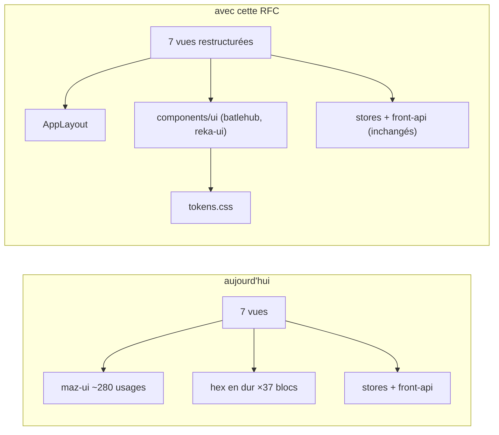
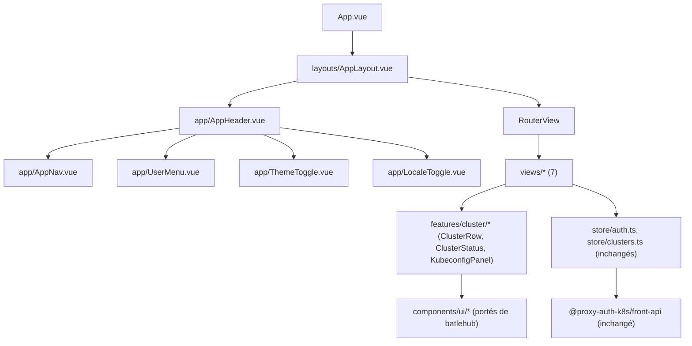
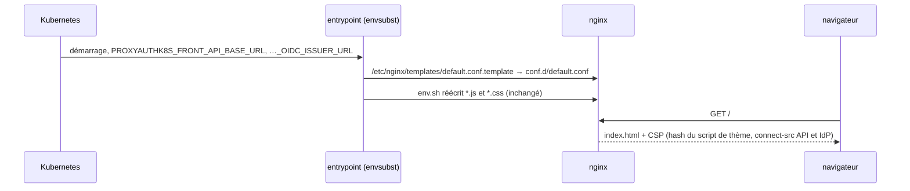
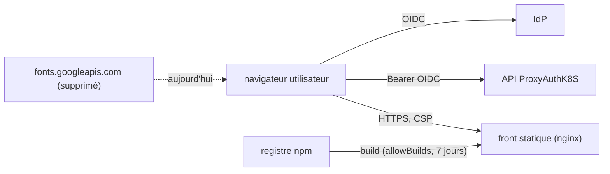

# RFC 0002 — Refonte UI sur le design system BatleHub

| Field       | Value                                                                  |
| ----------- | ---------------------------------------------------------------------- |
| Status      | Implemented (2026-10-17)                                               |
| Short       | UI sur le design system BatleHub                                       |
| Settles     | Le front adopte « The Proof Sheet » (tokens, typo, composants) de BatleHub sans toucher à sa logique, avec oxlint, un format appliqué et une CSP |
| Author      | Max Batleforc <maxleriche.60@gmail.com>                                |
| Co-author   | Claude Opus 5.5                                                        |
| Created     | 2026-10-17                                                             |
| Supersedes  | —                                                                      |
| Issue       | [#230 — Rework UI](https://github.com/batleforc/ProxyAuthK8S/issues/230) |
| Depends on  | RFC 0001 (prérequis dur : workspace pnpm, `apps/front/package.json`, `task js:ci`) |
| Release     | 0.2.0 (bloquant de principe, #258)                                     |
| Touches     | `apps/front/**`, `apps/front/package.json`, `libs/front/front-api` (lint), `eslint.config.mjs`, `.oxlintrc.json`, `.prettierrc`, `.prettierignore`, `.tasks/{lint,js,ui}.yaml`, `.github/workflows/front-lint.yaml`, `deploy/build/front/{Containerfile,nginx.conf}`, `.docs/content/docs/{ui,roadmap}.mdx`, README, nouveau `apps/front/DESIGN.md` |
| Risk        | medium (supply chain : remplacement de la lib de composants ; nouvelle CSP) |

---

## 1. Summary

Le front Vue est restylé et restructuré sur le design system BatleHub (« The
Proof Sheet ») : tokens OKLCH en deux rendus (sombre par défaut, clair),
Silkscreen et JetBrains Mono auto-hébergées, aucun arrondi ni carte, séparation
par filets, une seule action pleine par vue et l'état exprimé sur trois canaux
(motif, mot, teinte). maz-ui est remplacé par Tailwind v4 et des primitives
headless (`reka-ui`) portées depuis `batlehub/ui/src/components/ui`. La couche
logique (stores pinia, client HeyApi `@proxy-auth-k8s/front-api`, utils,
routes) ne change pas : **aucun store n'est modifié**. Autour de la refonte, le
front passe au lint recommandé par Vue (oxlint + `eslint-plugin-vue`, comme
`create-vue`), Prettier devient appliqué, et l'image front sert enfin des
en-têtes de sécurité, dont une CSP stricte. Le skill de référence est
`batlehub-design` du dépôt
[weebo-skillsagent](https://github.com/batleforc/weebo-skillsagent).

### Before / after

```text
# aujourd'hui
main.ts        : maz-ui + preset "obsidian", dark forcé (main.ts:44-48)
styles.scss    : Inter (Google Fonts), body #1a1a1a sur #fff (styles.scss:61-62)
5 vues         : linear-gradient(135deg,#0f172a,#1e293b) + max-width:1200px copiés
37 <style>     : hex slate/violet en dur ; 3 composants de nav ; aucune i18n
lint           : ESLint (configs NX) ; Prettier configuré mais jamais appliqué
nginx.conf     : aucun en-tête de sécurité

# avec cette RFC
main.ts        : tokens.css + Tailwind v4 (@theme) ; data-theme résolu avant le 1er paint
layouts/       : AppLayout unique (AppHeader + AppNav + <RouterView>), plus de gradient
components/ui/ : button, badge, code-block, copy-button, tabs, alert, empty-state,
                 skeleton, page-header, resolution, separator, announcer… (portés de batlehub)
i18n           : vue-i18n en/fr, préférence System / EN / FR
lint           : oxlint (SARIF) puis ESLint réduit à eslint-plugin-vue ; prettier --check
nginx.conf     : CSP générée au démarrage, nosniff, no-referrer, frame-ancestors 'none'
```



Le diagramme montre que la frontière de la refonte s'arrête aux stores : tout ce
qui est à droite de `S1`/`S2` (appels API, OIDC, redirections) n'est pas
modifié.

---

## 2. Motivation

1. **Trois systèmes de thème se contredisent.** Le preset maz `obsidian` force
   le mode sombre (`main.ts:44-48`), `styles.scss:50` pose `html` sur
   `hsl(var(--maz-background))`, puis `styles.scss:61-62` pose `body` en
   `#1a1a1a` sur `#ffffff`. Quelques blocs `@media (prefers-color-scheme: dark)`
   isolés (`nav.vue:232`, `MobileNav.vue:253`, `CallbackView.vue:326`) s'y
   ajoutent. Le rendu dépend de l'ordre de chargement, et le contrôle navigateur
   bloqué dans `todo.md` (responsive 480/768, hover, nav sombre) attend
   précisément cette migration.
2. **Le shell de page est copié cinq fois.**
   `linear-gradient(135deg,#0f172a,#1e293b)` apparaît dans `App.vue:48`,
   `CliView.vue:76`, `HomeLoggedin.vue:248`, `ClusterCallbackView.vue:135` et
   `ClusterNoSSOView.vue:154`, et `max-width:1200px` apparaît 9 fois. Il
   n'existe aucun composant de layout.
3. **Les vues sont surtout du CSS.** `CallbackView.vue` compte environ 290
   lignes de CSS sur 342, et `HomeLoggedin.vue` environ 300 sur 546, avec des
   cartes de cluster rendues inline sans composant `ClusterCard`. Les pages
   NoSSO et Callback ont deux jeux de cartes presque parallèles
   (`ClusterInfoCard` / `NoSsoClusterInfoCard`…).
4. **Aucune i18n, et un mélange de langues.** « Initialisation en cours… »
   (`App.vue:33`) côtoie des libellés de nav en anglais (`nav.vue:60,65`),
   `index.html` déclare `lang="en"`, et les traductions maz sont en `fr`.
5. **Le front ne sert aucun en-tête de sécurité et appelle un tiers.**
   `deploy/build/front/nginx.conf` ne pose ni CSP, ni `nosniff`, ni
   `Referrer-Policy`, et `styles.scss:2` charge Inter et JetBrains Mono depuis
   `fonts.googleapis.com` : chaque visite envoie l'IP de l'utilisateur à Google.
6. **Le format n'est appliqué nulle part.** `.prettierrc` existe, mais aucune
   tâche, aucun hook ni aucun workflow ne lance Prettier : seule l'extension
   VS Code le fait, si elle est installée.
7. **Incohérence avec l'écosystème Weebo.** BatleHub a un design system
   documenté (`DESIGN.md`, 799 lignes, format impeccable) et packagé en skill ;
   ProxyAuthK8S est le seul front Weebo hors système.

---

## 3. Goals / non-goals

**Goals**

- Le front n'utilise que les tokens de `tokens.css` (copie de
  `weebo-skillsagent/skills/batlehub-design/tokens.css`). Aucune couleur en dur
  hors de ce fichier.
- Un seul layout, un seul header et une seule nav. Le thème System / Light /
  Dark est mémorisé et résolu avant le premier rendu.
- Toutes les chaînes passent par vue-i18n (en, fr). `index.html` reçoit la bonne
  `lang`.
- Le statut de cluster (Disponible, Injoignable, Désactivé, État inconnu) suit
  la règle « resolution as state » sur trois canaux.
- WCAG 2.2 AA vérifié par axe **dans un vrai navigateur** (Playwright,
  Chromium), contraste compris, dans les deux thèmes.
- Les stores, le client `front-api`, les routes et les utils sont inchangés, et
  leurs tests restent verts sans modification.
- Lint selon la recommandation Vue (`create-vue` 3.24) : oxlint puis ESLint
  réduit à `eslint-plugin-vue`. Prettier appliqué sur tout le dépôt.
- L'image front sert une CSP stricte et les en-têtes de sécurité de base.

**Non-goals**

- **Changer le comportement fonctionnel** (flux SSO, no-SSO, CLI, callback) : la
  refonte est visuelle et structurelle. Toute évolution fonctionnelle relève
  d'une autre RFC.
- **Nouvelles pages** (admin, gestion des `ProxyKubeApi` depuis l'UI) : hors
  périmètre, même si le layout les rend possibles.
- **Extraire un package npm partagé `@batlehub/ui`** : couplage de release
  entre deux dépôts ; à reconsidérer avec un troisième front Weebo (§12).
- **Migrer le site de docs** au design system ou à oxlint : `.docs` garde son
  ESLint (Next) et sera refait par la RFC 0005.
- **oxfmt** : Vue le classe encore expérimental dans `create-vue` ; on y passera
  quand il en sortira.
- **Biome** : Vue ne le propose nulle part (ni la doc, ni `create-vue`).
- **Firefox en CI** : contrôle local seulement ; Chromium suffit pour axe et le
  débordement.

---

## 4. User-facing design

### 4.1 Configuration

Deux préférences côté navigateur :

| Clé `localStorage` | Valeurs | Absent | Effet |
| --- | --- | --- | --- |
| `pak.theme` | `system` / `light` / `dark` | `system` | `data-theme` posé sur `<html>` par un script inline avant le premier rendu |
| `pak.locale` | `system` / `en` / `fr` | `system` | `navigator.language` si `system`, avec repli sur `en` |

Aucune de ces valeurs n'est sensible. Un `localStorage` indisponible (navigation
privée) donne la valeur par défaut, sans erreur. Toute valeur hors liste donne
le défaut.

Côté conteneur, aucune variable nouvelle : la CSP est construite à partir des
variables `PROXYAUTHK8S_FRONT_*` déjà utilisées par `env.sh` (URL de l'API, de
l'IdP). Une variable absente donne une directive **plus stricte** (`'self'`
seul), jamais plus large.

### 4.2 Behaviour rules

- **Un filet, pas une carte** : les régions sont séparées par des filets pleine
  largeur (pointillés au repos, pleins sous un état). Pas de conteneur centré
  `max-width` ; la mesure de prose est de 68ch.
- **Une seule action pleine (crimson) par vue**. Sur `HomeLoggedin`, c'est « Se
  connecter au cluster » du cluster sélectionné ; les autres boutons sont des
  `.ctl` (transparents, bordure 1px `--rule-strong`, majuscules).
- **Nav** : un cadre segmenté, l'élément courant affiché en bloc d'encre. Sous
  640px, la même nav passe sur deux lignes au lieu d'utiliser un composant
  mobile séparé.
- **Statut de cluster**, sur trois canaux (motif, mot, teinte) :

  | Statut actuel (`ui.mdx`) | Motif | Mot | Teinte |
  | --- | --- | --- | --- |
  | Disponible | trame fine 3×3 | « Disponible » | ink |
  | Injoignable | trame grossière 2×2 | « Injoignable » | accent |
  | Désactivé | aucun motif, filet pointillé | « Désactivé » | ink-dim |
  | État inconnu | trame grossière 2×2 | « État inconnu » | copper (jamais « sain ») |

- **Focus** : anneau ambre de 2px, décalé de 2px, sur tout élément focusable.
- **Mouvement** : une seule courbe (`--resolve`, 520ms) ; elle est désactivée
  sous `prefers-reduced-motion`.
- **Code** (kubeconfig, commandes CLI) : composant `code-block` avec bouton
  copier. `overflow-wrap: anywhere` sur les identifiants. Le body ne défile
  jamais à l'horizontale.
- **Notifications** : l'`Announcer` (région `aria-live`) remplace les toasts
  maz dans `useCopyToClipboard` et `ClusterCallbackView`.
- **Accent** : crimson BatleHub, sans écart.

### 4.3 Validation

Bloquant (CI) :

| Condition | Rationale |
| --- | --- |
| Une couleur littérale (`#`, `rgb(`, `hsl(`, `oklch(`) hors de `tokens.css` | Test vitest qui parcourt `src/**/*.{vue,css,ts}` : c'est l'invariant de §5.2 |
| Une clé i18n manquante dans `fr.json` ou `en.json` | Script `i18n:check` (repris de batlehub `build/i18n-audit.mjs`) |
| Une violation axe (serious/critical), contraste compris, sur une vue | Playwright + `@axe-core/playwright`, Chromium, dans les deux thèmes ; axe sous jsdom saute `color-contrast` |
| `scrollWidth > innerWidth` à 360px sur une vue | Playwright : le body ne défile jamais à l'horizontale |
| `vue/no-v-html` hors de `code-block` | ESLint (`eslint-plugin-vue`) : c'est la mitigation T2 |
| Une erreur oxlint ou ESLint Vue | `task js:lint` |
| `prettier --check` non vide | `task lint`, donc aussi le pre-commit |

Avertissements : aucun au runtime. L'audit i18n liste les clés orphelines dans
la sortie CI sans bloquer.

---

## 5. Architecture

### 5.1 Structure cible de `apps/front/src`



Le graphe montre que les vues ne dépendent plus d'une lib de composants tierce,
mais de primitives locales qui ne lisent que des tokens.

### 5.2 Invariant

Tous les composants demandent des noms de tokens (`var(--accent)`, classes
Tailwind mappées par `@theme`), jamais un rendu. Comme `data-theme` est la seule
bascule et que le test de §4.3 refuse toute couleur littérale hors de
`tokens.css`, un écran ne peut pas avoir un rendu sombre et clair à la fois.
C'est exactement le bug du §2.1.

Parce que la CSP n'autorise que `'self'` et le hash du script de thème en
`script-src`, un script injecté dans le DOM ne s'exécute pas, même si une
interpolation était un jour contournée.

### 5.3 Fusion des doublons

| Aujourd'hui | Cible |
| --- | --- |
| `nav.vue` (237), `DesktopNav`, `MobileNav` (258) | `AppNav.vue` unique |
| 5 shells gradient + 9 `max-width:1200px` | `AppLayout.vue` |
| `ClusterInfoCard` / `NoSsoClusterInfoCard` et leurs voisines | `features/cluster/ClusterSummary.vue`, paramétré SSO/no-SSO |
| cartes cluster inline dans `HomeLoggedin.vue` | `features/cluster/ClusterRow.vue` (ligne de tableau, pas carte) |
| `ArchitectureDiagram.vue` (322 lignes) | déplacé dans la doc (page architecture), retiré du front |
| `vue-hljs` / highlight.js | `code-block` batlehub (shiki en bundle fin) |
| toasts maz (`useToast` dans `composables/useCopyToClipboard.ts` et `views/ClusterCallbackView.vue:5`) | `Announcer` batlehub (région `aria-live`). Aucun store n'appelle de toast |

### 5.4 En-têtes servis par l'image front



`env.sh` ne réécrit que les `*.js` et `*.css`, jamais `index.html` : le hash du
script inline de thème calculé au build reste donc valide après le démarrage.

---

## 6. Detailed design

### 6.1 Fondations

- Copier `tokens.css` et `reference/fonts/` (Silkscreen 400/700, JetBrains Mono,
  OFL-1.1, avec leur fichier de licence) depuis
  `weebo-skillsagent/skills/batlehub-design/`. Déclarer les `@font-face` comme
  dans `reference/index.html`.
- `src/assets/index.css` : `@import "tailwindcss"`, puis `@theme` qui mappe les
  tokens (comme `batlehub/ui/src/assets/index.css`).
- `index.html` : script inline de résolution du thème avant le paint (son hash
  `sha256` est calculé au build et injecté dans le template nginx), puis `lang`
  mis à jour par vue-i18n. Retirer l'`@import` Google Fonts de `styles.scss` :
  plus aucune requête vers un tiers.
- `apps/front/DESIGN.md` : un court fichier qui pointe vers le `DESIGN.md` du
  skill et ne liste que les écarts propres à ProxyAuthK8S (statuts de cluster,
  rendu du kubeconfig). C'est la règle du skill : « Anything a project changes
  is written into that project's own `DESIGN.md` ».
- Toutes les dépendances vont dans `apps/front/package.json` (RFC 0001), donc
  sous `minimumReleaseAge` et `allowBuilds`.

### 6.2 Primitives

Portées depuis `batlehub/ui/src/components/ui` (copie, pas dépendance) :
`button`, `badge`, `alert`, `code-block`, `copy-button`, `tabs`, `page-header`,
`resolution`, `separator`, `skeleton`, `empty-state`, `async-state`,
`announcer`, `table`, `dialog` (si nécessaire). Seules celles qui sont utilisées
sont copiées. Elles s'appuient sur `reka-ui` 2 (et non `radix-vue`, que
batlehub utilise encore : on lui proposera la même montée).

Chaque fichier porté commence par un en-tête : source
(`batlehub/ui/src/components/ui/<fichier>`), commit batlehub, licence
Apache-2.0. `task ui:diff-batlehub` (`.tasks/ui.yaml`) compare chaque fichier
porté à sa source au commit courant de batlehub.

Correspondance maz-ui vers primitives :

| maz-ui | Usages | Cible |
| --- | --- | --- |
| `MazBtn` | ~70 | `Button` (`action` ×1 par vue, sinon `ctl`) |
| `MazIcon` + `@maz-ui/icons` | ~61 / ~40 glyphes | `@lucide/vue` 14–16px |
| `MazBadge` | ~32 | `Badge` / `Resolution` |
| `MazCard` | ~18 | **supprimé** : sections séparées par `Separator` |
| `MazTabs*` | — | `Tabs` |
| `MazAccordion`, `MazDropdown`, `MazAvatar`, `MazSpinner`, `MazTextarea` | — | `details/summary` natif, menu headless, initiales, `Skeleton`, `textarea` stylé |
| Toast plugin (`main.ts:14,61`) | `useCopyToClipboard`, `ClusterCallbackView` | `Announcer` |

`code-block` utilise `shiki/core` avec le moteur regex JavaScript et les seules
grammaires `yaml` et `bash`, chargés à la demande.

### 6.3 Vues

| Vue | Lignes | Restructuration |
| --- | --- | --- |
| `HomeLoggedout` | 22 (+ Hero, FeatureGrid, HowItWorks, CtaSection) | `page-header` + trois sections à filets ; une seule action « Se connecter ». `ArchitectureDiagram` part dans la doc |
| `HomeLoggedin` | 546 | tableau de clusters (`ClusterRow`) + panneau de détail ; statut sur trois canaux |
| `CallbackView` | 342 | `async-state` (chargement / erreur / succès) + `KubeconfigPanel` |
| `ClusterCallbackView` | 236 | idem, partage `ClusterSummary` ; toast remplacé par l'`Announcer` |
| `ClusterNoSSOView` | 255 | `ClusterSummary` mode no-SSO + `KubeconfigPanel` |
| `CliView` | 174 | étapes numérotées + `code-block` |
| `AboutView` | 133 | prose 68ch |

### 6.4 Méthode : POC puis migration

1. **POC sur `HomeLoggedin`** avec le skill `impeccable` (présent dans
   weebo-skillsagent) piloté par `batlehub-design/DESIGN.md`. La vue est la plus
   chargée et contient le statut de cluster. C'est le « POC via impeccable.style
   » que demande #230.
2. Validation visuelle contre `batlehub-design/reference/index.html`.
3. Migration vue par vue. **Chaque phase est mergée sur `main`** : maz-ui et
   les primitives cohabitent jusqu'à la dernière vue, puis maz-ui est retiré.
   Aucun tag de release avant la phase 6.

### 6.5 Lint et format

Forme générée par `create-vue` 3.24 (la recommandation Vue) :

- `oxlint` en premier : `.oxlintrc.json` à la racine (plugins `typescript`,
  `vue`, `vitest`), sur `apps/front` et `libs/front/front-api`. oxlint ne lit
  que les blocs `<script>` des `.vue`.
- ESLint ensuite, **réduit** aux règles de template : `eslint-plugin-vue`
  (`flat/recommended`, `vue/no-v-html` en erreur) plus
  `eslint-plugin-oxlint`, qui coupe toute règle déjà couverte par oxlint. La
  config `@eslint/js` + `typescript-eslint` posée par la RFC 0001 est réduite
  en conséquence, pas jetée.
- Script `lint` de chaque paquet : `oxlint . && eslint .`. `task js:lint`
  l'agrège (RFC 0001).
- Le job SARIF de `front-lint.yaml` lance `oxlint --format=sarif` ;
  `@microsoft/eslint-formatter-sarif` est retiré. Les erreurs ESLint Vue font
  échouer le job `check`, sans rapport SARIF.
- Prettier, **appliqué** sur tout le dépôt (TS, Vue, JSON, YAML, Markdown,
  MDX) : `task fmt` (`prettier --write .`), et `prettier --check .` dans
  `task lint`, donc dans le pre-commit. Le premier passage est un commit à
  part, `style: apply prettier`, sans autre changement. `.prettierignore`
  exclut le code généré (`libs/front/front-api/src/lib`, `libs/cli/client_api`,
  `swagger.json`, `deploy/crds.yaml`).
- `.docs` garde son propre ESLint (Next) jusqu'à la RFC 0005, mais passe par
  Prettier comme le reste.

### 6.6 En-têtes de sécurité

- `deploy/build/front/nginx.conf` devient
  `/etc/nginx/templates/default.conf.template` (mécanisme `envsubst` natif de
  l'image `nginx-unprivileged`), qui ajoute dans `location /` et
  `location = /index.html` :

  ```nginx
  add_header Content-Security-Policy "default-src 'self'; script-src 'self' '${THEME_SCRIPT_HASH}'; style-src 'self'; font-src 'self'; img-src 'self' data:; connect-src 'self' ${PROXYAUTHK8S_FRONT_API_BASE_URL} ${PROXYAUTHK8S_FRONT_OIDC_ISSUER_URL}; frame-ancestors 'none'; base-uri 'none'; form-action 'self'" always;
  add_header X-Content-Type-Options "nosniff" always;
  add_header Referrer-Policy "no-referrer" always;
  ```

  Ce sont les variables que `env.sh` substitue déjà dans le bundle
  (posées par `deploy/chart/templates/dp.front.yaml:30-60`). `THEME_SCRIPT_HASH` est écrit au build dans l'image (un
  fichier lu par l'entrypoint), pas fourni par l'opérateur.
- `style-src 'self'` suppose que Tailwind et Vue n'injectent pas de style
  inline à l'exécution. Si `reka-ui` en pose (positionnement de popover), la
  PR le montre et on ajoute `'unsafe-inline'` sur `style-src` seulement, avec
  sa justification ici.

### 6.P Proof against a real client

Clients réels : Chromium (Playwright, épinglé par le lockfile) en CI ; Firefox
et Chromium récents en local. Largeurs 360, 480, 768 et 1280, thèmes clair et
sombre, `fr` et `en`. Exécutés contre la stack locale `compose.yaml` (Keycloak
ou Dex), et contre l'image front construite pour la CSP.

1. Ouvrir `/` déconnecté : une seule requête de police, vers l'origine du front.
   **Aucune requête vers `fonts.googleapis.com`** (Playwright :
   `page.on('request')`).
2. Se connecter avec `dev-user` : la liste de clusters s'affiche. Le statut «
   Injoignable » d'un cluster arrêté est lisible en niveaux de gris (motif +
   mot) et au lecteur d'écran (mot).
3. Passer en thème clair, recharger : pas de flash sombre (capture à
   `DOMContentLoaded`).
4. Navigation complète au clavier : Tab depuis le haut jusqu'à « Copier le
   kubeconfig », anneau ambre visible à chaque étape, copie effectuée, et
   l'`Announcer` lit « copié ».
5. 360px : `document.documentElement.scrollWidth === innerWidth` sur chaque vue.
6. **Refus, garde** : ouvrir `/cli` déconnecté redirige vers le login (garde de
   `store/auth.ts:95`), et aucune requête SDK ne part avant l'authentification.
   C'est la preuve que la refonte n'a pas déplacé la garde.
7. axe-core dans Chromium : 0 violation serious/critical par vue et par thème,
   `color-contrast` compris.
8. `curl -sI` sur l'image front : `Content-Security-Policy`,
   `X-Content-Type-Options: nosniff` et `Referrer-Policy: no-referrer` sont
   présents, et `connect-src` contient l'URL d'API passée au conteneur.
9. **Refus, CSP** : injecter via la console un `<script>` inline : le
   navigateur le bloque (`Refused to execute inline script because it violates
   the following Content Security Policy directive`), et l'application
   fonctionne toujours, ce qui prouve que le script de thème est bien couvert
   par son hash.

**Deliberately untouched**, so reviewers do not go looking :

- `apps/front/src/store/*.ts` : aucun changement, ni logique ni UI.
- `libs/front/front-api/**` : client généré par HeyApi (seulement linté).
- `apps/front/src/router/index.ts` : mêmes routes, mêmes noms.
- `apps/front/src/utils/*` : kubeconfig, cliCommands, redirect, download.
- `deploy/build/front/env.sh` : inchangé ; il ne touche pas `index.html`.

---

## 7. Security

**Rating:** medium. Il n'y a pas de nouvelle surface serveur, mais on remplace
une lib de composants (environ 280 usages) par des primitives copiées et de
nouvelles dépendances, et on ajoute une CSP qui peut casser l'application si
elle est fausse.

### 7.1 Threat model



| # | Threat (STRIDE) | Where | Mitigation | Residual risk |
| --- | --- | --- | --- | --- |
| T1 | Info disclosure : fuite d'IP et de Referer vers Google Fonts | `styles.scss:2` | Polices auto-hébergées ; `font-src 'self'` ; §6.P point 1 | aucun |
| T2 | Tampering : XSS via un rendu HTML de contenu serveur (nom de cluster, message d'erreur) | composants qui affichent des données API | Pas de `v-html` sauf `code-block` (shiki échappe) : `vue/no-v-html` en erreur ; **CSP** `script-src 'self' <hash>` en seconde ligne | faible ; shiki est la seule source HTML, et un script injecté est bloqué (§6.P point 9) |
| T3 | Info disclosure : kubeconfig ou token laissé dans le DOM ou le presse-papiers | `KubeconfigPanel`, `copy-button` | Inchangé par rapport à aujourd'hui ; pas de persistance `localStorage` du kubeconfig (test) | accepté (existant) |
| T4 | Tampering : paquet npm compromis (nouvelles dépendances) | build | §8 ; primitives **copiées** (code relu) ; `allowBuilds` et `minimumReleaseAge` (RFC 0001) | faible |
| T5 | Spoofing : préférences `localStorage` manipulées | `pak.theme`, `pak.locale` | Valeurs validées contre une liste fermée ; toute autre valeur donne le défaut | aucun |
| T6 | Elevation : clickjacking de la page qui affiche le kubeconfig | toutes les vues | `frame-ancestors 'none'` | aucun |
| T7 | Tampering : CSP élargie par une variable d'environnement mal formée | entrypoint `envsubst` | variables absentes donnent `'self'` seul ; la valeur doit être une URL `http(s)://` au format strict (vérifiée par l'entrypoint, sinon le conteneur refuse de démarrer) ; `http://` est admis avec un avertissement (ingress sans TLS) | faible |

Tests négatifs : T1 → §6.P point 1 ; T2 → `vue/no-v-html` et §6.P point 9 ;
T5 → spec `ThemeToggle` ; T6 → `curl -sI` (point 8) ; T7 → démarrage du
conteneur avec `PROXYAUTHK8S_FRONT_API_BASE_URL="x; script-src *"` refusé.

### 7.2 Authentication and authorisation

Inchangées : la garde `router.beforeEach` de `store/auth.ts:95` et le flux
`oidc-client-ts` ne sont pas modifiés. §6.P point 6 le prouve. `connect-src`
doit inclure l'IdP, sinon le renouvellement de token échoue : §6.P point 2 le
détecte.

### 7.3 Input handling and injection

Seules entrées : les réponses de l'API (rendues en texte par interpolation Vue),
les deux préférences de §4.1 (liste fermée) et, côté conteneur, les URLs
injectées dans la CSP (T7). Shiki reçoit le kubeconfig comme texte et produit
du HTML échappé.

### 7.4 Secrets and cryptography

Aucun nouveau secret. Le token OIDC reste géré par `oidc-client-ts` comme
aujourd'hui. Le hash CSP est un `sha256` calculé au build, pas un secret.

### 7.5 Abuse and resource exhaustion

Sans objet côté serveur. Côté client, shiki charge les grammaires à la demande :
seuls `yaml` (kubeconfig) et `bash` (CLI) sont embarqués, pour borner le bundle.

### 7.6 Existing defences that still hold

CORS deny-by-default côté API, garde de route et PKCE. La CSP, `nosniff`,
`no-referrer` et `frame-ancestors` **s'ajoutent** : avant cette RFC, l'image
front n'en servait aucun.

---

## 8. Supply chain

CVE vérifiées par requête OSV (`api.osv.dev/v1/query`) sur la version exacte, le
2026-10-17. `task audit` (`pnpm audit`) sera relancé sur le lockfile réel en
phase 1. Toute version doit avoir 7 jours (`minimumReleaseAge`, RFC 0001).

| Dependency / image / tool | Version | Why this one | Licence | Known CVEs (`task audit`) | Maintenance |
| --- | --- | --- | --- | --- | --- |
| `tailwindcss` + `@tailwindcss/vite` | 4.3.3 (aligné batlehub) | Mapping des tokens via `@theme`, pas de CSS par composant | MIT | aucune (OSV) | très actif ; 4.3.3 publiée le 2026-10-16, installable à partir du 2026-10-23 |
| `reka-ui` | 2.11.0 | Primitives headless accessibles (tabs, dialog, menu), successeur maintenu de `radix-vue` | MIT | aucune (OSV) | publiée le 2026-10-05 |
| `class-variance-authority`, `clsx`, `tailwind-merge` | 0.7.1 / 2.1.1 / 3.7.0 | Variantes de primitives (code copié de batlehub) | Apache-2.0 / MIT / MIT | aucune (OSV) | `cva` sans release depuis 2024-11, stable mais peu active |
| `@lucide/vue` | 1.58.0 | Icônes SVG inline | ISC | aucune (OSV) | actif |
| `shiki` (`shiki/core`, `@shikijs/langs`, `@shikijs/themes`, moteur JS) | 4.5.0 | `code-block` batlehub | MIT | aucune (OSV) | actif |
| `vue-i18n` | 11.4.14 | i18n en/fr | MIT | aucune (OSV) | actif |
| `oxlint` | ~1.88.0 (celle de `create-vue` 3.24) | lint rapide, recommandé par Vue, SARIF natif | MIT | à vérifier au `task audit` | très actif |
| `eslint-plugin-oxlint` | ~1.88.0 | coupe les règles ESLint couvertes par oxlint | MIT | à vérifier | actif |
| `eslint-plugin-vue` | déjà installé (10.x) | règles de template, maintenues par l'équipe Vue | MIT | — | actif |
| `prettier` | déjà installé (3.x) | formatage, recommandé par Vue | MIT | — | actif |
| `@playwright/test` + `@axe-core/playwright` (dev) | dernières publiées depuis ≥ 7 jours | axe en vrai navigateur (contraste), débordement 360px, preuve CSP | Apache-2.0 / MPL-2.0 | à vérifier | actifs |
| `axe-core` (dev, via `@axe-core/playwright`) | 4.14.0 | tests a11y | MPL-2.0 | aucune (OSV) | actif |
| Polices Silkscreen, JetBrains Mono | celles du skill | auto-hébergées | OFL-1.1 | — | — |
| **Retirés** : `maz-ui`, `@maz-ui/icons`, `@maz-ui/themes`, `@maz-ui/translations`, `vue-hljs`, `highlight.js`, `sass` (si plus de SCSS), `@microsoft/eslint-formatter-sarif` | — | — | MIT / BSD-3 | — | — |

- **Build et release** : l'image front embarque les polices (environ 200 Ko) et
  le template nginx. Le Containerfile garde son multi-stage ; il copie le
  template dans `/etc/nginx/templates/` au lieu de `conf.d/`. La SBOM change de
  contenu.
- **CI** : le job Playwright installe Chromium via
  `pnpm exec playwright install --with-deps chromium` (pas d'action tierce).
- **Updates** : Dependabot, comme le reste du workspace. Les primitives
  copiées sont mises à jour à la main avec `task ui:diff-batlehub`.
- **Licence** : MPL-2.0 (axe-core) en dev uniquement, sans impact sur l'image
  publiée. OFL-1.1 pour les polices : le fichier de licence est copié avec
  elles.

---

## 9. Data and privacy

| Data | Personal? | Where stored | Retention | Who can read it | Leaves the instance? |
| --- | --- | --- | --- | --- | --- |
| `pak.theme` | non | `localStorage` du navigateur | jusqu'à effacement | l'utilisateur | non |
| `pak.locale` | non | `localStorage` du navigateur | jusqu'à effacement | l'utilisateur | non |
| IP et Referer vers Google Fonts | **oui (IP)** | chez Google | inconnue | Google | **oui aujourd'hui, supprimé par cette RFC** |

La RFC **réduit** les données personnelles qui sortent de l'instance (T1), et
`Referrer-Policy: no-referrer` empêche l'URL courante (qui peut contenir un
nom de cluster) de partir vers un lien externe.

---

## 10. Operability

### 10.1 Observability

- **Metrics** : aucune.
- **Logs and audit trail** : inchangés (l'audit est côté proxy). Les
  violations CSP apparaissent dans la console du navigateur ; pas de
  `report-uri` (pas de collecteur à exposer).
- **Alerts** : aucune, car le front est statique.

### 10.2 Failure modes

| Failure | Detected by | Behaviour | Recovery |
| --- | --- | --- | --- |
| `localStorage` indisponible | try/catch | défauts (`system`) | aucune action |
| Grammaire shiki non chargée | `code-block` | repli en `<pre>` texte brut | aucune action |
| Police non chargée | navigateur | repli `monospace` (`font-display: swap`) | aucune action |
| URL d'API ou d'IdP absente de la CSP | console navigateur, §6.P point 2 | appels bloqués (fermé) | corriger la variable `PROXYAUTHK8S_FRONT_*` |
| Variable CSP mal formée | entrypoint | le conteneur ne démarre pas (fermé) | corriger la variable |
| Hash du script de thème périmé | §6.P point 3 (flash) et console | thème `system` par défaut, sans casser l'app | reconstruire l'image |

La CSP échoue fermée : une URL oubliée bloque des appels plutôt que d'ouvrir la
politique.

### 10.3 Performance and capacity

Budget : bundle JS initial ≤ celui d'aujourd'hui (maz-ui et highlight.js
retirés, shiki chargé paresseusement). Mesure avec `vite build --report` avant
et après, consignée dans la PR. LCP < 2,5 s sur la vue d'accueil (Lighthouse en
local). Le job Playwright ajoute quelques minutes à la CI front.

---

## 11. Other concerns

- **Accessibility** : WCAG 2.2 AA, avec contraste vérifié dans les deux thèmes
  par axe dans Chromium (Playwright), focus ambre visible, parcours clavier
  complet, `prefers-reduced-motion` respecté, statut jamais porté par la seule
  couleur, notifications par région `aria-live`.
- **Internationalisation** : vue-i18n en/fr, toutes les chaînes extraites,
  `i18n:check` en CI, langue `system` avec repli `en`. Les libellés de statut
  actuels (« Disponible »…) deviennent des clés.
- **Compliance** : suppression d'un transfert d'IP vers un tiers (RGPD).
- **Licensing** : OFL-1.1 (polices) à joindre. Le code copié de batlehub est
  sous Apache-2.0, attribué en tête des fichiers portés ; le projet est sous
  GPL-3.0, compatible avec Apache-2.0 dans ce sens.
- **Documentation** : `.docs/content/docs/ui.mdx` (captures, statuts), page
  architecture (reçoit `ArchitectureDiagram`), roadmap (refonte en 0.2.0), README
  (GIF de démo `demo-1.gif` à refaire), `apps/front/DESIGN.md`, guide
  développeur (`task fmt`, lint hybride), guide de déploiement (variables qui
  alimentent la CSP).

---

## 12. Alternatives considered

| Alternative | Why rejected |
| --- | --- |
| Restyler maz-ui avec les tokens BatleHub (thème custom) | maz-ui impose cartes, arrondis et ombres, que DESIGN.md interdit : on se battrait contre la lib sur ~280 usages |
| Package partagé `@batlehub/ui` publié | couplage de version entre deux dépôts, publication npm à maintenir ; à reconsidérer avec un troisième front Weebo |
| `radix-vue` 1.9 comme batlehub | plus de release depuis février 2025, renommé `reka-ui` |
| shadcn-vue CLI (`npx shadcn-vue add`) | génère du code proche mais pas les variantes BatleHub (`ctl`, `resolution`) ; copier depuis batlehub est plus fidèle |
| oxlint seul, `v-html` gardé par un test vitest | perd toutes les règles de template ; ce n'est pas la forme recommandée par Vue (`create-vue` garde ESLint pour les templates) |
| Biome | ni la doc Vue ni `create-vue` ne le proposent ; support des SFC Vue partiel |
| oxfmt | encore expérimental dans `create-vue` |
| axe sous jsdom (vitest) seulement | jsdom ne calcule pas les couleurs rendues : `color-contrast` est sauté, la promesse AA ne serait vérifiée par rien |
| CSP figée au build | `connect-src` dépend des URLs d'API et d'IdP de chaque déploiement |
| En-têtes de sécurité dans une RFC séparée | les polices auto-hébergées sont ce qui rend une CSP stricte possible ; les séparer laisserait la 0.2.0 sans CSP |
| Branche longue jusqu'au retrait de maz-ui | ~280 usages : conflits permanents avec `main` |
| Réécrire la logique en même temps | double le risque ; la logique est testée et découplée (§5.1) |
| Ne rien faire | le contrôle navigateur du `todo.md` reste bloqué, et le bug de thème du §2.1 persiste |

---

## 13. Rollout and compatibility

- **Default behaviour** : thème `system`, locale `system` (repli `en`).
- **Migration** : aucune donnée. Les URLs et les routes sont inchangées : un
  lien profond existant fonctionne toujours.
- **Operator prerequisites** : aucune variable nouvelle. Les variables
  `PROXYAUTHK8S_FRONT_*` existantes alimentent aussi la CSP ; une URL d'API ou
  d'IdP qui n'était pas renseignée (et retombait sur un défaut côté JS) doit
  désormais l'être, sinon les appels sont bloqués. Le guide de déploiement et
  les notes de version de la 0.2.0 le disent.
- **Rollback** : redéployer l'image front précédente ; aucun état serveur.
- **Feature flag** : non. Chaque phase est mergée sur `main` avec maz-ui encore
  présent ; aucun tag avant la phase 6. La 0.2.0 est taguée une fois les RFC
  0001 et 0002 livrées en entier.

---

## 14. Test plan

- **Unit** (`apps/front/src/**/*.spec.ts`) : les 9 specs existantes, inchangées
  sauf `SectionCard`, `KubeconfigBlock`, `TokensCard` (renommées ou réécrites)
  et `useCopyToClipboard.spec.ts` (toast → `Announcer` ; seule spec de logique
  qui change). Nouvelles specs : `ClusterStatus` (les 4 statuts sur trois
  canaux), `ThemeToggle` (persistance, valeur invalide ignorée),
  `LocaleToggle`, test « aucune couleur littérale ».
- **Navigateur** (Playwright, Chromium, CI) : chaque vue × deux thèmes : axe
  complet, débordement à 360px, absence de requête vers `googleapis`.
- **Image** : `curl -sI` sur l'image construite (en-têtes), démarrage refusé
  avec une variable CSP mal formée (T7).
- **Proof** : §6.P.
- **Security** : T1 (point 1 et grep `googleapis` dans `dist/`), T2
  (`vue/no-v-html` et point 9), T5 (spec `ThemeToggle`), T6 (point 8), T7.
- **Lint/format** : `task lint` vert, `prettier --check .` vert après le commit
  de formatage.
- **Audit** : `task audit` vert avec les nouvelles dépendances.
- **Existing suites** : les specs du store `clusters` et des utils passent sans
  modification, ce qui prouve que la logique n'a pas bougé.

---

## 15. Decisions and open questions

### Resolved

| # | Question | Decision |
| --- | --- | --- |
| 0 | Source du design system | **`batlehub-design` de weebo-skillsagent** (tokens identiques octet par octet à `batlehub/ui/src/design/tokens.css`). Le lien `weebo-skills` du CLAUDE.md est mort. |
| 1 | `radix-vue` ou `reka-ui` ? | **`reka-ui` 2**, et proposer la même montée à batlehub. |
| 2 | Copie ou package partagé ? | **Copie annotée** (source, commit, Apache-2.0) et `task ui:diff-batlehub`. |
| 3 | Lint et format | **Forme recommandée par Vue (`create-vue` 3.24)** : oxlint puis ESLint réduit à `eslint-plugin-vue` + `eslint-plugin-oxlint` ; **Prettier appliqué** sur tout le dépôt. Biome écarté (non proposé par Vue), oxfmt reporté (expérimental). Le mainteneur voulait d'abord sortir d'ESLint ; l'hybride garde ESLint pour les seules règles de template, dont `vue/no-v-html`. |
| 4 | highlight.js ou shiki ? | **shiki en bundle fin** (`shiki/core`, moteur JS, `yaml` + `bash`, à la demande). |
| 5 | Landing déconnectée | **Réduite** à un `page-header` et trois sections à filets avec une seule action ; `ArchitectureDiagram` part dans la doc. |
| 6 | Accent | **Crimson BatleHub**, sans écart. |
| 7 | Langue par défaut | **`system`**, repli `en`. |
| 8 | Planning | **0.2.0.** Pas de blocage technique, mais un blocage de principe décidé par le mainteneur : la 0.2.0 sort avec la refonte. Va contre la recommandation (v2.0.0, comme la roadmap). Roadmap corrigée. La RFC 0005 ne bloque pas la 0.2.0. |
| 9 | En-têtes de sécurité | **Dans cette RFC, phase 5** : CSP générée au démarrage (templates `envsubst`), hash du script de thème calculé au build, `nosniff`, `no-referrer`, `frame-ancestors 'none'`. La mise en garde du brouillon sur `env.sh` était fausse : il ne réécrit pas `index.html`. |
| 10 | RFC 0001 | **Prérequis dur** (phase 0) : dépendances dans `apps/front/package.json`, sous `allowBuilds` et `minimumReleaseAge`. |
| 11 | Toasts | **`Announcer`** dans `useCopyToClipboard` et `ClusterCallbackView` ; aucun store n'est modifié. |
| 12 | Contraste | **Playwright en CI (Chromium)** pour axe complet et le débordement ; Firefox en local. |
| 13 | Livraison | **Phases mergées sur `main`**, aucun tag avant la fin. |
| 14 | Périmètre du lint | **`front` et `front-api`** ; `.docs` garde son ESLint jusqu'à la RFC 0005. SARIF produit par `oxlint --format=sarif`. |

### Still open

Aucune.

---

## 16. Implementation phases

| Phase | Content |
| --- | --- |
| 0 | **Obligatoire** : RFC 0001 livrée (workspace pnpm, scripts, `task js:ci`, ESLint sans NX) |
| 1 | `style: apply prettier` (commit de formatage seul), puis `build(lint): oxlint + eslint-plugin-vue, prettier check` |
| 2 | Fondations : `tokens.css`, polices, Tailwind v4, script de thème, vue-i18n, `AppLayout`, `AppHeader`, `AppNav`, `Announcer`. maz-ui toujours présent. Test « aucune couleur littérale » en mode avertissement. Job Playwright |
| 3 | POC `HomeLoggedin` (impeccable + batlehub-design), avec `ClusterRow` et `ClusterStatus` |
| 4 | Vues callback, no-SSO et CLI ; `ClusterSummary`, `KubeconfigPanel`, `code-block` ; landing et About ; `ArchitectureDiagram` vers la doc |
| 5 | Retrait de maz-ui, vue-hljs et sass ; test « aucune couleur littérale » et axe bloquants ; en-têtes de sécurité et CSP |
| 6 | Docs : `ui.mdx`, captures, GIF du README, guide de déploiement (CSP). Puis tag 0.2.0 |

Chaque phase garde la CI verte. La phase 2 est utile seule : elle supprime le
bug de thème et la duplication du shell. La CSP (phase 5) arrive avec le
retrait du dernier usage de maz-ui, qui pourrait injecter du style ou du script
inline ; la protéger plus tôt casserait les vues encore en maz-ui.

---

## 17. Implementation notes

Écarts constatés à l'implémentation (2026-10-17), chacun au plus près de la
RFC :

- **Les stores appelaient bien des toasts.** `store/auth.ts` et
  `store/clusters.ts` importent `useToast` de maz-ui (contrairement au §5.3).
  Retirer maz-ui imposait de toucher leur import : une ligne chacun, vers
  `composables/useToast.ts`, qui garde la même API
  (`success|info|warning|error(message, { timeout })`) et affiche dans
  `app/Notices.vue` (deux régions live, `role="alert"` et `role="status"`).
  Aucune logique de store ne change ; `clusters.spec.ts` ne change que le
  chemin de son `vi.mock`.
- **Pas de shiki.** `code-block` rend le texte en encre sur `--ground-sunk`,
  sans coloration : la coloration ajoute des teintes que la One Synthetic Rule
  refuse, et le HTML de shiki demande `v-html` et des attributs `style` que
  `style-src 'self'` bloque. Résultat : aucun `v-html` dans le front
  (`vue/no-v-html` en erreur partout), pas de dépendance shiki.
- **Pas de popover headless.** Le menu Réglages est écrit à la main (Escape,
  retour du focus, clic extérieur, focus sur la première cellule) : celui de
  reka-ui chargeait floating-ui et `@vueuse/core` dès la première page.
  reka-ui reste pour les onglets (vues chargées à la demande).
- **Budget de bundle** (§10.3) : JS + CSS initiaux 132 Kio gzip contre
  135 Kio avant (maz-ui), assets totaux 506 Kio contre 587 Kio. Les deux
  variantes de l'accueil sont chargées à la demande.
- **Titre poster sous 640px** : 24px au lieu de `--t-display` (56px).
  « ProxyAuthK8S » à 56px débordait de 264px à 360px de large (Silkscreen ne
  se coupe pas) ; 24px reste un multiple de 8.
- **Garde de `/cli`** (§6.P point 6) : arrivé déconnecté sur `/cli`, la vue
  s'affiche un instant, parce que `store/auth.ts` n'installe
  `router.beforeEach` qu'après la première navigation. C'était déjà le cas ;
  le store n'est pas modifié. Le test vérifie la redirection vers l'IdP et
  l'absence de tout appel SDK. À traiter dans le store, hors de cette RFC.
- **`/auth/callback` sans session** : le store finit le callback pendant
  l'initialisation puis renvoie à l'accueil, la vue n'apparaît jamais seule ;
  elle n'est pas dans la boucle axe.
- **CSP** : `frame-src` reçoit aussi l'origine de l'IdP (renouvellement
  silencieux d'`oidc-client-ts` par iframe). Les URLs sont réduites à leur
  origine. Le template garde le nom `nginx.conf` (copié vers
  `templates/default.conf.template`) ; `15-csp.envsh` est la seule entrée
  ajoutée à `.dockerignore`.
- **Prettier** est appliqué à `apps/front` et aux configs de lint racine, pas
  à tout le dépôt (d'autres chantiers modifiaient le reste en parallèle). Son
  `--check` passe par le script `lint` du front, donc par `task js:lint`.
- **Primitives portées** : `button`, `empty-state`, `page-header`,
  `resolution`, `skeleton`, `table`, `tabs`, `lib/utils.ts`. Exclues de
  Prettier pour que `task ui:diff-batlehub` ne montre que les vrais écarts.
  Non portées car inutilisées : `badge`, `alert`, `separator`, `announcer`
  (remplacé par `Notices`), `async-state`, `copy-button`, `dialog`.
- **Règle oxlint coupée** : `vitest/require-mock-type-parameters`, qui
  imposait de réécrire les specs existantes des stores et des utils.
- **Contenu des utils** : les textes de `utils/cliCommands.ts` (titres et
  descriptions des méthodes d'installation, exemples) restent en français
  dans les deux langues, les utils étant hors périmètre.
- **Non faits** : captures et GIF du README (§6, `.docs/public` hors
  périmètre de ce lot), déplacement du contenu d'`ArchitectureDiagram` dans
  `architecture.mdx` (le composant est retiré, À propos pointe vers la page),
  contrôle Firefox local.
- **T7 et `http://`** (décision du mainteneur, 2026-10-17) : l'entrypoint
  accepte `http://` en plus de `https://`, avec un avertissement dans les logs.
  Le chart pose `http://` quand `ingress.tls.enabled` est faux ; un refus
  aurait empêché ces déploiements de démarrer. La validation stricte du
  format, qui empêche d'élargir la CSP, reste le contrôle de T7.
- **Firefox** : la suite Playwright tourne aussi sous Firefox (projet
  `firefox`, 17 tests + le test CSP sur l'image). Aucun défaut de l'application ;
  trois ajustements du banc de test : `goto('/cli', { waitUntil: 'commit' })`
  (la page part vers l'IdP refusé avant son `load` sous Firefox), permissions
  du presse-papiers accordées sous Chromium seulement (Firefox n'en a pas), et
  détection des violations CSP qui accepte aussi l'orthographe de Firefox
  (`Content-Security-Policy`).
- **Captures** : `task ui:screenshots` régénère `.docs/public/screenshots/`
  (8 PNG, les deux thèmes, et `flow.gif` du README), API simulée, Chromium.

Livraison (2026-10-19) : phases 1 à 6 sur `main` (étape 7 du PLAN) ; la
suite de la RFC 0009 porte les points du §6.P (`rfc0002.rs`,
`e2e-it/csp.spec.ts`, lignes de `MATRIX.md`). Restent hors de cette RFC, comme
noté plus haut : le contenu d'`ArchitectureDiagram` dans `architecture.mdx`
et l'affichage furtif de `/cli` déconnecté (garde du store).
