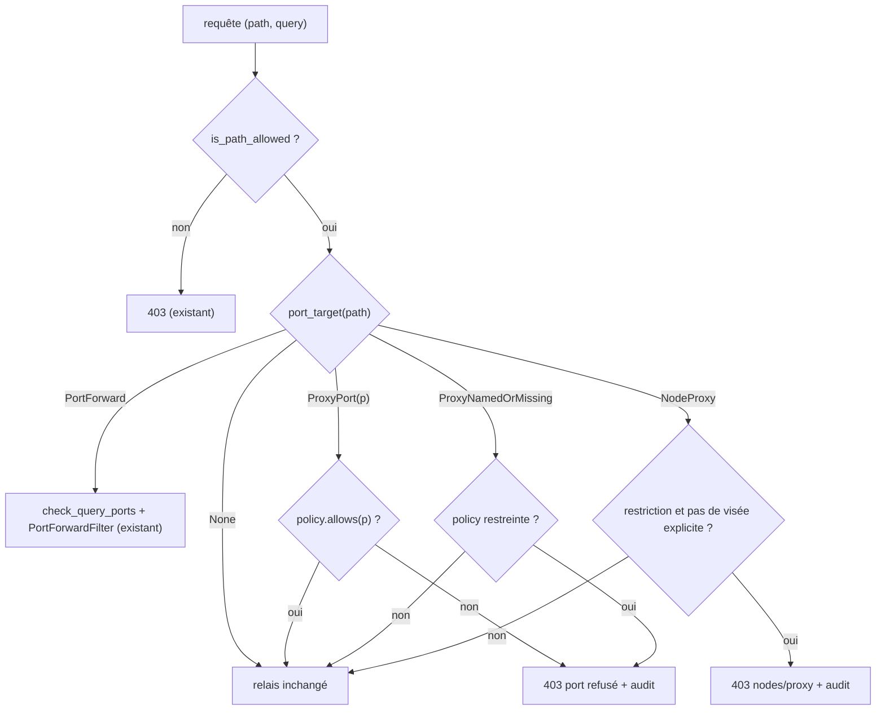
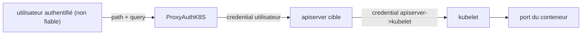

# RFC 0003 — Filtrage des ports : fermer les contournements

| Field       | Value                                                                  |
| ----------- | ---------------------------------------------------------------------- |
| Status      | Draft                                                                  |
| Short       | Filtrage des ports, angles morts                                       |
| Settles     | `allowed_ports` s'applique à tous les chemins qui ouvrent un port d'un pod, d'un service ou d'un nœud, pas seulement `pods/{name}/portforward` |
| Author      | Max Batleforc <maxleriche.60@gmail.com>                                |
| Co-author   | Claude Opus 5.5                                                        |
| Created     | 2026-10-17                                                             |
| Supersedes  | —                                                                      |
| Issue       | [#265 — Filter Port Forward by port](https://github.com/batleforc/ProxyAuthK8S/issues/265) |
| Touches     | `libs/server/crd/src/security/{mod.rs,allowed_crd_configuration.rs,allowed_path_configuration_enum.rs,port_range.rs}`, `libs/server/api/src/cluster/redirect/kube_redirect.rs`, `…/kube_redirect/{upgrade.rs,port_forward.rs,standard.rs}`, `…/redirect/audit.rs`, CRD générée, `.docs/content/docs/{security,crds}.mdx` |
| Risk        | medium                                                                 |

> **Constat préalable : #265 est déjà livré dans son périmètre littéral.**
> `AllowedPathConfiguration.allowed_ports`
> (`crd/src/security/allowed_path_configuration.rs:101`), `PortSpec` / `PortPolicy`
> (`port_range.rs:27,59`), `SecurityConfiguration::port_forward_policy`
> (`security/mod.rs`), le contrôle de la query (`port_forward::check_query_ports`)
> et l'inspection SPDY-dans-websocket (`PortForwardFilter`, `SpdyInspector`) sont
> en place depuis `a5688d5`. Ils sont documentés dans `security.mdx:471-512`. Cette
> RFC traite donc **ce que la fonctionnalité laisse passer**. L'issue #265 peut être
> fermée en pointant vers cette RFC.

---

## 1. Summary

Aujourd'hui, un opérateur qui restreint les ports d'un port-forward avec
`allowed_ports` croit avoir fermé l'accès aux autres ports des pods. Trois
chemins le contournent : une règle `Crd` qui couvre `pods` (elle lève la
restriction), les sous-ressources `…/{name}:{port}/proxy` des pods et des
services (non couvertes, comme le documente `security.mdx:510`), et
`nodes/{node}/proxy`, qui atteint l'API kubelet (`/portForward`, `/exec`) sans
passer par l'apiserver. Cette RFC applique la politique de ports à ces trois
chemins, ajoute `allowed_ports` aux règles `Crd`, et consigne chaque port ouvert
ou refusé dans l'audit.

### Before / after

```yaml
# Règles d'un ProxyKubeApi
security_config:
  enabled: true
  allowed_resources:
    - Path: { path: "/api/v1/namespaces/dev/pods/*/portforward", parametised: true, allowed_ports: ["8080"] }
    - Crd:  { group: "", version: v1, kind: Pod, namespace: { … dev … } }
```

```text
# aujourd'hui
kubectl port-forward pod/web 5432                       -> 101 (la règle Crd lève la restriction)
GET …/namespaces/dev/pods/web:5432/proxy/               -> 200 (proxy non couvert)
GET …/api/v1/nodes/n1/proxy/portForward/dev/web?port=5432 -> selon allowed_resources, sans contrôle de port

# avec cette RFC
kubectl port-forward pod/web 5432                       -> 403 "port 5432 is not allowed on this cluster"
GET …/namespaces/dev/pods/web:5432/proxy/               -> 403 (même politique)
GET …/api/v1/nodes/n1/proxy/…                           -> 403 dès qu'une restriction de port ou d'exec est en vigueur, sauf règle nodes/proxy explicite
```


Le diagramme montre que la restriction ne vaut que sur une des trois portes qui
mènent au même port de conteneur.

---

## 2. Motivation

1. **Une règle `Crd` sur `pods` annule `allowed_ports`.**
   `AllowedPathConfigurationEnum::port_policy` renvoie `PortPolicy::Any` pour
   toute règle `Crd` (`allowed_path_configuration_enum.rs:32-37`), et
   `AllowedCrdConfiguration::matches` accepte `…/{plural}[/...]`
   (`allowed_crd_configuration.rs:44-50`), donc aussi `pods/{name}/portforward`.
   Comme `port_forward_policy` fait l'union des règles qui correspondent et
   renvoie `Any` au premier `Any`, la règle `Crd` « Pod » qu'un opérateur écrit
   naturellement lève toute restriction.
2. **Le proxy apiserver ouvre n'importe quel port.** `GET
   …/pods/{name}:{port}/proxy/…` et `…/services/{name}:{port}/proxy/…` relaient
   du HTTP vers le port choisi. `is_port_forward_path` (`port_forward.rs:43`) ne
   reconnaît que `…/pods/{name}/portforward`. La doc l'avoue
   (`security.mdx:510-511`) et renvoie la charge à l'opérateur.
3. **`nodes/{node}/proxy` contourne l'apiserver.** Il atteint l'API kubelet, qui
   expose `/portForward/{ns}/{pod}` et `/exec/{ns}/{pod}/{container}`. Ni la
   politique de ports ni la future politique d'exec (RFC 0004) ne la voient.
4. **L'audit ne sait pas quel port a été ouvert.** `AuditContext::emit` ne trace
   que le `101` (`upgrade.rs`, `record_status`). Le port demandé et la fermeture
   par `PortForwardFilter` n'apparaissent que dans un `warn!` hors de la cible
   `audit` (`upgrade/tunnel.rs:81`).

---

## 3. Goals / non-goals

**Goals**

- Une seule politique de ports par requête, appliquée à `pods/x/portforward`,
  `pods/x:port/proxy`, `services/x:port/proxy` et `nodes/n:port/proxy`.
- `allowed_ports` disponible aussi sur les règles `Crd`.
- `nodes/{node}/proxy` est refusé quand une restriction de ports (ou d'exec, RFC
  0004) s'applique à l'utilisateur, sauf règle explicite qui le vise.
- Chaque port autorisé ou refusé produit un événement d'audit.

**Non-goals**

- **Rendre `allowed_resources` vide « fermé par défaut »** : c'est le
  comportement documenté (fail-open, `security.mdx` « risques acceptés »). Le
  changer casse tous les déploiements, ce qui mérite sa propre RFC (§15 Q4).
- **Filtrer par méthode HTTP (verbe)** : les règles `Path` ignorent la méthode.
  C'est un manque transverse, partagé avec la RFC 0004 (§15 Q5).
- **Filtrer les ports des `Service` de type NodePort/LoadBalancer** : ils ne
  passent pas par le proxy.
- **Remplacer le RBAC du cluster cible** : le proxy ajoute une restriction, il
  ne remplace pas `pods/portforward` dans RBAC.

---

## 4. User-facing design

### 4.1 Configuration

```yaml
allowed_resources:
  - Crd:
      group: ""
      version: v1
      kind: Pod
      namespace: { enabled: true, … }
      allowed_ports: ["8080", "9000-9100"]   # NOUVEAU, même sémantique que sur Path
  - Path:
      path: "/api/v1/nodes/**"                # vise explicitement nodes/proxy
      parametised: true
```

- `allowed_ports` absent signifie que la règle ne restreint pas les ports
  (inchangé). `[]` signifie qu'aucun port n'est autorisé (inchangé).
- **Changement de comportement** : une règle `Crd` sans `allowed_ports` reste
  `Any` (compatibilité), mais un avertissement est émis quand une autre règle
  restreint les ports sur le même chemin (§4.3). Ce défaut n'est pas le côté sûr
  ; l'option fermée est discutée en §15 Q1.

### 4.2 Behaviour rules

- **Extraction du port** (segment `{name}` décodé une fois, comme l'apiserver) :
  - `pods/{name}/portforward` : `ports`/`port` de la query (existant) ou
    en-têtes SPDY (existant) ;
  - `pods/{name}:{port}/proxy[/…]`, `pods/{scheme}:{name}:{port}/proxy[/…]`,
    `services/{name}:{port}/proxy[/…]`,
    `services/{scheme}:{name}:{port}/proxy[/…]` : `{port}` du segment. Un port
    **nommé** (`http`) ou absent est **refusé** si une restriction s'applique,
    car le proxy ne peut pas le résoudre sans lire l'objet ;
  - `nodes/{node}[:{port}]/proxy/…` : refusé si l'utilisateur a une restriction
    de ports ou d'exec, sauf si la règle qui autorise le chemin le vise
    explicitement (son motif contient `nodes` en littéral, pas via `**`).
- **Cas inintéressant** : sans restriction (aucune règle avec `allowed_ports`,
  ou `security_config.enabled: false`), rien ne change, y compris pour
  `nodes/proxy`.
- Union : comme aujourd'hui, les ports des règles qui correspondent
  s'additionnent ; une règle sans `allowed_ports` lève la restriction.

### 4.3 Validation

Refusé à l'admission (CEL) et à la réconciliation (`validate()`) :

| Condition | Rationale |
| --- | --- |
| `allowed_ports` invalide sur une règle `Crd` | Même `PORT_SPEC_RULE` (`port_range.rs:9`) que pour `Path` |
| `allowed_ports` sur une règle `Crd` dont le `kind` n'est ni `Pod` ni `Service` | Sans effet : on refuse plutôt que d'induire en erreur |

Avertissements :

| Condition | Behaviour | Surfaced in |
| --- | --- | --- |
| Une règle `Crd` `Pod`/`Service` sans `allowed_ports` coexiste avec une règle qui en a | union donc `Any` (inchangé) | nouveau champ `warnings: Vec<String>` de `ProxyKubeApiStatus` (`crd/src/status/mod.rs:7`, qui n'a aujourd'hui que `exposed`/`path`/`error`) + log de réconciliation |
| Une règle `Path` avec `**` couvre `nodes/` alors qu'une restriction existe | `nodes/proxy` refusé quand même (pas de visée explicite) | même champ `status.warnings` |

---

## 5. Architecture

### 5.1 Décision par requête



Le graphe montre que chaque chemin capable d'atteindre un port passe par une
seule classification, `port_target`, avant tout relais standard ou upgrade.

### 5.2 Invariant

`port_target` est appelé dans `redirect()` juste après `is_path_allowed`
(`kube_redirect.rs:221-249`), **avant** l'aiguillage `upgrade_redirect` /
`standard_redirect`. Aucune requête qui nomme un port ne peut donc atteindre
l'upstream sans que la politique ait été évaluée, quel que soit le transport
(HTTP simple, websocket, watch).

---

## 6. Detailed design

### 6.1 `libs/server/crd`

- `AllowedCrdConfiguration` : nouveau champ `allowed_ports:
  Option<Vec<PortSpec>>` (`#[schemars(length(max = 64))]`) et une règle CEL
  `!has(self.allowed_ports) || self.kind in ['Pod','Service']`.
- `AllowedPathConfigurationEnum::port_policy` : la branche `Crd` renvoie
  `config.port_policy()` au lieu de `PortPolicy::Any`.
- `SecurityConfiguration::port_forward_policy` est renommé `port_policy(path,
  user, groups)` (alias déprécié conservé une version), avec la même sémantique.
- `SecurityConfiguration::node_proxy_explicitly_allowed(path, user, groups) ->
  bool`.
- Diagnostic `shadowed_port_rules() -> Vec<String>`, utilisé par le contrôleur
  pour remplir `status.warnings` (nouveau champ).

### 6.2 `libs/server/api`

- `port_forward.rs` : nouvelle fonction `port_target(path) -> PortTarget` (`None
  | PortForward | ProxyPort(u16) | ProxyNamedOrMissing | NodeProxy`).
  `is_port_forward_path` devient un cas de `port_target`.
- `kube_redirect.rs` : après le contrôle d'allow-list, évaluer `port_target` et
  renvoyer `forbidden(...)` avec un événement d'audit. La branche `PortForward`
  garde le chemin actuel (`check_handshake`, `port_forward_filter`).
- `audit.rs` : `AuditContext` gagne `port: Option<u16>` et `decision:
  Option<&'static str>` (`port_allowed`, `port_denied`, `node_proxy_denied`,
  `session_closed_by_filter`).
- `upgrade/tunnel.rs:81` : la fermeture par le filtre émet un événement d'audit
  en plus du `warn!`.

### 6.P Proof against a real client

Client : `kubectl` 1.34 (exec et port-forward en websocket par défaut) et `curl`
8, contre la stack `compose.yaml` et un cluster k3d (`task kube3d:*`). Suite :
`libs/server/api/tests/proxy_upgrade.rs` (upstream TCP qui enregistre les
octets) et `proxy_security.rs` (wiremock).

1. `kubectl port-forward pod/web 8080` avec une règle `Crd` `allowed_ports:
   ["8080"]` donne une connexion établie, et l'audit indique `port_allowed
   port=8080`.
2. **Refus** : `kubectl port-forward pod/web 5432` avec la même règle. kubectl
   affiche `error: … 403 Forbidden … port 5432 is not allowed on this cluster`,
   et l'upstream enregistreur n'a **reçu aucun octet** (aucun `connect`).
3. **Refus** : `curl …/api/v1/namespaces/dev/pods/web:5432/proxy/` donne 403. Le
   mock wiremock n'a enregistré aucune requête.
4. **Refus** : `curl …/api/v1/namespaces/dev/services/web:http/proxy/` (port
   nommé) avec restriction donne 403.
5. **Refus** : `curl …/api/v1/nodes/n1/proxy/portForward/dev/web?port=8080` avec
   restriction et sans règle `nodes` explicite donne 403.
6. Sans aucune restriction : les 5 requêtes ci-dessus passent comme aujourd'hui
   (non-régression).

**Deliberately untouched**, so reviewers do not go looking :

- `SpdyInspector` / `WebsocketDecoder` : déjà corrects pour le port-forward.
- `upstream_to_client` (`tunnel.rs:101`) : les flux de port-forward sont ouverts
  par le client ; filtrer le sens descendant n'apporte rien.
- `PortPolicy::Any` quand `allowed_resources` est vide : fail-open documenté
  (§15 Q4).

---

## 7. Security

**Rating:** medium. La RFC durcit un contrôle d'accès existant ; un parseur de
segment est ajouté sur une entrée contrôlée par l'attaquant.

### 7.1 Threat model



| # | Threat (STRIDE) | Where | Mitigation | Residual risk |
| --- | --- | --- | --- | --- |
| T1 | Elevation : ouvrir un port interdit via une règle `Crd` | `port_policy` | branche `Crd` qui lit `allowed_ports` ; avertissement `status.warnings` | une `Crd` sans `allowed_ports` reste `Any` (compat) : §15 Q1 |
| T2 | Elevation : ouvrir un port via `pods/x:port/proxy` | `port_target` | `ProxyPort(p)` contrôlé | aucun |
| T3 | Elevation : port nommé ou absent qui se résout à un port interdit | `port_target` | refus si restreint | perte de fonction (ports nommés), accepté |
| T4 | Elevation : `nodes/n/proxy` vers kubelet `/portForward` ou `/exec` | `port_target` | `NodeProxy` refusé sous restriction | aucun |
| T5 | Tampering : encodage (`web%3A5432`, `pod%2Fx`, `..`) pour tromper `port_target` | parseur | décodage une fois comme l'apiserver + `path_has_no_traversal` (existant) ; fuzz | faible |
| T6 | Repudiation : port ouvert sans trace | audit | événements `port_*` sur la cible `audit` | aucun |

### 7.2 Authentication and authorisation

Aucune nouvelle surface : la vérification s'ajoute après l'authentification et
`proxy_group`. Un contournement ne donnerait que l'état actuel.

### 7.3 Input handling and injection

`port_target` lit le segment `{name}[:{port}]` décodé une fois, avec au plus 3
composants séparés par `:`. Le port doit être composé de chiffres ASCII et tenir
dans un `u16`, comme `check_port`. Le chemin est déjà borné par actix et la
query est inchangée. Une cible de fuzz est ajoutée pour `port_target` (§14).

### 7.4 Secrets and cryptography

Sans objet : aucun secret ni primitive cryptographique.

### 7.5 Abuse and resource exhaustion

Évaluation en O(segments) sans I/O, avant tout appel upstream : un refus coûte
moins cher qu'un relais.

### 7.6 Existing defences that still hold

Garde anti-traversée, refus de SPDY nu, refus des extensions websocket sur un
port-forward restreint, refus d'un corps sur un upgrade, mTLS vers l'upstream et
RBAC du cluster cible.

---

## 8. Supply chain

| Dependency / image / tool | Version | Why this one | Licence | Known CVEs (`task audit`) | Maintenance |
| --- | --- | --- | --- | --- | --- |
| aucune nouvelle dépendance | — | parseur écrit à la main (une vingtaine de lignes) | — | — | — |
| `cargo-fuzz` (dev, si absent) | dernière | cible de fuzz `port_target` | MIT/Apache-2.0 | à vérifier | actif |

- **Build et release** : la CRD générée change (nouveau champ). Le chart Helm
  embarque la CRD (`task gen`).

---

## 9. Data and privacy

| Data | Personal? | Where stored | Retention | Who can read it | Leaves the instance? |
| --- | --- | --- | --- | --- | --- |
| `port` dans l'événement d'audit | non | logs (cible `audit`) | politique de logs de l'opérateur | opérateurs | selon le collecteur de logs |
| `user`, `groups` (déjà présents) | oui | idem | idem | idem | idem |

Aucune nouvelle donnée personnelle : seul le numéro de port s'ajoute aux
événements existants.

---

## 10. Operability

### 10.1 Observability

- **Metrics** : `proxyauth_port_decisions_total{cluster, decision}` (decision
  parmi `allowed`, `denied`, `node_proxy_denied`, `closed_by_filter`). Pas de
  label de port ni d'utilisateur (cardinalité). Exporté par le pipeline
  OTel/Prometheus existant (`libs/server/trace`, endpoint `prometheus_metrics`
  de `api/src/metrics`).
- **Logs and audit trail** : chaque décision émet un événement sur la cible
  `audit` (§6.2).
- **Alerts** : aucune par défaut. Un pic de `denied` relève d'une règle d'alerte
  de l'opérateur.

### 10.2 Failure modes

| Failure | Detected by | Behaviour | Recovery |
| --- | --- | --- | --- |
| Segment `{name}` illisible | `port_target` | **fermé** (403) si une restriction s'applique, sinon relais (l'apiserver refusera) | corriger la requête |
| CRD ancienne (sans le champ) côté cluster | désérialisation | champ absent, donc `None` (compat) | `helm upgrade` de la CRD |

### 10.3 Performance and capacity

Négligeable : quelques comparaisons de chaînes par requête, uniquement sur les
chemins `proxy`/`portforward`.

---

## 11. Other concerns

- **Accessibility** : pas d'UI.
- **Internationalisation** : messages d'erreur API en anglais, comme les
  existants.
- **Compliance** : renforce le contrôle d'accès et l'audit (traçabilité ISO
  27001 A.8.15).
- **Licensing** : inchangé.
- **Documentation** : `security.mdx` (supprimer l'avertissement de la ligne 510,
  que cette RFC rend faux, et documenter `nodes/proxy`), `crds.mdx` régénéré,
  exemple dans `expose-cluster.mdx`.

---

## 12. Alternatives considered

| Alternative | Why rejected |
| --- | --- |
| Ne rien faire et documenter (état actuel, `security.mdx:510`) | Un opérateur qui écrit une règle `Crd` `Pod` perd la restriction sans le savoir (§2.1) |
| Refuser toute sous-ressource `proxy` dès qu'une restriction existe | Casse les usages légitimes (`pods/x:8080/proxy`) alors que le port est lisible |
| Résoudre les ports nommés en lisant le Pod/Service | Nécessite un `GET` upstream avec le credential de l'utilisateur, ajoute de la latence et une course (TOCTOU) |
| Faire de `Crd` sans `allowed_ports` un `Only([])` sous restriction | Plus sûr, mais cassant : option retenue pour la v1.0.0 ? (§15 Q1) |

---

## 13. Rollout and compatibility

- **Default behaviour** : sans `allowed_ports` nulle part, rien ne change.
- **Migration** : le champ est additif dans la CRD. **Changements de
  comportement** pour les clusters qui ont déjà une restriction : les requêtes
  `…:port/proxy` et `nodes/proxy` sont désormais filtrées. Ces changements sont
  annoncés dans le CHANGELOG (`feat!:`).
- **Operator prerequisites** : mettre à jour la CRD avant le serveur.
- **Rollback** : image précédente ; le champ inconnu est ignoré par l'ancienne
  version, ce qui rouvre T1 à T4.
- **Feature flag** : non. Le durcissement est le défaut.

---

## 14. Test plan

- **Unit** (`crd/src/security/*`) : `port_policy` avec les combinaisons
  `Crd`/`Path` ; CEL et `validate()` restent alignés (test existant de la ligne
  280, étendu).
- **Unit** (`api/.../port_forward.rs`) : table `port_target` (pods, services
  avec scheme, nodes, encodages, `..`).
- **Integration** (`api/tests/proxy_security.rs`, `proxy_upgrade.rs`) : §6.P
  points 1 à 6.
- **Security** : un test négatif par ligne T1 à T5 ; cible `cargo fuzz`
  `port_target`.
- **Audit** : `task audit` vert.
- **Existing suites** : `port_forward.rs:479+` (frames SPDY) inchangé.

---

## 15. Decisions and open questions

### Resolved

| # | Question | Decision |
| --- | --- | --- |
| — | #265 « filtrer le port-forward par port » est-il à faire ? | **Déjà livré** (`allowed_ports`, `a5688d5`). Cette RFC ne traite que les contournements. *(à confirmer et fermer l'issue)* |

### Still open

1. **Règle `Crd` sans `allowed_ports`** quand une restriction existe ailleurs :
   garder `Any` (compat, avec avertissement) ou passer à `Only([])` (sûr,
   cassant) ? Recommandation : avertissement maintenant, bascule fermée en
   v1.0.0 avec le nettoyage `allowed_ressources`.
2. **`nodes/proxy`** : refus implicite sous restriction (proposé) ou refus
   systématique sauf règle explicite, même sans restriction ?
3. **Ports nommés** : les refuser (proposé) ou proposer `allowed_port_names` ?
4. **Fail-open quand `allowed_resources` est vide** : RFC séparée pour un mode
   `default: deny` ?
5. **Règles sensibles au verbe** (`methods: [GET]`) : transverse aux RFC 0003 et
   0004, faut-il une RFC à part ?

---

## 16. Implementation phases

| Phase | Content |
| --- | --- |
| 1 | `port_target` + filtrage de `…:port/proxy` (pods, services) + audit `port_*` |
| 2 | `allowed_ports` sur `Crd` + CEL + `status.warnings` |
| 3 | `nodes/proxy` sous restriction |
| 4 | Docs (`security.mdx`, `crds.mdx`, exemple), CHANGELOG `feat!:` |

La phase 1 est utile seule. Le contrôle de chaque surface arrive dans la même
phase que sa détection.
