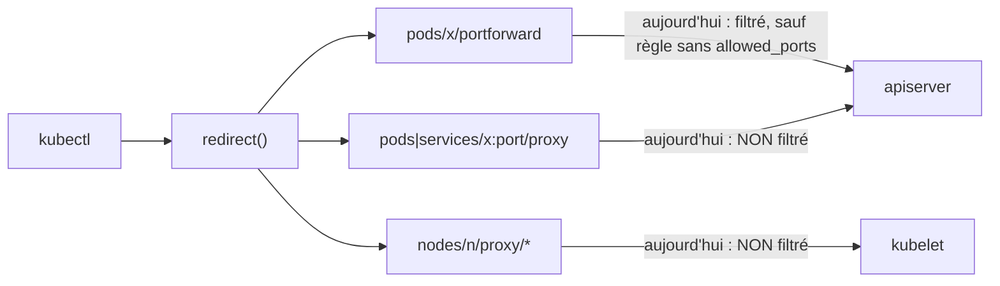
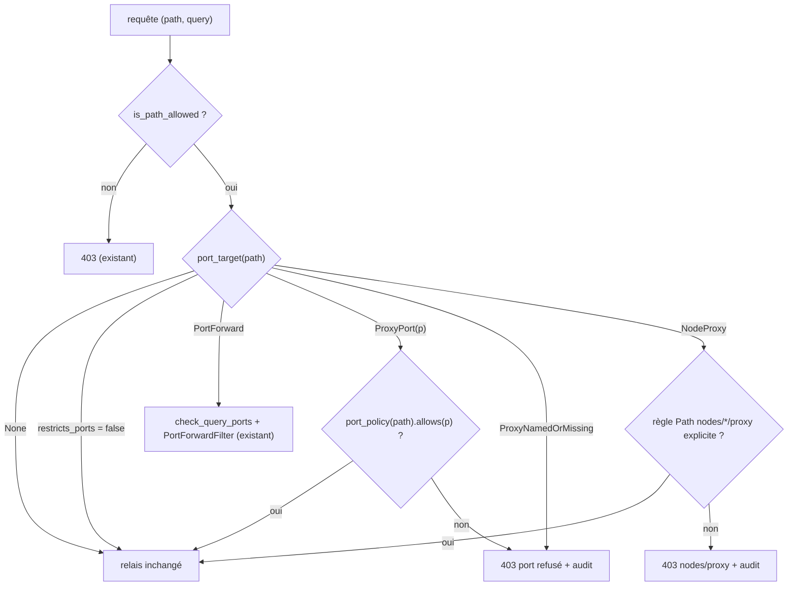
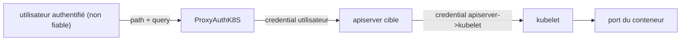

# RFC 0003 — Filtrage des ports : fermer les contournements

| Field       | Value                                                                  |
| ----------- | ---------------------------------------------------------------------- |
| Status      | In review                                                              |
| Short       | Filtrage des ports, angles morts                                       |
| Settles     | `allowed_ports` s'applique à tous les chemins qui ouvrent un port d'un pod, d'un service ou d'un nœud, pas seulement `pods/{name}/portforward`, et une règle sans `allowed_ports` ne lève plus une restriction |
| Author      | Max Batleforc <maxleriche.60@gmail.com>                                |
| Co-author   | Claude Opus 5.5                                                        |
| Created     | 2026-10-17                                                             |
| Supersedes  | —                                                                      |
| Issue       | à créer (« Port filtering bypasses ») ; [#265 — Filter Port Forward by port](https://github.com/batleforc/ProxyAuthK8S/issues/265) à fermer (déjà livrée) |
| Touches     | `libs/server/crd/src/security/{mod.rs,allowed_crd_configuration.rs,allowed_path_configuration_enum.rs,port_range.rs}`, `libs/server/crd/src/status/mod.rs`, `libs/server/api/src/cluster/redirect/kube_redirect.rs`, `…/kube_redirect/{upgrade.rs,port_forward.rs,standard.rs}`, `…/redirect/audit.rs`, CRD générée, `.docs/content/docs/{security,crds}.mdx` |
| Risk        | medium                                                                 |

> **Constat préalable : #265 est déjà livré dans son périmètre littéral.**
> `AllowedPathConfiguration.allowed_ports`
> (`crd/src/security/allowed_path_configuration.rs:101`), `PortSpec` / `PortPolicy`
> (`port_range.rs:27,59`), `SecurityConfiguration::port_forward_policy`
> (`security/mod.rs:175`), le contrôle de la query (`port_forward::check_query_ports`)
> et l'inspection SPDY-dans-websocket (`PortForwardFilter`, `SpdyInspector`) sont
> en place depuis `a5688d5`. Ils sont documentés dans `security.mdx:471-512`. Cette
> RFC traite donc **ce que la fonctionnalité laisse passer**. L'issue #265 est
> fermée en pointant vers cette RFC, et une nouvelle issue suit les contournements.

---

## 1. Summary

Aujourd'hui, un opérateur qui restreint les ports d'un port-forward avec
`allowed_ports` croit avoir fermé l'accès aux autres ports des pods. Trois
chemins le contournent : toute règle sans `allowed_ports` qui couvre aussi le
chemin (une règle `Crd` `Pod`, ou un `Path` `…/pods/**`) lève la restriction,
les sous-ressources `…/{name}:{port}/proxy` des pods et des services ne sont pas
couvertes (comme le documente `security.mdx:510`), et `nodes/{node}/proxy`
atteint l'API kubelet (`/portForward`, `/exec`) sans passer par l'apiserver.

Cette RFC fait trois choses. Dès qu'un utilisateur est soumis à une restriction
de ports, seules les règles qui listent explicitement des ports lui en accordent.
La politique de ports s'applique aux trois chemins. Enfin, `allowed_ports` est
ajouté aux règles `Crd`, et chaque port ouvert ou refusé est consigné dans
l'audit.

### Before / after

```yaml
# Règles d'un ProxyKubeApi
security_config:
  enabled: true
  allowed_resources:
    - Path: { path: "/api/v1/namespaces/dev/pods/*/portforward", parametised: true, allowed_ports: ["8080"] }
    - Crd:  { group: "", version: v1, kind: Pod, namespace: { … dev … } }
```

```text
# aujourd'hui
kubectl port-forward pod/web 5432                         -> 101 (la règle Crd lève la restriction)
GET …/namespaces/dev/pods/web:5432/proxy/                 -> 200 (proxy non couvert)
GET …/api/v1/nodes/n1/proxy/portForward/dev/web?port=5432 -> selon allowed_resources, sans contrôle de port

# avec cette RFC
kubectl port-forward pod/web 5432                         -> 403 "port 5432 is not allowed on this cluster"
GET …/namespaces/dev/pods/web:5432/proxy/                 -> 403 (la règle Crd n'accorde aucun port)
GET …/namespaces/dev/pods/web:8080/proxy/                 -> 403 (aucune règle avec allowed_ports ne couvre ce chemin)
GET …/api/v1/nodes/n1/proxy/…                             -> 403 (restriction en vigueur, aucune règle Path nodes/*/proxy)
```



Le diagramme montre que la restriction ne vaut que sur une des trois portes qui
mènent au même port de conteneur.

---

## 2. Motivation

1. **Une règle sans `allowed_ports` annule la restriction.**
   `AllowedPathConfigurationEnum::port_policy` renvoie `PortPolicy::Any` pour
   toute règle `Crd` (`allowed_path_configuration_enum.rs:32-37`), et
   `AllowedCrdConfiguration::matches` accepte `…/{plural}[/...]`
   (`allowed_crd_configuration.rs:44-50`), donc aussi `pods/{name}/portforward`.
   Comme `port_forward_policy` fait l'union des règles qui correspondent et
   renvoie `Any` au premier `Any` (`security/mod.rs:184`), la règle `Crd` « Pod »
   qu'un opérateur écrit naturellement lève toute restriction. Une règle `Path`
   `…/pods/**` sans `allowed_ports` produit le même effet.
2. **Le proxy apiserver ouvre n'importe quel port.** `GET
   …/pods/{name}:{port}/proxy/…` et `…/services/{name}:{port}/proxy/…` relaient
   du HTTP vers le port choisi. `is_port_forward_path` (`port_forward.rs:43`) ne
   reconnaît que `…/pods/{name}/portforward`. La doc l'avoue
   (`security.mdx:510-511`) et renvoie la charge à l'opérateur.
3. **`nodes/{node}/proxy` contourne l'apiserver.** Il atteint l'API kubelet, qui
   expose `/portForward/{ns}/{pod}` et `/exec/{ns}/{pod}/{container}`. Ni la
   politique de ports ni la future politique d'exec (RFC 0004) ne la voient.
4. **L'audit ne sait pas quel port a été ouvert.** `AuditContext::emit` ne trace
   que le `101` (`upgrade.rs`, `record_status`). Le port demandé et la fermeture
   par `PortForwardFilter` n'apparaissent que dans un `warn!` hors de la cible
   `audit` (`upgrade/tunnel.rs:81`).

---

## 3. Goals / non-goals

**Goals**

- Une seule politique de ports par requête, appliquée à `pods/x/portforward`,
  `pods/x:port/proxy`, `services/x:port/proxy` et `nodes/n[:port]/proxy`.
- Sous restriction, une règle sans `allowed_ports` n'accorde aucun port, quel
  que soit son type (`Path` ou `Crd`).
- `allowed_ports` disponible aussi sur les règles `Crd` `Pod` et `Service`.
- `nodes/{node}/proxy` est refusé quand une restriction de ports s'applique à
  l'utilisateur, sauf règle `Path` qui le vise explicitement (les RFC 0004 et
  0006 étendent la condition aux restrictions d'exec et de verbes).
- Le workspace `fuzz/` (modèle batlehub) et le compteur partagé
  `proxyauth_policy_decisions_total`, réutilisés par les RFC 0004 et 0006.
- Chaque port autorisé ou refusé produit un événement d'audit.

**Non-goals**

- **Rendre `allowed_resources` vide « fermé par défaut »** : c'est le
  comportement documenté (fail-open, `security.mdx` « risques acceptés »). Le
  changer casse tous les déploiements et relève d'une future RFC `default: deny`
  (§15).
- **Filtrer par méthode HTTP (verbe)** : traité par la RFC 0006.
- **Filtrer les ports des `Service` de type NodePort/LoadBalancer** : ils ne
  passent pas par le proxy.
- **Résoudre les ports nommés** (`web:http`) : refusés sous restriction (§4.2).
- **Sujets (`users`/`groups`) sur les règles `Path`** : une règle `Path` vaut
  pour tous, donc sa restriction aussi (§4.2). Future RFC.
- **Remplacer le RBAC du cluster cible** : le proxy ajoute une restriction, il
  ne remplace pas `pods/portforward` dans RBAC.

---

## 4. User-facing design

### 4.1 Configuration

```yaml
allowed_resources:
  - Crd:
      group: ""
      version: v1
      kind: Pod
      namespace: { enabled: true, … }
      allowed_ports: ["8080", "9000-9100"]   # NOUVEAU, même sémantique que sur Path
  - Path:
      path: "/api/v1/nodes/*/proxy/**"        # vise explicitement nodes/proxy
      parametised: true
```

- `allowed_ports: [...]` liste les ports qu'une règle accorde. `[]` n'en accorde
  aucun (inchangé).
- `allowed_ports` absent :
  - si **aucune** règle visible par l'utilisateur ne porte `allowed_ports`, les
    ports ne sont pas restreints (inchangé) ;
  - sinon, la règle **n'accorde aucun port** sur un chemin porteur de port.
    Elle continue d'autoriser ses autres chemins (`get pods`, `logs`…).
- **Changement de comportement** (`feat!:`) : une configuration qui mélange une
  règle avec `allowed_ports` et une règle sans (`Crd` `Pod`, `…/pods/**`) perdait
  silencieusement sa restriction ; elle est désormais restreinte. Un
  avertissement `status.warnings` signale chaque règle concernée (§4.3).

### 4.2 Behaviour rules

- **Restriction** : un utilisateur est *restreint* quand au moins une règle dont
  le sujet (utilisateur, groupes, namespaces) le concerne porte `allowed_ports`,
  quel que soit le chemin de cette règle :
  `SecurityConfiguration::restricts_ports(user, groups)`. Une règle `Path` n'a
  pas de sujet : une seule règle `Path` avec `allowed_ports` restreint donc
  **tous** les utilisateurs du cluster. Pour exempter quelqu'un, il faut
  aujourd'hui une règle `Crd` avec des sujets de namespace.
- **Ordre des contrôles** : la politique de ports est évaluée **avant** le
  contrôle « websocket seulement » de `check_handshake`. Le repli SPDY de
  kubectl ≥ 1.30 (déclenché par tout échec de la montée websocket, y compris un
  403) reçoit donc le même 403 avec sa raison, au lieu de « SPDY is not
  supported ». Seule une requête **conforme** en SPDY reçoit le 400.
- **Ports accordés** (utilisateur restreint) : l'union des `allowed_ports` des
  règles qui correspondent au chemin demandé **et** portent `allowed_ports`. Les
  règles qui correspondent sans `allowed_ports` ne contribuent rien.
- **Extraction du port** (segment `{name}` décodé une fois, comme l'apiserver) :
  - `pods/{name}/portforward` : `ports`/`port` de la query (existant) ou
    en-têtes SPDY (existant) ;
  - `pods/{name}:{port}/proxy[/…]`, `pods/{scheme}:{name}:{port}/proxy[/…]` :
    `{port}` est un port de conteneur ;
  - `services/{name}:{port}/proxy[/…]`,
    `services/{scheme}:{name}:{port}/proxy[/…]` : `{port}` est un **port du
    Service**, pas son `targetPort`. Seule une règle qui couvre le chemin
    `services/…` peut l'accorder ; une règle `pods` n'accorde jamais rien sur un
    Service ;
  - un port **nommé** (`http`), absent ou illisible est **refusé** sous
    restriction, car le proxy ne peut pas le résoudre sans lire l'objet. Le
    message est `403 "named or missing port is not allowed on this cluster"` ;
  - `nodes/{node}[:{port}]/proxy[/…]` : refusé sous restriction, sauf si une
    règle `Path` qui autorise le chemin le **vise explicitement**, c'est-à-dire
    que son motif contient, à leur position, les segments littéraux `nodes` et
    `proxy` (par exemple `/api/v1/nodes/*/proxy/**`). Une règle `Crd` `Node` ou
    un `Path` `/api/v1/nodes/**` ne comptent pas. Le message est `403 "nodes/proxy
    is not allowed while ports are restricted"`.
- **Cas sans restriction** (aucune règle avec `allowed_ports`, ou
  `security_config.enabled: false`) : rien ne change, y compris pour
  `nodes/proxy`.

### 4.3 Validation

Refusé à l'admission (CEL) et à la réconciliation (`validate()`) :

| Condition | Rationale |
| --- | --- |
| `allowed_ports` invalide sur une règle `Crd` | Même `PORT_SPEC_RULE` (`port_range.rs:9`) que pour `Path` |
| `allowed_ports` sur une règle `Crd` dont le `kind` n'est ni `Pod` ni `Service` | Sans effet (l'accès kubelet passe par une règle `Path` explicite) : on refuse plutôt que d'induire en erreur |

Avertissements, dans un nouveau champ `warnings: Vec<String>` de
`ProxyKubeApiStatus` (`crd/src/status/mod.rs`, qui n'a aujourd'hui que
`exposed`/`path`/`error`) et dans le log de réconciliation :

| Condition | Behaviour | Message |
| --- | --- | --- |
| Une restriction existe et une règle sans `allowed_ports` couvre des chemins porteurs de port (`Crd` `Pod`/`Service`, `Path` qui couvre `pods/`, `services/`) | la règle n'accorde aucun port | `rule N covers port-bearing paths without allowed_ports: it grants no port while ports are restricted` |
| Une restriction existe et une règle couvre `nodes/` sans viser `nodes/*/proxy` (`Crd` `Node`, `Path` `nodes/**`) | `nodes/proxy` refusé | `rule N covers nodes/ but not nodes/*/proxy explicitly: nodes/proxy stays denied` |

---

## 5. Architecture

### 5.1 Décision par requête



Le graphe montre que chaque chemin capable d'atteindre un port passe par une
seule classification, `port_target`, avant tout relais standard ou upgrade. Les
branches `ProxyNamedOrMissing` et `NodeProxy` ne sont évaluées que si
l'utilisateur est restreint.

### 5.2 Invariant

`port_target` est appelé dans `redirect()` juste après `is_path_allowed`
(`kube_redirect.rs:221-249`), **avant** l'aiguillage `upgrade_redirect` /
`standard_redirect`. Aucune requête qui nomme un port ne peut donc atteindre
l'upstream sans que la politique ait été évaluée, quel que soit le transport
(HTTP simple, websocket, watch).

---

## 6. Detailed design

### 6.1 `libs/server/crd`

- `AllowedCrdConfiguration` : nouveau champ `allowed_ports:
  Option<Vec<PortSpec>>` (`#[schemars(length(max = 64))]`) et une règle CEL
  `!has(self.allowed_ports) || self.kind in ['Pod','Service']`.
- `AllowedPathConfigurationEnum::port_policy` renvoie `Option<PortPolicy>` :
  `None` quand la règle n'a pas d'`allowed_ports`, que ce soit `Path` ou `Crd`.
- `SecurityConfiguration::restricts_ports(user, groups) -> bool` : vrai dès
  qu'une règle visible par l'utilisateur porte `allowed_ports`.
- `SecurityConfiguration::port_forward_policy` est renommé `port_policy(path,
  user, groups)`, **sans alias** (seul appelant : `kube_redirect.rs:246`).
  Nouvelle sémantique : `Any` si `!restricts_ports`, sinon `Only(union des
  allowed_ports explicites des règles qui correspondent)`.
- `SecurityConfiguration::node_proxy_explicitly_allowed(path, user, groups) ->
  bool` : une règle `Path` correspondante dont le motif a `nodes` et `proxy` en
  segments littéraux à leur position.
- `SecurityConfiguration::port_warnings() -> Vec<String>` (§4.3), utilisé par le
  contrôleur pour remplir `status.warnings`.

### 6.2 `libs/server/api`

- `port_forward.rs` : nouvelle fonction `port_target(path) -> PortTarget` (`None
  | PortForward | ProxyPort(u16) | ProxyNamedOrMissing | NodeProxy`).
  `is_port_forward_path` devient un cas de `port_target`.
- `kube_redirect.rs` : après le contrôle d'allow-list, si `restricts_ports`,
  évaluer `port_target` et renvoyer `forbidden(...)` avec un événement d'audit.
  La branche `PortForward` garde le chemin actuel (`check_handshake`,
  `port_forward_filter`).
- `upgrade.rs` : `check_handshake` évalue la politique de ports **avant** le
  contrôle websocket et le refus de SPDY (`upgrade.rs:135-139`), pour que le
  repli SPDY de kubectl reçoive la raison du refus (§4.2). La RFC 0004 y ajoute
  la politique exec.
- `audit.rs` : `AuditContext` gagne `port: Option<u16>` et `decision:
  Option<&'static str>` (`port_allowed`, `port_denied`, `node_proxy_denied`,
  `session_closed_by_filter`).
- `upgrade/tunnel.rs:81` : la fermeture par le filtre émet un événement d'audit
  en plus du `warn!`.

### 6.P Proof against a real client

Client : `kubectl` 1.34 (exec et port-forward en websocket par défaut) et `curl`
8, contre la stack `compose.yaml` et un cluster k3d (`task kube3d:*`). Suite :
`libs/server/api/tests/proxy_upgrade.rs` (upstream TCP qui enregistre les
octets) et `proxy_security.rs` (wiremock). Configuration : celle du §1, plus une
règle `Crd` `Pod` `allowed_ports: ["8080"]` pour le point 1.

1. `kubectl port-forward pod/web 8080` avec une règle `Crd` `allowed_ports:
   ["8080"]` donne une connexion établie, et l'audit indique `port_allowed
   port=8080`.
2. **Refus** : `kubectl port-forward pod/web 5432` avec la configuration du §1
   (règle `Crd` sans `allowed_ports`). kubectl affiche `error: … 403 Forbidden …
   port 5432 is not allowed on this cluster` (et **non** « SPDY is not
   supported », y compris après son repli SPDY), et l'upstream enregistreur n'a
   **reçu aucun octet** (aucun `connect`), ni pour le websocket, ni pour le
   repli.
3. **Refus** : `curl …/api/v1/namespaces/dev/pods/web:5432/proxy/` donne 403. Le
   mock wiremock n'a enregistré aucune requête.
4. **Refus** : `curl …/api/v1/namespaces/dev/services/web:http/proxy/` (port
   nommé) sous restriction donne 403.
5. **Refus** : `curl …/api/v1/nodes/n1/proxy/portForward/dev/web?port=8080` sous
   restriction, avec une règle `Path` `/api/v1/nodes/**`, donne 403, et
   `status.warnings` contient l'avertissement `nodes/`.
6. Avec une règle `Path` `/api/v1/nodes/*/proxy/**`, la requête du point 5
   passe.
7. Sans aucune restriction : les requêtes 2 à 5 passent comme aujourd'hui
   (non-régression).

**Deliberately untouched**, so reviewers do not go looking :

- `SpdyInspector` / `WebsocketDecoder` : déjà corrects pour le port-forward.
- `upstream_to_client` (`tunnel.rs:101`) : les flux de port-forward sont ouverts
  par le client ; filtrer le sens descendant n'apporte rien.
- `PortPolicy::Any` quand `allowed_resources` est vide : fail-open documenté
  (§3).

---

## 7. Security

**Rating:** medium. La RFC durcit un contrôle d'accès existant ; un parseur de
segment est ajouté sur une entrée contrôlée par l'attaquant.

### 7.1 Threat model



| # | Threat (STRIDE) | Where | Mitigation | Residual risk |
| --- | --- | --- | --- | --- |
| T1 | Elevation : ouvrir un port interdit via une règle sans `allowed_ports` (`Crd` `Pod`, `Path` `pods/**`) | `port_policy` | sous restriction, seules les règles avec `allowed_ports` explicites accordent des ports ; avertissement `status.warnings` | aucun |
| T2 | Elevation : ouvrir un port via `pods/x:port/proxy` | `port_target` | `ProxyPort(p)` contrôlé | aucun |
| T3 | Elevation : port nommé ou absent qui se résout à un port interdit | `port_target` | refus sous restriction | perte de fonction (ports nommés), acceptée |
| T4 | Elevation : `nodes/n/proxy` vers kubelet `/portForward` ou `/exec` | `port_target` | `NodeProxy` refusé sous restriction sauf règle `Path` `nodes/*/proxy` explicite | aucun |
| T5 | Tampering : encodage (`web%3A5432`, `web%253A5432`, `pod%2Fx`, `..`) pour tromper `port_target` | parseur | décodage une fois comme l'apiserver + `path_has_no_traversal` (existant) ; table de tests exhaustive ; cible de fuzz ; toute erreur de parsing donne 403 sous restriction | faible |
| T6 | Repudiation : port ouvert sans trace | audit | événements `port_*` sur la cible `audit` | aucun |
| T7 | Elevation : `services/web:80/proxy` autorisé, mais le Service envoie vers un `targetPort` interdit | sémantique Service | `allowed_ports` d'une règle `services` désigne des ports de Service ; documenté | qui peut écrire un Service choisit son `targetPort` : à couvrir par le RBAC (`services` en écriture) du cluster cible |

### 7.2 Authentication and authorisation

Aucune nouvelle surface : la vérification s'ajoute après l'authentification et
`proxy_group`. Un contournement ne donnerait que l'état actuel.

### 7.3 Input handling and injection

`port_target` lit le segment `{name}[:{port}]` décodé une fois, avec au plus 3
composants séparés par `:`. Le port doit être composé de chiffres ASCII et tenir
dans un `u16`, comme `check_port`. Le chemin est déjà borné par actix et la
query est inchangée. Une table de tests et une cible de fuzz couvrent les
entrées hostiles (§14).

### 7.4 Secrets and cryptography

Sans objet : aucun secret ni primitive cryptographique.

### 7.5 Abuse and resource exhaustion

Évaluation en O(segments + règles) sans I/O, avant tout appel upstream : un refus
coûte moins cher qu'un relais.

### 7.6 Existing defences that still hold

Garde anti-traversée, refus de SPDY nu, refus des extensions websocket sur un
port-forward restreint, refus d'un corps sur un upgrade, mTLS vers l'upstream et
RBAC du cluster cible.

---

## 8. Supply chain

| Dependency / image / tool | Version | Why this one | Licence | Known CVEs (`task audit`) | Maintenance |
| --- | --- | --- | --- | --- | --- |
| aucune dépendance runtime | — | parseur écrit à la main (une vingtaine de lignes) | — | — | — |
| `libfuzzer-sys` (workspace `fuzz/` séparé, dev) | 0.4.13 (2026-06-04) | cibles de fuzz, comme batlehub | MIT/Apache-2.0 | aucune advisory RustSec (vérifié le 2026-10-17) ; `task audit` étendu à `fuzz/Cargo.lock` | actif |
| `arbitrary` (workspace `fuzz/`, dev) | 1.5.0 (2026-10-06), feature `derive` | entrées structurées | MIT/Apache-2.0 | aucune advisory RustSec (vérifié le 2026-10-17) | actif |
| `cargo-fuzz` (outil, nightly) | 0.13.2 (2026-06-09), via `taiki-e/install-action` en CI | lance les cibles | MIT/Apache-2.0 | — | actif |

- **Fuzz, modèle batlehub** : workspace `fuzz/` séparé (son propre
  `Cargo.lock`), jamais compilé par `cargo check --workspace`. Deux niveaux :
  - à chaque PR, `task fuzz:check` (`cargo check --manifest-path
    fuzz/Cargo.toml --bins --all-targets`, toolchain **stable**) garantit que
    les cibles compilent ;
  - un job CI nightly (cron) lance `task fuzz:run TARGET=…` 60 s par cible
    (`cargo +nightly fuzz run --target <host> …`, `ASAN_OPTIONS=detect_leaks=0`),
    avec cache de corpus, `cargo fuzz cmin`, et téléversement de
    `fuzz/artifacts/` en cas d'échec.
  `--target <host>` est nécessaire parce que le cargo-fuzz précompilé est musl,
  sans ASan ; `detect_leaks=0` parce que LeakSanitizer ne démarre pas sous le
  `ptrace_scope` du runner et laisse un artefact vide qui ressemble à un crash.
  Les tâches vont dans un nouveau `.tasks/fuzz.yaml`, inclus sous l'espace de
  noms `fuzz` (`fuzz:check`, `fuzz:run`), comme les autres fichiers `.tasks/`
  de ce dépôt. Pas `.tasks/rust.yaml` : l'espace de noms `rust:` est réservé au
  Taskfile distant du kit (RFC 0005). `task lint` dépend de `fuzz:check`, pour
  que toute CI qui lance `task lint` (y compris `checks.yml` du kit) compile
  les cibles. `task audit` couvre aussi `fuzz/Cargo.lock` (`cargo audit -f
  fuzz/Cargo.lock`, ou `cargo deny --manifest-path fuzz/Cargo.toml` après la
  RFC 0005), puisque `cargo audit` à la racine ne voit pas ce workspace séparé.
- **Build et release** : la CRD générée change (nouveaux champs `allowed_ports`
  sur `Crd` et `status.warnings`). Le chart Helm embarque la CRD (`task gen`).

---

## 9. Data and privacy

| Data | Personal? | Where stored | Retention | Who can read it | Leaves the instance? |
| --- | --- | --- | --- | --- | --- |
| `port` dans l'événement d'audit | non | logs (cible `audit`) | politique de logs de l'opérateur | opérateurs | selon le collecteur de logs |
| `user`, `groups` (déjà présents) | oui | idem | idem | idem | idem |

Aucune nouvelle donnée personnelle : seul le numéro de port s'ajoute aux
événements existants.

---

## 10. Operability

### 10.1 Observability

- **Metrics** : nouveau compteur **partagé**
  `proxyauth_policy_decisions_total{cluster, policy, decision}`, créé ici et
  repris par les RFC 0004 (`policy="exec"`) et 0006 (`policy="verb"`). Ici
  `policy="port"`, et `decision` parmi `allowed`, `denied`,
  `node_proxy_denied`, `closed_by_filter`. Pas de label de port ni
  d'utilisateur (cardinalité). `api/src/metrics.rs` ne contient aujourd'hui
  qu'un histogramme HTTP : le compteur est créé sur le même `Meter` et exporté
  par l'endpoint Prometheus existant.
- **Logs and audit trail** : chaque décision émet un événement sur la cible
  `audit` (§6.2).
- **Status** : `status.warnings` du `ProxyKubeApi` (§4.3).
- **Alerts** : aucune par défaut. Un pic de `denied` relève d'une règle d'alerte
  de l'opérateur.

### 10.2 Failure modes

| Failure | Detected by | Behaviour | Recovery |
| --- | --- | --- | --- |
| Segment `{name}` illisible | `port_target` | **fermé** (403) sous restriction, sinon relais (l'apiserver refusera) | corriger la requête |
| CRD ancienne (sans le champ) côté cluster | désérialisation | champ absent, donc `None` | `helm upgrade` de la CRD |
| Configuration mixte qui perd des accès après mise à jour | `status.warnings`, `403` | refus | ajouter `allowed_ports` à la règle signalée |

### 10.3 Performance and capacity

Négligeable : quelques comparaisons de chaînes par requête, uniquement sur les
chemins `proxy`/`portforward`.

---

## 11. Other concerns

- **Accessibility** : pas d'UI.
- **Internationalisation** : messages d'erreur API en anglais, comme les
  existants.
- **Compliance** : renforce le contrôle d'accès et l'audit (traçabilité ISO
  27001 A.8.15).
- **Licensing** : inchangé.
- **Documentation** : `security.mdx` (remplacer l'avertissement de la ligne 510,
  que cette RFC rend faux, documenter la règle « sans `allowed_ports` = aucun
  port sous restriction », les ports nommés, `nodes/proxy` et la sémantique des
  ports de Service avec T7), `crds.mdx` régénéré, exemple dans
  `expose-cluster.mdx`.

---

## 12. Alternatives considered

| Alternative | Why rejected |
| --- | --- |
| Ne rien faire et documenter (état actuel, `security.mdx:510`) | Un opérateur qui écrit une règle `Crd` `Pod` perd la restriction sans le savoir (§2.1) |
| Garder `Any` pour une règle sans `allowed_ports` et seulement avertir | Laisse T1 ouvert dans le cas même qui motive la RFC ; l'avertissement ne protège rien |
| Basculer vers « aucun port » seulement en v1.0.0 | Repousse la correction d'une faille ; le `feat!:` est déjà nécessaire pour le proxy et `nodes/proxy` |
| Politique calculée par chemin (règles qui correspondent seulement) | `nodes/n/proxy` ne correspond jamais à `pods/*/portforward` : il ne serait jamais restreint |
| Refuser toute sous-ressource `proxy` dès qu'une restriction existe | Casse les usages légitimes (`pods/x:8080/proxy`) alors que le port est lisible |
| Résoudre les ports nommés en lisant le Pod/Service, ou `allowed_port_names` | `GET` upstream avec le credential de l'utilisateur, latence, course (TOCTOU) ; un nom est choisi par qui écrit le pod et ne prouve rien |
| Refuser `nodes/proxy` systématiquement, même sans restriction | Casse les clusters qui n'utilisent pas `allowed_ports`, qui ne devaient pas changer |
| Table de tests seule, sans fuzz (premier grill) | Abandonné au grill de la RFC 0006 : le modèle batlehub (compile en stable à chaque PR, fuzz nightly) lève l'objection nightly/CI, et l'infrastructure sert aux RFC 0004 et 0006 |

---

## 13. Rollout and compatibility

- **Default behaviour** : sans `allowed_ports` nulle part, rien ne change.
- **Migration** : les champs sont additifs dans la CRD. **Changements de
  comportement** pour les clusters qui ont déjà une restriction : les règles sans
  `allowed_ports` n'accordent plus de ports, et les requêtes `…:port/proxy` et
  `nodes/proxy` sont filtrées. Ces changements sont annoncés dans le CHANGELOG
  (`feat!:`), avec la marche à suivre (`status.warnings`).
- **Operator prerequisites** : mettre à jour la CRD avant le serveur.
- **Rollback** : image précédente ; le champ inconnu est ignoré par l'ancienne
  version, ce qui rouvre T1 à T4.
- **Feature flag** : non. Le durcissement est le défaut.

---

## 14. Test plan

- **Unit** (`crd/src/security/*`) : `restricts_ports` et `port_policy` avec les
  combinaisons `Crd`/`Path`, avec et sans `allowed_ports` ;
  `node_proxy_explicitly_allowed` (`nodes/*/proxy/**` oui, `nodes/**` et `Crd`
  `Node` non) ; `port_warnings` ; CEL et `validate()` restent alignés (test
  existant de la ligne 280, étendu).
- **Unit** (`api/.../port_forward.rs`) : table `port_target` qui couvre pods et
  services avec et sans scheme, nodes avec et sans port, encodage simple et
  double (`%3A`, `%253A`), `..`, 0, 1 et 3 `:`, port supérieur à 65535, port
  vide, port non ASCII ; plus un test « toute erreur de parsing donne 403 sous
  restriction ».
- **Fuzz** : création du workspace `fuzz/`, des tâches `fuzz:check` et `fuzz:run`
  (`.tasks/fuzz.yaml`), de leur branchement dans `task lint` et `task audit`,
  et du job nightly ; cible `fuzz_port_target` (entrées `arbitrary`)
  qui vérifie le déterminisme, l'absence de panic, et qu'un `ProxyPort(p)`
  renvoyé correspond au port du segment décodé.
- **Integration** (`api/tests/proxy_security.rs`, `proxy_upgrade.rs`) : §6.P
  points 1 à 7.
- **Security** : un test négatif par ligne T1 à T5.
- **Audit** : `task audit` vert.
- **Existing suites** : `port_forward.rs:479+` (frames SPDY) inchangé.

---

## 15. Decisions and open questions

### Resolved

| # | Question | Decision |
| --- | --- | --- |
| R1 | #265 « filtrer le port-forward par port » est-il à faire ? | **Déjà livré** (`allowed_ports`, `a5688d5`). On ferme #265 en pointant vers cette RFC et on crée une issue « Port filtering bypasses » |
| R2 | Règle sans `allowed_ports` quand une restriction existe : `Any` ou aucun port ? | **Aucun port, dès cette RFC**, pour `Path` comme pour `Crd`. Avertissement `status.warnings` sur chaque règle concernée |
| R3 | Que veut dire « une restriction s'applique » ? | **Par utilisateur** : une règle visible par l'utilisateur porte `allowed_ports`, quel que soit son chemin (`restricts_ports`) |
| R4 | `nodes/proxy` : refus implicite ou systématique ? | **Implicite** : refusé sous restriction de ports (la RFC 0004 ajoute exec, la RFC 0006 les verbes). Sans restriction, inchangé |
| R5 | Qu'est-ce qu'une visée explicite de `nodes/proxy` ? | Une règle `Path` dont le motif contient les segments littéraux `nodes` et `proxy` à leur position. `Crd` `Node` et `nodes/**` ne comptent pas |
| R6 | Ports nommés : refus ou `allowed_port_names` ? | **Refus** sous restriction |
| R7 | `allowed_ports` sur `Crd` : quels `kind` ? | `Pod` et `Service` seulement |
| R8 | Sens de `allowed_ports` sur un Service | **Ports du Service** ; seule une règle couvrant `services/…` les accorde. Le `targetPort` relève du RBAC (T7) |
| R9 | Fail-open quand `allowed_resources` est vide | **Hors périmètre** : future RFC `default: deny` |
| R10 | Règles sensibles au verbe | **Traité par la RFC 0006** |
| R11 | Alias déprécié de `port_forward_policy` | **Aucun** : renommage direct, un seul appelant |
| R12 | Fuzz de `port_target` | ~~Table de tests seule~~ **Révisé (grill de la RFC 0006)** : table de tests **et** fuzz sur le modèle batlehub ; cette RFC crée le workspace `fuzz/`, les tâches et le job nightly |
| R13 | Repli SPDY de kubectl (grill de la RFC 0004) | **Politiques avant le contrôle websocket, livré ici** (phase 1) : sans cela, chaque refus de port s'affiche « SPDY is not supported ». La RFC 0004 en hérite |
| R14 | Une règle `Path` restreint-elle tout le monde ? (grill de la RFC 0004) | **Oui**, documenté ; sujets sur les règles `Path` : future RFC |
| R15 | Métrique (grill de la RFC 0006) | **Compteur partagé** `proxyauth_policy_decisions_total{policy, decision}` créé ici |

### Still open

Aucune.

---

## 16. Implementation phases

| Phase | Content |
| --- | --- |
| 1 | `port_target`, `restricts_ports`, nouvelle union (R2), `allowed_ports` sur `Crd` (avec CEL), filtrage de `…:port/proxy` (pods, services), politiques avant le contrôle websocket (R13), audit `port_*`, compteur partagé (R15), workspace `fuzz/` + `fuzz:check` + job nightly + cible `port_target` (R12) |
| 2 | `nodes/proxy` sous restriction (R4, R5) et `status.warnings` |
| 3 | Docs (`security.mdx`, `crds.mdx`, exemple), CHANGELOG `feat!:` |

La phase 1 est utile seule : sans la nouvelle union, filtrer `…:port/proxy` ne
servirait à rien dès qu'une règle `Crd` `Pod` ou `pods/**` existe, c'est
pourquoi les deux arrivent ensemble.

---

## 17. Implementation notes

Preuve sur le banc de la RFC 0009 (k3s 1.35, kubectl 1.37, 2026-10-18) :
`tests/integration/tests/rfc0003.rs`, les sept points verts.

- **Point 2, écart avec le texte.** kubectl 1.37 tunnelle SPDY dans une
  websocket : le port est dans l'en-tête de chaque flux, et kubectl n'ouvre
  un flux qu'à la première connexion locale. La session est alors déjà
  montée (101) ; le proxy ne peut plus répondre 403, il la ferme, et kubectl
  affiche `error: lost connection to pod`, pas la raison de la politique. Le
  refus tient (le port n'est jamais atteint) ; le message promis ne s'affiche
  que pour un refus à l'upgrade (ports dans l'URL, repli SPDY). Le test
  vérifie ce qui tient : sortie en erreur, port jamais atteint, audit.
- **Audit corrigé.** Un port refusé en cours de session était consigné
  `session_closed_by_filter` sans port, comme un trafic illisible. Il l'est
  maintenant `port_denied` avec le port (`PortForwardFilter::refused_port`) ;
  `session_closed_by_filter` reste pour ce que le filtre ne sait pas lire.
- **Point 4** est prouvé avec une règle `Crd` `Service` qui autorise le port
  80 : `services/web:http/proxy` est refusé (port nommé) et
  `services/web:80/proxy` passe, ce qui isole la règle du port nommé.

