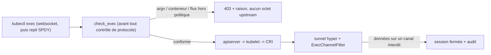
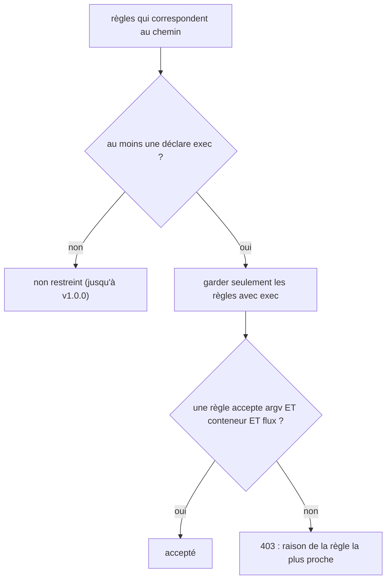
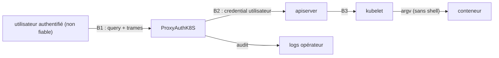

# RFC 0004 — Filtrage d'exec et d'attach (commande, conteneur, flux)

| Field       | Value                                                                  |
| ----------- | ---------------------------------------------------------------------- |
| Status      | In review                                                              |
| Short       | Filtrage exec / attach                                                 |
| Settles     | Ce que le proxy peut garantir sur `pods/{name}/exec` et `/attach` : commandes autorisées, conteneurs, flux, et une trace de session |
| Author      | Max Batleforc <maxleriche.60@gmail.com>                                |
| Co-author   | Claude Opus 5.5                                                        |
| Created     | 2026-10-17                                                             |
| Supersedes  | —                                                                      |
| Issue       | — (à créer)                                                            |
| Depends on  | RFC 0003 (`status.warnings`, `nodes/proxy`), RFC 0006 (règles sensibles au verbe), RFC 0007 (migration vers axum/hyper) |
| Touches     | `libs/server/crd/src/security/*` (nouveau `exec_policy.rs`), `libs/server/api/src/cluster/redirect/kube_redirect/{upgrade.rs,upgrade/tunnel.rs,port_forward.rs}`, nouveaux `kube_redirect/{exec.rs,websocket.rs}`, `…/redirect/audit.rs`, CRD générée, `.docs/content/docs/{security,crds}.mdx` |
| Risk        | high                                                                   |

> **Document de référence** (plus de 4 000 mots). Pour une lecture rapide : §1,
> §3, §4.1, §4.2, §7.1 et §15.

---

## 1. Summary

Aujourd'hui, une requête `pods/{name}/exec` ou `/attach` autorisée par
`allowed_resources` est relayée octet pour octet : le proxy ne lit ni la
commande, ni le conteneur, ni les flux demandés. Cette RFC ajoute une politique
`exec` aux règles d'`allowed_resources`, en trois couches de force décroissante,
présentées comme telles à l'opérateur :

1. **Contrôles avant connexion (garantis)** : liste blanche des commandes
   (`argv` complet), conteneurs autorisés, et flux autorisés (`stdin`, `tty`).
   Ils sont lus dans la query, avant tout octet vers l'upstream, et **une
   requête est acceptée si au moins une règle l'accepte entièrement**.
2. **Contrôle du flux (garanti)** : un décodeur des canaux `v5.channel.k8s.io`
   ferme la session si des données arrivent sur un canal interdit (stdin,
   resize).
3. **Trace de session (observation, pas barrière)** : audit d'ouverture
   (argv, conteneur, flux) et de fermeture (durée, octets par canal, raison).

Le **filtrage du contenu de stdin** (refuser `rm -rf` tapé dans un shell) est
**rejeté comme mécanisme de sécurité** (§12) : il est contournable par
construction. La garantie se construit en n'autorisant pas de shell.
L'**enregistrement de stdin et stdout** est sorti du périmètre (§3).

La RFC s'implémente après la migration vers axum/hyper (RFC 0007) : le
contrôle de flux s'insère dans un tunnel `hyper::upgrade` au lieu de la
plomberie actix actuelle.

### Before / after

```yaml
allowed_resources:
  - Path:
      path: "/api/v1/namespaces/dev/pods/*/exec"
      parametised: true
      exec:                                  # NOUVEAU
        commands:
          - ["ls", "**"]                     # ls avec n'importe quels arguments
          - ["cat", "/var/log/app/*"]        # cat d'un fichier de ce dossier
          - ["/app/bin/healthcheck"]         # exactement cette commande, sans argument
        containers: ["app"]
        stdin: false
        tty: false
```

```text
# aujourd'hui
kubectl exec web -c app -- ls /tmp              -> 101, relayé
kubectl exec -it web -- sh                      -> 101, shell interactif
kubectl exec web -c sidecar -- env              -> 101, variables du sidecar

# avec cette RFC
kubectl exec web -c app -- ls /tmp              -> 101, audit {argv:[ls,/tmp]}
kubectl exec -it web -c app -- sh               -> 403 "command [sh] is not allowed" (et tty refusé)
kubectl exec web -c sidecar -- env              -> 403 "container sidecar is not allowed"
kubectl cp ./f web:/tmp/f -c app                -> 403 (exec "tar -xmf -" + stdin : refusé)
```



La garantie est dans le contrôle de la query, avant la connexion. Le filtre de
flux n'est qu'une seconde ligne. Le contrôle passe **avant** le refus de SPDY,
pour que le repli SPDY de kubectl reçoive aussi le 403 avec sa raison.

---

## 2. Motivation

1. **exec est relayé sans aucune lecture.** `tunnel()`
   (`upgrade/tunnel.rs:25`) copie les octets dans les deux sens. Le seul point
   d'inspection est `filter.inspect` (`tunnel.rs:79`), réservé au port-forward
   restreint. `command=`, `container=`, `stdin=` et `tty=` ne sont lus nulle
   part ; `kube_redirect.rs:280-291` n'écrit même que le chemin dans les logs
   d'info, justement parce que la query contient la commande.
2. **Autoriser exec revient à autoriser un shell.** Une règle `…/pods/*/exec`,
   une règle plus large comme `/api/v1/namespaces/dev/**` (`**` couvre tous
   les segments restants : `path_matcher.rs:10-11`), ou une règle `Crd` `Pod`
   (qui ignore les segments après la ressource : `allowed_crd_configuration.rs:56-125`)
   donnent un shell interactif dans tous les conteneurs du pod. Le besoin
   courant (« le dev peut lancer le healthcheck et lire les logs ») ne
   s'exprime pas.
3. **L'audit d'une session exec est vide.** `AuditContext`
   (`redirect/audit.rs:22`) émet un seul événement par requête, au moment du
   handshake (`101` ou refus) : ni commande, ni durée, ni volume, ni fin de
   session.
4. **Un refus ne dit pas pourquoi.** kubectl ≥ 1.30 bascule en SPDY dès que la
   montée websocket échoue, y compris sur un 403
   (`client-go/transport/websocket/roundtripper.go:130-156`, puis
   `NewFallbackExecutor`, `exec.go:158-159`). Le proxy refuse SPDY en 400
   (`upgrade.rs:135-139`) : l'utilisateur voit « SPDY is not supported », jamais
   la raison du refus. C'est vrai aujourd'hui pour le port-forward restreint.
5. **Le même angle mort existe via le kubelet.** `nodes/{node}/proxy/exec/…`
   atteint l'exec du kubelet sans passer par `pods/exec` (RFC 0003, T4).

---

## 3. Goals / non-goals

**Goals**

- Un opérateur peut limiter exec à une liste de commandes (`argv`), à une liste
  de conteneurs, et interdire stdin et tty, règle par règle.
- La même politique couvre `attach` (sans commande : flux et conteneurs
  seulement).
- Une requête est acceptée si **une** règle l'accepte entièrement : aucune
  combinaison de règles n'autorise ce qu'aucune règle n'a voulu.
- Un refus intervient **avant** toute connexion upstream, avec un message
  lisible par kubectl, y compris après son repli SPDY.
- Une session produit un événement d'audit d'ouverture et de fermeture.
- La doc dit clairement ce qui est garanti et ce qui ne l'est pas.

**Non-goals**

- **Filtrer le contenu de stdin ou d'un TTY** (liste noire de commandes tapées)
  : contournable par construction (édition de ligne, `r\m`, base64, alias,
  éditeur, script). Il donnerait un faux sentiment de sécurité (§12).
- **Enregistrer stdin et stdout** (« session recording ») : capture des
  secrets, crée une donnée personnelle sensible, et personne ne l'a demandé.
  À rouvrir dans une RFC dédiée si le besoin apparaît.
- **Filtrer ou masquer stdout/stderr** (DLP) : même problème que stdin, et
  coût CPU sur chaque octet.
- **Empêcher la création de pods ou de conteneurs éphémères** (`kubectl
  debug`, `POST pods`, `PATCH …/ephemeralcontainers`) : c'est la RFC 0006
  (règles sensibles au verbe), **prérequis** de celle-ci.
- **Remplacer le RBAC du cluster cible** : `pods/exec` dans RBAC reste la
  première barrière.
- **Relayer SPDY** : SPDY reste refusé, y compris après la RFC 0007.
- **Motifs en regex** : exclus (lisibilité, ReDoS).

---

## 4. User-facing design

### 4.1 Configuration

Nouveau champ `exec: Option<ExecPolicyConfiguration>` sur
`AllowedPathConfiguration` **et** `AllowedCrdConfiguration` (même schéma) :

```yaml
exec:
  commands:            # Option<Vec<Vec<String>>>, max 64 entrées, max 32 éléments chacune
    - ["ls", "**"]
  containers: ["app"]  # Option<Vec<String>>, max 32 (glob par élément : "app-*")
  stdin: false         # bool, défaut false
  tty: false           # bool, défaut false
  attach: false        # bool, défaut false (pods/{name}/attach)
  mask_secrets: false  # bool, défaut false : masque -p…/--password=… dans l'audit
```

- **`exec` absent sur toutes les règles qui correspondent** : la requête n'est
  pas restreinte (compatibilité, comme `allowed_ports` absent). Ce n'est pas le
  côté sûr ; il bascule en v1.0.0 (§13).
- **`exec` présent sur au moins une règle qui correspond** : seules les règles
  qui déclarent `exec` décident pour cette requête (§4.2, « la règle déclarée
  l'emporte »).
- **`exec: {}`** : exec reste possible, mais **sans aucune commande
  autorisée** (`commands` absent dans un `exec` présent vaut `[]`), sans stdin,
  sans tty et sans attach. Dès qu'il est déclaré, le défaut est fermé.
- **`commands: []`** : aucune commande, donc exec refusé (attach reste soumis à
  `attach`).
- `containers` absent : tous les conteneurs. `[]` : aucun.

### 4.2 Behaviour rules

- **Évaluation par règle.** Une requête est acceptée si **au moins une** règle
  correspondante l'accepte **entièrement** : sa commande, son conteneur et ses
  flux ensemble. Les champs de règles différentes ne se combinent jamais : une
  règle A (`ls` dans `app`) et une règle B (`env` dans `sidecar`)
  n'autorisent ni `env` dans `app`, ni `ls` dans `sidecar`.
- **La règle déclarée l'emporte.** Parmi les règles qui correspondent au
  chemin, si au moins une déclare `exec`, les règles sans `exec` sont ignorées
  pour cette requête. Une règle large (`…/pods/**`, `Crd` `Pod`) ne lève donc
  plus en silence la politique d'une règle `exec` voisine. Sans aucune règle
  `exec`, rien ne change.
- **Correspondance des commandes** : l'`argv` reçu (tous les paramètres
  `command`, dans l'ordre, comme l'apiserver : `zz_generated.conversion.go:6479`)
  est comparé élément par élément au motif. `*` couvre un élément entier ou une
  partie d'élément (même sémantique que les chemins). `**`, uniquement en
  dernière position, couvre zéro élément ou plus. **Pas de normalisation de
  chemin** : `ls` et `/bin/ls` sont deux commandes différentes.
- **Interpréteurs** : un motif dont le premier élément est un shell ou un
  interpréteur connu (`sh`, `bash`, `ash`, `zsh`, `dash`, `busybox`, `env`,
  `python*`, `perl`, `ruby`, `node`, `nsenter`, `chroot`, `xargs`, `find`…)
  **et** qui contient un joker (`*` ou `**`) déclenche un **avertissement**
  (§4.3) : il rend la liste blanche équivalente à « tout ». Un interpréteur
  avec un `argv` exact (`["sh", "-c", "/app/bin/rotate-logs"]`) est une
  commande exacte, sans avertissement.
- **Conteneur** : kubectl résout lui-même le conteneur par défaut (annotation
  `kubectl.kubernetes.io/default-container`, sinon le premier, `podcmd.go:56-83`)
  et **envoie toujours `container=`** (exec, attach et cp). Sous restriction de
  `containers`, un `container=` absent est donc refusé (« specify `-c
  <container>` ») sans casser kubectl.
- **Booléens alignés sur l'apiserver** (`Convert_Slice_string_To_bool`,
  `apimachinery/pkg/runtime/conversion.go:83-95`) : seule la première valeur
  compte ; « faux » si la clé est absente, ou si la valeur est `0` ou `false`
  (sans tenir compte de la casse) ; **tout le reste vaut « vrai »**, y compris
  `stdin=` (valeur vide). Le proxy applique exactement cette règle.
- **Flux** : `stdin` vrai est refusé si `stdin: false`, et `tty` vrai si
  `tty: false`. `stdout` et `stderr` sont toujours permis (lecture du
  résultat).
- **Paramètres dupliqués** (`container`, `stdin`, `tty`, `stdout`, `stderr`
  deux fois) : **refusés** (400). L'apiserver prendrait la première valeur ;
  refuser est plus strict et supprime toute ambiguïté.
- **Ordre des contrôles** : la politique `exec` (et la politique de ports
  existante) est évaluée **avant** le contrôle « websocket seulement ». La
  requête SPDY de repli de kubectl reçoit donc le même 403 avec la raison ;
  seule une requête **conforme** en SPDY reçoit le 400 « SPDY is not
  supported ».
- **Cas inintéressant** : sans aucune règle `exec`, ou avec
  `security_config.enabled: false`, aucune décision ne change. La trace de
  session est quand même émise (§10.1).

### 4.3 Validation

Refusé à l'admission (CEL) et à la réconciliation (`validate()`) :

| Condition | Rationale |
| --- | --- |
| `commands[i]` vide | Une commande vide ne correspond à rien : erreur de saisie |
| `**` ailleurs qu'en dernier élément | Sémantique ambiguë |
| `tty: true` et `stdin: false` | Un tty sans stdin n'a pas de sens pour kubectl et masque une erreur |
| plus de 64 commandes, 32 éléments, 32 conteneurs, élément > 512 octets | Bornes du coût CEL et de la correspondance |

Avertissements :

| Condition | Behaviour | Surfaced in |
| --- | --- | --- |
| motif qui commence par un interpréteur **et** contient un joker | accepté | `status.warnings` du `ProxyKubeApi` (introduit par la RFC 0003) + log de réconciliation |
| `stdin: true` avec une commande qui lit stdin (`tar`, `sh`…) | accepté | idem |
| règle `exec` restrictive, mais une règle autorise la création de pods ou `ephemeralcontainers` (verbe `create`/`patch`, RFC 0006) ou `nodes/proxy` | accepté | idem (« exec restriction can be bypassed by … ») |

---

## 5. Architecture

### 5.1 Où se prend la décision


L'apiserver ne reçoit jamais une requête refusée : la décision est prise sur la
query, avant l'ouverture de la connexion upstream, et répétée à l'identique sur
le repli SPDY.

### 5.2 Évaluation des règles



Le diagramme montre les deux corrections du grill : le filtre « déclarée
l'emporte » avant l'évaluation, puis un OU de règles où chaque règle fait un ET
de ses champs.

### 5.3 Format des flux

- Sous-protocole websocket demandé par client-go : `v5.channel.k8s.io`
  (`client-go/tools/remotecommand/websocket.go:89`). Il n'existe **pas** de
  `base64.v5`. L'apiserver accepte aussi `v4.channel.k8s.io`,
  `v4.base64.channel.k8s.io`, `base64.channel.k8s.io` et `channel.k8s.io`
  (proxifiés vers le kubelet).
- Sous restriction, seuls `v5.channel.k8s.io` et `v4.channel.k8s.io` (binaires)
  sont acceptés ; les variantes base64 et l'absence de sous-protocole sont
  refusées, comme le port-forward refuse ce qu'il ne sait pas lire.
- Chaque message websocket binaire commence par un octet de canal : `0` stdin,
  `1` stdout, `2` stderr, `3` erreur/statut, `4` resize, `255` close (v5
  seulement).
- Le décodeur de trames websocket existe déjà (`WebsocketDecoder`,
  `port_forward.rs:144`) ; il est extrait dans `kube_redirect/websocket.rs` et
  partagé.

### 5.4 Invariant

Le kubelet transmet `argv` tel quel au runtime (CRI `ExecRequest.cmd`,
`repeated string`, sans shell ajouté). Si le premier élément d'`argv` n'est pas
un interpréteur, la commande exécutée est exactement celle que le motif a
acceptée. C'est cette propriété, et non une lecture de stdin, qui fait de la
liste blanche une barrière. Comme `check_exec` refuse avant toute connexion, et
que les booléens sont lus avec la règle exacte de l'apiserver, aucun `argv`,
conteneur ou flux refusé ne peut atteindre le kubelet par ce chemin.

---

## 6. Detailed design

### 6.1 `libs/server/crd`

- Nouveau `security/exec_policy.rs` : `ExecPolicyConfiguration` (schéma de
  §4.1, bornes `schemars` et règles CEL) et `CommandPattern(Vec<String>)`.
- `SecurityConfiguration::exec_rules(path, username, groups) -> ExecRules`,
  qui renvoie `Unrestricted` (aucune règle `exec` parmi celles qui
  correspondent) ou `Restricted(Vec<&ExecPolicyConfiguration>)` (« déclarée
  l'emporte »). Contrairement à `port_forward_policy` (`mod.rs:175-189`), il ne
  fusionne pas les champs.
- `ExecPolicyConfiguration::accepts(&ExecRequest) -> Result<(), Denial>` : ET
  des champs dans une règle. `ExecRules::check` fait le OU et renvoie la raison
  de la règle la plus proche (même conteneur, sinon la première).
- `validate()` reproduit les règles CEL, avec un test d'alignement CEL/Rust
  comme `allowed_path_configuration.rs:280`.

### 6.2 `libs/server/api`

Écrit sur la plomberie issue de la RFC 0007 (`hyper::upgrade`). Les fonctions
de décision sont pures et indépendantes du framework.

- `kube_redirect/exec.rs` :
  - `is_exec_path(path)` et `is_attach_path(path)` (segments décodés une fois,
    comme `is_port_forward_path`, `port_forward.rs:43`) ;
  - `parse_exec_query(query) -> Result<ExecRequest, String>` : `argv`,
    `container`, booléens selon §4.2, refus des doublons, au plus 32
    `command` et 4 KiB par élément ;
  - `ExecChannelFilter`, qui implémente un trait partagé avec
    `PortForwardFilter` : `trait UpgradeFilter { fn inspect(&mut self, chunk)
    -> Result<(), String>; fn on_upstream(&mut self, chunk); fn summary(&self)
    -> SessionSummary; }`.
- `kube_redirect/websocket.rs` : `WebsocketDecoder` extrait de
  `port_forward.rs`, trame bornée à 1 MiB.
- `upgrade.rs` : `check_handshake` évalue **d'abord** les politiques (ports,
  exec), **puis** le contrôle websocket et le refus de corps. Nouvelle variante
  `UpgradeRefusal::ExecOutsidePolicy(String)` (403, audit `exec_denied`).
  Après le `101`, sélection du filtre selon le protocole accepté (refus des
  protocoles non binaires sous restriction).
- Tunnel : `inspect` sur le sens client → upstream ; `on_upstream` sur le sens
  upstream → client **uniquement** pour compter les octets, sans jamais
  bloquer ; à la fin des deux moitiés, `audit.emit_session_end(summary)`.
- `audit.rs` : `AuditContext` gagne `exec: Option<ExecAudit { argv,
  container, stdin, tty }>` et `emit_session_end`. Avec `mask_secrets`, les
  éléments `-p<x>`, `--password=<x>`, `--token=<x>` et l'élément qui suit
  `-p`/`--password`/`--token` sont remplacés par `***`.

### 6.3 `kubectl cp` et autres usages indirects

- `kubectl cp local pod:` lance d'abord `test -d <dest>`, puis `tar -xmf -`
  (ou `tar --no-same-permissions --no-same-owner -xmf -`, plus `-C <dir>`) avec
  stdin (`cp.go:281, 325-334`) : refusé si `stdin: false`.
- `kubectl cp pod: local` lance `tar cf - <path>` sans stdin (`cp.go:395`) :
  autorisé si `["tar", "cf", "-", "**"]` est listé. Avec `--retries` non nul,
  kubectl lance `sh -c "tar cf - '<path>' | tail -c+N"` (`cp.go:399-400`) :
  c'est un shell, refusé sauf motif interpréteur. La doc donne la recette et
  le piège.
- `kubectl debug` crée un conteneur éphémère (`PATCH …/ephemeralcontainers`)
  puis fait un `attach`. La RFC couvre l'`attach` ; le `PATCH` relève de la
  RFC 0006.

### 6.P Proof against a real client

Client : `kubectl` 1.34 (`v5.channel.k8s.io`, repli SPDY actif par défaut).
Suite : `libs/server/api/tests/proxy_upgrade.rs` (upstream enregistreur sur
loopback, `start_upstream`, `:59`), étendue par un harnais de trames v5 ; puis
un cluster k3d (`task kube3d:*`) pour la preuve de bout en bout.

1. `kubectl exec web -c app -- ls /tmp` avec `commands: [["ls","**"]]` : sortie
   de `ls`, code 0. L'audit montre `exec_open argv=["ls","/tmp"]
   container=app`, puis `exec_closed reason=eof stdout_bytes>0`.
2. **Refus, commande** : `kubectl exec web -c app -- sh -c id` affiche
   `Forbidden: command [sh -c id] is not allowed on this cluster` (et **non**
   « SPDY is not supported »). L'upstream enregistreur n'a **accepté aucune
   connexion**, ni pour le websocket, ni pour le repli SPDY.
3. **Refus, tty** : `kubectl exec -it web -c app -- ls` avec `tty: false`
   donne 403 avant connexion.
4. **Refus, conteneur** : `?command=ls&stdout=true` sans `container` avec
   `containers: ["app"]` donne 403 « specify -c <container> ».
5. **Refus, cp** : `kubectl cp ./f web:/tmp/f -c app` avec `stdin: false`
   donne 403.
6. **Refus, flux** : un client de test qui négocie `stdin=false` puis envoie
   un message sur le canal 0 voit la session fermée. Aucun octet du canal 0
   n'est arrivé à l'upstream, et l'audit indique `exec_closed
   reason=forbidden_channel channel=0`.
7. **Refus, doublon** : `?command=ls&container=app&container=sidecar` donne 400.
8. **Refus, booléen** : `?command=ls&container=app&stdin=` (valeur vide, vraie
   pour l'apiserver) avec `stdin: false` donne 403.
9. **Refus, produit croisé** : règles A (`ls` dans `app`) et B (`env` dans
   `sidecar`) ; `env` dans `app` donne 403.
10. **Refus, règle large** : une règle `/api/v1/namespaces/dev/**` sans
    `exec` plus une règle `exec` restrictive ; `sh` donne 403.
11. `kubectl attach web -c app` avec `attach: false` donne 403 ; avec
    `attach: true`, le flux s'affiche.
12. Non-régression : sans règle `exec`, les points 1 à 5 passent comme
    aujourd'hui, et `exec_open` / `exec_closed` sont émis.

**Deliberately untouched**, so reviewers do not go looking :

- La logique SPDY de `PortForwardFilter` : seules l'extraction de
  `WebsocketDecoder` et le trait la touchent.
- Le refus de SPDY nu : il reste, mais passe après les politiques.
- `standard_redirect` : exec et attach passent toujours par l'upgrade.

---

## 7. Security

**Rating:** high. On ajoute un parseur de query et un décodeur de flux sur des
entrées contrôlées par l'attaquant, sur le chemin qui donne l'exécution de code
dans les conteneurs.

### 7.1 Threat model



| # | Threat (STRIDE) | Where | Mitigation | Residual risk |
| --- | --- | --- | --- | --- |
| T1 | Elevation : commande hors liste | B1, query | `ExecRules::check` avant toute connexion | aucun si aucun interpréteur à joker n'est listé |
| T2 | Elevation : commande listée qui exécute autre chose (`find -exec`, `env sh`, `sh -c *`) | motifs | avertissement interpréteur + joker (§4.3) ; doc « pas d'interpréteur » | **accepté par l'opérateur** qui le liste |
| T3 | Tampering : différence de parsing entre le proxy et l'apiserver (encodage, `+`, `;`, doublons, casse, booléens) | `parse_exec_query` | même décodage que Go (`+` donne espace, un seul décodage) ; `;` et doublons refusés ; booléens lus avec la règle exacte de l'apiserver ; table de référence générée depuis Go et `cargo fuzz` (§14) | faible |
| T4 | Elevation : données stdin malgré `stdin=false` | B1, flux | `ExecChannelFilter` ferme sur le canal 0 | aucun |
| T5 | Elevation : protocole non lisible (base64, sans sous-protocole, extension deflate) qui cache les canaux | handshake | refus sous restriction | aucun |
| T6 | Elevation : conteneur par défaut non maîtrisé | query | `container=` exigé sous restriction (kubectl l'envoie toujours) | aucun |
| T7 | Elevation : contournement par création de pod, conteneur éphémère ou `nodes/proxy/exec` | autres chemins | RFC 0006 (verbes) et RFC 0003 T4, **prérequis** ; avertissement de validation | faible une fois les prérequis livrés |
| T8 | Elevation : combinaison de règles (produit croisé, règle large sans `exec`) | évaluation | OU de règles, ET des champs ; « déclarée l'emporte » | aucun |
| T9 | Info disclosure : secrets dans l'argv (`mysql -pXXX`) | audit | doc explicite ; `mask_secrets` opt-in | **accepté par l'opérateur** (argv intégral par défaut) |
| T10 | Repudiation : session sans trace | audit | `exec_open` et `exec_closed` toujours émis | aucun |
| T11 | DoS : trames énormes ou fragmentées pour épuiser le décodeur | flux | trame bornée à 1 MiB, aucun buffer au-delà d'une trame | faible |

Tests négatifs : T1 → §6.P point 2 ; T3 → points 7 et 8, fuzz ; T4 → point 6 ;
T5 → handshake `v4.base64.channel.k8s.io` refusé ; T6 → point 4 ; T7 → tests
de la RFC 0006 ; T8 → points 9 et 10 ; T9 → test `mask_secrets` ; T10 →
point 12 ; T11 → trame de 2 MiB refusée.

### 7.2 Authentication and authorisation

Aucune nouvelle surface : la politique s'ajoute après l'authentification,
`proxy_group` et `is_path_allowed`. Si le contrôle est contourné, l'attaquant
revient à l'état actuel : exec complet autorisé par le RBAC du cluster.

### 7.3 Input handling and injection

- Au plus 32 paramètres `command` (au-delà : 400), chaque élément borné à
  4 KiB, longueur totale de la query bornée par le serveur HTTP.
- Décodage identique à Go : un seul percent-decode, `+` donne un espace. `;`
  dans la query : Go (`URL.Query()`) ignore la paire fautive, le proxy la
  refuse (400) ; il est plus strict, donc aucune paire qu'il n'a pas vue ne
  peut être lue en aval.
- Booléens : règle de l'apiserver (§4.2), sans exception.
- Trames websocket bornées à 1 MiB (le kubelet découpe en 32 KiB) ; trames de
  contrôle gérées selon la RFC 6455.
- `parse_exec_query` et le décodeur ont une cible `cargo fuzz`.

### 7.4 Secrets and cryptography

Aucun nouveau secret. L'argv peut contenir un secret tapé en argument ; la doc
le signale et propose `mask_secrets`.

### 7.5 Abuse and resource exhaustion

Le décodeur ne garde que l'en-tête de trame courant. Le budget de rate limit
reste compté une fois par session (inchangé). Le repli SPDY d'une requête
refusée compte comme une seconde requête, comme aujourd'hui.

### 7.6 Existing defences that still hold

Refus de SPDY nu, d'un corps sur un upgrade (anti-smuggling) et des extensions
websocket sous restriction ; garde anti-traversée ; mTLS ; RBAC cible.

---

## 8. Supply chain

| Dependency / image / tool | Version | Why this one | Licence | Known CVEs (`task audit`) | Maintenance |
| --- | --- | --- | --- | --- | --- |
| aucune dépendance runtime | — | décodeur websocket déjà écrit (`WebsocketDecoder`) ; motifs réutilisant `path_matcher` | — | — | — |
| `cargo-fuzz` (dev) | dernière (mise) | fuzz `parse_exec_query` et du décodeur | MIT/Apache-2.0 | à vérifier | actif |

- **Build et release** : la CRD générée change. Pas de nouvelle image. La table
  de référence Go est générée hors CI et versionnée : pas de toolchain Go en CI.

---

## 9. Data and privacy

| Data | Personal? | Where stored | Retention | Who can read it | Leaves the instance? |
| --- | --- | --- | --- | --- | --- |
| `argv` (audit) | **peut contenir des secrets ou des données personnelles** | logs, cible `audit` | politique de l'opérateur | opérateurs | selon le collecteur |
| conteneur, flags, durée, octets par canal | non | idem | idem | idem | idem |
| `user`, `groups` (existants) | oui | idem | idem | idem | idem |

Le contenu de stdin et stdout n'est **jamais** stocké. L'argv intégral est un
choix de traçabilité ; `mask_secrets` en réduit l'exposition.

---

## 10. Operability

### 10.1 Observability

- **Metrics** :
  - `proxyauth_exec_sessions_total{cluster, kind=exec|attach, decision}` ;
  - `proxyauth_exec_session_seconds{cluster, kind}` (histogramme) ;
  - aucune commande ni aucun utilisateur en label.
- **Logs and audit trail** : `exec_denied` (avec la raison), `exec_open` et
  `exec_closed` (raisons : `eof`, `client_closed`, `upstream_closed`,
  `forbidden_channel`, `error`).
- **Alerts** : aucune par défaut. La doc suggère une alerte sur
  `forbidden_channel` (client modifié).

### 10.2 Failure modes

| Failure | Detected by | Behaviour | Recovery |
| --- | --- | --- | --- |
| Query non analysable | `parse_exec_query` | **fermé** (400) | corriger le client |
| Protocole négocié non lisible sous restriction | après le `101` | **fermé** (session coupée) | mettre à jour kubectl |
| Trame websocket invalide | décodeur | **fermé** | — |
| Pas de restriction | — | relais + audit | — |

### 10.3 Performance and capacity

Sous restriction, le décodeur lit les en-têtes de trame (quelques octets par
message). Surcoût visé inférieur à 5 % du débit, mesuré avec `kubectl exec …
-- cat /dev/zero | head -c 1G` avec et sans filtre, débit noté dans la PR.
Sans restriction, le seul surcoût est le comptage d'octets.

---

## 11. Other concerns

- **Accessibility** : pas d'UI.
- **Internationalisation** : messages d'erreur API en anglais, comme les
  existants.
- **Compliance** : traçabilité des accès privilégiés (ISO 27001 A.8.2/A.8.15,
  NIS2 sur la journalisation des accès d'administration).
- **Licensing** : inchangé.
- **Documentation** : section « exec et attach » de `security.mdx` : tableau
  « garanti / non garanti », liste des interpréteurs, évaluation par règle et
  « déclarée l'emporte », recettes `kubectl cp` (et le piège `--retries`),
  argv dans l'audit, complément **Kyverno** (politique d'admission sur
  `PodExecOptions` pour les accès qui ne passent pas par le proxy). Plus
  `crds.mdx` régénéré.

---

## 12. Alternatives considered

| Alternative | Why rejected |
| --- | --- |
| **Liste noire sur le contenu de stdin** (lecture du canal 0) | Contournable par construction : édition de ligne, échappements, `$(echo … \| base64 -d)`, alias, `vi`, scripts. Faux sentiment de sécurité |
| Liste noire sur `argv` | Un motif refusé se contourne par un chemin absolu, un lien ou un interpréteur. La liste blanche est le seul modèle sûr |
| Union des champs de toutes les règles (brouillon) | Produit croisé : autorise des combinaisons qu'aucune règle n'a voulues (T8) |
| Une règle sans `exec` lève toute restriction (brouillon) | Une règle large annule en silence une règle `exec` voisine (T8) |
| Enregistrement de stdin et stdout (`record: io`, brouillon) | Capture des secrets, donnée sensible, non demandé |
| Avertissement sur tout interpréteur | Signale aussi des commandes exactes sûres ; habitue à ignorer l'avertissement |
| Masquage des secrets dans l'argv par défaut | Heuristique incomplète présentée comme une protection ; réduit la traçabilité |
| Regex dans les motifs | Lisibilité, ReDoS |
| Oracle Go en CI | Toolchain Go en CI pour un test ; une table générée et versionnée donne la même couverture |
| Imposer la politique côté cluster (Kyverno) seulement | Un composant par cluster cible, alors que le proxy centralise. Documenté en complément |
| Écrire la RFC sur la plomberie actix actuelle | Le tunnel serait réécrit une seconde fois par la RFC 0007 |
| Ne rien faire | §2 |

---

## 13. Rollout and compatibility

- **Default behaviour** : sans `exec`, aucun changement de décision. Seuls les
  événements d'audit `exec_open` et `exec_closed` sont nouveaux. Le refus d'un
  port-forward restreint affiche désormais sa raison au lieu de « SPDY is not
  supported ».
- **v1.0.0** : `exec` absent bascule vers « exec interdit sauf règle `exec`
  explicite », avec le nettoyage `allowed_ressources` et la bascule de la RFC
  0003 Q1. Annoncé dans le CHANGELOG dès cette RFC.
- **Migration** : champ additif dans la CRD.
- **Operator prerequisites** : CRD mise à jour avant le serveur ; RFC 0003,
  0006 et 0007 livrées. Pour les clients, kubectl ≥ 1.30 (déjà requis).
- **Rollback** : image précédente ; le champ `exec` est ignoré et les
  restrictions disparaissent sans bruit. À signaler dans le CHANGELOG.
- **Feature flag** : non.

---

## 14. Test plan

- **Unit** (`crd/src/security/exec_policy.rs`) : évaluation par règle (OU/ET),
  « déclarée l'emporte », défauts (absent, `{}`, `[]`), alignement CEL/Rust,
  avertissement interpréteur seulement avec joker.
- **Unit** (`api/.../exec.rs`) : table `parse_exec_query` (encodages, `+`, `;`,
  doublons, booléens, valeur vide), correspondance `argv`/motifs (`*`, `**`),
  `mask_secrets`.
- **Table de référence Go** : un petit programme hors CI (`url.Query()` +
  `runtime.Convert_Slice_string_To_bool` + conversion `PodExecOptions`)
  génère `tests/fixtures/exec_query_reference.json` ; le test Rust la rejoue.
  Régénérée à chaque montée de version Kubernetes ciblée.
- **Integration** (`api/tests/proxy_upgrade.rs`) : §6.P points 1 à 12 avec
  l'upstream enregistreur et un harnais de trames v5, y compris la requête
  SPDY de repli.
- **Proof** : §6.P, puis k3d avec kubectl 1.34.
- **Security** : un test négatif par ligne T1 à T11 (§7.1) ; `cargo fuzz` sur
  `parse_exec_query` et le décodeur.
- **Audit** : `task audit` vert.
- **Existing suites** : tests de port-forward inchangés après l'extraction de
  `WebsocketDecoder`.

---

## 15. Decisions and open questions

### Resolved

| # | Question | Decision |
| --- | --- | --- |
| 0 | Filtrer le contenu de stdin et du tty ? | **Non, pas comme barrière** (§12). Les flux sont autorisés ou interdits en bloc. |
| 1 | Défaut de `exec` absent | **Non restreint maintenant, bascule en v1.0.0** vers « exec interdit sauf règle `exec` », avec le nettoyage `allowed_ressources` et la RFC 0003 Q1. |
| 2 | argv dans l'audit | **Intégral par défaut**, masquage opt-in (`mask_secrets`), doc explicite. |
| 3 | Protocoles base64 | **Refusés sous restriction.** Il n'existe pas de `base64.v5` ; seuls `v5`/`v4` binaires sont acceptés. |
| 4 | Booléens de l'apiserver | **Vérifié** (`conversion.go:83-95`) : première valeur ; faux si absent, `0` ou `false` (casse ignorée) ; tout le reste vrai, y compris la valeur vide. Le proxy applique cette règle et refuse les doublons. |
| 5 | Filtrage par verbe (T7) | **Prérequis** : RFC 0006. |
| 6 | Kyverno | **Recommandé dans la doc** en complément. |
| 7 | Regex | **Exclues.** |
| 8 | Union des règles | **Évaluation par règle** : OU des règles, ET des champs. Corrige le produit croisé du brouillon. |
| 9 | Règle sans `exec` | **« La règle déclarée l'emporte »** : dès qu'une règle correspondante déclare `exec`, les autres sont ignorées pour la requête. |
| 10 | Avertissement interpréteur | **Seulement avec un joker.** |
| 11 | `record: io` | **Sorti du périmètre.** |
| 12 | Ordre par rapport à la RFC 0003 | **0003 d'abord** (`status.warnings`, `nodes/proxy`). |
| 13 | Oracle Go | **Table de référence générée hors CI**, versionnée, plus `cargo fuzz`. |
| 14 | Framework | **RFC 0007 (axum/hyper) avant celle-ci.** Ordre : 0003, 0006, 0007, 0004. |
| 15 | Repli SPDY de kubectl | **Politiques évaluées avant le contrôle websocket** : le repli reçoit le même 403 avec la raison. Corrige aussi le port-forward existant. |
| 16 | Conteneur absent | **Refusé sous restriction** : vérifié, kubectl envoie toujours `container=`. |

### Still open

Aucune.

---

## 16. Implementation phases

| Phase | Content |
| --- | --- |
| 0 | Prérequis : RFC 0003, 0006 et 0007 livrées |
| 1 | Politiques avant le contrôle websocket (corrige aussi le port-forward) ; audit `exec_open` / `exec_closed` sans politique ; extraction de `WebsocketDecoder` et du trait `UpgradeFilter` |
| 2 | CRD `exec` + `exec_rules()` + `parse_exec_query` + `check` avant connexion (commandes, conteneurs, flux, attach) + avertissements + `ExecChannelFilter` (canaux interdits, refus des protocoles non binaires) + table de référence Go + fuzz |
| 3 | `mask_secrets` |
| 4 | Docs (`security.mdx` garanti/non garanti, recettes `kubectl cp`, Kyverno), CHANGELOG (annonce de la bascule v1.0.0) |

Le filtre de canaux est dans la même phase que la politique : le champ `stdin:
false` ne doit pas exister dans une version où seule la query est vérifiée. Un
contrôle n'arrive jamais après la surface qu'il protège.
