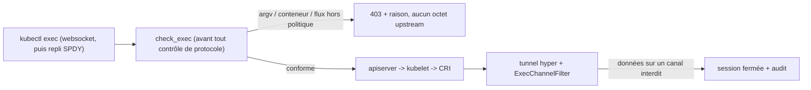
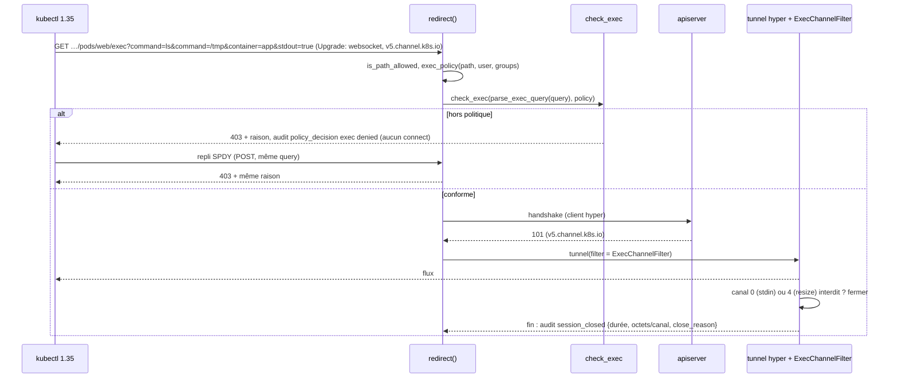
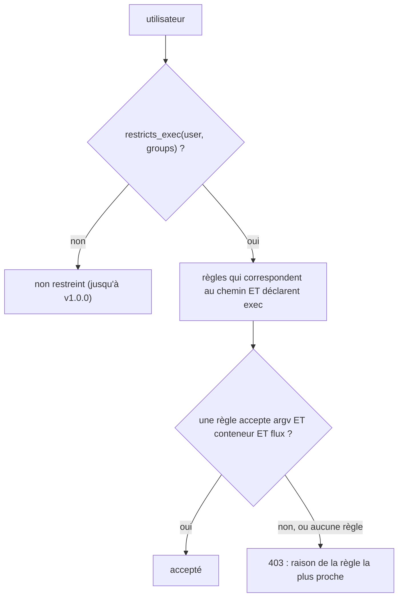
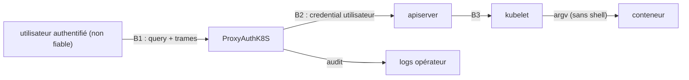

# RFC 0004 — Filtrage d'exec et d'attach (commande, conteneur, flux)

| Field       | Value                                                                  |
| ----------- | ---------------------------------------------------------------------- |
| Status      | Accepted                                                               |
| Short       | Filtrage exec / attach                                                 |
| Settles     | Ce que le proxy peut garantir sur `pods/{name}/exec` et `/attach` : commandes autorisées, conteneurs, flux, et une trace de session |
| Author      | Max Batleforc <maxleriche.60@gmail.com>                                |
| Co-author   | Claude Opus 5.5                                                        |
| Created     | 2026-10-17                                                             |
| Supersedes  | —                                                                      |
| Issue       | — (à créer)                                                            |
| Depends on  | RFC 0003 (`status.warnings`, `nodes/proxy`, politiques avant le contrôle websocket), RFC 0006 (règles sensibles au verbe), RFC 0007 (migration vers axum/hyper), RFC 0008 (schéma d'audit, `session_closed`) |
| Touches     | `libs/server/crd/src/security/*` (nouveau `exec_policy.rs`), `libs/server/api/src/cluster/redirect/kube_redirect/{upgrade.rs,upgrade/tunnel.rs,port_forward.rs}`, nouveaux `kube_redirect/{exec.rs,websocket.rs}`, `…/redirect/audit.rs`, CRD générée, `.docs/content/docs/{security,crds}.mdx` |
| Risk        | high                                                                   |

> **Document de référence** (plus de 4 000 mots). Pour une lecture rapide : §1,
> §3, §4.1, §4.2, §7.1 et §15.

---

## 1. Summary

Aujourd'hui, une requête `pods/{name}/exec` ou `/attach` autorisée par
`allowed_resources` est relayée octet pour octet : le proxy ne lit ni la
commande, ni le conteneur, ni les flux demandés. Cette RFC ajoute une politique
`exec` aux règles d'`allowed_resources`, en trois couches de force décroissante,
présentées comme telles à l'opérateur :

1. **Contrôles avant connexion (garantis)** : liste blanche des commandes
   (`argv` complet), conteneurs autorisés, et flux autorisés (`stdin`, `tty`).
   Ils sont lus dans la query, avant tout octet vers l'upstream, et **une
   requête est acceptée si au moins une règle l'accepte entièrement**.
2. **Contrôle du flux (garanti)** : un décodeur des canaux `v5.channel.k8s.io`
   ferme la session si des données arrivent sur un canal interdit (stdin,
   resize).
3. **Trace de session (observation, pas barrière)** : sur le schéma d'audit de
   la RFC 0008, la ligne `request` de l'ouverture porte un objet `exec` (argv,
   conteneur, flux) et la ligne `session_closed` de la fermeture les octets par
   canal.

Le **filtrage du contenu de stdin** (refuser `rm -rf` tapé dans un shell) est
**rejeté comme mécanisme de sécurité** (§12) : il est contournable par
construction. La garantie se construit en n'autorisant pas de shell.
L'**enregistrement de stdin et stdout** est sorti du périmètre (§3).

La RFC s'implémente après la migration vers axum/hyper (RFC 0007) : le
contrôle de flux s'insère dans un tunnel `hyper::upgrade` au lieu de la
plomberie actix actuelle.

### Before / after

```yaml
allowed_resources:
  - Path:
      path: "/api/v1/namespaces/dev/pods/*/exec"
      parametised: true
      exec:                                  # NOUVEAU
        commands:
          - ["ls", "**"]                     # ls avec n'importe quels arguments
          - ["cat", "/var/log/app/*"]        # cat d'un fichier de ce dossier
          - ["/app/bin/healthcheck"]         # exactement cette commande, sans argument
        containers: ["app"]
        stdin: false
        tty: false
  - Path:
      path: "/api/v1/namespaces/dev/pods/*/attach"   # attach a son propre chemin
      parametised: true
      exec: { containers: ["app"], attach: true }
```

```text
# aujourd'hui
kubectl exec web -c app -- ls /tmp              -> 101, relayé
kubectl exec -it web -- sh                      -> 101, shell interactif
kubectl exec web -c sidecar -- env              -> 101, variables du sidecar

# avec cette RFC
kubectl exec web -c app -- ls /tmp              -> 101, audit {argv:[ls,/tmp]}
kubectl exec -it web -c app -- sh               -> 403 "command [sh] is not allowed" (et tty refusé)
kubectl exec web -c sidecar -- env              -> 403 "container sidecar is not allowed"
kubectl cp ./f web:/tmp/f -c app                -> 403 (exec "tar -xmf -" + stdin : refusé)
kubectl exec -n prod api -- sh                  -> 403 (restreint : aucune règle exec ne couvre prod)
```



La garantie est dans le contrôle de la query, avant la connexion. Le filtre de
flux n'est qu'une seconde ligne. Le contrôle passe **avant** le refus de SPDY,
pour que le repli SPDY de kubectl reçoive aussi le 403 avec sa raison.

---

## 2. Motivation

1. **exec est relayé sans aucune lecture.** `tunnel()`
   (`upgrade/tunnel.rs:25`) copie les octets dans les deux sens. Le seul point
   d'inspection est `filter.inspect` (`tunnel.rs:79`), réservé au port-forward
   restreint. `command=`, `container=`, `stdin=` et `tty=` ne sont lus nulle
   part ; `kube_redirect.rs:280-291` n'écrit même que le chemin dans les logs
   d'info, justement parce que la query contient la commande.
2. **Autoriser exec revient à autoriser un shell.** Une règle `…/pods/*/exec`,
   une règle plus large comme `/api/v1/namespaces/dev/**` (`**` couvre tous
   les segments restants : `path_matcher.rs:10-11`), ou une règle `Crd` `Pod`
   (qui ignore les segments après la ressource : `allowed_crd_configuration.rs:56-125`)
   donnent un shell interactif dans tous les conteneurs du pod. Le besoin
   courant (« le dev peut lancer le healthcheck et lire les logs ») ne
   s'exprime pas.
3. **L'audit d'une session exec ne dit pas ce qui a été lancé.** Depuis la
   RFC 0008, la ligne `request` du handshake et la ligne `session_closed` de la
   fin existent (durée, octets, qui a fermé), mais aucune ne porte la commande,
   le conteneur ni les flux demandés : la query n'est jamais lue.
4. **Un refus ne dit pas pourquoi.** kubectl ≥ 1.30 bascule en SPDY dès que la
   montée websocket échoue, y compris sur un 403
   (`client-go/transport/websocket/roundtripper.go:130-156`, puis
   `NewFallbackExecutor`, `exec.go:158-159`). Le proxy refuse SPDY en 400
   (`upgrade.rs:135-139`) : l'utilisateur voit « SPDY is not supported », jamais
   la raison du refus. C'est vrai aujourd'hui pour le port-forward restreint.
5. **Le même angle mort existe via le kubelet.** `nodes/{node}/proxy/exec/…`
   atteint l'exec du kubelet sans passer par `pods/exec` (RFC 0003, T4). La RFC
   0003 (R4) le refuse sous restriction de ports ; cette RFC étend la condition
   à `restricts_exec`.

---

## 3. Goals / non-goals

**Goals**

- Un opérateur peut limiter exec à une liste de commandes (`argv`), à une liste
  de conteneurs, et interdire stdin et tty, règle par règle.
- La même politique couvre `attach` (sans commande : flux et conteneurs
  seulement).
- Une requête est acceptée si **une** règle l'accepte entièrement : aucune
  combinaison de règles n'autorise ce qu'aucune règle n'a voulu.
- Un refus intervient **avant** toute connexion upstream, avec un message
  lisible par kubectl, y compris après son repli SPDY.
- Une session exec ou attach est tracée de l'ouverture (commande, conteneur,
  flux) à la fermeture, dans le schéma de la RFC 0008.
- La doc dit clairement ce qui est garanti et ce qui ne l'est pas.

**Non-goals**

- **Filtrer le contenu de stdin ou d'un TTY** (liste noire de commandes tapées)
  : contournable par construction (édition de ligne, `r\m`, base64, alias,
  éditeur, script). Il donnerait un faux sentiment de sécurité (§12).
- **Enregistrer stdin et stdout** (« session recording ») : capture des
  secrets, crée une donnée personnelle sensible, et personne ne l'a demandé.
  À rouvrir dans une RFC dédiée si le besoin apparaît.
- **Filtrer ou masquer stdout/stderr** (DLP) : même problème que stdin, et
  coût CPU sur chaque octet.
- **Empêcher la création de pods ou de conteneurs éphémères** (`kubectl
  debug`, `POST pods`, `PATCH …/ephemeralcontainers`) : c'est la RFC 0006
  (règles sensibles au verbe), **prérequis** de celle-ci.
- **Remplacer le RBAC du cluster cible** : `pods/exec` dans RBAC reste la
  première barrière.
- **Relayer SPDY** : SPDY reste refusé, y compris après la RFC 0007.
- **Motifs en regex** : exclus (lisibilité, ReDoS).
- **Sujets (`users`/`groups`) sur les règles `Path`** : une règle `Path` vaut
  pour tous les utilisateurs, donc une règle `exec` restreint tout le cluster
  (§4.2). Exempter un groupe relève d'une future RFC.

---

## 4. User-facing design

### 4.1 Configuration

Nouveau champ `exec: Option<ExecPolicyConfiguration>` sur
`AllowedPathConfiguration` **et** `AllowedCrdConfiguration` (même schéma ; sur
une `Crd`, seulement `kind: Pod`) :

```yaml
exec:
  commands:            # Option<Vec<Vec<String>>>, max 64 entrées, max 32 éléments chacune
    - ["ls", "**"]
  containers: ["app"]  # Option<Vec<String>>, max 32 (glob par élément : "app-*")
  stdin: false         # bool, défaut false
  tty: false           # bool, défaut false
  attach: false        # bool, défaut false (pods/{name}/attach)
```

Et un champ global :

```yaml
security_config:
  mask_exec_secrets: false   # bool, défaut false : masque -p…/--password=… dans l'audit
```

- **Aucune règle visible par l'utilisateur ne déclare `exec`** : l'utilisateur
  n'est pas restreint (compatibilité, comme `allowed_ports` absent). Ce n'est
  pas le côté sûr ; il bascule en v1.0.0 (§13).
- **Au moins une règle visible déclare `exec`** : l'utilisateur est restreint.
  Seules les règles qui correspondent au chemin **et** déclarent `exec`
  peuvent accepter un exec ou un attach (§4.2), comme pour `allowed_ports`
  (RFC 0003, R2).
- **`exec: {}`** : exec reste possible, mais **sans aucune commande
  autorisée** (`commands` absent dans un `exec` présent vaut `[]`), sans stdin,
  sans tty et sans attach. Dès qu'il est déclaré, le défaut est fermé.
- **`commands: []`** : aucune commande, donc exec refusé (attach reste soumis à
  `attach`).
- `containers` absent : tous les conteneurs. `[]` : aucun.

### 4.2 Behaviour rules

- **Évaluation par règle.** Une requête est acceptée si **au moins une** règle
  correspondante l'accepte **entièrement** : sa commande, son conteneur et ses
  flux ensemble. Les champs de règles différentes ne se combinent jamais : une
  règle A (`ls` dans `app`) et une règle B (`env` dans `sidecar`)
  n'autorisent ni `env` dans `app`, ni `ls` dans `sidecar`.
- **Restriction par utilisateur.** `restricts_exec(user, groups)` est vrai dès
  qu'une règle dont le sujet concerne l'utilisateur déclare `exec`, quel que
  soit son chemin (même définition que `restricts_ports`, RFC 0003 R3). Une
  règle `Path` n'a pas de sujet : une seule règle `Path` avec `exec` restreint
  donc **tous** les utilisateurs du cluster, y compris ceux qui passent par une
  règle `**`. Pour exempter un utilisateur, il faut aujourd'hui une règle `Crd`
  avec des sujets de namespace (sujets sur `Path` : non-goal, §3).
- **Seules les règles `exec` accordent.** Sous restriction, les règles qui
  correspondent au chemin sans déclarer `exec` n'accordent ni exec ni attach.
  Une règle large (`…/pods/**`, `/api/v1/namespaces/**`, `Crd` `Pod`) ne lève
  donc plus en silence la politique d'une règle `exec`, même dans un autre
  namespace. Sans aucune règle `exec`, rien ne change.
- **Attach.** Sous restriction, `pods/{name}/attach` n'est accepté que par une
  règle qui couvre ce chemin, déclare `exec` **et** a `attach: true` ;
  `commands` y est ignoré, `containers`, `stdin` et `tty` s'appliquent. Une
  règle `…/pods/*/exec` ne couvre pas `attach` : `path_matcher` n'a pas
  d'alternative (`{exec,attach}`), il faut deux règles, ou `Crd` `Pod`.
  `…/pods/*/*` est déconseillé, car il ouvre aussi `log`, `portforward`, etc.
- **`nodes/proxy`.** Le refus de la RFC 0003 (R4, R5) s'applique sous
  `restricts_ports || restricts_exec || restricts_verbs` (RFC 0006) : sous
  restriction d'exec,
  `nodes/{n}/proxy/**` (donc `/exec/…` et `/run/…` du kubelet) est refusé sauf
  règle `Path` qui vise explicitement `nodes/*/proxy`.
- **Correspondance des commandes** : l'`argv` reçu (tous les paramètres
  `command`, dans l'ordre, comme l'apiserver : `zz_generated.conversion.go:6479`)
  est comparé élément par élément au motif. `*` couvre un élément entier ou une
  partie d'élément (même sémantique que les chemins). `**`, uniquement en
  dernière position, couvre zéro élément ou plus. **Pas de normalisation de
  chemin** : `ls` et `/bin/ls` sont deux commandes différentes.
- **Interpréteurs** : un motif dont le premier élément est un shell ou un
  interpréteur connu (`sh`, `bash`, `ash`, `zsh`, `dash`, `busybox`, `env`,
  `python*`, `perl`, `ruby`, `node`, `nsenter`, `chroot`, `xargs`, `find`…)
  **et** qui contient un joker (`*` ou `**`) déclenche un **avertissement**
  (§4.3) : il rend la liste blanche équivalente à « tout ». Un interpréteur
  avec un `argv` exact (`["sh", "-c", "/app/bin/rotate-logs"]`) est une
  commande exacte, sans avertissement.
- **Conteneur** : kubectl résout lui-même le conteneur par défaut (annotation
  `kubectl.kubernetes.io/default-container`, sinon le premier, `podcmd.go:56-83`)
  et **envoie toujours `container=`** (exec, attach et cp). Sous restriction de
  `containers`, un `container=` absent est donc refusé (« specify `-c
  <container>` ») sans casser kubectl.
- **Booléens alignés sur l'apiserver** (`Convert_Slice_string_To_bool`,
  `apimachinery/pkg/runtime/conversion.go:83-95`) : seule la première valeur
  compte ; « faux » si la clé est absente, ou si la valeur est `0` ou `false`
  (sans tenir compte de la casse) ; **tout le reste vaut « vrai »**, y compris
  `stdin=` (valeur vide). Le proxy applique exactement cette règle.
- **Flux** : `stdin` vrai est refusé si `stdin: false`, et `tty` vrai si
  `tty: false`. `stdout` et `stderr` sont toujours permis (lecture du
  résultat).
- **Paramètres dupliqués** (`container`, `stdin`, `tty`, `stdout`, `stderr`
  deux fois) : **refusés** (400). L'apiserver prendrait la première valeur ;
  refuser est plus strict et supprime toute ambiguïté.
- **Ordre des contrôles** : la politique `exec` est évaluée **avant** le
  contrôle « websocket seulement », dans l'ordre que la RFC 0003 (phase 1)
  introduit pour la politique de ports. La requête SPDY de repli de kubectl
  reçoit donc le même 403 avec la raison ; seule une requête **conforme** en
  SPDY reçoit le 400 « SPDY is not supported ».
- **Cas inintéressant** : sans aucune règle `exec`, ou avec
  `security_config.enabled: false`, aucune décision ne change. La trace de
  session est quand même émise (§10.1).

### 4.3 Validation

Refusé à l'admission (CEL) et à la réconciliation (`validate()`) :

| Condition | Rationale |
| --- | --- |
| `commands[i]` vide | Une commande vide ne correspond à rien : erreur de saisie |
| `**` ailleurs qu'en dernier élément | Sémantique ambiguë |
| `tty: true` et `stdin: false` | Un tty sans stdin n'a pas de sens pour kubectl et masque une erreur |
| `exec` sur une règle `Crd` dont le `kind` n'est pas `Pod` | Sans effet : on refuse plutôt que d'induire en erreur (comme `allowed_ports`, RFC 0003 R7) |
| plus de 64 commandes, 32 éléments, 32 conteneurs, élément > 512 octets | Bornes du coût CEL et de la correspondance |

Avertissements :

| Condition | Behaviour | Surfaced in |
| --- | --- | --- |
| motif qui commence par un interpréteur **et** contient un joker | accepté | `status.warnings` du `ProxyKubeApi` (introduit par la RFC 0003) + log de réconciliation |
| `stdin: true` avec une commande qui lit stdin (`tar`, `sh`…) | accepté | idem |
| règle `exec` restrictive, mais une règle autorise la création de pods ou `ephemeralcontainers` (verbe `create`/`patch`, RFC 0006), ou une règle `Path` vise explicitement `nodes/*/proxy` | accepté | idem (« exec restriction can be bypassed by … ») |
| restriction d'exec et une règle couvre `pods/…/exec` ou `…/attach` sans déclarer `exec` | la règle n'accorde ni exec ni attach | idem |

---

## 5. Architecture

### 5.1 Où se prend la décision



L'apiserver ne reçoit jamais une requête refusée : la décision est prise sur la
query, avant l'ouverture de la connexion upstream, et répétée à l'identique sur
le repli SPDY.

### 5.2 Évaluation des règles



Le diagramme montre la restriction décidée par utilisateur, puis un OU de
règles où chaque règle fait un ET de ses champs. Une règle sans `exec` ne
participe jamais à la décision d'un utilisateur restreint.

### 5.3 Format des flux

- Sous-protocole websocket demandé par client-go : `v5.channel.k8s.io`
  (`client-go/tools/remotecommand/websocket.go:89`). Il n'existe **pas** de
  `base64.v5`. L'apiserver accepte aussi `v4.channel.k8s.io`,
  `v4.base64.channel.k8s.io`, `base64.channel.k8s.io` et `channel.k8s.io`
  (proxifiés vers le kubelet).
- Sous restriction, seuls `v5.channel.k8s.io` et `v4.channel.k8s.io` (binaires)
  sont acceptés ; les variantes base64 et l'absence de sous-protocole sont
  refusées, comme le port-forward refuse ce qu'il ne sait pas lire.
- Chaque message websocket binaire commence par un octet de canal : `0` stdin,
  `1` stdout, `2` stderr, `3` erreur/statut, `4` resize, `255` close (v5
  seulement).
- Le décodeur de trames websocket existe déjà (`WebsocketDecoder`,
  `port_forward.rs:144`) ; il est extrait dans `kube_redirect/websocket.rs` et
  partagé.

### 5.4 Invariant

Le kubelet transmet `argv` tel quel au runtime (CRI `ExecRequest.cmd`,
`repeated string`, sans shell ajouté). Si le premier élément d'`argv` n'est pas
un interpréteur, la commande exécutée est exactement celle que le motif a
acceptée. C'est cette propriété, et non une lecture de stdin, qui fait de la
liste blanche une barrière. Comme `check_exec` refuse avant toute connexion, et
que les booléens sont lus avec la règle exacte de l'apiserver, aucun `argv`,
conteneur ou flux refusé ne peut atteindre le kubelet par ce chemin.

---

## 6. Detailed design

### 6.1 `libs/server/crd`

- Nouveau `security/exec_policy.rs` : `ExecPolicyConfiguration` (schéma de
  §4.1, bornes `schemars` et règles CEL) et `CommandPattern(Vec<String>)`.
- `SecurityConfiguration::restricts_exec(username, groups) -> bool` (même forme
  que `restricts_ports`, RFC 0003).
- `SecurityConfiguration::exec_rules(path, username, groups) -> ExecRules`,
  qui renvoie `Unrestricted` (`!restricts_exec`) ou
  `Restricted(Vec<&ExecPolicyConfiguration>)` (règles qui correspondent au
  chemin et déclarent `exec`, éventuellement vide). Contrairement à
  `port_policy` (RFC 0003), il ne fusionne pas les champs.
- Le refus de `nodes/proxy` (`restricts_node_proxy`, aujourd'hui
  `restricts_ports || restricts_verbs`) gagne `|| restricts_exec`.
- `SecurityConfiguration.mask_exec_secrets: bool` (défaut `false`).
- Règle CEL `!has(self.exec) || self.kind == 'Pod'` sur `AllowedCrdConfiguration`.
- `ExecPolicyConfiguration::accepts(&ExecRequest) -> Result<(), Denial>` : ET
  des champs dans une règle. `ExecRules::check` fait le OU et renvoie la raison
  de la règle la plus proche (même conteneur, sinon la première).
- `validate()` reproduit les règles CEL, avec un test d'alignement CEL/Rust
  comme `allowed_path_configuration.rs:280`.

### 6.2 `libs/server/api`

Écrit sur la plomberie issue de la RFC 0007 (`hyper::upgrade`). Les fonctions
de décision sont pures et indépendantes du framework.

- `kube_redirect/exec.rs` :
  - `is_exec_path(path)` et `is_attach_path(path)` (segments décodés une fois,
    comme `is_port_forward_path`, `port_forward.rs:43`) ;
  - `parse_exec_query(query) -> Result<ExecRequest, String>` : `argv`,
    `container`, booléens selon §4.2, refus des doublons, au plus 32
    `command` et 4 KiB par élément ;
  - `ExecChannelFilter`, qui implémente un trait partagé avec
    `PortForwardFilter` : `trait UpgradeFilter { fn inspect(&mut self, chunk)
    -> Result<(), String>; fn on_upstream(&mut self, chunk); fn summary(&self)
    -> SessionSummary; }`.
- `kube_redirect/websocket.rs` : `WebsocketDecoder` extrait de
  `port_forward.rs`, trame bornée à 1 MiB.
- `upgrade.rs` : `check_handshake` évalue déjà les politiques avant le contrôle
  websocket et le refus de corps (RFC 0003, phase 1) ; la politique exec s'y
  ajoute après celle des ports. Nouvelle variante
  `UpgradeRefusal::ExecOutsidePolicy(String)` (403, ligne `policy_decision`
  `policy: exec`, `decision: denied`, avec la raison). Un exec accepté sous
  restriction écrit sa ligne `policy_decision` `allowed`, comme un port
  accepté.
  Après le `101`, sélection du filtre selon le protocole accepté (refus des
  protocoles non binaires sous restriction).
- Tunnel : `inspect` sur le sens client → upstream ; `on_upstream` sur le sens
  upstream → client **uniquement** pour compter les octets, sans jamais
  bloquer. Le filtre ne décode les trames (et ne compte par canal) que sous
  restriction ; une session sans restriction garde les totaux de
  `session_closed` (RFC 0008, phase 4).
- `audit.rs` : `AuditContext` gagne `exec: Option<ExecAudit { argv,
  container, stdin, tty }>`, écrit comme un objet `exec` sur la ligne `request`
  et sur `session_closed` ; `session_closed` gagne `channel_bytes` (octets par
  canal, sous restriction) et `channel` quand le filtre coupe sur un canal
  interdit (`close_reason: filter`). Avec `mask_exec_secrets`
  (global, donc aussi pour les refus et les utilisateurs non restreints), les
  éléments `-p<x>`, `--password=<x>`, `--token=<x>` et l'élément qui suit
  `-p`/`--password`/`--token` sont remplacés par `***`.

### 6.3 `kubectl cp` et autres usages indirects

- `kubectl cp local pod:` lance d'abord `test -d <dest>`, puis `tar -xmf -`
  (ou `tar --no-same-permissions --no-same-owner -xmf -`, plus `-C <dir>`) avec
  stdin (`cp.go:281, 325-334`) : refusé si `stdin: false`.
- `kubectl cp pod: local` lance `tar cf - <path>` sans stdin (`cp.go:395`) :
  autorisé si `["tar", "cf", "-", "**"]` est listé. Avec `--retries` non nul,
  kubectl lance `sh -c "tar cf - '<path>' | tail -c+N"` (`cp.go:399-400`) :
  c'est un shell, refusé sauf motif interpréteur. La doc donne la recette et
  le piège.
- `kubectl debug` crée un conteneur éphémère (`PATCH …/ephemeralcontainers`)
  puis fait un `attach`. La RFC couvre l'`attach` ; le `PATCH` relève de la
  RFC 0006.

### 6.P Proof against a real client

Banc de la RFC 0009, `tests/integration/tests/rfc0004.rs`, une fonction
`pN_sujet` par point, toujours à travers le proxy. Client : le kubectl épinglé
du banc (`mise.toml`, 1.35 ; `v5.channel.k8s.io`, repli SPDY actif par
défaut). Les points qui demandent une requête forgée (6, 7, 8) passent par un
client brut écrit dans le test, sans dépendance nouvelle, comme
`proxy_upgrade.rs`, qui garde les tests rapides (upstream enregistreur,
harnais de trames v5). Les lignes d'audit sont lues avec
`observe::audit_lines`.

1. `kubectl exec web -c app -- ls /tmp` avec `commands: [["ls","**"]]` : sortie
   de `ls`, code 0. La ligne `request` porte `exec: {argv: ["ls","/tmp"],
   container: "app"}`, puis `session_closed` porte des octets non nuls sur le
   canal 1 (stdout).
2. **Refus, commande** : `kubectl exec web -c app -- sh -c id` affiche
   `Forbidden: command [sh -c id] is not allowed on this cluster` (et **non**
   « SPDY is not supported »). L'upstream enregistreur n'a **accepté aucune
   connexion**, ni pour le websocket, ni pour le repli SPDY.
3. **Refus, tty** : `kubectl exec -it web -c app -- ls` avec `tty: false`
   donne 403 avant connexion.
4. **Refus, conteneur** : `?command=ls&stdout=true` sans `container` avec
   `containers: ["app"]` donne 403 « specify -c <container> ».
5. **Refus, cp** : `kubectl cp ./f web:/tmp/f -c app` avec `stdin: false`
   donne 403.
6. **Refus, flux** : un client de test qui négocie `stdin=false` puis envoie
   un message sur le canal 0 voit la session fermée. Aucun octet du canal 0
   n'est arrivé à l'upstream, et `session_closed` indique `close_reason:
   filter`, `channel: 0`.
7. **Refus, doublon** : `?command=ls&container=app&container=sidecar` donne 400.
8. **Refus, booléen** : `?command=ls&container=app&stdin=` (valeur vide, vraie
   pour l'apiserver) avec `stdin: false` donne 403.
9. **Refus, produit croisé** : règles A (`ls` dans `app`) et B (`env` dans
   `sidecar`) ; `env` dans `app` donne 403.
10. **Refus, règle large** : une règle `/api/v1/namespaces/**` sans `exec`
    plus une règle `exec` restrictive sur `dev` ; `sh` donne 403 dans `dev`
    **et** dans `prod`.
11. `kubectl attach web -c app` avec `attach: false` donne 403 ; avec
    `attach: true` sur une règle qui couvre `…/pods/*/attach`, le flux
    s'affiche. Une règle `…/pods/*/exec` seule n'accorde pas l'attach.
12. **Refus, kubelet** : sous restriction d'exec seulement (aucun
    `allowed_ports`), `curl …/api/v1/nodes/n1/proxy/exec/dev/web/app?command=sh`
    donne 403 ; l'upstream n'a reçu aucune connexion.
13. Non-régression : sans règle `exec`, les points 1 à 5 passent comme
    aujourd'hui, et la ligne `request` porte quand même l'objet `exec`.

**Deliberately untouched**, so reviewers do not go looking :

- La logique SPDY de `PortForwardFilter` : seules l'extraction de
  `WebsocketDecoder` et le trait la touchent.
- Le refus de SPDY nu : il reste, après les politiques ; l'ordre est déjà posé
  par la RFC 0003.
- `standard_redirect` : exec et attach passent toujours par l'upgrade.

---

## 7. Security

**Rating:** high. On ajoute un parseur de query et un décodeur de flux sur des
entrées contrôlées par l'attaquant, sur le chemin qui donne l'exécution de code
dans les conteneurs.

### 7.1 Threat model



| # | Threat (STRIDE) | Where | Mitigation | Residual risk |
| --- | --- | --- | --- | --- |
| T1 | Elevation : commande hors liste | B1, query | `ExecRules::check` avant toute connexion | aucun si aucun interpréteur à joker n'est listé |
| T2 | Elevation : commande listée qui exécute autre chose (`find -exec`, `env sh`, `sh -c *`) | motifs | avertissement interpréteur + joker (§4.3) ; doc « pas d'interpréteur » | **accepté par l'opérateur** qui le liste |
| T3 | Tampering : différence de parsing entre le proxy et l'apiserver (encodage, `+`, `;`, doublons, casse, booléens) | `parse_exec_query` | même décodage que Go (`+` donne espace, un seul décodage) ; `;` et doublons refusés ; booléens lus avec la règle exacte de l'apiserver ; table de référence générée depuis Go et cibles de fuzz (§14) | faible |
| T4 | Elevation : données stdin malgré `stdin=false` | B1, flux | `ExecChannelFilter` ferme sur le canal 0 | aucun |
| T5 | Elevation : protocole non lisible (base64, sans sous-protocole, extension deflate) qui cache les canaux | handshake | refus sous restriction | aucun |
| T6 | Elevation : conteneur par défaut non maîtrisé | query | `container=` exigé sous restriction (kubectl l'envoie toujours) | aucun |
| T7 | Elevation : contournement par création de pod, conteneur éphémère ou `nodes/proxy/exec` | autres chemins | RFC 0006 (verbes) **prérequis** ; `nodes/proxy` refusé sous `restricts_exec` (RFC 0003 R4 étendu) ; avertissement de validation | faible une fois les prérequis livrés |
| T8 | Elevation : combinaison de règles (produit croisé, règle large sans `exec`, autre namespace) | évaluation | restriction par utilisateur ; seules les règles `exec` accordent ; OU de règles, ET des champs | aucun |
| T9 | Info disclosure : secrets dans l'argv (`mysql -pXXX`) | audit | doc explicite ; `mask_exec_secrets` global opt-in ; changement annoncé au CHANGELOG | **accepté par l'opérateur** (argv intégral par défaut) |
| T10 | Repudiation : session sans trace | audit | objet `exec` sur la ligne `request`, et `session_closed` (RFC 0008), toujours écrits | aucun |
| T11 | DoS : trames énormes ou fragmentées pour épuiser le décodeur | flux | trame bornée à 1 MiB, aucun buffer au-delà d'une trame | faible |

Tests négatifs : T1 → §6.P point 2 ; T3 → points 7 et 8, table Go ; T4 →
point 6 ; T5 → handshake `v4.base64.channel.k8s.io` refusé ; T6 → point 4 ; T7
→ point 12 et tests de la RFC 0006 ; T8 → points 9 et 10 ; T9 → test
`mask_exec_secrets` ; T10 → point 13 ; T11 → trame de 2 MiB refusée.

### 7.2 Authentication and authorisation

Aucune nouvelle surface : la politique s'ajoute après l'authentification,
`proxy_group` et `is_path_allowed`. Si le contrôle est contourné, l'attaquant
revient à l'état actuel : exec complet autorisé par le RBAC du cluster.

### 7.3 Input handling and injection

- Au plus 32 paramètres `command` (au-delà : 400), chaque élément borné à
  4 KiB, longueur totale de la query bornée par le serveur HTTP.
- Décodage identique à Go : un seul percent-decode, `+` donne un espace. `;`
  dans la query : Go (`URL.Query()`) ignore la paire fautive, le proxy la
  refuse (400) ; il est plus strict, donc aucune paire qu'il n'a pas vue ne
  peut être lue en aval.
- Booléens : règle de l'apiserver (§4.2), sans exception.
- Trames websocket bornées à 1 MiB (le kubelet découpe en 32 KiB) ; trames de
  contrôle gérées selon la RFC 6455.
- `parse_exec_query` et le décodeur ont chacun une cible de fuzz (workspace
  `fuzz/` de la RFC 0003, modèle batlehub) : toute entrée invalide donne 400
  ou 403, jamais de panic.

### 7.4 Secrets and cryptography

Aucun nouveau secret. L'argv peut contenir un secret tapé en argument ; la doc
le signale et propose `mask_exec_secrets`.

### 7.5 Abuse and resource exhaustion

Le décodeur ne garde que l'en-tête de trame courant. Le budget de rate limit
reste compté une fois par session (inchangé). Le repli SPDY d'une requête
refusée compte comme une seconde requête, comme aujourd'hui.

### 7.6 Existing defences that still hold

Refus de SPDY nu, d'un corps sur un upgrade (anti-smuggling) et des extensions
websocket sous restriction ; garde anti-traversée ; mTLS ; RBAC cible.

---

## 8. Supply chain

| Dependency / image / tool | Version | Why this one | Licence | Known CVEs (`task audit`) | Maintenance |
| --- | --- | --- | --- | --- | --- |
| aucune dépendance runtime | — | décodeur websocket déjà écrit (`WebsocketDecoder`) ; motifs réutilisant `path_matcher` | — | — | — |

- **Build et release** : la CRD générée change. Pas de nouvelle image. La table
  de référence Go est générée hors CI et versionnée : pas de toolchain Go en CI.
- **Fuzz** : cibles ajoutées au workspace `fuzz/` créé par la RFC 0003
  (`libfuzzer-sys` 0.4.13, `arbitrary` 1.5.0), compilées à chaque PR en stable
  (`task fuzz:check`) et lancées par le job nightly. Aucune dépendance runtime.
  La table Go reste l'oracle de compatibilité contre T3.

---

## 9. Data and privacy

| Data | Personal? | Where stored | Retention | Who can read it | Leaves the instance? |
| --- | --- | --- | --- | --- | --- |
| `argv` (audit) | **peut contenir des secrets ou des données personnelles** | logs, cible `audit` | politique de l'opérateur | opérateurs | selon le collecteur |
| conteneur, flags, durée, octets par canal | non | idem | idem | idem | idem |
| `user`, `groups` (existants) | oui | idem | idem | idem | idem |

Le contenu de stdin et stdout n'est **jamais** stocké. L'argv intégral est un
choix de traçabilité ; `mask_exec_secrets` en réduit l'exposition.

**Changement pour tous les déploiements** : la trace de session est émise même
sans règle `exec`, donc l'argv de chaque `kubectl exec` entre dans les logs
d'audit dès la mise à jour, y compris là où aucune politique n'est configurée.
C'est annoncé dans le CHANGELOG (§13), avec `mask_exec_secrets`.

---

## 10. Operability

### 10.1 Observability

- **Metrics** :
  - compteur partagé `proxyauth_policy_decisions_total{cluster,
    policy="exec", decision}` (créé par la RFC 0003), `decision` parmi
    `allowed`, `denied`, `closed_by_filter` ;
  - `proxyauth_session_duration_seconds{kind}` (histogramme), pour tous les
    tunnels : `kind` parmi `exec`, `attach`, `portforward`, `proxy` ;
  - aucune commande ni aucun utilisateur en label.
- **Logs and audit trail** (schéma de la RFC 0008) : `policy_decision`
  `policy: exec` (`allowed` sous restriction, `denied` avec la raison), objet
  `exec` sur la ligne `request`, et `session_closed` avec les octets par canal
  sous restriction et `channel` quand le filtre coupe (`close_reason` :
  `client`, `upstream`, `filter`, `error`).
- **Alerts** : aucune par défaut. La doc suggère une alerte sur
  `session_closed` avec `close_reason: filter` et `channel` (client modifié).

### 10.2 Failure modes

| Failure | Detected by | Behaviour | Recovery |
| --- | --- | --- | --- |
| Query non analysable | `parse_exec_query` | **fermé** (400) | corriger le client |
| Protocole négocié non lisible sous restriction | après le `101` | **fermé** (session coupée) | mettre à jour kubectl |
| Trame websocket invalide | décodeur | **fermé** | — |
| Pas de restriction | — | relais + audit | — |

### 10.3 Performance and capacity

Sous restriction, le décodeur lit les en-têtes de trame (quelques octets par
message). Surcoût visé inférieur à 5 % du débit, mesuré avec `kubectl exec …
-- cat /dev/zero | head -c 1G` avec et sans filtre, débit noté dans la PR.
Sans restriction, le seul surcoût est le comptage d'octets.

---

## 11. Other concerns

- **Accessibility** : pas d'UI.
- **Internationalisation** : messages d'erreur API en anglais, comme les
  existants.
- **Compliance** : traçabilité des accès privilégiés (ISO 27001 A.8.2/A.8.15,
  NIS2 sur la journalisation des accès d'administration).
- **Licensing** : inchangé.
- **Documentation** : section « exec et attach » de `security.mdx` : tableau
  « garanti / non garanti », liste des interpréteurs, évaluation par règle et
  « seules les règles `exec` accordent » et la portée d'une règle `Path` (tout le cluster), recettes `kubectl cp` (et le piège `--retries`),
  argv dans l'audit, complément **Kyverno** (politique d'admission sur
  `PodExecOptions` pour les accès qui ne passent pas par le proxy). Plus
  `crds.mdx` régénéré.

---

## 12. Alternatives considered

| Alternative | Why rejected |
| --- | --- |
| **Liste noire sur le contenu de stdin** (lecture du canal 0) | Contournable par construction : édition de ligne, échappements, `$(echo … \| base64 -d)`, alias, `vi`, scripts. Faux sentiment de sécurité |
| Liste noire sur `argv` | Un motif refusé se contourne par un chemin absolu, un lien ou un interpréteur. La liste blanche est le seul modèle sûr |
| Union des champs de toutes les règles (brouillon) | Produit croisé : autorise des combinaisons qu'aucune règle n'a voulues (T8) |
| Une règle sans `exec` lève toute restriction (brouillon) | Une règle large annule en silence une règle `exec` voisine (T8) |
| « La règle déclarée l'emporte » par chemin (premier grill) | `restricts_exec` indéfinissable, donc `nodes/proxy/exec` jamais restreint ; une règle large reste sans restriction dans les namespaces qu'aucune règle `exec` ne couvre. Aligné sur la RFC 0003 (R2, R3) |
| `mask_secrets` par règle | Aucune règle ne porte le réglage pour un refus ou un utilisateur non restreint, alors que l'audit est émis dans les deux cas |
| Tests aux limites sans fuzz (second grill) | Abandonné au grill de la RFC 0006 : le modèle batlehub lève l'objection nightly/CI, et des propriétés vérifiées par fuzz couvrent mieux un décodeur de trames qu'une table |
| Métrique propre (`proxyauth_exec_sessions_total`) | Un compteur partagé par politique (RFC 0003 R15) suffit et garde un seul tableau de bord |
| Enregistrement de stdin et stdout (`record: io`, brouillon) | Capture des secrets, donnée sensible, non demandé |
| Avertissement sur tout interpréteur | Signale aussi des commandes exactes sûres ; habitue à ignorer l'avertissement |
| Masquage des secrets dans l'argv par défaut | Heuristique incomplète présentée comme une protection ; réduit la traçabilité |
| Regex dans les motifs | Lisibilité, ReDoS |
| Oracle Go en CI | Toolchain Go en CI pour un test ; une table générée et versionnée donne la même couverture |
| Imposer la politique côté cluster (Kyverno) seulement | Un composant par cluster cible, alors que le proxy centralise. Documenté en complément |
| Écrire la RFC sur la plomberie actix actuelle | Le tunnel serait réécrit une seconde fois par la RFC 0007 |
| Ne rien faire | §2 |

---

## 13. Rollout and compatibility

- **Default behaviour** : sans `exec`, aucun changement de décision. Seul
  l'objet `exec` de la ligne `request` est nouveau, **et il contient l'argv**
  (§9) : annoncé en tête du CHANGELOG avec `mask_exec_secrets`.
- **Changement de comportement** dès qu'une règle `exec` existe : elle
  restreint tous les utilisateurs du cluster (règle `Path`), et les règles
  sans `exec` n'accordent plus exec ni attach (`feat!:`).
- **v1.0.0** : `exec` absent bascule vers « exec interdit sauf règle `exec`
  explicite », avec le nettoyage `allowed_ressources` (la RFC 0003 a déjà
  basculé les règles sans `allowed_ports`, R2). Annoncé dans le CHANGELOG dès cette RFC.
- **Migration** : champ additif dans la CRD.
- **Operator prerequisites** : CRD mise à jour avant le serveur ; RFC 0003,
  0006 et 0007 livrées. Pour les clients, kubectl ≥ 1.30 (déjà requis).
- **Rollback** : image précédente ; le champ `exec` est ignoré et les
  restrictions disparaissent sans bruit. À signaler dans le CHANGELOG.
- **Feature flag** : non.

---

## 14. Test plan

- **Unit** (`crd/src/security/exec_policy.rs`) : évaluation par règle (OU/ET),
  `restricts_exec` (règle `Path` sans sujet, règle `Crd` avec sujets), règles
  sans `exec` qui n'accordent rien sous restriction, `attach` (chemin et
  drapeau), défauts (absent, `{}`, `[]`), CEL `kind: Pod`, alignement CEL/Rust,
  avertissement interpréteur seulement avec joker.
- **Unit** (`api/.../exec.rs`) : table `parse_exec_query` (encodages, `+`, `;`,
  doublons, booléens, valeur vide), correspondance `argv`/motifs (`*`, `**`),
  `mask_exec_secrets`.
- **Fuzz** : cibles `fuzz_exec_query` (déterminisme ; un `ExecRequest` accepté
  a exactement l'`argv` que la table Go produirait pour les paires lues ; aucun
  doublon accepté) et `fuzz_websocket_decoder` (aucune panic, aucun buffer
  au-delà d'une trame de 1 MiB, une trame sur un canal interdit ferme
  toujours).
- **Table de référence Go** : un petit programme hors CI (`url.Query()` +
  `runtime.Convert_Slice_string_To_bool` + conversion `PodExecOptions`)
  génère `tests/fixtures/exec_query_reference.json` ; le test Rust la rejoue.
  Régénérée à chaque montée de version Kubernetes ciblée.
- **Integration** (`api/tests/proxy_upgrade.rs`) : les refus avant connexion,
  le filtre de canaux et la requête SPDY de repli, avec l'upstream enregistreur
  et un harnais de trames v5.
- **Table de référence Go** : produite par le générateur de la RFC 0006
  (`crd/tests/request_info_reference`, `task gen:request-info-reference`).
- **Proof** : §6.P, sur le banc de la RFC 0009 (`rfc0004.rs`).
- **Security** : un test négatif par ligne T1 à T11 (§7.1).
- **Audit** : `task audit` vert.
- **Existing suites** : tests de port-forward inchangés après l'extraction de
  `WebsocketDecoder`.

---

## 15. Decisions and open questions

### Resolved

| # | Question | Decision |
| --- | --- | --- |
| 0 | Filtrer le contenu de stdin et du tty ? | **Non, pas comme barrière** (§12). Les flux sont autorisés ou interdits en bloc. |
| 1 | Défaut de `exec` absent | **Utilisateur non restreint maintenant (aucune règle `exec` visible), bascule en v1.0.0** vers « exec interdit sauf règle `exec` », avec le nettoyage `allowed_ressources`. |
| 2 | argv dans l'audit | **Intégral par défaut**, masquage opt-in (`mask_exec_secrets`, global, voir 18), doc explicite. |
| 3 | Protocoles base64 | **Refusés sous restriction.** Il n'existe pas de `base64.v5` ; seuls `v5`/`v4` binaires sont acceptés. |
| 4 | Booléens de l'apiserver | **Vérifié** (`conversion.go:83-95`) : première valeur ; faux si absent, `0` ou `false` (casse ignorée) ; tout le reste vrai, y compris la valeur vide. Le proxy applique cette règle et refuse les doublons. |
| 5 | Filtrage par verbe (T7) | **Prérequis** : RFC 0006. |
| 6 | Kyverno | **Recommandé dans la doc** en complément. |
| 7 | Regex | **Exclues.** |
| 8 | Union des règles | **Évaluation par règle** : OU des règles, ET des champs. Corrige le produit croisé du brouillon. |
| 9 | Règle sans `exec` | **Remplacée par 17** : sous restriction, une règle sans `exec` n'accorde ni exec ni attach (« déclarée l'emporte » par chemin abandonné). |
| 10 | Avertissement interpréteur | **Seulement avec un joker.** |
| 11 | `record: io` | **Sorti du périmètre.** |
| 12 | Ordre par rapport à la RFC 0003 | **0003 d'abord** (`status.warnings`, `nodes/proxy`, politiques avant le contrôle websocket). |
| 13 | Oracle Go | **Table de référence générée hors CI**, versionnée, plus **fuzz sur le modèle batlehub** (révisé au grill de la RFC 0006, comme RFC 0003 R12). |
| 14 | Framework | **RFC 0007 (axum/hyper) avant celle-ci.** Ordre : 0003, 0006, 0007, 0004. |
| 15 | Repli SPDY de kubectl | **Politiques évaluées avant le contrôle websocket** : le repli reçoit le même 403 avec la raison. **Livré par la RFC 0003** (phase 1), qui en a besoin pour ses propres refus ; cette RFC y ajoute la politique exec. |
| 16 | Conteneur absent | **Refusé sous restriction** : vérifié, kubectl envoie toujours `container=`. |
| 17 | Modèle de restriction (second grill) | **Aligné sur la RFC 0003** : `restricts_exec(user, groups)` vrai dès qu'une règle visible déclare `exec` ; sous restriction, seules les règles qui correspondent au chemin et déclarent `exec` accordent ; `nodes/proxy` refusé sous `restricts_ports \|\| restricts_exec`. |
| 18 | Portée de `mask_secrets` | **Champ global plat** `security_config.mask_exec_secrets`, défaut `false` ; l'argv dans l'audit de tous les déploiements est annoncé au CHANGELOG. |
| 19 | `exec` sur `Crd` | **`kind: Pod` seulement** (CEL + `validate()`). |
| 20 | Règle `Path` et sujets | **Une règle `Path` avec `exec` restreint tous les utilisateurs**, documenté ; sujets sur `Path` : future RFC. |
| 21 | `attach` | **Règle qui couvre `…/attach`, déclare `exec` et `attach: true`** ; `commands` ignoré ; pas d'alternative dans `path_matcher`, donc deux règles ou `Crd` `Pod`. |
| 22 | Métrique (grill de la RFC 0006) | **Compteur partagé** `proxyauth_policy_decisions_total{policy="exec"}` ; l'histogramme de durée devient commun à tous les tunnels (décision 29). |
| 23 | Audit (troisième grill, 2026-10-18) | **Le schéma de la RFC 0008** : refus en `policy_decision` `policy: exec`, objet `exec` sur la ligne `request`, octets par canal sur `session_closed` ; `exec_denied`, `exec_open` et `exec_closed` disparaissent, comme l'annonçait la décision 6 de la RFC 0008. |
| 24 | Raisons de fermeture | **Celles de la RFC 0008** (`client`, `upstream`, `filter`, `error`) ; un canal interdit est un `filter` avec un champ `channel`. |
| 25 | Phases | **Phase 1 redéfinie** : la trace de session sans politique est livrée par la RFC 0008 (phase 4) ; restent les champs `exec`, `mask_exec_secrets` et l'extraction de `WebsocketDecoder` et du trait. |
| 26 | argv dans un audit qu'on ne peut plus couper | **Décision 2 confirmée** : argv intégral, `mask_exec_secrets: false` par défaut, signalé en tête du CHANGELOG. |
| 27 | Octets par canal | **Seulement sous restriction**, quand le filtre décode les trames ; sans restriction, les totaux de `session_closed`. |
| 28 | Preuve | **Le banc de la RFC 0009** (`rfc0004.rs`, 13 points), avec le kubectl du banc ; requêtes forgées par un client brut dans le test, sans dépendance nouvelle. |
| 29 | Histogramme de durée | **`proxyauth_session_duration_seconds{kind}` pour tous les tunnels**, au lieu d'un histogramme propre à exec. |
| 30 | Table de référence Go | **Le générateur de la RFC 0006**, même tâche et même `go.mod`. |
| 31 | Exec accepté sous restriction | **Une ligne `policy_decision` `allowed`**, comme un port accepté ; sans restriction, seule la ligne `request` trace la commande. |
| 32 | Release | **0.2.0**, comme prévu : elle ferme le plus gros trou restant, et ses prérequis (0003, 0006, 0007, 0008) sont livrés. |

### Still open

Aucune.

---

## 16. Implementation phases

| Phase | Content |
| --- | --- |
| 0 | Prérequis : RFC 0003, 0006, 0007 et 0008 livrées (fait) |
| 1 | Objet `exec` (argv, conteneur, flux) sur les lignes `request` et `session_closed`, sans politique, avec `mask_exec_secrets` dès cette phase (l'argv entre dans les logs) ; `proxyauth_session_duration_seconds{kind}` ; extraction de `WebsocketDecoder` et du trait `UpgradeFilter` |
| 2 | CRD `exec` (CEL `kind: Pod`) + `restricts_exec` + `exec_rules()` + `parse_exec_query` + `check` avant connexion (commandes, conteneurs, flux, attach) + `nodes/proxy` sous `restricts_exec` + avertissements + `ExecChannelFilter` (canaux interdits, refus des protocoles non binaires) + table de référence Go + cibles de fuzz |
| 3 | Docs (`security.mdx` garanti/non garanti, portée d'une règle `Path`, attach, recettes `kubectl cp`, Kyverno), CHANGELOG (argv dans l'audit, `feat!:`, annonce de la bascule v1.0.0) |

Le filtre de canaux est dans la même phase que la politique : le champ `stdin:
false` ne doit pas exister dans une version où seule la query est vérifiée. Un
contrôle n'arrive jamais après la surface qu'il protège.
