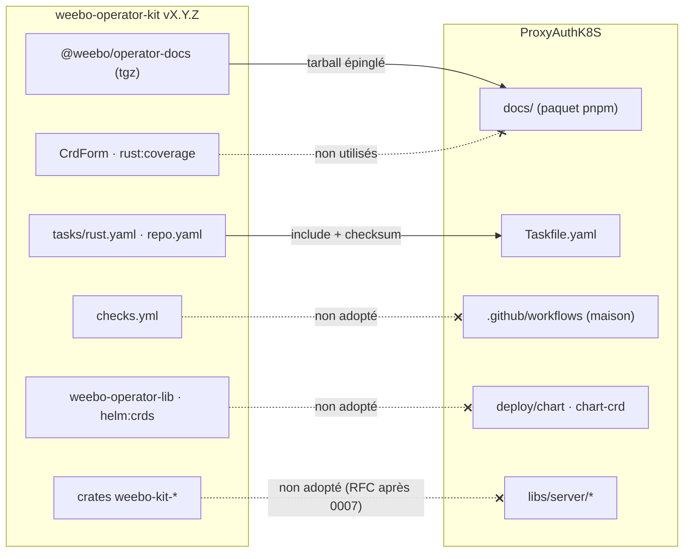
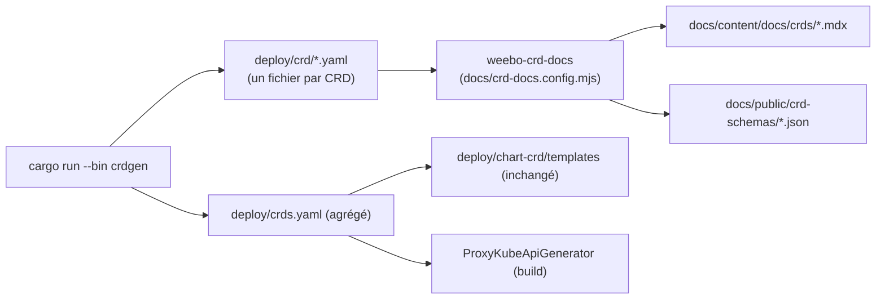
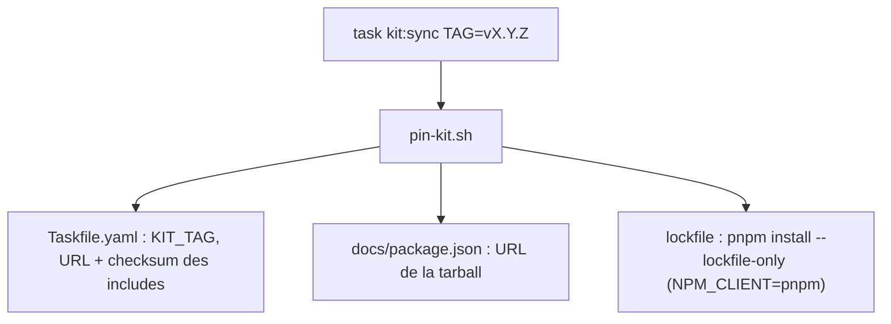
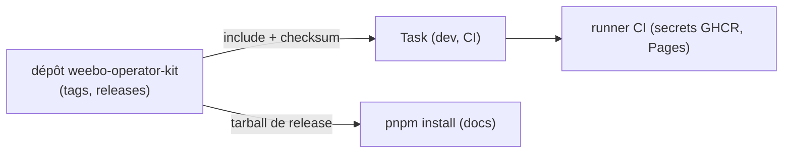

# RFC 0005 — Adopter weebo-operator-kit (doc, tâches)

| Field       | Value                                                                 |
| ----------- | --------------------------------------------------------------------- |
| Status      | In review                                                             |
| Short       | Adoption de weebo-operator-kit                                        |
| Settles     | Quelles briques du kit ProxyAuthK8S adopte (doc, Taskfiles partagés), lesquelles il refuse (CI réutilisable, chart lib, couverture, crates), et comment elles cohabitent avec le workspace pnpm de la RFC 0001 |
| Author      | Max Batleforc <maxleriche.60@gmail.com>                               |
| Co-author   | Claude Opus 5.5                                                       |
| Created     | 2026-10-17                                                            |
| Supersedes  | —                                                                     |
| Depends on  | RFC 0001 **livrée** (workspace pnpm, contrat de scripts, `.docs` autonome ; le dépôt est sous Yarn 4 tant qu'elle ne l'est pas) ; une release du kit qui contient la PR de la phase 0 |
| Kit         | [batleforc/weebo-operator-kit](https://github.com/batleforc/weebo-operator-kit) `v0.17.0` (2026-10-16), dernière release au 2026-10-17 ; épingle cible : la release qui suit la PR de la phase 0 |
| Touches     | `.docs/` → `docs/`, `pnpm-workspace.yaml`, `Taskfile.yaml`, `.tasks/{lint,audit,gen,docs}.yaml`, `.github/workflows/`, `mise.toml`, `cog.toml`, `deny.toml`, docs développeur ; côté kit : `templates/kit.yaml`, `templates/pin-kit.sh`, `packages/operator-docs/package.json` |
| Risk        | medium                                                                |

---

## 1. Summary

ProxyAuthK8S adopte de weebo-operator-kit ce qui n'impose pas de devenir un
« opérateur kit » au sens strict : le paquet de doc `@weebo/operator-docs`
(thème, mise en page, routes, générateur de référence CRD) et les Taskfiles
partagés `rust.yaml` et `repo.yaml`, inclus à distance et épinglés par
checksum. Le site de doc passe de `.docs/` à `docs/`, l'arborescence que le kit
attend, et reste un paquet du workspace pnpm de la RFC 0001.

Ne sont **pas** adoptés : la CI réutilisable `checks.yml` (pas de Redis, et
`kit:sync` épingle les workflows par tag), le chart lib `weebo-operator-lib` et
`helm:crds`, la couverture `rust:coverage` (le dépôt a déjà un gate qui marche),
le `CrdForm` (il ne sait pas rendre les `oneOf` de serde) et les crates
`weebo-kit-*` (§3).

Une PR sur le kit vient d'abord (phase 0) : peers de la doc en plages, pour ne
pas rétrograder `next` sous un correctif de sécurité, `NPM_CLIENT` pour la ligne
lockfile de `kit:sync`, et un repli de `KIT_TAG` hors de `Cargo.toml`.

### Before / after

```text
# aujourd'hui (Yarn 4 ; pnpm après la RFC 0001)
.docs/                    Fumadocs maison, thème maison, crds.mdx monolithique (crdoc + perl)
task lint:rust            cargo fmt --check, clippy --all -D warnings (local)
task audit                cargo audit, yarn audit, trivy si installé (local)
CI Rust                   back-clippy, back-cargo-test (+ coverage, Redis)… workflows maison

# avec cette RFC
docs/                     @weebo/operator-docs : thème, routes, une page par CRD (weebo-crd-docs)
task rust:lint            tasks/rust.yaml du kit, checksum épinglé (clippy --all-targets)
task rust:audit           cargo deny + trivy fs (kit), trivy obligatoire
task repo:lint            actionlint + hadolint des Containerfiles (kit)
task repo:audit           trivy config (kit) ; partie JS sautée (NPM_DIR vide)
task coverage:ci          inchangé (nextest + Redis, COVERAGE_MIN 62)
CI                        workflows maison qui appellent task rust:* / repo:*
task kit:sync TAG=vX.Y.Z  remet à jour toutes les épingles du kit en une commande
```



Les flèches pleines sont adoptées ; les pointillées barrées sont refusées
dans cette RFC, avec leur raison en §3.

---

## 2. Motivation

1. **La doc a un thème, des routes et un rendu CRD maison.** `.docs` porte sa
   propre config Fumadocs, et la référence CRD est un `crds.mdx` monolithique
   produit par `crdoc` (binaire mise, ou repli docker/podman), un `perl` qui
   échappe les accolades et `add-frontmatter.sh` (`.tasks/gen.yaml:86-128`).
   weebo-authentik et weebo-forgejo ont déjà la même doc via
   `@weebo/operator-docs`, avec une page et un schéma JSON par CRD.
2. **Les gates Rust sont copiés à la main.** `lint:rust` (`.tasks/lint.yaml:5-10`)
   et `audit:rust` (`.tasks/audit.yaml`) dupliquent ce que `tasks/rust.yaml` du
   kit fait déjà, avec des différences non voulues : le kit lance
   `clippy --workspace --all-targets` (tests compris) et `cargo deny`
   (licences, sources, doublons) en plus des advisories, alors que le dépôt
   lance `cargo clippy --all` et `cargo audit`, et saute trivy en silence s'il
   n'est pas installé (`.tasks/audit.yaml:34`).
3. **Chaque correction des gates est à refaire dans chaque dépôt.** Le kit
   épingle ses Taskfiles par checksum et met tout à jour avec
   `task kit:sync TAG=…` ; ProxyAuthK8S doit aujourd'hui recopier chaque
   changement.
4. **La doc doit migrer de toute façon.** La RFC 0001 a gardé `.docs` autonome
   précisément pour que ce changement ne touche que son paquet.

La couverture n'est **pas** une motivation : elle est déjà mesurée et bloquante
(`coverage:ci`, `.tasks/test.yaml:26-30`, `COVERAGE_MIN` 62, dernière mesure
63,18 % ; job `coverage` de `back-cargo-test.yaml:72-124`, avec Redis).

---

## 3. Goals / non-goals

**Goals**

- Le site de doc utilise `@weebo/operator-docs`, épinglé sur une release du
  kit, dans `docs/`, et reste un paquet du workspace pnpm.
- La référence CRD est générée par `weebo-crd-docs` (une page par kind, plus
  les schémas JSON), et la chaîne `crdoc` + `perl` + `add-frontmatter.sh`
  disparaît.
- `rust:lint`, `rust:audit`, `repo:lint` et `repo:audit` viennent du kit,
  épinglés par checksum ; les copies locales sont supprimées.
- Une seule commande (`task kit:sync TAG=…`) déplace toutes les épingles du
  kit.
- Aucune dépendance de la doc n'est rétrogradée sous un correctif de sécurité.
- Rien dans ce dépôt ne réintroduit npm.

**Non-goals**

- **`checks.yml` (CI réutilisable)** : son job `test` n'a pas de service Redis
  (les tests d'intégration et la couverture en exigent un,
  `REQUIRE_TEST_REDIS=1`), il demande `.github/actions/setup-mise` dans ce
  dépôt, et `pin-kit.sh:33` réécrit ses `uses:` par tag, ce qui écraserait un
  épinglage par SHA. Les workflows maison appellent les tâches du kit.
- **Le chart lib `weebo-operator-lib`** : il rend un Deployment d'opérateur
  avec webhook d'admission ; `deploy/chart` déploie un back, un front, otel,
  un HPA et un ingress. L'adapter coûterait plus qu'il n'apporte.
- **`tasks/helm.yaml` et `helm:crds`** : `lint` fait ~25 rendus de test qui
  supposent le contrat de valeurs du chart lib (`helm.yaml:35-117`).
  `helm:crds` (`helm.yaml:119-144`) met les CRD dans le chart principal et
  échoue sur tout `{{` dans une CRD, or ProxyKubeApi en a 16
  (`{{username}}`, `deploy/crds.yaml:691`). Supprimer `deploy/chart-crd`
  casserait un chemin d'installation publié (OCI signé,
  `quick-started.mdx:126`, `helm-chart.mdx:9`, notes de release). Une RFC à
  part, avec migration, si le besoin apparaît.
- **`rust:coverage`** : inclus avec `rust.yaml` mais **jamais appelé**. Il lance
  `cargo llvm-cov` sans nextest, sans Redis, avec `--include-ignored` et un
  seuil de 85 % ; l'adopter remplacerait le gate `coverage:ci` qui marche.
- **Le `CrdForm` du kit** : il ne connaît ni `oneOf` ni `anyOf`. ProxyKubeApi
  utilise des `oneOf` serde « externally tagged » partout (`cert`, `service`,
  `allowed_resources[]`, `config_from`, `rule_kind`…) : `CrdForm` afficherait
  toutes les variantes comme champs optionnels, donc des manifestes refusés par
  l'apiserver, et prendrait `virtual_apis[].kind` pour une union discriminée.
  `ProxyKubeApiGenerator` est gardé (§6.1).
- **Les crates `weebo-kit-*`** (télémétrie, leader election, `Condition`,
  squelette de contrôleur) : elles supposent tower/axum ; une RFC dédiée,
  ouverte **après la RFC 0007** (migration vers axum).
- **Les pages `reference/` du kit** (reason codes, events, metrics) : elles
  scannent `reason_codes!` et `Denial::new` des crates du kit, absents ici.
- **`perf.yml` et `task perf`** : ils mesurent un opérateur seul contre
  envtest via `weebo-kit-perf` ; ProxyAuthK8S est un proxy avec un front.
- **Repasser `docs/` à npm** pour coller au kit : on garde pnpm (RFC 0001) et
  on rend le kit agnostique (§6.4).
- **Réécrire le contenu de la doc** : on déplace les pages, on ne les réécrit
  pas.

---

## 4. User-facing design

### 4.1 Configuration

`docs/package.json` :

```json
{
  "name": "@proxy-auth-k8s/docs",
  "private": true,
  "scripts": {
    "dev": "next dev",
    "build": "next build",
    "typecheck": "fumadocs-mdx && next typegen && tsc --noEmit",
    "lint": "eslint",
    "gen:crds": "weebo-crd-docs"
  },
  "dependencies": {
    "@weebo/operator-docs": "https://github.com/batleforc/weebo-operator-kit/releases/download/vX.Y.Z/weebo-operator-docs-X.Y.Z.tgz",
    "fumadocs-core": "16.17.5",
    "fumadocs-ui": "16.17.5",
    "fumadocs-mdx": "15.4.7",
    "next": "16.4.2"
  }
}
```

Les versions de `next` et `fumadocs-*` restent celles d'aujourd'hui : la
release du kit visée déclare ses peers en **plages** (phase 0 : `next ^16.4.1`,
`fumadocs-core`/`fumadocs-ui ^16.16.2`, `fumadocs-mdx ^15.4.6`).

`Taskfile.yaml` :

```yaml
vars:
  KIT_TAG: vX.Y.Z      # lu par kit:sync / kit:cog faute de crate du kit dans Cargo.toml (phase 0)
includes:
  rust:
    taskfile: https://raw.githubusercontent.com/batleforc/weebo-operator-kit/vX.Y.Z/tasks/rust.yaml
    checksum: <sha256 posé par kit:sync>
  repo:
    taskfile: https://raw.githubusercontent.com/batleforc/weebo-operator-kit/vX.Y.Z/tasks/repo.yaml
    checksum: <sha256 posé par kit:sync>
    vars:
      CONTAINERFILES: deploy/build/back/Containerfile deploy/build/front/Containerfile
      NPM_DIR: ""      # partie JS de repo:audit sautée ; audit:js (pnpm audit) la couvre
  kit:
    taskfile: .tasks/kit.yaml   # templates/kit.yaml du kit, rendu par kit:cog
    vars:
      NPM_CLIENT: pnpm
  fuzz: .tasks/fuzz.yaml        # local (RFC 0003), le kit n'a pas de fuzz
```

`mise.toml` gagne `cargo:cargo-deny`, `hadolint` et `trivy` : les tâches du kit
les appellent via `mise exec`.

- Le `checksum:` est obligatoire sur chaque include distant : Task refuse un
  fichier dont le hash ne correspond pas. C'est le côté fermé.
- L'URL de la tarball est une release immuable du kit ; jamais de `file:` ni
  de chemin local poussé (`docs/plan.md` du kit).
- `allowBuilds` (RFC 0001) : `@weebo/operator-docs` n'a pas de script
  d'installation ; rien à ajouter. S'il en gagnait un, `strictDepBuilds`
  (RFC 0001) bloquerait l'installation, ce qui est voulu.

### 4.2 Behaviour rules

- `task lint` dépend de `rust:lint`, `repo:lint`, `lint:helm` (local),
  `js:lint` et `fuzz:check` (RFC 0003). `lint:rust` et `lint:actions` locaux
  sont supprimés : `repo:lint` fait actionlint, et hadolint en plus.
- `task audit` dépend de `rust:audit` (`cargo deny` + `trivy fs`), `repo:audit`
  (`trivy config` ; partie JS sautée car `NPM_DIR` est vide, `repo.yaml:35`),
  `audit:js` (`pnpm audit` sur tout le workspace, RFC 0001) et
  `cargo deny --manifest-path fuzz/Cargo.toml check` (le workspace `fuzz/` de la
  RFC 0003 est séparé, `rust:audit` ne le voit pas). trivy est **obligatoire** :
  plus de saut silencieux.
- `task test` et `task coverage:ci` restent locaux (nextest, Redis,
  `COVERAGE_MIN` 62). `rust:coverage` n'est appelé par aucune tâche ni aucun
  workflow.
- **CI** : les workflows maison (`back-clippy`, `back-cargo-test` avec son
  service Redis et son job `coverage`, audit) appellent `task rust:lint`,
  `task rust:audit`, `task repo:lint`, `task repo:audit`. `back-clippy` passe en
  bloquant (aujourd'hui `continue-on-error: true`). Le job nightly de fuzz
  (RFC 0003) reste un workflow local.
- **Dependabot** reste actif sur `next` et `fumadocs-*` dans `docs/` : une
  montée dans la plage des peers du kit s'installe ; une montée hors plage fait
  échouer `pnpm install` (§10.2).
- Sans réseau, `task --offline` utilise le cache de Task : un dev déjà passé
  une fois continue de pouvoir linter.
- `docs:api` (pages API depuis `swagger.json`) reste local : le kit ne
  couvre pas l'OpenAPI.

### 4.3 Validation

Bloquant :

| Condition | Rationale |
| --- | --- |
| checksum d'un include distant différent | Task refuse : un Taskfile modifié en amont ne s'exécute pas sans revue |
| `cargo deny check` échoue (licence hors liste, source git, advisory) | `deny.toml` devient la politique de dépendances Rust (§6.3) |
| peers de `@weebo/operator-docs` non satisfaits | `pnpm install` en strict-peer (RFC 0001) échoue plutôt que de construire un site incohérent |
| trivy absent | l'audit échoue au lieu de sauter l'étape |
| version de Task < 3.54 | les includes distants ne sont pas supportés en dessous (`docs/plan.md:512` du kit) |

Avertissements :

| Condition | Behaviour | Surfaced in |
| --- | --- | --- |
| Une release du kit plus récente existe | rien ne bouge tant que `kit:sync` n'est pas lancé | watch GitHub sur les releases du kit (la tarball n'est pas suivie par Dependabot) |

---

## 5. Architecture

### 5.1 Chaîne de la référence CRD



Une seule source (la sortie de `crdgen`) alimente le chart, la doc et le
générateur ; la chaîne `crdoc` → `perl` → `add-frontmatter.sh` disparaît.

### 5.2 Épinglage



Invariant : parce que chaque include porte un checksum et que la tarball est
une release immuable enregistrée dans le lockfile, aucun code du kit ne
s'exécute ici sans une ligne de diff revue dans ce dépôt. Aucun workflow
réutilisable n'est appelé, donc aucun tag déplacé ne peut changer la CI.

---

## 6. Detailed design

### 6.1 `.docs` → `docs/`

- `git mv .docs docs`, puis `pnpm-workspace.yaml` (`- docs`), les chemins de
  `.tasks/gen.yaml` (`swagger-file`, `docs:api`), `docs-deploy.yml`,
  `tsconfig.base.json` (`exclude`), `eslint.config.mjs` (`ignores`),
  `.prettierignore`.
- Les fichiers propres au site (`next.config.mjs`, layouts, `src/lib/*`,
  thème) sont remplacés par l'arborescence attendue du kit :
  `next.config.mjs` (`withOperatorDocs({ basePath })`), `source.config.ts`,
  `src/app/` (routes fines), `src/components/mdx.tsx`,
  `src/lib/{shared,source,crd-choices}.ts`.
- On garde les composants propres au projet : `ProxyKubeApiGenerator`
  (`src/components/proxykubeapi-generator.{client,server}.tsx` : unions `oneOf`
  avec choix de variante, validation des champs requis, des types et des
  bornes, presets TLS/OIDC/`allowed_resources`, lecture de
  `deploy/crds.yaml` au build), `Mermaid`, `OpenAPIPageClient`/`APIPage`, et la
  génération des pages API. Le support des `oneOf` serde dans `CrdForm` pourra
  faire l'objet d'une PR kit plus tard.
- `content/docs/crds.mdx` est remplacé par `content/docs/crds/` (généré) ;
  `index.mdx` et `meta.json` listent `"...crds"`.
- Versions : `next` 16.4.2, `fumadocs-core`/`fumadocs-ui` 16.17.5 et
  `fumadocs-mdx` 15.4.7 **ne bougent pas**, grâce aux peers en plages de la
  release du kit visée. Les peers exacts de v0.17.0 (`next 16.4.0`)
  imposeraient de redescendre sous trois advisories corrigées en 16.4.1
  (GHSA-673q-mjm6-r5xr et GHSA-2464-fhr4-w9xw, critiques, RCE ;
  GHSA-p3m5-59mp-jv5r, haute, DoS), que ni `pnpm audit` ni trivy ne signalent
  encore.

### 6.2 CRD par fichier

- `gen:crds-file` écrit `deploy/crd/<kind>.yaml` (un fichier par CRD), comme
  le kit l'attend, en plus de l'actuel `deploy/crds.yaml` agrégé, encore lu par
  le chart CRD, le générateur et les exemples.
- `gen:docs:crd` (crdoc) et `add-frontmatter.sh` sont supprimés ;
  `docs:crds` lance `pnpm --filter @proxy-auth-k8s/docs gen:crds`.

### 6.3 Taskfiles partagés

- `rust.yaml` remplace `lint:rust` et `audit:rust`. Il apporte `cargo deny`,
  qui remplace `cargo audit` pour les advisories, et `trivy fs` sur
  `Cargo.lock`.
- **`deny.toml`** à la racine :
  - licences : la liste autorisée part des licences présentes aujourd'hui dans
    `Cargo.lock`, relue dans la PR ; aucune licence copyleft forte (GPL, AGPL)
    pour une dépendance qui finit dans le binaire ;
  - sources : `crates.io` seulement, sources git refusées par défaut ;
  - advisories : refus, exceptions nommées et datées seulement.
- **`clippy --workspace --all-targets -D warnings`** compile aussi les tests :
  les avertissements qu'il révèle sont **corrigés** dans la phase 1, sans
  `#[allow]` en masse ni assouplissement du gate.
- `rust:coverage` est inclus avec `rust.yaml` mais n'est appelé nulle part ;
  `coverage:ci` (`.tasks/test.yaml`) reste le gate.
- `rust:doctor` remplace la partie envtest des vérifications de `task init`.
- `repo.yaml` remplace `lint:actions`, apporte hadolint sur les deux
  Containerfiles, et `repo:audit` (`trivy config`) est adopté dès la phase 1 :
  sa partie JS est déjà sautée quand `NPM_DIR` est vide.
- `.tasks/kit.yaml` est rendu depuis `templates/kit.yaml` (`kit:cog`,
  `kit:sync`) ; `cog.toml` est rendu par `kit:cog`, ce qui aligne les règles
  de commit avec les autres dépôts weebo.

### 6.4 PR sur le kit (phase 0)

Trois changements, sans effet pour weebo-authentik et weebo-forgejo :

- **Peers en plages** dans `packages/operator-docs/package.json` :
  `next ^16.4.1`, `fumadocs-core`/`fumadocs-ui ^16.16.2`,
  `fumadocs-mdx ^15.4.6`. Un correctif de sécurité de Next ne demande plus une
  release du kit (le kit a sorti 9 releases en 6 jours).
- **`NPM_CLIENT`** (défaut `npm`) dans `templates/kit.yaml` : `pnpm` donne
  `pnpm install --lockfile-only` au lieu de `npm install --package-lock-only`
  (`templates/kit.yaml:105-109`).
- **Repli de `KIT_TAG`** : `kit:sync` et `kit:cog` lisent aujourd'hui le tag
  dans la ligne `git = ".../weebo-operator-kit", tag = …` de `Cargo.toml`
  (`templates/kit.yaml:30-34`, `76-80`). Sans crate du kit, ils échouent
  (« kit tag '' is not vX.Y.Z »). Repli : la variable `KIT_TAG` du Taskfile,
  réécrite par `pin-kit.sh`.

`repo:audit` n'a besoin d'aucun changement : `{{if .NPM_DIR}}…{{else}}true{{end}}`
(`tasks/repo.yaml:35`) saute déjà la partie npm. `perf.yml` n'est pas touché :
il n'est pas adopté ici. La PR passe d'abord ; la RFC ne s'implémente qu'avec
une release du kit qui la contient.

### 6.P Proof against a real client

Consommateurs : Task ≥ 3.54 (mise), pnpm (RFC 0001), Next 16.4.2 au build,
GitHub Pages pour la publication, `cargo deny`, et les workflows GitHub Actions
maison.

1. `task --list` charge les includes distants ; la première exécution
   télécharge `rust.yaml` et `repo.yaml`, puis `task --offline rust:lint`
   fonctionne sans réseau.
2. `task rust:lint`, `task rust:audit`, `task repo:lint`, `task repo:audit` :
   code 0 sur `main` migré ; `task coverage:ci` passe toujours au seuil 62.
3. `task docs:crds` produit une page par CRD (`ProxyKubeApi`, et toute autre
   kind sortie de `crdgen`) et `public/crd-schemas/index.json` ; la page du
   générateur `ProxyKubeApiGenerator` fonctionne comme avant.
4. `task docs:build` puis `docs-deploy.yml` : le site publié sert
   `/docs/crds/<kind>` (200), `llms.txt` (200) et la recherche répond.
5. **Refus, include modifié** : on remplace le `checksum:` de `rust.yaml` par
   un hash faux ; `task rust:lint` échoue sur la vérification du checksum et
   aucune commande `cargo` n'est lancée.
6. **Refus, source Rust non autorisée** : une dépendance `git =` fait échouer
   `task rust:audit` (`cargo deny` : `source not allowed`).
7. **Refus, peers** : forcer `next@16.3.0` (hors de `^16.4.1`) dans `docs/` fait
   échouer `pnpm install` ; `next@16.4.2` s'installe.
8. **Refus, outil manquant** : sans trivy dans le `PATH` de mise, `task audit`
   échoue au lieu de passer.
9. `task kit:sync TAG=vX.Y.Z` sans crate du kit dans `Cargo.toml` réussit et
   met à jour `KIT_TAG`, les includes, la tarball et le lockfile pnpm.
10. `grep -rn "npm \(ci\|install\|audit\)" Taskfile.yaml .tasks .github`
    ne renvoie rien : npm n'est pas revenu.

**Deliberately untouched**, so reviewers do not go looking :

- `deploy/chart` et `deploy/chart-crd` : ni chart lib ni `helm:crds` (§3).
- `libs/server/*` : les crates du kit ne sont pas adoptées (§3).
- `apps/front` et `front-api` : hors du périmètre du kit.
- `coverage:ci` et le job `coverage` : gate existant conservé.
- Le contenu rédigé de la doc : déplacé, pas réécrit.

---

## 7. Security

**Rating:** medium. Du code tiers (Taskfiles, tarball de doc) s'exécute en
local et en CI ; il vient d'un dépôt du même mainteneur, mais c'est une
nouvelle frontière de confiance.

### 7.1 Threat model



| # | Threat (STRIDE) | Where | Mitigation | Residual risk |
| --- | --- | --- | --- | --- |
| T1 | Tampering : Taskfile du kit modifié après épinglage (tag déplacé) | include distant | `checksum:` sha256 vérifié par Task | aucun tant que le checksum est revu au `kit:sync` |
| T2 | Tampering : tarball de doc remplacée sur la release | `pnpm install` | intégrité enregistrée dans `pnpm-lock.yaml` ; une tarball différente fait échouer `--frozen-lockfile` | aucun |
| T3 | ~~Workflow réutilisable modifié~~ | — | **sans objet** : `checks.yml` n'est pas adopté | — |
| T4 | Elevation : Taskfile du kit qui lit les secrets du runner | `task` en CI | les workflows maison ne passent aux jobs `task rust:*`/`repo:*` aucun secret ; `permissions: contents: read` | aucun |
| T5 | Tampering : script d'installation dans la tarball de doc | `pnpm install` | `allowBuilds` + `strictDepBuilds` (RFC 0001) | aucun |
| T6 | Info disclosure : la doc publie un nom d'hôte interne | `docs/content`, `basePath` | revue du contenu déplacé, rien de neuf n'est écrit | faible |
| T7 | Elevation : dépendance de doc rétrogradée sous un correctif de sécurité pour satisfaire un peer exact | `docs/package.json` | peers du kit en plages (phase 0) ; Dependabot actif | aucun |
| T8 | Tampering : étape d'audit sautée en silence (outil absent) | `task audit` | trivy, `cargo-deny`, hadolint dans `mise.toml` ; absence = échec | aucun |

Tests négatifs : T1 → §6.P point 5 ; T2 → `pnpm install --frozen-lockfile`
avec une URL de tarball modifiée échoue ; T5 → RFC 0001 §6.P point 6 ; T7 →
§6.P point 7 ; T8 → §6.P point 8.

### 7.2 Authentication and authorisation

Aucune surface authentifiée n'est touchée. Le site de doc reste statique
(GitHub Pages).

### 7.3 Input handling and injection

`weebo-crd-docs` lit les CRD générées par ce dépôt (`deploy/crd/`), pas une
entrée externe. `ProxyKubeApiGenerator` s'exécute dans le navigateur du lecteur
et ne fait que produire du YAML qu'il copie ; rien n'est envoyé.

### 7.4 Secrets and cryptography

Aucun secret ajouté. Les tâches du kit ne reçoivent pas de secrets (T4).

### 7.5 Abuse and resource exhaustion

Sans objet : site statique, pas de surface distante nouvelle.

### 7.6 Existing defences that still hold

`minimumReleaseAge`, `allowBuilds`, `strictDepBuilds` et `pnpm audit` (apportés
par la RFC 0001), gitleaks et `cog verify` en pre-commit, signature et SBOM des
images, Trivy, CodeQL, gate de couverture. `cargo deny` remplace `cargo audit`
et ajoute licences et sources.

---

## 8. Supply chain

| Dependency / image / tool | Version | Why this one | Licence | Known CVEs (`task audit`) | Maintenance |
| --- | --- | --- | --- | --- | --- |
| `@weebo/operator-docs` (tarball) | release qui suit la phase 0 (v0.17.0 aujourd'hui) | thème, routes, générateur CRD partagés avec les autres dépôts weebo | MIT | une seule dépendance (`js-yaml ^5.2.1`) ; vérifié au `pnpm audit` | même mainteneur, releases fréquentes (9 en 6 jours ; 0.x : une mineure peut casser) |
| `next` | 16.4.2 (inchangé) | dernière 16.4 ; 16.4.1 corrige trois advisories (§6.1) | MIT | aucune connue sur 16.4.2 au 2026-10-17 | actif |
| `fumadocs-core`, `fumadocs-ui` | 16.17.5 (inchangé) | dans la plage `^16.16.2` | MIT | aucune connue (OSV, GHSA) | actif |
| `fumadocs-mdx` | 15.4.7 (inchangé) | dans la plage `^15.4.6` | MIT | aucune connue (OSV, GHSA) | actif |
| Taskfiles `rust.yaml`, `repo.yaml` | kit, checksum | gates partagés | MIT (kit) | — | même mainteneur |
| `cargo-deny` | dernière (mise) | licences, sources, doublons et advisories | MIT/Apache-2.0 | aucune connue | actif |
| `hadolint` | dernière (mise) | lint des Containerfiles (`repo:lint`) | GPL-3.0 (outil, non distribué) | aucune connue | actif |
| `trivy` | dernière (mise) | `trivy fs` et `trivy config` | Apache-2.0 | aucune connue | actif |

Retirés : `crdoc` (mise `go:fybrik.io/crdoc`), le repli docker/podman de
`docs:crd`, `cargo audit` (remplacé par `cargo deny`).

- **Build et release** : l'image front ne change pas. Le site de doc reste
  un export statique ; sa SBOM gagne `@weebo/operator-docs`.
- **Updates** : la tarball n'est pas suivie par Dependabot (URL, pas de
  registre) ; elle bouge avec `task kit:sync`. `next` et `fumadocs-*` restent
  suivis par Dependabot dans la plage des peers.

---

## 9. Data and privacy

| Data | Personal? | Where stored | Retention | Who can read it | Leaves the instance? |
| --- | --- | --- | --- | --- | --- |
| aucune nouvelle | — | — | — | — | — |

Le site reste statique sans analytics. Le générateur produit du YAML dans le
navigateur et n'envoie rien. Les routes `llms.txt` et `llms-full.txt`
publient le contenu de la doc, déjà public.

---

## 10. Operability

### 10.1 Observability

- **Metrics** : aucune.
- **Logs and audit trail** : `cargo deny` ajoute un rapport par advisory et
  par licence dans la sortie de `task audit`.
- **Alerts** : aucune.

### 10.2 Failure modes

| Failure | Detected by | Behaviour | Recovery |
| --- | --- | --- | --- |
| GitHub injoignable au premier `task` | Task | échec ; ensuite `--offline` sert le cache | relancer en ligne une fois |
| Release du kit qui casse (0.x) | CI de la PR `kit:sync` | PR rouge, `main` intact | rester sur l'ancienne épingle, corriger côté kit |
| Dependabot monte `next`/`fumadocs` hors de la plage des peers | `pnpm install` | échec (fermé) | élargir la plage par une release du kit, puis `kit:sync` |
| `cargo deny` rouge sur une licence existante | `task rust:audit` | échec | décider la licence dans `deny.toml` |
| outil d'audit absent | `task audit` | échec | `mise install` |

### 10.3 Performance and capacity

`cargo deny` et `trivy fs` ajoutent environ une minute à `task audit`.
`clippy --all-targets` compile aussi les tests : `task lint` est plus long en
local la première fois.

---

## 11. Other concerns

- **Accessibility** : le site prend le thème du kit ; à vérifier au contraste
  et au clavier sur la page CRD et le générateur (§6.P point 4).
- **Internationalisation** : la doc reste dans sa langue actuelle.
- **Compliance** : `cargo deny` formalise la politique de licences Rust.
- **Licensing** : `hadolint` est GPL-3.0, utilisé comme outil et jamais
  distribué : pas d'obligation.
- **Documentation** : guide développeur (tâches `rust:*`, `repo:*`,
  `kit:sync`, `KIT_TAG`), README, `CLAUDE.md` (épinglage du kit).

---

## 12. Alternatives considered

| Alternative | Why rejected |
| --- | --- |
| Tout adopter (chart lib, `helm.yaml`, crates, `perf`) | le chart et `perf` supposent un opérateur seul ; les crates touchent le runtime : trois RFC en une |
| CI réutilisable `checks.yml` (option A) | pas de Redis dans `test` ; `pin-kit.sh` réécrit par tag, donc pas d'épinglage par SHA (T3) ; action `setup-mise` à ajouter. Les workflows maison qui appellent les tâches du kit donnent les mêmes gates |
| `rust:coverage` du kit à la place de `coverage:ci` | sans nextest ni Redis, seuil 85 % arbitraire : remplacerait un gate qui marche |
| `CrdForm` à la place de `ProxyKubeApiGenerator` | ne rend pas les `oneOf` serde : produirait des manifestes refusés |
| `helm:crds` à la place de `deploy/chart-crd` | échoue sur les `{{` des CRD ; casse un chemin d'installation publié |
| Rétrograder `next` à 16.4.0 pour les peers exacts de v0.17.0 | réintroduit deux RCE et un DoS corrigés en 16.4.1 (T7) |
| Monter les peers exacts du kit à 16.4.2 | règle le cas une fois ; le problème revient à chaque correctif de Next |
| Repasser `docs/` en npm pour coller au kit | deux gestionnaires de paquets dans le dépôt, deux audits ; contredit la RFC 0001 |
| Adopter sans la PR kit | `kit:sync` échoue sans crate du kit et réintroduit `npm install` : l'avantage principal du kit est perdu |
| Copier le thème du kit dans `.docs` | une copie de plus qui dérive, exactement ce que le kit supprime |
| Ne rien faire | la doc et les gates Rust restent à maintenir à la main, en divergence avec les autres dépôts weebo |

---

## 13. Rollout and compatibility

- **Default behaviour** : identique pour les utilisateurs du proxy ; l'URL de
  la doc garde son `basePath`. Les anciennes URLs `/docs/crds` (page unique)
  deviennent `/docs/crds/` (index) : la page d'index liste chaque kind.
  L'installation des CRD (`chart-crd`) ne change pas.
- **Migration développeur** : `mise install` (Task ≥ 3.54, cargo-deny,
  hadolint, trivy), puis `task --list`. `task lint:rust` devient
  `task rust:lint`.
- **Operator prerequisites** : aucun.
- **Prérequis d'implémentation** : RFC 0001 livrée ; release du kit qui contient
  la PR de la phase 0.
- **Rollback** : `git revert` ; aucun état persistant.
- **Feature flag** : non.

---

## 14. Test plan

- **Integration** : `task lint`, `task audit`, `task test`,
  `task coverage:ci`, `task docs:build`, CI complète.
- **Proof** : §6.P.
- **Security** : T1 (point 5), T2 (tarball modifiée), T5 (RFC 0001), T7
  (point 7), T8 (point 8).
- **Existing suites** : CI Rust, envtest, couverture, front : inchangées en
  résultat.

---

## 15. Decisions and open questions

### Resolved

| # | Question | Decision |
| --- | --- | --- |
| 0 | Adopter le kit dans la RFC 0001 ? | **Non, RFC séparée** (grill de la RFC 0001, Q24). |
| 1 | Peers de la doc | **Peers du kit en plages** (phase 0) ; ProxyAuthK8S ne rétrograde rien (`next` 16.4.2), ce qui évite trois advisories corrigées en 16.4.1. |
| 2 | `ProxyKubeApiGenerator` ou `CrdForm` | **Garder `ProxyKubeApiGenerator`** : `CrdForm` ne rend pas les `oneOf` serde de ProxyKubeApi. |
| 3 | CI | **Option B** : workflows maison qui appellent `task rust:*`/`repo:*`. `checks.yml` n'a pas Redis, et `pin-kit.sh` réécrit par tag. T3 sans objet. |
| 4 | Couverture | **`coverage:ci` local conservé** (nextest, Redis, 62 %) ; `rust:coverage` inclus mais jamais appelé. La couverture était déjà mesurée. |
| 5 | `helm:crds` | **Non** : `{{` dans les CRD et chemin d'installation publié ; RFC à part si besoin. |
| 6 | PR kit avant la RFC | **Oui** : peers en plages, `NPM_CLIENT` (ligne lockfile de `kit:sync`), repli `KIT_TAG`. `repo:audit` est adoptable sans elle. |
| 7 | Crates `weebo-kit-*` | **RFC dédiée après la RFC 0007** (axum). |
| 8 | Dépendance à la RFC 0001 | **Prérequis strict** : le dépôt est sous Yarn 4 tant qu'elle n'est pas livrée. |
| 9 | Outils d'audit | **`cargo-deny`, `hadolint`, `trivy` dans `mise.toml`** ; trivy obligatoire. |
| 10 | Dependabot sur `next`/`fumadocs` | **Actif**, dans la plage des peers. |
| 11 | `deny.toml` | Licences présentes aujourd'hui, relues ; pas de GPL/AGPL dans le binaire ; pas de source git ; `cargo deny` remplace `cargo audit`. |
| 12 | Avertissements `clippy --all-targets` | **Corrigés en phase 1**, sans `#[allow]` en masse. |

### Still open

Aucune.

---

## 16. Implementation phases

| Phase | Content |
| --- | --- |
| 0 | Prérequis : RFC 0001 livrée. (kit) `feat: ranged docs peers, NPM_CLIENT for kit:sync, KIT_TAG fallback` ; release du kit |
| 1 | `build: include kit rust and repo taskfiles`. Includes épinglés, `deny.toml`, `cargo-deny`/`hadolint`/`trivy` dans `mise.toml`, correction des avertissements `clippy --all-targets`, `repo:audit`, suppression de `lint:rust`, `lint:actions`, `audit:rust` ; workflows maison basculés sur `task rust:*`/`repo:*`, `back-clippy` bloquant |
| 2 | `build(docs): move .docs to docs`. `git mv` et chemins, sans changer le site |
| 3 | `feat(docs): adopt @weebo/operator-docs`. Tarball, arborescence du kit, `weebo-crd-docs`, `ProxyKubeApiGenerator` conservé, suppression de `crdoc` |
| 4 | `build: kit:sync and kit:cog`. `.tasks/kit.yaml` (`NPM_CLIENT=pnpm`), `KIT_TAG`, `cog.toml` rendu |
| 5 | `docs: developer guide for kit tasks` |

Chaque phase laisse la CI verte. Le contrôle T1 (checksum) arrive en phase 1,
avec le premier include distant qu'il protège ; le contrôle T8 (outils
obligatoires) arrive dans la même phase que les tâches qui les appellent.

---

## 17. Implementation notes

Phase 1 (2026-10-17) :

- Includes épinglés sur **v0.17.0**, pas sur la release de la phase 0 :
  `tasks/rust.yaml` et `tasks/repo.yaml` sont identiques entre v0.17.0 et la
  PR de la phase 0 (mêmes sha256), et un tag qui n'existe pas encore ferait
  échouer le chargement de tout le Taskfile. `kit:sync` (phase 4) ne
  déplacera que le tag.
- `deny.toml` reprend les deux exceptions de `.cargo/audit.toml` (supprimé avec
  `cargo-audit`) : RUSTSEC-2023-0071 (`rsa`) et RUSTSEC-2026-0258 (`h2` 0.3
  d'actix, retiré par la RFC 0007). `unmaintained = "workspace"` : les crates
  non maintenus transitifs (`unsafe-libyaml`, `zvariant`, `zbus_names`) sont
  signalés sans bloquer, comme `cargo audit` le faisait. `inout` yanked :
  `cargo update -p inout`. Les crates du dépôt déclarent `license = "MIT"`
  (le dépôt l'est déjà). `libfuzzer-sys` (NCSA) en exception, workspace
  `fuzz/` seulement.
- `clippy --workspace --all-targets -D warnings` était déjà propre.
- hadolint : DL3018 (versions `apk` non épinglées) ignoré en ligne sur l'image
  back, la base `alpine:3` étant flottante.
- actionlint : `.github/actionlint.yaml` exclut `.github/workflows/.bck/`
  (workflows retirés, jamais exécutés par GitHub), comme le faisait
  `lint:actions` ; `SHELLCHECK_OPTS=--severity=warning` posé au niveau du
  Taskfile.
- CI : `.github/actions/setup-mise` (repris de weebo-forgejo, mise épinglé et
  vérifié par sha256) ; `back-clippy` garde son rapport SARIF et gagne un pas
  bloquant `task rust:lint` ; `back-dep-audit` lance `task rust:audit
  audit:fuzz` ; nouveau `repo-checks.yaml` pour `repo:lint` et `repo:audit`.
  Chaque job n'installe que ses outils (`MISE_EXEC_AUTO_INSTALL=false`).
