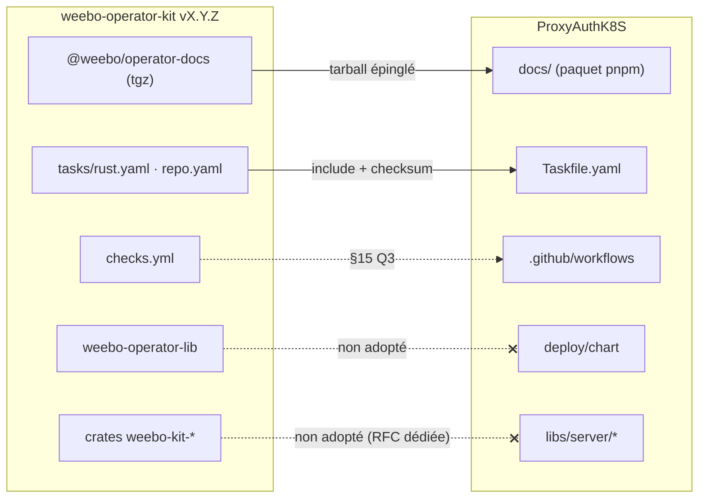
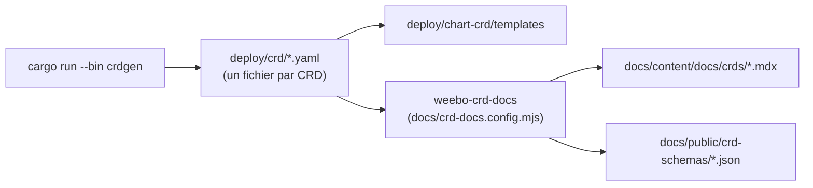
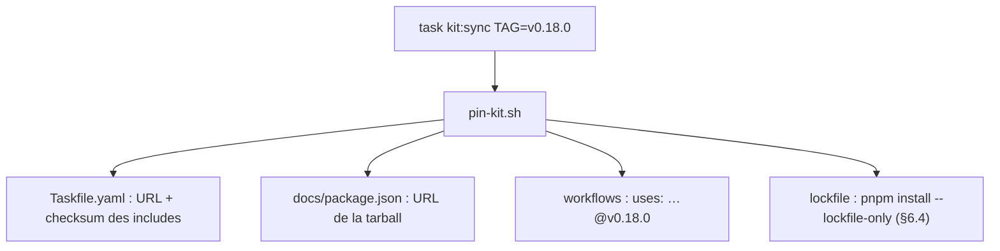
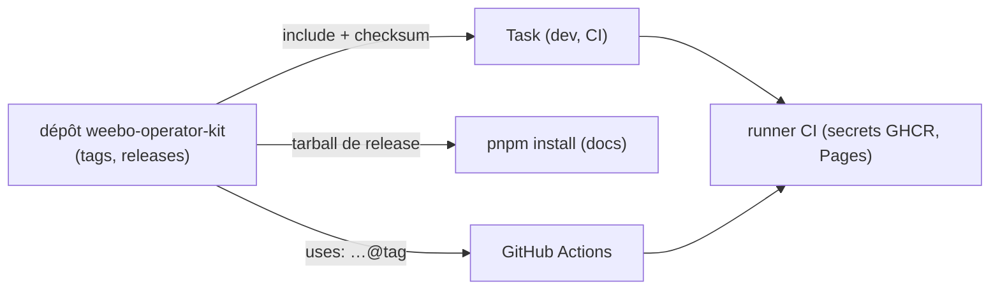

# RFC 0005 — Adopter weebo-operator-kit (doc, tâches, CI)

| Field       | Value                                                                 |
| ----------- | --------------------------------------------------------------------- |
| Status      | Draft                                                                 |
| Short       | Adoption de weebo-operator-kit                                        |
| Settles     | Quelles briques du kit ProxyAuthK8S adopte (doc, Taskfiles partagés, CI réutilisable), lesquelles il refuse, et comment elles cohabitent avec le workspace pnpm de la RFC 0001 |
| Author      | Max Batleforc <maxleriche.60@gmail.com>                               |
| Co-author   | Claude Opus 5.5                                                       |
| Created     | 2026-10-17                                                            |
| Supersedes  | —                                                                     |
| Depends on  | RFC 0001 (workspace pnpm, contrat de scripts, `.docs` autonome)       |
| Kit         | [batleforc/weebo-operator-kit](https://github.com/batleforc/weebo-operator-kit) `v0.17.0` (2026-10-16) |
| Touches     | `.docs/` → `docs/`, `pnpm-workspace.yaml`, `Taskfile.yaml`, `.tasks/{lint,audit,gen,docs}.yaml`, `.github/workflows/`, `.github/actions/setup-mise`, `cog.toml`, `deny.toml`, `deploy/chart-crd`, docs développeur ; côté kit : `tasks/repo.yaml`, `templates/kit.yaml` |
| Risk        | medium                                                                |

---

## 1. Summary

ProxyAuthK8S adopte de weebo-operator-kit ce qui n'impose pas de devenir un
« opérateur kit » au sens strict : le paquet de doc `@weebo/operator-docs`
(thème, mise en page, routes, générateur de référence CRD), les Taskfiles
partagés `rust.yaml` et `repo.yaml` inclus à distance et épinglés par checksum,
et, si §15 Q3 le confirme, la CI réutilisable `checks.yml`. Le site de doc
passe de `.docs/` à `docs/`, l'arborescence que le kit attend. Il reste un
paquet du workspace pnpm de la RFC 0001. Le chart lib `weebo-operator-lib` et
les crates `weebo-kit-*` ne sont pas adoptés ici (§3). Le kit suppose npm à
plusieurs endroits (`kit:sync`, `repo:audit`, `perf.yml`) : cette RFC propose
de le rendre agnostique au gestionnaire de paquets côté kit, plutôt que de
faire revenir npm dans ce dépôt.

### Before / after

```text
# aujourd'hui
.docs/                    Fumadocs maison, thème maison, crds.mdx monolithique (crdoc + perl)
task lint:rust            cargo fmt --check, clippy --all -D warnings (local)
task audit                cargo audit, pnpm audit, trivy (local)
CI Rust                   back-clippy, back-cargo-test… (workflows maison)

# avec cette RFC
docs/                     @weebo/operator-docs : thème, routes, une page par CRD (weebo-crd-docs)
task rust:lint            tasks/rust.yaml du kit @v0.17.0, checksum épinglé
task rust:audit           cargo deny + trivy fs (kit)
task repo:lint            actionlint + hadolint des Containerfiles (kit)
task kit:sync TAG=vX.Y.Z  remet à jour toutes les épingles du kit en une commande
```



Les flèches pleines sont adoptées ; les pointillées barrées sont refusées
dans cette RFC, avec leur raison en §3.

---

## 2. Motivation

1. **La doc a un thème, des routes et un rendu CRD maison.** `.docs` porte sa
   propre config Fumadocs, et la référence CRD est un `crds.mdx` monolithique
   produit par `crdoc` (binaire mise, ou repli docker/podman), un `perl` qui
   échappe les accolades et `add-frontmatter.sh` (`.tasks/gen.yaml:86-128`).
   weebo-authentik et weebo-forgejo ont déjà la même doc via
   `@weebo/operator-docs`, avec une page et un schéma JSON par CRD, et un
   constructeur de manifeste.
2. **Les gates Rust sont copiés à la main.** `lint:rust` (`.tasks/lint.yaml:5-10`)
   et `audit:rust` (`.tasks/audit.yaml`) dupliquent ce que `tasks/rust.yaml` du
   kit fait déjà, avec des différences non voulues : le kit lance
   `clippy --workspace --all-targets` (tests compris) et `cargo deny`
   (licences, sources, doublons) en plus des advisories, alors que le dépôt
   lance `cargo clippy --all` et `cargo audit`.
3. **Chaque correction des gates est à refaire dans chaque dépôt.** Le kit
   épingle ses Taskfiles par checksum et met tout à jour avec
   `task kit:sync TAG=…` ; ProxyAuthK8S doit aujourd'hui recopier chaque
   changement.
4. **La doc doit migrer de toute façon.** La RFC 0001 a gardé `.docs` autonome
   précisément pour que ce changement ne touche que son paquet.

---

## 3. Goals / non-goals

**Goals**

- Le site de doc utilise `@weebo/operator-docs`, épinglé sur une release du
  kit, dans `docs/`, et reste un paquet du workspace pnpm.
- La référence CRD est générée par `weebo-crd-docs` (une page par kind, plus
  les schémas JSON), et la chaîne `crdoc` + `perl` + `add-frontmatter.sh`
  disparaît.
- `rust:lint`, `rust:audit` et `repo:lint` viennent du kit, épinglés par
  checksum ; les copies locales sont supprimées.
- Une seule commande (`task kit:sync TAG=…`) déplace toutes les épingles du
  kit.
- Rien dans ce dépôt ne réintroduit npm.

**Non-goals**

- **Le chart lib `weebo-operator-lib`** : il rend un Deployment d'opérateur
  avec webhook d'admission ; `deploy/chart` déploie un back, un front, otel,
  un HPA et un ingress. L'adapter coûterait plus qu'il n'apporte.
- **`tasks/helm.yaml`** : son `lint` fait ~25 rendus de test qui supposent le
  contrat de valeurs du chart lib (`helm.yaml:35-117`), qu'on n'adopte pas.
  Seul `helm:crds` (§15 Q5) pourrait servir.
- **Les crates `weebo-kit-*`** (télémétrie, leader election, `Condition`,
  squelette de contrôleur) : `kube` 4 est déjà aligné avec le kit, mais
  remplacer `libs/server/{trace,controller,crd}` touche le runtime et le
  schéma de statut des CRD. Une RFC dédiée, après celle-ci.
- **Les pages `reference/` du kit** (reason codes, events, metrics) : elles
  scannent `reason_codes!` et `Denial::new` des crates du kit, absents ici.
- **`perf.yml` et `task perf`** : ils mesurent un opérateur seul contre
  envtest via `weebo-kit-perf` ; ProxyAuthK8S est un proxy avec un front.
- **Repasser `docs/` à npm** pour coller au kit : on garde pnpm (RFC 0001) et
  on rend le kit agnostique (§6.4).
- **Réécrire le contenu de la doc** : on déplace les pages, on ne les réécrit
  pas.

---

## 4. User-facing design

### 4.1 Configuration

`docs/package.json` :

```json
{
  "name": "@proxy-auth-k8s/docs",
  "private": true,
  "scripts": {
    "dev": "next dev",
    "build": "next build",
    "typecheck": "fumadocs-mdx && next typegen && tsc --noEmit",
    "lint": "eslint",
    "gen:crds": "weebo-crd-docs"
  },
  "dependencies": {
    "@weebo/operator-docs": "https://github.com/batleforc/weebo-operator-kit/releases/download/v0.17.0/weebo-operator-docs-0.17.0.tgz",
    "fumadocs-core": "16.16.2",
    "fumadocs-ui": "16.16.2",
    "fumadocs-mdx": "15.4.6",
    "next": "16.4.0"
  }
}
```

`Taskfile.yaml` :

```yaml
includes:
  rust:
    taskfile: https://raw.githubusercontent.com/batleforc/weebo-operator-kit/v0.17.0/tasks/rust.yaml
    checksum: <sha256 posé par kit:sync>
  repo:
    taskfile: https://raw.githubusercontent.com/batleforc/weebo-operator-kit/v0.17.0/tasks/repo.yaml
    checksum: <sha256 posé par kit:sync>
    vars:
      CONTAINERFILES: deploy/build/back/Containerfile deploy/build/front/Containerfile
  kit: .tasks/kit.yaml   # templates/kit.yaml du kit, rendu par kit:cog
```

- Le `checksum:` est obligatoire sur chaque include distant : Task refuse un
  fichier dont le hash ne correspond pas. C'est le côté fermé.
- L'URL de la tarball est une release immuable du kit ; jamais de `file:` ni
  de chemin local poussé (`docs/plan.md` du kit).
- `allowBuilds` (RFC 0001) : `@weebo/operator-docs` n'a pas de script
  d'installation ; rien à ajouter. S'il en gagnait un, `strictDepBuilds`
  bloquerait l'installation, ce qui est voulu.

### 4.2 Behaviour rules

- `task lint` dépend de `rust:lint`, `repo:lint`, `lint:helm` (local) et
  `js:lint`. `lint:rust` et `lint:actions` locaux sont supprimés : `repo:lint`
  fait actionlint, et hadolint en plus.
- `task audit` dépend de `rust:audit` (`cargo deny` + `trivy fs`), `audit:js`
  (`pnpm audit`, local) et `repo:audit` côté Containerfiles (§6.4).
- Sans réseau, `task --offline` utilise le cache de Task : un dev déjà passé
  une fois continue de pouvoir linter.
- `docs:api` (pages API depuis `swagger.json`) reste local : le kit ne
  couvre pas l'OpenAPI.

### 4.3 Validation

Bloquant :

| Condition | Rationale |
| --- | --- |
| checksum d'un include distant différent | Task refuse : un Taskfile modifié en amont ne s'exécute pas sans revue |
| `cargo deny check` échoue (licence, source git non autorisée, advisory) | `deny.toml` devient la politique de dépendances Rust |
| peers de `@weebo/operator-docs` non satisfaits | `pnpm install` en strict-peer échoue plutôt que de construire un site incohérent |
| version de Task < 3.54 | les includes distants ne sont pas supportés en dessous (`docs/plan.md:512` du kit) |

Avertissements :

| Condition | Behaviour | Surfaced in |
| --- | --- | --- |
| Une release du kit plus récente existe | rien ne bouge tant que `kit:sync` n'est pas lancé | PR Dependabot sur la tarball, ou revue manuelle |

---

## 5. Architecture

### 5.1 Chaîne de la référence CRD



Une seule source (la sortie de `crdgen`) alimente le chart et la doc ; la
chaîne `crdoc` → `perl` → `add-frontmatter.sh` disparaît.

### 5.2 Épinglage



Invariant : parce que chaque include porte un checksum et que la tarball est
une release immuable, aucun code du kit ne s'exécute ici sans une ligne de
diff revue dans ce dépôt.

---

## 6. Detailed design

### 6.1 `.docs` → `docs/`

- `git mv .docs docs`, puis `pnpm-workspace.yaml` (`- docs`), les chemins de
  `.tasks/gen.yaml` (`swagger-file`, `docs:api`), `docs-deploy.yml`,
  `tsconfig.base.json` (`exclude`), `eslint.config.mjs` (`ignores`),
  `.prettierignore`.
- Les fichiers propres au site (`next.config.mjs`, layouts, `src/lib/*`,
  thème) sont remplacés par l'arborescence attendue du kit :
  `next.config.mjs` (`withOperatorDocs({ basePath })`), `source.config.ts`,
  `src/app/` (routes fines), `src/components/mdx.tsx`,
  `src/lib/{shared,source,crd-choices}.ts`.
- On garde les composants propres au projet : `ProxyKubeApiGenerator`
  (`.docs/src/components/`), `Mermaid`, `OpenAPIPageClient`/`APIPage`, et la
  génération des pages API. §15 Q2 décide si `ProxyKubeApiGenerator` est
  remplacé par le `CrdForm` du kit.
- `content/docs/crds.mdx` est remplacé par `content/docs/crds/` (généré) ;
  `index.mdx` et `meta.json` listent `"...crds"`.
- Versions : `next` et `fumadocs-*` **redescendent** aux peers exacts du kit
  (`next 16.4.2 → 16.4.0`, `fumadocs-core/ui 16.17.5 → 16.16.2`,
  `fumadocs-mdx 15.4.7 → 15.4.6`). §15 Q1.

### 6.2 CRD par fichier

- `gen:crds-file` écrit `deploy/crd/<kind>.yaml` (un fichier par CRD), comme
  le kit l'attend, en plus de l'actuel `deploy/crds.yaml` agrégé, encore lu par
  le chart CRD et les exemples.
- `gen:docs:crd` (crdoc) et `add-frontmatter.sh` sont supprimés ;
  `docs:crds` lance `pnpm --filter @proxy-auth-k8s/docs gen:crds`.

### 6.3 Taskfiles partagés

- `rust.yaml` remplace `lint:rust` et `audit:rust`. Il apporte `cargo deny`,
  donc un `deny.toml` à la racine (licences autorisées, sources git
  autorisées, advisories), et `trivy fs` sur `Cargo.lock`.
- `rust:coverage` (seuil 85 % par défaut) est inclus mais **pas** branché
  dans les gates tant que la couverture actuelle n'est pas mesurée (§15 Q4).
- `rust:doctor` remplace la partie envtest des vérifications de `task init`.
- `repo.yaml` remplace `lint:actions` et apporte hadolint sur les deux
  Containerfiles.
- `.tasks/kit.yaml` est rendu depuis `templates/kit.yaml` (`kit:cog`,
  `kit:sync`) ; `cog.toml` est rendu par `kit:cog`, ce qui aligne les règles
  de commit avec les autres dépôts weebo.

### 6.4 Rendre le kit agnostique au gestionnaire de paquets (côté kit)

Trois endroits du kit supposent npm : `kit:sync` (`npm install
--package-lock-only`, `templates/kit.yaml:105-109`), `repo:audit`
(`npm audit --prefix NPM_DIR`, `tasks/repo.yaml:17-35`) et `perf.yml`
(`npm ci`). Proposition, en PR sur le kit :

- `kit.yaml` et `repo.yaml` prennent une variable `NPM_CLIENT` (défaut
  `npm`, donc aucun changement pour weebo-authentik et weebo-forgejo) ;
  `pnpm` donne `pnpm install --lockfile-only` et `pnpm audit`.
- `repo:audit` saute la partie JS quand `NPM_DIR` est vide ; ProxyAuthK8S
  garde son `audit:js` (`pnpm audit` sur tout le workspace, RFC 0001), plus
  large que le seul dossier `docs/`.
- `perf.yml` n'est pas touché : il n'est pas adopté ici.

Tant que la PR kit n'est pas publiée, ProxyAuthK8S n'inclut pas
`repo:audit` et n'utilise pas la ligne lockfile de `kit:sync` (§15 Q6).

### 6.5 CI

Selon §15 Q3 :

- **Option A, `checks.yml`** : les workflows `back-clippy`, `back-cargo-test`
  et un nouveau job audit sont remplacés par un appel à
  `batleforc/weebo-operator-kit/.github/workflows/checks.yml@vX.Y.Z` avec
  `lint-task: lint`, `test-task: test`, `audit-task: audit`, `helm-task: ""`.
  Il faut ajouter `.github/actions/setup-mise` et passer `back-clippy` en
  bloquant (aujourd'hui `continue-on-error: true`).
- **Option B, garder les workflows maison** qui appellent `task rust:lint`
  etc. : moins de couplage, mais une CI à maintenir à la main.

### 6.P Proof against a real client

Consommateurs : Task ≥ 3.54 (mise), pnpm 12.x, Next 16.4.0 au build, GitHub
Pages pour la publication, `cargo deny`, et les workflows GitHub Actions.

1. `task --list` charge les includes distants ; la première exécution
   télécharge `rust.yaml` et `repo.yaml`, puis `task --offline rust:lint`
   fonctionne sans réseau.
2. `task rust:lint`, `task rust:audit`, `task repo:lint` : code 0 sur `main`
   migré.
3. `task docs:crds` produit une page par CRD (`ProxyKubeApi`, et toute autre
   kind sortie de `crdgen`) et `public/crd-schemas/index.json`.
4. `task docs:build` puis `docs-deploy.yml` : le site publié sert
   `/docs/crds/<kind>` (200), `llms.txt` (200) et la recherche répond.
5. **Refus, include modifié** : on remplace le `checksum:` de `rust.yaml` par
   un hash faux ; `task rust:lint` échoue sur la vérification du checksum et
   aucune commande `cargo` n'est lancée.
6. **Refus, source Rust non autorisée** : une dépendance `git =` hors de
   `deny.toml` fait échouer `task rust:audit` (`cargo deny` :
   `source not allowed`).
7. **Refus, peers** : forcer `next@16.4.2` dans `docs/` fait échouer
   `pnpm install` sur les peers exacts du kit.
8. `grep -rn "npm \(ci\|install\|audit\)" Taskfile.yaml .tasks .github`
   ne renvoie rien : npm n'est pas revenu.

**Deliberately untouched**, so reviewers do not go looking :

- `deploy/chart` : le chart lib n'est pas adopté (§3).
- `libs/server/*` : les crates du kit ne sont pas adoptées (§3).
- `apps/front` et `front-api` : hors du périmètre du kit.
- Le contenu rédigé de la doc : déplacé, pas réécrit.

---

## 7. Security

**Rating:** medium. Du code tiers (Taskfiles, tarball de doc, workflow
réutilisable) s'exécute en local et en CI ; il vient d'un dépôt du même
mainteneur, mais c'est une nouvelle frontière de confiance.

### 7.1 Threat model



| # | Threat (STRIDE) | Where | Mitigation | Residual risk |
| --- | --- | --- | --- | --- |
| T1 | Tampering : Taskfile du kit modifié après épinglage (tag déplacé) | include distant | `checksum:` sha256 vérifié par Task | aucun tant que le checksum est revu au `kit:sync` |
| T2 | Tampering : tarball de doc remplacée sur la release | `pnpm install` | intégrité enregistrée dans `pnpm-lock.yaml` ; une tarball différente fait échouer `--frozen-lockfile` | aucun |
| T3 | Elevation : workflow réutilisable modifié (tag déplacé) | `checks.yml@vX.Y.Z` (Q3 = A) | épingler par **SHA** de commit, pas par tag | faible. À accepter par le mainteneur si on garde le tag pour `kit:sync` |
| T4 | Elevation : workflow réutilisable qui lit les secrets du dépôt | `checks.yml` | `permissions: contents: read`, pas de `secrets: inherit` | aucun |
| T5 | Tampering : script d'installation dans la tarball de doc | `pnpm install` | `allowBuilds` + `strictDepBuilds` (RFC 0001) | aucun |
| T6 | Info disclosure : la doc publie un nom d'hôte interne | `docs/content`, `basePath` | revue du contenu déplacé, rien de neuf n'est écrit | faible |

Tests négatifs : T1 → §6.P point 5, T2 → `pnpm install --frozen-lockfile`
avec une URL de tarball modifiée échoue, T5 → RFC 0001 §6.P point 6.

### 7.2 Authentication and authorisation

Aucune surface authentifiée n'est touchée. Le site de doc reste statique
(GitHub Pages).

### 7.3 Input handling and injection

`weebo-crd-docs` lit les CRD générées par ce dépôt (`deploy/crd/`), pas une
entrée externe. Le `CrdForm` du site s'exécute dans le navigateur du lecteur
et ne fait que produire du YAML qu'il copie ; rien n'est envoyé.

### 7.4 Secrets and cryptography

Aucun secret ajouté. Les jobs du kit ne reçoivent pas de secrets (T4).

### 7.5 Abuse and resource exhaustion

Sans objet : site statique, pas de surface distante nouvelle.

### 7.6 Existing defences that still hold

`minimumReleaseAge`, `allowBuilds`, `pnpm audit` (RFC 0001), gitleaks et
`cog verify` en pre-commit, signature et SBOM des images, Trivy, CodeQL.
`cargo deny` s'ajoute à `cargo audit`.

---

## 8. Supply chain

| Dependency / image / tool | Version | Why this one | Licence | Known CVEs (`task audit`) | Maintenance |
| --- | --- | --- | --- | --- | --- |
| `@weebo/operator-docs` (tarball) | 0.17.0 (kit v0.17.0) | thème, routes, générateur CRD partagés avec les autres dépôts weebo | MIT | une seule dépendance (`js-yaml ^5.2.1`) ; à vérifier au `pnpm audit` | même mainteneur, releases fréquentes (0.x : une mineure peut casser) |
| `next` | 16.4.0 (descend de 16.4.2) | peer exact du kit | MIT | **à vérifier** : descendre peut réintroduire une CVE corrigée en 16.4.1/16.4.2 (§15 Q1) | actif |
| `fumadocs-core`, `fumadocs-ui` | 16.16.2 (descendent de 16.17.5) | peers exacts | MIT | à vérifier | actif |
| `fumadocs-mdx` | 15.4.6 (descend de 15.4.7) | peer exact | MIT | à vérifier | actif |
| Taskfiles `rust.yaml`, `repo.yaml` | kit v0.17.0, checksum | gates partagés | MIT (kit) | — | même mainteneur |
| `cargo-deny` | dernière (mise) | licences, sources, doublons en plus des advisories | MIT/Apache-2.0 | aucune connue | actif |
| `hadolint` | dernière (mise) | lint des Containerfiles (`repo:lint`) | GPL-3.0 (outil, non distribué) | aucune connue | actif |
| `checks.yml` (si Q3 = A) | kit, épinglé par SHA | CI partagée | MIT | — | même mainteneur |

Retirés : `crdoc` (mise `go:fybrik.io/crdoc`), le repli docker/podman de
`docs:crd`.

- **Build et release** : l'image front ne change pas. Le site de doc reste
  un export statique ; sa SBOM gagne `@weebo/operator-docs`.
- **Updates** : la tarball n'est pas suivie par Dependabot (URL, pas de
  registre) ; elle bouge avec `task kit:sync`. Une release du kit doit donc
  être surveillée (watch GitHub sur les releases du kit).

---

## 9. Data and privacy

| Data | Personal? | Where stored | Retention | Who can read it | Leaves the instance? |
| --- | --- | --- | --- | --- | --- |
| aucune nouvelle | — | — | — | — | — |

Le site reste statique sans analytics. Le `CrdForm` génère du YAML dans le
navigateur et n'envoie rien. Les routes `llms.txt` et `llms-full.txt`
publient le contenu de la doc, déjà public.

---

## 10. Operability

### 10.1 Observability

- **Metrics** : aucune.
- **Logs and audit trail** : `cargo deny` ajoute un rapport par advisory et
  par licence dans la sortie de `task audit`.
- **Alerts** : aucune.

### 10.2 Failure modes

| Failure | Detected by | Behaviour | Recovery |
| --- | --- | --- | --- |
| GitHub injoignable au premier `task` | Task | échec ; ensuite `--offline` sert le cache | relancer en ligne une fois |
| Release du kit qui casse (0.x) | CI de la PR `kit:sync` | PR rouge, `main` intact | rester sur l'ancienne épingle, corriger côté kit |
| Peer de doc incompatible avec une mise à jour Dependabot de `next` | `pnpm install` | échec (fermé) | ignorer `next`/`fumadocs-*` dans Dependabot pour `docs/` ; ils bougent avec le kit |
| `cargo deny` rouge sur une licence existante | `task rust:audit` | échec | décider la licence dans `deny.toml` |

### 10.3 Performance and capacity

`cargo deny` et `trivy fs` ajoutent environ une minute à `task audit`.
`clippy --all-targets` compile aussi les tests : `task lint` est plus long en
local la première fois.

---

## 11. Other concerns

- **Accessibility** : le site prend le thème du kit ; à vérifier au contraste
  et au clavier sur la page CRD et le `CrdForm` (§6.P point 4).
- **Internationalisation** : la doc reste dans sa langue actuelle.
- **Compliance** : `cargo deny` formalise la politique de licences Rust.
- **Licensing** : `hadolint` est GPL-3.0, utilisé comme outil et jamais
  distribué : pas d'obligation.
- **Documentation** : guide développeur (tâches `rust:*`, `repo:*`,
  `kit:sync`), README, `CLAUDE.md` (épinglage du kit).

---

## 12. Alternatives considered

| Alternative | Why rejected |
| --- | --- |
| Tout adopter (chart lib, `helm.yaml`, crates, `perf`) | le chart et `perf` supposent un opérateur seul ; les crates touchent le runtime : trois RFC en une |
| Repasser `docs/` en npm pour coller au kit | deux gestionnaires de paquets dans le dépôt, deux audits ; contredit la RFC 0001 |
| Garder Yarn/pnpm et ignorer `kit:sync` et `repo:audit` | les épingles seraient mises à jour à la main, l'avantage principal du kit est perdu |
| Copier le thème du kit dans `.docs` | une copie de plus qui dérive, exactement ce que le kit supprime |
| Ne rien faire | la doc et les gates Rust restent à maintenir à la main, en divergence avec les autres dépôts weebo |

---

## 13. Rollout and compatibility

- **Default behaviour** : identique pour les utilisateurs du proxy ; l'URL de
  la doc garde son `basePath`. Les anciennes URLs `/docs/crds` (page unique)
  deviennent `/docs/crds/` (index) : la page d'index liste chaque kind.
- **Migration développeur** : `mise install` (Task ≥ 3.54, cargo-deny,
  hadolint), puis `task --list`. `task lint:rust` devient `task rust:lint`.
- **Operator prerequisites** : aucun.
- **Rollback** : `git revert` ; aucun état persistant.
- **Feature flag** : non.

---

## 14. Test plan

- **Integration** : `task lint`, `task audit`, `task docs:build`, CI complète.
- **Proof** : §6.P.
- **Security** : T1 (point 5), T2 (tarball modifiée), T5 (RFC 0001), une
  ligne par menace.
- **Existing suites** : CI Rust, envtest, front : inchangées en résultat.

---

## 15. Decisions and open questions

### Resolved

| # | Question | Decision |
| --- | --- | --- |
| 0 | Adopter le kit dans la RFC 0001 ? | **Non, RFC séparée** (grill de la RFC 0001, Q24). |

### Still open

1. **Peers de la doc** : redescendre `next` 16.4.2 → 16.4.0 et `fumadocs-*`
   aux versions exactes du kit, ou sortir d'abord une release du kit qui
   monte ses peers ? Recommandation : release du kit d'abord, si
   `pnpm audit` montre une advisory corrigée entre 16.4.0 et 16.4.2.
2. **`ProxyKubeApiGenerator`** (composant maison) : le remplacer par le
   `CrdForm` du kit, ou le garder ? Recommandation : `CrdForm`, s'il couvre
   le schéma `ProxyKubeApi`.
3. **CI** : appeler `checks.yml` du kit (option A) ou garder les workflows
   maison qui appellent `task` (option B) ? Recommandation : A, épinglé par
   SHA.
4. **Couverture** : brancher `rust:coverage` (seuil 85 %) dans les gates, et
   avec quel seuil ? Recommandation : mesurer d'abord, seuil = valeur
   actuelle arrondie à l'inférieur.
5. **`helm:crds`** : adopter la tâche du kit (CRD dans le chart principal,
   politique `keep`) et supprimer `deploy/chart-crd` ? Recommandation : non
   dans cette RFC ; c'est un changement de déploiement pour les utilisateurs.
6. **Kit agnostique au gestionnaire de paquets** : faire la PR `NPM_CLIENT`
   sur le kit (§6.4) avant cette RFC, ou adopter sans `repo:audit` et
   `kit:sync` côté lockfile en attendant ? Recommandation : PR kit d'abord.
7. **Crates `weebo-kit-*`** : ouvrir tout de suite la RFC dédiée (télémétrie,
   leader election, `Condition`), ou attendre que cette RFC soit livrée ?

---

## 16. Implementation phases

| Phase | Content |
| --- | --- |
| 0 | (kit) `feat: NPM_CLIENT var for kit:sync and repo:audit` ; release du kit |
| 1 | `build: include kit rust and repo taskfiles`. Includes épinglés, `deny.toml`, suppression de `lint:rust`, `lint:actions`, `audit:rust` |
| 2 | `build(docs): move .docs to docs`. `git mv` et chemins, sans changer le site |
| 3 | `feat(docs): adopt @weebo/operator-docs`. Tarball, peers, arborescence du kit, `weebo-crd-docs`, suppression de `crdoc` |
| 4 | `build: kit:sync and kit:cog`. `.tasks/kit.yaml`, `cog.toml` rendu |
| 5 | `ci: use kit checks.yml` (si Q3 = A) |
| 6 | `docs: developer guide for kit tasks` |

Chaque phase laisse la CI verte. Le contrôle T1 (checksum) arrive en phase 1,
avec le premier include distant qu'il protège.
