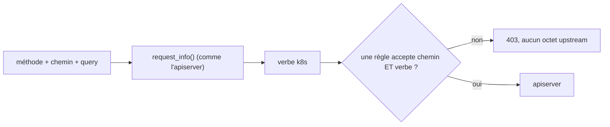
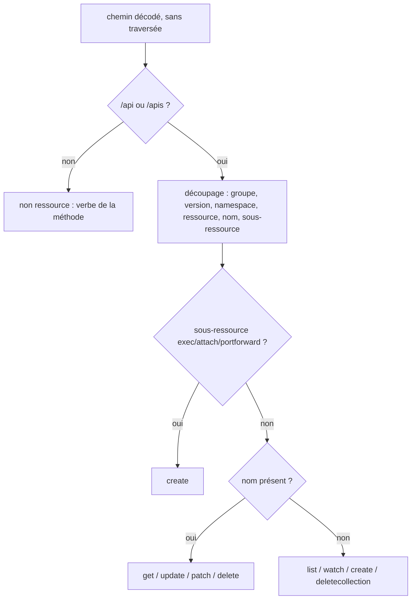
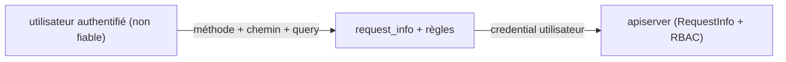

# RFC 0006 — Règles sensibles au verbe Kubernetes

| Field       | Value                                                                  |
| ----------- | ---------------------------------------------------------------------- |
| Status      | Draft                                                                  |
| Short       | Règles par verbe                                                       |
| Settles     | Une règle d'`allowed_resources` peut limiter les verbes Kubernetes (get, list, watch, create, update, patch, delete…) qu'elle autorise, calculés comme le fait l'apiserver |
| Author      | Max Batleforc <maxleriche.60@gmail.com>                                |
| Co-author   | Claude Opus 5.5                                                        |
| Created     | 2026-10-17                                                             |
| Supersedes  | —                                                                      |
| Issue       | — (à créer)                                                            |
| Blocks      | RFC 0004 (T7 : contournement d'exec par création de pod ou conteneur éphémère) ; ferme la RFC 0003 §15 Q5 |
| Touches     | `libs/server/crd/src/security/*` (nouveaux `verb.rs`, `request_info.rs`), `libs/server/api/src/cluster/redirect/kube_redirect.rs`, CRD générée, `.docs/content/docs/{security,crds}.mdx` |
| Risk        | high                                                                   |

---

## 1. Summary

Aujourd'hui, une règle d'`allowed_resources` autorise un chemin pour **toutes**
les méthodes : `is_path_allowed(path, username, groups)` (`mod.rs:159`) ne
reçoit pas la méthode. Une règle pensée pour lire des pods permet aussi de les
créer, de les supprimer, ou de patcher `ephemeralcontainers`. Cette RFC ajoute
un champ `verbs` aux règles `Path` et `Crd`. Le verbe d'une requête est calculé
**comme l'apiserver le calcule** (`RequestInfo` de
`k8s.io/apiserver/pkg/endpoints/request`), pas à partir de la seule méthode
HTTP : un `GET` peut être un `get`, un `list` ou un `watch`, et un exec en
websocket est un `GET` qui vaut `create`.

### Before / after

```yaml
allowed_resources:
  - Path:
      path: "/api/v1/namespaces/dev/pods/**"
      parametised: true
      verbs: [get, list, watch]        # NOUVEAU : lecture seule
  - Path:
      path: "/api/v1/namespaces/dev/pods/*/exec"
      parametised: true
      verbs: [create]                  # exec = create, comme dans RBAC
```

```text
# aujourd'hui (règle /api/v1/namespaces/dev/pods/**)
kubectl get pods -n dev                         -> 200
kubectl delete pod web -n dev                   -> 200
kubectl debug web -n dev --image=busybox        -> PATCH ephemeralcontainers relayé
kubectl exec web -n dev -- sh                   -> 101

# avec verbs: [get, list, watch]
kubectl get pods -n dev                         -> 200
kubectl delete pod web -n dev                   -> 403 "verb delete is not allowed on …"
kubectl debug web -n dev --image=busybox        -> 403 "verb patch is not allowed on …"
kubectl exec web -n dev -- sh                   -> 403 "verb create is not allowed on …" (exec en GET websocket)
```



Le verbe est dérivé avant la décision ; le piège « `GET` = lecture » est
neutralisé parce que les sous-ressources de connexion valent `create`.

---

## 2. Motivation

1. **Aucune règle ne peut être en lecture seule.** `is_path_allowed`
   (`mod.rs:159`, appelé à `kube_redirect.rs:231`) ignore la méthode, et
   `AllowedPathConfiguration` (`allowed_path_configuration.rs:60-94`) n'a aucun
   champ de verbe. `/api/v1/namespaces/dev/pods/**` permet `POST`, `PUT`,
   `PATCH` et `DELETE`.
2. **La RFC 0004 est contournable sans ça.** Qui peut `POST pods` lance un pod
   avec la commande de son choix ; qui peut `PATCH …/ephemeralcontainers`
   (`kubectl debug`) obtient un shell. La politique `exec` de la RFC 0004 ne
   vaut rien tant que ces verbes ne sont pas filtrables (RFC 0004, T7).
3. **Le RBAC du cluster cible est la seule barrière par verbe.** Le proxy
   centralise l'accès à plusieurs clusters ; ne pas pouvoir exprimer « lecture
   seule » pousse à dupliquer des `Role` par cluster.
4. **Une règle par méthode HTTP serait fausse.** Depuis kubectl 1.30, exec,
   attach et port-forward passent en `GET` websocket ; l'apiserver les autorise
   avec le verbe `create` (feature `AuthorizePodWebsocketUpgradeCreatePermission`,
   bêta par défaut depuis 1.30). Un filtre `methods: [GET]` laisserait donc
   passer un shell.

---

## 3. Goals / non-goals

**Goals**

- Une règle `Path` ou `Crd` peut limiter les verbes qu'elle autorise.
- Le verbe est calculé comme l'apiserver le calcule, pour toutes les formes de
  requête (collection, objet nommé, sous-ressource, watch, chemin non
  ressource).
- Les sous-ressources de connexion (`exec`, `attach`, `portforward`) valent
  `create` quelle que soit la méthode.
- Les politiques existantes (ports, et `exec` de la RFC 0004) ne sont
  évaluées que parmi les règles qui acceptent le chemin **et** le verbe.
- Sans `verbs`, rien ne change.

**Non-goals**

- **Remplacer RBAC** : le proxy ajoute une restriction ; RBAC du cluster cible
  reste en place.
- **Vérifier le contenu des corps** (`POST pods` avec une image autorisée,
  `securityContext`…) : c'est le rôle d'une admission côté cluster (Kyverno,
  `ValidatingAdmissionPolicy`).
- **Filtrer par nom d'objet** (`resourceNames` de RBAC) : déjà exprimable par
  le chemin pour les objets nommés.
- **Un filtre par méthode HTTP** : faux pour les connexions (§2.4).
- **Changer le défaut d'`allowed_resources` vide** (fail-open) : RFC 0003
  §15 Q4.

---

## 4. User-facing design

### 4.1 Configuration

Nouveau champ `verbs: Option<Vec<Verb>>` sur `AllowedPathConfiguration` et
`AllowedCrdConfiguration` :

```yaml
verbs: [get, list, watch]   # Option<Vec<Verb>>, valeurs fermées, max 9
```

`Verb` : `get`, `list`, `watch`, `create`, `update`, `patch`, `delete`,
`deletecollection`, et `*` (tous, explicite).

- `verbs` **absent** : tous les verbes (compatibilité). Ce n'est pas le côté
  sûr ; bascule en v1.0.0 (§15 Q1).
- `verbs: []` : aucun verbe, la règle n'autorise rien (refusé à la validation,
  §4.3, parce que c'est une erreur de saisie).

### 4.2 Behaviour rules

Calcul du verbe (`request_info`), sur le chemin upstream décodé une fois (même
garde anti-traversée que les matchers existants) :

| Requête | Verbe |
| --- | --- |
| `GET`/`HEAD` sur un objet nommé | `get` |
| `GET`/`HEAD` sur une collection | `list` |
| `GET` avec `watch=true`/`1` sur une collection, ou préfixe `/api/v1/watch/…` | `watch` |
| `POST` sur une collection | `create` |
| `PUT` | `update` |
| `PATCH` | `patch` |
| `DELETE` sur un objet nommé | `delete` |
| `DELETE` sur une collection | `deletecollection` |
| sous-ressource `exec`, `attach`, `portforward` (toute méthode) | `create` |
| sous-ressource `proxy` (`pods`, `services`, `nodes`) | verbe de la méthode (`GET` → `get`, `POST` → `create`…) |
| autres sous-ressources (`status`, `log`, `scale`, `ephemeralcontainers`, `eviction`…) | verbe de la méthode sur l'objet nommé (`PATCH …/ephemeralcontainers` → `patch`, `POST …/eviction` → `create`) |
| chemin non ressource (`/version`, `/healthz`, `/openapi/*`, découverte `/apis`) | verbe minuscule de la méthode (`get`, `post`…) ; seul `get` est exprimable, les autres sont refusés sous restriction |
| méthode inconnue (`OPTIONS`, `TRACE`, extension) | **refusée** sous restriction |

- **Correspondance** : une règle accepte une requête si son chemin correspond
  **et** si le verbe est dans `verbs` (ou `verbs` absent).
- **Politiques dérivées** : `port_forward_policy` et la politique `exec` (RFC
  0004) ne regardent que les règles qui ont accepté chemin et verbe.
- **API virtuelles** : quand `virtual_redirect::plan` réécrit la requête
  (`kube_redirect.rs:215`), le verbe est calculé pour la requête **réellement
  envoyée** (chemin et méthode réécrits), comme le chemin réécrit est déjà
  vérifié (`kube_redirect.rs:226-228`).
- **Cas inintéressant** : aucune règle avec `verbs`, ou
  `security_config.enabled: false` : aucune décision ne change.

### 4.3 Validation

Refusé à l'admission (CEL) et à la réconciliation (`validate()`) :

| Condition | Rationale |
| --- | --- |
| `verbs: []` | Une règle qui n'autorise rien est une erreur de saisie |
| valeur hors de l'énumération | Fermée : une faute de frappe ne doit pas valoir « aucun » en silence |
| `*` avec d'autres valeurs | Ambigu |

Avertissements (`status.warnings`, RFC 0003) :

| Condition | Behaviour | Surfaced in |
| --- | --- | --- |
| règle sur un chemin d'exec/attach/portforward sans `create` dans `verbs` | acceptée | `status.warnings` : « this rule never allows exec, which is create » |
| règle `get`/`list` seulement sur `…/pods/**` alors qu'une autre règle autorise `create`/`patch` sur `pods` ou `ephemeralcontainers` | acceptée | idem (repris par la RFC 0004) |

---

## 5. Architecture

### 5.1 Calcul du verbe



Le découpage reprend celui de `AllowedCrdConfiguration::matches`
(`allowed_crd_configuration.rs:56-125`), qui sait déjà isoler groupe, version,
namespace et ressource ; il est extrait dans `request_info.rs` et partagé.

### 5.2 Invariant

Le verbe est calculé à partir de ce que l'apiserver lira (chemin décodé une
fois, méthode réelle, query `watch`), et toute requête dont le verbe ne peut
pas être déterminé est refusée sous restriction. Une requête ne peut donc pas
être jugée `get` par le proxy et exécutée comme `create` par l'apiserver.

---

## 6. Detailed design

### 6.1 `libs/server/crd`

- `security/verb.rs` : `enum Verb` (sérialisé en minuscules, `*` → `All`),
  bornes `schemars`, règles CEL.
- `security/request_info.rs` : `RequestInfo { verb, api_group, version,
  namespace, resource, name, subresource, is_resource_request }` et
  `request_info(method, path, query) -> Result<RequestInfo, String>`, avec la
  table de §4.2.
- `AllowedPathConfigurationEnum::matches` prend un `&RequestInfo` en plus du
  chemin ; `is_path_allowed` devient `is_request_allowed(&RequestInfo, path,
  username, groups)`.
- `port_forward_policy` (et `exec_rules` de la RFC 0004) filtrent sur la même
  correspondance chemin + verbe.

### 6.2 `libs/server/api`

- `kube_redirect.rs:215-238` : calcul de `RequestInfo` pour la requête
  d'origine et, si une API virtuelle réécrit la requête, pour la requête
  réécrite ; les deux doivent passer.
- Message de refus : `verb "<verb>" is not allowed on "<path>"`, audit
  `verb_denied`.
- Les requêtes d'upgrade (watch, exec, attach, portforward, proxy) passent par
  le même contrôle avant `upgrade_redirect`.

### 6.P Proof against a real client

Client : `kubectl` 1.34 contre un cluster k3d (`task kube3d:*`), suite
`libs/server/api/tests/proxy_security.rs` (upstream enregistreur) pour les cas
unitaires.

1. Règle `…/pods/**` avec `verbs: [get, list, watch]` : `kubectl get pods`,
   `kubectl get pod web -o yaml` et `kubectl get pods -w` réussissent.
2. **Refus** : `kubectl delete pod web` donne `Error from server (Forbidden):
   verb "delete" is not allowed on …` ; l'upstream n'a reçu aucune requête.
3. **Refus** : `kubectl debug web --image=busybox` donne 403 sur le `PATCH
   …/ephemeralcontainers`.
4. **Refus** : `kubectl exec web -- sh` (websocket `GET`) donne 403 « verb
   create » ; le repli SPDY (`POST`) reçoit le même 403.
5. **Refus** : `kubectl run x --image=busybox` (`POST pods`) donne 403.
6. Règle `…/pods/*/exec` avec `verbs: [create]` : `kubectl exec` réussit.
7. **Refus** : une requête `OPTIONS` sur une règle restreinte donne 403.
8. Non-régression : sans `verbs`, `tests/proxy_security.rs` et
   `tests/proxy_redirect.rs` passent sans modification.

**Deliberately untouched**, so reviewers do not go looking :

- L'authentification et `proxy_group` : le verbe s'ajoute après.
- `virtual_redirect` : seul le point de contrôle change, pas la réécriture.

---

## 7. Security

**Rating:** high. Le calcul du verbe est un parseur de requête sur une entrée
contrôlée par l'attaquant, et une erreur de calcul autorise une écriture.

### 7.1 Threat model



| # | Threat (STRIDE) | Where | Mitigation | Residual risk |
| --- | --- | --- | --- | --- |
| T1 | Elevation : verbe jugé lecture par le proxy, écriture par l'apiserver | `request_info` | table alignée sur `RequestInfoFactory` ; connexions = `create` ; méthode inconnue refusée ; table de référence générée depuis Go | faible |
| T2 | Elevation : exec via `GET` websocket sur une règle « lecture » | sous-ressources de connexion | `create` quelle que soit la méthode | aucun |
| T3 | Tampering : `watch` caché (`watch=TRUE`, `watch=1`, préfixe `/watch/`) | query | même lecture que l'apiserver ; `watch` n'élargit jamais vers l'écriture | aucun |
| T4 | Elevation : méthode surchargée (`X-HTTP-Method-Override`) | en-têtes | l'apiserver ne l'honore pas ; le proxy retire l'en-tête et calcule sur la méthode réelle | aucun |
| T5 | Elevation : API virtuelle qui réécrit en écriture | `virtual_redirect` | verbe calculé sur la requête réécrite aussi | aucun |
| T6 | Tampering : chemin encodé ou traversée qui change la ressource | découpage | décodage unique et garde anti-traversée existants | aucun |
| T7 | DoS : chemin très long | découpage | borne du serveur HTTP ; découpage linéaire | aucun |

Tests négatifs : T1 → table de référence et §6.P points 2 à 5 ; T2 → point 4 ;
T3 → `?watch=TRUE` sur une règle `[get]` refusé ; T4 → `POST` +
`X-HTTP-Method-Override: GET` jugé `create` ; T5 → test API virtuelle ; T6 →
`…/pods/web%2Fexec` ; T7 → chemin de 64 KiB refusé.

### 7.2 Authentication and authorisation

Aucune nouvelle surface. Si le contrôle est contourné, on revient à l'état
actuel : tous les verbes autorisés par le chemin, puis RBAC.

### 7.3 Input handling and injection

Méthode, chemin et query sont lus une fois, décodés une fois, sans
allocation proportionnelle à autre chose que le chemin. `watch` suit la règle
booléenne de l'apiserver (RFC 0004 §4.2).

### 7.4 Secrets and cryptography

Aucun.

### 7.5 Abuse and resource exhaustion

Calcul en temps linéaire sur le chemin, aucune requête supplémentaire vers
l'apiserver.

### 7.6 Existing defences that still hold

Garde anti-traversée, décodage unique, contrôle du chemin réécrit des API
virtuelles, RBAC cible.

---

## 8. Supply chain

| Dependency / image / tool | Version | Why this one | Licence | Known CVEs (`task audit`) | Maintenance |
| --- | --- | --- | --- | --- | --- |
| aucune | — | découpage extrait de `AllowedCrdConfiguration::matches` | — | — | — |

- **Build et release** : la CRD générée change. Pas de nouvelle image.

---

## 9. Data and privacy

| Data | Personal? | Where stored | Retention | Who can read it | Leaves the instance? |
| --- | --- | --- | --- | --- | --- |
| verbe dans l'audit `verb_denied` | non | logs, cible `audit` | politique de l'opérateur | opérateurs | selon le collecteur |

Aucune donnée personnelle nouvelle : `user` et `groups` sont déjà dans l'audit.

---

## 10. Operability

### 10.1 Observability

- **Metrics** : `proxyauth_denied_total{cluster, reason="verb"}` (même
  famille que les refus existants, à vérifier dans `metrics.rs`).
- **Logs and audit trail** : `verb_denied { verb, path }`.
- **Alerts** : aucune.

### 10.2 Failure modes

| Failure | Detected by | Behaviour | Recovery |
| --- | --- | --- | --- |
| verbe indéterminable sous restriction | `request_info` | **fermé** (403) | ajouter `*` à la règle si voulu |
| règle sans `create` sur un chemin d'exec | validation | avertissement | corriger la règle |

### 10.3 Performance and capacity

Un découpage de chemin par requête, déjà fait pour les règles `Crd`.
Négligeable.

---

## 11. Other concerns

- **Accessibility** : pas d'UI.
- **Internationalisation** : messages API en anglais.
- **Compliance** : moindre privilège exprimable par cluster (ISO 27001 A.8.2).
- **Licensing** : inchangé.
- **Documentation** : `security.mdx` (table des verbes, piège « GET websocket
  = create », recettes lecture seule), `crds.mdx` régénéré.

---

## 12. Alternatives considered

| Alternative | Why rejected |
| --- | --- |
| `methods: [GET, POST…]` | faux pour exec/attach/portforward en websocket (§2.4) ; ne distingue pas `list`/`watch`/`get` |
| Déléguer au RBAC cible (`SubjectAccessReview`) | une requête de plus par appel, et ne restreint pas plus que RBAC : l'objectif est d'ajouter une restriction propre au proxy |
| Champ `read_only: true` | trop grossier : ne permet pas « exec mais pas create pod » |
| Ne rien faire | la RFC 0004 reste contournable (T7) |

---

## 13. Rollout and compatibility

- **Default behaviour** : sans `verbs`, aucun changement.
- **Migration** : champ additif.
- **Operator prerequisites** : CRD mise à jour avant le serveur.
- **Rollback** : image précédente ; `verbs` ignoré, les restrictions
  disparaissent sans bruit (CHANGELOG).
- **Feature flag** : non.

---

## 14. Test plan

- **Unit** (`request_info.rs`) : table de §4.2, ligne par ligne, plus la table
  de référence générée depuis `RequestInfoFactory` (Go, hors CI, versionnée).
- **Unit** (`verb.rs`) : sérialisation, `*`, validation CEL/Rust.
- **Integration** : §6.P sur `proxy_security.rs` et `proxy_upgrade.rs`.
- **Security** : un test négatif par ligne T1 à T7 ; `cargo fuzz` sur
  `request_info`.
- **Existing suites** : inchangées sans `verbs`.

---

## 15. Decisions and open questions

### Resolved

| # | Question | Decision |
| --- | --- | --- |
| 0 | Verbes Kubernetes ou méthodes HTTP ? | **Verbes Kubernetes**, calculés comme l'apiserver (grill de la RFC 0004). |
| 1 | Prérequis de la RFC 0004 ? | **Oui** (grill de la RFC 0004, Q7). |

### Still open

1. **Défaut de `verbs` absent** : tous les verbes maintenant, bascule en v1.0.0
   vers « lecture seule » ou vers « aucun » ? Recommandation : bascule vers
   `[get, list, watch]` en v1.0.0, avec les autres bascules (RFC 0003 Q1, RFC
   0004 Q1).
2. **`proxy` (sous-ressource)** : verbe de la méthode (proposé, comme
   l'apiserver), ou toujours `create` par prudence ?
3. **Chemins non ressource** : refuser tout ce qui n'est pas `get` sous
   restriction (proposé), ou permettre `post` explicite ?
4. **`X-HTTP-Method-Override`** : retirer l'en-tête (proposé) ou refuser la
   requête ?
5. **Granularité** : faut-il aussi un champ `subresources` (par exemple `[log,
   status]`), ou le chemin suffit-il ?
6. **Ordre de livraison** : avant ou après la RFC 0007 (axum) ? Le calcul est
   indépendant du framework ; recommandation : avant, pour fermer T7 au plus
   tôt.

---

## 16. Implementation phases

| Phase | Content |
| --- | --- |
| 1 | `request_info.rs` extrait et testé (table + référence Go + fuzz), sans effet sur les décisions |
| 2 | Champ `verbs`, CEL, `is_request_allowed`, politiques filtrées par verbe, refus `verb_denied` |
| 3 | Avertissements de validation (`status.warnings`) |
| 4 | Docs `security.mdx`, CHANGELOG |

Chaque phase laisse la CI verte ; la phase 1 n'a aucun effet observable.
