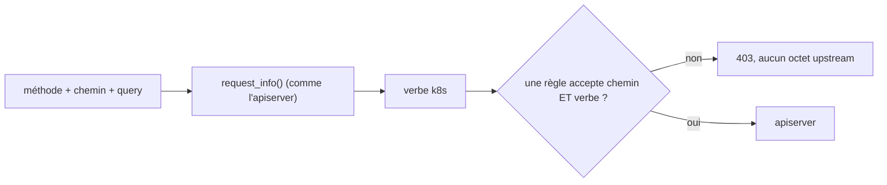
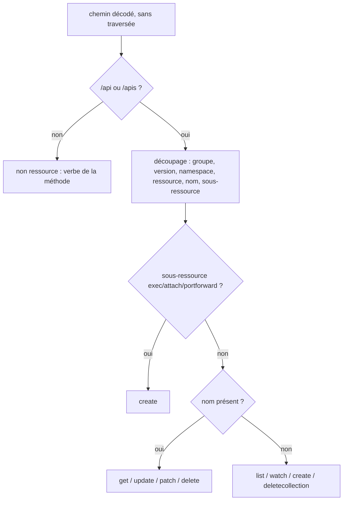
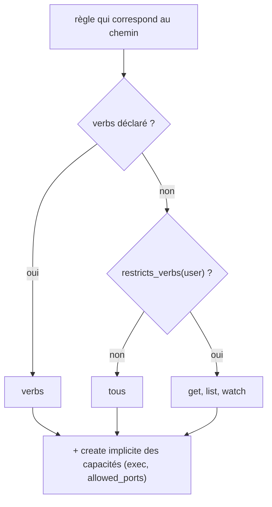
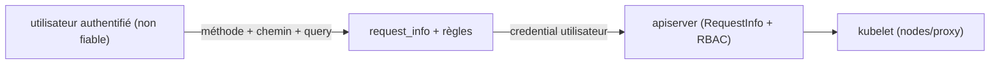

# RFC 0006 — Règles sensibles au verbe Kubernetes

| Field       | Value                                                                  |
| ----------- | ---------------------------------------------------------------------- |
| Status      | In review                                                              |
| Short       | Règles par verbe                                                       |
| Settles     | Une règle d'`allowed_resources` peut limiter les verbes Kubernetes (get, list, watch, create, update, patch, delete…) qu'elle autorise, calculés comme le fait l'apiserver ; sous restriction, une règle sans `verbs` est en lecture seule |
| Author      | Max Batleforc <maxleriche.60@gmail.com>                                |
| Co-author   | Claude Opus 5.5                                                        |
| Created     | 2026-10-17                                                             |
| Supersedes  | —                                                                      |
| Issue       | — (à créer)                                                            |
| Depends on  | RFC 0003 (`restricts_*`, `nodes/proxy`, `status.warnings`, workspace `fuzz/`, métrique `proxyauth_policy_decisions_total`) |
| Blocks      | RFC 0004 (T7 : contournement d'exec par création de pod ou conteneur éphémère) ; ferme la RFC 0003 §3 (verbes) |
| Touches     | `libs/server/crd/src/security/*` (nouveaux `verb.rs`, `request_info.rs`), `libs/server/api/src/cluster/redirect/kube_redirect.rs`, `…/redirect/forwarded.rs` (en-têtes retirés), `fuzz/fuzz_targets/fuzz_request_info.rs`, CRD générée, `.docs/content/docs/{security,crds}.mdx` |
| Risk        | high                                                                   |

---

## 1. Summary

Aujourd'hui, une règle d'`allowed_resources` autorise un chemin pour **toutes**
les méthodes : `is_path_allowed(path, username, groups)` (`mod.rs:159`) ne
reçoit pas la méthode. Une règle pensée pour lire des pods permet aussi de les
créer, de les supprimer, ou de patcher `ephemeralcontainers`. Cette RFC ajoute
un champ `verbs` aux règles `Path` et `Crd`. Le verbe d'une requête est calculé
**comme l'apiserver le calcule** (`RequestInfo` de
`k8s.io/apiserver/pkg/endpoints/request`), pas à partir de la seule méthode
HTTP : un `GET` peut être un `get`, un `list` ou un `watch`, et un exec en
websocket est un `GET` qui vaut `create`.

Le modèle suit celui des RFC 0003 et 0004 : la restriction se décide **par
utilisateur**. Dès qu'une règle qui le concerne déclare `verbs`, toute règle
sans `verbs` ne lui accorde plus que la lecture (`get`, `list`, `watch`).

### Before / after

```yaml
allowed_resources:
  - Path:
      path: "/api/v1/namespaces/dev/pods/**"
      parametised: true
      verbs: [get, list, watch]        # NOUVEAU : lecture seule
  - Path:
      path: "/api/v1/namespaces/dev/pods/*/exec"
      parametised: true
      exec: { commands: [["ls", "**"]] }   # RFC 0004 : implique create sur exec
  - Crd: { group: "", version: v1, kind: ConfigMap, namespace: { … dev … } }   # sans verbs
```

```text
# aujourd'hui
kubectl get pods -n dev                         -> 200
kubectl delete pod web -n dev                   -> 200
kubectl debug web -n dev --image=busybox        -> PATCH ephemeralcontainers relayé
kubectl delete configmap app -n dev             -> 200

# avec cette RFC
kubectl get pods -n dev                         -> 200
kubectl delete pod web -n dev                   -> 403 "verb delete is not allowed on …"
kubectl debug web -n dev --image=busybox        -> 403 "verb patch is not allowed on …"
kubectl exec web -n dev -- ls                   -> 101 (create implicite de la règle exec)
kubectl delete configmap app -n dev             -> 403 (règle sans verbs : lecture seule sous restriction)
kubectl get configmap app -n dev                -> 200
```



Le verbe est dérivé avant la décision ; le piège « `GET` = lecture » est
neutralisé parce que les sous-ressources de connexion valent `create`.

---

## 2. Motivation

1. **Aucune règle ne peut être en lecture seule.** `is_path_allowed`
   (`mod.rs:159`, appelé à `kube_redirect.rs:231`) ignore la méthode, et
   `AllowedPathConfiguration` (`allowed_path_configuration.rs:60-94`) n'a aucun
   champ de verbe. `/api/v1/namespaces/dev/pods/**` permet `POST`, `PUT`,
   `PATCH` et `DELETE`.
2. **La RFC 0004 est contournable sans ça.** Qui peut `POST pods` lance un pod
   avec la commande de son choix ; qui peut `PATCH …/ephemeralcontainers`
   (`kubectl debug`) obtient un shell. La politique `exec` de la RFC 0004 ne
   vaut rien tant que ces verbes ne sont pas filtrables (RFC 0004, T7).
3. **Le RBAC du cluster cible est la seule barrière par verbe.** Le proxy
   centralise l'accès à plusieurs clusters ; ne pas pouvoir exprimer « lecture
   seule » pousse à dupliquer des `Role` par cluster.
4. **Une règle par méthode HTTP serait fausse.** Depuis kubectl 1.30, exec,
   attach et port-forward passent en `GET` websocket ; l'apiserver les autorise
   avec le verbe `create` (feature `AuthorizePodWebsocketUpgradeCreatePermission`,
   bêta par défaut depuis 1.30). Un filtre `methods: [GET]` laisserait donc
   passer un shell.
5. **Une règle sans `verbs` annulerait la restriction.** Si une règle sans
   `verbs` valait « tous les verbes », une `Crd` `Pod` à côté d'une règle
   `…/pods/** verbs: [get, list, watch]` rouvrirait `delete` et
   `ephemeralcontainers` : le contournement que la RFC 0003 (R2) a fermé pour
   les ports.

---

## 3. Goals / non-goals

**Goals**

- Une règle `Path` ou `Crd` peut limiter les verbes qu'elle autorise.
- Le verbe est calculé comme l'apiserver le calcule, pour toutes les formes de
  requête (collection, objet nommé, sous-ressource, watch, chemin non
  ressource).
- Les sous-ressources de connexion (`exec`, `attach`, `portforward`) valent
  `create` quelle que soit la méthode.
- Sous restriction de verbes, une règle sans `verbs` n'accorde que la lecture.
- Les politiques existantes (ports, et `exec` de la RFC 0004) ne sont
  évaluées que parmi les règles qui acceptent le chemin **et** le verbe.
- Sans aucune règle `verbs`, rien ne change.

**Non-goals**

- **Remplacer RBAC** : le proxy ajoute une restriction ; RBAC du cluster cible
  reste en place.
- **Vérifier le contenu des corps** (`POST pods` avec une image autorisée,
  `securityContext`…) : c'est le rôle d'une admission côté cluster (Kyverno,
  `ValidatingAdmissionPolicy`).
- **Filtrer par nom d'objet** (`resourceNames` de RBAC) : déjà exprimable par
  le chemin pour les objets nommés.
- **Un champ `subresources`** : le chemin d'une règle `Path` l'exprime déjà ;
  les `verbs` d'une `Crd` couvrent toutes ses sous-ressources (§4.2).
- **Un filtre par méthode HTTP** : faux pour les connexions (§2.4).
- **Sujets (`users`/`groups`) sur les règles `Path`** : une règle `Path` vaut
  pour tous (RFC 0003 R14). Future RFC.
- **Changer le défaut d'`allowed_resources` vide** (fail-open) : future RFC
  `default: deny` (RFC 0003 R9).

---

## 4. User-facing design

### 4.1 Configuration

Nouveau champ `verbs: Option<Vec<Verb>>` sur `AllowedPathConfiguration` et
`AllowedCrdConfiguration` :

```yaml
verbs: [get, list, watch]   # Option<Vec<Verb>>, valeurs fermées, max 9
```

`Verb` : `get`, `list`, `watch`, `create`, `update`, `patch`, `delete`,
`deletecollection`, et `*` (tous, explicite).

- **Aucune règle visible par l'utilisateur ne déclare `verbs`** : tous les
  verbes (compatibilité). Bascule en v1.0.0 vers `[get, list, watch]` (§13).
- **Au moins une règle visible déclare `verbs`** : l'utilisateur est restreint,
  et une règle **sans** `verbs` vaut `[get, list, watch]` pour lui.
- **Une capacité déclarée implique `create` sur sa connexion**, que l'utilisateur
  soit restreint ou non :
  - `exec` (RFC 0004) implique `create` sur `…/exec`, et sur `…/attach` si
    `attach: true` ;
  - `allowed_ports` (RFC 0003) implique `create` sur `…/portforward` seulement ;
    un `POST` via `…/proxy` reste soumis aux `verbs`.
- `verbs: []` : refusé à la validation (§4.3).

### 4.2 Behaviour rules

Calcul du verbe (`request_info`), sur le chemin upstream décodé une fois (même
garde anti-traversée que les matchers existants) :

| Requête | Verbe |
| --- | --- |
| `GET`/`HEAD` sur un objet nommé | `get` |
| `GET`/`HEAD` sur une collection | `list` |
| `GET` avec `watch` vrai (règle booléenne de l'apiserver) sur une collection, ou préfixe `/api/v1/watch/…` | `watch` |
| `POST` sur une collection | `create` |
| `PUT` | `update` |
| `PATCH` | `patch` |
| `DELETE` sur un objet nommé | `delete` |
| `DELETE` sur une collection | `deletecollection` |
| sous-ressource `exec`, `attach`, `portforward` (toute méthode) | `create` |
| sous-ressource `proxy` (`pods`, `services`, `nodes`) | verbe de la méthode (`GET` → `get`, `POST` → `create`…), comme l'apiserver |
| autres sous-ressources (`status`, `log`, `scale`, `ephemeralcontainers`, `eviction`…) | verbe de la méthode sur l'objet nommé (`PATCH …/ephemeralcontainers` → `patch`, `POST …/eviction` → `create`) |
| chemin non ressource (`/version`, `/healthz`, `/openapi/*`, découverte `/apis`) | verbe minuscule de la méthode ; seul `get` est exprimable, tout autre verbe est refusé sous restriction |
| méthode inconnue (`OPTIONS`, `TRACE`, extension) | **refusée** sous restriction |

- **Restriction par utilisateur** : `restricts_verbs(user, groups)` est vrai dès
  qu'une règle dont le sujet concerne l'utilisateur déclare `verbs`, quel que
  soit son chemin (même définition que `restricts_ports`, RFC 0003 R3). Une
  règle `Path` n'a pas de sujet : une règle `Path` avec `verbs` restreint tout
  le cluster.
- **Correspondance** : une règle accepte une requête si son chemin correspond
  **et** si le verbe est dans ses verbes effectifs : `verbs` s'il est déclaré ;
  sinon tous les verbes (utilisateur non restreint) ou `[get, list, watch]`
  (restreint) ; plus le `create` implicite de ses capacités (§4.1).
- **Règles `Crd`** : elles ignorent les segments qui suivent la ressource ;
  leurs `verbs` couvrent donc toutes les sous-ressources. Une `Crd` `Pod` avec
  `patch` ou `update` autorise aussi `PATCH …/ephemeralcontainers`, donc
  `kubectl debug` : avertissement (§4.3).
- **`nodes/proxy`** : un `GET` sur `nodes/{n}/proxy/…` vaut `get`, y compris en
  websocket, et le kubelet y sert `/exec` et `/run`. Le refus de la RFC 0003
  (R4, R5) s'applique donc aussi sous `restricts_verbs` : la condition devient
  `restricts_ports || restricts_exec || restricts_verbs`, et seule une règle
  `Path` qui vise explicitement `nodes/*/proxy` l'autorise.
- **Politiques dérivées** : `port_policy` (RFC 0003) et `exec_rules` (RFC
  0004) ne regardent que les règles qui ont accepté chemin et verbe.
- **En-têtes** : `X-HTTP-Method-Override` est retiré de la requête relayée, au
  même endroit que les en-têtes `impersonate-*` : `is_proxy_owned_header`
  (`forwarded.rs:42`), filtre partagé par le relais standard et l'upgrade, et
  indépendant du framework (la RFC 0007 en hérite). Le verbe est toujours
  calculé sur la méthode réelle.
- **API virtuelles** : quand `virtual_redirect::plan` réécrit la requête
  (`kube_redirect.rs:215`), le verbe est calculé pour la requête d'origine
  **et** pour la requête **réellement envoyée** (chemin et méthode réécrits) ;
  les deux doivent passer.
- **Cas sans restriction** : aucune règle avec `verbs`, ou
  `security_config.enabled: false` : aucune décision ne change.

### 4.3 Validation

Refusé à l'admission (CEL) et à la réconciliation (`validate()`) :

| Condition | Rationale |
| --- | --- |
| `verbs: []` | Une règle qui n'autorise rien est une erreur de saisie |
| valeur hors de l'énumération | Fermée : une faute de frappe ne doit pas valoir « aucun » en silence |
| `*` avec d'autres valeurs | Ambigu |

Avertissements (`status.warnings`, RFC 0003) :

| Condition | Behaviour | Message |
| --- | --- | --- |
| règle qui couvre `exec`/`attach`/`portforward` sans capacité déclarée et dont les `verbs` excluent `create` | acceptée | `rule N never allows exec/attach/portforward, which are create` |
| règle `Crd` `Pod` (ou `Path` qui couvre `pods/*/ephemeralcontainers`) avec `patch` ou `update` | acceptée | `rule N also allows ephemeralcontainers (kubectl debug), which bypasses exec restrictions` (repris par la RFC 0004) |
| restriction de verbes et règle qui couvre `nodes/` sans viser `nodes/*/proxy` | `nodes/proxy` refusé | message de la RFC 0003 |

---

## 5. Architecture

### 5.1 Calcul du verbe



Le découpage reprend celui de `AllowedCrdConfiguration::matches`
(`allowed_crd_configuration.rs:56-125`), qui sait déjà isoler groupe, version,
namespace et ressource ; il est extrait dans `request_info.rs` et partagé.

### 5.2 Verbes effectifs d'une règle



Le graphe montre qu'une règle sans `verbs` ne peut jamais rouvrir une écriture
pour un utilisateur restreint.

### 5.3 Invariant

Le verbe est calculé à partir de ce que l'apiserver lira (chemin décodé une
fois, méthode réelle, query `watch`), et toute requête dont le verbe ne peut
pas être déterminé est refusée sous restriction. Une requête ne peut donc pas
être jugée `get` par le proxy et exécutée comme `create` par l'apiserver.

---

## 6. Detailed design

### 6.1 `libs/server/crd`

- `security/verb.rs` : `enum Verb` (sérialisé en minuscules, `*` → `All`),
  bornes `schemars`, règles CEL.
- `security/request_info.rs` : `RequestInfo { verb, api_group, version,
  namespace, resource, name, subresource, is_resource_request }` et
  `request_info(method, path, query) -> Result<RequestInfo, String>`, avec la
  table de §4.2.
- `SecurityConfiguration::restricts_verbs(user, groups) -> bool`.
- `AllowedPathConfigurationEnum::effective_verbs(restricted) -> VerbSet` (§5.2).
- `AllowedPathConfigurationEnum::matches` prend un `&RequestInfo` en plus du
  chemin ; `is_path_allowed` devient `is_request_allowed(&RequestInfo, path,
  username, groups)`.
- `port_policy` (RFC 0003) et `exec_rules` (RFC 0004) filtrent sur la même
  correspondance chemin + verbe.
- Le refus de `nodes/proxy` (RFC 0003) teste aussi `restricts_verbs`.

### 6.2 `libs/server/api`

- `kube_redirect.rs:215-238` : calcul de `RequestInfo` pour la requête
  d'origine et, si une API virtuelle réécrit la requête, pour la requête
  réécrite ; les deux doivent passer.
- `forwarded.rs` : `is_proxy_owned_header` reconnaît `x-http-method-override`,
  donc le relais standard et l'upgrade le retirent tous les deux.
- Message de refus : `verb "<verb>" is not allowed on "<path>"`, audit
  `verb_denied`, compteur `proxyauth_policy_decisions_total{policy="verb",
  decision="denied"}` (RFC 0003).
- Les requêtes d'upgrade (watch, exec, attach, portforward, proxy) passent par
  le même contrôle avant `upgrade_redirect`.

### 6.3 `fuzz/`

Cible `fuzz_request_info.rs` dans le workspace `fuzz/` créé par la RFC 0003
(modèle batlehub, §14). Propriétés :

- déterminisme ;
- une méthode autre que `GET`/`HEAD` n'est jamais classée `get`, `list` ou
  `watch` ;
- un chemin dont la sous-ressource décodée est `exec`, `attach` ou
  `portforward` vaut toujours `create` ;
- aucune panic, et toute erreur donne `Err`.

### 6.P Proof against a real client

Client : `kubectl` 1.34 contre un cluster k3d (`task kube3d:*`), suite
`libs/server/api/tests/proxy_security.rs` (upstream enregistreur) pour les cas
unitaires. Configuration : celle du §1.

1. `kubectl get pods`, `kubectl get pod web -o yaml` et `kubectl get pods -w`
   réussissent.
2. **Refus** : `kubectl delete pod web` donne `Error from server (Forbidden):
   verb "delete" is not allowed on …` ; l'upstream n'a reçu aucune requête.
3. **Refus** : `kubectl debug web --image=busybox` donne 403 sur le `PATCH
   …/ephemeralcontainers`.
4. **Refus** : `kubectl run x --image=busybox` (`POST pods`) donne 403.
5. `kubectl exec web -- ls` réussit grâce au `create` implicite de la règle
   `exec`, sans `verbs` déclaré.
6. **Refus, règle sans `verbs`** : `kubectl delete configmap app` donne 403,
   `kubectl get configmap app` réussit.
7. **Refus, kubelet** : sous restriction de verbes seulement, avec une règle
   `Path` `/api/v1/nodes/**` sans `verbs`, un `GET` websocket sur
   `…/nodes/n1/proxy/exec/dev/web/app?command=sh` donne 403.
8. **Refus** : une requête `OPTIONS` donne 403.
9. **En-tête** : `POST …/pods` avec `X-HTTP-Method-Override: GET` est jugé
   `create` (403), et l'upstream enregistreur ne voit jamais l'en-tête sur une
   requête acceptée.
10. Non-régression : sans `verbs`, `tests/proxy_security.rs` et
    `tests/proxy_redirect.rs` passent sans modification.

**Deliberately untouched**, so reviewers do not go looking :

- L'authentification et `proxy_group` : le verbe s'ajoute après.
- `virtual_redirect` : seul le point de contrôle change, pas la réécriture.
- `list_fallback` : ses `SelfSubjectAccessReview` internes ne passent pas par
  `allowed_resources`.

---

## 7. Security

**Rating:** high. Le calcul du verbe est un parseur de requête sur une entrée
contrôlée par l'attaquant, et une erreur de calcul autorise une écriture.

### 7.1 Threat model



| # | Threat (STRIDE) | Where | Mitigation | Residual risk |
| --- | --- | --- | --- | --- |
| T1 | Elevation : verbe jugé lecture par le proxy, écriture par l'apiserver | `request_info` | table alignée sur `RequestInfoFactory` ; connexions = `create` ; méthode inconnue refusée ; table de référence générée depuis Go ; cible de fuzz | faible |
| T2 | Elevation : exec via `GET` websocket sur une règle « lecture » | sous-ressources de connexion | `create` quelle que soit la méthode | aucun |
| T3 | Tampering : `watch` caché (`watch=TRUE`, `watch=1`, préfixe `/watch/`) | query | même lecture que l'apiserver ; `watch` n'élargit jamais vers l'écriture | aucun |
| T4 | Elevation : méthode surchargée (`X-HTTP-Method-Override`) | en-têtes | l'apiserver ne l'honore pas ; le proxy retire l'en-tête et calcule sur la méthode réelle | aucun |
| T5 | Elevation : API virtuelle qui réécrit en écriture | `virtual_redirect` | verbe calculé sur la requête réécrite aussi | aucun |
| T6 | Tampering : chemin encodé ou traversée qui change la ressource | découpage | décodage unique et garde anti-traversée existants | aucun |
| T7 | DoS : chemin très long | découpage | borne du serveur HTTP ; découpage linéaire | aucun |
| T8 | Elevation : `GET nodes/n/proxy/exec` (verbe `get`) sur une règle « lecture » | `nodes/proxy` | refus sous `restricts_verbs` sauf règle `Path` `nodes/*/proxy` explicite (RFC 0003 R4 étendu) | aucun |
| T9 | Elevation : règle sans `verbs` qui rouvre une écriture | correspondance | sous restriction, une règle sans `verbs` vaut `[get, list, watch]` | aucun |
| T10 | Elevation : `Crd` `Pod` avec `patch` qui ouvre `ephemeralcontainers` | règles `Crd` | avertissement `status.warnings` ; doc | **accepté par l'opérateur** qui le déclare |

Tests négatifs : T1 → table de référence, fuzz et §6.P points 2 à 4 ; T2 →
`kubectl exec` sur une règle `[get]` sans `exec` refusé ; T3 → `?watch=TRUE`
sur une règle `[get]` refusé ; T4 → point 9 ; T5 → test API virtuelle ; T6 →
`…/pods/web%2Fexec` ; T7 → chemin de 64 KiB refusé ; T8 → point 7 ; T9 →
point 6 ; T10 → test de l'avertissement.

### 7.2 Authentication and authorisation

Aucune nouvelle surface. Si le contrôle est contourné, on revient à l'état
actuel : tous les verbes autorisés par le chemin, puis RBAC.

### 7.3 Input handling and injection

Méthode, chemin et query sont lus une fois, décodés une fois, sans
allocation proportionnelle à autre chose que le chemin. `watch` suit la règle
booléenne de l'apiserver (RFC 0004 §4.2).

### 7.4 Secrets and cryptography

Aucun.

### 7.5 Abuse and resource exhaustion

Calcul en temps linéaire sur le chemin, aucune requête supplémentaire vers
l'apiserver.

### 7.6 Existing defences that still hold

Garde anti-traversée, décodage unique, contrôle du chemin réécrit des API
virtuelles, retrait des en-têtes `impersonate-*`, RBAC cible.

---

## 8. Supply chain

| Dependency / image / tool | Version | Why this one | Licence | Known CVEs (`task audit`) | Maintenance |
| --- | --- | --- | --- | --- | --- |
| aucune dépendance runtime | — | découpage extrait de `AllowedCrdConfiguration::matches` | — | — | — |
| `libfuzzer-sys`, `arbitrary` (workspace `fuzz/`, RFC 0003) | 0.4.13, 1.5.0 | cible `request_info` | MIT/Apache-2.0 | vérifié par la RFC 0003 | actifs |

- **Build et release** : la CRD générée change. Pas de nouvelle image.

---

## 9. Data and privacy

| Data | Personal? | Where stored | Retention | Who can read it | Leaves the instance? |
| --- | --- | --- | --- | --- | --- |
| verbe dans l'audit `verb_denied` | non | logs, cible `audit` | politique de l'opérateur | opérateurs | selon le collecteur |

Aucune donnée personnelle nouvelle : `user` et `groups` sont déjà dans l'audit.

---

## 10. Operability

### 10.1 Observability

- **Metrics** : `proxyauth_policy_decisions_total{cluster, policy="verb",
  decision}`, compteur partagé créé par la RFC 0003. Aucun verbe, chemin ni
  utilisateur en label.
- **Logs and audit trail** : `verb_denied { verb, path }`.
- **Alerts** : aucune.

### 10.2 Failure modes

| Failure | Detected by | Behaviour | Recovery |
| --- | --- | --- | --- |
| verbe indéterminable sous restriction | `request_info` | **fermé** (403) | ajouter `*` à la règle si voulu |
| configuration mixte qui perd des écritures après mise à jour | `403 verb_denied` | refus | déclarer `verbs` sur la règle concernée |
| règle sans `create` sur un chemin d'exec | validation | avertissement | déclarer `exec` ou `create` |

### 10.3 Performance and capacity

Un découpage de chemin par requête, déjà fait pour les règles `Crd`.
Négligeable.

---

## 11. Other concerns

- **Accessibility** : pas d'UI.
- **Internationalisation** : messages API en anglais.
- **Compliance** : moindre privilège exprimable par cluster (ISO 27001 A.8.2).
- **Licensing** : inchangé.
- **Documentation** : `security.mdx` (table des verbes, piège « GET websocket
  = create », lecture seule implicite sous restriction, `create` implicite des
  capacités, `verbs` d'une `Crd` sur ses sous-ressources, `nodes/proxy` en
  `get`, recettes lecture seule), `crds.mdx` régénéré.

---

## 12. Alternatives considered

| Alternative | Why rejected |
| --- | --- |
| `methods: [GET, POST…]` | faux pour exec/attach/portforward en websocket (§2.4) ; ne distingue pas `list`/`watch`/`get` |
| Déléguer au RBAC cible (`SubjectAccessReview`) | une requête de plus par appel, et ne restreint pas plus que RBAC : l'objectif est d'ajouter une restriction propre au proxy |
| Champ `read_only: true` | trop grossier : ne permet pas « exec mais pas create pod » |
| Règle sans `verbs` = tous les verbes, même sous restriction (brouillon) | une règle voisine rouvre les écritures (T9), comme `allowed_ports` avant la RFC 0003 |
| Règle sans `verbs` = aucun verbe sous restriction | vide toute l'allow-list dès la première règle `verbs` : `verbs` porte sur l'allow-list elle-même, pas sur une capacité |
| Exiger `verbs: [create]` sur les règles `exec`/`allowed_ports` | redondant et facile à oublier ; la capacité déclarée dit déjà l'intention |
| `proxy` toujours `create` | écart avec l'apiserver : refuse des lectures que RBAC juge `get` |
| Champ `subresources` | le chemin d'une règle `Path` l'exprime ; avertissement pour le cas `Crd` |
| Ne rien faire | la RFC 0004 reste contournable (T7) |

---

## 13. Rollout and compatibility

- **Default behaviour** : sans `verbs`, aucun changement.
- **Changement de comportement** (`feat!:`) dès qu'une règle `verbs` existe :
  toutes les règles sans `verbs` passent en lecture seule pour les
  utilisateurs restreints (tout le cluster si la règle est un `Path`), et
  `nodes/proxy` est refusé sauf règle explicite.
- **v1.0.0** : `verbs` absent vaut `[get, list, watch]` pour tous les
  utilisateurs, avec les bascules exec (RFC 0004, décision 1) et le nettoyage
  `allowed_ressources`. Annoncé dans le CHANGELOG dès cette RFC.
- **Migration** : champ additif.
- **Operator prerequisites** : CRD mise à jour avant le serveur ; RFC 0003
  livrée.
- **Rollback** : image précédente ; `verbs` ignoré, les restrictions
  disparaissent sans bruit (CHANGELOG).
- **Feature flag** : non.

---

## 14. Test plan

- **Unit** (`request_info.rs`) : table de §4.2, ligne par ligne, plus la table
  de référence générée depuis `RequestInfoFactory` (Go, hors CI, versionnée).
- **Unit** (`verb.rs`, `mod.rs`) : sérialisation, `*`, validation CEL/Rust ;
  `restricts_verbs` ; verbes effectifs (§5.2) avec et sans restriction, avec
  `create` implicite ; avertissements.
- **Fuzz** : cible `fuzz_request_info` (§6.3) dans le workspace `fuzz/` de la
  RFC 0003, compilée à chaque PR par `task fuzz:check` (stable) et lancée par
  le job nightly.
- **Integration** : §6.P sur `proxy_security.rs` et `proxy_upgrade.rs`.
- **Security** : un test négatif par ligne T1 à T10.
- **Existing suites** : inchangées sans `verbs`.

---

## 15. Decisions and open questions

### Resolved

| # | Question | Decision |
| --- | --- | --- |
| 0 | Verbes Kubernetes ou méthodes HTTP ? | **Verbes Kubernetes**, calculés comme l'apiserver (grill de la RFC 0004). |
| 1 | Prérequis de la RFC 0004 ? | **Oui** (grill de la RFC 0004, Q7). |
| 2 | Modèle de restriction | **Par utilisateur**, aligné sur les RFC 0003 et 0004 : `restricts_verbs` ; sous restriction, une règle sans `verbs` vaut `[get, list, watch]`. |
| 3 | Capacités et `create` | `exec` implique `create` sur `exec` (et `attach` si `attach: true`) ; `allowed_ports` implique `create` sur `portforward` seulement. |
| 4 | Défaut de `verbs` absent en v1.0.0 | **`[get, list, watch]` pour tous**, avec les autres bascules ; annoncé dès cette RFC. |
| 5 | `proxy` (sous-ressource) | **Verbe de la méthode**, comme l'apiserver. |
| 6 | Chemins non ressource | **Seul `get`** sous restriction ; pas de verbe `post`. |
| 7 | `X-HTTP-Method-Override` | **Retiré** de la requête relayée, sans refus. |
| 8 | Champ `subresources` | **Non** ; avertissement pour une `Crd` `Pod` avec `patch`/`update`. |
| 9 | Ordre de livraison | **Avant la RFC 0007** : 0003, 0006, 0007, 0004. |
| 10 | Tests de robustesse | **Modèle batlehub** : cible `cargo fuzz` avec propriétés dans le workspace `fuzz/` de la RFC 0003 ; table de référence Go conservée. |
| 11 | Métrique | **Compteur partagé** `proxyauth_policy_decisions_total{policy, decision}` (RFC 0003). |
| 12 | `nodes/proxy` en `get` | **Refusé sous `restricts_verbs`** sauf règle `Path` `nodes/*/proxy` explicite (T8). |

### Still open

Aucune.

---

## 16. Implementation phases

| Phase | Content |
| --- | --- |
| 1 | `request_info.rs` extrait et testé (table + référence Go + cible de fuzz), sans effet sur les décisions |
| 2 | Champ `verbs`, CEL, `restricts_verbs`, verbes effectifs, `is_request_allowed`, politiques filtrées par verbe, `nodes/proxy` sous `restricts_verbs`, retrait de `X-HTTP-Method-Override`, refus `verb_denied` |
| 3 | Avertissements de validation (`status.warnings`) |
| 4 | Docs `security.mdx`, CHANGELOG (`feat!:`, annonce v1.0.0) |

Chaque phase laisse la CI verte ; la phase 1 n'a aucun effet observable. Le
refus de `nodes/proxy` arrive dans la même phase que la lecture seule
implicite, puisque c'est elle qui ouvre T8.
