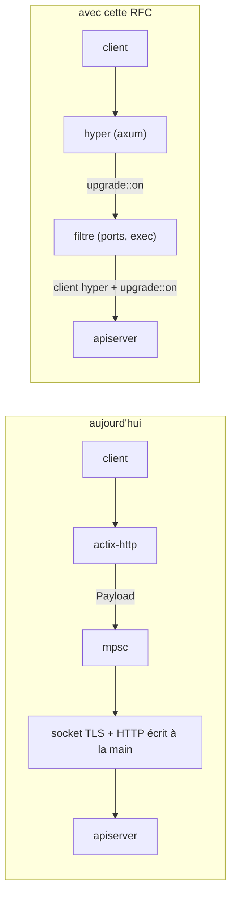
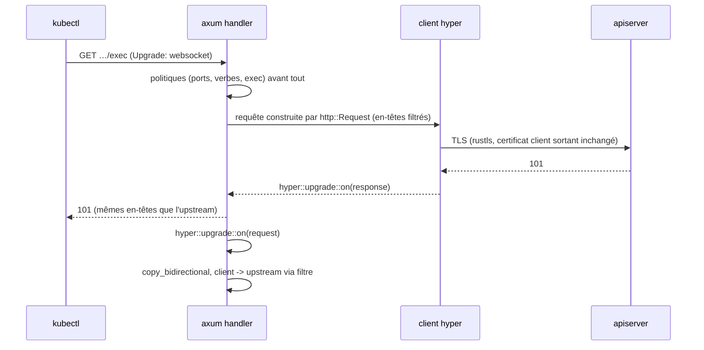
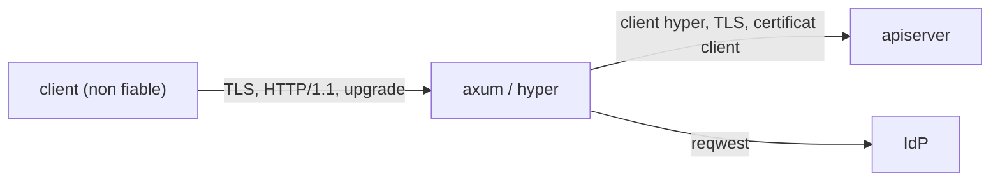

# RFC 0007 — Migrer le serveur HTTP d'actix-web vers axum (hyper 1)

| Field       | Value                                                                  |
| ----------- | ---------------------------------------------------------------------- |
| Status      | Accepted : code livré (2026-10-18), recette après la première instance (§13, §17) |
| Short       | actix-web vers axum                                                    |
| Settles     | Le serveur (API, OAuth, proxy, upgrades) passe d'actix-web 4 à axum 0.8 sur hyper 1, à comportement constant, et le tunnel d'upgrade utilise `hyper::upgrade` au lieu de HTTP écrit à la main |
| Author      | Max Batleforc <maxleriche.60@gmail.com>                                |
| Co-author   | Claude Opus 5.5                                                        |
| Created     | 2026-10-17                                                             |
| Supersedes  | —                                                                      |
| Issue       | — (à créer)                                                            |
| Depends on  | RFC 0003 et RFC 0006 livrées (leurs comportements entrent dans le contrat `http_contract.rs`) |
| Blocks      | RFC 0004 (le contrôle de flux s'écrit sur le tunnel hyper)             |
| Touches     | `apps/server`, `libs/server/api/**` (57 fichiers), `libs/server/api/tests/**` (23 fichiers, 114 tests au 2026-10-17), `Cargo.toml`, `apps/server/Cargo.toml`, `libs/server/api/Cargo.toml`, docs développeur |
| Risk        | high                                                                   |

---

## 1. Summary

Le serveur ProxyAuthK8S tourne sur actix-web 4. Pour les upgrades (exec,
attach, port-forward, watch), actix-http ne rend au handler les octets qui
suivent le handshake que pour `Upgrade: websocket` (`upgrade.rs:195`). Le
proxy compense en ouvrant lui-même la socket TCP/TLS vers l'apiserver, en
**écrivant la requête HTTP à la main** (`upgrade/connect.rs`, 255 lignes), en
**relisant la réponse à la main** (`upgrade/response.rs`, 486 lignes) et en
reliant les deux par un canal `mpsc` (`upgrade/tunnel.rs`). Cette RFC migre
tout le serveur vers **axum 0.8** sur **hyper 1**, la pile déjà présente via
`kube` et `reqwest`, et déjà utilisée par `weebo-kit-runtime` (axum 0.8 +
axum-server 0.8). Les upgrades passent par `hyper::upgrade::on` des deux
côtés. La migration est **iso-fonctionnelle** : mêmes routes, mêmes réponses,
même OpenAPI, SPDY toujours refusé.

### Before / after

```text
# aujourd'hui
HttpServer (actix) + bind_rustls_0_23          main.rs:81,133
middlewares : wrap_fn request-id, TracingLogger (tracing-actix-web),
              HttpMetrics (Transform maison), Compress, actix-cors
OpenAPI     : utoipa-actix-web + utoipa-scalar (feature actix-web)
upgrade     : TcpStream + TLS + requête écrite à la main + 101 relu à la main + mpsc
proxy std   : Payload -> mpsc -> reqwest::Body ; réponse re-parsée en types actix
tests       : 114 #[actix_web::test], init_service ; proxy_upgrade = vrai HttpServer

# avec cette RFC
axum::Router + axum-server (tls-rustls)        comme weebo-kit-runtime
middlewares : tower-http (request-id, trace, compression, cors) + HttpMetrics en tower Layer
OpenAPI     : utoipa-axum + utoipa-scalar (feature axum)
upgrade     : hyper::upgrade::on(req) côté client, client hyper + upgrade::on(res) côté apiserver,
              copy_bidirectional enveloppé par le filtre
proxy std   : axum::body::Body -> reqwest::Body (même crate http 1.x, pas de re-parsing)
tests       : tower::ServiceExt::oneshot ; proxy_upgrade = vrai serveur axum
```



Le diagramme montre ce qui disparaît : le HTTP écrit à la main sur une socket
brute, qui est la partie la plus exposée au smuggling.

---

## 2. Motivation

1. **Le tunnel d'upgrade réimplémente HTTP.** `serialize_upgrade_request`
   (`upgrade/connect.rs:115`) écrit la requête, `read_upgrade_response_headers`
   (`upgrade/response.rs`) relit le `101`. Chaque garde (refus de corps
   `upgrade.rs:214`, en-têtes hop-by-hop, taille des en-têtes) est à maintenir
   à la main, sur le chemin qui donne exec dans les conteneurs.
2. **actix limite le protocole d'upgrade.** Seul `Upgrade: websocket` est
   rendu au handler ; le contrôle de flux de la RFC 0004 et le filtre de ports
   doivent passer par un `Payload` actix relié à un `mpsc`
   (`tunnel.rs:51-63`), avec deux `actix_web::rt::spawn`.
3. **Deux piles HTTP coexistent.** actix-http côté serveur, hyper 1 côté client
   (`kube`, `reqwest`). `standard.rs:240-290` convertit statut et en-têtes de
   `reqwest` vers les types actix, en jetant ceux qui ne sont pas UTF-8.
4. **Écosystème divergent du kit.** `weebo-kit-runtime` (RFC 0005) sert son
   webhook avec axum 0.8 et axum-server 0.8 ; une future adoption de ses crates
   (télémétrie, santé) suppose tower/axum.

---

## 3. Goals / non-goals

**Goals**

- Plus aucune dépendance `actix-web`, `actix-cors`, `tracing-actix-web`,
  `utoipa-actix-web`.
- Iso-fonctionnel : mêmes routes, mêmes statuts, mêmes en-têtes, même
  OpenAPI (diff de `swagger.json` vide), mêmes événements d'audit et
  métriques.
- Le tunnel d'upgrade utilise `hyper::upgrade` des deux côtés ; plus de
  sérialisation HTTP à la main.
- Les tests existants (114 au 2026-10-17) sont portés et passent, plus une suite de
  non-régression HTTP indépendante du framework écrite **avant** la
  migration.

**Non-goals**

- **Relayer SPDY** : toujours refusé.
- **Changer une route, un format de réponse ou un défaut** : tout changement
  visible est un bug de migration.
- **mTLS entrant** : il n'existe pas aujourd'hui (`server_config.rs:59`,
  `with_no_client_auth`) ; le seul certificat client est sortant, vers
  l'apiserver (`kube_redirect/tls.rs:90`), et il est conservé tel quel.
- **Adopter les crates du kit** : RFC dédiée, après celle-ci.
- **Implémenter la RFC 0004** : elle s'appuie sur ce résultat.

---

## 4. User-facing design

### 4.1 Configuration

Aucune option ajoutée ni modifiée : `server_config.https`, les chemins PEM,
`CorsOrigins` (SameOriginOnly / Any / List), le timeout d'arrêt et le port
gardent leur sens.

### 4.2 Behaviour rules

- **Correspondance des middlewares** :

  | actix (ordre actuel, `main.rs:82-120`) | axum / tower |
  | --- | --- |
  | `wrap_fn` qui recopie `RequestId` en `x-request-id` (:97-116) | `tower_http::request_id::{SetRequestIdLayer, PropagateRequestIdLayer}` |
  | `TracingLogger::<OtelRootSpanBuilder>` (`root_span.rs:25`, lit `traceparent`) | `tower_http::trace::TraceLayer` avec un `MakeSpan` qui lit `traceparent` |
  | `HttpMetrics` (Transform maison, `metrics.rs:98,123`, `match_pattern()` pour `http.route`) | `Layer` maison, `MatchedPath` pour `http.route` |
  | `Compress` (:120) | `tower_http::compression::CompressionLayer` ; les flux qui posent `content-encoding: identity` restent non compressés |
  | `actix-cors` (:82-92) | `tower_http::cors::CorsLayer`, mêmes origines, `max_age` 3600 |

- **Routes** : `/{ns}/{cluster}/{path:.*}` devient `/{ns}/{cluster}/{*path}`.
  Le chemin transmis aux matchers doit être le **même texte brut**
  qu'aujourd'hui, parce que les matchers décodent une fois eux-mêmes
  (`percent_decode_once`). L'extracteur `Path` d'axum **percent-décode** : il
  n'est donc **jamais** utilisé pour `{*path}`. Le proxy lit `OriginalUri`
  (`req.uri().path()`) et retire lui-même le préfixe `/clusters/{ns}/{cluster}`.
  `%2F`, `%252e` et `..` arrivent aux matchers avec le texte d'aujourd'hui
  (contrat, T3).
- **CORS `SameOriginOnly`** : `CorsLayer` n'a pas ce mode ; il devient un
  `AllowOrigin::predicate` qui porte la logique actuelle (`main.rs:82-92`)
  telle quelle, y compris le traitement de `X-Forwarded-Host` et du schéma.
  Les trois modes (`SameOriginOnly`, `Any`, `List`) sont couverts par le
  contrat, en preflight et en requête simple.
- **ALPN entrant** : `h2` et `http/1.1` restent annoncés, comme
  `bind_rustls_0_23` aujourd'hui ; axum-server garde le serveur auto de
  hyper-util (h1 et h2). Une requête normale de kubectl passe en h2, un
  upgrade en http/1.1 (contrat, T7).
- **Limites HTTP** : le code ne configure aucune limite (ni `PayloadConfig`, ni
  `JsonConfig`, ni en-têtes) ; ce sont les défauts d'actix qui s'appliquent, et
  ils diffèrent de ceux d'hyper et d'axum (96 en-têtes pour actix-http, 100
  pour hyper ; `DefaultBodyLimit` 2 MiB). Le contrat **mesure et fige** les
  limites réelles d'actix (nombre d'en-têtes, taille d'un en-tête, ligne de
  requête, corps JSON et formulaire) ; hyper et axum sont réglés dessus. Un
  écart impossible à combler est écrit ici et dans le CHANGELOG, pas présenté
  comme iso.
- **Extracteurs** : `PeerAddr` et `req.peer_addr()` deviennent
  `ConnectInfo<SocketAddr>` ; `web::Data<State>` devient `State<AppState>` ;
  `impl FromRequest for User` (`model/user.rs:130`) devient `FromRequestParts`.
- **Erreurs** : `AuthError::into_actix_error` (`helper/mod.rs:34`) devient
  `impl IntoResponse`.
- **Futures `Send`** : axum exige des handlers `Send`. Le futur de
  `User::from_request` est aujourd'hui boxé sans `Send` (`user.rs:132`) ; tout
  état non `Send` doit être corrigé, pas contourné par `spawn_local`.

### 4.3 Validation

| Condition | Rationale |
| --- | --- |
| `swagger.json` généré diffère | la règle Weebo veut l'OpenAPI comme contrat, et le front génère son client HeyApi depuis ce fichier ; **diff strictement vide**, chaque écart (`{path}` contre `{path:.*}`, `operationId`, ordre) est corrigé par un `#[utoipa::path(path = …, operation_id = …)]` explicite, jamais accepté comme cosmétique |
| la suite de non-régression HTTP (§6.1) diffère | iso-fonctionnel |
| un test existant est supprimé au lieu d'être porté | la couverture ne doit pas baisser pendant la migration |

---

## 5. Architecture

### 5.1 Tunnel d'upgrade



La requête vers l'apiserver est construite par `http::Request` et sérialisée
par hyper : un corps déclaré, un en-tête invalide ou une ligne de requête
malformée sont refusés par la bibliothèque, pas par du code maison.

### 5.2 Invariant

Comme hyper sérialise et parse les deux handshakes, aucun octet du client
n'atteint l'apiserver hors d'une requête HTTP bien formée construite par le
proxy ; et comme le filtre enveloppe le sens client → upstream du flux
upgradé, aucune donnée de session n'atteint l'apiserver sans passer par lui.

---

## 6. Detailed design

### 6.1 Avant de migrer : figer le comportement

- Nouveau point d'entrée `pub async fn serve(listener: TcpListener, state:
  AppState)`, à signature indépendante du framework : écrit sur actix en
  phase 1, réécrit sur axum ensuite, appelé par `main.rs` et par les tests.
- Nouvelle suite `libs/server/api/tests/http_contract.rs` qui démarre le
  serveur **en processus** via `serve` sur un port éphémère et ne parle qu'en
  HTTP (reqwest, client websocket). Lancer le binaire imposerait Redis, OIDC et
  l'environnement complet, pour rien. Elle couvre :
  - statuts, en-têtes et corps pour chaque route ; CORS (trois modes,
    preflight et simple) ; compression ; `x-request-id` ; `traceparent` ;
    métriques `/management/metrics` ;
  - ALPN négocié (h2 pour une requête normale, http/1.1 pour un upgrade) ;
  - les limites HTTP mesurées (§4.2) ;
  - le texte brut du chemin transmis aux matchers (`%2F`, `%252e`, `..`) ;
  - ce que les RFC 0003 et 0006, livrées avant, ont apporté : messages exacts
    des 403 (ports, verbes, `nodes/proxy`), raison du refus renvoyée au repli
    SPDY, en-têtes retirés (`impersonate-*`, `x-http-method-override`),
    compteur `proxyauth_policy_decisions_total`.
- Elle passe sur actix **avant** toute migration ; elle est la preuve de §6.P.

### 6.2 Serveur

- `apps/server/src/main.rs` : appelle `serve` ; `axum::Router`, état partagé,
  couches tower, `axum_server::bind_rustls` (feature
  `tls-rustls-no-provider`, même `rustls::ServerConfig` que
  `server_config.rs:42-61`) ou `axum::serve` sans TLS. Arrêt gracieux avec le
  même délai (`main.rs:132`) via `axum_server::Handle`.
- Le `tokio::select!` avec le contrôleur (`main.rs:149-158`) reste.
- `utoipa-axum` : `OpenApiRouter` pour `/management`, `/api/v1`, `/clusters` ;
  `gen_openapi()` (`lib.rs:56-69`) rebâti sur le même routeur.
- `utoipa-scalar` avec la feature `axum`, même URL `/api/docs`.

### 6.3 Proxy standard

- `standard.rs` : `axum::body::Body` devient `reqwest::Body` sans `mpsc`
  (`Body::into_data_stream`) ; la réponse `reqwest` est rendue avec ses types
  `http` 1.x, sans re-parsing (`standard.rs:240-290` se réduit au filtrage
  hop-by-hop).
- `virtual_redirect/watch.rs` : même reframage ligne par ligne, sur
  `Body::from_stream`.

### 6.4 Upgrade

- `upgrade/connect.rs` et `upgrade/response.rs` sont remplacés par
  `hyper::client::conn::http1` sur la connexion TLS existante de `tls.rs` (pas
  de pool : une session exec ou port-forward occupe sa connexion des heures ;
  le certificat client sortant reste où il est) ; `serialize_upgrade_request`
  disparaît. Les en-têtes retirés restent décidés par `is_proxy_owned_header`
  et `is_upstream_auth_header` (`forwarded.rs`), déjà indépendants du
  framework.
- `upgrade/tunnel.rs` : `hyper::upgrade::on` des deux côtés, puis
  `tokio::io::copy_bidirectional` avec un `AsyncRead` enveloppé par le filtre
  (`PortForwardFilter`, puis `ExecChannelFilter` de la RFC 0004).
- SPDY : toujours refusé, **après** les politiques. Cet ordre est déjà livré
  par la RFC 0003 (R13) ; la migration le conserve (contrat).

### 6.5 Tests

- 110 `#[actix_web::test]` deviennent `#[tokio::test]` avec
  `tower::ServiceExt::oneshot` sur le `Router` ; les helpers `harness/`,
  `envtest_support/`, `virtual_api_support/` sont portés en premier.
- `proxy_upgrade.rs` démarre un vrai serveur axum.

### 6.P Proof against a real client

Clients : `kubectl` 1.34 (exec, attach, cp, port-forward, logs `-f`, `get
-w`), le plugin `kubectl-proxyauth` du dépôt, un navigateur sur le front, et
`curl`. Contre k3d (`task kube3d:*`).

1. `http_contract.rs` passe à l'identique avant et après la migration.
2. `task gen:swagger-file` puis `git diff --exit-code swagger.json` : vide.
3. `kubectl exec -it`, `kubectl attach`, `kubectl cp` (aller et retour),
   `kubectl port-forward` (port autorisé) et `kubectl logs -f` fonctionnent ;
   `kubectl get pods -w` reçoit les événements ligne par ligne.
4. **Refus** : `kubectl port-forward` sur un port hors politique donne le 403
   avec sa raison, y compris après le repli SPDY ; l'upstream enregistreur n'a
   reçu aucune connexion.
5. **Refus** : une requête d'upgrade avec `Content-Length: 10` donne 400, et
   aucun octet n'est écrit vers l'upstream (anti-smuggling, désormais garanti
   par hyper).
6. **Refus** : un `Upgrade: SPDY/3.1` conforme aux politiques donne le 400
   « SPDY is not supported ».
7. Preflight CORS depuis une origine non listée : refusé comme aujourd'hui.
8. `/management/metrics` expose `http_server_*` avec le même `http.route`.
9. Débit `kubectl exec … -- cat /dev/zero | head -c 1G` : au moins égal à
   l'actuel.

**Deliberately untouched**, so reviewers do not go looking :

- `libs/server/crd` : aucune dépendance HTTP.
- La logique d'authentification, d'OAuth et de throttle Redis
  (`throttle.rs`) : seules leurs signatures changent.
- Le certificat client sortant vers l'apiserver (`tls.rs:90`).

---

## 7. Security

**Rating:** high. Toute la surface HTTP authentifiée et le proxy sont
réécrits ; une régression peut ouvrir un accès. En contrepartie, le HTTP écrit
à la main disparaît.

### 7.1 Threat model



| # | Threat (STRIDE) | Where | Mitigation | Residual risk |
| --- | --- | --- | --- | --- |
| T1 | Tampering : smuggling vers l'apiserver sur le chemin d'upgrade | handshake upstream | hyper sérialise la requête ; refus de corps conservé ; §6.P point 5 | faible (bibliothèque) |
| T2 | Elevation : un middleware de sécurité oublié (CORS, throttle) | `Router` | suite `http_contract.rs` écrite avant ; CORS testé (point 7) | faible |
| T3 | Elevation : chemin capturé décodé différemment (`{*path}`) | routage | jamais d'extracteur `Path` pour `{*path}`, lecture de `OriginalUri` ; contrat : le chemin brut transmis aux matchers est identique (`%2F`, `%252e`, `..`) | faible |
| T4 | Info disclosure : en-têtes hop-by-hop ou d'authentification relayés | proxy standard et upgrade | filtrage existant (`forwarded.rs`) porté tel quel, testé | aucun |
| T5 | DoS : limites de taille (en-têtes, corps) différentes | hyper / axum | limites actix réelles mesurées par le contrat ; hyper et axum réglés dessus ; écart documenté | faible |
| T6 | Spoofing : IP client mal lue (throttle, `X-Forwarded-For`) | `ConnectInfo` | `forwarded::throttle_client_ip` porté, test sur `ConnectInfo` | aucun |
| T7 | Tampering : ALPN différent (h2 retiré, ou upgrade accepté en h2) qui change le comportement de kubectl | TLS serveur | serveur auto hyper-util, ALPN figé par le contrat | aucun |

### 7.2 Authentication and authorisation

Mêmes contrôles, mêmes points d'appel : le passage de `FromRequest` à
`FromRequestParts` ne change pas la logique (`model/user.rs`). Prouvé par les
tests `oauth_*`, `oidc_*` et `proxy_security.rs` portés.

### 7.3 Input handling and injection

Le parsing HTTP passe d'actix-http à hyper, deux implémentations maintenues
et fuzzées. Le proxy ne parse plus aucune réponse HTTP lui-même.

### 7.4 Secrets and cryptography

Même `rustls::ServerConfig`, même configuration TLS sortante. Aucun secret
nouveau.

### 7.5 Abuse and resource exhaustion

Limites portées (T5). Les tunnels restent bornés (`UPGRADE_CHANNEL_CAPACITY`
devient le tampon de `copy_bidirectional`).

### 7.6 Existing defences that still hold

Throttle Redis, fail2login, garde anti-traversée, refus de SPDY, refus de corps
sur upgrade, filtrage des en-têtes d'authentification amont.

---

## 8. Supply chain

| Dependency / image / tool | Version | Why this one | Licence | Known CVEs (`task audit`) | Maintenance |
| --- | --- | --- | --- | --- | --- |
| `axum` | 0.8.9 | routeur sur hyper 1, utilisé par le kit | MIT | à vérifier | équipe tokio ; dernière release 2026-04-14 ; 0.x : une mineure peut casser |
| `axum-server` | 0.8 (feature `tls-rustls-no-provider`) | TLS serveur, comme `weebo-kit-runtime` | MIT | à vérifier | actif |
| `tower-http` | dernière 0.6 | CORS, trace, compression, request-id | MIT | à vérifier | équipe tokio |
| `utoipa-axum` | 0.3.0 (2026-09-22) | OpenAPI (règle Weebo) | MIT/Apache-2.0 | à vérifier | actif |
| `utoipa-scalar` | 0.4, feature `axum` | UI Scalar (règle Weebo) | MIT/Apache-2.0 | — | actif |
| `hyper`, `hyper-util`, `http`, `tower` | déjà dans l'arbre (kube, reqwest) | upgrade, client | MIT | — | équipe tokio |
| **Retirés** : `actix-web`, `actix-cors`, `tracing-actix-web`, `utoipa-actix-web` et leurs transitives (`actix-http`, `actix-router`, `actix-server`…) | — | — | MIT/Apache-2.0 | — | — |

- **Build et release** : image back inchangée de forme ; SBOM plus petite (une
  seule pile HTTP).
- **Updates** : Dependabot cargo ; axum 0.x suivi comme une dépendance à
  mineures cassantes (lecture du CHANGELOG à chaque mineure).

---

## 9. Data and privacy

| Data | Personal? | Where stored | Retention | Who can read it | Leaves the instance? |
| --- | --- | --- | --- | --- | --- |
| aucune nouvelle | — | — | — | — | — |

Les logs, l'audit et les métriques gardent les mêmes champs ; aucun nouveau
champ n'est collecté.

---

## 10. Operability

### 10.1 Observability

- **Metrics** : mêmes noms et mêmes labels (`http.route` via `MatchedPath`),
  y compris le compteur `proxyauth_policy_decisions_total` des RFC 0003, 0004
  et 0006.
- **Logs and audit trail** : mêmes événements ; le span racine lit toujours
  `traceparent`.
- **Alerts** : aucune nouvelle.

### 10.2 Failure modes

| Failure | Detected by | Behaviour | Recovery |
| --- | --- | --- | --- |
| route ou en-tête différent | `http_contract.rs` en CI | build rouge | corriger avant merge |
| régression en production | métriques 4xx/5xx | — | rollback de l'image |
| futur non `Send` | compilation | build rouge | corriger l'état partagé |

### 10.3 Performance and capacity

Performances équivalentes attendues ; le tunnel perd un saut `mpsc` et deux
`spawn`. Mesure §6.P point 9, notée dans la PR.

---

## 11. Other concerns

- **Accessibility** : pas d'UI.
- **Internationalisation** : messages inchangés.
- **Compliance** : SBOM réduite.
- **Licensing** : MIT/Apache-2.0 des deux côtés.
- **Documentation** : guide développeur (architecture du serveur, tests),
  `CLAUDE.md` si une convention de test change.

---

## 12. Alternatives considered

| Alternative | Why rejected |
| --- | --- |
| Garder actix | le HTTP écrit à la main reste sur le chemin d'exec ; la RFC 0004 s'empile dessus |
| hyper seul, sans axum | pas de routeur ni d'extracteurs, pas d'intégration utoipa : la règle Weebo « Utoipa + Scalar » devient intenable |
| Servir seulement le proxy avec hyper, l'API avec actix | deux serveurs, deux ports ou un proxy interne ; plus complexe que la migration |
| Pingora | conçu pour un reverse proxy L7 sans API applicative ; ni OpenAPI ni extracteurs ; pile différente de kube |
| Migration incrémentale route par route dans le même binaire | deux frameworks sur un même port n'est pas possible sans proxy interne |

---

## 13. Rollout and compatibility

- **Default behaviour** : identique (c'est le critère d'acceptation).
- **Migration** : aucune pour les opérateurs ni les clients.
- **Operator prerequisites** : aucun.
- **Rollback** : image précédente.
- **Feature flag** : non. Une seule release porte la migration : la **0.2.0**,
  avec les RFC 0001 à 0009 ([PLAN.md](PLAN.md), qui révise la décision 7).
- **Critère de livraison** : le §6.P passe entièrement sur le cluster de
  recette, **puis** 7 jours sans hausse des 4xx/5xx ni des erreurs de tunnel.

---

## 14. Test plan

- **Contrat** : `http_contract.rs` écrit et vert sur actix avant la
  migration, inchangé après.
- **Unit et intégration** : les 110 tests portés ; aucun supprimé.
- **Proof** : §6.P.
- **Security** : un test négatif par ligne T1 à T7.
- **Audit** : `task audit` vert, `cargo machete` sans dépendance actix
  restante.
- **OpenAPI** : diff vide de `swagger.json`.

---

## 15. Decisions and open questions

### Resolved

| # | Question | Decision |
| --- | --- | --- |
| 0 | Migrer, et vers quoi ? | **axum sur hyper 1**, avant la RFC 0004 (grill de la RFC 0004, Q12). |
| 1 | SPDY | **Toujours refusé**, après les politiques (ordre livré par la RFC 0003, R13). |
| 2 | Client hyper pour l'upgrade | **`hyper::client::conn::http1`** sur la connexion TLS de `tls.rs` ; pas de pool. |
| 3 | TLS serveur | **`axum-server`** (`tls-rustls-no-provider`), comme le kit ; arrêt via `Handle`. |
| 4 | Ordre avec la RFC 0006 | **0006 avant** (RFC 0006, décision 9) : 0003, 0006, 0007, 0004. |
| 5 | Découpage des PRs | **Phase 1 seule sur `main`** ; phases 2 à 6 dans **une seule PR, un commit par phase**, CI verte sur le dernier commit (les états intermédiaires ne compilent pas). |
| 6 | Période de recette | **§6.P complet sur la recette, puis 7 jours** sans hausse des 4xx/5xx ni des erreurs de tunnel. |
| 7 | Release | ~~Après la 0.2.0~~ ; révisée par [PLAN.md](PLAN.md) : **dans la 0.2.0**. |
| 8 | Forme du contrat | **En processus**, via `serve(listener, state)` indépendant du framework ; pas de lancement du binaire. |
| 9 | Périmètre du contrat | Inclut les apports des RFC 0003 et 0006 (403, repli SPDY, en-têtes retirés, compteur). |
| 10 | Limites HTTP | **Mesurées et figées** par le contrat sur actix, reproduites sous hyper/axum ; écart documenté. |
| 11 | ALPN | **`h2` et `http/1.1` figés** par le contrat (T7). |
| 12 | `{*path}` | **Lu dans l'URI brute**, jamais via `Path` (qui percent-décode). |
| 13 | CORS `SameOriginOnly` | **`AllowOrigin::predicate`** avec la logique actuelle ; trois modes testés. |
| 14 | `swagger.json` | **Diff strictement vide** ; `path`/`operation_id` explicites au besoin. |

### Still open

Aucune.

---

## 16. Implementation phases

| Phase | Content |
| --- | --- |
| 1 | `serve(listener, state)` extrait sur actix, puis `http_contract.rs` (aucun changement de comportement) |
| 2 | Helpers de test et extracteurs portés ; `Send` corrigé là où il manque |
| 3 | Serveur, middlewares tower, OpenAPI (`swagger.json` identique) |
| 4 | Proxy standard et watch |
| 5 | Upgrade sur `hyper::upgrade`, suppression de `connect.rs` et `response.rs` |
| 6 | Retrait d'actix, `cargo machete`, docs |

La phase 1 est mergée seule sur `main`. Les phases 2 à 6 forment une seule PR,
un commit par phase pour la relecture : le binaire ne peut pas servir les deux
frameworks à la fois, donc les états intermédiaires ne compilent pas.

---

## 17. Implementation notes

Phase 1 (2026-10-17) :

- `api::server::{AppState, serve}` porte le serveur actix (routes, CORS,
  compression, métriques, `x-request-id`, root span `traceparent`, Scalar) ;
  `main.rs` ne fait plus que lier le listener et appeler `serve`.
  `root_span.rs` et `res/scalar.html` ont suivi dans `libs/server/api`.
  `swagger.json` régénéré : identique octet pour octet.
- `libs/server/api/tests/http_contract.rs`, mesuré sur actix :
  - limites : 96 lignes d'en-tête (97 → `431`), en-tête de requête de
    128 Kio (au-delà → `431`), URI de 65 534 octets (borne de la crate
    `http`, au-delà → `400`), formulaire de 16 Kio (`413`) ;
    `measure_limits` (ignoré) refait la mesure ;
  - CORS : `SameOriginOnly` refuse toute origine (preflight `400`, aucun
    `Access-Control-Allow-Origin`). **Écart avec §4.2** : il n'y a aujourd'hui
    aucune logique `X-Forwarded-Host` ; c'est un `actix-cors` à liste vide, et
    le contrat fige ce comportement. `Any` renvoie l'origine en écho (jamais
    `*`), `max_age` 3600 ;
  - ALPN : `h2` et `http/1.1` annoncés par le listener que construit
    `ServerConfig::rustls_config` ;
  - messages exacts des refus des RFC 0003 et 0006, raison du refus au repli
    SPDY, `400` du SPDY conforme, texte brut des chemins (`%2F`, `..`, `%252e`),
    en-têtes retirés, compteur `proxyauth_policy_decisions_total`.
- `traceparent` reste couvert par les tests de `root_span.rs` : le contrat ne
  voit pas l'identifiant de trace en HTTP.
- `h2` 0.3 (actix-http) porte RUSTSEC-2026-0258 (DoS, low), sans correctif sur
  cette branche : la migration vers axum (hyper 1, h2 0.4) le retire.

Phases 2 à 6 (2026-10-18), une PR, un commit par phase :

- **Résultat.** Plus aucune crate `actix*` dans `Cargo.lock` ni dans
  `fuzz/Cargo.lock` ; `h2` 0.3 est parti avec, et l'exception
  RUSTSEC-2026-0258 de `deny.toml` est retirée. `swagger.json` régénéré est
  identique **octet pour octet**. `http_contract.rs` passe, à un écart près
  (ci-dessous). 780 tests du workspace et les 60 de l'envtest passent ; la
  suite d'intégration de la RFC 0009 (k3d, kubectl 1.37) aussi, avec
  `tests/integration/tests/rfc0007.rs` pour les points 3 à 8.
- **Écart impossible à combler** : une URI de plus de 65 534 octets reçoit
  `414 URI Too Long` de hyper, avant tout service, au lieu du `400` d'actix.
  Le contrat a été modifié sur cette seule assertion, avec ce renvoi.
- **Iso tenu exprès**, chacun couvert par le contrat ou un test :
  - le préflight CORS d'une origine refusée reste un `400` (une couche
    devant `CorsLayer`, qui aurait répondu `200` sans en-têtes) ;
  - une méthode non routée sur un chemin connu reste un `404`
    (`method_not_allowed_fallback`, axum aurait dit `405`) ;
  - un formulaire illisible reste un `400` et un formulaire de plus de
    16 Kio un `413` (axum aurait dit `422`) ;
  - `h2` et `http/1.1` annoncés par ALPN, comme le faisait
    `listen_rustls_0_23` ; 96 lignes d'en-tête et 128 Kio de tête, comme
    actix-http ; une requête reçue après que le client a fermé son sens
    d'envoi est quand même servie (`half_close`) ;
  - le label `http.route` de la route du proxy garde l'écriture actix
    (`{path:.*}`), et le span racine les champs de `tracing-actix-web` ;
  - `x-request-id` reste un UUID généré pour chaque requête.
- **Écarts assumés** : une réponse texte d'erreur porte maintenant
  `text/plain; charset=utf-8` (actix n'en mettait pas) ; un en-tête de
  réponse amont non UTF-8 est relayé au lieu d'être retiré ; une requête
  `POST …/auth/login` (méthode d'une route statique) est un `404`, alors
  qu'actix la relayait au cluster comme un chemin quelconque ; les spans
  n'enregistrent plus la requête entière (`req`), seulement `ns` et
  `cluster`.
- **Tunnel.** `connect.rs` construit une `http::Request` (mêmes en-têtes
  retirés et ajoutés) que `hyper::client::conn::http1` envoie sur la
  connexion TLS existante ; `response.rs` (486 lignes, le parseur de réponse
  fait main) est supprimé, et ses 13 tests avec lui. Le refus de corps reste,
  avec son `400` : il n'est plus le seul rempart (hyper ne relaie aucun
  corps), mais l'ordre et les réponses ne changent pas.
- **`Send`.** Deux futures n'étaient pas `Send` : un sérialiseur
  `form_urlencoded` vivant pendant un `await` (`oidc_conf.rs`), et une
  closure de `list_fallback` dont la future empruntait son argument (bug
  connu de rustc, rust-lang/rust#110338) ; les deux sont corrigées à la
  source, sans `spawn_local`.
- **Extracteur `User`** : porté en `FromRequestParts`, bien qu'aucune route ne
  l'utilise (ses tests le couvrent).
- **Tests.** Un module `harness::test` reprend l'API de `actix_web::test`
  (`TestRequest`, `call_service`, `read_body`…) sur `tower::ServiceExt::oneshot`
  et les vraies routes (`harness::app`) : les corps et les assertions des
  tests portés n'ont pas changé. `proxy_upgrade.rs` démarre le serveur par
  `serve`, comme en production.
- **Reste, hors du dépôt** : les 7 jours de recette (§13). La RFC passe
  `Implemented` à leur issue.
- **Recette reportée** (2026-10-24) : aucune instance n'a tourné sur actix,
  donc pas de base à laquelle comparer « sans hausse des 4xx/5xx ». La
  recette se fera sur la première instance, déployée après la 0012
  (`PLAN.md`, étape 19), avec des seuils absolus à fixer avant de la
  commencer.

Point 9 (2026-10-19), sur le banc de la RFC 0009 (k3s 1.35.5, kubectl
1.35.9, podman rootless, un seul poste) : `rfc0007::p9_exec_throughput`
(ignoré par défaut, lancé à la main) fait sortir 1 Gio de `head -c` par
`kubectl exec` à travers l'Ingress et le tunnel, puis compte les octets reçus.
Trois passages par serveur, le même banc, l'image actix construite depuis
`77c9ece` (dernier commit sur actix) et posée par `kubectl set image` :

| Serveur | MiB/s | Médiane |
| --- | --- | --- |
| axum (`df8b153`) | 182,6 · 207,8 · 194,4 | 194 |
| actix (`77c9ece`) | 193,3 · 79,8 · 191,3 | 191 |

Le débit sur axum est au moins égal à celui d'actix ; le passage à 79,8 MiB/s
est isolé (le suivant, même image, revient à 191). La mesure porte sur un
poste, pas sur le cluster de recette.
