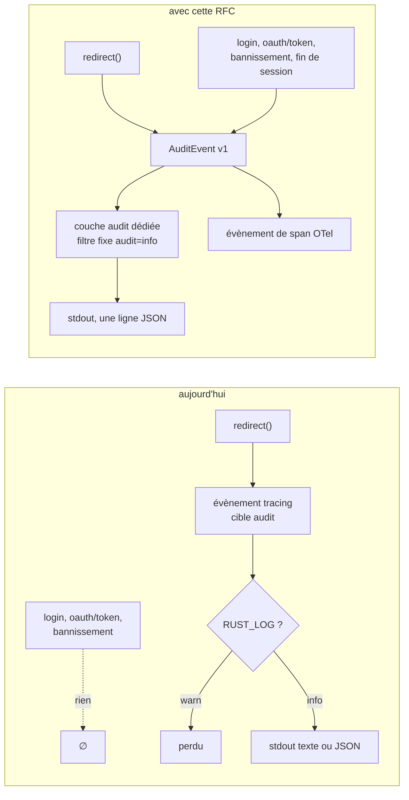
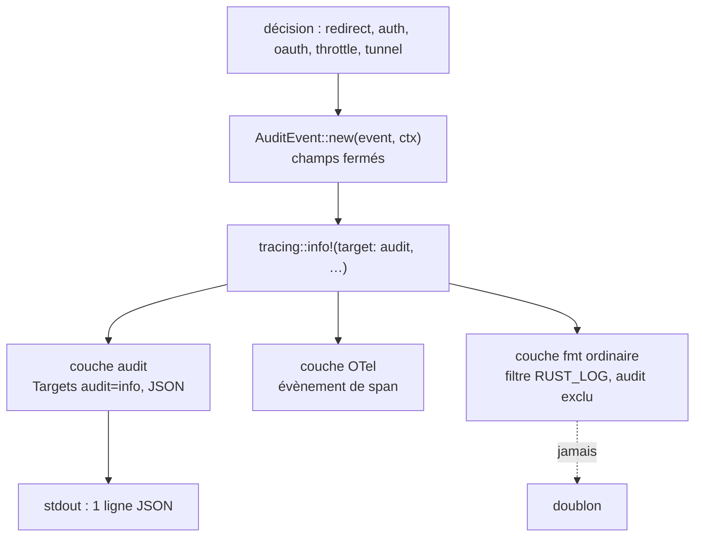
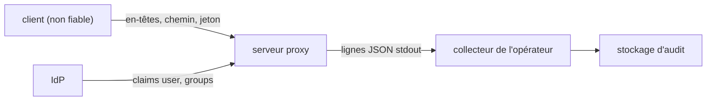

# RFC 0008 — Trace d'audit : couverture, schéma et sortie garantie

| Field       | Value                                                                  |
| ----------- | ---------------------------------------------------------------------- |
| Status      | Draft                                                                  |
| Short       | Trace d'audit                                                          |
| Settles     | Chaque décision de sécurité du serveur (accès proxifié, refus de politique, authentification, remise de jetons OAuth, bannissement, fin de session) produit un évènement d'audit d'un schéma versionné, que le niveau de log ne peut pas faire taire |
| Author      | Max Batleforc <maxleriche.60@gmail.com>                                |
| Co-author   | Claude Opus 5.5                                                        |
| Created     | 2026-10-17                                                             |
| Supersedes  | —                                                                      |
| Issue       | — (à créer)                                                            |
| Depends on  | RFC 0003 et 0006 (évènements de politique livrés) ; la phase 4 attend la RFC 0007 (tunnel hyper) |
| Blocks      | RFC 0004 (ses évènements `exec_open`/`exec_closed` s'écrivent sur ce schéma) |
| Touches     | `libs/server/trace/src/lib.rs`, `libs/server/api/src/cluster/redirect/{audit.rs,throttle.rs}`, `…/kube_redirect.rs`, `…/kube_redirect/{upgrade.rs,upgrade/tunnel.rs,upgrade/response.rs}`, `libs/server/api/src/cluster/auth/{login.rs,callback.rs,oauth/*.rs}`, `.docs/content/docs/security.mdx` |
| Risk        | medium                                                                 |

> Document de référence (environ 4 900 mots) : §1 à §4 suffisent pour en
> discuter ; §5 à §16 servent à l'implémenter et à le relire.

---

## 1. Summary

Aujourd'hui, l'audit se limite au chemin de proxy. `AuditContext::emit`
(`redirect/audit.rs:135`) écrit un évènement `proxied request` par requête
proxifiée, plus les décisions de ports et de verbes des RFC 0003 et 0006. Tout
le reste n'en laisse aucune trace : la connexion d'un utilisateur, la remise
des jetons de l'IdP par le serveur OAuth intégré, le bannissement d'un client, la durée
d'une session exec. Et un `RUST_LOG=warn` éteint l'audit sans un mot.

Cette RFC fait de l'audit un flux à part, en quatre points :

- **Toujours émis** : une couche dédiée, insensible à `RUST_LOG`.
- **Un format** : lignes JSON d'un schéma versionné (`audit_schema: 1`), avec
  `request_id`, `trace_id` et l'adresse du client.
- **Couvrant** chaque décision de sécurité : authentification, jetons,
  bannissements, refus de politique, fin de session.
- **Lisible côté client** : le refus amont d'un upgrade websocket n'est plus
  masqué par le repli SPDY de kubectl.

### Before / after

```text
# aujourd'hui (RUST_LOG=info, LOG_FORMAT=text)
INFO audit: proxied request user=alice groups=dev ns=default cluster=c verb=GET path=/api/v1/namespaces/dev/pods response_status=200 latency_ms=12
(RUST_LOG=warn : rien)        (POST /oauth/token qui remet les jetons : rien)
(kubectl exec sur un pod Pending) error: unable to upgrade connection: this proxy only tunnels websocket upgrades; SPDY is not supported…

# avec cette RFC (quel que soit RUST_LOG ou LOG_FORMAT)
{"audit_schema":1,"event":"request","outcome":"allowed","request_id":"…","trace_id":"…","client_ip":"10.0.0.7","user":"alice","groups":["dev"],"ns":"default","cluster":"c","http_method":"GET","k8s_verb":"list","path":"/api/v1/namespaces/dev/pods","status":200,"latency_ms":12}
{"audit_schema":1,"event":"oauth_token_issued","outcome":"allowed","client_ip":"10.0.0.7","user":"alice","ns":"default","cluster":"c","grant_type":"authorization_code","redirect_uri":"http://127.0.0.1:8000/",…}
(kubectl exec sur un pod Pending) error: … SPDY is not supported …; the websocket attempt was refused upstream: pod web does not have a host assigned
```



Le schéma montre les deux pertes d'aujourd'hui : des décisions qui n'émettent
rien, et un filtre global qui jette ce qui est émis.

---

## 2. Motivation

1. **Un niveau de log éteint l'audit.** Le filtre `env_filter` construit depuis
   `RUST_LOG` (`trace/src/lib.rs:290`) s'applique à tout le `Registry`
   (`:300`), donc aussi à la cible `audit`. Un opérateur qui passe
   `RUST_LOG=warn` pour calmer ses logs perd tout l'audit, sans avertissement.
   `security.mdx` (« Journal d'audit ») suggère bien `RUST_LOG=warn,audit=info`,
   mais rien ne l'impose.
2. **La remise de jetons n'est pas tracée.** Le serveur OAuth intégré
   (`cluster/auth/oauth/authorize.rs:60`, `callback.rs:51`, `token.rs:69`)
   échange un code contre les jetons de l'IdP, puis les remet au client local
   (`IssuedCode`, `oauth/model.rs:47`). L'identité n'est connue qu'au callback
   (`claims.subject()`, `callback.rs:281`, un `info!` hors audit), et
   `IssuedCode` ne la garde pas. `token.rs` ne journalise que des erreurs
   (`:103,109`). Une compromission ne laisse donc aucune trace de qui a reçu
   des jetons, ni quand.
3. **L'authentification et les bannissements non plus.** `cluster_login`
   (`auth/login.rs:40`) et `callback_login` (`auth/callback.rs:46`) n'écrivent
   qu'un `info!` hors audit. Le bannissement décidé par
   `throttle::record_auth_failure` (`redirect/throttle.rs:114`) ne produit
   rien : seul le `429` de la requête suivante apparaît, comme une requête
   ordinaire.
4. **Les évènements ne se recoupent pas.** Le champ `verb`
   (`redirect/audit.rs:142`) contient la méthode HTTP, alors que
   `emit_verb_denied` ajoute `k8s_verb` : un `GET` peut être un `get`, un
   `list`, un `watch` ou un `create` (RFC 0006). L'évènement ne porte ni
   `request_id`, ni `trace_id`, ni l'adresse du client. Le texte n'en donne que
   les spans, et le JSON seulement via `with_span_list`
   (`trace/src/lib.rs:229-230`).
5. **Une session n'a pas de fin.** L'évènement d'une session upgradée part au
   `101` (`upgrade.rs:329`). La fin de la session (durée, octets, qui a fermé)
   n'est jamais écrite (`upgrade/tunnel.rs:53-59`). La RFC 0004 le constate
   pour exec (motivation 3) ; c'est vrai de tout tunnel (port-forward, attach,
   watch).
6. **Le repli SPDY masque le refus amont.** Constaté le 2026-10-17 avec
   kubectl 1.37 (RFC 0006 §17) : l'apiserver refuse le websocket d'un
   `kubectl exec` sur un pod `Pending`, et le proxy relaie ce refus
   (`refused_upgrade_response`, `upgrade/response.rs:107`). kubectl retente
   alors en SPDY et n'affiche que le `400` du proxy, « SPDY is not supported »
   (`upgrade.rs:135`). La vraie raison n'est visible ni par l'utilisateur, ni
   dans l'audit, qui ne garde que le statut.

---

## 3. Goals / non-goals

**Goals**

- Un évènement d'audit pour chaque décision de sécurité du serveur (§4.2),
  dans un schéma unique et versionné.
- Un audit qui ne dépend ni de `RUST_LOG` ni de `LOG_FORMAT`.
- Chaque évènement porte `request_id`, `trace_id`, `client_ip`, `http_method`
  et, quand il est calculable, `k8s_verb`.
- La raison d'un refus amont d'upgrade est consignée, et rendue au client qui
  retente en SPDY.
- Un évènement `session_closed` pour chaque tunnel. La RFC 0004 y ajoute
  `argv` et ses canaux.

**Non-goals**

- **Stockage inaltérable (WORM, signature, chaînage de hachés)** : c'est le
  rôle du collecteur de l'opérateur. Le serveur garantit l'émission, pas la
  conservation.
- **Intégration SIEM spécifique** (Splunk HEC, syslog) : la sortie est une
  ligne JSON sur stdout, que tout collecteur sait router.
- **Exporteur OTLP logs** : les évènements restent aussi des évènements de
  span OTel, comme aujourd'hui (§12).
- **Audit des appels du contrôleur vers les clusters** (réconciliation,
  reachability) : ils ne portent aucune identité d'utilisateur ;
  `status.error` et les logs du contrôleur les couvrent.
- **Audit du corps des requêtes ou de la query string** : ils peuvent porter
  des secrets (arguments d'exec, sélecteurs) ; l'argv d'exec relève de la
  RFC 0004 et de son `mask_exec_secrets`.
- **Interrupteur pour couper l'audit** : un audit qu'on éteint par
  configuration ne prouve rien. On filtre côté collecteur.
- **Remplacer l'audit de l'apiserver cible** : il reste la source pour ce que
  l'apiserver a exécuté. Le proxy trace ce qu'il a décidé.

---

## 4. User-facing design

### 4.1 Configuration

Aucune option nouvelle obligatoire. Un seul réglage, côté serveur :

```text
AUDIT_SPDY_HINT=true   # défaut true : rappelle au repli SPDY le refus amont du websocket (§4.2)
```

- Les évènements d'audit sortent **toujours** : couche dédiée à filtre fixe
  `audit=info`, toujours au format JSON, quel que soit `LOG_FORMAT`. La
  couche de logs ordinaire exclut la cible `audit`, pour qu'il n'y ait pas de
  doublon.
- `AUDIT_SPDY_HINT` absent vaut `true`, et c'est sans risque : l'indice ne
  redonne au client que le corps que le proxy lui a déjà relayé pour **sa
  propre** tentative websocket (même utilisateur, même adresse, même chemin,
  §7.1 T5). Le couper (`false`) ne change que le
  message du `400`, jamais l'audit.

### 4.2 Behaviour rules

**Évènements** (`event`), et quand ils sont émis :

| `event` | Émis par | Quand |
| --- | --- | --- |
| `request` | `redirect()` | une requête proxifiée reçoit sa réponse (remplace `proxied request`) |
| `policy_decision` | `redirect()`, `check_handshake`, `tunnel` | décision de ports (RFC 0003) ou de verbes (RFC 0006) : `policy`, `decision`, `port`, `reason` |
| `auth_login` | `cluster_login` | redirection vers l'IdP d'un cluster |
| `auth_callback` | `callback_login` | retour de l'IdP : `outcome` allowed (identité résolue) ou denied (nonce, code ou jeton invalide) |
| `oauth_authorize` | `oauth::authorize` | demande d'autorisation acceptée ou refusée : `redirect_uri` (loopback, sans query) ; il n'y a pas de `client_id`, le serveur n'enregistre aucun client |
| `oauth_callback` | `oauth::callback` | retour de l'IdP : `user` (sujet du jeton d'identité vérifié) en cas de succès, raison en cas d'échec (nonce, `at_hash`, échange) |
| `oauth_token_issued` / `oauth_token_denied` | `oauth::token` | jetons remis ou refusés : `user` (repris d'`IssuedCode`), `redirect_uri`, `grant_type`, `expires_in` ; raison du refus (`invalid_grant`, PKCE, `redirect_uri`) ; jamais un jeton ni le code |
| `client_banned` | `throttle::record_auth_failure` | un bannissement est posé ou prolongé : à chaque échec au-delà du seuil de `fail2login` (`ban_duration_for` rend une durée, `throttle.rs:138`) ; `failures`, `ban_seconds` (0 : permanent) |
| `session_closed` | `tunnel` | fin d'un tunnel : `duration_ms`, `bytes_in`, `bytes_out`, `close_reason` (client, upstream, filter, error) |

**Champs communs**, présents sur chaque évènement :

- `audit_schema` (`1`), `event`, `outcome` (`allowed`, `denied`, `error`) ;
- `request_id`, `trace_id` ;
- `client_ip` : l'adresse calculée par `throttle_client_ip`, qui honore
  `TRUSTED_PROXY_COUNT`, comme pour les bans ;
- `user` (`-` si inconnu), `groups` (tableau), `ns`, `cluster`.

Sur `request` et `policy_decision` s'ajoutent `http_method`, `k8s_verb` (si
`request_info` aboutit), `path` (sans query), `status` et `latency_ms`.
`verb` reste un alias de `http_method` jusqu'en v1.0.0, puis disparaît, avec
annonce dans le CHANGELOG. Pour une API virtuelle, `k8s_verb` et `path` sont
ceux de la requête d'origine, et `upstream_path` / `upstream_k8s_verb` ceux
de la requête réécrite, les deux étant vérifiés (RFC 0006 T5).

**Contenu interdit**, quel que soit l'évènement : l'en-tête `Authorization`,
tout jeton ou code (d'accès, de rafraîchissement, d'autorisation, `id_token`),
le `client_secret`, la query string, les corps. Les champs sont une liste
fermée, construite par `AuditEvent`, jamais un dump de la requête.

**Refus amont d'un upgrade** : quand l'upstream répond autre chose que `101`,
le message du `Status` renvoyé par l'apiserver est lu (`read_response_body`
le lit déjà, `response.rs:116`). Il est tronqué à 256 caractères et sert à
deux choses :

- il est consigné dans `upstream_reason` de l'évènement `request` ;
- il est gardé 10 s dans un cache local, avec pour clé
  `(client_ip, user, ns/cluster, path)`.

Si un `Upgrade: SPDY/…` arrive avec la même clé pendant ce délai, le `400`
« SPDY is not supported » gagne : `; the websocket attempt was refused
upstream: <upstream_reason>`.

**Cas sans rien de nouveau** : un serveur sans requête n'émet rien. Un cluster
sans `security_config` émet `request`, comme aujourd'hui. Un appel au
dashboard (`/api/v1/clusters`) n'émet rien : il ne fait que lire la liste des
clusters visibles, déjà filtrée par groupe.

### 4.3 Validation

Rien n'est refusé : il n'y a aucune entrée nouvelle à valider.
`AUDIT_SPDY_HINT` est un booléen, et une valeur illisible vaut `true` avec un
avertissement.

| Condition | Behaviour | Surfaced in |
| --- | --- | --- |
| `RUST_LOG` exclut la cible `audit` (par exemple `warn`) | l'audit sort quand même | un `warn!` au démarrage : « RUST_LOG no longer filters the audit target » |
| `AUDIT_SPDY_HINT` illisible | `true` | `warn!` au démarrage, comme les autres replis de `common::config` |
| `LOG_FORMAT=text` | logs en texte, audit en JSON sur le même stdout | doc (`security.mdx`) : filtrer sur `"audit_schema"` |

---

## 5. Architecture

### 5.1 Émission



Un évènement emprunte toujours la couche audit, parce que son filtre est un
`Targets` fixe. `RUST_LOG` ne règle que la couche ordinaire et le filtre OTel,
qui ne voit plus la cible `audit` comme filtrable.

### 5.2 Repli SPDY

```mermaid
sequenceDiagram
    participant K as kubectl
    participant P as proxy
    participant A as apiserver
    K->>P: GET …/exec (Upgrade: websocket)
    P->>A: handshake
    A-->>P: 400 Status "pod web does not have a host assigned"
    P->>P: audit request upstream_reason=…<br/>cache (ip, user, cluster, path) 10 s
    P-->>K: 400 (relayé)
    K->>P: POST …/exec (Upgrade: SPDY/3.1)
    P->>P: politiques puis NotWebsocket, cache trouvé
    P-->>K: 400 "SPDY is not supported…; the websocket attempt was refused upstream: pod web does not have a host assigned"
```

Le cache ne sert qu'à **ce** message : il ne change aucune décision, et une
entrée absente (autre réplique, délai dépassé) redonne le message
d'aujourd'hui.

### 5.3 Invariant

Toutes les sorties passent par `AuditEvent`, dont les champs sont une liste
fermée. Aucun appelant ne peut donc y mettre un en-tête ou un corps arbitraire,
ni un jeton. Et la couche audit a son propre filtre fixe : aucune valeur de
`RUST_LOG` ne peut retirer un évènement de stdout.

---

## 6. Detailed design

### 6.1 `libs/server/trace`

- `start_tracing` ajoute une troisième couche :
  `fmt::layer().json().flatten_event(true).with_current_span(false)` filtrée
  par `Targets::new().with_target("audit", Level::INFO)`.
- La couche ordinaire reçoit `.with_filter(filter_fmt.add_directive("audit=off"))`.
- Le filtre global `env_filter` ne s'applique plus au `Registry` entier, mais
  par couche : ordinaire et OTel. Sinon il couperait la couche audit en amont.
  La couche OTel garde exactement les directives d'aujourd'hui (celles de
  `base_filter`, dont la mise en sourdine des crates de transport), pour que
  le volume de spans exportés ne change pas.
- Avertissement au démarrage si la valeur de `RUST_LOG` aurait exclu `audit`.

### 6.2 `libs/server/api`

- `redirect/audit.rs` : `AuditEvent` (champs de §4.2, `serde`-free :
  construit des champs `tracing`), `AuditEvent::emit()`. `AuditContext`
  garde ses champs et gagne `request_id`, `trace_id`, `client_ip`,
  `k8s_verb` ; `emit`, `emit_port_decision` et `emit_verb_denied` deviennent
  des appels à `AuditEvent`. `sanitize_audit_field` reste en défense en
  profondeur : plus aucune sortie texte ne reçoit la cible `audit`, et les
  évènements de span OTel sont des attributs structurés.
- `kube_redirect.rs` : `client_ip` (déjà calculé, `peer_id`, `:98`) et
  `k8s_verb` (déjà calculé, `request_info`) passent dans `AuditContext`.
- `upgrade/response.rs` : `refused_upgrade_response` rend aussi le message du
  `Status` amont ; `upgrade.rs` le consigne et l'insère dans le cache.
- Nouveau `upgrade/spdy_hint.rs` : cache borné (1 024 entrées, TTL 10 s,
  éviction de la plus ancienne), clé `(client_ip, user, ns/cluster, path)` ;
  `UpgradeRefusal::NotWebsocket` l'interroge.
- `auth/login.rs`, `auth/callback.rs`, `auth/oauth/{authorize,callback,token}.rs` :
  un `AuditEvent` par issue (accepté, refusé, erreur).
- `auth/oauth/model.rs` : `IssuedCode` gagne `subject` (et `groups` si le
  jeton d'identité en porte), posé au callback, pour que `token.rs` sache à
  qui il remet les jetons. Le code vit 60 s dans Redis (`CODE_TTL_SECONDS`),
  qui détient déjà les jetons eux-mêmes : le sujet n'y ajoute rien de
  sensible.
- `throttle::record_auth_failure` : `client_banned` quand le compteur franchit
  le seuil.
- `upgrade/tunnel.rs` (phase 4, sur le tunnel hyper de la RFC 0007) :
  compteurs d'octets dans les deux moitiés, `session_closed` à la fin de la
  dernière.

### 6.3 Docs

- `security.mdx` « Journal d'audit » réécrit : schéma v1, table des
  évènements, champs interdits, exemple de filtre collecteur, alias `verb`.

### 6.P Proof against a real client

Clients : `kubectl` 1.37 (le seul installé ; websocket par défaut pour exec et
port-forward), `curl` 8, le plugin `kubectl-proxyauth` du dépôt pour la
connexion SSO (`/auth/login`, `/auth/callback`) et kubelogin
(`kubectl oidc-login`) pour le serveur OAuth intégré, comme le décrit
`security.mdx` (« OAuth Authorization Server médiée »). Banc : le serveur réel, en TLS, devant un kube-apiserver réel
(binaires envtest, comme pour la preuve de la RFC 0006, §17) ; la sortie est
lue avec `jq`. Suite automatique : `libs/server/api/tests/audit_trail.rs`
(capture de la couche audit) et `http_contract.rs` (RFC 0007).

1. Serveur lancé avec `RUST_LOG=warn` : `kubectl get pods` produit **une**
   ligne `{"audit_schema":1,"event":"request","k8s_verb":"list",…}`, et
   aucune ligne `info` ordinaire.
2. `kubectl get pods -w` : `k8s_verb` vaut `watch`, `http_method` `GET` ;
   `request_id` et `trace_id` sont présents et non vides.
3. `kubectl proxyauth login` : la sortie contient `auth_login` puis
   `auth_callback` (`outcome: allowed`) pour cet utilisateur. `kubectl
   oidc-login get-token` contre le serveur OAuth intégré : `oauth_authorize`,
   `oauth_callback`, puis `oauth_token_issued`, ces deux derniers avec le même
   `user`.
   **Refus** : un `grep` du jeton émis (lu dans le cache de kubelogin) sur
   toute la sortie du serveur ne trouve rien.
4. **Refus** : `curl` sur `/oauth/token` avec un code invalide produit
   `oauth_token_denied` et un `400`.
5. **Refus** : `fail2login.max_failed_logins: 2`, puis trois requêtes avec un
   jeton faux : une ligne `client_banned` avec `client_ip` et `ban_seconds`,
   puis des `request` en `429`.
6. **Refus** : `kubectl delete pod web` : une ligne `policy_decision`
   (`policy: verb`, `decision: denied`, `k8s_verb: delete`) et une ligne
   `request` en `403`.
7. `kubectl exec web -- ls` sur un pod `Pending` : kubectl affiche
   `…SPDY is not supported…; the websocket attempt was refused upstream: …`
   avec la raison de l'apiserver, et la ligne `request` du `GET` porte
   `upstream_reason`.
8. Avec un kubelet (k3d, délégation cgroup `cpuset`, voir RFC 0006 §17) :
   `kubectl port-forward pod/web 8080` puis Ctrl-C donne `session_closed`
   avec `close_reason: client` et des octets non nuls.
9. Un `kubectl get` avec `Authorization: Bearer <jeton>` : le jeton
   n'apparaît dans aucune ligne, ni d'audit, ni de log.

**Deliberately untouched**, so reviewers do not go looking :

- Les décisions elles-mêmes (ports, verbes, groupes, bans) : seule leur
  trace change.
- `virtual_redirect` : il émet déjà via `AuditContext`, et hérite du schéma.
- Le contrôleur (`libs/server/controller`) : aucune identité d'utilisateur
  (§3).

---

## 7. Security

**Rating:** medium. Aucun contrôle d'accès ne change, mais l'audit est la
défense contre la répudiation, et il touche à des données sensibles (jetons,
identité, adresse).

### 7.1 Threat model



| # | Threat (STRIDE) | Where | Mitigation | Residual risk |
| --- | --- | --- | --- | --- |
| T1 | Repudiation : audit perdu par un `RUST_LOG` restrictif | `trace` | couche audit à filtre `Targets` fixe (§6.1) ; avertissement au démarrage | aucun |
| T2 | Repudiation : jetons remis sans trace | `oauth/callback.rs`, `oauth/token.rs` | `oauth_callback` et `oauth_token_issued` / `_denied` à chaque issue ; le sujet suit le code dans `IssuedCode` | aucun |
| T3 | Info disclosure : jeton, code ou secret dans l'audit | `AuditEvent` | champs fermés ; aucun en-tête, query ou corps ; test qui cherche le jeton dans toute la sortie | `upstream_reason` reprend un message de l'apiserver (borné à 256 caractères) ; accepté |
| T4 | Tampering : faux évènement par un champ contrôlé (`user`, `path`, `upstream_reason`) | sortie | JSON : le sérialiseur échappe CR/LF ; la couche texte ordinaire exclut `audit` ; `sanitize_audit_field` gardé en défense en profondeur | aucun |
| T5 | Info disclosure : l'indice SPDY donne le refus d'un autre utilisateur | `spdy_hint.rs` | clé `(client_ip, user, ns/cluster, path)` ; TTL 10 s. L'indice ne révèle rien de neuf : c'est le corps que le proxy a déjà relayé à ce même client en réponse à sa tentative websocket, que kubectl n'a simplement pas affiché | deux connexions derrière le même NAT avec le **même** `user` : c'est le même utilisateur |
| T6 | Spoofing : `client_ip` falsifiée par `X-Forwarded-For` | `throttle_client_ip` | `TRUSTED_PROXY_COUNT` existant, défaut 0 | celui déjà accepté pour les bans (`security.mdx`, risques acceptés) |
| T7 | DoS : saturation par l'indice SPDY ou par le volume d'audit | cache, stdout | cache borné à 1 024 entrées ; un évènement par décision, pas par octet | un stdout bloqué ralentit les requêtes (§10.2) ; accepté |

Tests négatifs : T1 → §6.P point 1 ; T2 → point 3 ; T3 → points 3 et 9 ;
T4 → `user` contenant `\n{"audit_schema":1}` reste un seul champ JSON ;
T5 → un autre `user` ne reçoit pas l'indice ; T7 → 2 000 clés distinctes
laissent le cache à 1 024.

### 7.2 Authentication and authorisation

Aucune surface nouvelle : pas de route, pas de jeton. Le cache de l'indice ne
sert qu'à composer un message pour l'appelant qui a provoqué l'entrée.

### 7.3 Input handling and injection

Le seul parseur nouveau lit le message d'un `Status` amont, déjà lu en entier
(`read_response_body`, borné par sa limite actuelle) : le JSON est décodé, le
champ `message` tronqué à 256 caractères, et tout échec donne une raison vide.
Pas de fuzz dédié : `serde_json` sur un corps borné.

### 7.4 Secrets and cryptography

Aucun secret n'est ajouté. La règle « jamais un jeton » est portée par la liste
fermée des champs et prouvée par §6.P points 3 et 9.

### 7.5 Abuse and resource exhaustion

Un évènement par décision, déjà le cas pour `request`. Le cache de l'indice
est borné en entrées et en durée : un client qui varie les chemins ne fait
qu'évincer ses propres entrées.

### 7.6 Existing defences that still hold

`sanitize_audit_field`, l'exclusion de la query string, `TRUSTED_PROXY_COUNT`,
le refus de SPDY après les politiques (RFC 0003 R13).

---

## 8. Supply chain

| Dependency / image / tool | Version | Why this one | Licence | Known CVEs (`task audit`) | Maintenance |
| --- | --- | --- | --- | --- | --- |
| aucune nouvelle | — | `tracing-subscriber` (feature `json`) et `serde_json` sont déjà dans l'arbre | — | — | — |

- **Build et release** : inchangés.
- **Updates** : sans objet.

---

## 9. Data and privacy

| Data | Personal? | Where stored | Retention | Who can read it | Leaves the instance? |
| --- | --- | --- | --- | --- | --- |
| `client_ip` (nouveau) | **oui** | stdout, collecteur | politique de l'opérateur | opérateurs | selon le collecteur |
| `user`, `groups` (déjà là) | oui | idem | idem | idem | idem |
| `redirect_uri` (OAuth, loopback) | non | idem | idem | idem | idem |
| `subject` dans `IssuedCode` | oui (identifiant) | Redis, avec les jetons | 60 s (`CODE_TTL_SECONDS`) | le serveur | non |
| `upstream_reason` | peut nommer un pod ou un namespace | stdout ; cache mémoire 10 s | 10 s en mémoire, puis opérateur | opérateurs ; l'appelant lui-même (indice) | selon le collecteur |
| `request_id`, `trace_id` | non | idem | idem | idem | vers le collecteur OTel déjà configuré |

- L'adresse est déjà dans les clés de bannissement (Redis) : l'audit la
  rend lisible au même public, les opérateurs. Elle sert à enquêter
  (répudiation, bannissements) ; la minimisation porte sur le reste (pas de
  user-agent, pas de query).
- Effacement et export : par le collecteur, sur `user` et `client_ip`.

---

## 10. Operability

### 10.1 Observability

- **Metrics** : `proxyauth_audit_events_total{event, outcome}`. Les deux
  labels sont bornés (l'énumération de §4.2) ; ni utilisateur, ni chemin.
- **Logs and audit trail** : l'objet de la RFC. Une ligne JSON par évènement,
  table de §4.2.
- **Alerts** : aucune par défaut. Une hausse de `client_banned` ou
  d'`oauth_token_denied` relève d'une règle de l'opérateur, documentée comme
  exemple.

### 10.2 Failure modes

| Failure | Detected by | Behaviour | Recovery |
| --- | --- | --- | --- |
| stdout bloqué (collecteur arrêté, pipe plein) | latence des requêtes | **proposé** (question 1) : l'écriture bloque la requête (fermé : pas de décision sans trace) | relancer le collecteur |
| corps du refus amont illisible | `upstream_reason` vide | message SPDY d'aujourd'hui | aucune |
| indice absent (autre réplique, plus de 10 s) | — | message SPDY d'aujourd'hui | aucune ; best effort assumé |
| `RUST_LOG` excluant `audit` | avertissement au démarrage | audit émis quand même | aucune |

### 10.3 Performance and capacity

Une sérialisation JSON par décision, contre une ligne texte aujourd'hui. Le
coût est à mesurer par le banc de débit de la RFC 0007 (§6.P point 9), avec
un seuil de 5 % de latence ajoutée au p99. Le cache : 1 024 entrées d'au plus
~600 octets, soit moins de 1 Mio par réplique.

---

## 11. Other concerns

- **Accessibility** : pas d'UI.
- **Internationalisation** : le message de l'indice SPDY et l'audit sont en
  anglais, comme les autres messages d'API.
- **Compliance** : traçabilité ISO 27001 A.8.15 (journalisation) et A.5.28
  (preuves) ; NIS2 art. 21 (journalisation des accès). Le schéma versionné
  devient la pièce produite à l'audit.
- **Licensing** : inchangé.
- **Documentation** : `security.mdx` (Journal d'audit, risques acceptés),
  `configuration.mdx` (`AUDIT_SPDY_HINT`), CHANGELOG (alias `verb`, JSON
  forcé).

---

## 12. Alternatives considered

| Alternative | Why rejected |
| --- | --- |
| Documenter `RUST_LOG=…,audit=info` (état actuel) | repose sur chaque opérateur ; le défaut d'une erreur est un audit vide |
| Exporteur OTLP logs (`opentelemetry-appender-tracing`) | une dépendance et un second pipeline pour ce que stdout fait déjà ; les évènements restent des évènements de span. Réévaluable si un opérateur en a besoin |
| Fichier d'audit dédié avec rotation | état sur disque dans un conteneur sans volume ; la rotation et la rétention reviennent au collecteur |
| Audit en texte quand `LOG_FORMAT=text` | deux formats à maintenir pour une sortie lue par des machines |
| Indice SPDY partagé via Redis | une écriture Redis par refus amont pour un message best effort ; derrière un répartiteur sans affinité, le repli peut tomber sur une autre réplique et retrouve alors le message d'aujourd'hui, ce qui est accepté |
| Ne pas relayer le refus amont (répondre `101` puis fermer) | contredit l'invariant d'upgrade (seul un `101` amont ouvre un tunnel) |
| Un champ `verb` réutilisé pour le verbe k8s | casse silencieusement les requêtes des collecteurs ; l'alias puis le retrait en v1.0.0 sont annoncés |

---

## 13. Rollout and compatibility

- **Default behaviour** : l'audit passe en JSON sur stdout, même en
  `LOG_FORMAT=text`, et sort même avec `RUST_LOG=warn`. Le message
  `proxied request` devient `event: request`, `response_status` devient
  `status`, et `verb` reste un alias de `http_method`.
- **Migration** : les requêtes des collecteurs passent de
  `message="proxied request"` à `event="request"`. Le CHANGELOG l'annonce
  (`feat!:`) avec la table de correspondance.
- **Operator prerequisites** : aucune.
- **Rollback** : image précédente ; la couverture et le format reviennent,
  sans état persistant.
- **Feature flag** : non pour l'audit (§3) ; `AUDIT_SPDY_HINT` pour
  l'indice seul.

---

## 14. Test plan

- **Unit** (`redirect/audit.rs`) : chaque `event` produit exactement ses
  champs ; `verb` = `http_method` ; aucun champ hors liste.
- **Unit** (`trace`) : un subscriber avec `RUST_LOG=warn` capture quand même
  un évènement `audit` dans la couche audit, et aucun dans la couche
  ordinaire.
- **Unit** (`upgrade/spdy_hint.rs`) : TTL, borne de 1 024, clé par
  utilisateur.
- **Integration** (`tests/audit_trail.rs`, nouveau) : capture de la couche
  audit ; un cas par ligne de §4.2, dont OAuth (`oauth_as_*` existants
  réutilisés) et `client_banned` (`proxy_throttle.rs`).
- **Integration** (`http_contract.rs`) : le message du `400` SPDY avec
  l'indice ; sans entrée, inchangé.
- **Proof** : §6.P.
- **Security** : un test négatif par ligne T1 à T7 (§7.1).
- **Audit** : `task audit` vert, sans dépendance nouvelle.
- **Existing suites** : toutes. Les tests qui lisent `proxied request` sont
  portés sur `event: request`.

---

## 15. Decisions and open questions

### Resolved

Propositions de l'auteur, pas encore confrontées au `/grill-me` : chacune
peut y être rouverte.

| # | Question | Decision |
| --- | --- | --- |
| 1 | Peut-on couper l'audit ? | **Non.** Un audit qu'une configuration éteint ne prouve rien ; le filtrage se fait au collecteur. |
| 2 | Format | **JSON toujours**, schéma versionné `audit_schema: 1` ; les logs ordinaires gardent `LOG_FORMAT`. |
| 3 | Sortie | **stdout**, en plus des évènements de span OTel existants ; pas d'exporteur OTLP logs pour l'instant (§12). |
| 4 | `client_ip` | **Ajoutée**, calculée comme pour les bans (`TRUSTED_PROXY_COUNT`). |
| 5 | Repli SPDY qui masque le refus amont | **Indice best effort** dans le `400`, cache local 10 s par `(ip, user, cluster, path)`, désactivable (`AUDIT_SPDY_HINT`). |
| 6 | Session close pour tous les tunnels ou seulement exec | **Tous** ; la RFC 0004 ajoute ses champs propres à exec. |

### Still open

1. **Échec d'écriture sur stdout** : bloquer la requête (fermé, proposé) ou
   abandonner la ligne et compter `proxyauth_audit_dropped_total` (ouvert) ?
   Recommandation : bloquer, puisqu'un proxy d'accès sans trace est le cas que
   la RFC ferme ; à trancher au grill avec le banc de débit de la RFC 0007.
2. **Le dashboard (`/api/v1/clusters`) doit-il auditer ?** Il ne lit que des
   métadonnées déjà filtrées par groupe. Recommandation : non, revu si le
   dashboard gagne des écritures.

---

## 16. Implementation phases

| Phase | Content |
| --- | --- |
| 1 | `AuditEvent` et schéma v1 ; couche audit dédiée insensible à `RUST_LOG` (contrôle de T1, livré avec le format) ; `request_id`, `trace_id`, `client_ip`, `http_method`/`k8s_verb` ; alias `verb` ; docs et CHANGELOG `feat!:` |
| 2 | Évènements d'authentification et OAuth (`auth_*`, `oauth_*`), `client_banned` (contrôles de T2 et T3) |
| 3 | `upstream_reason` et indice SPDY (`spdy_hint.rs`, contrôle de T5) |
| 4 | `session_closed` sur le tunnel hyper de la RFC 0007 ; la RFC 0004 s'y appuie |

Les phases 1 à 3 sont indépendantes du framework HTTP : elles touchent
l'émission, pas le transport, et peuvent sortir avant la RFC 0007. La phase 4
attend son tunnel, pour ne pas écrire deux fois le comptage d'octets.
