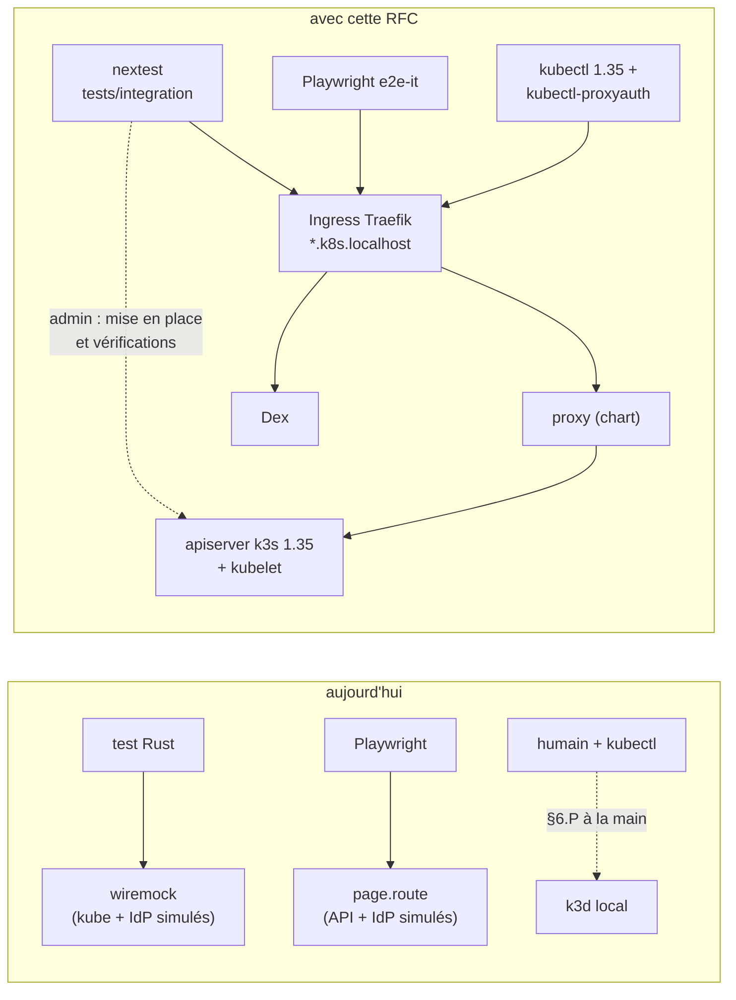
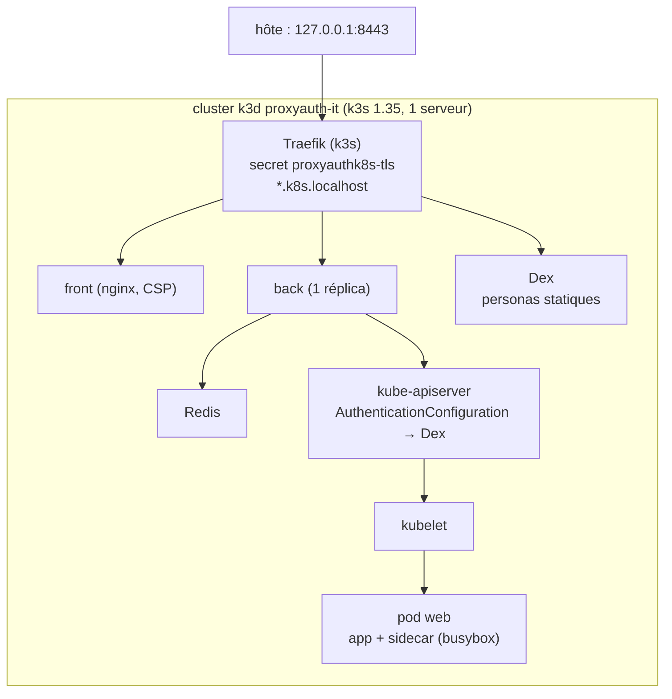
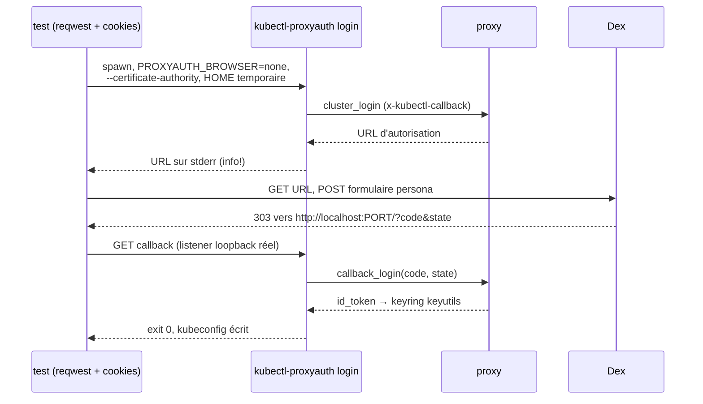
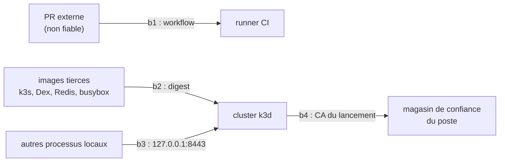

# RFC 0009 — Banc et suite d'intégration sur un vrai cluster

| Field       | Value                                                                  |
| ----------- | ---------------------------------------------------------------------- |
| Status      | Implemented (2026-10-17 à 2026-10-19)                                  |
| Short       | Suite d'intégration                                                    |
| Settles     | Chaque point §6.P des RFC 0001 à 0008 est prouvé par un test automatisé contre la pile déployée (k3d, Dex, chart, images), ou marqué hors suite avec son renvoi, et cette suite verte conditionne le tag 0.2.0 |
| Author      | Max Batleforc <maxleriche.60@gmail.com>                                |
| Co-author   | Claude Opus 5.5                                                        |
| Created     | 2026-10-17                                                             |
| Supersedes  | —                                                                      |
| Issue       | — (à créer)                                                            |
| Depends on  | RFC 0001 (pnpm), 0002 (front et image nginx), 0005 phase 1 (`mise.toml`, workflows sur `task`) |
| Blocks      | tag 0.2.0 ; les étapes 10, 11, 12b, 12c et 12 du PLAN livrent leurs lignes de matrice |
| Touches     | `tests/integration/` (nouveau), `apps/front/e2e-it/` (nouveau), `.tasks/integration.yaml`, `.it/` (nouveau, versionné en partie), `Taskfile.yaml`, `Cargo.toml` (membre de workspace), `.config/nextest.toml` (nouveau), `mise.toml`, `deploy/chart` (`ingress.publicUrl`, `back.extraVolumes`, §17), `apps/front/eslint.config.mjs`, `.github/workflows/integration.yaml`, `.gitignore`, `.docs/content/docs/developper-guide/`, `.rfc/PLAN.md` |
| Risk        | medium                                                                 |

> Document de référence (environ 6 000 mots) : §1 à §4 suffisent pour en
> discuter ; §5 à §16 servent à l'implémenter et à le relire.

---

## 1. Summary

Aujourd'hui, aucun test ne parle à un vrai cluster avec kubelet. Le backend est
testé contre wiremock (API kube et IdP simulés, `libs/server/api/tests/harness`),
envtest fournit un apiserver sans kubelet (`.tasks/envtest.yaml`), et les e2e
Playwright interceptent l'API et l'IdP par `page.route` avec un jeton injecté
dans le sessionStorage (`apps/front/e2e/fixtures.ts`). Les §6.P des RFC 0003,
0004, 0006, 0007 et 0008 décrivent des preuves contre k3d et un vrai IdP, mais
ces preuves se font à la main.

Cette RFC ajoute un **banc** reproductible (un cluster k3d, Dex, Redis, le
chart du dépôt avec les images construites localement) et une **suite** en
boîte noire qui le pilote : tests Rust pour le backend, la CLI et kubectl,
projet Playwright pour l'UI. Une matrice versionnée relie chaque point §6.P à
son test. La même commande tourne en local et en CI, et la suite est un check
requis.

### Before / after

```text
# aujourd'hui
task test                    # wiremock + Redis réel
task envtest:test            # apiserver sans kubelet
pnpm -C apps/front e2e       # page.route, jeton factice
# §6.P 0003 point 4 : à la main
kubectl port-forward pod/web 9090:9090   # « refusé ? » → on lit le terminal

# avec cette RFC
task it:up                   # k3d 1.35 + Dex + Redis + chart + images locales
task it:test                 # nextest (tests/integration) puis Playwright (e2e-it)
task it:matrix               # chaque point §6.P a une ligne et un test qui existe
task it:down
```



Le schéma montre la règle du banc : l'action testée passe toujours par
l'Ingress et le proxy ; seul le kubeconfig admin parle en direct à
l'apiserver, et jamais pour l'action testée.

---

## 2. Motivation

1. **Les §6.P sont des promesses non vérifiées.** 77 points §6.P répartis sur
   huit RFC ; ceux des 0003, 0004, 0006 et 0007 nomment k3d et kubectl comme
   banc, et aucun workflow de `.github/workflows/` ne crée de cluster. Une
   régression d'un refus de port-forward ne se voit qu'en relançant la recette
   à la main.
2. **La 0.2.0 regroupe désormais les huit RFC**, dont la migration axum (0007
   phases 2 à 6). `http_contract.rs` fige le contrat HTTP en process, mais pas
   le chemin réel : Ingress Traefik, image `distroless`, kubelet derrière
   l'apiserver, tunnel SPDY ou websocket jusqu'au conteneur. La migration doit
   être prouvée sur ce chemin avant le tag.
3. **Les doubles de test cachent l'IdP réel.** `mount_oidc_provider` signe ses
   propres jetons ; les e2e front écrivent `access_token: 'test-token'`. Aucun
   test ne voit une vraie redirection d'autorisation, un vrai `state`, ni la
   validation par l'apiserver d'un jeton émis par un IdP
   (`AuthenticationConfiguration`, dont dépend le relais de jeton du proxy).
4. **Le chart et les images ne sont jamais exécutés en CI.** `build.yaml`
   construit les images, `deploy/chart` n'est jamais installé. La CSP générée
   au démarrage par `15-csp.envsh` (RFC 0002) n'est vérifiée qu'en
   `vite preview` dans `csp.spec.ts`, pas dans l'image nginx qui la produit.
5. **La CLI n'est testée qu'en unitaire.** `login/sso/mod.rs` a un aller-retour
   complet, mais sur wiremock et avec un canal interne à la place du
   navigateur. Le binaire, son listener loopback, le keyring et le plugin
   `get-token` appelé par kubectl ne sont jamais exercés ensemble.

---

## 3. Goals / non-goals

**Goals**

- Un banc complet monté par `task it:up`, identique en local (podman) et en CI
  (Docker, `ubuntu-latest`).
- Une suite en boîte noire qui ne dépend d'aucune crate interne et reste valable
  avant et après la migration axum.
- Une ligne de matrice par point §6.P des RFC 0001 à 0008, et un check qui
  échoue si un point ou un test manque.
- Un check CI requis sur les PR concernées, un lancement de nuit sur `main`, et
  un passage vert obligatoire avant le tag 0.2.0.
- Un format d'extension : chaque RFC suivante (0008, 0007 phases 2 à 6, 0004)
  livre ses tests et ses personas dans la PR de son code.

**Non-goals**

- **Remplacer les suites existantes** : wiremock, envtest, fuzz et les e2e
  Playwright simulés restent ; ils sont rapides, déterministes et couvrent des
  cas qu'un vrai cluster rend lents (erreurs amont, cas de parsing).
- **Une matrice de versions Kubernetes** : une seule version épinglée (1.35) ;
  un saut de version est une PR à part.
- **Plusieurs clusters cibles** : aucun §6.P n'en demande ; la cible est
  l'apiserver du cluster qui héberge le proxy.
- **La haute disponibilité** : `back.replicas: 1` dans les valeurs du banc
  (§15, décision 33) ; le bail de réconciliation et le partage Redis entre
  réplicas restent couverts par les tests du contrôleur.
- **Les chemins interactifs de la CLI** (prompt TOFU, collage de l'URL) : ils
  exigent un terminal ; leurs tests unitaires les couvrent (§15, décision 31).
- **Les points d'outillage** des RFC 0001 et 0005 : ils sont prouvés par les
  jobs CI qui les exécutent déjà ; la matrice y renvoie.
- **Un test de charge** ou de durée : le « 7 jours en recette » de la 0007
  reste manuel.
- **Scanner les images du banc** dans `task audit` : elles ne sont jamais
  livrées (§8).

---

## 4. User-facing design

Les « utilisateurs » de cette RFC sont les contributeurs et la CI.

### 4.1 Configuration

```yaml
# .tasks/integration.yaml (extrait)
vars:
  IT_DIR: .it/run              # état d'un lancement, ignoré par git
  IT_CLUSTER: proxyauth-it
  IT_HOST: proxyauth.k8s.localhost
  IT_DEX_HOST: dex.k8s.localhost
  IT_HTTPS_PORT: 8443          # publié sur 127.0.0.1 seulement
tasks:
  up:     { desc: "Create the integration cluster and deploy the stack" }
  test:   { desc: "Run the Rust then Playwright integration suites" }
  matrix: { desc: "Check that every §6.P point has a row and an existing test" }
  down:   { desc: "Delete the integration cluster and its run directory" }
```

- **Aucune option ne change le comportement du produit.** Les valeurs du banc
  (`.it/values.yaml`) sont un fichier de valeurs du chart comme un autre.
- `IT_HTTPS_PORT` est publié **sur 127.0.0.1** par k3d, jamais sur
  `0.0.0.0` : le banc embarque des mots de passe connus (personas Dex).
- `CONTAINER_HOST` absent : la tâche utilise le socket podman rootless s'il
  existe (comme `.tasks/kube3d.yaml`), sinon Docker. Défini : il est utilisé
  tel quel.
- `IT_KEEP=1` garde le cluster après `it:test` pour déboguer ; absent, la CI
  appelle toujours `it:down` (étape `if: always()`).

### 4.2 Behaviour rules

- **Un cluster par lancement.** Les tests s'isolent par namespace
  (`it-<module>-<test>`) et par CRD `ProxyKubeApi` dédiées, nommées d'après le
  test. Rien n'est recréé entre deux tests.
- **L'action testée passe par le proxy, le reste en direct.** Mise en place
  (namespaces, CRD, pod `web`) et vérifications indirectes (logs, métriques,
  état des objets) passent par `.it/run/admin.kubeconfig`, l'admin de k3d.
  Un test ne vérifie jamais le proxy à travers le proxy.
- **Résolution des noms.** Aucun `/etc/hosts` n'est modifié. reqwest utilise
  `ClientBuilder::resolve` vers `127.0.0.1:IT_HTTPS_PORT` ; Playwright lance
  Chromium avec `--host-resolver-rules` ; kubectl reçoit un kubeconfig dont
  `server` porte le port publié et `tls-server-name` le nom attendu. Dans le
  cluster, `hostAliases` de k3d fait pointer les deux noms sur Traefik
  (le mécanisme existant de `.k3d/k3d.cluster.yaml.tpl`).
- **Métriques** : lues par `services/proxy` de l'apiserver sur le service back
  (`/management/metrics`, `metrics.prometheus.enabled` dans les valeurs du
  banc), avec l'admin. Une assertion porte sur l'écart avant et après
  l'action, jamais sur une valeur absolue.
- **Audit (0008)** : lu dans `pods/log` du pod back, lignes JSON
  `audit_schema: 1` filtrées par le `x-request-id` que le test envoie.
- **Aucun retry.** `retries: 0` dans Playwright, pas de `retries` dans le
  profil nextest `it`. Un test instable passe en quarantaine (§4.3).
- **Ordre** : `it:test` lance nextest puis Playwright ; un échec Rust
  n'empêche pas Playwright de tourner (les deux rapports sont utiles), mais la
  tâche échoue si l'un des deux échoue.

### 4.3 Validation

Rejeté par `task it:matrix` (et donc en CI) :

| Condition | Rationale |
| --- | --- |
| Un point numéroté d'un §6.P de `.rfc/000[1-9]*.md` sans ligne dans `MATRIX.md` | un point sans ligne est une omission indiscernable d'une décision |
| Une ligne qui cite un ID de test absent (`cargo nextest list` ou `playwright test --list`) | un renvoi mort prouve faussement le point |
| Une ligne `hors suite` sans renvoi (job CI, test unitaire) ni raison | même règle que les blocs obligatoires des RFC |
| Une ligne `quarantaine` sans numéro d'issue | une quarantaine sans issue est un test supprimé en silence |

Rejeté par `task it:up` :

| Condition | Rationale |
| --- | --- |
| Une image du banc sans digest dans `.it/images.lock` | une étiquette flottante rend un échec irreproductible |
| Le port `IT_HTTPS_PORT` déjà pris | k3d échouerait plus tard avec une erreur moins claire |
| `rollout status` du back, du front, de Dex ou de Redis non atteint en 180 s | un banc à moitié monté produit des échecs trompeurs |

Avertissements :

| Condition | Comportement | Visible dans |
| --- | --- | --- |
| Des lignes `quarantaine` dans la matrice | la suite passe ; leur nombre est imprimé | sortie de `it:matrix`, résumé du job CI (`$GITHUB_STEP_SUMMARY`) |
| Durée totale > 15 min | la suite passe | résumé du job CI, avec la durée par phase |

---

## 5. Architecture

### 5.1 Le banc



Le proxy relaie le jeton de l'utilisateur (aucun champ de jeton de service dans
`ProxyKubeApi`) : l'apiserver valide donc lui-même les jetons de Dex grâce à
l'`AuthenticationConfiguration`, avec la CA du lancement. Parce que la cible
est `KubernetesService: {name: kubernetes, namespace: default, port: 443}`,
le proxy n'a besoin d'aucun accès réseau hors du cluster.

### 5.2 Une connexion CLI dans la suite



Le test joue le rôle du navigateur sans toucher au code de la CLI : il ne voit
que ce que voit un humain (une URL, un formulaire, une redirection).

### 5.3 Invariant

Parce que la crate `tests/integration` n'a **aucune dépendance de chemin**
vers le workspace (vérifié par `cargo metadata` dans `it:matrix`), un test ne
peut pas appeler une fonction interne pour contourner le chemin réel ; parce
que l'action testée passe par l'Ingress, un test vert prouve aussi le chart,
l'image et la configuration TLS.

---

## 6. Detailed design

### 6.1 `.it/` : le banc

- `.it/k3d.yaml.tpl` : dérivé de `.k3d/k3d.cluster.yaml.tpl`, avec
  `rancher/k3s:v1.35.x-k3s1@sha256:…`, un port `127.0.0.1:${IT_HTTPS_PORT}:443`
  sur le load balancer, `hostAliases` vers Traefik pour les deux noms, et une
  `AuthenticationConfiguration` dont l'émetteur est `https://dex.k8s.localhost`,
  l'audience le `client_id` du back, et les `claimMappings` **réels**
  (`claims.email`, `claims.groups`) au lieu des constantes `"TestUser"` et
  `'developers'` du template local.
- `.it/images.lock` : une ligne par image (k3s, Dex, Redis, busybox), nom et
  digest. Lu par `it:up` et par Renovate (`regexManagers`).
- `.it/values.yaml` : valeurs du chart (`ingress.host`, TLS,
  `oidc.source: secret`, `back.redis.value.url`, `back.replicas: 1`,
  `back.logFormat: json`, images locales `proxyauthk8s/{server,front}:it` en
  `pullPolicy: Never`).
- `.it/dex/config.yaml` et `.it/personas.yaml` : la configuration Dex
  (`staticPasswords`, un client confidentiel pour le back, un client public
  pour le front si son flux le demande) et le fichier unique des personas.
- `.it/redis.yaml`, `.it/web.yaml` : Redis (`Deployment` et `Service`) et le
  pod `web` (`app` et `sidecar`, `busybox httpd -f -p 8080`, un second port
  9090 pour les refus de la 0003).
- `.it/run/` (ignoré par git) : CA, certificats, kubeconfigs, logs.

### 6.2 `.tasks/integration.yaml`

`it:up`, dans l'ordre :

1. CA du lancement : `CAROOT=.it/run/ca mkcert -cert-file … '*.k8s.localhost'`.
   **Jamais `mkcert -install`** (contrairement à `gen:install` dans
   `.tasks/gen.yaml`) : la CA de test n'entre pas dans le magasin de confiance
   du poste.
2. Rendu du template k3d (CA inline), `k3d cluster create`.
3. Construction des images depuis `deploy/build/{back,front}/Containerfile`,
   `k3d image import`.
4. `kubectl apply` de `deploy/chart-crd`, Redis, Dex, secrets
   (`proxyauthk8s-tls`, `proxyauthk8s-back-oidc` générés dans `.it/run`), puis
   `helm upgrade --install` de `deploy/chart` avec `.it/values.yaml`.
5. `rollout status` des quatre déploiements, puis le pod `web`.

`it:test` lance `keyctl session - cargo nextest run -p integration --profile it`
avec `DBUS_SESSION_BUS_ADDRESS` retiré, puis `pnpm -C apps/front e2e:it`.
`it:down` supprime le cluster et `.it/run`.

### 6.3 `tests/integration` (Rust)

- Membre du workspace, `publish = false`, dépendances : `reqwest` (rustls,
  cookies), `kube` et `k8s-openapi` (client admin seulement), `tokio`,
  `serde_json`, `tempfile`. Aucune dépendance de chemin.
- `src/bench.rs` : lecture de `.it/run` (kubeconfig admin, CA, port), client
  reqwest résolu, `namespace(test)` qui crée et nettoie le namespace.
- `src/personas.rs` : lecture de `.it/personas.yaml` ; aucune persona n'est
  définie dans le code d'un test.
- `src/cli.rs` : `login(persona, cluster) -> Session` (§5.2), avec `HOME`,
  `KUBECONFIG` et `PROXYAUTH_CALLBACK_PORT` propres au test ; `Session::kubectl(args)`
  lance le vrai `kubectl` avec `kubectl-proxyauth` dans le `PATH`, de sorte que
  le plugin `get-token` soit appelé par kubectl lui-même.
- `src/raw.rs` : requêtes HTTP brutes réservées à ce que kubectl ne sait pas
  produire (chemins `%2F`, `..`, `%252e`, SPDY malformé, en-têtes).
- `src/observe.rs` : `metric_delta(name, labels, || action)` et
  `audit_events(request_id)`.
- `tests/rfc0003.rs`, `tests/rfc0006.rs`, … : un fichier par RFC, un test par
  point, nommé `p<N>_<sujet>` (`rfc0003::p4_port_not_allowed_is_refused`). Le
  nom est l'ID cité dans la matrice.
- Profil nextest `it` dans `.config/nextest.toml` : `retries = 0`,
  `slow-timeout` 60 s, `test-threads` 4 (les tests sont isolés par namespace).

### 6.4 `apps/front/e2e-it` (Playwright)

- `playwright.it.config.ts` à côté de `playwright.config.ts`, script
  `e2e:it` dans `apps/front/package.json`. `baseURL`
  `https://proxyauth.k8s.localhost:8443`, `ignoreHTTPSErrors: false`.
  Chromium ne lit pas une CA passée par variable d'environnement : il est
  lancé avec `--ignore-certificate-errors-spki-list=<SPKI du certificat du
  lancement>`, qui n'accepte que cette clé-là, et aucune autre erreur TLS.
  `retries: 0`, Chromium seulement (Firefox reste dans la suite simulée).
- `global-setup.ts` : pour chaque persona, une vraie connexion par le
  formulaire Dex, puis export du sessionStorage
  (`oidc.user:<issuer>:<client>`) dans `storageState` via `page.evaluate`.
- `login.spec.ts` refait le parcours complet (accueil, redirection, Dex,
  callback, liste des clusters) sans état préalable.
- Aucun `page.route` dans ce dossier ; une règle `no-restricted-properties`
  d'oxlint l'interdit sous `e2e-it/`.

### 6.5 `tests/integration/MATRIX.md` et `it:matrix`

```text
| RFC  | Point | Statut      | Preuve                                         |
| 0003 | 4     | suite       | rfc0003::p4_port_not_allowed_is_refused        |
| 0002 | 3     | suite       | e2e-it/login.spec.ts › full login              |
| 0001 | 2     | hors suite  | job front-lint (`pnpm install --frozen-lockfile`) |
| 0007 | 9     | hors suite  | manuel : 7 jours en recette                    |
| 0004 | 6     | quarantaine | rfc0004::p6_… — #312                           |
```

`it:matrix` est un script `uv run --script` (Python, pas de dépendance) qui
extrait les points numérotés des §6.P, lit la matrice, et compare avec
`cargo nextest list -p integration --message-format json` et
`playwright test --list`. Il tourne aussi dans `task lint` (rapide, sans
cluster) pour qu'une RFC qui ajoute un point §6.P ne puisse pas être mergée
sans sa ligne.

### 6.6 CI : `.github/workflows/integration.yaml`

- Déclencheurs : `pull_request` sur `apps/**`, `libs/**`, `deploy/**`,
  `tests/integration/**`, `.it/**`, `.tasks/integration.yaml`, le workflow
  lui-même ; `schedule` nocturne sur `main` ; `workflow_dispatch`.
- `permissions: contents: read`, actions épinglées par SHA, mise via
  `.github/actions/setup-mise` (RFC 0005). `apt-get install keyutils`.
- Étapes : `task it:up`, `task it:test`, puis en `if: always()` : export des
  logs du cluster (`kubectl logs` de tous les pods, `events`) en artefact,
  rapport Playwright en artefact, `task it:down`.
- Check requis sur `main` (protection de branche, réglage manuel noté au
  §13).
- La release (`release-prepare.yml`) exige le dernier passage vert de
  `integration.yaml` sur le commit tagué.

### 6.P Proof against a real client

Cette RFC est elle-même un banc de preuve ; sa preuve est que le banc observe
ce qu'il prétend observer, avec kubectl 1.35, `kubectl-proxyauth` construit
depuis l'arbre, Chromium de Playwright et Dex, sur k3s 1.35.

1. `task it:up` sur un poste vierge puis en CI — quatre `rollout status`
   atteints, `curl --cacert .it/run/ca/rootCA.pem --resolve …
   https://proxyauth.k8s.localhost:8443/` renvoie `200` et un en-tête
   `Content-Security-Policy` ; la CA n'apparaît pas dans
   `trust list` (pas d'installation système).
2. Connexion CLI de la persona `reader` (§5.2) — `kubectl-proxyauth login`
   sort en `0`, `kubectl get pods -n it-smoke` renvoie le pod `web`, et le log
   de l'apiserver montre l'utilisateur `reader@it.local` (le jeton Dex a été
   validé par l'apiserver, pas seulement par le proxy).
3. Refus : `reader` lance `kubectl delete pod web -n it-smoke` — kubectl sort
   en `1` avec le `Forbidden` du proxy (politique de verbes), le pod existe
   toujours, et `metric_delta` de
   `proxyauth_policy_decisions_total{policy="verb",decision="denied"}` vaut
   `1`. `nogroup` ne peut pas se connecter au cluster (`proxy_group`) : le
   proxy répond 404 au login, la CLI sort en erreur. Le refus par groupe ne
   passe pas par ce compteur (§17).
4. Refus non contournable par le banc : un test qui appellerait l'apiserver
   en direct avec le jeton de `nogroup` est **refusé par la revue**, pas par
   le code ; `it:matrix` vérifie seulement l'absence de dépendance de chemin
   (§5.3). Le contrôle mécanique est l'invariant ; ce point dit sa limite.
5. Une ligne de matrice qui cite `rfc0003::p99_missing` — `task it:matrix`
   sort en `1` et nomme la ligne.
6. Un point §6.P ajouté à une RFC sans ligne — `task lint` sort en `1`.
7. Playwright `login.spec.ts` — la requête vers `/auth?…` de Dex est
   observée dans la trace, aucune requête n'est interceptée, et la liste des
   clusters affiche celui du namespace `it-smoke`.
8. Un test volontairement cassé (assertion fausse) — le job CI échoue, la
   tentative n'est pas rejouée (une seule exécution dans le rapport nextest).
9. Durée — le résumé du job affiche la durée de `it:up` et de `it:test` ; le
   total reste sous 15 minutes sur `ubuntu-latest`.

**Deliberately untouched**, so reviewers do not go looking:

- `libs/server/api/tests/harness` et les tests wiremock — ils restent la
  couche rapide ; la suite ne les remplace pas.
- `apps/front/e2e/` — la suite simulée garde `views`, `csp` et `screenshots`
  (les captures de la doc en dépendent).
- `.tasks/kube3d.yaml` et `compose.yaml` — l'environnement de développement
  (Authelia) ne change pas ; le banc a son propre template.
- `libs/cli/cli` — aucun changement : `PROXYAUTH_BROWSER=none`,
  `--certificate-authority` et le repli keyutils existent déjà.

---

## 7. Security

**Rating:** medium — aucune surface produit nouvelle, mais le banc embarque
des secrets de test, une CA, et des images tierces exécutées en CI.

### 7.1 Threat model

Actifs : le poste du contributeur (magasin de confiance, keyring), le runner CI
et son `GITHUB_TOKEN`, la crédibilité de la suite (un faux vert). Acteurs :
une image tierce compromise, une PR externe, un processus local qui écoute le
port publié.



| # | Threat (STRIDE) | Where | Mitigation | Residual risk |
| --- | --- | --- | --- | --- |
| T1 | Elevation : une PR externe modifie la suite pour exfiltrer un secret | b1 | `permissions: contents: read`, événement `pull_request` (pas `pull_request_target`), aucun secret de dépôt lu par le workflow | une PR peut consommer des minutes de runner ; accepté (Max Batleforc) |
| T2 | Tampering : image tierce remplacée sous la même étiquette | b2 | digest obligatoire dans `.it/images.lock`, vérifié par `it:up` | une image compromise au moment de l'épinglage ; Renovate montre le diff de digest en revue |
| T3 | Spoofing : la CA de test signe un site réel sur le poste | b4 | CA générée dans `.it/run/ca`, jamais `mkcert -install`, contrainte au nom `*.k8s.localhost` ; supprimée par `it:down` | la clé de la CA reste sur disque pendant `IT_KEEP=1` ; accepté |
| T4 | Info disclosure : un autre processus local se connecte avec une persona connue | b3 | port publié sur `127.0.0.1` seulement ; mots de passe Dex de test, sans valeur hors du banc | un processus local du même utilisateur ; hors périmètre (il a déjà les fichiers) |
| T5 | Tampering : faux vert, un test qui contourne le proxy | suite | invariant §5.3 (pas de dépendance de chemin), action testée par l'Ingress, revue (§6.P point 4) | un test mal écrit qui vérifie l'admin ; la matrice rend chaque test relisible |
| T6 | Info disclosure : un secret réel commité dans `.it/` | dépôt | secrets générés dans `.it/run` (ignoré) ; seuls les mots de passe de personas sont versionnés, allowlistés dans `.gitleaks.toml` par chemin exact | aucun |
| T7 | Elevation : le jeton du keyring d'un test fuit dans le keyring de session du contributeur | poste | `keyctl session -` et `DBUS_SESSION_BUS_ADDRESS` retiré : les jetons vont dans un keyring de session jetable | aucun |

### 7.2 Authentication and authorisation

- Aucune surface nouvelle dans le produit. Dans le banc, Dex authentifie les
  personas et l'apiserver valide leurs jetons ; le proxy applique ses règles
  comme en production. Le kubeconfig admin donne tous les droits sur un
  cluster jetable, et seulement sur lui.

### 7.3 Input handling and injection

- `it:matrix` lit des fichiers du dépôt (Markdown) et la sortie de nextest et
  Playwright ; il n'exécute rien de ce qu'il lit. Les noms de namespaces sont
  dérivés du nom du test, normalisés en `[a-z0-9-]`, tronqués à 63
  caractères.

### 7.4 Secrets and cryptography

- Secrets du banc : CA et certificat (mkcert, ECDSA P-256), `client_secret`
  Dex du back, mots de passe des personas. Les deux premiers sont générés à
  chaque lancement dans `.it/run` ; les mots de passe sont versionnés en
  clair (ce sont des fixtures, comme les clés de `libs/cli/cli/src/test_support.rs`)
  et Dex les stocke en bcrypt dans sa configuration.
- Le TLS n'est jamais désactivé : reqwest, kubectl et Chromium reçoivent la CA.

### 7.5 Abuse and resource exhaustion

- Le job CI a un `timeout-minutes: 30`. Le cluster est supprimé en
  `if: always()`. Les ressources du chart gardent leurs limites.

### 7.6 Existing defences that still hold

- La validation des jetons par le proxy et par l'apiserver, les règles des CRD
  et la CSP ne sont pas assouplies pour le banc : `.it/values.yaml` ne touche
  à aucun réglage de sécurité du chart.

---

## 8. Supply chain

| Dependency / image / tool | Version | Why this one | Licence | Known CVEs (`task audit`) | Maintenance |
| --- | --- | --- | --- | --- | --- |
| `rancher/k3s` (image) | v1.35.x-k3s1, digest | déjà le cluster local (`.k3d`) | Apache-2.0 | non scanné : jamais livré | SUSE, releases mensuelles |
| `ghcr.io/dexidp/dex` (image) | dernière stable, digest | IdP OIDC léger, utilisateurs statiques, déjà alternative dans `.compose/` | Apache-2.0 | non scanné : jamais livré | CNCF sandbox, actif |
| `redis` (image) | `8-alpine`, digest | déjà le service des jobs `back-cargo-test` et `back-envtest` | RSALv2 / SSPLv1 / AGPLv3 (Redis 8) | non scanné : jamais livré | Redis Ltd |
| `busybox` (image) | stable, digest | seule image citée par les §6.P (0006) | GPL-2.0 | non scanné : jamais livré | officielle Docker |
| `kubectl` (mise, `aqua:kubernetes/kubectl`) | 1.35.x | client réel des §6.P, aligné sur le cluster | Apache-2.0 | aucun connu | Kubernetes |
| `kube`, `k8s-openapi` (crates) | déjà dans `Cargo.lock` | client admin | Apache-2.0 | `cargo deny` vert | déjà utilisés |
| `reqwest`, `tokio`, `serde_json`, `tempfile` | déjà dans `Cargo.lock` | — | MIT / Apache-2.0 | `cargo deny` vert | déjà utilisés |
| `keyutils` (paquet apt du runner) | celui d'Ubuntu | `keyctl session` | GPL-2.0 / LGPL | — | distribution |
| `k3d`, `helm`, `mkcert`, `@playwright/test` | déjà dans `mise.toml` / `apps/front` | — | MIT / Apache-2.0 | — | déjà utilisés |

- **Aucune nouvelle crate ni nouveau paquet npm.** La crate
  `tests/integration` n'est pas publiée et n'entre dans aucune image.
- **Redis 8** n'est plus sous licence BSD : il n'est exécuté que dans le banc,
  jamais distribué, ce qui ne crée aucune obligation pour le dépôt (MIT).
- **Build et release** : les `Containerfile` ne changent pas ; la release
  exige un passage vert de la suite (§6.6). Pas d'effet sur le SBOM.
- **Mises à jour** : Renovate suit `.it/images.lock` (regex manager) et
  `mise.toml` ; une mise à jour de k3s est une PR à part (§3).

---

## 9. Data and privacy

| Data | Personal? | Where stored | Retention | Who can read it | Leaves the instance? |
| --- | --- | --- | --- | --- | --- |
| Personas Dex (`reader@it.local`, …) | non : identités fictives | `.it/personas.yaml` | versionné | tout lecteur du dépôt | non |
| Logs du cluster (artefact CI) | non : seulement les personas | artefact GitHub Actions | 7 jours (`retention-days: 7`) | lecteurs du dépôt | GitHub Actions |
| Traces et captures Playwright | non | artefact GitHub Actions | 7 jours | lecteurs du dépôt | GitHub Actions |

- Aucune donnée personnelle réelle n'entre dans le banc : il n'a ni accès
  réseau vers un IdP réel, ni données de production. Les artefacts ne
  contiennent que des identités fictives et des jetons d'un cluster supprimé.

---

## 10. Operability

### 10.1 Observability

- **Metrics** : aucune métrique produit nouvelle. Le job publie dans
  `$GITHUB_STEP_SUMMARY` la durée de chaque phase, le nombre de tests et le
  nombre de lignes en quarantaine.
- **Logs and audit trail** : logs de tous les pods et `events` du cluster en
  artefact à chaque lancement, réussi ou non.
- **Alerts** : l'échec du lancement de nuit sur `main` ouvre (ou commente)
  une issue `it-nightly` ; c'est le seul signal, le reste bloque une PR.

### 10.2 Failure modes

| Failure | Detected by | Behaviour (fail open / closed) | Recovery |
| --- | --- | --- | --- |
| Banc qui ne monte pas (image, rollout) | `it:up` | **fermé** : le check échoue, la PR ne merge pas | logs en artefact ; relancer le job |
| Matrice incomplète | `it:matrix` (lint) | **fermé** | ajouter la ligne |
| Test instable | échec non reproductible | **fermé** jusqu'à la quarantaine tracée | `#[ignore]` ou `test.fixme` + issue |
| Registre d'images indisponible en CI | `it:up` | **fermé** | relancer ; pas de repli sur une étiquette |
| Durée > 15 min | résumé du job | ouvert (avertissement) | découper la suite (§15, question 7 si besoin) |

Un banc qui échoue ferme le merge : un check requis qui passerait en cas de
panne prouverait le contraire de ce qu'il affiche.

### 10.3 Performance and capacity

- Budget : 15 minutes au total sur `ubuntu-latest`. Estimation à mesurer en
  phase 1 : création k3d ≈ 1 min, construction des deux images ≈ 5 min (cache
  Buildx de `build.yaml` réutilisé), déploiement ≈ 2 min, suites ≈ 5 min.
  La phase 1 publie la mesure réelle dans le §17.
- Coût : minutes de runner gratuites pour un dépôt public.

---

## 11. Other concerns

- **Accessibility** : pas d'UI nouvelle ; la suite réelle peut rejouer la
  boucle axe de la 0002 sur les vues authentifiées, que la suite simulée ne
  voit qu'avec un faux jeton.
- **Internationalisation** : aucun texte produit ; les assertions de l'UI
  portent sur les rôles et les `data-testid`, pas sur des chaînes traduites,
  sauf le test du sélecteur de langue.
- **Compliance** : renforce la preuve des contrôles d'accès (traçabilité
  RFC → test) ; aucune obligation nouvelle.
- **Licensing** : aucune obligation nouvelle (§8, Redis).
- **Documentation** : `.docs/content/docs/developper-guide/integration-tests.mdx`
  (prérequis, `task it:*`, ajouter un test, une persona, une quarantaine) ;
  `tasks.mdx` y renvoie ; `CLAUDE.md` gagne un paragraphe « une RFC livre ses
  lignes de matrice ».

---

## 12. Alternatives considered

| Alternative | Why rejected |
| --- | --- |
| Ne rien faire, garder les §6.P manuels | la 0.2.0 regroupe huit RFC dont la migration axum ; une recette manuelle de 77 points par release n'est pas tenable |
| kind au lieu de k3d | k3d est déjà outillé (`.tasks/kube3d.yaml`, template, podman) ; kind ajouterait un second outil et une seconde configuration d'apiserver |
| Étendre envtest | pas de kubelet : exec, attach, port-forward et logs (0003, 0004, 0008 point 8) sont impossibles |
| Lancer le serveur hors du cluster (comme le k3d local) | ne teste ni le chart, ni l'image, ni la CSP servie par nginx (motivation 4) |
| Keycloak ou Authelia comme IdP du banc | plus lourds à démarrer et à configurer de façon déterministe ; Authelia reste celui du développement |
| Tests de bout en bout en Playwright seulement | kubectl et la CLI ne se pilotent pas depuis un navigateur ; les assertions sur métriques et audit sont plus simples en Rust |
| Simuler un terminal (`expectrl`) pour le TOFU et le collage | une dépendance et des tests fragiles pour deux chemins déjà couverts en unitaire |
| `dbus-run-session` + `gnome-keyring-daemon` | un démon de plus, à déverrouiller ; keyutils est déjà le repli de la CLI |
| Un cluster par test | plusieurs minutes par test ; l'isolation par namespace suffit |

---

## 13. Rollout and compatibility

- **Default behaviour** : aucun effet sur le produit.
- **Migration** : aucune. Les tests existants ne bougent pas.
- **Operator prerequisites** : en local, podman rootless ou Docker, et
  `keyutils` (présent par défaut sur Fedora) ; en CI, rien de plus que le
  runner. Réglage manuel : ajouter `integration` aux checks requis de `main`.
- **Rollback** : retirer le check requis et le workflow ; le reste est
  inerte.
- **Staged rollout** : le check est d'abord non requis pendant la phase 1,
  puis requis une fois trois passages verts consécutifs sur `main`.

---

## 14. Test plan

- **Unit** (`tests/integration/src`) : normalisation des noms de namespaces ;
  parsing de l'URL d'autorisation sur stderr ; extraction des points §6.P par
  `it:matrix` sur des fixtures Markdown.
- **Integration** : la suite elle-même ; chaque RFC y livre un fichier
  `tests/rfcNNNN.rs` et, côté UI, des specs dans `e2e-it/`.
- **Proof** : §6.P.
- **Security** : T1, `actionlint` et une revue du workflow (aucun
  `pull_request_target`, aucun `secrets.`) ; T2, `it:up` refuse une image sans
  digest (test du script sur une ligne sans `@sha256`) ; T3, §6.P point 1
  (CA absente du magasin système) ; T4, `ss -ltn` après `it:up` ne montre que
  `127.0.0.1:8443` ; T5, `it:matrix` échoue sur une dépendance de chemin
  ajoutée ; T6, gitleaks en pre-commit et en CI ; T7, après `it:test`,
  `secret-tool search service proxyauthk8s` dans la session de l'utilisateur
  ne renvoie rien.
- **Audit** : `task audit` inchangé et vert (aucune dépendance nouvelle).
- **Existing suites** that must pass unchanged : `task test`,
  `task envtest:test`, `task fuzz:check`, la suite Playwright simulée.

---

## 15. Decisions and open questions

### Resolved

Décisions tranchées au `/grill-me` du 2026-10-17 (numérotation du grill).

| # | Question | Decision |
| --- | --- | --- |
| 1 | Contenu de la 0.2.0 | **RFC 0001 à 0008 complètes ; les bascules v1.0.0 restent à part.** |
| 2 | La suite conditionne-t-elle le tag ? | **Oui, bloquante.** |
| 3 | Unité de couverture | **Un point §6.P = au moins un test nommé, dans une matrice versionnée ; exclusions justifiées.** |
| 4 | Boîte noire | **Oui** : système déployé, aucune crate interne ; valable avant et après axum. |
| 5 | Ordre | **La suite d'abord, sur l'existant ; chaque RFC suivante livre ses tests avec son code.** |
| 6 | Forme | **Cette RFC 0009**, plutôt qu'un ajout au PLAN. |
| 7 | Cluster | **k3d**, template dérivé de `.k3d/`. |
| 8 | Version | **Kubernetes 1.35 seule** (celle du template local), kubectl 1.35 ; les mentions 1.34 des §6.P suivent. |
| 9 | IdP | **Dex dans le cluster**, utilisateurs statiques ; Authelia reste celui du développement. |
| 10 | Langages | **Rust (`tests/integration`, nextest) pour backend, CLI et kube ; Playwright sur vraie pile pour l'UI.** |
| 11 | e2e simulés | **Conservés** ; la suite réelle s'ajoute. |
| 12 | Déclencheurs | **PR avec filtres de chemins (check requis), nuit sur `main`, avant le tag.** |
| 13 | Point d'entrée | **`task it:up`, `it:test`, `it:down`**, identiques en local et en CI. |
| 14 | Granularité | **Un cluster par lancement, isolation par namespace.** |
| 15 | Déploiement | **Chart Helm du dépôt, images locales importées.** |
| 16 | Redis | **Manifeste minimal `redis:8-alpine`.** |
| 17 | TLS et noms | **CA par lancement, wildcard `*.k8s.localhost` sur Traefik, apiserver qui fait confiance à Dex, résolution côté client.** |
| 18 | Images | **Toutes épinglées par digest, Renovate, non scannées ; pod `web` en busybox.** |
| 19 | Personas | **Un fichier unique ; chaque RFC y ajoute les siennes.** |
| 20 | Matrice | **`tests/integration/MATRIX.md` et `task it:matrix`.** |
| 21 | Budget | **15 minutes, zéro retry, quarantaine avec issue.** |
| 22 | Accès admin | **Admin en direct pour mise en place et vérifications ; le proxy pour l'action testée seulement.** |
| 23 | Audit | **Logs du pod, filtrés par `request_id`.** |
| 24 | Métriques | **`services/proxy`, assertions sur l'écart.** |
| 25 | Points d'outillage | **Hors suite avec renvoi vers le job CI** (0001, 0005, recette de 7 jours). |
| 26 | PLAN | **Une release 0.2.0 ; G3 et G4 retirés ; cette RFC en étape 0.** |
| 27 | Documentation | **Page `integration-tests.mdx` du guide développeur.** |
| 28 | Connexion UI | **Vraie connexion Dex par persona dans un `globalSetup`, réutilisée ; un test refait le parcours complet.** |
| 29 | Connexion CLI | **Vrai binaire, `PROXYAUTH_BROWSER=none`, formulaire Dex rempli en HTTP, callback servi par le listener réel.** |
| 30 | Keyring | **keyutils dans une `keyctl session` dédiée, sans D-Bus.** |
| 31 | TOFU et collage | **Hors suite, renvoi aux tests unitaires.** |
| 32 | kubectl | **Vrai kubectl 1.35 avec le plugin `get-token` ; HTTP brut pour les cas limites.** |
| 33 | Réplicas du back | **1 dans le banc** (décidé à la rédaction) : les logs d'audit et les métriques se lisent sur un seul pod ; la HA n'est pas l'objet de la suite. |
| 34 | `mkcert -install` | **Jamais dans le banc** (décidé à la rédaction, T3) : `CAROOT` dans `.it/run`. |
| 35 | Hôtes | **`proxyauth.k8s.localhost` et `dex.k8s.localhost`** (décidé à la rédaction) : le chart sert front et API sous un seul `ingress.host`. |

### Still open

Aucune.

---

## 16. Implementation phases

| Phase | Content |
| --- | --- |
| 1 | Banc : `.it/`, `.tasks/integration.yaml`, workflow non requis ; un test de fumée Rust (§6.P points 1 à 3) et `login.spec.ts`. Utile seul : la pile entière tourne en CI pour la première fois |
| 2 | `MATRIX.md` complète (77 lignes, statut `à écrire` autorisé pendant cette phase seulement) et `it:matrix` dans `task lint` |
| 3 | Tests des RFC déjà codées : 0002 (UI, CSP de l'image), 0003, 0006, 0007 phase 1 ; lignes 0001 et 0005 en hors suite |
| 4 | Plus aucune ligne `à écrire` pour ce qui est codé ; check requis après trois passages verts ; page de doc |
| — | Ensuite, hors de cette RFC : 0008, 0007 phases 2 à 6 et 0004 livrent leurs lignes avec leur code ; le statut `à écrire` est refusé par `it:matrix` à partir de la phase 4 |

---

## 17. Implementation notes

Phases 1 et 2, 2026-10-17.

- **Un seul port, 8443, partout.** podman rootless ne publie pas 443
  (`ip_unprivileged_port_start = 1024`). Plutôt que deux URL (443 dans le
  cluster, 8443 sur l'hôte) pour un émetteur OIDC qui doit être identique au
  caractère près, Traefik expose `websecure` sur 8443 dans le cluster aussi
  (`HelmChartConfig` de `.it/k3d.yaml.tpl`), et l'émetteur Dex est
  `https://dex.k8s.localhost:8443`.
- **ClusterIP de Traefik épinglé** (`10.43.0.200`). Les `hostAliases` de k3d
  écrivent la même IP dans `/etc/hosts` du nœud (l'apiserver valide les jetons
  Dex) et dans les `NodeHosts` de CoreDNS (le back appelle Dex) ; une IP
  connue avant la création du cluster évite tout correctif après coup.
- **Deux ajouts au chart**, utiles hors du banc : `ingress.publicUrl` (l'URL
  publique quand elle n'est pas `<schéma>://<host>`, ici à cause du port) et
  `back.extraVolumes` / `back.extraVolumeMounts` (la CA d'un IdP interne, montée
  et désignée par `SSL_CERT_FILE` : le client HTTP par défaut du back ne fait
  confiance qu'au magasin système). Le §6.P « Deliberately untouched » ne
  citait pas le chart ; il ne change pas de comportement sans ces valeurs.
- **Point 3 réécrit.** Le refus par `proxy_group` n'incrémente pas
  `proxyauth_policy_decisions_total` (seules les politiques de port et de
  verbe le font), et le label vaut `denied`, pas `deny`. Le point prouve donc
  le compteur sur un refus de verbe, et le refus par groupe au login.
- **Jeton du tableau de bord** : la suite l'obtient de Dex par le grant
  `password` (`passwordConnector: local`, banc seulement), comme le jeton
  qu'un humain copie depuis le tableau de bord. La connexion au cluster, elle,
  passe par le vrai flux d'autorisation (§5.2).
- **Noms résolus par le système** pour la CLI et kubectl : `*.localhost`
  pointe sur la boucle locale (RFC 6761, nss-myhostname / systemd-resolved),
  donc ni `tls-server-name` ni réécriture du kubeconfig ne sont nécessaires.
- **`it:matrix` lit les sources** (`fn pN_…` des fichiers de
  `tests/integration/tests`, titres `test('…')` de `e2e-it`) au lieu de
  `cargo nextest list` et `playwright --list` : il tourne dans `task lint` sans
  compiler ni banc. Les points 5 et 6 sont prouvés par `--self-test`.
- **`task test` ne lance pas la suite** : `default-filter` du profil nextest
  `default` n'en garde que les tests unitaires ; le profil `it` la lance seule.
- **podman rootless** exige la délégation du contrôleur `cpuset` (comme la RFC
  0006 §17) ; `it:up` le vérifie et affiche la configuration systemd à poser.
  La CI (Docker) n'est pas concernée.
- **Le banc a tourné pour la première fois le 2026-10-17** (podman rootless,
  `cpuset` délégué) : points 1, 2, 3 et 7 verts. Il a trouvé, avant tout test
  de RFC, six défauts du produit ou de son outillage, corrigés dans la même
  PR :
  1. l'image back ne se construisait plus : le `[[test]] http_contract` de
     `libs/server/api/Cargo.toml` (étape 6) manquait à l'étage de cache du
     `Containerfile` ;
  2. le front plantait en boucle sous le chart : `readOnlyRootFilesystem`
     interdisait à l'entrypoint nginx d'écrire `conf.d` et à `env.sh` de
     réécrire `/app` (RFC 0002). `conf.d` a un `emptyDir`, et `env.sh` remplit
     une copie dans `/tmp/app`, servie par nginx ;
  3. le rôle de l'opérateur n'avait pas `proxykubeapis/status` : aucun statut
     n'était jamais écrit hors du kubeconfig admin du développement ;
  4. `kubectl proxyauth login` échouait sur un compte sans `~/.kube`
     (`secure_write` crée maintenant le dossier parent, en `0700`) ;
  5. `/auth/login` répondait sans `Content-Type` : le client généré de la CLI
     refusait le corps (`application/octet-stream`) ; il envoie maintenant le
     `text/plain` documenté ;
  6. le client généré envoie tous les en-têtes déclarés, vides s'ils ne sont
     pas fixés : l'`x-front-callback` vide de la CLI faisait rediriger son
     login vers le tableau de bord au lieu de son listener local. Un en-tête
     vide compte désormais comme absent (`callback_target`).
- **`kube_login` est un client public dans Dex**, sans `client_secret` dans la
  `ProxyKubeApi` (PKCE seul) : la redirection de la CLI est
  `http://localhost:<port>/auth/callback/<ns>/<cluster>`, une par namespace de
  test, et Dex compare exactement celles d'un client confidentiel. Un
  opérateur qui garde un client confidentiel doit donc enregistrer une URL par
  cluster et par port (constat, hors de cette RFC).
- **Rotation des clés de l'IdP** : le JWKS vient du document de découverte,
  gardé 5 minutes (`DISCOVERY_TTL`). Après un redémarrage de Dex (stockage en
  mémoire) ou une rotation (6 h par défaut chez Dex), la vérification de
  l'ID token échoue jusqu'à l'expiration du cache. Le banc redémarre le back
  après Dex ; pour le produit, relire le JWKS sur un `kid` inconnu est une
  évolution à part (constat, non corrigé ici).
- **Import des images** : sous podman, `k3d image import` échoue sur son
  propre `docker save` ; `it:up` passe par une archive (`podman save -m`).
  Le `HelmChartConfig` de Traefik est monté en bind mount
  (`.it/traefik-config.yaml`) : le répertoire de données de k3s est un volume
  qui masque un fichier écrit par `files:` de k3d.
- **Phase 3, 2026-10-18** : `rfc0002.rs`, `rfc0003.rs`, `rfc0006.rs` et
  `e2e-it/csp.spec.ts` ; les lignes 0002, 0003 et 0006 sont `suite` ou `hors
  suite` justifiées, et ces RFC sortent de `PENDING`. Écarts de texte notés
  au §17 des RFC 0003 (point 2) et 0006 (points 5 et 8). Le fixture commun
  (`src/fixture.rs`) donne `admin` du namespace à `it-readers` dans
  l'apiserver : un refus observé ne peut venir que du proxy.
- **Banc et charge** : sous podman, une construction d'image release lancée
  pendant que le banc tourne a fait redémarrer le nœud k3s ; le load balancer
  de k3d a alors perdu le serveur (`EOF`). Construire les images avant
  `it:up` (ce que fait `it:up`), ou relancer le banc.
- **Phase 4, 2026-10-18** : page `developper-guide/integration-tests.mdx`
  (renvoyée par `tasks.mdx`), paragraphe « RFC proofs » de `CLAUDE.md`, job
  `nightly-alert` (issue `it-nightly` ouverte ou commentée sur un échec de
  nuit, seul job avec `issues: write`), et `release-prepare.yml` qui refuse un
  tag sans passage vert d'`integration.yaml` sur son commit. Pour qu'un commit
  de `main` en ait un, le workflow tourne aussi sur `push` vers `main` (mêmes
  filtres de chemins) ; un tag hors de ces chemins se débloque par
  `gh workflow run integration.yaml --ref <tag>`, que l'erreur indique.
- **Check requis (2026-10-19)** : trois passages verts consécutifs
  d'`integration.yaml` sur `main` (`808d8c4`, `dceb3f3`, `df8b153`), puis
  `integration` ajouté aux checks requis de `main` par un ruleset dédié
  (`main-integration`), à côté du ruleset `main` (signatures, pas de force
  push), qui reste sans contournement. **Écart** : le ruleset laisse les
  administrateurs le contourner, pour le seul commit de version que
  `task bump` pousse sur `main` ; le tag reste gardé par
  `release-prepare.yml`. Les filtres de chemins du workflow auraient laissé
  une PR de doc attendre un check qui ne vient jamais :
  `integration-skipped.yaml` porte un job du même nom, sur les chemins
  complémentaires (`paths-ignore`), qui passe sans rien lancer.
- **Durée en CI** (§10.3), les trois passages ci-dessus : 22, 20 et 21 min
  (`ubuntu-latest`, construction des images comprise). En local, `it:up`
  342 s avec le cache d'images, `it:test` 25 s.
