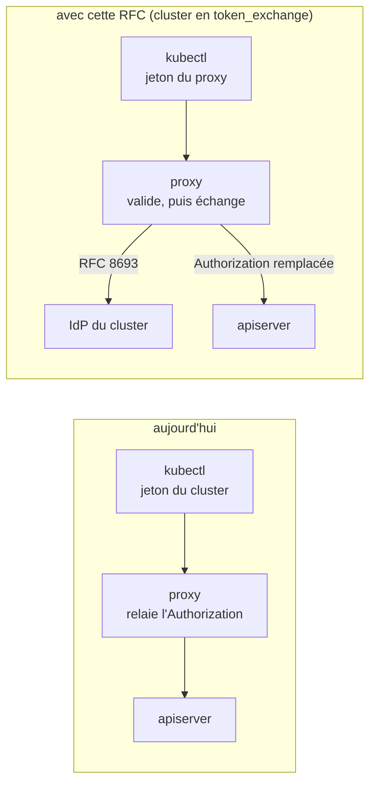
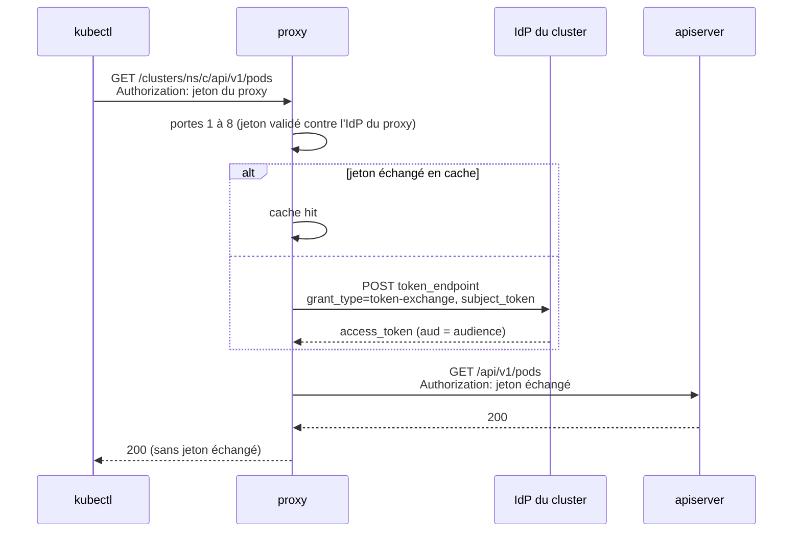
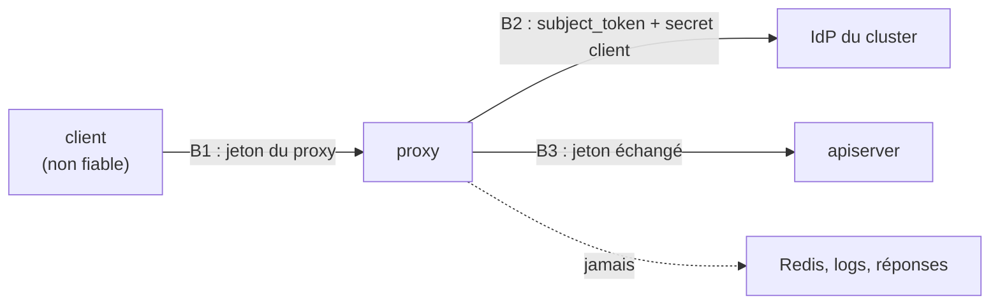

# RFC 0010 — Échange de jeton : une connexion au proxy pour tous les clusters

| Field       | Value                                                                  |
| ----------- | ---------------------------------------------------------------------- |
| Status      | Draft                                                                  |
| Short       | Échange de jeton (RFC 8693)                                            |
| Settles     | Ne plus demander une connexion SSO et un jeton stocké par cluster     |
| Author      | Max Batleforc <maxleriche.60@gmail.com>                                |
| Co-author   | Claude Opus 5.5 (1M context)                                           |
| Created     | 2026-10-18                                                             |
| Supersedes  | —                                                                      |
| Touches     | `libs/server/crd/src/authentication_configuration/`, `libs/server/common/src/{oidc_cache.rs,token_exchange.rs}`, `libs/server/api/src/cluster/redirect/{kube_redirect.rs,forwarded.rs,audit.rs}`, `…/kube_redirect/{standard.rs,upgrade/connect.rs,virtual_redirect/,list_fallback/}`, `libs/server/api/src/visible_clusters/`, `libs/server/api/src/metrics.rs`, `libs/cli/cli/src/login/`, `apps/front/src/`, CRD générée, `swagger.json` et clients générés, `.it/`, `tests/integration/`, `.docs/content/docs/` |
| Risk        | high                                                                   |

---

## 1. Summary

Aujourd'hui, un utilisateur se connecte au proxy (le jeton du dashboard, émis
par l'IdP du proxy), puis **une fois par cluster** à l'IdP de ce cluster, et
garde un jeton par cluster : dans le trousseau pour le CLI
(`libs/cli/cli/src/keystore.rs`, une entrée par cluster), dans un kubeconfig
téléchargé pour le dashboard. Cette RFC ajoute un mode d'authentification par
cluster, `token_exchange`, où le client présente **le jeton du proxy** et le
proxy l'échange, côté serveur, contre un jeton de l'IdP du cluster
([RFC 8693](https://www.rfc-editor.org/rfc/rfc8693.html)). Le jeton échangé
ne quitte jamais le proxy : il remplace l'`Authorization` de la requête relayée
et vit dans un cache en mémoire jusqu'à son expiration. L'apiserver continue de
valider un vrai jeton de son IdP : le modèle de confiance du cluster ne change
pas.

### Before / after

```yaml
# aujourd'hui : un jeton par cluster, obtenu par un login SSO dédié
users:
  - name: team-a/prod
    user:
      exec: { command: kubectl-proxyauth, args: [get-token, --cluster, team-a/prod] }
      # → renvoie le jeton de l'IdP de team-a/prod, stocké dans le trousseau

# avec cette RFC, sur un cluster en token_exchange : le jeton du proxy
users:
  - name: team-a/prod
    user:
      exec: { command: kubectl-proxyauth, args: [get-token, --server] }
      # → renvoie le jeton du proxy ; aucun jeton du cluster côté client
```

```yaml
# ProxyKubeApi
spec:
  auth_config:
    validate_against: Kubernetes
    oidc_provider:
      enabled: true
      issuer_url: https://sso.example.com/realms/corp
      client_id: kube-prod            # client confidentiel, échange activé
      config_from: { name: kube-prod-oidc }   # client_secret
    token_exchange:
      enabled: true                   # défaut : false
      audience: kube-prod             # le jeton échangé est pour l'apiserver
      max_cache_seconds: 300          # défaut : 300
```



Le jeton que reçoit l'apiserver est, dans les deux cas, émis par l'IdP du
cluster ; ce qui change est qui le détient : le client aujourd'hui, le seul
proxy demain.

---

## 2. Motivation

1. **Une connexion SSO par cluster.** `handle_login_clusters`
   (`libs/cli/cli/src/login/mod.rs:81`) ouvre un navigateur par cluster ; un
   utilisateur de dix clusters fait dix allers-retours chez l'IdP le matin,
   et autant quand les jetons expirent.
2. **Un jeton longue durée par cluster sur le poste.** Le trousseau garde un
   jeton par cluster (`keystore::entry(service, user)`), le dashboard fait
   télécharger un kubeconfig qui en contient un. Chaque jeton est un secret de
   plus qui peut fuir d'un poste, d'une sauvegarde ou d'un partage d'écran.
3. **Deux chemins d'authentification à maintenir côté client.** Le front a
   deux générateurs de kubeconfig (`generateCallbackKubeconfig`,
   `generateCallbackPluginKubeconfig`, `apps/front/src/utils/`) et le CLI trois
   sources de jeton (donné, SSO, saisi). Un cluster en échange n'a besoin que
   du jeton du proxy, que le client a déjà.
4. **Le cas le plus courant s'y prête.** Une entreprise a souvent un seul IdP
   (un realm Keycloak) pour le dashboard et ses clusters ; Keycloak sait
   échanger un jeton du realm contre un jeton pour un autre client du même
   realm depuis la 26.2
   ([notes de version](https://www.keycloak.org/docs/26.2.5/release_notes/)).

---

## 3. Goals / non-goals

**Goals**

- Un utilisateur connecté au proxy atteint tout cluster en `token_exchange`
  sans autre connexion ni autre jeton côté client.
- L'apiserver valide toujours un jeton de son propre IdP ; aucune
  configuration de l'apiserver ne change.
- Le jeton échangé ne quitte jamais le proxy (ni réponse, ni log, ni Redis).
- Opt-in par cluster ; un cluster qui ne l'active pas se comporte exactement
  comme aujourd'hui.
- Chaque échange laisse une trace d'audit et une métrique.

**Non-goals**

- **Le proxy comme émetteur de jetons** (option B de l'analyse du
  2026-10-18) : la clé de signature deviendrait la plus sensible du système,
  et chaque apiserver devrait lui faire confiance. Rejeté.
- **L'impersonation** (`Impersonate-*`, `X-Remote-*`, option C) : le proxy
  détiendrait un droit d'impersonation sur chaque cluster. Rejeté ; les
  en-têtes restent filtrés (`is_upstream_auth_header`).
- **La délégation** (`actor_token`, RFC 8693 §4.1) : Keycloak ne l'a qu'en
  preview, et l'apiserver n'en lit rien.
- **Rafraîchir le jeton du proxy côté CLI** : le CLI garde le jeton serveur tel
  qu'il l'a reçu ; sa durée de vie borne la session, comme aujourd'hui pour le
  dashboard.
- **Un mode mixte** où un cluster en échange accepterait aussi un jeton du
  cluster : une seule façon de valider par cluster (décision 1).
- **L'échange pour le dashboard lui-même** (`/api/v1/clusters`) : il utilise
  déjà le jeton du proxy.

---

## 4. User-facing design

### 4.1 Configuration

Un bloc `token_exchange` sous `auth_config` :

```yaml
token_exchange:
  enabled: false            # défaut ; true active l'échange pour ce cluster
  audience: ""              # paramètre `audience` envoyé ; vide = omis
  scope: ""                 # paramètre `scope` envoyé ; vide = omis
  connector_id: ""          # Dex seulement (§6.2) ; vide = omis
  max_cache_seconds: 300    # plafond de vie d'un jeton échangé en cache
```

- **Absent ou `enabled: false`** : rien ne change, le jeton du client est
  validé selon `validate_against` et relayé.
- **`enabled: true`** : le jeton du client est validé contre l'IdP **du
  proxy** (`state.oidc_client`, le même chemin que le dashboard) et
  `validate_against` ne s'applique plus au jeton entrant ; il reste utilisé
  par le contrôleur pour son statut.
- Le client qui échange est celui de `oidc_provider` (`client_id`, et
  `client_secret` ou `config_from`) : un client confidentiel chez l'IdP du
  cluster. Aucun nouveau secret.
- `max_cache_seconds` borne le temps pendant lequel un changement de groupes
  chez l'IdP peut ne pas être vu par l'apiserver (§7, T9). `0` désactive le
  cache : un échange par requête.
- Défaut sûr : `enabled: false`. Activer l'échange envoie le jeton du proxy
  de l'utilisateur à l'IdP du cluster ; c'est un choix de l'opérateur.

### 4.2 Behaviour rules

- L'échange a lieu **après** toutes les portes de `redirect` (bannissement,
  authentification, rate limit, groupe, allow-list, ports), juste avant le
  relais. Une requête refusée ne coûte aucun appel à l'IdP.
- Le cache est cherché d'abord ; un jeton échangé n'est réutilisé que pour la
  même paire (jeton du proxy, cluster), et jamais au-delà du plus petit de :
  son `exp` − 30 s, l'`exp` du jeton du proxy, `max_cache_seconds`.
- La requête relayée perd **toutes** les valeurs `Authorization` du client et
  reçoit `Authorization: Bearer <jeton échangé>`. Le reste du filtrage des
  en-têtes (`forwarded.rs`) est inchangé.
- Les trois relais (standard, upgrade, API virtuelle) et les appels faits pour
  l'appelant (`list_fallback`, `SelfSubjectAccessReview`) utilisent le jeton
  échangé.
- Un cluster en échange sans `oidc_provider.enabled` est refusé par
  l'admission (§4.3).

### 4.3 Validation

Rejeté par l'admission (règle CEL, comme `AuthenticationConfiguration`
aujourd'hui) :

| Condition | Rationale |
| --- | --- |
| `token_exchange.enabled` et `oidc_provider.enabled: false` | aucun client pour échanger : chaque requête échouerait |
| `token_exchange.enabled` et `disable_validation: true` | l'échange exige un utilisateur validé ; sans validation, n'importe quel porteur obtiendrait un jeton |
| `max_cache_seconds` > 3600 | borne T9 ; une heure couvre tout IdP raisonnable |
| `audience`, `scope` ou `connector_id` avec CR, LF ou `&` | ces valeurs sont envoyées dans un formulaire ; refusées plutôt qu'échappées |

Avertissements, dans `status.warnings` (vu par `kubectl get proxykubeapi` et
le dashboard) :

| Condition | Comportement | Visible dans |
| --- | --- | --- |
| l'issuer du cluster diffère de celui du proxy et `connector_id` est vide | l'échange part quand même (fédération Keycloak possible) | `status.warnings` |
| `client_secret` absent (ni inline ni `config_from`) | l'échange part en client public, que Keycloak refuse | `status.warnings` |

### 4.4 API surface

| Method | Path | Auth | Who may call | Limit |
| --- | --- | --- | --- | --- |
| GET | `/api/v1/clusters` (champ ajouté `token_exchange: bool` par cluster) | jeton du proxy | inchangé | inchangé |

Le champ dit au CLI et au front qu'aucune connexion au cluster n'est à faire.
`swagger.json`, le client HeyApi (`libs/front/front-api`) et `client_api`
sont régénérés. Aucun nouvel endpoint.

---

## 5. Architecture

### 5.1 Où se place l'échange



L'échange arrive après la dernière porte : une requête que le proxy refuse ne
déclenche aucun appel à l'IdP, et le jeton échangé n'existe que pour une
requête que la politique a déjà acceptée.

### 5.2 Le cache

`common::oidc_cache::TtlCache`, déjà utilisé pour les jetons validés : en
mémoire, par processus, borné (`MAX_CACHED_ENTRIES`), purgé à l'expiration.
Clé : SHA-256 du jeton du proxy, de l'UID du `ProxyKubeApi`, de l'issuer, du
`client_id` et de l'`audience`. Le jeton du proxy n'est jamais gardé en clair ;
le jeton échangé l'est, en mémoire seulement.

**Invariant** : parce que la clé contient le hash du jeton présenté, un
utilisateur ne peut obtenir que le jeton échangé de son propre jeton ; parce
que le cache est en mémoire, aucun jeton du cluster n'est écrit dans Redis,
un dump ou une sauvegarde.

Chaque réplica échange pour son compte : avec trois réplicas, au plus trois
échanges par (utilisateur, cluster) et par durée de cache. Les échanges
concurrents sur une même clé sont regroupés derrière un verrou par clé, comme
`list_fallback/cache.rs` le fait déjà.

---

## 6. Detailed design

### 6.1 CRD (`libs/server/crd/src/authentication_configuration/`)

- `token_exchange.rs` : `TokenExchange { enabled, audience, scope,
  connector_id, max_cache_seconds }`, `#[serde(default)]`, et ses règles CEL
  (§4.3) dans `AuthenticationConfiguration`.
- `warnings()` étendu pour les deux avertissements de §4.3.

### 6.2 L'appel d'échange (`libs/server/common/src/token_exchange.rs`)

- Un `POST` form-urlencoded vers le `token_endpoint` de la découverte OIDC du
  cluster (déjà en cache, `oidc_config_cache.rs`) : `grant_type=
  urn:ietf:params:oauth:grant-type:token-exchange`, `subject_token`,
  `subject_token_type=urn:ietf:params:oauth:token-type:access_token`,
  `requested_token_type=…:access_token`, et `audience`, `scope`,
  `connector_id` quand ils sont renseignés. Authentification du client en
  `client_secret_basic`.
- Construit avec `reqwest` et `form_urlencoded` (déjà dans l'arbre) : pas de
  nouvelle dépendance ; `openidconnect` 4 n'expose pas la RFC 8693.
- Réponse lue avec une limite (16 Kio), `access_token` et `expires_in`
  extraits ; tout autre champ ignoré. Délai : 5 s.
- Dex : son échange n'accepte qu'un jeton d'un IdP amont, désigné par
  `connector_id`, et seulement par le connecteur OIDC
  ([doc Dex](https://dexidp.io/docs/guides/token-exchange/)). Le cas couvert
  est donc la fédération : l'IdP du proxy est l'amont du Dex du cluster.

### 6.3 Dans `redirect` (`libs/server/api/src/cluster/redirect/kube_redirect.rs`)

- Porte 4 : si `token_exchange.enabled`, le jeton est validé par
  `User::get_user_info_from_oidc_token(token, data.oidc_client)` au lieu de
  `get_user_info_with_proxy`. Le throttling et `is_caller_fault()` sont
  inchangés.
- Après la porte 8 : `exchanged = token_exchange::exchange(&data, &proxy,
  token).await`, rangé dans `RedirectContext` (`upstream_token:
  Option<SecretString>`).
- `apply_forward_headers` (`upstream.rs`) et `build_upgrade_request`
  (`upgrade/connect.rs`) remplacent `Authorization` quand `upstream_token` est
  présent ; `list_fallback` et `virtual_redirect` lisent le même champ.

### 6.4 Les clients

- `visible_clusters` : champ `token_exchange` dans la réponse.
- CLI : `login clusters` ne lance pas de SSO pour un cluster en échange et
  écrit un contexte dont l'exec renvoie le jeton du serveur ; `get-token`
  n'a pas de jeton de cluster à chercher.
- Front : le bouton de connexion d'un cluster en échange télécharge
  directement le kubeconfig à plugin (`generateCallbackPluginKubeconfig`),
  sans aller-retour chez l'IdP du cluster.

### 6.P Proof against a real client

Suite d'intégration de la RFC 0009 (`tests/integration/tests/rfc0010.rs`),
kubectl 1.35 (`mise.toml`) et le CLI du dépôt, contre deux IdP réels sur le
banc : le Dex existant (IdP du proxy) et un second Dex (IdP du cluster) dont
le connecteur OIDC pointe vers le premier, avec l'échange activé (décision 3).

1. `kubectl get pods` sur un cluster en échange, avec le seul jeton du proxy —
   succès ; le log du second Dex montre une requête `token-exchange` ; le
   kubeconfig et le trousseau du persona ne contiennent aucun jeton du
   cluster.
2. Dix `kubectl get pods` de suite — un seul échange côté Dex (le cache) ;
   `proxyauth_token_exchange_total{result="cache_hit"}` monte de 9.
3. **Refus** : un persona hors de `proxy_group` — `403` du proxy, et **aucune**
   requête `token-exchange` dans le log du second Dex.
4. **Refus** : le jeton du cluster (obtenu par un login direct au second Dex)
   présenté au proxy pour un cluster en échange — `401` ; l'apiserver n'a
   reçu aucune requête de ce persona.
5. `kubectl exec` et `kubectl port-forward` sur un cluster en échange — le
   tunnel s'ouvre ; l'audit de la session porte l'utilisateur du jeton du
   proxy.
6. Le second Dex arrêté — `kubectl get pods` reçoit `503` (pas `401`), et le
   compteur de fail2login du persona n'a pas bougé.
7. La réponse relayée et les logs du proxy (niveau `debug`) ne contiennent
   jamais la valeur du jeton échangé (recherche de la chaîne dans
   `task it:logs`).

**Deliberately untouched**, so reviewers do not go looking:

- `cluster/auth/oauth/*` — le serveur OAuth médié reste le moyen d'obtenir un
  jeton du cluster pour un cluster *sans* échange.
- `jwt_validator` — l'échange ne valide pas le jeton échangé : l'apiserver le
  fait, c'est le but.
- `forwarded.rs::UPSTREAM_AUTH_PREFIXES` — `Impersonate-*` et `X-Remote-*`
  restent jetés ; cette RFC n'ouvre pas l'impersonation.

---

## 7. Security

**Rating:** high — le proxy obtient, pour chaque utilisateur, un jeton
accepté par l'apiserver du cluster, et l'envoie à sa place.

### 7.1 Threat model

Actifs : le jeton du proxy de l'utilisateur, le jeton échangé, le secret du
client d'échange, l'accès au cluster. Acteurs : un client authentifié, un
client non autorisé sur ce cluster, un tiers qui lit les logs, l'IdP du
cluster.



| # | Threat (STRIDE) | Where | Mitigation | Residual risk |
| --- | --- | --- | --- | --- |
| T1 | Spoofing : un jeton du cluster ou forgé présenté sur un cluster en échange | B1 | validé contre l'IdP du proxy seul (`get_user_info_from_oidc_token`, porte 4) ; sinon `401` | aucun |
| T2 | Elevation : un non-membre de `proxy_group` obtient un jeton échangé | B1→B2 | l'échange suit la porte 6 (`is_proxy_allowed`) et l'allow-list ; refus avant tout appel | aucun |
| T3 | Info disclosure : le jeton échangé revient au client | B1 | jamais écrit dans la réponse ; l'apiserver ne renvoie pas l'`Authorization` ; `SecretString` sans `Debug` | aucun |
| T4 | Info disclosure : un utilisateur reçoit le jeton échangé d'un autre | cache | clé = hash du jeton présenté + UID du cluster + audience | aucun |
| T5 | Tampering : le client double ou glisse un `Authorization` qui passe au relais | B3 | toutes les valeurs `Authorization` retirées avant d'insérer la nôtre | aucun |
| T6 | DoS : un flot de jetons valides distincts force un échange chacun | B2 | rate limit par utilisateur (porte 5) avant l'échange ; cache borné ; verrou par clé ; délai de 5 s | un utilisateur légitime peut coûter un échange par requête s'il change de jeton à chaque fois ; accepté (opérateur) |
| T7 | Repudiation : un accès par jeton échangé sans trace | P | événement d'audit `token_exchanged` (utilisateur, cluster, résultat, pas de jeton) | aucun |
| T8 | Info disclosure : le jeton du proxy part chez un IdP tiers | B2 | opt-in par cluster ; avertissement si l'issuer diffère sans `connector_id` (§4.3) | l'opérateur qui active l'échange vers un IdP tiers lui confie le jeton ; accepté (opérateur) |
| T9 | Elevation : groupes retirés chez l'IdP, jeton échangé encore en cache | cache | `max_cache_seconds` (300, ≤ 3600) ; l'`exp` du jeton du proxy borne aussi | jusqu'à `max_cache_seconds` ; accepté (opérateur, réglable) |
| T10 | Elevation : un jeton échangé sert hors du proxy | B3 | il ne sort pas du proxy (T3) ; son `aud` est celle du cluster | s'il fuyait, valide jusqu'à son `exp` ; comme un jeton de cluster aujourd'hui |

### 7.2 Authentication and authorisation

- Aucune nouvelle surface accessible sans jeton : l'échange n'existe que sur
  le chemin de proxy, après authentification et autorisation.
- Défaut : `enabled: false` ; un cluster sans le bloc n'échange rien.
- Un contournement de la porte 4 donnerait un jeton du cluster à son auteur :
  c'est pourquoi l'échange n'accepte que des requêtes dont `user` est
  `Some` (affirmé dans `exchange`, et `disable_validation` interdit avec
  l'échange, §4.3).

### 7.3 Input handling and injection

- `audience`, `scope`, `connector_id` viennent de la CRD (opérateur) et
  passent par `form_urlencoded` ; CR/LF/`&` refusés à l'admission en plus.
- La réponse de l'IdP est lue avec une limite de 16 Kio et un délai de 5 s ;
  un JSON invalide ou sans `access_token` est un échec (§10.2).
- `token_endpoint` vient de la découverte de l'issuer configuré : pas de
  nouvelle URL contrôlée par un utilisateur, donc pas de nouveau SSRF.

### 7.4 Secrets and cryptography

- Secret du client : le `client_secret` existant, de préférence via
  `config_from` (Secret Kubernetes) ; rotation inchangée.
- Le jeton échangé est en mémoire dans un `SecretString` (crate `secrecy`
  0.10.3, déjà dans `Cargo.lock` en transitif ; ajoutée en dépendance directe
  de `common`, §8), jamais dans Redis, un log, une métrique ou une réponse.
- Le jeton du proxy n'est gardé que haché (SHA-256) comme clé.

### 7.5 Abuse and resource exhaustion

- Un appel sortant au plus par (jeton, cluster, réplica) et par durée de cache.
- Les refus (portes 1 à 8) précèdent l'échange : un appelant non autorisé ne
  fait jamais appeler l'IdP.
- Cache borné en entrées ; une entrée fait environ 2 Kio (un jeton).

### 7.6 Existing defences that still hold

- Le filtrage d'en-têtes de `forwarded.rs` (identité, impersonation).
- Le throttling et `is_caller_fault()` ; l'allow-list et les ports.
- Le mTLS vers l'apiserver (`tls.rs`) : inchangé, le jeton échangé circule
  dans la même connexion.

---

## 8. Supply chain

| Dependency / image / tool | Version | Why this one | Licence | Known CVEs (`task audit`) | Maintenance |
| --- | --- | --- | --- | --- | --- |
| `secrecy` (dépendance directe de `common`) | 0.10.3, déjà dans `Cargo.lock` | un type de secret sans `Debug` ni `Display`, plutôt qu'un type maison | MIT OR Apache-2.0 | aucune (`task audit` vert aujourd'hui) | projet RustCrypto/iqlusion |
| `reqwest`, `form_urlencoded`, `sha2`, `serde_json` | déjà dans l'arbre | l'appel d'échange (`openidconnect` 4 et `oauth2` 5 n'implémentent pas la RFC 8693) | inchangé | inchangé | inchangé |
| second Dex sur le banc | même image que `.it/images.lock` (`dex`) | IdP du cluster pour §6.P, sans nouvelle image | Apache-2.0 | inchangé | inchangé |

- **Build and release** : inchangés ; le banc gagne un déploiement, pas une
  image.
- **Updates** : rien de nouveau à suivre.

---

## 9. Data and privacy

| Data | Personal? | Where stored | Retention | Who can read it | Leaves the instance? |
| --- | --- | --- | --- | --- | --- |
| jeton échangé | oui (identifie l'utilisateur) | mémoire du pod | ≤ `max_cache_seconds` | le processus du proxy | vers l'apiserver du cluster seulement |
| hash du jeton du proxy | non (SHA-256, non réversible) | mémoire du pod | idem | le processus | non |
| jeton du proxy (`subject_token`) | oui | jamais stocké | — | — | **oui : vers l'IdP du cluster** (T8) |
| événement `token_exchanged` | oui (nom d'utilisateur, groupes) | logs (cible `audit`) | celle des logs | l'opérateur | selon la collecte des logs |

- Le seul flux nouveau est l'envoi du jeton du proxy à l'IdP du cluster ; il
  est documenté dans la page de sécurité et activé par l'opérateur.
- Les métriques ne portent ni utilisateur ni jeton (labels `cluster` et
  `result` seulement).

---

## 10. Operability

### 10.1 Observability

- **Metrics** : `proxyauth_token_exchange_total{result}` avec `result` ∈
  `exchanged`, `cache_hit`, `refused`, `unavailable` ; histogramme
  `proxyauth_token_exchange_duration_seconds`. Pas de label `cluster` pour
  borner la cardinalité ; le cluster est dans l'audit.
- **Logs and audit trail** : `token_exchanged` (cible `audit`) à chaque
  échange réel (pas sur un cache hit), avec utilisateur, `ns`, `cluster`,
  résultat. S'aligne sur le schéma de la RFC 0008.
- **Alerts** : aucune livrée ; la doc propose `rate(…{result="unavailable"})`
  au-dessus de 0 pendant 5 min.

### 10.2 Failure modes

| Failure | Detected by | Behaviour (fail open / closed) | Recovery |
| --- | --- | --- | --- |
| IdP du cluster injoignable ou lent (> 5 s) | erreur réseau, délai | **fermé** : `503`, pas compté en fail2login | automatique au retour de l'IdP |
| IdP refuse (`invalid_grant`, `unauthorized_client`) | statut 400/401 de l'IdP | **fermé** : `401` « token exchange refused », pas compté en fail2login (le jeton a déjà été validé à la porte 4) | corriger la config IdP ; `status.warnings` aide |
| réponse sans `access_token` ou trop grosse | parsing | **fermé** : `502` | idem |
| client d'échange mal configuré (secret absent) | avertissement de statut | fermé (l'IdP refuse) | corriger la CRD |

Toujours fermé : un échec d'échange ne relaie jamais le jeton du proxy à
l'apiserver.

### 10.3 Performance and capacity

- Un échange ajoute un aller-retour à l'IdP (Keycloak local : quelques
  dizaines de ms, à mesurer sur le banc en phase 4) une fois par durée de
  cache ; les requêtes suivantes ne coûtent qu'une recherche en mémoire.
- Mémoire : environ 2 Kio par (utilisateur, cluster) actif, borné.

---

## 11. Other concerns

- **Accessibility** : le front perd une étape (pas de login par cluster) ; le
  bouton existant change de destination, pas de nouveau composant.
- **Internationalisation** : une chaîne nouvelle dans le front (« connexion
  par échange ») dans chaque locale livrée.
- **Compliance** : réduit le nombre de secrets longue durée sur les postes
  (contrôle d'accès ISO 27001 A.5.17) ; l'audit couvre chaque émission.
- **Licensing** : inchangé.
- **Documentation** : `.docs/content/docs/` (sécurité, CRD, configuration de
  Keycloak et de Dex pour l'échange), le guide CLI.

---

## 12. Alternatives considered

| Alternative | Why rejected |
| --- | --- |
| Le proxy émet ses propres jetons (B) | une clé de signature qui ouvre tous les clusters, et une configuration d'apiserver par cluster, impossible sur certains managés |
| Impersonation (C) | un droit d'impersonation par cluster détenu par le proxy ; sa compromission ouvre tous les clusters |
| Rendre le jeton échangé au client (`/oauth/token` en RFC 8693) | garde un jeton par cluster côté client : le problème de §2.2 reste |
| Cache dans Redis, partagé par les réplicas | met des jetons de cluster dans Redis, ses dumps et ses sauvegardes, pour économiser au plus N−1 échanges |
| Dex `audience:server:client_id:` (cross-client trust) | Dex seulement, se décide au login, et donne un jeton multi-audience que tous les clusters accepteraient |
| Ne rien faire | dix logins SSO pour dix clusters, dix jetons sur chaque poste |

---

## 13. Rollout and compatibility

- **Default behaviour** : inchangé ; le bloc est absent ou `enabled: false`.
- **Migration** : activer l'échange sur un cluster rend invalides les jetons
  de cluster déjà distribués pour lui (décision 1) ; les utilisateurs refont
  `kubectl-proxyauth login clusters`, qui écrit le nouveau contexte.
  Réversible : désactiver l'échange rétablit l'ancien chemin.
- **Operator prerequisites** : chez l'IdP du cluster, un client confidentiel
  avec l'échange activé ; pour Keycloak, le jeton du proxy doit porter ce
  client dans son `aud` (mapper d'audience sur le client du dashboard).
- **Rollback** : désactiver le bloc ; rien n'est persisté (cache en mémoire).
- **Feature flag** : le champ `enabled` par cluster.

---

## 14. Test plan

- **Unit** (`libs/server/crd`) : règles CEL et `validate()` de §4.3 ;
  `warnings()`.
- **Unit** (`libs/server/common/src/token_exchange.rs`) : formulaire envoyé
  (paramètres présents ou omis), parsing de réponse, limite de taille, calcul
  du TTL (min des trois bornes).
- **Integration** (`libs/server/api/tests/token_exchange.rs`, wiremock pour
  les deux IdP et l'apiserver) : succès, cache hit, IdP en panne (`503`),
  IdP qui refuse (`401`).
- **Proof** : §6.P (`tests/integration/tests/rfc0010.rs`).
- **Security** (`libs/server/api/tests/token_exchange.rs`), un test par ligne :
  - T1 `a_cluster_token_is_refused_on_an_exchange_cluster`
  - T2 `a_non_member_never_reaches_the_idp` (wiremock : 0 appel)
  - T3 `the_exchanged_token_never_reaches_the_client`
  - T4 `two_users_never_share_an_exchanged_token`
  - T5 `client_authorization_headers_are_all_replaced`
  - T6 `a_rate_limited_caller_never_reaches_the_idp`
  - T7 `an_exchange_writes_one_audit_event`
  - T8 `a_foreign_issuer_without_connector_warns`
  - T9 `the_cache_never_outlives_max_cache_seconds`
  - T10 `an_exchange_failure_never_relays_the_proxy_token`
- **Audit** : `task audit` vert (aucune dépendance nouvelle).
- **Existing suites** : `http_contract`, `proxy_security`, `proxy_upgrade`,
  envtest et `rfc0003`, `rfc0006`, `rfc0007` inchangés : un cluster sans
  échange se comporte comme avant.

---

## 15. Decisions and open questions

### Resolved

| # | Question | Decision |
| --- | --- | --- |
| 1 | Un cluster en échange accepte-t-il aussi un jeton du cluster ? | **Non : un seul mode par cluster.** Deviner le mode depuis l'`iss` non vérifié du jeton ajoute un chemin de validation et une ambiguïté exploitable. |
| 2 | Où vit le jeton échangé ? | **En mémoire seulement, par réplica.** Redis exposerait des jetons de cluster pour économiser au plus N−1 échanges (§12). |

### Still open

1. **Quel client échange ?** Le client du cluster (`oidc_provider.client_id`,
   proposé) fonctionne aussi en fédération Dex mais demande, chez Keycloak, un
   mapper d'audience sur le client du dashboard. Le client du proxy, s'il est
   dans le même realm, échangerait son propre jeton sans mapper, mais ne
   marche que dans ce cas. Recommandation : le client du cluster.
2. **Release** : la 0.2.0 est gelée sur 0001 à 0009 (`PLAN.md`).
   Recommandation : 0.3.0, après la RFC 0008 dont l'événement
   `token_exchanged` réutilise le schéma.
3. **Preuve Keycloak** : le banc prouve la fédération par Dex (décision à
   prendre : un second Dex plutôt qu'une image Keycloak, environ 450 Mo, pour
   éviter une nouvelle image). Le cas Keycloak même realm reste-t-il une
   vérification manuelle (`hors suite`) ou mérite-t-il l'image ?
   Recommandation : manuelle d'abord, l'image si un utilisateur le demande.
4. **`max_cache_seconds` par défaut** : 300 s suit la durée d'un jeton d'accès
   Keycloak par défaut ; un défaut plus court (60 s) réduit T9 au prix d'un
   échange par minute et par utilisateur actif.

---

## 16. Implementation phases

| Phase | Content |
| --- | --- |
| 1 | CRD (`token_exchange`, CEL, warnings), `common::token_exchange` et son cache, branchement dans `redirect` et les trois relais, audit et métriques, tests unitaires, d'intégration et de sécurité (T1 à T10). Utile seul : un opérateur peut l'activer et utiliser le jeton du proxy à la main. |
| 2 | `visible_clusters.token_exchange`, régénération de `swagger.json` et des clients, CLI (`login clusters`, `get-token`) et front. |
| 3 | Banc : second Dex fédéré, personas, `rfc0010.rs`, lignes de `MATRIX.md`, retrait de `PENDING` ; documentation. |

Le contrôle (portes avant l'échange, refus fermés) arrive dans la même phase
que la surface : la phase 1 ne relaie jamais un jeton échangé sans eux.
