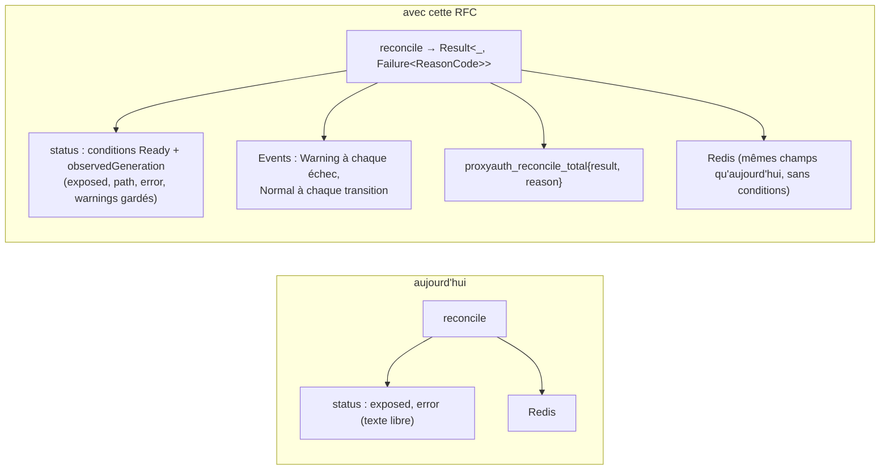
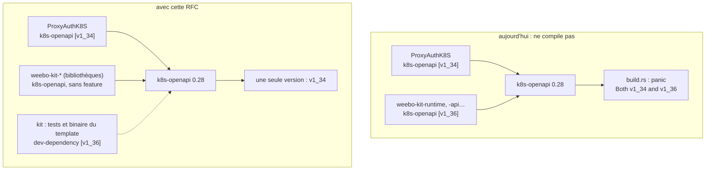
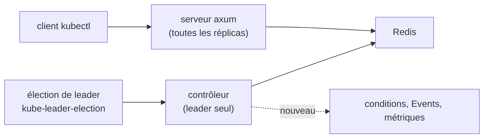
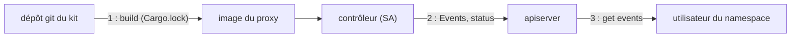

# RFC 0011 — Conditions, Events et codes de raison : adopter les crates du kit

| Field       | Value                                                                  |
| ----------- | ---------------------------------------------------------------------- |
| Status      | Implemented (2026-10-24, PR #292) : phases 0 à 6 et 2b ; écarts au §17, révision au §18 |
| Short       | Crates `weebo-kit-*` : statut, Events, codes de raison                 |
| Settles     | Ce que ProxyAuthK8S prend des crates Rust du kit, et comment il résout le conflit de version de `k8s-openapi` |
| Author      | Max Batleforc <maxleriche.60@gmail.com>                                |
| Co-author   | Claude Opus 5.5 (1M context)                                           |
| Created     | 2026-10-19                                                             |
| Supersedes  | —                                                                      |
| Touches     | `Cargo.toml` (workspace), `apps/crdgen/Cargo.toml`, `libs/server/common/src/state.rs` (`event_recorder`, `controller_health`), `libs/server/api/src/base.rs` (`/management/ready`), `swagger.json` et clients régénérés, `libs/server/controller/` (`Cargo.toml`, `error.rs`, `proxy_kube_api/{mod,reconcile,cleanup}.rs`, `reason.rs` nouveau), `libs/server/crd/src/{lib.rs,status/mod.rs}`, `deploy/crds.yaml` et `deploy/chart-crd/` (régénérés), `deploy/chart/templates/rbac.operator.yaml`, `deny.toml`, `.github/workflows/{back-envtest,back-clippy}.yaml` et `perf.yml` (nouveau), `apps/server/src/main.rs` (arrêt du contrôleur), `libs/server/{api,crd,common}/` (lints, phase 6), `tests/perf/` (nouveau), `.tasks/perf.yaml` (nouveau), `Cargo.toml` racine et `clippy.toml` (`[workspace.lints]`), `.tasks/envtest.yaml`, `libs/server/api/tests/envtest_reconcile.rs`, `tests/integration/`, `.it/matrix.py`, `docs/content/docs/` ; côté kit, par une RFC du kit remise à sa session : les `Cargo.toml` des crates `weebo-kit-*` |
| Risk        | medium (§7 : une permission RBAC nouvelle, une source git nouvelle dans le graphe Cargo) |

> Document de référence (environ 5 000 mots) : §1 à §4 suffisent pour en
> discuter ; §5 à §16 servent à l'implémenter et à le relire.

---

## 1. Summary

ProxyAuthK8S ne dit l'état d'une `ProxyKubeApi` que par `status.exposed` et
une chaîne `status.error`, sans condition, sans `observedGeneration` et sans
Event. Cette RFC fait passer le contrôleur sur trois briques du kit
(`weebo-kit-domain`, `weebo-kit-api`, `weebo-kit-runtime`) : un catalogue de
codes de raison (`reason_codes!`), une condition `Ready` standard écrite par
`status::publish`, des Events Kubernetes à chaque échec et à chaque
transition, et les métriques de reconcile ; le rythme de reconcile et le
backoff deviennent ceux du kit. Elle a d'abord fait résoudre, côté kit, le
conflit qui empêchait de compiler ces crates chez nous : le kit activait la
feature `v1_36` de `k8s-openapi` dans ses bibliothèques, ProxyAuthK8S active
`v1_34`, et `k8s-openapi` refuse deux features de version dans un même
graphe (corrigé dans le kit v0.19.1). Les crates du kit restent référencées
par git, sur un tag.

### Before / after

```text
# aujourd'hui
$ kubectl get proxykubeapis -n team-a
NAME    AGE
prod    3d
$ kubectl wait --for=condition=Ready proxykubeapi/prod -n team-a
error: timed out waiting for the condition      ← aucune condition n'existe
$ kubectl describe proxykubeapi/prod -n team-a | sed -n '/Events/,$p'
Events:  <none>

# avec cette RFC
$ kubectl get proxykubeapis -n team-a
NAME    READY   REASON              AGE
prod    False   TargetUnreachable   3d
$ kubectl describe proxykubeapi/prod -n team-a | sed -n '/Events/,$p'
  Type     Reason             From                       Message
  Warning  TargetUnreachable  proxy-kube-api-controller  Target service is not reachable
$ kubectl wait --for=condition=Ready proxykubeapi/prod -n team-a   # après correction
proxykubeapi.weebo.si.rs/prod condition met
```



Le chemin des requêtes proxifiées ne change pas : seul ce que le contrôleur
publie sur la CR et autour d'elle change.

---

## 2. Motivation

1. **Aucun outil standard ne sait si une `ProxyKubeApi` est prête.** Le statut
   (`libs/server/crd/src/status/mod.rs:7-15`) n'a que `exposed`, `path`,
   `error` et `warnings`. `kubectl wait --for=condition=Ready`, le health
   check d'Argo CD et Flux lisent `status.conditions` : ils n'ont rien à lire.
   Un déploiement GitOps d'un cluster mal configuré est vu « Healthy ».
2. **Le contrôleur ne raconte rien hors de ses logs.** Aucun Event n'est émis
   (`kube::runtime::events` n'apparaît nulle part dans `libs/server`). Un
   utilisateur qui n'a que `kubectl` dans son namespace ne voit pas pourquoi
   son cluster n'apparaît pas au dashboard : la cause est dans les logs du
   pod du proxy, qu'il ne lit pas.
3. **Les erreurs sont du texte libre.** `status.error` est un `format!("…{e}")`
   (`proxy_kube_api/reconcile.rs:77`, `:109`, `:124`, `:137-139`). On ne peut
   ni filtrer, ni compter, ni documenter une cause. L'error policy ignore
   l'erreur (`proxy_kube_api/mod.rs:42-48`), et `ControllerError::metric_label`
   (`error.rs:36-38`) n'est appelé par aucun compteur.
4. **Aucune métrique de reconcile.** `libs/server/api/src/metrics.rs` compte les
   requêtes, les décisions de politique, l'audit et les sessions, rien du
   contrôleur. Un contrôleur qui échoue en boucle sur toutes les CR ne se voit
   pas dans Prometheus.
5. **Le kit a déjà écrit tout cela, et on ne peut pas l'utiliser.** Les crates
   `weebo-kit-*` activent `k8s-openapi/v1_36` dans leurs bibliothèques
   (`Cargo.toml:38` du kit, hérité par `weebo-kit-api`, `-application`,
   `-adapters` et `-runtime`). ProxyAuthK8S active `v1_34` (`Cargo.toml:29`).
   Ajouter une seule crate du kit fait échouer la compilation de
   `k8s-openapi` : « Both v1_34 and v1_36 features are enabled » (constaté le
   2026-10-19, §6.P point 9). Corrigé par le kit en v0.19.1 (§6.1) ; depuis,
   `apps/crdgen` dépend déjà de `weebo-kit-api` v0.24.0 pour le CRD IDE.

---

## 3. Goals / non-goals

**Goals**

- Une `ProxyKubeApi` porte une condition `Ready` standard, avec une raison
  tirée d'un catalogue fermé et `observedGeneration`.
- Chaque échec de reconcile et chaque transition produit un Event sur la CR.
- Le contrôleur expose `proxyauth_reconcile_total` et
  `proxyauth_reconcile_duration_seconds`, aux labels bornés.
- Les crates du kit compilent dans ProxyAuthK8S avec une seule feature de
  version de `k8s-openapi`, choisie par ProxyAuthK8S.
- Les crates du kit sont référencées par git sur un tag, et `kit:sync` les
  monte avec le reste du kit.

**Non-goals**

- **`telemetry::init` du kit.** Il installe seul le subscriber global
  (`telemetry.rs:58-63`, échec si un autre existe) et ne connaît ni le filtre
  `audit=off` de la sortie standard (`libs/server/trace/src/lib.rs:213-217`)
  ni `/management/metrics` sur le routeur principal. L'adopter dupliquerait
  chaque ligne d'audit sur stdout, ce que la RFC 0008 interdit.
- **`acquire_leadership` du kit.** Elle appelle `std::process::exit(1)` quand
  le lease peut être perdu (`leader.rs:94-96`) : chez nous, toutes les
  réplicas servent le proxy, et perdre le lease tuerait le service HTTP de la
  réplica. Les briques sous elle (`LeaseLock`, `acquire`, `hold`) ne sortent
  pas, elles : la phase 4 les étudie (§6.6). Correction du 2026-10-23 : le
  texte accepté le 2026-10-19 écartait toute l'élection du kit sur la seule
  `acquire_leadership`.
- **Le squelette de contrôleur du kit** (`controller::controller`,
  `WatchScope`, `drive`, les watches partagés de `shared`). Il suppose les
  variables `WEEBO_WATCH_*` et un opérateur seul dans son pod ; notre
  contrôleur tourne à côté du serveur, sur toutes les réplicas, et seul le
  leader réconcilie. À revoir quand le kit saura rétrograder sans sortir. Ses
  fonctions libres de requeue (`requeue_after`, `retry_after_error`) ne
  supposent rien de cela : elles sont adoptées (décision 16).
- **Surveiller les Secrets référencés** (`config_from`, `CertSource::Secret`)
  (décision 23). Le chemin des requêtes relit déjà le Secret de `config_from`
  toutes les 30 s (`OidcConfigCache`, `libs/server/common/src/oidc_config_cache.rs`) :
  une rotation y prend effet sans le contrôleur, seul le statut attend le
  reconcile suivant (5 min au plus). Un watch demanderait `list` et `watch`
  sur les Secrets, donc le contenu de tous les Secrets du cluster (ou des
  `rbac.referencedNamespaces`) au ServiceAccount, qui n'a aujourd'hui que
  `get` par nom (`deploy/chart/templates/rbac.operator.yaml`). Un statut
  immédiat serait une RFC à part (watch de métadonnées, borné aux namespaces
  référencés).
- **`admission`, `webhook_server`, les `routes` de `Health`.** Pas de webhook
  ici (la validation passe par CEL) ; nos sondes restent `/management/health`
  et `/management/ready` (`libs/server/api/src/lib.rs:33-40`). `Health` et
  `controller::drive` sont adoptés, sans effet sur les sondes (décision 26).
- **`weebo-kit-testkit::EnvTestCluster`.** Il compile les liaisons Go de
  `envtest` (Go et `libclang` au build) ; notre harnais
  (`libs/server/api/tests/envtest_support/mod.rs`) télécharge les binaires et
  n'a besoin de rien de plus. Aucun gain qui paie la dépendance de build.
- **La library chart `weebo-operator-lib`, les tâches `helm:*`, les workflows
  réutilisables** (`publish.yml`, `release.yml`). Mêmes raisons que la RFC
  0005 (R5) : la chart couvre le back seul, ni le front ni le collecteur
  OTel.
- **Les watches partagés (`shared`), `Drift`, `record_write`,
  `Annotations`/`force-orphan`.** Un seul contrôleur, aucun objet distant à
  créer ou corriger : rien à partager ni à compter.
- **`weebo-kit-adapters`, `weebo-kit-application` en direct**, les types
  `api::refs`/`api::tls`. Ils changeraient le schéma de `spec` : pas avant la
  1.0. (`weebo-kit-runtime` dépend de `weebo-kit-application`, qui entre donc
  dans le graphe sans être utilisé.)
- **Retirer `exposed`, `path`, `error`, `warnings`.** Le serveur lit `exposed`
  depuis Redis (`get_all_visible_cluster_model.rs:45`) ; leur retrait est une
  bascule de la 1.0.
- **Publier les crates du kit sur crates.io.** Décision du mainteneur du kit,
  pas prise : on reste sur git.
- **La library chart `weebo-operator-lib`.** Elle ne couvre ni le front ni le
  collecteur OTel.

---

## 4. User-facing design

### 4.1 Configuration

Aucune option nouvelle. Le contrôleur publie conditions et Events toujours ;
il n'y a pas de drapeau pour s'en passer.

Côté build, la version de Kubernetes que ProxyAuthK8S compile reste un choix
de ProxyAuthK8S, à un seul endroit :

```toml
# Cargo.toml (workspace) — la seule feature de version du graphe
k8s-openapi = { version = '0.28', features = ['v1_34'] }

# crates du kit : par git, sur un tag que kit:sync réécrit (ici seulement)
weebo-kit-domain = { git = "https://github.com/batleforc/weebo-operator-kit", tag = "v0.24.0" }
weebo-kit-api = { git = "https://github.com/batleforc/weebo-operator-kit", tag = "v0.24.0" }
weebo-kit-runtime = { git = "https://github.com/batleforc/weebo-operator-kit", tag = "v0.24.0" }

# apps/crdgen/Cargo.toml, libs/server/{crd,controller}/Cargo.toml
weebo-kit-api = { workspace = true }
```

- `version = '0'` devient `'0.28'` : en 0.x, chaque mineure de `k8s-openapi`
  casse, et `'0'` laisserait `cargo update` en tirer une autre que celle du
  kit.
- `v0.24.0` est le `KIT_TAG` du dépôt aujourd'hui ; la correction de §6.1 y
  est depuis la v0.19.1 (RFC 0005 du kit, PR kit #13, publiée le
  2026-10-19).
- Les guillemets doubles et le `Cargo.toml` racine ne sont pas un style : ce
  sont la forme et le seul fichier que `pin-kit.sh` (`kit:sync`) réécrit et
  que `kit:cog` lit (décision 19).

### 4.2 Behaviour rules

**Le catalogue.** `libs/server/controller/src/reason.rs` déclare, avec
`weebo_kit_domain::reason_codes!`, l'enum `ReasonCode` et son `impl Reason`
(écrit à la main : la macro ne le génère pas, `reason.rs:39-72` du kit) :

| Code | Sévérité | Quand | Aujourd'hui |
| --- | --- | --- | --- |
| `Reconciled` | succès (`Reason::SUCCESS`) | la cible répond, la CR est servie | `exposed: true` |
| `InvalidSpec` | bloquant | `validate()` refuse la spec | `"Failed to validate proxy configuration: {e}"` (`reconcile.rs:77`) |
| `OidcConfigUnresolved` | bloquant | `config_from` ne se lit pas | `"Failed to resolve the OIDC configuration: {e}"` (`:109`) |
| `TargetUnreachable` | bloquant | la sonde répond « non joignable » | `"Target service is not reachable"` (`:124`) |
| `ProbeFailed` | bloquant | la sonde échoue elle-même | `"Failed to check if target service is reachable: {e}"` (`:137-139`) |
| `CacheWriteFailed` | bloquant | l'écriture Redis échoue, au reconcile ou au nettoyage du finalizer (`action` `Cleanup`) | `ControllerError::Redis` (`:167-174`), sans statut |
| `StatusWriteFailed` | bloquant | le patch de statut échoue après les essais de `status::publish` | `ControllerError::Kube` (`:223-225`), sans Event |
| `FinalizerFailed` | bloquant | l'ajout ou le retrait du finalizer échoue | `FinalizerError(AddFinalizer\|RemoveFinalizer)` (`mod.rs:94`), sans Event |
| `RulesRestricted` | avis | `security_config.warnings()` n'est pas vide | `status.warnings` (`:144-148`) |
| `DeprecatedInsecureCert` | avis | `cert: Insecure` | un `warn!` seul (`:82-88`) |
| `Deleted` | avis | le finalizer a nettoyé Redis | rien (`cleanup.rs:16-44`) |

**Le statut.**

- `Ready` est `True` avec `Reconciled`, `False` avec le code bloquant. Les avis
  deviennent chacun une condition `True` de type égal au code
  (`RulesRestricted`, `DeprecatedInsecureCert`), comme le fait
  `conditions::conditions` (`conditions.rs:15-55`).
- `lastTransitionTime` ne bouge que quand le statut d'une condition change.
- `observedGeneration` n'est écrit que sur succès (`status.rs:81-83` du kit) :
  une CR en échec garde la génération de son dernier succès, ce qui dit
  « cette version de la spec n'a jamais été servie ».
- `exposed`, `path`, `error` et `warnings` restent, avec les mêmes valeurs ;
  `error` porte le message de `Ready` quand il est `False`. Ils passent par
  le merge patch de `status::publish`, où une clé absente reste en place :
  une liste `warnings` vide part donc en `"warnings": null` (décision 20),
  comme `error` et `path` à `None`, sans quoi des avertissements retirés
  resteraient affichés.
- Redis reçoit les champs d'aujourd'hui, `exposed`, `path`, `error` et
  `warnings`, et rien de plus : `conditions` et `observedGeneration` sont vidés
  avant le `SET` (décision 18). `publish` calcule les conditions lui-même,
  après l'écriture Redis, et personne ne les lit dans Redis.
- Le statut est publié à chaque reconcile, sans garde d'égalité (décision
  17) : `conditions()` garde `lastTransitionTime` tant que le statut d'une
  condition ne change pas, le patch d'une CR saine est donc identique au
  précédent et l'apiserver ne l'écrit pas (§6.P point 6).

**Le rythme** (décision 16) : celui du kit, `controller::requeue_after` et
`retry_after_error`.

| Après | Aujourd'hui (compteur Redis) | Avec cette RFC (kit, en mémoire, par uid) |
| --- | --- | --- |
| un succès | 1 h | 5 min (`STEADY_REQUEUE_SECS`, ±20 %) |
| un échec | 5 min, doublé jusqu'à 1 h | 30 s, doublé jusqu'à 5 min |
| un `InvalidSpec` | 5 min, doublé | 5 min (`steady: true` : seule une modification de la CR, qui relance seule un reconcile, le corrige) |
| un changement de leader | la série survit | la série repart de zéro |

Le compteur Redis (`retry_counter_key`, `RETRY_COUNTER_TTL_SECONDS`,
`retry_delay_seconds`, `attempts_from_counter`) disparaît ; les clés
`requeue_retry:*` restantes expirent seules en 24 h. Ce qu'un reconcile toutes
les 5 min rattrape, que le watch des `ProxyKubeApi` ne voit pas : un Redis
vidé, un Secret référencé qui change, une cible qui tombe ou revient (§10.2).

**Les logs** (décision 21). Un reconcile sain ne journalise qu'en `debug!` ;
un changement de raison de `Ready` (les mêmes moments que les Events
`Normal`) reste en `info!`, les `warn!` et `error!` sont inchangés.

**Les Events.**

- Un `Warning` à chaque reconcile qui finit sur `Ready: False`, un `Normal`
  quand `Ready` passe à `True` ou change de raison, et un pour chaque avis qui
  apparaît ou disparaît (`events::announce_outcome`, appelé par
  `status::publish`).
- Un `Warning` par l'error policy (`retry_after_error`), sous le code que lui
  donne `ControllerError::reason()`, un `match` exhaustif sans bras `_`
  (décision 22) :

  | Variante | Code, `action` |
  | --- | --- |
  | `Redis` | `CacheWriteFailed` |
  | `Kube` (patch de statut) | `StatusWriteFailed` |
  | `FinalizerError(ApplyFailed(e))` | celui de `e`, `Reconcile` |
  | `FinalizerError(CleanupFailed(e))` | celui de `e`, `Cleanup` |
  | `FinalizerError(AddFinalizer \| RemoveFinalizer)` | `FinalizerFailed` |
  | `FinalizerError(UnnamedObject \| InvalidFinalizer)`, `InvalidResource`, `CrdUnavailable` | aucun : log seul, pas d'objet nommé et namespacé où publier un Event, ou une erreur de démarrage qui n'atteint pas l'error policy |

  La variante `Serde`, construite nulle part, est retirée. La CR n'a pas de
  statut à publier dans ces cas ; une variante nouvelle ne compile pas sans
  son code.
- **Le nettoyage est fermé** (décision 25). Un `DEL` Redis de la clé ou du
  retrait de l'index qui échoue fait échouer `clean_proxy_kube_api`
  (aujourd'hui : un `info!`, puis le finalizer est retiré) : le finalizer
  reste, la CR reste `Terminating`, l'error policy relance avec un `Warning`
  `CacheWriteFailed`/`Cleanup`. Le proxy route depuis Redis
  (`kube_redirect.rs:68`) et la clé n'a pas de TTL : sans cela, un
  `ProxyKubeApi` supprimé pendant une panne Redis resterait servi.
- Un `Normal` `Deleted` quand le finalizer a fini (`announce_change`).
- Seul le leader émet : les followers ne réconcilient pas
  (`proxy_kube_api/mod.rs:56-66`). Le `Reporter` porte
  `controller: "proxy-kube-api-controller"` (le field manager actuel,
  `reconcile.rs:58`) et `instance: $HOSTNAME`.
- Une publication d'Event qui échoue est journalisée et n'échoue jamais le
  reconcile (`events.rs`, comportement du kit).

**Colonnes.** `kubectl get proxykubeapis` gagne `READY` et `REASON`
(`#[kube(printcolumn)]` sur `status.conditions[?(@.type=="Ready")]`).

**Le cas sans intérêt.** Une CR saine produit, toutes les 5 min, un patch de
statut identique au précédent : l'apiserver ne l'écrit pas
(`resourceVersion` inchangé), aucun Event, aucune ligne `info!`, et le
compteur `proxyauth_reconcile_total{result="success",reason="Reconciled"}`
qui monte. La garde d'égalité de `reconcile.rs:214` disparaît avec
`ProxyKubeApiStatus::equal` et `::patch`, qui n'ont plus d'appelant.

### 4.3 Validation

Refusé à la compilation ou au lint :

| Condition | Rationale |
| --- | --- |
| Deux features `v1_*` de `k8s-openapi` dans le graphe | `k8s-openapi` refuse de compiler (`build.rs`) ; c'est le symptôme de §2.5 |
| Un code du catalogue pas en PascalCase | `assert_pascal_case` du kit, dans un test unitaire : une raison de condition doit l'être |
| Une source git autre que le dépôt du kit | `deny.toml` (`unknown-git = "deny"`), qui gagne une seule entrée `allow-git` |

Avertissements :

| Condition | Behaviour | Surfaced in |
| --- | --- | --- |
| Règles sous restriction (`status.warnings`) | condition `RulesRestricted: True`, Event `Normal` à l'apparition | `kubectl describe`, colonne `REASON` si `Ready` est `True` |
| `cert: Insecure` | condition `DeprecatedInsecureCert: True` | `kubectl describe` (aujourd'hui : logs seuls) |

---

## 5. Architecture

### 5.1 Un reconcile

```mermaid
sequenceDiagram
    participant C as Controller (leader)
    participant R as reconcile
    participant K as apiserver
    participant D as Redis
    C->>R: ProxyKubeApi (génération n)
    R->>R: validate, OIDC, sonde → Result#lt;msg, Failure#lt;ReasonCode#gt;#gt;, avis
    R->>D: SET proxyk8sauth:ns/name (exposed, path, error, warnings ; sans conditions)
    R->>K: status::publish : conditions(previous, outcome, avis, n, now), merge patch status
    alt patch identique (CR saine)
        K-->>R: ok, rien d'écrit (resourceVersion inchangé)
    else changé
        K-->>R: ok, écrit
    end
    R->>K: Events (announce_outcome : Warning si Ready False, Normal à chaque transition)
    R-->>C: requeue_after (5 min, ou 30 s → 5 min sur échec)
```

Redis est écrit avant l'apiserver, comme aujourd'hui : un échec Redis renvoie
`CacheWriteFailed` sans publier de statut, et le reconcile reprend par l'error
policy. Un Event qui ne part pas ne bloque rien. Comme le patch part à chaque
reconcile, le `Warning` d'un échec répété part aussi à chaque reconcile
(décision 12), sans qu'une garde le fasse taire.

### 5.2 Le graphe de `k8s-openapi`



**Invariant** : aucune bibliothèque n'active de feature de version ; seul
l'utilisateur final (le workspace ProxyAuthK8S ici, le binaire du template
dans le kit) en choisit une. Deux features ne peuvent donc plus se rencontrer,
quel que soit l'opérateur qui consomme le kit. C'est la règle de
`k8s-openapi` lui-même (`src/lib.rs:75-81` de 0.28.0 : « If you're writing a
library crate, your crate *must not* enable any features »).

### 5.3 Ce qui ne change pas



Le serveur lit `exposed` dans Redis comme avant ; l'élection reste la nôtre.
Seule la flèche en pointillé est nouvelle.

---

## 6. Detailed design

### 6.1 Côté kit (une RFC du kit, remise à sa session)

ProxyAuthK8S ne modifie pas le dépôt du kit. La correction passe par une RFC
du kit (décision 2), dont le brouillon est écrit depuis cette RFC, avec les
faits vérifiés ci-dessous, et remis à la session du kit, qui la dépose, la
passe au grill et l'implémente. Ce qu'elle doit livrer :

- Workspace : `k8s-openapi = { version = "0.28", features = ["schemars"] }`,
  sans `v1_36`.
- Les crates qui ont des tests (`weebo-kit-api`, `-application`, `-adapters`,
  `-runtime`, `-perf`, `-testkit`) gagnent
  `[dev-dependencies] k8s-openapi = { workspace = true, features = ["v1_36"] }`.
- `cargo check`, `clippy` et `doc`, qui ne compilent pas les
  dev-dependencies, passent `K8S_OPENAPI_ENABLED_VERSION=1.36` (dans le
  `mise.toml` du kit, ou dans les tâches `rust:*`).
- Le template d'opérateur garde `features = ["v1_36"]` dans son propre
  `Cargo.toml` (`templates/operator/Cargo.toml:48-49`) : c'est une
  application.
- Vérifié sur une copie (`git archive origin/main`, kit v0.18.2) : sans la
  feature, `cargo check` des crates domain, api, runtime, application et
  adapters passe avec `K8S_OPENAPI_ENABLED_VERSION` à 1.34 et à 1.32. Aucune
  crate du kit n'utilise de champ propre à 1.35 ou 1.36.
- **Livré** dans le kit **v0.19.1** (2026-10-19), avec un job CI qui compile
  de 1.32 à 1.36. Vérifié sur le tag, sur une copie de ProxyAuthK8S :
  `cargo check -p controller` passe avec les trois crates en `tag =
  "v0.19.1"`, `cargo tree -e features -i k8s-openapi` ne montre que `v1_34`,
  et `Cargo.lock` fige le commit (`git+…?tag=v0.19.1#a6cdb648d200…`). Le repli
  de la décision 5 n'a plus lieu d'être.
- **Revérifié sur le kit v0.24.0** (2026-10-23, copie de ProxyAuthK8S au
  commit `3a6f8f9`, les trois crates en `tag = "v0.24.0"`) : `cargo check -p
  controller` passe, `cargo tree -e features -i k8s-openapi` ne montre que
  `v1_34`, `Cargo.lock` fige `#2dbed2d8`. Entre v0.19.1 et v0.24.0, ce que
  cette RFC utilise n'a changé que sur deux points : `retry_after_error`
  applique son propre backoff (v0.22.0, décision 16), et le kit compile sous
  des lints maison (`unwrap_used`, `arithmetic_side_effects`… en `deny`), qui
  ne s'appliquent qu'à ses propres crates. `leader.rs` sort toujours du
  processus (`:96`), `telemetry::init` installe toujours le subscriber
  global : les non-goals tiennent.

### 6.2 Workspace ProxyAuthK8S

- `k8s-openapi = { version = '0.28', features = ['v1_34'] }` (§4.1). Nos
  crates `common`, `controller` et `cli` activent la feature par le
  workspace ; c'est sans conséquence ici, ProxyAuthK8S n'étant consommé par
  personne, et on ne les touche pas.
- `weebo-kit-domain`, `weebo-kit-api`, `weebo-kit-runtime` en
  `[workspace.dependencies]`, par git et tag ; `libs/server/controller`,
  `libs/server/crd` (pour `Condition`) et `apps/crdgen` (déjà sur
  `weebo-kit-api` pour le CRD IDE) les prennent en `workspace = true`.
- `deny.toml` : `[sources] allow-git = ["https://github.com/batleforc/weebo-operator-kit"]`
  est déjà en place, depuis crdgen.
- `kit:sync` (RFC 0005, phase 4) réécrit le tag : `pin-kit.sh` remplace
  `git = "https://github.com/$repo", tag = "…"` dans le **seul** `Cargo.toml`
  racine et relance `cargo metadata` pour `Cargo.lock` ; `kit:cog` lit le tag
  au même endroit (`.tasks/kit.yaml:38`). Le tag de crdgen, aujourd'hui dans
  `apps/crdgen/Cargo.toml`, n'est donc ni lu ni déplacé : une PR
  `fix(deps)` le passe dans le workspace avant cette RFC (décision 19).

### 6.3 `libs/server/crd`

- `ProxyKubeApiStatus` gagne `conditions: Vec<weebo_kit_api::Condition>`
  (`#[serde(default, skip_serializing_if = "Vec::is_empty")]`) et
  `observed_generation: Option<i64>` (`skip_serializing_if =
  "Option::is_none"`), lus et jamais écrits par nous : `publish` les écrit.
  `equal()` et `patch()` (SSA) sont retirés ; une méthode `fields()` rend la
  `serde_json::Map` de `StatusUpdate::fields` : `exposed`, `path`, `error`,
  et `warnings` en `null` quand la liste est vide.
- `#[kube(printcolumn = …)]` pour `READY` et `REASON`.
- `deploy/crds.yaml` et `deploy/chart-crd/` régénérés (`task gen:crds-file`) :
  ajout pur au schéma de `status`.

### 6.4 `libs/server/controller`

- `reason.rs` : le catalogue de §4.2, son `impl Reason`, un test
  `assert_pascal_case(ReasonCode::ALL)`.
- `reconcile.rs` : les quatre branches de `ProxyKubeApiStatus::new(false, …)`
  deviennent `Err(Failure::new(code, message))` ; les avis viennent de
  `security_config.warnings()` et de `is_deprecated_insecure()`. Les champs
  sont écrits dans Redis (conditions vidées), puis publiés par
  `status::publish` à chaque reconcile (merge patch sur `status`, même field
  manager), qui calcule les conditions et annonce les Events. L'action rendue
  est `requeue_after(&proxy, steady, None)`, `steady` vrai sur `Reconciled`
  et `InvalidSpec` ; le compteur Redis et ses quatre fonctions sont retirés,
  avec leurs tests. Les `info!` du chemin sain passent en `debug!` ; un
  `info!` quand la raison de `Ready` change entre `previous` et les
  conditions que rend `publish`.
- `mod.rs` : un `Recorder` construit une fois dans `run`
  (`Reporter { controller: "proxy-kube-api-controller", instance: Some(holder_id) }`) et
  porté par le contexte du contrôleur ; l'error policy rend
  `retry_after_error(recorder, obj_ref, code, action, &err)`, le code et
  l'action venant de `ControllerError::reason()`, un `match` exhaustif. Le
  `requeue(20 s)` des followers ne change pas.
- `cleanup.rs` : `announce_change(Deleted, CLEANUP)` après le nettoyage ; un
  `DEL` Redis qui échoue remonte en `CacheWriteFailed`, `action` `Cleanup`.
- `ReconcileMetrics::new("proxyauthk8s", "proxyauth")` : compteurs enregistrés
  sur le `MeterProvider` global que `libs/server/trace` installe déjà.
- `ControllerError::metric_label`, sans appelant, est retiré.

### 6.5 Chart et CI

- `rbac.operator.yaml` : `events.k8s.io` `events` `create`, `patch` dans le
  ClusterRole (le contrôleur publie dans le namespace de chaque CR).
- `back-envtest.yaml` : `ENVTEST_K8S_VERSION` passe de 1.31.0 à 1.34.x.
  Règle (décision 4) : envtest tourne toujours à la version de la feature
  `v1_*` du workspace, et un commentaire sur la ligne `k8s-openapi` du
  `Cargo.toml` le rappelle.
  Aujourd'hui, les tests envtest tournent contre un apiserver plus ancien que
  la plus ancienne version que `k8s-openapi` 0.28 sait compiler (`earliest =
  v1_32`, son `Cargo.toml:52`).

### 6.6 Suites : ce que le kit offre encore (phases 4 à 6)

Relevé le 2026-10-23 sur le kit v0.24.0, après les phases 1 à 3, et grillé le
même jour (décisions 27 à 42). Preuves : §6.P points 11 à 17.

- **Phase 2b, livrée avec la phase 2 : `controller::drive` et `Health`**
  (décision 26). `lib.rs` jetait en silence chaque erreur du flux du
  contrôleur (`.filter_map(ok)`) : un watch en échec ne laissait ni log ni
  signal. `drive("ProxyKubeApi", health, stream)` journalise chaque erreur et
  remonte les erreurs de watch à `common::State::controller_health` ;
  `/management/ready` affiche `controller: ok|failing` sans changer son code,
  et la jauge `proxyauth_controller_watch_failing` vaut 1 après 5 min d'échec.
  Les sondes n'en dépendent pas : toutes les réplicas font tourner le watch,
  une panne de l'apiserver hôte les redémarrerait (liveness) ou les
  dérouterait (readiness) toutes à la fois, alors que le proxy sert depuis
  Redis.
- **Phase 4 : l'élection de leader du kit.** Remplacer `kube-leader-election`
  0.44 et `run_leader_election` (`libs/server/controller/src/lib.rs:62-98`)
  par `LeaseLock`, `acquire` et `hold` : `hold` rend la main dès que le lease
  peut être perdu, la réplica rétrograde (`is_leader` à `false`) et retourne à
  `acquire`, sans sortir. Gains : une dépendance tierce de moins, une prise de
  lease sur l'horloge monotone (kit v0.14.1) plutôt que sur `renewTime`, la
  jauge `proxyauth_leader`. Les deux implémentations écrivent les mêmes
  champs du `Lease` (`holderIdentity`, `leaseDurationSeconds`, `renewTime`,
  `leaseTransitions`), mais jugent l'expiration différemment.
  Ce que le grill a fixé :
  - **La boucle** : `acquire` (retente toutes les 5 s) → `State.is_leader =
    true` → `hold` → au retour de `hold`, `State.is_leader = false` et retour
    à `acquire` ; jamais `exit` (décision 28). `acquire_leadership` n'est pas
    utilisé : il sort du processus, bloque les followers et lit
    `POD_NAMESPACE`/`LEASE_NAME`, que le chart ne pose pas (il pose
    `LEASE_NAMESPACE`).
  - **La jauge** `proxyauth_leader`, observable, lit `State.is_leader` ; le
    `LEADER` statique du kit n'est mis à jour que par `acquire_leadership`
    et reste inutilisé (décision 35).
  - **À l'arrêt**, le leader appelle `step_down` : la relève est immédiate au
    lieu d'attendre le TTL (décision 36).
  - **Le lease, le TTL, l'identité** ne changent pas (décisions 27, 29).
  - **RBAC** : `update` sur les `leases` (le kit écrit par `replace`), `patch`
    gardé une version pour le retour arrière (décision 37).
  - **Ce que ça corrige** (T7, décision 34) : `kube-leader-election` écrit
    par merge patch sans `resourceVersion` (`lease.rs:237-314` de 0.44.0) et
    notre boucle n'a pas de délai (`lib.rs:71-98`) : un leader figé plus que
    le TTL reste leader à son réveil, à côté de celui qui l'a remplacé. Le
    kit écrit par `replace` avec le `resourceVersion` lu (un 409 vaut « pas
    leader », `leader.rs:178-189`) et `hold` abandonne 12,5 s après le
    dernier renouvellement réussi.
- **Phase 5 : `weebo-kit-perf`.** Mesurer ce que coûte le contrôleur (RSS,
  CPU, descripteurs, appels à l'apiserver) pour N `ProxyKubeApi`, contre un
  budget (`Budget::small_cluster` par défaut), chaque semaine comme le
  `perf.yml` du kit. `PerfRun` lance le vrai binaire contre envtest : le nôtre
  est aussi le serveur et a besoin de Redis, et le reconcile sonde une cible
  par CR.
  Ce que le grill a fixé :
  - **`/metrics` sur `WEEBO_METRICS_ADDR`** : `PerfRun` lit `GET /metrics`
    sur l'adresse qu'il passe (chemin figé, `prom.rs:209-226` du kit) et
    attend `proxyauth_leader` à 1 pour déclarer le binaire prêt. Quand la
    variable est posée, le serveur ouvre un second listener qui ne sert que
    le même registre ; sans elle, rien ne change (décision 42).
  - **Une crate `tests/perf` isolée** : `weebo-kit-perf` tire
    `weebo-kit-testkit`, donc Go et `libclang` au build ; seule cette crate
    et son job les portent (décision 31). `task perf` lance `server` en
    release contre l'envtest du testkit, avec un Redis, et des CR pointées
    vers cet apiserver (son 401/403 compte pour joignable).
  - **Le workflow** : le `perf.yml` réutilisable du kit, le lundi 04:00 UTC
    et à la main, jamais sur une PR ; rapport en artefact, page « Resource
    budget » de la doc, PR de comparaison ; un dépassement fait échouer le
    job sans bloquer de merge (décision 30).
  - **Le budget** : premier passage en `WEEBO_PERF_REPORT_ONLY=1`, puis la
    mesure + 25 % (`small_cluster`, 64 Mio au repos, vise un opérateur seul,
    pas un proxy avec OTel) ; contrôles de fuite du kit gardés (décision 38).
- **Phase 6 : les lints maison du kit** (v0.22.0) : `unwrap_used`,
  `expect_used`, `panic`, `indexing_slicing`, `arithmetic_side_effects`,
  les `cast_*`, `allow_attributes` en `deny`, `#[expect(…, reason)]` à la
  place de `#[allow]`. Mesuré le 2026-10-23 (clippy avec la liste du kit,
  `--all-targets`) : **553 violations**, 184 dans `src/`, 369 dans `tests/` ;
  `api` 346, `integration` 83, `crd` 48, `cli` 24, `controller` 20. Dans
  `src/` : `indexing_slicing` 77, `arithmetic_side_effects` 42,
  `let_underscore_*` 35, 6 `expect`, 1 `unwrap`, 6 `unsafe_code`, 11 `#[allow]`
  sans raison. Ce que le grill a fixé :
  - **Adoption** : la liste dans `[workspace.lints]` et le `clippy.toml` du
    kit à la racine ; chaque crate passe en `[lints] workspace = true` dans
    son commit, nettoyée : `common`, `cli_trace`, `server`, `swaggergen`,
    `crd_runtime`, `virtual_api`, `controller`, puis `crd`, `cli`,
    `integration`, et `api` en dernier ; `client_api` (généré) jamais
    (décision 32).
  - **Helpers de test** (`tests/support`, `tests/harness`, la crate
    `integration`), que l'exemption de `clippy.toml` ne couvre pas : un
    `#![expect(clippy::expect_used, clippy::panic, clippy::indexing_slicing,
    clippy::unwrap_used, reason = …)]` par module, comme `weebo-kit-testkit` ;
    les `let_underscore_*` corrigés partout, tests compris (décision 39).
  - **Code de production** : `.get()` avec une erreur explicite,
    `checked_`/`saturating_`, `try_from`, `#[expect(…, reason)]` au lieu de
    `#[allow]` (retiré s'il n'excuse rien), un `// SAFETY:` par `unsafe` ;
    aucun changement de comportement (décision 40).

### 6.P Proof against a real client

Banc de la RFC 0009 (k3s `v1.35.9-k3s1`, `.it/images.lock:4`), deux réplicas
du proxy, `kubectl` 1.35 et la suite `tests/integration/tests/rfc0011.rs`. La
CR est créée avec le kubeconfig d'administration : c'est la mise en place,
l'action testée est celle du contrôleur. Points 9 et 10 hors suite (jobs CI).

1. **Prête.** Une `ProxyKubeApi` qui vise l'apiserver du banc :
   `kubectl wait --for=condition=Ready --timeout=60s` sort en 0 ;
   `status.conditions[Ready]` vaut `True`/`Reconciled`, et
   `status.observedGeneration` égale `metadata.generation`.
2. **Refus : cible injoignable.** Une CR qui vise un Service sans endpoint :
   `Ready` `False`/`TargetUnreachable` ; un Event `Warning`
   `TargetUnreachable` sur la CR (`kubectl get events
   --field-selector involvedObject.name=…`) ; la CR est marquée
   injoignable dans la liste des clusters du dashboard (`is_reachable:
   false`), comme aujourd'hui.
3. **Refus : spec invalide.** Une spec que `validate()` refuse : `Ready`
   `False`/`InvalidSpec`, `observedGeneration` absent, Event `Warning`.
4. **Retour.** La CR du point 2 corrigée : `Ready` repasse à `True`, un Event
   `Normal` `Reconciled`, `lastTransitionTime` a bougé et `observedGeneration`
   suit la nouvelle génération.
5. **Avis.** Une CR dont `security_config.warnings()` n'est pas vide :
   condition `RulesRestricted` `True`, `Ready` `True`, et `status.warnings`
   inchangé. La règle qui l'avait levé retirée : la condition
   `RulesRestricted` et la clé `status.warnings` disparaissent toutes les deux
   (`kubectl get -o jsonpath='{.status.warnings}'` est vide), et un Event
   `Normal` « RulesRestricted no longer applies » part.
6. **Pas de boucle, pas d'écriture.** Après le point 1, une annotation posée
   sur la CR relance un reconcile ; on note la `resourceVersion` que rend
   `kubectl annotate -o jsonpath`, on attend que
   `proxyauth_reconcile_total{reason="Reconciled"}` monte, puis la
   `resourceVersion` reste celle-là pendant 90 s et aucun Event nouveau
   n'apparaît : le patch identique de ce reconcile n'a rien écrit. C'est la preuve de la décision 17 ; si elle échoue (l'apiserver
   écrit un patch identique, par les `managedFields` par exemple), la garde
   revient, calculée par `conditions()` avant `publish`, avec un
   `announce_error` à la main pour garder le `Warning` des échecs répétés.
7. **Un seul émetteur.** Sur les Events des points 2 à 4,
   `reportingInstance` est le pod qui tient le lease
   `proxy-auth-k8s-leader-election`, jamais l'autre réplica.
8. **Métriques.** `/management/metrics` montre
   `proxyauth_reconcile_total{kind="ProxyKubeApi",result="error",reason="TargetUnreachable"}`
   qui a augmenté après le point 2.
9. **Une seule version de `k8s-openapi`** (hors suite, job `back-clippy`).
   `cargo tree -e features -i k8s-openapi` ne montre qu'une feature,
   `v1_34`. Contrôle fait le 2026-10-19 sur des copies : avec le kit v0.18.2
   tel quel, `cargo check -p controller` échoue (« Both v1_34 and v1_36
   features are enabled on the k8s-openapi crate ») ; avec la correction de
   §6.1, il passe, et l'arbre de `server` ne gagne qu'un crate tiers,
   `opentelemetry-http` 0.33.1.
10. **Source git refusée** (hors suite, `task audit`). `cargo deny check
    sources` passe avec l'entrée `allow-git` du kit, et échoue si on retire
    cette entrée.

11. **Le leader se signale** (phase 4). Sur le banc, `proxyauth_leader` vaut 1
    sur le pod dont le `HOSTNAME` est le `holderIdentity` du lease
    `proxy-auth-k8s-leader-election`.
12. **Refus : un autre détenteur prend le lease** (phase 4). Un `kubectl
    replace` admin du lease avec un autre `holderIdentity` : en moins de
    12,5 s, `proxyauth_leader` passe à 0 sur le pod, qui ne réconcilie plus
    (une CR créée ensuite n'a pas de statut tant que le lease est tenu par
    l'autre), et `/management/ready` répond toujours 200.
13. **Relève à l'arrêt** (phase 4). `kubectl rollout restart` du back : le
    nouveau pod tient le lease moins de 5 s après la fin de l'ancien
    (`step_down`), au lieu des 15 s du TTL.
14. **T7 : un leader figé perd la main** (phase 4, envtest : une horloge figée
    ne s'obtient pas sur le banc). Un renouvellement bloqué plus que le TTL :
    `hold` rend la main, `State.is_leader` passe à `false`, et le reconcile
    suivant de ce pod est celui d'un follower.
15. **La mesure existe** (phase 5, hors suite, workflow `perf`). `task perf`
    écrit `target/perf/proxyauthk8s.json` et `.md` : phases, RSS, CPU,
    descripteurs, appels à l'apiserver, p95 du reconcile.
16. **Les lints du kit tiennent** (phase 6, hors suite, `back-clippy`). `task
    lint` avec `[workspace.lints]` adopté par chaque crate sauf `client_api` :
    aucune violation, aucun `#[allow(`.
17. **Aucun changement de comportement** (phase 6, hors suite, CI). Workspace,
    envtest et banc restent verts sur le commit de chaque crate.

**Deliberately untouched**, so reviewers do not go looking :

- `libs/server/trace` : la télémétrie reste la nôtre (non-goal) ; les
  métriques du kit passent par `opentelemetry::global`.
- `libs/server/controller/src/lib.rs` (élection) : `kube-leader-election`
  reste.
- `libs/server/api/src/cluster/redirect/audit.rs` : l'audit de la RFC 0008 n'a
  pas de lien avec ces raisons ; ses `reason` restent les siennes.
- `apps/front`, CLI : ils ne lisent ni `error` ni les conditions
  (`apps/front/src/features/cluster/status.ts:7-12`).

---

## 7. Security

**Rating:** medium — une permission RBAC nouvelle (créer des Events dans tous
les namespaces) et une source git nouvelle dans le graphe de build ; aucune
nouvelle surface réseau, aucun changement du chemin des requêtes. Elle ferme
aussi un défaut existant du nettoyage (T6).

### 7.1 Threat model

Actifs : l'intégrité du build (code compilé dans l'image du proxy), la
confidentialité de ce que les messages d'erreur contiennent, la disponibilité
de l'apiserver.

Acteurs : un utilisateur qui peut lire les Events d'un namespace ; le
mainteneur du dépôt du kit (ou quiconque compromet ce dépôt) ; le contrôleur
lui-même, avec son ServiceAccount.



| # | Threat (STRIDE) | Where | Mitigation | Residual risk |
| --- | --- | --- | --- | --- |
| T1 | Tampering : un tag du kit déplacé, ou un commit malveillant, entre dans le build | 1 | `Cargo.lock` enregistre le commit d'une dépendance git : un tag déplacé ne change rien sans `cargo update` ; `kit:sync` passe en PR, avec le diff de `Cargo.lock` ; `deny.toml` n'admet que ce dépôt ; §6.P point 10 | le dépôt du kit est de confiance au même titre que ses tâches et ses workflows, déjà inclus (RFC 0005) ; accepté (mainteneur) |
| T2 | Information disclosure : un message d'erreur (chemin d'un Secret, URL interne, texte d'erreur de la sonde) sort dans un Event lisible par tout le namespace | 2 → 3 | les messages sont ceux de `status.error` aujourd'hui, déjà lisibles par qui lit la CR ; aucune valeur de Secret n'y entre (les erreurs nomment des clés, jamais des valeurs) ; notes tronquées à 1000 octets par le kit ; test : le message de `OidcConfigUnresolved` ne contient pas la valeur de `client_secret` de la fixture | un lecteur d'Events sans droit de lecture sur la CR voit le message ; accepté : même audience en pratique (le namespace de l'équipe) |
| T3 | Elevation / spoofing : la permission `events create` permet au SA d'écrire des Events trompeurs dans n'importe quel namespace | 2 | permission limitée à `events.k8s.io/events`, verbes `create`, `patch` ; le SA lit déjà les Secrets référencés, ce qui est plus fort | un SA compromis peut forger des Events ; accepté, moindre que ses droits actuels |
| T4 | Denial of service : une CR cassée produit un Event à chaque retry, ou une boucle de reconcile par l'écriture du statut | 2 | backoff du kit par CR, 30 s doublé jusqu'à 5 min (`controller::failed`), seuls les retries comptent, pas les rafales d'events ; les Events répétés sont agrégés en série par le `Recorder` de kube ; un patch de `status` écrit relance un reconcile (aucun filtre de génération sur le `Controller`, `libs/server/controller/src/lib.rs:144`), qui produit le même patch, que l'apiserver n'écrit pas : la boucle s'arrête au second tour, et ce reconcile relancé par un event ne compte pas dans le backoff ; point 6 | une CR en échec coûte au plus un Event agrégé et une sonde toutes les 5 min ; accepté |
| T5 | Repudiation : une réplica non leader publie un statut ou un Event contradictoire | 2 | seul le leader réconcilie (`mod.rs:56-66`) ; `reportingInstance` nomme l'émetteur ; point 7 | aucun |
| T7 | Tampering / repudiation : deux réplicas réconcilient à la fois : un leader figé plus que le TTL (pause GC, requête bloquée) se réveille leader, son patch de lease passe sans `resourceVersion` (`kube-leader-election` 0.44) et sa boucle n'a pas de délai (`lib.rs:71-98`) ; constaté le 2026-10-23 | lease | phase 4 (décision 34) : `LeaseLock` du kit (`replace` avec `resourceVersion`, 409 = « pas leader »), `hold` abandonne 12,5 s après le dernier renouvellement réussi ; §6.P points 12 et 14 | aucun après la phase 4 |
| T8 | Tampering : double leader pendant le rolling upgrade de la phase 4 (anciens pods sur `kube-leader-election`, nouveaux sur le kit, même lease) : un ancien pod dont l'horloge avance de plus de 10 s juge le lease expiré et l'écrase | lease | une seule fenêtre, celle de la mise à jour ; le nouveau leader voit l'autre détenteur au renouvellement suivant (5 s au plus) et rétrograde ; le reconcile est idempotent (Redis `SET`, merge patch identique) | des Events en double pendant 5 s au plus ; accepté (mainteneur, décision 27) |
| T6 | Elevation of privilege : un `ProxyKubeApi` supprimé pendant une panne Redis reste dans Redis, sans TTL, donc routable par le proxy (`kube_redirect.rs:68`) alors que son propriétaire l'a retiré (constaté le 2026-10-23, `cleanup.rs:18-20`) | Redis | nettoyage fermé (décision 25) : `clean_proxy_kube_api` rend `Err` si le `DEL` ou le retrait de l'index échoue, le finalizer reste et le nettoyage est relancé ; test unitaire et envtest | une suppression attend le retour de Redis ; un opérateur peut retirer le finalizer à la main, et reprend alors le risque ; accepté (mainteneur) |

### 7.2 Authentication and authorisation

Pas de nouvelle surface : aucun endpoint, aucune route. La seule autorisation
nouvelle est celle du ServiceAccount (T3). Les utilisateurs lisent conditions
et Events avec leurs droits Kubernetes existants.

### 7.3 Input handling and injection

L'entrée est la spec de la CR, déjà validée (CEL, `validate()`). Les messages
d'Events et de conditions sont du texte, jamais interprétés ; le kit tronque
les notes. Aucun parseur nouveau.

### 7.4 Secrets and cryptography

Aucun secret nouveau. Les messages ne doivent porter aucune valeur de Secret
(T2, et son test).

### 7.5 Abuse and resource exhaustion

Une écriture de statut par changement, pas par reconcile ; Events agrégés ;
compteurs aux labels bornés (`kind`, `result`, `reason` du catalogue fermé).

### 7.6 Existing defences that still hold

- Seul le leader réconcilie ; le lease reste celui de `kube-leader-election`.
- Le chemin des requêtes, les politiques et l'audit ne lisent pas ces champs.
- `cargo deny` refuse toute autre source git ou registre.

---

## 8. Supply chain

| Dependency / image / tool | Version | Why this one | Licence | Known CVEs (`task audit`) | Maintenance |
| --- | --- | --- | --- | --- | --- |
| `weebo-kit-domain` (git) | v0.24.0 (`KIT_TAG`) | `Reason`, `reason_codes!`, `Failure`/`Advisory` : ce qu'on écrirait sinon | MIT | à vérifier par `cargo deny` au moment de l'ajout | même mainteneur que ProxyAuthK8S |
| `weebo-kit-api` (git) | v0.24.0, **déjà dans le graphe** par `apps/crdgen` | `Condition` | MIT | `task audit` vert sur `main` | idem |
| `weebo-kit-runtime` (git) | idem | conditions, `status::publish`, Events, `ReconcileMetrics` | MIT | idem | idem |
| `weebo-kit-application` (git, transitif) | idem | dépendance de `weebo-kit-runtime`, non utilisée directement | MIT | idem | idem |
| `kube-leader-election` | 0.44.0, **retiré** en phase 4 | remplacé par le `LeaseLock` du kit (T7) | — | — | une dépendance tierce de moins |
| `weebo-kit-perf`, `weebo-kit-testkit` (git, dev, phase 5) | v0.24.0 | la mesure de coût ; seulement dans la crate `tests/perf` | MIT | `task audit` au moment de l'ajout | même mainteneur |
| `envtest` (transitif de `weebo-kit-testkit`, dev, phase 5) | 0.3 | l'apiserver du testkit ; Go et `libclang` au build, dans le seul job `perf` | à vérifier par `cargo deny` | idem | crate tierce |
| `opentelemetry-http` (transitif) | 0.33.1 | seul crate tiers nouveau du graphe de `server` (mesuré) | Apache-2.0 | à vérifier par `cargo deny` | projet OpenTelemetry |

- **Mesuré** (2026-10-19, `cargo tree -p server -e normal` sur des copies) :
  358 lignes avant, quatre crates `weebo-kit-*` et `opentelemetry-http` en
  plus ensuite. Le reste de ce que tire `weebo-kit-runtime` (axum-server,
  rustls, prometheus, opentelemetry-prometheus) est déjà dans notre graphe.
- **Remesuré** (2026-10-23, kit v0.24.0, diff des noms de `Cargo.lock`) :
  `weebo-kit-application`, `-domain`, `-runtime` et `opentelemetry-http`
  entrent ; `weebo-kit-api` y est déjà.
- **Build and release** : Containerfile inchangé ; le build tire un dépôt git
  de plus (réseau au build, comme les autres crates).
- **Updates** : `kit:sync TAG=…` (RFC 0005 phase 4), en PR, avec le diff de
  `Cargo.lock`. Pas de Dependabot pour une source git.

---

## 9. Data and privacy

| Data | Personal? | Where stored | Retention | Who can read it | Leaves the instance? |
| --- | --- | --- | --- | --- | --- |
| `status.conditions`, `observedGeneration` | non : état d'une CR | etcd (CR), Redis (copie) | vie de la CR | qui lit la CR | non |
| Events du contrôleur | non : code, message d'erreur technique | etcd (Events) | TTL des Events de l'apiserver (1 h par défaut) | qui lit les Events du namespace | non |
| `proxyauth_reconcile_*` | non : labels `kind`, `result`, `reason` | Prometheus / OTLP | celle du backend de métriques | opérateurs de la plateforme | vers le collecteur configuré, comme les métriques existantes |

Aucune donnée personnelle : aucun nom d'utilisateur, aucun groupe, aucune
adresse n'entre dans ces champs (le contrôleur ne voit pas les requêtes).

---

## 10. Operability

### 10.1 Observability

- **Metrics** : `proxyauth_reconcile_total{kind, result, reason}`, `result`
  valant `success` ou `error` (la sévérité du code),
  `proxyauth_reconcile_duration_seconds{kind}` (noms du kit, préfixe
  `proxyauth` comme les compteurs existants). Cardinalité : 1 kind × 2
  résultats × 11 codes au plus. Le kit déclare aussi
  `proxyauth_remote_writes_total`, jamais incrémenté ici : il n'est pas
  exporté.
- **Logs et audit** : les `info!`/`warn!`/`error!` du reconcile restent.
  L'audit de la RFC 0008 ne change pas : il trace les requêtes, pas le
  contrôleur.
- **Leadership** (phase 4) : `proxyauth_leader` (1 sur le pod qui tient le
  lease), lu de `State.is_leader`.
- **Watch du contrôleur** (décision 26) : `proxyauth_controller_watch_failing`
  (1 après 5 min d'échec continu), `controller: ok|failing` dans le corps de
  `/management/ready`, un `warn!` par erreur.
- **Alerts** : aucune livrée ; la doc propose
  `increase(proxyauth_reconcile_total{result="error"}[15m]) > 0` par raison.

### 10.2 Failure modes

| Failure | Detected by | Behaviour (fail open / closed) | Recovery |
| --- | --- | --- | --- |
| Publication d'un Event refusée (RBAC manquant, apiserver lent) | log `warn` du kit | ouvert, volontairement : le reconcile continue, le statut est publié | corriger le RBAC |
| Suppression d'une CR pendant une panne Redis | `CacheWriteFailed`, `action` `Cleanup` | fermé (décision 25) : finalizer gardé, CR `Terminating`, le cluster reste dans Redis mais la CR n'est plus modifiable | au retour de Redis, le `DEL` passe et le finalizer est retiré |
| Patch de statut refusé | `status::publish` (3 essais, 0,5/1/2 s) puis `StatusWriteFailed` | le reconcile échoue, `retry_after_error` (Event `Warning`, backoff) ; Redis a déjà le bon état, donc le proxy sert correctement | automatique |
| Redis indisponible | `CacheWriteFailed` | fermé comme aujourd'hui : pas de statut publié, Event `Warning`, backoff du kit, qui ne dépend plus de Redis (le compteur Redis retombait au délai de base dans ce cas) | automatique |
| Redis vidé ou redémarré sans persistance | le dashboard et le proxy ne voient plus les clusters (le serveur ne lit que Redis) | fermé : un cluster absent de Redis n'est pas servi | reconcile suivant, 5 min au plus (aujourd'hui : 1 h) |
| Secret de `config_from` changé ou supprimé | — (pas de watch, non-goal) | le proxy relit le Secret toutes les 30 s (`OidcConfigCache`) ; seul le statut (`OidcConfigUnresolved`) attend | reconcile suivant, 5 min au plus |
| Cible tombée ou revenue | la sonde du reconcile | `is_reachable` du dashboard en retard d'au plus 5 min (aujourd'hui : 1 h) | reconcile suivant |
| Changement de leader | — | la série de backoff du kit, en mémoire, repart de zéro sur le nouveau leader : un retry à 30 s de plus par CR en échec | automatique |
| Kit et ProxyAuthK8S sur deux features | `cargo check` | fermé : pas de build | §6.1 |

### 10.3 Performance and capacity

- Un reconcile par CR toutes les 5 min (au lieu d'1 h) : une sonde HTTP vers
  la cible, un `SET` Redis et un patch de statut, que l'apiserver n'écrit pas
  s'il est identique. Pour 100 CR, environ 0,3 appel par seconde de chaque
  sorte.
- Une écriture de statut par changement d'état ; zéro pour une CR saine.
- Events : un par échec et par transition, agrégés par kube.
- Logs : le chemin sain en `debug!` (décision 21) ; au niveau `info`, une CR
  saine n'écrit plus rien entre deux transitions.
- Temps de build : quatre crates de plus, mesuré en phase 1 (budget +10 % sur
  `cargo build --release -p server` en CI).

---

## 11. Other concerns

- **Accessibility** : pas d'UI.
- **Internationalisation** : codes et messages en anglais, comme le reste de
  l'API Kubernetes.
- **Compliance** : sans objet.
- **Licensing** : MIT des deux côtés, inchangé.
- **Documentation** : une page `docs/content/docs/…/status-and-events.mdx` (la
  condition `Ready`, le tableau des codes, l'alerte proposée) ; le guide
  développeur (RFC 0005 phase 5) explique comment ajouter un code.

---

## 12. Alternatives considered

| Alternative | Why rejected |
| --- | --- |
| Ne rien faire | motivation 1 : GitOps voit « Healthy » un cluster cassé |
| Écrire nos propres conditions et Events, sans le kit | environ 300 lignes déjà écrites et testées dans le kit (`conditions.rs`, `status.rs`, `events.rs`), et un format différent des autres opérateurs weebo |
| Passer ProxyAuthK8S en `v1_36` pour suivre le kit | ça compile aujourd'hui, mais le conflit revient à chaque opérateur qui choisit une autre version, et le kit violerait toujours la règle de `k8s-openapi` ; gardé comme repli (§15) |
| `K8S_OPENAPI_ENABLED_VERSION` côté ProxyAuthK8S à la place de la feature | une variable d'environnement oubliée (Containerfile, IDE) casse le build ; la feature dans `Cargo.toml` est vue par tous |
| Adopter tout le runtime (télémétrie, leader, squelette) | trois incompatibilités concrètes (§3 : subscriber global, `exit(1)`, `WatchScope`) |
| Vendoriser les crates du kit (copie dans le dépôt) | double maintenance, et `kit:sync` ne les monterait plus |
| Attendre une publication sur crates.io | décision non prise ; git sur tag donne la même reproductibilité par `Cargo.lock` |

---

## 13. Rollout and compatibility

- **Default behaviour** : à la mise à jour, chaque CR gagne ses conditions au
  premier reconcile du nouveau leader. Les champs existants gardent leurs
  valeurs.
- **Migration** : CRD régénérée (ajout de champs de `status` et de colonnes),
  appliquée par le chart avant le Deployment, comme toute mise à jour de CRD.
  Réversible : une version antérieure ignore les champs inconnus.
- **Operator prerequisites** : la permission `events` (chart).
- **Rollback** : la version précédente ne publie plus de conditions ; celles
  déjà écrites restent jusqu'à la prochaine écriture de statut par la vieille
  version (SSA de `proxy-kube-api-controller`, qui ne les connaît pas : elles
  restent, figées). Aucun risque de §7 rouvert.
- **Ordre** : la RFC du kit (§6.1), son implémentation et sa release
  d'abord, puis la phase 4 de la RFC 0005 (`kit:sync`), puis cette RFC. Les
  deux premiers sont faits (kit v0.19.1, `KIT_TAG` v0.24.0) ; reste la PR
  `fix(deps)` de crdgen (décision 19), puis cette RFC, dans la **0.4.0**,
  avant la 0010 (décision 24).
- ~~**Repli** (décision 5)~~ : caduc, la correction du kit est publiée
  (décision 24).
- **Élection (phase 4)** : même lease, même nom ; anciens et nouveaux pods
  le partagent pendant le rolling upgrade (T8, décision 27). **Retour
  arrière** vers une version antérieure à la phase 4 : `step_down` retire
  `renewTime`, que `kube-leader-election` exige pour prendre un lease ;
  supprimer le lease avant (`kubectl -n <ns> delete lease
  proxy-auth-k8s-leader-election`), écrit dans les notes de version
  (décision 36). Le chart garde `patch` sur les `leases` une version.
- **Lints (phase 6)** : aucun effet à l'exécution.
- **Rythme** : à la mise à jour, chaque CR passe d'un reconcile par heure à
  un toutes les 5 min (décision 16) ; les clés `requeue_retry:*` de
  l'ancienne version expirent seules en 24 h, rien à migrer.

---

## 14. Test plan

- **Unit** (`libs/server/controller/src/reason.rs`, `reconcile.rs`,
  `error.rs`, `libs/server/crd/src/status/mod.rs`) : PascalCase du
  catalogue ; chaque branche de reconcile produit le bon `Failure` ou `Ok` ;
  avis `RulesRestricted` et `DeprecatedInsecureCert` ; `steady` vrai sur
  `Reconciled` et `InvalidSpec` seulement ; `ControllerError::reason()` rend
  le code et l'`action` de chaque variante du tableau de §4.2 ; un `DEL` Redis
  en échec fait échouer `clean_proxy_kube_api` (T6) ; `fields()`
  envoie `warnings: null` pour une liste vide ; la copie Redis n'a ni
  `conditions` ni `observedGeneration`.
- **Integration** (`libs/server/controller/tests/reconcile.rs`, envtest) :
  conditions et `observedGeneration` écrits sur l'apiserver d'envtest ; Event
  émis par un `Recorder` réel.
- **Proof** : §6.P, `tests/integration/tests/rfc0011.rs` (`p1_ready` à
  `p8_metrics`), points 9 et 10 hors suite.
- **Security** :
  - T1 : §6.P point 10 (`cargo deny` refuse une autre source) ;
  - T2 : le message `OidcConfigUnresolved` de la fixture ne contient pas la
    valeur du Secret ;
  - T3 : test du chart (`helm template`) : la règle `events` n'a que `create`
    et `patch` ;
  - T4 : point 6 (pas de boucle ni d'écriture) ;
  - T5 : point 7 (un seul émetteur).
- **Audit** : `task audit` vert avec les nouvelles dépendances.
- **Existing suites** : `envtest`, `http_contract.rs`, la suite d'intégration
  complète (aucune requête ne change), `task fuzz:check`.

---

## 15. Decisions and open questions

### Resolved

Grill du 2026-10-19 : toutes les recommandations acceptées, sauf la forme de
la correction côté kit (décision 2), qui passe par une RFC du kit plutôt que
par une PR directe.

| # | Question | Decision |
| --- | --- | --- |
| 1 | Crates du kit : crates.io ou git ? | **Git, sur un tag**, tant que le mainteneur n'a pas décidé de publier. `Cargo.lock` fige le commit. |
| 2 | Résolution du conflit de version | **Le kit retire la feature de version de ses bibliothèques, par une RFC du kit** (et non une PR directe, contre la recommandation du brouillon) : le changement touche tous les opérateurs du kit. Brouillon écrit depuis ici, remis à la session du kit, qui la dépose, la passe au grill et l'implémente. |
| 3 | Version compilée par ProxyAuthK8S | **`v1_34`** : la version minimale qu'on compile et qu'on teste ; aucun champ récent n'est nécessaire. |
| 4 | Envtest | **Toujours à la version de la feature** : 1.31 → 1.34 en phase 1 (1.31 est sous le plancher de `k8s-openapi` 0.28, 1.32). |
| 5 | Si le kit tarde | ~~**Repli `v1_36`** si la correction du kit n'est pas publiée à l'entrée de la 0011 dans la 0.3.0 ; retour en `v1_34` au `kit:sync` suivant. La 0.3.0 n'attend pas le kit.~~ Caduque : voir décision 24. |
| 6 | Catalogue de codes | **Tel que §4.2** : `Reconciled` ; bloquants `InvalidSpec`, `OidcConfigUnresolved`, `TargetUnreachable`, `ProbeFailed`, `CacheWriteFailed` ; avis `RulesRestricted`, `DeprecatedInsecureCert`, `Deleted`. |
| 7 | Avis | **Des conditions séparées** à côté de `Ready`, comme le kit les produit ; `status.warnings` reste. |
| 8 | `observedGeneration` | **Seulement sur succès** (comportement du kit) : une CR en échec garde la génération de son dernier succès. |
| 9 | Écriture du statut | **Merge patch du kit** (`status::publish`), même field manager, ~~garde d'égalité étendue aux conditions~~ (remplacé par la décision 17) ; au retour arrière, les conditions restent figées, sans danger. |
| 10 | Non-goals | **Confirmés** : ni télémétrie, ni élection, ni squelette du kit ; `exposed`, `path`, `error`, `warnings` gardés jusqu'à la 1.0. À rouvrir quand le kit saura rétrograder un leader sans sortir. |
| 11 | Colonnes | **`READY` et `REASON`** dans `kubectl get proxykubeapis`. |
| 12 | Events répétés | **Un `Warning` à chaque reconcile en échec** ; kube agrège en série, ~~backoff 5 min → 1 h inchangé~~ (backoff du kit, décision 16). |
| 13 | Release | ~~**0.3.0, avec la 0010**, après la phase 4 de la RFC 0005.~~ Remplacée par la décision 24 : la 0.3.0 est partie sans elle. |
| 14 | Pages de référence du kit | **Plus tard, hors de cette RFC** : leur générateur suppose la structure de crates du template. |
| 15 | Qui écrit la RFC du kit | **Brouillon écrit depuis ProxyAuthK8S**, dans le scratchpad, remis à la session du kit ; ProxyAuthK8S ne touche pas au dépôt du kit. |

### Grill du 2026-10-23 (kit v0.24.0)

Revue de la RFC contre le kit v0.24.0 et `main` au commit `3a6f8f9`, puis
grill. La RFC n'a pas encore de code : elle est amendée en place plutôt que
par une *bis*, sur décision du mainteneur. Toutes les recommandations sont
acceptées.

| # | Question | Decision |
| --- | --- | --- |
| 16 | Rythme et backoff | **Ceux du kit** (`requeue_after`, `retry_after_error`) : 5 min après un succès, 30 s doublé jusqu'à 5 min après un échec, `InvalidSpec` en `steady`. Le compteur Redis est retiré. `retry_after_error` impose son backoff depuis la v0.22.0 : garder `requeue(5s)` n'était plus possible. 5 min plutôt qu'1 h : un Redis vidé coupait le proxy jusqu'à 1 h, et le reconcile périodique est le seul à rattraper ce que le watch ne voit pas ; le coût (une sonde, un `SET`, un patch sans écriture par CR) est négligeable. |
| 17 | Garde d'égalité | **Retirée** : `publish` à chaque reconcile, l'apiserver n'écrit pas un patch identique. Avec la garde, un échec répété n'aurait plus émis son `Warning` (décision 12). Preuve : §6.P point 6, qui porte aussi le repli. |
| 18 | Redis et les conditions | **Pas de conditions dans Redis** : `publish` les calcule après le `SET`, avec son propre `now`, et personne ne les y lit. `conditions` et `observedGeneration` sont vidés avant le `SET`. |
| 19 | Où vit le tag du kit | **Le seul `Cargo.toml` racine**, en `[workspace.dependencies]`, entre guillemets doubles : c'est ce que `pin-kit.sh` réécrit et ce que `kit:cog` lit. crdgen, qui portait son propre tag, passe en `workspace = true` par une PR `fix(deps)` séparée, avant cette RFC : le bug est sur `main`. |
| 20 | `warnings` vide sous merge patch | **`"warnings": null`** explicite : une clé absente d'un merge patch reste en place. La forme de la CR et de Redis ne change pas (pas de `warnings: []`). |
| 21 | Logs à 5 min | **Le chemin sain en `debug!`** ; `info!` seulement quand la raison de `Ready` change. |
| 22 | Codes de l'error policy | **`StatusWriteFailed` et `FinalizerFailed`** ajoutés (11 codes) ; `CacheWriteFailed` sert aussi au nettoyage (`action` `Cleanup`) ; `ControllerError::reason()` rend `Option<(code, action)>` par un `match` exhaustif sans bras `_`, `None` pour ce qui n'a pas d'objet où publier (tableau de §4.2) ; `Serde`, morte, est retirée. |
| 25 | Nettoyage quand Redis échoue | **Fermé, dans cette RFC** (et non par un correctif séparé) : `clean_proxy_kube_api` rend `Err` sur un `DEL` ou un retrait d'index en échec, le finalizer reste (T6). |
| 23 | Surveiller les Secrets référencés | **Non** (non-goal) : le proxy relit déjà `config_from` toutes les 30 s, et un watch donnerait au SA `list`/`watch` sur tous les Secrets, contre `get` par nom aujourd'hui. Le statut attend 5 min au plus. |
| 24 | Release et kit | **0.4.0, la 0011 avant la 0010** ; tag du kit v0.24.0 (`KIT_TAG`) ; phase 0 livrée (kit v0.19.1), décision 5 caduque. |
| 26 | Un watch du contrôleur qui échoue en boucle | **Visible, sans effet sur les sondes** (choisi le 2026-10-23) : `drive` journalise et nourrit `controller_health`, `/management/ready` affiche `controller: failing` avec son code inchangé, jauge `proxyauth_controller_watch_failing`. La liveness du kit redémarrerait toutes les réplicas pendant une panne de l'apiserver hôte ; la liveness sur le leader seul ne ferait que passer le lease à une réplica qui voit la même panne. |

### Grill du 2026-10-23 (phases 4 à 6)

Les questions 27 à 33 du brouillon gardent leur numéro ; 34 à 42 sont
nées au grill, des faits relevés sur les sources (`kube-leader-election`
0.44.0, kit v0.24.0) et d'un clippy avec la liste du kit. Toutes les
recommandations acceptées, sauf la 33, tranchée contre le brouillon.

| # | Question | Decision |
| --- | --- | --- |
| 27 | Rolling upgrade : anciens et nouveaux pods sur le même lease | **Même lease, même nom, risque borné accepté** (T8) : le double leader exige plus de 10 s d'écart d'horloge et dure 5 s au plus ; notre reconcile est idempotent. Un nouveau nom donnerait sûrement deux leaders pendant la bascule, `Recreate` couperait le proxy. |
| 28 | Que fait une réplica quand `hold` rend la main | **Elle rétrograde** (`State.is_leader = false`, requeue de follower), continue de servir le proxy et retourne à `acquire` ; jamais `exit`. |
| 29 | TTL et renouvellement | **15 s / 5 s**, ceux du kit et les nôtres ; nom du lease et identité (`HOSTNAME`) inchangés. |
| 30 | Où tourne la mesure de perf | **Le `perf.yml` réutilisable du kit**, le lundi 04:00 UTC et à la main, jamais sur une PR ; un dépassement fait échouer le job sans bloquer de merge. |
| 31 | Quoi mesurer | **Le binaire `server` réel** en release, contre l'envtest du testkit, avec un Redis et des CR pointées vers cet apiserver, dans une crate `tests/perf` isolée (Go et `libclang` pour elle seule). |
| 32 | Périmètre et ordre des lints | **`[workspace.lints]` du kit et son `clippy.toml`, adoptés crate par crate**, `api` en dernier, `client_api` exclu. |
| 33 | Phases 4 à 6 : où et quand | **Dans cette RFC et dans la 0.4.0** (contre le brouillon, qui les voulait après la PR des phases 0 à 3) : la PR de la 0011 attend la phase 6. |
| 34 | La fenêtre de double leader actuelle (T7) | **Fermée par la phase 4**, sans correctif séparé de l'ancienne crate. |
| 35 | Source de vérité du leadership | **`State.is_leader`**, tenu par notre boucle ; jauge `proxyauth_leader` qui le lit ; `acquire_leadership` et le `LEADER` du kit inutilisés. |
| 36 | Céder le lease à l'arrêt | **`step_down` au SIGTERM** ; retour arrière : supprimer le lease, documenté (§13). |
| 37 | RBAC des `leases` | **`update` ajouté**, `patch` gardé une version. |
| 38 | Budget de perf | **Mesuré d'abord** (`WEEBO_PERF_REPORT_ONLY=1`), puis la mesure + 25 % ; contrôles de fuite du kit gardés. |
| 39 | Helpers de test sous les lints | **`#![expect(…, reason)]` par module** pour les panics ; `let_underscore_*` corrigés partout. |
| 40 | Code de production sous les lints | **`.get()`, `checked_`/`saturating_`, `try_from`, `#[expect(reason)]`, `// SAFETY:`** ; aucun changement de comportement. |
| 41 | Preuves des phases 4 à 6 | **§6.P points 11 à 17** : 11 à 13 sur le banc, 14 en envtest, 15 à 17 hors suite. |
| 42 | `/metrics` pour `PerfRun` | **Second listener sur `WEEBO_METRICS_ADDR`**, seulement quand la variable est posée. |

### Still open

Aucune.

---

## 16. Implementation phases

| Phase | Content |
| --- | --- |
| 0 | **Kit**, par une RFC du kit remise à sa session (décisions 2 et 15) : bibliothèques sans feature de version, dev-dependencies `v1_36`, `K8S_OPENAPI_ENABLED_VERSION` pour `check`/`clippy`/`doc` ; release. Utile seule : elle débloque tout opérateur qui ne compile pas en `v1_36`. **Livrée** (kit v0.19.1) |
| 0b | **`fix(deps)`**, hors RFC (décision 19) : `weebo-kit-api` de crdgen dans `[workspace.dependencies]`, `Cargo.lock` inchangé |
| 1 | **Dépendances** : `k8s-openapi = '0.28'`, `weebo-kit-domain` et `-runtime` à côté de `-api`, envtest 1.34 ; preuves 9 et 10 (`deny.toml` est déjà prêt). Aucun changement de comportement |
| 2 | **Statut, Events et rythme** : catalogue (11 codes), `ControllerError::reason()`, nettoyage fermé (T6), conditions, `status::publish` sans garde, `fields()` et `warnings: null`, Redis sans conditions, Events, `requeue_after`/`retry_after_error` et retrait du compteur Redis, logs en `debug!`, colonnes, RBAC `events`, CRD régénérée ; preuves 1 à 7 |
| 3 | **Métriques et doc** : `ReconcileMetrics`, retrait de `metric_label`, page de doc ; preuve 8 |
| 2b | **`drive` et `Health`** (décision 26), livrée avec la phase 2 : erreurs du contrôleur journalisées, `controller` dans le corps de `/management/ready`, jauge `proxyauth_controller_watch_failing` |
| 4 | **Élection de leader du kit** (§6.6, décisions 27 à 29, 34 à 37) : boucle `acquire`/`hold`, retrait de `kube-leader-election`, jauge `proxyauth_leader`, `step_down` à l'arrêt, RBAC `update` ; T7 et T8 ; preuves 11 à 14 |
| 5 | **`weebo-kit-perf`** (§6.6, décisions 30, 31, 38, 42) : `/metrics` sur `WEEBO_METRICS_ADDR`, crate `tests/perf`, `task perf`, workflow hebdomadaire, page « Resource budget » ; preuve 15. Après la phase 4 : `PerfRun` attend `proxyauth_leader` |
| 6 | **Lints maison du kit** (§6.6, décisions 32, 39, 40) : `[workspace.lints]`, `clippy.toml`, un commit par crate, `api` en dernier ; preuves 16 et 17 |

La RFC 0005 phase 4 (`kit:sync`) précède la phase 1 : faite (`KIT_TAG`
v0.24.0). Le rythme entre dans la phase 2 et non la 1 : `retry_after_error`
a besoin du `Recorder` et des codes.

---

## 17. Implementation notes

Suivi d'avancement, tenu pendant l'implémentation (branche
`feat/rfc-0011-kit-runtime`). Les sections 1 à 16 restent le texte accepté ;
les écarts sont notés ici.

### État au 2026-10-23

| Étape | État | Notes |
| --- | --- | --- |
| Amendement (grill du 2026-10-23) | fait, à commiter | décisions 16 à 25, `PLAN.md`, `.rfc/README.md`, décision 3 de la 0010, roadmap |
| 0 (kit) | fait | kit v0.19.1 ; revérifié sur v0.24.0 (§6.1) |
| 0b `fix(deps)` crdgen | fait, à commiter | `weebo-kit-api` en `[workspace.dependencies]`, crdgen en `workspace = true` ; `Cargo.lock` inchangé ; le tag du `Cargo.toml` racine est lu par `kit:cog` |
| 1 (dépendances) | fait, à commiter | `k8s-openapi = '0.28'`, `weebo-kit-domain` et `-runtime` dans le workspace, envtest 1.31.0 → 1.34.1 (`back-envtest.yaml`, `.tasks/envtest.yaml`) ; `cargo check --workspace --all-targets` vert, `cargo tree -e features -i k8s-openapi` ne montre que `v1_34` ; envtest 1.34.1 local : 60/60 verts, `controller` 31/31 (Redis réel) |
| 2 (statut, Events, rythme) | codé, à commiter | voir « Phase 2 livrée » ; `controller` 32/32 (Redis réel) ; envtest 1.34.1 60/60, dont `an_identical_status_is_published_but_not_written` (décision 17 tenue sur un vrai apiserver) ; workspace 837/837 ; `task lint` et `task audit` verts |
| 3 (métriques, doc) | codé, à commiter | `ReconcileMetrics` (`proxyauth_reconcile_*`, `kind="ProxyKubeApi"`), page `docs/content/docs/status-and-events.mdx`, renvoi depuis `expose-cluster.mdx` |
| 2b (`drive`, `Health`) | codé, à commiter | décision 26 ; `health.rs::a_failing_controller_watch_shows_without_failing_the_probes` ; sur le banc, `/management/ready` rend `controller: ok` et la jauge vaut 0 ; envtest 60/60, workspace 838/838 |
| 4 (élection) | codé, à commiter | voir « Phase 4 livrée » ; envtest `envtest_leader_election` 4/4 (dont le point 14), `controller` 28/28 ; banc : suite 64/64 (p11), `rfc0011_leader` 2/2 (p12, p13) |
| 5 (perf) | codé, à commiter | voir « Phase 5 livrée » ; `task perf` local vert en rapport seul ; workflow `perf` à lancer une première fois |
| 6 (lints) | codé, à commiter | voir « Phase 6 livrée » ; `task lint` vert, aucun `#[allow(` hors `client_api` ; workspace 836/836, envtest 61/61, `fuzz/` et `task audit` verts ; banc recréé : suite 64/64, `rfc0011_leader` 2/2, Playwright 3/3 |
| Banc (`rfc0011.rs`, `MATRIX.md`) | vert, à commiter | `p1` à `p8` et `t3_…` ; lignes 0011 en `suite` / `hors suite`, 0011 retirée de `PENDING` (`it:matrix` vert) ; `task it:test` du 2026-10-23 : Rust 63/63 (1 exclu par le profil `it`), Playwright 3/3 |

Les messages de commit préparés sont dans `.git/rfc0011/` (hors suivi git),
avec l'ordre des commits dans `COMMITS.md` du même dossier.

### Écarts

- **Phase 1** : les crates du kit ne sont déclarées qu'au workspace ;
  `controller` et `crd` ne les prennent qu'en phase 2, où elles servent
  (`cargo-machete` refuserait une dépendance inutilisée). La preuve 9 vaut
  donc à partir de la phase 2.
- **§6.P, banc à une réplica** : le banc tourne `back.replicas: 1` (RFC
  0009, décision 33). Le point 7 vérifie donc que `reportingInstance` est le
  `holderIdentity` du lease et `reportingController`
  `proxy-kube-api-controller` ; « jamais l'autre réplica » reste prouvé par
  l'envtest `a_follower_does_not_touch_the_resource` (un follower n'écrit ni
  statut ni finalizer, donc n'émet rien).
- **§6.P point 3** : CEL et `validate()` se recouvrent presque partout. La
  spec admise mais refusée est une entrée `claim_mappings.extra` sans
  `value_expression` (aucune règle CEL sur `ExtraMapping`,
  `claim_mappings.rs:136`). C'est aussi un trou d'admission, hors de cette
  RFC : une règle CEL `self.key != '' && self.value_expression != ''` le
  fermerait, et le point 3 aurait alors besoin d'une autre spec.
- **Point 6, déclencheur** : une annotation (`it.weebo.si.rs/poke`) relance
  le reconcile ; la `resourceVersion` de référence est celle que rend
  `kubectl annotate`.
- **`publish = false`** sur `crd` et `controller` : avec la dépendance git du
  kit, cargo-deny (`bans`) refuse sinon un wildcard dans une crate publiable,
  comme pour crdgen.
- **Hors RFC** : RUSTSEC-2026-0385 (`ctutils` 0.4.3, tiré par le trousseau
  du CLI) faisait échouer `task audit` sur `main` ; patch séparé
  `fix(deps)` vers 0.4.5.
- **Test oublié du plan** : `libs/server/api/tests/envtest_controller.rs`
  vérifiait aussi la clé `requeue_retry:*` ; il vérifie maintenant la
  condition `Ready` du CR et l'absence de conditions dans Redis.
- **Point 5, l'Event de disparition** : constaté sur le banc. Le `Recorder` de
  kube 4.2 forme ses séries sans la note (`EventKey`, `events.rs:98-106`) ;
  l'Event « RulesRestricted no longer applies » du kit a le même type, la même
  raison et la même action que celui de l'apparition, il ne fait donc que
  monter le `series.count` de ce dernier, dont la note reste. Le point 5
  vérifie la disparition de la condition et de `status.warnings`, et
  `series.count` ≥ 2. Correction côté kit (une `action` distincte pour une
  disparition) remise à sa session : `.git/rfc0011/kit-handover-advisory-gone-event.md`.
- **Point 4** : `lastTransitionTime` a la seconde pour résolution ; le test
  attend 2 s avant de corriger la cible.
- **T3** : prouvé sur le banc (`rfc0011::t3_…`, le ClusterRole déployé), plutôt
  que par un `helm template` : le dépôt n'a pas de tests de chart.

### Phase 2 livrée

- `common::State::event_recorder` (`Arc<OnceLock<Recorder>>`), initialisé par
  `proxy_kube_api::recorder` (`Reporter { controller: FIELD_MANAGER, instance:
  lease_name }`, `lease_name` étant le `HOSTNAME`).
- `crd::status` : `conditions`, `observedGeneration` (clé camelCase, celle
  qu'écrit `status::publish`), `fields()` ; `patch()` et `equal()` retirés.
  Colonnes `Ready`, `Reason`, `Age` en JSON brut : la forme
  `printcolumn(name = …)` déclenche `clippy::duplicated_attributes`.
- `controller::reason` (11 codes), `ControllerError::reason()`, variante
  `Serde` et `metric_label` retirées.
- `reconcile` : `evaluate` / `cache` / publication, `requeue_after`, compteur
  Redis retiré avec ses tests ; error policy sur `retry_after_error`.
- `cleanup` fermé (T6) ; Event `Deleted`.
- Chart : `events.k8s.io` `events` `create`, `patch` dans le ClusterRole.
- Tests : le palier rapide vise `evaluate`/`cache` ;
  `cleanup_survives_an_unreachable_redis` devient
  `cleanup_fails_closed_when_redis_is_unreachable` ; l'envtest
  `an_unchanged_status_is_not_patched_again` devient
  `an_identical_status_is_published_but_not_written` (décision 17, sur un vrai
  apiserver) et les tests envtest vérifient conditions et Events.
- CI : étape « One Kubernetes version feature in the graph » dans
  `back-clippy` (point 9).

### Phase 4 livrée

- `controller::lease_lock` rend le `LeaseLock` du kit (`leader::lease`) ;
  `run_leader_election(state, Arc<LeaseLock>, renew, ttl)` : `is_leader` à
  `false`, `acquire`, `true`, `hold`, `false`, et on recommence ; jamais
  `exit`. `leadership_transition` et ses tests disparaissent avec
  `kube-leader-election`.
- `controller::run` : la jauge observable `proxyauth_leader` ; l'acquisition
  initiale séparée disparaît (la boucle la fait) ; à la sortie du `select!`
  (SIGTERM), `step_down` si ce pod menait.
- Chart : `update` sur les `leases`, `patch` gardé ; doc du chart : la note
  de retour arrière (supprimer le lease).
- Tests : `run.rs::a_leader_that_cannot_renew_steps_down` devient
  `a_replica_that_cannot_reach_the_apiserver_does_not_lead` (la boucle ne
  peut plus être leader sans lease) ; envtest
  `a_frozen_leader_steps_down_before_its_lease_can_be_taken` (point 14) par
  un relais TCP figé entre le client du leader et l'apiserver ; banc
  `rfc0011::p11_…` et `rfc0011_leader::p12_…`/`p13_…`, ce dernier binaire
  lancé seul par `task it:test` après le reste (il déplace le lease et
  redémarre le back).
- **Écart, trouvé par le point 13** : au SIGTERM, le serveur HTTP sans
  connexion s'arrêtait le premier, le `select!` de `apps/server/src/main.rs`
  lâchait le futur du contrôleur avant son `step_down`, et la relève
  attendait le TTL (13,8 s mesurées). Le contrôleur tourne maintenant dans
  sa tâche ; quand le serveur finit le premier, `main` l'attend 5 s
  (`CONTROLLER_STOP_TIMEOUT`) avant de l'abandonner.
- **Écart** : `hold` borne chaque renouvellement par `timeout_at(deadline)`
  (`leader.rs:302`), ce qui couvre aussi un renouvellement qui bloque, pas
  seulement un qui échoue ; le relais du point 14 fait les deux (connexions
  coupées, puis acceptées sans réponse).

### Phase 5 livrée

- `WEEBO_METRICS_ADDR` (`ObservabilitySettings::weebo_metrics_addr`) :
  `api::metrics::serve_metrics` sert `/metrics` sur un listener à part et
  active l'export Prometheus ; tests `metrics::tests`. Doc de configuration.
- `tests/perf`, workspace à part (comme `fuzz/`) : le test `#[ignore]`
  `proxyauthk8s_costs_within_its_budget` lance `server` en release contre
  l'envtest du testkit, une cible HTTP locale qui répond 200 ; phases
  `startup`, `warm-up` (10 CR), `baseline`, `burst` (100), `delete`, `final`.
  `task perf` (`.tasks/perf.yaml`), `task perf:check-tag` dans `task lint`
  (le tag du kit de `tests/perf/Cargo.toml` suit celui du `Cargo.toml`
  racine, que seul `kit:sync` réécrit), `task audit:perf`.
- Workflow `.github/workflows/perf.yml` : lundi 04:00 UTC et à la main.
- **Écart, workflow** : le `perf.yml` réutilisable du kit installe la doc par
  `npm ci` (notre doc est un paquet du workspace pnpm) et cherche le rapport
  sous `target/` (le nôtre est sous `dist/target`) : un workflow calqué sur
  lui, en pnpm, avec `WEEBO_PERF_OUT`.
- **Écart, versions** : `envtest` 0.3, sous le testkit, active la feature
  `latest` (`v1_36`) de `k8s-openapi`, et `crd` hérite du `v1_34` du
  workspace racine : les deux ne se compilent pas ensemble. `tests/perf` ne
  dépend donc d'aucune crate du dépôt et déclare les champs de `ProxyKubeApi`
  qu'il écrit et lit (`#[derive(CustomResource)]`) ; la CRD installée est la
  vraie (`deploy/crd/`). Remis à la session du kit :
  `.git/rfc0011/kit-handover-testkit-forces-v1_36.md`.
- **Premier passage** (portable, 2026-10-23, rapport seul) : démarrage 1,1 s,
  arrêt 0,9 s ; RSS au repos 26,6 → 29,5 Mio, pic 29,5 ; 33 requêtes/min au
  repos (le lease) ; 4 requêtes et 7,2 ms CPU par objet ; 100 CR convergées
  en 0,5 s ; p95 ≤ 0,08 s. Seul contrôle dépassé : croissance du RSS entre
  `baseline` et `final`, 10,8 % pour 10 % (+2,9 Mio après 100 CR créées et
  supprimées), à suivre au premier passage du workflow. Le budget reste celui
  du kit et le workflow en rapport seul jusqu'à cette mesure (décision 38).

### Phase 6 livrée

- `[workspace.lints]` du kit dans le `Cargo.toml` racine et son
  `clippy.toml` ; `[lints] workspace = true` dans les 15 crates du workspace,
  `client_api` (généré) excepté. Fait en parallèle par groupes de crates
  (serveur, `crd` et CLI, `integration`, `api`).
- Tests et helpers : `#![expect(…, reason = "test harness: …")]` par module,
  limité aux lints qui y tirent ; dans les `envtest_*.rs`, sous
  `cfg_attr(feature = "envtest", …)` (sans la feature, l'attente serait non
  remplie). Les `let _ =` sont devenus des liaisons nommées commentées, des
  `drop(…)` commentés, ou des erreurs journalisées.
- **Changements qui ne sont pas purement mécaniques** (aucun test n'a changé
  d'attendu) :
  - `api` : des refus à la place de paniques sur un décalage hors limites
    dans les décodeurs : `websocket.rs:205`/`:214` (« websocket decoder
    overrun »), `exec.rs:185`/`:250` (« empty exec message »),
    `port_forward.rs:287`/`:352`/`:389` (trame SPDY tronquée, bloc
    d'en-têtes trop grand) ; `list_fallback/mod.rs:153` : une liste de
    namespaces amont qui n'est pas un objet JSON donne une `DiscoveryError`
    au lieu d'une panique, jamais la liste non filtrée (le seul cas
    atteignable en pratique) ; `forwarded.rs:127` replie sur « unknown »,
    `tunnel.rs:288`/`:331` coupent le relais si une lecture annonce plus que
    le tampon.
  - `crd` : `request_info.rs` et `path_matcher.rs` en motifs de tranche et
    `split_once` ; le décodage `%XX` passe par `decode_hex_pair` (arithmétique
    vérifiée, plus de cast `u32 → u8`) ; deux erreurs neuves, inatteignables
    derrière les contrôles de longueur (`request_info.rs`, ressource absente ;
    `service/mod.rs`, `ServiceError::NoPorts`). `task fuzz:check` vert.
  - `common` : `oidc_cache.rs`, un TTL qui déborde ne met plus en cache (il
    paniquait) ; `state/redis.rs`, l'échec du retrait d'une entrée d'index
    périmée est journalisé.
  - `server` : l'échec d'installation du `CryptoProvider` sort de `main` en
    erreur ; `swaggergen` : `main` rend un `Result`.
  - CLI : un échec d'écriture vers le navigateur pendant la connexion SSO
    est journalisé en `debug!`.
  - `virtual_api` : `stamp_kind` n'écrit `kind` que dans un objet JSON (les
    corps l'étaient toujours).
- `#[expect]` gardés, avec leur raison : les regex statiques (`crd`,
  `cli_trace`), le cast borné de `api/duration.rs:70`,
  `wrong_self_convention` (noms d'actix), `async_fn_in_trait` de
  `crd_runtime`, `dead_code` des modules d'aide, les blocs `unsafe` des tests
  qui modifient l'environnement (avec leur `// SAFETY:`).
- **Écart** : `common` dépend du kit par git (pour `Health`) ; comme `crd` et
  `controller`, il passe en `publish = false`, sans quoi cargo-deny (`bans`)
  y voit un wildcard.
- **Hors périmètre, relevé** : `cargo clippy -p api --no-default-features
  --all-targets` ne compile pas (`tests/proxy_upgrade.rs` appelle
  `api::server` sans la feature `server`) ; antérieur à cette RFC.

### Plan de la phase 2 (tel que prévu)

- **Découpage du reconcile** : sans garde d'égalité (décision 17), chaque
  reconcile publie, et `libs/server/controller/tests/reconcile.rs` ne peut
  plus éviter l'apiserver en préremplissant un statut identique. Le reconcile
  se découpe en `evaluate` (validation, OIDC, sonde → `Result<String,
  Failure<ReasonCode>>` et avis), `cache` (Redis, conditions vidées) et la
  publication (`status::publish`) ; les tests Redis visent les deux premiers,
  le patch est prouvé dans `libs/server/api/tests/envtest_reconcile.rs`
  (dont `an_unchanged_status_is_not_patched_again` devient la preuve que
  `resourceVersion` ne bouge pas).
- **Un seul `Recorder`** : un champ `OnceLock<Recorder>` dans
  `common::State`, initialisé par le contrôleur
  (`Reporter { controller: "proxy-kube-api-controller", instance: lease_name }`) ;
  pas de global, les tests envtest ouvrent un client par test.
- **Tests à réécrire** : les attentes de requeue (`60 * 60`, `5 * 60`, la
  série du compteur Redis) de `tests/reconcile.rs` et `envtest_reconcile.rs`,
  `reset_redis`/`cleanup_keys` (clés `requeue_retry:*`), et les trois tests
  de l'error policy de `proxy_kube_api/mod.rs` (`requeue(5s)`).

---

## 18. Revision against the tree (2026-10-24)

Les phases 0 à 6 et 2b sont livrées par la PR #292 (commit `0c0e9ec`) ; la
phase 0 l'était déjà dans le kit (v0.19.1). Le détail par phase et chaque
écart sont au §17 ; cette section en garde ce qui change la lecture des §1 à
§16.

### Ce qui diffère du texte

- **§7.6** : « le lease reste celui de `kube-leader-election` » ne tient plus
  depuis la phase 4 : le lease est tenu par le `LeaseLock` du kit (T7), et
  `kube-leader-election` est retiré du graphe.
- **§6.P point 5** : l'Event de disparition d'un avis ne forme pas un Event à
  part, il monte le `series.count` de celui de l'apparition (`Recorder` de
  kube 4.2) ; le point vérifie la condition, `status.warnings` et
  `series.count` ≥ 2. Correction remise au kit.
- **§6.P point 7** : le banc tourne à une réplica ; « jamais l'autre
  réplica » est prouvé par l'envtest `a_follower_does_not_touch_the_resource`.
- **Arrêt** (trouvé par le point 13) : le contrôleur tourne dans sa propre
  tâche et `main` l'attend 5 s (`CONTROLLER_STOP_TIMEOUT`) pour qu'il fasse
  son `step_down` ; sans cela, la relève attendait le TTL (13,8 s mesurées).
- **Phase 5** : `tests/perf` ne dépend d'aucune crate du dépôt (`envtest` 0.3
  force `v1_36`, le workspace est en `v1_34`) ; workflow `perf` en pnpm,
  calqué sur celui du kit.
- **Phase 6** : des paniques deviennent des refus ou des erreurs dans les
  décodeurs de `api`, dans `crd` et dans `common` ; aucun test n'a changé
  d'attendu (point 17).
- **`publish = false`** sur `crd`, `controller` et `common`, à cause de la
  dépendance git du kit (cargo-deny, `bans`).

### Ce que la preuve a observé

`task it:test` (2026-10-23, banc recréé) : Rust 63/63, `rfc0011_leader` 2/2,
Playwright 3/3 ; envtest 61/61 ; workspace 836/836 ; `task lint` vert, aucun
`#[allow(` hors `client_api`. Points hors suite : 9 et 16 par `back-clippy`,
10 par `task audit` (sources ok), 14 par l'envtest, 15 par le workflow `perf`,
dont le premier passage en CI reste à lancer (local : croissance du RSS de
10,8 % pour un budget de 10 %, rapport seul, décision 38).

### §7, ligne par ligne

| # | Preuve |
| --- | --- |
| T1 | point 10 : `cargo deny check sources` vert, `allow-git` limité au dépôt du kit |
| T2 | `envtest_reconcile::an_unresolved_oidc_config_never_shows_the_client_secret` (ajouté au landing : le test promis au §14 manquait) : un Secret `config_from` qui porte un `client_secret` canari mais pas d'`issuer_url` ; le canari n'apparaît ni dans `status.error`, ni dans la condition `Ready`, ni dans les notes d'Events |
| T3 | `rfc0011::t3_the_events_grant_is_create_and_patch_only`, sur le ClusterRole déployé |
| T4 | `rfc0011::p6_a_healthy_reconcile_writes_nothing` |
| T5 | `rfc0011::p7_only_the_leader_reports`, `envtest_reconcile::a_follower_does_not_touch_the_resource` |
| T6 | `controller/tests/reconcile.rs::cleanup_fails_closed_when_redis_is_unreachable` |
| T7 | `rfc0011_leader::p12_…`, `envtest_leader_election::a_frozen_leader_steps_down_before_its_lease_can_be_taken` |
| T8 | pas de test (fenêtre du seul rolling upgrade, accepté, décision 27) ; `p13_…` prouve la relève sans attendre le TTL |

### §8, ce qui a été livré

| Dépendance | Version livrée |
| --- | --- |
| `weebo-kit-api`, `-application`, `-domain`, `-runtime` | 0.24.0, tag `v0.24.0`, commit `2dbed2d` |
| `weebo-kit-perf`, `weebo-kit-testkit` (`tests/perf` seul) | 0.24.0, idem |
| `envtest` (`tests/perf` seul) | 0.3.0 |
| `k8s-openapi` | 0.28.0 (`v1_34`) |
| `kube` | 4.2.0 |
| `opentelemetry-http` | 0.33.1 |
| `kube-leader-election` | retiré |

`task audit` du 2026-10-24 : vert, après un `fix(deps)` séparé pour deux
avis parus entre-temps, sans lien avec cette RFC : RUSTSEC-2026-0387
(`crypto-bigint` 0.5.5, sous `openidconnect` 4.0.1, correctif hors
d'atteinte) ignoré dans `deny.toml` avec sa raison et la ligne de
`security.mdx` ; `fast-uri` 3.1.8 → 3.1.9 (sous `spectral-cli`).
