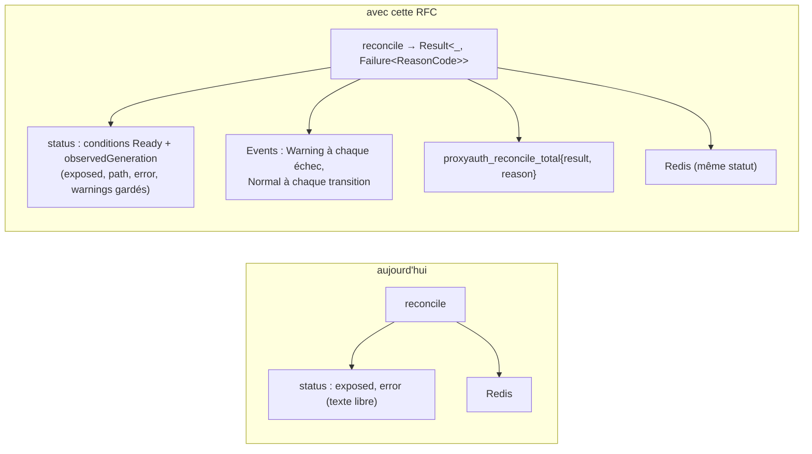
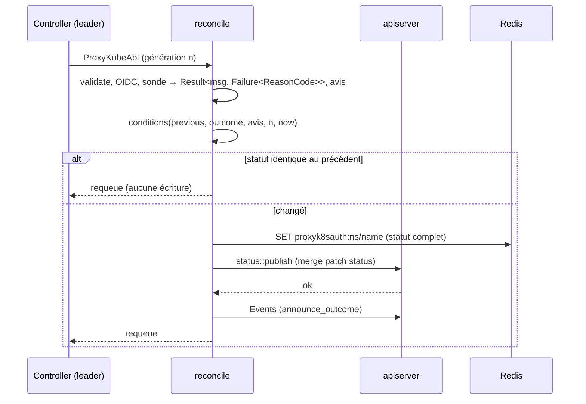
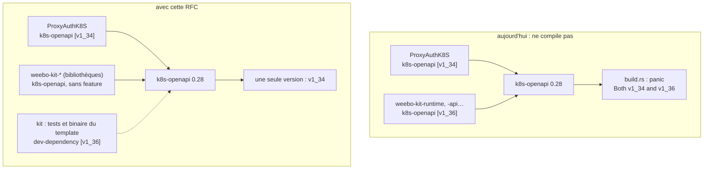
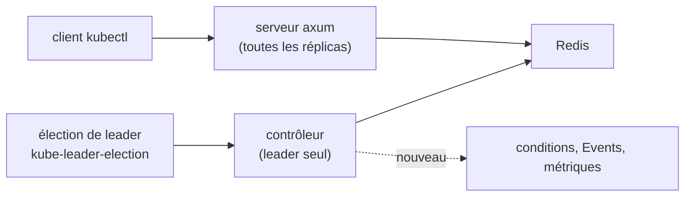
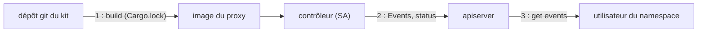

# RFC 0011 — Conditions, Events et codes de raison : adopter les crates du kit

| Field       | Value                                                                  |
| ----------- | ---------------------------------------------------------------------- |
| Status      | Accepted (2026-10-19, après grill)                                     |
| Short       | Crates `weebo-kit-*` : statut, Events, codes de raison                 |
| Settles     | Ce que ProxyAuthK8S prend des crates Rust du kit, et comment il résout le conflit de version de `k8s-openapi` |
| Author      | Max Batleforc <maxleriche.60@gmail.com>                                |
| Co-author   | Claude Opus 5.5 (1M context)                                           |
| Created     | 2026-10-19                                                             |
| Supersedes  | —                                                                      |
| Touches     | `Cargo.toml` (workspace), `libs/server/controller/` (`Cargo.toml`, `proxy_kube_api/{mod,reconcile,cleanup}.rs`, `reason.rs` nouveau), `libs/server/crd/src/{lib.rs,status/mod.rs}`, `deploy/crds.yaml` et `deploy/chart-crd/` (régénérés), `deploy/chart/templates/rbac.operator.yaml`, `deny.toml`, `.github/workflows/back-envtest.yaml`, `tests/integration/`, `.it/matrix.py`, `docs/content/docs/` ; côté kit, par une RFC du kit remise à sa session : les `Cargo.toml` des crates `weebo-kit-*` |
| Risk        | medium (§7 : une permission RBAC nouvelle, une source git nouvelle dans le graphe Cargo) |

> Document de référence (environ 5 000 mots) : §1 à §4 suffisent pour en
> discuter ; §5 à §16 servent à l'implémenter et à le relire.

---

## 1. Summary

ProxyAuthK8S ne dit l'état d'une `ProxyKubeApi` que par `status.exposed` et
une chaîne `status.error`, sans condition, sans `observedGeneration` et sans
Event. Cette RFC fait passer le contrôleur sur trois briques du kit
(`weebo-kit-domain`, `weebo-kit-api`, `weebo-kit-runtime`) : un catalogue de
codes de raison (`reason_codes!`), une condition `Ready` standard écrite par
`status::publish`, des Events Kubernetes à chaque échec et à chaque
transition, et les métriques de reconcile. Elle résout d'abord le conflit qui
empêche aujourd'hui de compiler ces crates chez nous : le kit active la
feature `v1_36` de `k8s-openapi` dans ses bibliothèques, ProxyAuthK8S active
`v1_34`, et `k8s-openapi` refuse deux features de version dans un même
graphe. Les crates du kit restent référencées par git, sur un tag.

### Before / after

```text
# aujourd'hui
$ kubectl get proxykubeapis -n team-a
NAME    AGE
prod    3d
$ kubectl wait --for=condition=Ready proxykubeapi/prod -n team-a
error: timed out waiting for the condition      ← aucune condition n'existe
$ kubectl describe proxykubeapi/prod -n team-a | sed -n '/Events/,$p'
Events:  <none>

# avec cette RFC
$ kubectl get proxykubeapis -n team-a
NAME    READY   REASON              AGE
prod    False   TargetUnreachable   3d
$ kubectl describe proxykubeapi/prod -n team-a | sed -n '/Events/,$p'
  Type     Reason             From                       Message
  Warning  TargetUnreachable  proxy-kube-api-controller  Target service is not reachable
$ kubectl wait --for=condition=Ready proxykubeapi/prod -n team-a   # après correction
proxykubeapi.weebo.si.rs/prod condition met
```



Le chemin des requêtes proxifiées ne change pas : seul ce que le contrôleur
publie sur la CR et autour d'elle change.

---

## 2. Motivation

1. **Aucun outil standard ne sait si une `ProxyKubeApi` est prête.** Le statut
   (`libs/server/crd/src/status/mod.rs:7-15`) n'a que `exposed`, `path`,
   `error` et `warnings`. `kubectl wait --for=condition=Ready`, le health
   check d'Argo CD et Flux lisent `status.conditions` : ils n'ont rien à lire.
   Un déploiement GitOps d'un cluster mal configuré est vu « Healthy ».
2. **Le contrôleur ne raconte rien hors de ses logs.** Aucun Event n'est émis
   (`kube::runtime::events` n'apparaît nulle part dans `libs/server`). Un
   utilisateur qui n'a que `kubectl` dans son namespace ne voit pas pourquoi
   son cluster n'apparaît pas au dashboard : la cause est dans les logs du
   pod du proxy, qu'il ne lit pas.
3. **Les erreurs sont du texte libre.** `status.error` est un `format!("…{e}")`
   (`proxy_kube_api/reconcile.rs:77`, `:109`, `:124`, `:137-139`). On ne peut
   ni filtrer, ni compter, ni documenter une cause. L'error policy ignore
   l'erreur (`proxy_kube_api/mod.rs:42-48`), et `ControllerError::metric_label`
   (`error.rs:36-38`) n'est appelé par aucun compteur.
4. **Aucune métrique de reconcile.** `libs/server/api/src/metrics.rs` compte les
   requêtes, les décisions de politique, l'audit et les sessions, rien du
   contrôleur. Un contrôleur qui échoue en boucle sur toutes les CR ne se voit
   pas dans Prometheus.
5. **Le kit a déjà écrit tout cela, et on ne peut pas l'utiliser.** Les crates
   `weebo-kit-*` activent `k8s-openapi/v1_36` dans leurs bibliothèques
   (`Cargo.toml:38` du kit, hérité par `weebo-kit-api`, `-application`,
   `-adapters` et `-runtime`). ProxyAuthK8S active `v1_34` (`Cargo.toml:29`).
   Ajouter une seule crate du kit fait échouer la compilation de
   `k8s-openapi` : « Both v1_34 and v1_36 features are enabled » (constaté le
   2026-10-19, §6.P point 9).

---

## 3. Goals / non-goals

**Goals**

- Une `ProxyKubeApi` porte une condition `Ready` standard, avec une raison
  tirée d'un catalogue fermé et `observedGeneration`.
- Chaque échec de reconcile et chaque transition produit un Event sur la CR.
- Le contrôleur expose `proxyauth_reconcile_total` et
  `proxyauth_reconcile_duration_seconds`, aux labels bornés.
- Les crates du kit compilent dans ProxyAuthK8S avec une seule feature de
  version de `k8s-openapi`, choisie par ProxyAuthK8S.
- Les crates du kit sont référencées par git sur un tag, et `kit:sync` les
  monte avec le reste du kit.

**Non-goals**

- **`telemetry::init` du kit.** Il installe seul le subscriber global
  (`telemetry.rs:58-63`, échec si un autre existe) et ne connaît ni le filtre
  `audit=off` de la sortie standard (`libs/server/trace/src/lib.rs:213-217`)
  ni `/management/metrics` sur le routeur principal. L'adopter dupliquerait
  chaque ligne d'audit sur stdout, ce que la RFC 0008 interdit.
- **L'élection de leader du kit.** `acquire_leadership` appelle
  `std::process::exit(1)` quand le lease peut être perdu (`leader.rs:94-96`) :
  chez nous, toutes les réplicas servent le proxy, et perdre le lease tuerait
  le service HTTP de la réplica. On garde `kube-leader-election`
  (`libs/server/controller/src/lib.rs:51-98`), qui rétrograde sans sortir.
- **Le squelette de contrôleur du kit** (`controller::controller`,
  `WatchScope`, `drive`). Il suppose les variables `WEEBO_WATCH_*` et un
  opérateur seul dans son pod ; notre contrôleur tourne à côté du serveur, sur
  toutes les réplicas, et seul le leader réconcilie. À revoir quand le kit
  saura rétrograder sans sortir.
- **`Health`, `admission`, `webhook_server`.** Pas de webhook ici (la
  validation passe par CEL) ; nos sondes sont `/management/health` et
  `/management/ready` (`libs/server/api/src/lib.rs:33-40`).
- **`weebo-kit-adapters`, `weebo-kit-application` en direct**, les types
  `api::refs`/`api::tls`. Ils changeraient le schéma de `spec` : pas avant la
  1.0. (`weebo-kit-runtime` dépend de `weebo-kit-application`, qui entre donc
  dans le graphe sans être utilisé.)
- **Retirer `exposed`, `path`, `error`, `warnings`.** Le serveur lit `exposed`
  depuis Redis (`get_all_visible_cluster_model.rs:45`) ; leur retrait est une
  bascule de la 1.0.
- **Publier les crates du kit sur crates.io.** Décision du mainteneur du kit,
  pas prise : on reste sur git.
- **La library chart `weebo-operator-lib`.** Elle ne couvre ni le front ni le
  collecteur OTel.

---

## 4. User-facing design

### 4.1 Configuration

Aucune option nouvelle. Le contrôleur publie conditions et Events toujours ;
il n'y a pas de drapeau pour s'en passer.

Côté build, la version de Kubernetes que ProxyAuthK8S compile reste un choix
de ProxyAuthK8S, à un seul endroit :

```toml
# Cargo.toml (workspace) — la seule feature de version du graphe
k8s-openapi = { version = '0.28', features = ['v1_34'] }

# crates du kit : par git, sur un tag que kit:sync réécrit
weebo-kit-domain = { git = "https://github.com/batleforc/weebo-operator-kit", tag = "v0.19.1" }
weebo-kit-api = { git = "https://github.com/batleforc/weebo-operator-kit", tag = "v0.19.1" }
weebo-kit-runtime = { git = "https://github.com/batleforc/weebo-operator-kit", tag = "v0.19.1" }
```

- `version = '0'` devient `'0.28'` : en 0.x, chaque mineure de `k8s-openapi`
  casse, et `'0'` laisserait `cargo update` en tirer une autre que celle du
  kit.
- `v0.19.1` est la release du kit qui porte la correction de §6.1 (RFC 0005
  du kit, PR kit #13, publiée le 2026-10-19).

### 4.2 Behaviour rules

**Le catalogue.** `libs/server/controller/src/reason.rs` déclare, avec
`weebo_kit_domain::reason_codes!`, l'enum `ReasonCode` et son `impl Reason`
(écrit à la main : la macro ne le génère pas, `reason.rs:39-72` du kit) :

| Code | Sévérité | Quand | Aujourd'hui |
| --- | --- | --- | --- |
| `Reconciled` | succès (`Reason::SUCCESS`) | la cible répond, la CR est servie | `exposed: true` |
| `InvalidSpec` | bloquant | `validate()` refuse la spec | `"Failed to validate proxy configuration: {e}"` (`reconcile.rs:77`) |
| `OidcConfigUnresolved` | bloquant | `config_from` ne se lit pas | `"Failed to resolve the OIDC configuration: {e}"` (`:109`) |
| `TargetUnreachable` | bloquant | la sonde répond « non joignable » | `"Target service is not reachable"` (`:124`) |
| `ProbeFailed` | bloquant | la sonde échoue elle-même | `"Failed to check if target service is reachable: {e}"` (`:137-139`) |
| `CacheWriteFailed` | bloquant | l'écriture Redis échoue | `ControllerError::Redis` (`:167-174`), sans statut |
| `RulesRestricted` | avis | `security_config.warnings()` n'est pas vide | `status.warnings` (`:144-148`) |
| `DeprecatedInsecureCert` | avis | `cert: Insecure` | un `warn!` seul (`:82-88`) |
| `Deleted` | avis | le finalizer a nettoyé Redis | rien (`cleanup.rs:16-44`) |

**Le statut.**

- `Ready` est `True` avec `Reconciled`, `False` avec le code bloquant. Les avis
  deviennent chacun une condition `True` de type égal au code
  (`RulesRestricted`, `DeprecatedInsecureCert`), comme le fait
  `conditions::conditions` (`conditions.rs:15-55`).
- `lastTransitionTime` ne bouge que quand le statut d'une condition change.
- `observedGeneration` n'est écrit que sur succès (`status.rs:81-83` du kit) :
  une CR en échec garde la génération de son dernier succès, ce qui dit
  « cette version de la spec n'a jamais été servie ».
- `exposed`, `path`, `error` et `warnings` restent, avec les mêmes valeurs ;
  `error` porte le message de `Ready` quand il est `False`.
- Redis reçoit le même statut que l'apiserver, conditions comprises.

**Les Events.**

- Un `Warning` à chaque reconcile qui finit sur `Ready: False`, un `Normal`
  quand `Ready` passe à `True` ou change de raison, et un pour chaque avis qui
  apparaît ou disparaît (`events::announce_outcome`, appelé par
  `status::publish`).
- Un `Warning` `CacheWriteFailed` par l'error policy (`retry_after_error`) :
  la CR n'a pas de statut à publier dans ce cas.
- Un `Normal` `Deleted` quand le finalizer a fini (`announce_change`).
- Seul le leader émet : les followers ne réconcilient pas
  (`proxy_kube_api/mod.rs:56-66`). Le `Reporter` porte
  `controller: "proxy-kube-api-controller"` (le field manager actuel,
  `reconcile.rs:58`) et `instance: $HOSTNAME`.
- Une publication d'Event qui échoue est journalisée et n'échoue jamais le
  reconcile (`events.rs`, comportement du kit).

**Colonnes.** `kubectl get proxykubeapis` gagne `READY` et `REASON`
(`#[kube(printcolumn)]` sur `status.conditions[?(@.type=="Ready")]`).

**Le cas sans intérêt.** Une CR saine produit, à chaque reconcile horaire, un
statut identique : aucune écriture (la garde d'égalité de `reconcile.rs:213`
est étendue aux conditions), aucun Event, et le compteur
`proxyauth_reconcile_total{result="ok",reason="Reconciled"}` qui monte.

### 4.3 Validation

Refusé à la compilation ou au lint :

| Condition | Rationale |
| --- | --- |
| Deux features `v1_*` de `k8s-openapi` dans le graphe | `k8s-openapi` refuse de compiler (`build.rs`) ; c'est le symptôme de §2.5 |
| Un code du catalogue pas en PascalCase | `assert_pascal_case` du kit, dans un test unitaire : une raison de condition doit l'être |
| Une source git autre que le dépôt du kit | `deny.toml` (`unknown-git = "deny"`), qui gagne une seule entrée `allow-git` |

Avertissements :

| Condition | Behaviour | Surfaced in |
| --- | --- | --- |
| Règles sous restriction (`status.warnings`) | condition `RulesRestricted: True`, Event `Normal` à l'apparition | `kubectl describe`, colonne `REASON` si `Ready` est `True` |
| `cert: Insecure` | condition `DeprecatedInsecureCert: True` | `kubectl describe` (aujourd'hui : logs seuls) |

---

## 5. Architecture

### 5.1 Un reconcile



Redis est écrit avant l'apiserver, comme aujourd'hui : un échec Redis renvoie
`CacheWriteFailed` sans publier de statut, et le reconcile reprend par l'error
policy. Un Event qui ne part pas ne bloque rien.

### 5.2 Le graphe de `k8s-openapi`



**Invariant** : aucune bibliothèque n'active de feature de version ; seul
l'utilisateur final (le workspace ProxyAuthK8S ici, le binaire du template
dans le kit) en choisit une. Deux features ne peuvent donc plus se rencontrer,
quel que soit l'opérateur qui consomme le kit. C'est la règle de
`k8s-openapi` lui-même (`src/lib.rs:75-81` de 0.28.0 : « If you're writing a
library crate, your crate *must not* enable any features »).

### 5.3 Ce qui ne change pas



Le serveur lit `exposed` dans Redis comme avant ; l'élection reste la nôtre.
Seule la flèche en pointillé est nouvelle.

---

## 6. Detailed design

### 6.1 Côté kit (une RFC du kit, remise à sa session)

ProxyAuthK8S ne modifie pas le dépôt du kit. La correction passe par une RFC
du kit (décision 2), dont le brouillon est écrit depuis cette RFC, avec les
faits vérifiés ci-dessous, et remis à la session du kit, qui la dépose, la
passe au grill et l'implémente. Ce qu'elle doit livrer :

- Workspace : `k8s-openapi = { version = "0.28", features = ["schemars"] }`,
  sans `v1_36`.
- Les crates qui ont des tests (`weebo-kit-api`, `-application`, `-adapters`,
  `-runtime`, `-perf`, `-testkit`) gagnent
  `[dev-dependencies] k8s-openapi = { workspace = true, features = ["v1_36"] }`.
- `cargo check`, `clippy` et `doc`, qui ne compilent pas les
  dev-dependencies, passent `K8S_OPENAPI_ENABLED_VERSION=1.36` (dans le
  `mise.toml` du kit, ou dans les tâches `rust:*`).
- Le template d'opérateur garde `features = ["v1_36"]` dans son propre
  `Cargo.toml` (`templates/operator/Cargo.toml:48-49`) : c'est une
  application.
- Vérifié sur une copie (`git archive origin/main`, kit v0.18.2) : sans la
  feature, `cargo check` des crates domain, api, runtime, application et
  adapters passe avec `K8S_OPENAPI_ENABLED_VERSION` à 1.34 et à 1.32. Aucune
  crate du kit n'utilise de champ propre à 1.35 ou 1.36.
- **Livré** dans le kit **v0.19.1** (2026-10-19), avec un job CI qui compile
  de 1.32 à 1.36. Vérifié sur le tag, sur une copie de ProxyAuthK8S :
  `cargo check -p controller` passe avec les trois crates en `tag =
  "v0.19.1"`, `cargo tree -e features -i k8s-openapi` ne montre que `v1_34`,
  et `Cargo.lock` fige le commit (`git+…?tag=v0.19.1#a6cdb648d200…`). Le repli
  de la décision 5 n'a plus lieu d'être.

### 6.2 Workspace ProxyAuthK8S

- `k8s-openapi = { version = '0.28', features = ['v1_34'] }` (§4.1). Nos
  crates `common`, `controller` et `cli` activent la feature par le
  workspace ; c'est sans conséquence ici, ProxyAuthK8S n'étant consommé par
  personne, et on ne les touche pas.
- `weebo-kit-domain`, `weebo-kit-api`, `weebo-kit-runtime` en
  `[workspace.dependencies]`, par git et tag ; seul `libs/server/controller`
  et `libs/server/crd` (pour `Condition`) les utilisent.
- `deny.toml` : `[sources] allow-git = ["https://github.com/batleforc/weebo-operator-kit"]`.
- `kit:sync` (RFC 0005, phase 4) réécrit le tag : `pin-kit.sh` remplace déjà
  `git = "https://github.com/$repo", tag = "…"` dans `Cargo.toml` et relance
  `cargo metadata` pour `Cargo.lock` (`templates/kit.yaml:74-129` du kit).

### 6.3 `libs/server/crd`

- `ProxyKubeApiStatus` gagne `conditions: Vec<weebo_kit_api::Condition>`
  (`#[serde(default, skip_serializing_if = "Vec::is_empty")]`) et
  `observed_generation: Option<i64>`. `equal()` les compare aussi.
- `#[kube(printcolumn = …)]` pour `READY` et `REASON`.
- `deploy/crds.yaml` et `deploy/chart-crd/` régénérés (`task gen:crds-file`) :
  ajout pur au schéma de `status`.

### 6.4 `libs/server/controller`

- `reason.rs` : le catalogue de §4.2, son `impl Reason`, un test
  `assert_pascal_case(ReasonCode::ALL)`.
- `reconcile.rs` : les quatre branches de `ProxyKubeApiStatus::new(false, …)`
  deviennent `Err(Failure::new(code, message))` ; les avis viennent de
  `security_config.warnings()` et de `is_deprecated_insecure()`. Le statut est
  calculé par `conditions::conditions`, comparé, puis écrit dans Redis et
  publié par `status::publish` (merge patch sur `status`, même field manager).
- `mod.rs` : un `Recorder` construit une fois dans `run`
  (`Reporter { controller: "proxy-kube-api-controller", instance: Some(holder_id) }`) et
  porté par le contexte du contrôleur ; l'error policy appelle
  `retry_after_error` sur `CacheWriteFailed` et garde son `requeue(5s)`.
- `cleanup.rs` : `announce_change(Deleted)` après le nettoyage.
- `ReconcileMetrics::new("proxyauthk8s", "proxyauth")` : compteurs enregistrés
  sur le `MeterProvider` global que `libs/server/trace` installe déjà.
- `ControllerError::metric_label`, sans appelant, est retiré.

### 6.5 Chart et CI

- `rbac.operator.yaml` : `events.k8s.io` `events` `create`, `patch` dans le
  ClusterRole (le contrôleur publie dans le namespace de chaque CR).
- `back-envtest.yaml` : `ENVTEST_K8S_VERSION` passe de 1.31.0 à 1.34.x.
  Règle (décision 4) : envtest tourne toujours à la version de la feature
  `v1_*` du workspace, et un commentaire sur la ligne `k8s-openapi` du
  `Cargo.toml` le rappelle.
  Aujourd'hui, les tests envtest tournent contre un apiserver plus ancien que
  la plus ancienne version que `k8s-openapi` 0.28 sait compiler (`earliest =
  v1_32`, son `Cargo.toml:52`).

### 6.P Proof against a real client

Banc de la RFC 0009 (k3s `v1.35.9-k3s1`, `.it/images.lock:4`), deux réplicas
du proxy, `kubectl` 1.35 et la suite `tests/integration/tests/rfc0011.rs`. La
CR est créée avec le kubeconfig d'administration : c'est la mise en place,
l'action testée est celle du contrôleur. Points 9 et 10 hors suite (jobs CI).

1. **Prête.** Une `ProxyKubeApi` qui vise l'apiserver du banc :
   `kubectl wait --for=condition=Ready --timeout=60s` sort en 0 ;
   `status.conditions[Ready]` vaut `True`/`Reconciled`, et
   `status.observedGeneration` égale `metadata.generation`.
2. **Refus : cible injoignable.** Une CR qui vise un Service sans endpoint :
   `Ready` `False`/`TargetUnreachable` ; un Event `Warning`
   `TargetUnreachable` sur la CR (`kubectl get events
   --field-selector involvedObject.name=…`) ; la CR est marquée
   injoignable dans la liste des clusters du dashboard (`is_reachable:
   false`), comme aujourd'hui.
3. **Refus : spec invalide.** Une spec que `validate()` refuse : `Ready`
   `False`/`InvalidSpec`, `observedGeneration` absent, Event `Warning`.
4. **Retour.** La CR du point 2 corrigée : `Ready` repasse à `True`, un Event
   `Normal` `Reconciled`, `lastTransitionTime` a bougé et `observedGeneration`
   suit la nouvelle génération.
5. **Avis.** Une CR dont `security_config.warnings()` n'est pas vide :
   condition `RulesRestricted` `True`, `Ready` `True`, et `status.warnings`
   inchangé.
6. **Pas de boucle.** Après le point 1, `metadata.resourceVersion` de la CR ne
   bouge pas pendant 90 s, et aucun Event nouveau n'apparaît.
7. **Un seul émetteur.** Sur les Events des points 2 à 4,
   `reportingInstance` est le pod qui tient le lease
   `proxy-auth-k8s-leader-election`, jamais l'autre réplica.
8. **Métriques.** `/management/metrics` montre
   `proxyauth_reconcile_total{kind="ProxyKubeApi",result="error",reason="TargetUnreachable"}`
   qui a augmenté après le point 2.
9. **Une seule version de `k8s-openapi`** (hors suite, job `back-clippy`).
   `cargo tree -e features -i k8s-openapi` ne montre qu'une feature,
   `v1_34`. Contrôle fait le 2026-10-19 sur des copies : avec le kit v0.18.2
   tel quel, `cargo check -p controller` échoue (« Both v1_34 and v1_36
   features are enabled on the k8s-openapi crate ») ; avec la correction de
   §6.1, il passe, et l'arbre de `server` ne gagne qu'un crate tiers,
   `opentelemetry-http` 0.33.1.
10. **Source git refusée** (hors suite, `task audit`). `cargo deny check
    sources` passe avec l'entrée `allow-git` du kit, et échoue si on retire
    cette entrée.

**Deliberately untouched**, so reviewers do not go looking :

- `libs/server/trace` : la télémétrie reste la nôtre (non-goal) ; les
  métriques du kit passent par `opentelemetry::global`.
- `libs/server/controller/src/lib.rs` (élection) : `kube-leader-election`
  reste.
- `libs/server/api/src/cluster/redirect/audit.rs` : l'audit de la RFC 0008 n'a
  pas de lien avec ces raisons ; ses `reason` restent les siennes.
- `apps/front`, CLI : ils ne lisent ni `error` ni les conditions
  (`apps/front/src/features/cluster/status.ts:7-12`).

---

## 7. Security

**Rating:** medium — une permission RBAC nouvelle (créer des Events dans tous
les namespaces) et une source git nouvelle dans le graphe de build ; aucune
nouvelle surface réseau, aucun changement du chemin des requêtes.

### 7.1 Threat model

Actifs : l'intégrité du build (code compilé dans l'image du proxy), la
confidentialité de ce que les messages d'erreur contiennent, la disponibilité
de l'apiserver.

Acteurs : un utilisateur qui peut lire les Events d'un namespace ; le
mainteneur du dépôt du kit (ou quiconque compromet ce dépôt) ; le contrôleur
lui-même, avec son ServiceAccount.



| # | Threat (STRIDE) | Where | Mitigation | Residual risk |
| --- | --- | --- | --- | --- |
| T1 | Tampering : un tag du kit déplacé, ou un commit malveillant, entre dans le build | 1 | `Cargo.lock` enregistre le commit d'une dépendance git : un tag déplacé ne change rien sans `cargo update` ; `kit:sync` passe en PR, avec le diff de `Cargo.lock` ; `deny.toml` n'admet que ce dépôt ; §6.P point 10 | le dépôt du kit est de confiance au même titre que ses tâches et ses workflows, déjà inclus (RFC 0005) ; accepté (mainteneur) |
| T2 | Information disclosure : un message d'erreur (chemin d'un Secret, URL interne, texte d'erreur de la sonde) sort dans un Event lisible par tout le namespace | 2 → 3 | les messages sont ceux de `status.error` aujourd'hui, déjà lisibles par qui lit la CR ; aucune valeur de Secret n'y entre (les erreurs nomment des clés, jamais des valeurs) ; notes tronquées à 1000 octets par le kit ; test : le message de `OidcConfigUnresolved` ne contient pas la valeur de `client_secret` de la fixture | un lecteur d'Events sans droit de lecture sur la CR voit le message ; accepté : même audience en pratique (le namespace de l'équipe) |
| T3 | Elevation / spoofing : la permission `events create` permet au SA d'écrire des Events trompeurs dans n'importe quel namespace | 2 | permission limitée à `events.k8s.io/events`, verbes `create`, `patch` ; le SA lit déjà les Secrets référencés, ce qui est plus fort | un SA compromis peut forger des Events ; accepté, moindre que ses droits actuels |
| T4 | Denial of service : une CR cassée produit un Event toutes les 5 s (error policy), ou une boucle de reconcile par l'écriture du statut | 2 | les Events répétés sont agrégés en série par le `Recorder` de kube ; le statut n'est écrit que s'il change (point 6) ; requeue exponentiel 5 min → 1 h inchangé (`reconcile.rs:38-43`) | aucun |
| T5 | Repudiation : une réplica non leader publie un statut ou un Event contradictoire | 2 | seul le leader réconcilie (`mod.rs:56-66`) ; `reportingInstance` nomme l'émetteur ; point 7 | aucun |

### 7.2 Authentication and authorisation

Pas de nouvelle surface : aucun endpoint, aucune route. La seule autorisation
nouvelle est celle du ServiceAccount (T3). Les utilisateurs lisent conditions
et Events avec leurs droits Kubernetes existants.

### 7.3 Input handling and injection

L'entrée est la spec de la CR, déjà validée (CEL, `validate()`). Les messages
d'Events et de conditions sont du texte, jamais interprétés ; le kit tronque
les notes. Aucun parseur nouveau.

### 7.4 Secrets and cryptography

Aucun secret nouveau. Les messages ne doivent porter aucune valeur de Secret
(T2, et son test).

### 7.5 Abuse and resource exhaustion

Une écriture de statut par changement, pas par reconcile ; Events agrégés ;
compteurs aux labels bornés (`kind`, `result`, `reason` du catalogue fermé).

### 7.6 Existing defences that still hold

- Seul le leader réconcilie ; le lease reste celui de `kube-leader-election`.
- Le chemin des requêtes, les politiques et l'audit ne lisent pas ces champs.
- `cargo deny` refuse toute autre source git ou registre.

---

## 8. Supply chain

| Dependency / image / tool | Version | Why this one | Licence | Known CVEs (`task audit`) | Maintenance |
| --- | --- | --- | --- | --- | --- |
| `weebo-kit-domain` (git) | première release du kit avec §6.1 | `Reason`, `reason_codes!`, `Failure`/`Advisory` : ce qu'on écrirait sinon | MIT | à vérifier par `cargo deny` au moment de l'ajout | même mainteneur que ProxyAuthK8S |
| `weebo-kit-api` (git) | idem | `Condition` | MIT | idem | idem |
| `weebo-kit-runtime` (git) | idem | conditions, `status::publish`, Events, `ReconcileMetrics` | MIT | idem | idem |
| `weebo-kit-application` (git, transitif) | idem | dépendance de `weebo-kit-runtime`, non utilisée directement | MIT | idem | idem |
| `opentelemetry-http` (transitif) | 0.33.1 | seul crate tiers nouveau du graphe de `server` (mesuré) | Apache-2.0 | à vérifier par `cargo deny` | projet OpenTelemetry |

- **Mesuré** (2026-10-19, `cargo tree -p server -e normal` sur des copies) :
  358 lignes avant, quatre crates `weebo-kit-*` et `opentelemetry-http` en
  plus ensuite. Le reste de ce que tire `weebo-kit-runtime` (axum-server,
  rustls, prometheus, opentelemetry-prometheus) est déjà dans notre graphe.
- **Build and release** : Containerfile inchangé ; le build tire un dépôt git
  de plus (réseau au build, comme les autres crates).
- **Updates** : `kit:sync TAG=…` (RFC 0005 phase 4), en PR, avec le diff de
  `Cargo.lock`. Pas de Dependabot pour une source git.

---

## 9. Data and privacy

| Data | Personal? | Where stored | Retention | Who can read it | Leaves the instance? |
| --- | --- | --- | --- | --- | --- |
| `status.conditions`, `observedGeneration` | non : état d'une CR | etcd (CR), Redis (copie) | vie de la CR | qui lit la CR | non |
| Events du contrôleur | non : code, message d'erreur technique | etcd (Events) | TTL des Events de l'apiserver (1 h par défaut) | qui lit les Events du namespace | non |
| `proxyauth_reconcile_*` | non : labels `kind`, `result`, `reason` | Prometheus / OTLP | celle du backend de métriques | opérateurs de la plateforme | vers le collecteur configuré, comme les métriques existantes |

Aucune donnée personnelle : aucun nom d'utilisateur, aucun groupe, aucune
adresse n'entre dans ces champs (le contrôleur ne voit pas les requêtes).

---

## 10. Operability

### 10.1 Observability

- **Metrics** : `proxyauth_reconcile_total{kind, result, reason}`,
  `proxyauth_reconcile_duration_seconds{kind, result}` (noms du kit, préfixe
  `proxyauth` comme les compteurs existants). Cardinalité : 1 kind × 2
  résultats × 9 codes au plus.
- **Logs et audit** : les `info!`/`warn!`/`error!` du reconcile restent.
  L'audit de la RFC 0008 ne change pas : il trace les requêtes, pas le
  contrôleur.
- **Alerts** : aucune livrée ; la doc propose
  `increase(proxyauth_reconcile_total{result="error"}[15m]) > 0` par raison.

### 10.2 Failure modes

| Failure | Detected by | Behaviour (fail open / closed) | Recovery |
| --- | --- | --- | --- |
| Publication d'un Event refusée (RBAC manquant, apiserver lent) | log `warn` du kit | ouvert, volontairement : le reconcile continue, le statut est publié | corriger le RBAC |
| Patch de statut refusé | `status::publish` (3 essais, 0,5/1/2 s) puis erreur | le reconcile échoue, requeue par l'error policy ; Redis a déjà le bon état, donc le proxy sert correctement | automatique |
| Redis indisponible | `CacheWriteFailed` | fermé comme aujourd'hui : pas de statut publié, Event `Warning`, requeue | automatique |
| Kit et ProxyAuthK8S sur deux features | `cargo check` | fermé : pas de build | §6.1 |

### 10.3 Performance and capacity

- Une écriture de statut par changement d'état (au plus une par CR et par
  reconcile en échec, backoff 5 min → 1 h) ; zéro pour une CR saine.
- Events : un par échec et par transition, agrégés par kube.
- Temps de build : quatre crates de plus, mesuré en phase 1 (budget +10 % sur
  `cargo build --release -p server` en CI).

---

## 11. Other concerns

- **Accessibility** : pas d'UI.
- **Internationalisation** : codes et messages en anglais, comme le reste de
  l'API Kubernetes.
- **Compliance** : sans objet.
- **Licensing** : MIT des deux côtés, inchangé.
- **Documentation** : une page `docs/content/docs/…/status-and-events.mdx` (la
  condition `Ready`, le tableau des codes, l'alerte proposée) ; le guide
  développeur (RFC 0005 phase 5) explique comment ajouter un code.

---

## 12. Alternatives considered

| Alternative | Why rejected |
| --- | --- |
| Ne rien faire | motivation 1 : GitOps voit « Healthy » un cluster cassé |
| Écrire nos propres conditions et Events, sans le kit | environ 300 lignes déjà écrites et testées dans le kit (`conditions.rs`, `status.rs`, `events.rs`), et un format différent des autres opérateurs weebo |
| Passer ProxyAuthK8S en `v1_36` pour suivre le kit | ça compile aujourd'hui, mais le conflit revient à chaque opérateur qui choisit une autre version, et le kit violerait toujours la règle de `k8s-openapi` ; gardé comme repli (§15) |
| `K8S_OPENAPI_ENABLED_VERSION` côté ProxyAuthK8S à la place de la feature | une variable d'environnement oubliée (Containerfile, IDE) casse le build ; la feature dans `Cargo.toml` est vue par tous |
| Adopter tout le runtime (télémétrie, leader, squelette) | trois incompatibilités concrètes (§3 : subscriber global, `exit(1)`, `WatchScope`) |
| Vendoriser les crates du kit (copie dans le dépôt) | double maintenance, et `kit:sync` ne les monterait plus |
| Attendre une publication sur crates.io | décision non prise ; git sur tag donne la même reproductibilité par `Cargo.lock` |

---

## 13. Rollout and compatibility

- **Default behaviour** : à la mise à jour, chaque CR gagne ses conditions au
  premier reconcile du nouveau leader. Les champs existants gardent leurs
  valeurs.
- **Migration** : CRD régénérée (ajout de champs de `status` et de colonnes),
  appliquée par le chart avant le Deployment, comme toute mise à jour de CRD.
  Réversible : une version antérieure ignore les champs inconnus.
- **Operator prerequisites** : la permission `events` (chart).
- **Rollback** : la version précédente ne publie plus de conditions ; celles
  déjà écrites restent jusqu'à la prochaine écriture de statut par la vieille
  version (SSA de `proxy-kube-api-controller`, qui ne les connaît pas : elles
  restent, figées). Aucun risque de §7 rouvert.
- **Ordre** : la RFC du kit (§6.1), son implémentation et sa release
  d'abord, puis la phase 4 de la RFC 0005 (`kit:sync`), puis cette RFC.
- **Repli** (décision 5) : si le kit n'a pas publié la correction quand la
  0011 doit entrer dans la 0.3.0, la 0011 part en `v1_36` (une ligne du
  workspace et envtest à 1.36), et revient en `v1_34` au `kit:sync` qui
  apporte la correction. La 0.3.0 n'attend pas le kit.

---

## 14. Test plan

- **Unit** (`libs/server/controller/src/reason.rs`, `reconcile.rs`) : PascalCase
  du catalogue ; chaque branche de reconcile produit le bon `Failure` ou
  `Ok` ; avis `RulesRestricted` et `DeprecatedInsecureCert` ; la garde
  d'égalité ignore un statut identique.
- **Integration** (`libs/server/controller/tests/reconcile.rs`, envtest) :
  conditions et `observedGeneration` écrits sur l'apiserver d'envtest ; Event
  émis par un `Recorder` réel.
- **Proof** : §6.P, `tests/integration/tests/rfc0011.rs` (`p1_ready` à
  `p8_metrics`), points 9 et 10 hors suite.
- **Security** :
  - T1 : §6.P point 10 (`cargo deny` refuse une autre source) ;
  - T2 : le message `OidcConfigUnresolved` de la fixture ne contient pas la
    valeur du Secret ;
  - T3 : test du chart (`helm template`) : la règle `events` n'a que `create`
    et `patch` ;
  - T4 : point 6 (pas de boucle) ;
  - T5 : point 7 (un seul émetteur).
- **Audit** : `task audit` vert avec les nouvelles dépendances.
- **Existing suites** : `envtest`, `http_contract.rs`, la suite d'intégration
  complète (aucune requête ne change), `task fuzz:check`.

---

## 15. Decisions and open questions

### Resolved

Grill du 2026-10-19 : toutes les recommandations acceptées, sauf la forme de
la correction côté kit (décision 2), qui passe par une RFC du kit plutôt que
par une PR directe.

| # | Question | Decision |
| --- | --- | --- |
| 1 | Crates du kit : crates.io ou git ? | **Git, sur un tag**, tant que le mainteneur n'a pas décidé de publier. `Cargo.lock` fige le commit. |
| 2 | Résolution du conflit de version | **Le kit retire la feature de version de ses bibliothèques, par une RFC du kit** (et non une PR directe, contre la recommandation du brouillon) : le changement touche tous les opérateurs du kit. Brouillon écrit depuis ici, remis à la session du kit, qui la dépose, la passe au grill et l'implémente. |
| 3 | Version compilée par ProxyAuthK8S | **`v1_34`** : la version minimale qu'on compile et qu'on teste ; aucun champ récent n'est nécessaire. |
| 4 | Envtest | **Toujours à la version de la feature** : 1.31 → 1.34 en phase 1 (1.31 est sous le plancher de `k8s-openapi` 0.28, 1.32). |
| 5 | Si le kit tarde | **Repli `v1_36`** si la correction du kit n'est pas publiée à l'entrée de la 0011 dans la 0.3.0 ; retour en `v1_34` au `kit:sync` suivant. La 0.3.0 n'attend pas le kit. |
| 6 | Catalogue de codes | **Tel que §4.2** : `Reconciled` ; bloquants `InvalidSpec`, `OidcConfigUnresolved`, `TargetUnreachable`, `ProbeFailed`, `CacheWriteFailed` ; avis `RulesRestricted`, `DeprecatedInsecureCert`, `Deleted`. |
| 7 | Avis | **Des conditions séparées** à côté de `Ready`, comme le kit les produit ; `status.warnings` reste. |
| 8 | `observedGeneration` | **Seulement sur succès** (comportement du kit) : une CR en échec garde la génération de son dernier succès. |
| 9 | Écriture du statut | **Merge patch du kit** (`status::publish`), même field manager, garde d'égalité étendue aux conditions ; au retour arrière, les conditions restent figées, sans danger. |
| 10 | Non-goals | **Confirmés** : ni télémétrie, ni élection, ni squelette du kit ; `exposed`, `path`, `error`, `warnings` gardés jusqu'à la 1.0. À rouvrir quand le kit saura rétrograder un leader sans sortir. |
| 11 | Colonnes | **`READY` et `REASON`** dans `kubectl get proxykubeapis`. |
| 12 | Events répétés | **Un `Warning` à chaque reconcile en échec** ; kube agrège en série, backoff 5 min → 1 h inchangé. |
| 13 | Release | **0.3.0, avec la 0010**, après la phase 4 de la RFC 0005. |
| 14 | Pages de référence du kit | **Plus tard, hors de cette RFC** : leur générateur suppose la structure de crates du template. |
| 15 | Qui écrit la RFC du kit | **Brouillon écrit depuis ProxyAuthK8S**, dans le scratchpad, remis à la session du kit ; ProxyAuthK8S ne touche pas au dépôt du kit. |

### Still open

Aucune.

---

## 16. Implementation phases

| Phase | Content |
| --- | --- |
| 0 | **Kit**, par une RFC du kit remise à sa session (décisions 2 et 15) : bibliothèques sans feature de version, dev-dependencies `v1_36`, `K8S_OPENAPI_ENABLED_VERSION` pour `check`/`clippy`/`doc` ; release. Utile seule : elle débloque tout opérateur qui ne compile pas en `v1_36` |
| 1 | **Dépendances** : `k8s-openapi = '0.28'`, crates du kit par git, `deny.toml`, envtest 1.34 ; preuves 9 et 10. Aucun changement de comportement |
| 2 | **Statut et Events** : catalogue, conditions, `status::publish`, Events, colonnes, RBAC `events`, CRD régénérée ; preuves 1 à 7 |
| 3 | **Métriques et doc** : `ReconcileMetrics`, retrait de `metric_label`, page de doc ; preuve 8 |

La RFC 0005 phase 4 (`kit:sync`) précède la phase 1. Si la phase 0 n'est pas
publiée à temps, la phase 1 part en `v1_36` (décision 5).
