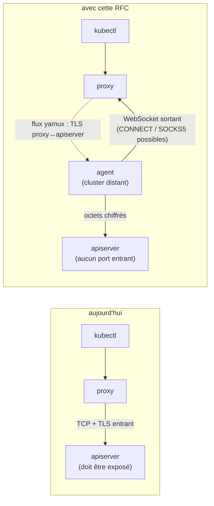
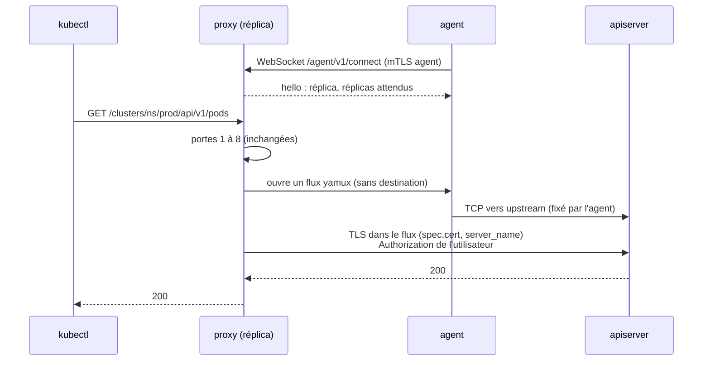
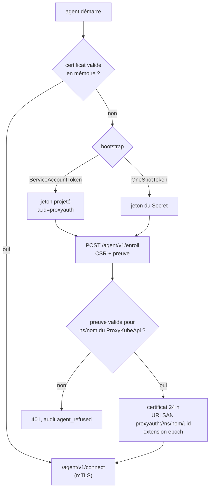
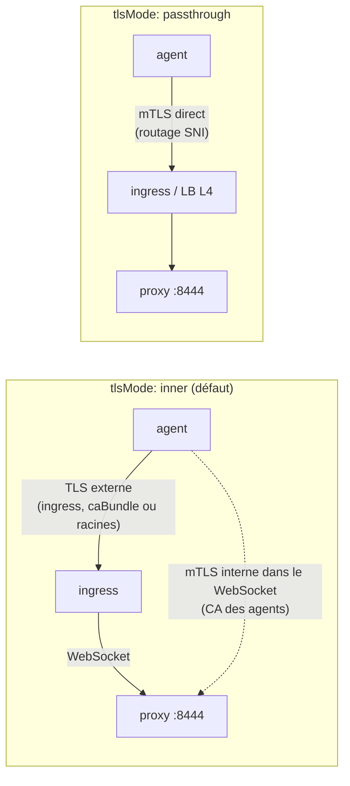
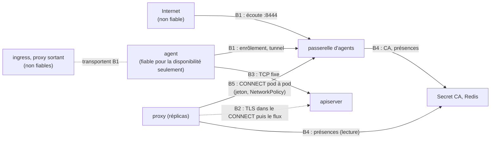

# RFC 0012 — Mode agent : joindre un apiserver qui n'est pas exposé

| Field       | Value                                                                  |
| ----------- | ---------------------------------------------------------------------- |
| Status      | Accepted (2026-10-24), pour la 0.4.0 avec la 0011, avant la 0010      |
| Short       | Mode agent (tunnel sortant)                                            |
| Settles     | Atteindre un cluster dont l'apiserver n'accepte aucune connexion entrante |
| Author      | Max Batleforc <maxleriche.60@gmail.com>                                |
| Co-author   | Claude Opus 5.5 (1M context)                                           |
| Created     | 2026-10-23                                                             |
| Supersedes  | —                                                                      |
| Touches     | `apps/agent/` (nouveau), `libs/agent/proto/` (nouveau), `libs/server/crd/src/service/`, `libs/server/api/src/agent/` (nouveau : passerelle d'agents, décision 26 : écoute, enrôlement, CA, registre des tunnels, `CONNECT`), `libs/agent/pki/` (nouveau), `apps/server/` (rôle `gateway`), `libs/server/api/src/cluster/redirect/kube_redirect/{upstream.rs,upgrade/connect.rs}` (`CONNECT` vers la passerelle, décision 25), `libs/server/api/src/cluster/redirect/audit.rs`, `libs/server/api/src/metrics.rs`, `libs/server/controller/` (CA des agents, jeton d'enrôlement, condition `AgentConnected`), `deploy/chart/`, `deploy/chart-agent/` (nouveau), `deploy/build/agent/Containerfile` (nouveau), CRD générée, `swagger.json`, `.it/`, `tests/integration/`, `docs/content/docs/` |
| Risk        | high                                                                   |

> Document de référence (environ 7 500 mots) : §1 à §4 suffisent pour en
> discuter ; §5 à §16 servent à l'implémenter et à le relire.

---

## 1. Summary

Aujourd'hui, le proxy compose lui-même la connexion vers l'apiserver d'un
cluster : `Service::url_to_call` (`libs/server/crd/src/service/mod.rs`) donne
une URL, puis `connect_upgrade_stream`
(`kube_redirect/upgrade/connect.rs`) fait un `TcpStream::connect` et le client
`reqwest` de `upstream.rs` en fait autant. Un apiserver derrière un NAT, sur un
réseau privé ou sur un site edge est donc hors d'atteinte, à moins de l'exposer.
Cette RFC ajoute une troisième variante de `spec.service`, `Agent`, et un
binaire `proxyauth-agent` installé sur le cluster distant. L'agent ouvre une
connexion **sortante** vers le proxy (WebSocket, multiplexée par yamux, à la
manière du konnectivity-agent) ; le proxy y ouvre un flux par connexion
upstream et y fait passer **le même TLS qu'aujourd'hui**, de bout en bout
jusqu'à l'apiserver. L'agent ne voit que des octets chiffrés, ne détient aucun
droit sur son cluster et ne joint qu'une seule destination, fixée de son côté.

### Before / after

```yaml
# aujourd'hui : le proxy doit pouvoir joindre l'apiserver
spec:
  service:
    ExternalService: { url: "https://prod.example.com:6443" }   # exposé
  cert: { ConfigMap: { name: prod-ca, key: ca.crt } }

# avec cette RFC : c'est l'agent qui appelle le proxy
spec:
  service:
    Agent:
      server_name: kubernetes.default.svc     # SAN vérifié (défaut)
      epoch: 0                                # incrémenté = tunnels coupés
      bootstrap:
        ServiceAccountToken:
          subject: system:serviceaccount:proxyauth-agent:proxyauth-agent
          jwks_url: https://oidc.eks.eu-west-1.amazonaws.com/id/ABC/keys
  cert: { ConfigMap: { name: prod-ca, key: ca.crt } }          # inchangé
```



Révisé par les décisions 25 et 26 : l'agent appelle une **passerelle
d'agents** (un Deployment à part, ou le pod du proxy en mode `embedded`) qui
tient les tunnels, et le proxy joint la passerelle en `CONNECT`, pod à pod,
dans le cluster relais ; le TLS proxy↔apiserver traverse les deux.

La flèche nouvellement fiable est la connexion de l'agent vers le proxy :
c'est elle qu'authentifie le mTLS de l'agent. Le flux en pointillé ne crée
aucune confiance nouvelle : le proxy vérifie l'apiserver avec `spec.cert`,
comme aujourd'hui.

---

## 2. Motivation

1. **Un apiserver injoignable n'est pas proxifiable.** `connect_upgrade_stream`
   et `build_upstream_client` (`upstream.rs`) supposent une route du proxy
   vers l'apiserver. Un cluster on-prem derrière un NAT, un k3s sur un site
   edge ou un cluster managé à endpoint privé n'en ont pas : aujourd'hui, la
   seule réponse est d'exposer l'apiserver.
2. **Exposer l'apiserver élargit la surface du cluster.** L'ouvrir à Internet,
   même filtré par IP, met l'endpoint le plus sensible du cluster face à des
   attaquants qui ne passent pas par le proxy : sa politique, son audit et son
   fail2login ne protègent alors que les clients honnêtes.
3. **Les réseaux visés n'autorisent qu'une sortie contrôlée.** Un réseau
   d'entreprise ne sort que par un proxy HTTP (`CONNECT`) ou SOCKS5 ; un
   apiserver isolé ne voit Internet qu'à travers un overlay WireGuard /
   Netbird. Le besoin vient d'un déploiement réel du mainteneur, qui a les
   deux types de proxy sortant.
4. **Un VPN site-à-site par cluster ne passe pas à l'échelle.** Chaque cluster
   ajouté coûte une configuration réseau des deux côtés ; un agent installé
   par un chart Helm, en GitOps, ne coûte qu'un `ProxyKubeApi`.

---

## 3. Goals / non-goals

**Goals**

- Un cluster dont l'apiserver n'accepte aucune connexion entrante est
  proxifié, avec la même politique, le même audit et les mêmes upgrades (exec,
  attach, port-forward, watch) qu'un cluster joint directement.
- La sortie de l'agent passe par un proxy `CONNECT` ou SOCKS5, ou par un
  overlay (Netbird) sans configuration propre.
- Le chemin d'authentification vers l'apiserver ne change pas : jeton de
  l'utilisateur, `client_cert`, et plus tard l'échange de la RFC 0010.
- L'agent ne voit jamais le trafic en clair et ne détient aucun droit sur son
  cluster.
- L'agent s'enrôle sans geste manuel en GitOps (§4.1, `ServiceAccountToken`).
- Les tunnels sont visibles dans le statut du `ProxyKubeApi`, dans les
  métriques et dans l'audit.

**Non-goals**

- **Joindre d'autres services du cluster distant** (dashboards, métriques) :
  l'agent deviendrait un pivot réseau générique ; la destination est fixe
  (décision 2).
- **Terminer le TLS dans l'agent, avec impersonation** : l'agent porterait un
  droit d'impersonation et lirait les jetons ; c'est une autre RFC si le besoin
  vient (décision 4).
- **Rejouer un flux coupé** : un `watch` ou un `exec` qui perd son tunnel est
  coupé, le client k8s retente, comme à la perte d'un réplica du proxy
  aujourd'hui (décision 16).
- **Compatibilité avec le konnectivity-agent** : son protocole laisse le
  serveur choisir la destination, ce que la décision 2 interdit (§12).
- **Le proxy derrière Netbird** (ligne « Support Proxy » de la roadmap) : là,
  c'est le proxy qui sort par un overlay, sans agent ; besoin distinct.
- **Un agent pour plusieurs clusters** : un agent sert un `ProxyKubeApi`, son
  identité y est liée.
- **UDP** : l'apiserver ne parle que TCP.
- **L'affichage des tunnels dans le front** : le statut est lisible par
  `kubectl get proxykubeapi` ; une vue dédiée viendra si on la demande.

---

## 4. User-facing design

### 4.1 Configuration

**Côté `ProxyKubeApi`**, la nouvelle variante de `spec.service` :

```yaml
service:
  Agent:
    server_name: kubernetes.default.svc   # défaut ; SAN vérifié sur l'apiserver
    epoch: 0                              # défaut ; voir §4.2
    bootstrap:                            # obligatoire, une seule variante
      ServiceAccountToken:                # GitOps : rien de secret dans git
        subject: system:serviceaccount:proxyauth-agent:proxyauth-agent
        audience: proxyauth               # défaut
        jwks_from:                        # cluster auto-hébergé (décision 24)
          ConfigMap: { name: prod-sa-jwks, key: jwks.json }   # ou Secret
        # ou jwks: '{"keys":[…]}'         # en ligne, figé
        # ou jwks_url: https://…          # émetteur public (EKS, GKE, AKS)
      # OneShotToken: { auto_rotate: false }
      # ExternalCA: { ca_ref: { ConfigMap: { name: agent-ca, key: ca.crt } } }  # phase 4
```

- `spec.cert` et `spec.client_cert` gardent leur sens : la CA de l'apiserver
  distant et le certificat client présenté à l'apiserver. **`spec.cert` est
  obligatoire** avec `Agent` (§4.3) : la CA de l'apiserver ne vient jamais de
  l'agent.
- `OneShotToken` : le contrôleur écrit un Secret `<name>-agent-bootstrap` dans
  le namespace du `ProxyKubeApi`, valable 1 h, à usage unique ; avec
  `auto_rotate: true`, il en écrit un nouveau dès que le précédent est
  consommé. Associé à un `PushSecret` d'External Secrets vers Vault, et à un
  `ExternalSecret` côté distant, il devient GitOps sans code Vault dans le
  proxy.
- `ServiceAccountToken` : l'agent présente un jeton de ServiceAccount
  **projeté** (volume `serviceAccountToken`, `audience: proxyauth`, 10 min),
  jamais le jeton monté par défaut. Le proxy le valide avec le JWKS de l'une
  de trois sources, une seule à la fois (décision 24) : `jwks_from`, un
  ConfigMap ou un Secret relu à chaque enrôlement (cache 30 s), pour un
  cluster dont l'émetteur est interne (kubeadm, k3s) ; `jwks_url`, pour un
  émetteur public (EKS, GKE, AKS, publics même à endpoint privé) ; `jwks` en
  ligne, figé. Le JWKS se lit par `kubectl get --raw /openid/v1/jwks` sur le
  cluster distant ; il est public, aucun secret n'entre dans git. La clé est
  choisie par le `kid` du jeton : un JWKS qui porte l'ancienne et la nouvelle
  clé fait passer une rotation sans coupure.
- `ExternalCA` (phase 4) : pas d'enrôlement ; le certificat de l'agent vient
  d'ailleurs (cert-manager avec un issuer Vault PKI) et le proxy fait confiance
  à `ca_ref`.

**Côté chart du proxy** (`deploy/chart/values.yaml`), tout est désactivé par
défaut. Révisé par les décisions 26 et 27 : les tunnels vivent dans une
**passerelle d'agents**, un Deployment à part (même image, rôle `gateway`),
ou dans le pod du proxy en mode `embedded` pour une petite installation :

```yaml
agentGateway:
  enabled: false
  mode: separate              # separate (Deployment) | embedded (dans le pod du proxy)
  replicaCount: 2
  port: 8444                  # écoute des agents (enrôlement, tunnels)
  connectPort: 8445           # CONNECT du proxy, interne au cluster relais, jamais dans un Ingress
  tlsMode: inner              # inner | passthrough (§5.3)
  ingress: { enabled: false, className: "", host: "", annotations: {} }
  limits:                     # décision 27, toutes réglables
    tunnelsPerAgentIdentity: 4    # par pod de la passerelle, replicas de l'agent confondus
    streamsPerTunnel: 128         # 32 Mio de fenêtre yamux au pire par tunnel
    maxStreamsPerTunnel: 512      # plafond d'une surcharge par cluster
    handshakeTimeoutSeconds: 10
    enrollPerMinute: 10           # par adresse cliente réelle
    enrollPerMinuteTotal: 120     # tous agents confondus
```

Côté `ProxyKubeApi`, un cluster qui en a besoin (un opérateur qui pilote le
cluster enfant à travers le proxy, des clients HTTP/1.1 nombreux) relève sa
borne, sans dépasser le plafond du chart :

```yaml
service:
  Agent:
    limits: { streams_per_tunnel: 384 }   # ≤ maxStreamsPerTunnel, sinon ramené au plafond et averti
```

**Côté chart de l'agent** (`deploy/chart-agent/values.yaml`) :

```yaml
proxy:
  url: wss://agent.proxy.example.com/agent/v1/connect
  cluster: team-a/prod        # namespace/nom du ProxyKubeApi
  caBundle: ""                # CA de l'URL du proxy (PKI privée, Netbird) ; vide = racines système
tlsMode: inner                # doit être celui du proxy
upstream: https://kubernetes.default.svc:443   # seule destination de l'agent
egress:
  proxy:
    url: ""                   # http://… (CONNECT) ou socks5h://… ; vide = variables d'environnement
    credentialsSecret: ""     # clés username / password
bootstrap:
  method: ServiceAccountToken # ou OneShotToken
  tokenSecret: ""             # OneShotToken : Secret qui porte le jeton
identitySecret: proxyauth-agent-identity  # OneShotToken : clé et certificat partagés (§6.5)
replicaCount: 2
```

- Défaut sûr : `agentTunnel.enabled: false`, aucun ingress. Un proxy qui
  n'active pas l'écoute ne présente aucune surface nouvelle.
- `egress.proxy.url` vide : l'agent lit `HTTPS_PROXY`, `ALL_PROXY` et
  `NO_PROXY` ; absentes, il sort en direct. Une valeur vide n'est pas une
  valeur absente pour `caBundle` : vide signifie « racines système ».

### 4.2 Behaviour rules

- **Cluster sans `Agent`** : rien ne change ; l'écoute de l'agent n'est pas
  consultée.
- **Cluster en `Agent` sans tunnel ouvert** : `503` avec le message
  `agent unavailable`, condition `AgentConnected=False`. **Jamais** de repli
  vers une connexion directe : le cluster n'a pas d'URL.
- **Choix du tunnel** : parmi les tunnels de ce réplica pour cette identité,
  celui qui porte le moins de flux ouverts. Un flux par connexion upstream,
  pas par requête : en HTTP/2, toutes les requêtes standard d'un réplica vers
  un cluster partagent **une** connexion, donc un flux (mesuré, §6.6) ; seuls
  les upgrades (exec, attach, port-forward, en HTTP/1.1) ouvrent chacun le
  leur. La répartition entre replicas de l'agent se fait donc par connexion.
- **Le flux ne porte aucune destination.** Ouvrir un flux vers l'agent veut
  dire « une connexion vers ton `upstream` ». Le proxy fait ensuite son TLS
  avec `cached_tls_config` (`kube_redirect/tls.rs`) et
  `ServerName = server_name`.
- ~~**Un tunnel par paire (replica de l'agent, réplica du proxy).**~~
  Révisé par la décision 26 : **chaque replica de l'agent tient un tunnel vers
  un pod de la passerelle**, celui où le load balancer l'envoie (une affinité
  ne gêne pas). Le pod publie la présence dans Redis
  (`proxyk8sauth:agent:<uid>:<pod>:<agent>`, TTL 30 s). Un réplica du proxy
  lit les pods qui tiennent un tunnel pour l'UID et joint l'un d'eux en
  `CONNECT`, pod à pod, par le nom DNS du Service headless de la passerelle
  (`<pod>.<service>.<ns>.svc`), jamais par une adresse lue dans Redis
  (T19). Il en essaie un autre si le premier refuse ; aucun : `503`.
- **Un rolling update du proxy ne coupe aucun tunnel** : ils vivent dans la
  passerelle. Une requête en cours sur un réplica arrêté est coupée et
  retentée par le client, comme aujourd'hui.
- **Enrôlement** : seulement quand l'agent n'a pas de certificat valide (premier
  démarrage, plus de 24 h hors ligne). Ensuite, renouvellement à 2/3 de la vie
  du certificat, par le canal de contrôle d'un tunnel déjà authentifié.
- **`epoch`** : à chaque connexion et chaque renouvellement, l'epoch du
  certificat est comparé à `spec.service.Agent.epoch`. Plus petit : refusé, et
  les tunnels ouverts avec ce certificat sont fermés dans les 30 s (période de
  rafraîchissement du cache CRD).
- **Suppression du `ProxyKubeApi`** : l'UID disparaît, les tunnels sont fermés,
  les renouvellements refusés. Un `ProxyKubeApi` recréé sous le même nom a un
  autre UID et n'hérite d'aucun agent.

### 4.3 Validation

Rejeté par l'admission (règles CEL, comme `AuthenticationConfiguration`) :

| Condition | Rationale |
| --- | --- |
| `Agent` sans `spec.cert` | la CA de l'apiserver viendrait de l'agent, qui pourrait alors faire l'homme du milieu (T4) |
| `Agent` avec `spec.cert: SystemRoots` | l'apiserver d'un cluster distant a une CA privée ; `SystemRoots` validerait n'importe quel certificat public pour `kubernetes.default.svc` présenté par un agent hostile |
| `ServiceAccountToken` sans aucune de `jwks`, `jwks_url`, `jwks_from`, ou avec plus d'une | une seule source de clés (décision 24) |
| `jwks_url` qui n'est pas `https://` | les clés de confiance ne passent pas en clair |
| `subject` qui ne commence pas par `system:serviceaccount:` | seul un ServiceAccount peut être un agent |
| `server_name` qui n'est pas un nom DNS ou une IP | il devient un `ServerName` rustls |
| `epoch` qui diminue | une baisse réhabiliterait des certificats révoqués (règle de transition CEL) |
| `jwks` > 64 Kio | borne de parsing |

Avertissements, dans `status.warnings` (vu par `kubectl get proxykubeapi` et
le dashboard) :

| Condition | Comportement | Visible dans |
| --- | --- | --- |
| l'empreinte de `kube-root-ca.crt` remontée par l'agent ne figure pas dans `spec.cert` | le trafic passe ; le TLS échouera si la CA est vraiment fausse | `status.warnings`, `status.agent.caFingerprint` |
| tunnels ouverts < tunnels attendus pendant 5 min | le trafic passe sur les tunnels restants | `status.agent`, condition `AgentConnected` reason `Degraded` |
| `OneShotToken` sans `auto_rotate` et aucun agent connecté | l'opérateur doit fournir le jeton | `status.warnings` |
| version de l'agent différente de celle du proxy | le trafic passe tant que le protocole est compatible | `status.agent.version` |

### 4.4 API surface

| Method | Path | Auth | Who may call | Limit |
| --- | --- | --- | --- | --- |
| POST | `/agent/v1/enroll` (port `agentTunnel.port`) | jeton d'enrôlement ou jeton de ServiceAccount, dans le corps | un agent pas encore enrôlé | `enrollPerMinute` par adresse, corps ≤ 16 Kio |
| GET (upgrade WebSocket) | `/agent/v1/connect` (même port) | mTLS : certificat d'agent (§5.3) | un agent enrôlé | `tunnelsPerAgentIdentity`, `handshakeTimeoutSeconds` |
| CONNECT | `kubernetes.default.svc:443` sur `connectPort` (décision 25) | `Proxy-Authorization: Bearer` (jeton du Secret `proxy-auth-k8s-gateway-token`), en-tête `X-Proxyauth-Agent: <uid>` | les réplicas du proxy, et eux seuls (NetworkPolicy) | un flux yamux par `CONNECT`, sous `streamsPerTunnel` |

Les deux routes vivent sur une écoute à part : aucune n'est servie sur le port
de l'API utilisateur, et aucune route utilisateur sur ce port. `/agent/v1/enroll`
est documenté par utoipa (`swagger.json` régénéré) ; aucun client front n'en a
besoin.

---

## 5. Architecture

### 5.1 Une requête à travers le tunnel



Le flux s'ouvre après toutes les portes : une requête refusée ne coûte rien à
l'agent. Le TLS est négocié entre le proxy et l'apiserver : l'agent relaie des
enregistrements TLS qu'il ne peut ni lire ni modifier sans être détecté.

**Invariant** : parce que l'ouverture d'un flux ne porte aucune adresse et que
l'agent ne connaît qu'une destination, aucun réplica du proxy, même compromis,
ne peut faire joindre à l'agent autre chose que son apiserver.

### 5.2 Identité et enrôlement



- La **CA des agents** est générée par le leader du contrôleur dans le Secret
  `proxy-auth-k8s-agent-ca` du namespace du proxy (clé ECDSA P-256, 10 ans),
  lue par tous les réplicas, distincte de toute CA de cluster. La signature
  utilise `rcgen` (déjà dans l'arbre en dépendance de test, §8).
- Le certificat d'agent porte l'URI SAN `proxyauth://<ns>/<nom>/<uid>` et
  l'epoch dans une extension privée. Tous les replicas d'un même agent
  partagent cette identité, mais chacun a sa clé et son certificat.
- `OneShotToken` : seul le SHA-256 du jeton est gardé, dans Redis, avec la TTL
  du jeton ; la consommation est un `GETDEL` : deux réplicas ne peuvent pas
  l'accepter tous les deux.
- `ServiceAccountToken` : `jsonwebtoken` (déjà en dépendance de `api`) vérifie
  la signature avec le JWKS, `aud` = `audience`, `exp`, et `sub` = `subject`.
  La clé est choisie par le `kid` (aucun `kid` : chaque clé du jeu est
  essayée). Le JWKS par URL est mis en cache 10 min, et relu tout de suite
  sur un `kid` inconnu, au plus une fois par minute ; `jwks_from` est relu
  avec un cache de 30 s, comme `OidcConfigCache`. Un JWKS vide ou illisible
  refuse l'enrôlement (reason `jwks`), jamais ne le laisse passer.

### 5.3 Les deux modes TLS de l'écoute



- **`inner`** : l'ingress termine le TLS externe ; l'agent ouvre ensuite, dans
  le WebSocket, un TLS mutuel avec le proxy. Le certificat serveur interne du
  proxy est émis par la CA des agents (SAN fixe
  `agent-tunnel.proxyauth.internal`) ; l'agent apprend cette CA à
  l'enrôlement. Fonctionne derrière n'importe quel ingress.
- **`passthrough`** : l'ingress route sur le SNI sans déchiffrer ; le proxy
  termine lui-même un TLS dont le certificat serveur vient du chart
  (`agentTunnel.tls.secretName`) et exige le certificat client à
  `/agent/v1/connect`. Une couche de TLS en moins, mais l'ingress doit savoir
  faire du passthrough.
- L'enrôlement (`/agent/v1/enroll`) ne passe que par le TLS externe dans les
  deux modes : en `inner`, l'ingress voit la preuve d'enrôlement (§7.4, T9).

**Invariant** : dans les deux modes, l'identité de l'agent est établie par un
TLS qui finit dans le pod du proxy ; aucun en-tête posé par l'ingress n'est lu
comme identité.

### 5.4 Sortie de l'agent

L'agent ouvre son TCP vers le proxy de l'une des trois façons :

1. en direct ;
2. par un proxy HTTP : `CONNECT host:443`, avec `Proxy-Authorization: Basic`
   si `credentialsSecret` est donné, écrit avec le client HTTP/1 de `hyper`
   (déjà dans l'arbre) ;
3. par un proxy SOCKS5 (`socks5h://`, résolution DNS par le proxy), avec
   authentification nom/mot de passe (RFC 1929) si donnée, par `tokio-socks`.

Le TLS externe (et, en `inner`, le mTLS interne) passent ensuite dans ce
tunnel : le proxy sortant ne voit qu'un flux chiffré vers `:443`. Un overlay
WireGuard / Netbird est le cas 1 : la route existe au niveau IP, seul
`caBundle` est à fournir si l'URL du proxy a une PKI privée.

---

## 6. Detailed design

### 6.1 CRD (`libs/server/crd/src/service/`)

- `Service::Agent { server_name, epoch, bootstrap }` et
  `AgentBootstrap::{ServiceAccountToken { subject, audience, jwks, jwks_url,
  jwks_from },
  OneShotToken { auto_rotate }, ExternalCA { ca_ref }}` (`ExternalCA` en phase
  4), avec les règles CEL de §4.3. `jwks_from` est un
  `JwksSource::{ConfigMap, Secret} { name, key, namespace }`, soumis à la
  même politique de namespaces que `spec.cert` (`rbac.referencedNamespaces`
  du chart).
- `url_to_call` renvoie, pour `Agent`, `https://<server_name>` : le reste du
  relais (chemins, en-têtes) n'a pas à savoir qu'un tunnel existe.
- `status.agent { tunnels, expected, lastSeen, version, caFingerprint }` et la
  condition `AgentConnected` (reasons `Connected`, `Degraded`, `NoTunnel`,
  `Refused`), au format des conditions de la RFC 0011.

### 6.2 Protocole (`libs/agent/proto/`, nouveau)

- Transport : WebSocket binaire (`tokio-tungstenite`), adapté en
  `AsyncRead + AsyncWrite` (adaptateur maison, quelques dizaines de lignes),
  puis `yamux` (`Mode::Server` côté agent, `Mode::Client` côté proxy : c'est le
  proxy qui ouvre les flux).
- Le flux 1, ouvert par l'agent à la connexion, est le **canal de contrôle** :
  messages `prost` (dérivés à la main, sans `protoc`), longueur préfixée,
  ≤ 64 Kio : `Hello { replica_id, replicas_expected, protocol }`,
  `AgentInfo { version, ca_fingerprint }`, `RenewRequest { csr }`,
  `RenewResponse { cert }`, `Ping`/`Pong`, `Close { reason }`.
- Tout autre flux est un flux de données : l'agent le relie à `upstream`, sans
  lire un octet de contenu.
- `protocol` est un entier ; un réplica refuse une version qu'il ne connaît pas,
  avec `Close { reason: "protocol" }`.

### 6.3 Passerelle et proxy (`libs/server/api/src/agent/`, nouveau)

Révisé par les décisions 25 et 26 : `listener.rs`, `enroll.rs` et
`registry.rs` sont la passerelle ; le proxy ne garde que le `CONNECT`.

- `listener.rs` : l'écoute `agentGateway.port`, axum avec la feature `ws`,
  `handshakeTimeoutSeconds`, mTLS selon `tlsMode`.
- `enroll.rs` : `POST /agent/v1/enroll`, vérifie la preuve (§5.2), signe le CSR,
  écrit `agent_enrolled` ou `agent_refused`.
- `registry.rs` : `TunnelRegistry`, une table en mémoire par réplica, clé =
  identité (`ns/nom/uid`), valeurs = tunnels yamux avec leur compteur de flux ;
  `open_stream(identity) -> Result<yamux::Stream, AgentUnavailable>`. Il publie
  la présence dans Redis (`proxyk8sauth:agent:<uid>:<réplica>:<agent>`, TTL 30 s)
  et ferme les tunnels dont l'epoch ou l'UID ne correspond plus.
- `connect.rs` (passerelle) : l'écoute `connectPort`, un `CONNECT` par flux :
  jeton comparé en temps constant, `X-Proxyauth-Agent` lu, `registry.open_stream`,
  puis `copy_bidirectional` entre la connexion du proxy et le flux yamux ; un
  `407` sans jeton valide, un `503` sans tunnel pour cet UID.
- ~~`upgrade/connect.rs` : `registry.open_stream` à la place du `TcpStream`.~~
  ~~`upstream.rs` : un client `hyper_util` (décision 22).~~ Révisé par la
  décision 25 : **reqwest passe par la passerelle comme par un proxy
  `CONNECT`.** Le client du cluster, toujours mis en cache par cluster
  (`UPSTREAM_CLIENTS`), reçoit `Proxy::custom`, qui choisit le pod de la
  passerelle pour l'UID (présences Redis, cache local), et `Proxy::headers`,
  qui porte `Proxy-Authorization` et `X-Proxyauth-Agent`. Le TLS vers
  l'apiserver (`spec.cert`, `server_name`) passe ensuite dans le tunnel
  `CONNECT`, comme dans un proxy d'entreprise. Les cinq sites reqwest du relais
  (`standard.rs`, `virtual_redirect` ×2, `list_fallback` ×2) ne changent pas.
  `upgrade/connect.rs` envoie son `CONNECT` lui-même, puis fait son TLS actuel.

### 6.4 Côté contrôleur (`libs/server/controller/`)

- ~~Crée la CA des agents si absente (leader seul).~~ La passerelle la crée
  (décision 26) : chaque pod tente un `create` du Secret, l'apiserver n'en
  laisse passer qu'un, les autres relisent après le `409` ; le proxy ne la lit
  plus (T12).
- `OneShotToken` : écrit `<name>-agent-bootstrap` et le hash dans Redis ;
  régénère après consommation si `auto_rotate`, ou sur l'annotation
  `proxyauth.weebo.si.rs/regenerate-bootstrap`.
- Agrège les présences Redis en `status.agent` et `AgentConnected`.

### 6.5 L'agent (`apps/agent/`, nouveau)

- Un binaire, sa propre image `ghcr.io/batleforc/proxyauthk8s-agent`
  (`deploy/build/agent/Containerfile`, multi-stage, image finale distroless
  statique, non-root) et son chart `deploy/chart-agent/` : Deployment de 2
  replicas, PDB, ServiceAccount **sans** RBAC, `automountServiceAccountToken:
  false`, volume projeté pour `ServiceAccountToken`, système de fichiers en
  lecture seule, NetworkPolicy de sortie (DNS, apiserver, proxy ou proxy
  sortant).
- **`ServiceAccountToken`** : clé et certificat en mémoire seulement ; un pod qui
  redémarre se réenrôle avec un nouveau jeton projeté. Aucun RBAC.
- **`OneShotToken`** : clé et certificat dans le Secret `identitySecret` du
  namespace de l'agent, **créé vide par le chart** ; le ServiceAccount de
  l'agent a `get`, `update` et `patch` sur **ce seul Secret** (`resourceNames`,
  pas de `create` : ce verbe ne se restreint pas par nom). Les replicas
  partagent cette identité : le premier qui trouve le Secret vide consomme le
  jeton et l'écrit, les autres le relisent ; le renouvellement est écrit avec
  le `resourceVersion` lu, le perdant d'un conflit relit (décision 21).
  Un pod redémarré ou un replica ajouté ne consomme donc aucun jeton.
- Métriques sur `:9090/metrics`, sondes `/healthz` (processus) et `/readyz`
  (au moins un tunnel ouvert).
- **`jwksPublisher`** (phase 2, `enabled: false` par défaut) : un CronJob du
  chart de l'agent, sous son **propre** ServiceAccount, lit
  `/openid/v1/jwks` (droit donné à tout ServiceAccount par la ClusterRoleBinding
  `system:service-account-issuer-discovery`, installée par défaut depuis
  Kubernetes 1.21) et l'écrit dans un ConfigMap du cluster distant
  (`get`, `update` sur ce seul ConfigMap, `resourceNames`). Un `PushSecret`
  d'External Secrets le pousse vers Vault, un `ExternalSecret` le recrée côté
  proxy, sous le nom que lit `jwks_from`. L'agent, lui, reste sans RBAC.

### 6.6 POC du 2026-10-23

Un POC jetable (hors dépôt) a monté le chemin complet contre un vrai
apiserver, k3s v1.35.9 sous k3d, avec kubectl 1.35 :

- un vrai WebSocket (`tokio-tungstenite` 0.29), l'adaptateur WebSocket →
  `AsyncRead`/`AsyncWrite` (une cinquantaine de lignes), le mTLS interne
  vérifié par `WebPkiClientVerifier` sur une CA d'agents `rcgen`, l'identité
  lue dans l'URI SAN (`x509-parser`), puis yamux 0.14.1 ;
- côté proxy, un client `hyper-util` dont le connecteur ouvre un flux et y
  négocie le TLS vers l'apiserver (`ServerName = kubernetes.default.svc`) ;
- un « gateway » qui termine le TLS de kubectl et en rouvre un vers l'apiserver
  dans un flux, avec le même ALPN : le transport qu'aura le vrai proxy.

| Vérification | Résultat |
| --- | --- |
| agent signé par une autre CA | refusé (`UnknownIssuer`), aucun tunnel enregistré |
| aucun tunnel | `agent unavailable`, pas de repli |
| `GET /version` en HTTP/2 avec le certificat client admin (`spec.client_cert`) | `HTTP/2.0`, `v1.35.9+k3s1` |
| 20 `list pods` en parallèle, HTTP/2 | 20/20, **0 flux yamux de plus** (multiplexés sur un) |
| `kubectl get nodes`, `auth whoami` avec un bearer token de ServiceAccount relayé tel quel | ALPN `h2` ; `system:serviceaccount:default:poc-user` |
| `kubectl exec`, `exec -i` (stdin), 1 Mio sur stdout | `exec-ok`, `stdin-ok`, 1 048 576 octets |
| `kubectl get cm -w` puis création d'un ConfigMap | évènement reçu |
| `kubectl port-forward` vers CoreDNS `:9153`, trois requêtes | 128 métriques, `200 200 200` |
| `kubectl logs -f` | ligne reçue |

kubectl ouvre ses upgrades (exec, port-forward en WebSocket) **sans ALPN** : le
TLS vers l'apiserver suit et reste en HTTP/1.1, ce que `upgrade.rs` exige
déjà.

Non couvert par le POC, à mesurer en phase 3 : le débit et la latence ajoutés,
la perte d'un tunnel en plein flux, les pings WebSocket derrière un vrai
ingress, plusieurs replicas d'agent, et le passage par le vrai pipeline du
proxy (portes, filtres d'upgrade) au lieu du gateway.

### 6.P Proof against a real client

Suite d'intégration de la RFC 0009 (`tests/integration/tests/rfc0012.rs`),
avec le kubectl épinglé du banc (`mise.toml`). L'agent est déployé par
`deploy/chart-agent` dans un namespace `it-remote` du **même** cluster k3d ; le
`ProxyKubeApi` en `Agent` vise l'apiserver de ce cluster, sa CA venant de
`kube-root-ca.crt`. Le proxy tourne à 2 réplicas. Un tinyproxy et un
microsocks, épinglés par digest dans `.it/images.lock`, servent de proxys
sortants. Les deux modes TLS sont exercés en joignant le Service de l'écoute,
sans ingress.

1. `kubectl get pods` sur le cluster en `Agent` (bootstrap
   `ServiceAccountToken`) — succès ; la ligne d'audit porte `upstream_via:
   agent` ; `status.agent.tunnels` vaut 2 (2 replicas d'agent, un tunnel
   chacun vers un pod de la passerelle, décision 26).
2. `kubectl exec -- echo ok` et `kubectl port-forward` à travers le tunnel —
   `ok` reçu, le port relayé répond ; les politiques des RFC 0003 et 0004
   s'appliquent (un exec interdit est refusé en `403`).
3. `kubectl get pods -w` pendant 2 min, avec un pod créé à la fin — l'évènement
   arrive.
4. **Refus** : agent mis à 0 replica — `kubectl get pods` reçoit `503`
   `agent unavailable` ; `AgentConnected=False` reason `NoTunnel` ; aucun log
   de connexion directe du proxy vers l'apiserver.
5. **Refus** : `epoch` passé de 0 à 1 — les tunnels tombent en moins de 30 s,
   une ligne `agent_refused` reason `epoch` est écrite ; avec un nouveau
   bootstrap, l'agent revient.
6. **Refus** : un jeton de ServiceAccount d'un autre ServiceAccount présenté à
   `/agent/v1/enroll` — `401`, `agent_refused` reason `subject`.
7. **Refus** : un agent enrôlé pour `ProxyKubeApi` A configuré pour servir B —
   la connexion est refusée (`identity`) ; B reste `NoTunnel`.
8. `OneShotToken` : deux agents enrôlés en même temps avec le même jeton — un
   seul obtient un certificat, l'autre reçoit `401` ; avec `auto_rotate`, un
   nouveau Secret apparaît.
9. Sortie par `CONNECT` (`egress.proxy.url: http://tinyproxy…`) — le tunnel
   s'ouvre, le log de tinyproxy montre `CONNECT` vers l'écoute ; tinyproxy à 0
   replica, `AgentConnected=False`.
10. Sortie par SOCKS5 (`socks5h://microsocks…`, avec identifiants) — le tunnel
    s'ouvre ; **refus** avec un mauvais mot de passe : aucun tunnel,
    `AgentConnected=False`.
11. `tlsMode: passthrough` — le point 1 réussit aussi dans ce mode.
12. **Refus** : un client sans certificat d'agent sur `/agent/v1/connect` —
    poignée de main refusée ; et une requête utilisateur sur le port de
    l'écoute — `404`.
13. **Refus puis reprise** (`jwks_from`) : le ConfigMap porte un JWKS sans la
    clé du cluster — l'agent redémarré reçoit `401`, `agent_refused` reason
    `signature` ; le ConfigMap corrigé (ancienne clé fictive et vraie clé),
    l'agent s'enrôle dans les 30 s, sans modification du `ProxyKubeApi`.
14. Le proxy à 2 réplicas, la passerelle à 2 pods : `kubectl rollout restart`
    du proxy pendant un `kubectl get pods -w` — `status.agent.tunnels` reste à
    2, aucune ligne `agent_disconnected` ; le watch coupé avec son réplica est
    rouvert par kubectl et reçoit l'évènement suivant.
15. **Refus** : depuis un pod de test du cluster relais, un `CONNECT` vers le
    `connectPort` de la passerelle sans jeton, puis avec un faux — `407`, et
    aucun flux ouvert chez l'agent (`proxyauth_agent_streams_total` inchangé).

Hors suite, avec un pointeur dans `MATRIX.md` : la variante `OneShotToken` +
External Secrets + Vault, `ExternalCA` et l'agent derrière Netbird sont
vérifiés à la main en suivant la doc ; la traversée d'un vrai ingress aussi.

**Deliberately untouched**, so reviewers do not go looking:

- `forwarded.rs` — les en-têtes envoyés à l'apiserver sont les mêmes, l'agent ne
  les voit pas.
- `kube_redirect.rs`, les portes 1 à 8 — le tunnel remplace le socket, pas la
  politique.
- `upgrade/tunnel.rs` — le relais des upgrades et ses filtres (exec,
  port-forward) travaillent sur un `AsyncRead + AsyncWrite`, qu'il vienne d'un
  socket ou d'un flux yamux.
- `Service::ExternalService`, `KubernetesService` — inchangés.

---

## 7. Security

**Rating:** high — une écoute nouvelle, joignable depuis Internet, et une CA
qui émet des identités ; un défaut d'identité ferait passer le trafic d'un
cluster par une machine hostile.

### 7.1 Threat model

Actifs : le trafic utilisateur vers l'apiserver (jetons compris), la clé de la
CA des agents, les preuves d'enrôlement, la disponibilité des clusters en
`Agent`, l'écoute du proxy. Acteurs : un tiers sur Internet, un agent
compromis ou volé, un locataire d'un autre namespace qui écrit son propre
`ProxyKubeApi`, l'ingress et les proxys sortants (vus comme non fiables pour
la confidentialité), un réplica du proxy compromis.



Révisé par la décision 26 : la passerelle (`P`) tient l'écoute des agents, la
CA et les tunnels ; le proxy (`Q`) la joint par B5, lit les présences et ne
lit plus la CA. B2 part du proxy : ni la passerelle ni l'agent ne le
terminent.

| # | Threat (STRIDE) | Where | Mitigation | Residual risk |
| --- | --- | --- | --- | --- |
| T1 | Spoofing : un tiers se fait passer pour l'agent de `ns/nom` | B1 | mTLS avec la CA des agents ; URI SAN comparé à la CRD en cache (`registry.rs`) à chaque connexion | aucun sans la clé d'un agent ou de la CA |
| T2 | Elevation : l'agent d'un locataire A sert le cluster d'un locataire B | B1 | l'identité contient `ns/nom/uid` ; la preuve d'enrôlement est vérifiée contre **le** `ProxyKubeApi` demandé | aucun |
| T3 | Info disclosure : l'agent lit ou modifie le trafic | B2 | TLS de bout en bout proxy↔apiserver, CA de `spec.cert` (obligatoire, `SystemRoots` refusé) | l'agent voit volumes et horaires ; accepté (mainteneur) |
| T4 | Spoofing : l'agent compromis présente un faux apiserver | B2 | la CA vient de l'admin, jamais de l'agent ; l'empreinte remontée n'est qu'un avertissement | aucun |
| T5 | Elevation : un réplica compromis fait joindre à l'agent une autre cible du cluster distant | B3 | l'ouverture de flux ne porte aucune adresse ; `upstream` vient des values de l'agent (§5.1) | aucun |
| T6 | Spoofing : rejeu d'un `OneShotToken` | B1 | hash SHA-256 dans Redis, `GETDEL` atomique, TTL 1 h | jeton intercepté avant usage : un agent hostile enrôlé jusqu'au prochain `epoch` (voir T3 : il ne lit rien) |
| T7 | Spoofing : jeton de ServiceAccount d'un autre SA, d'une autre audience, ou expiré | B1 | `sub`, `aud`, `exp` et signature vérifiés (`enroll.rs`) | un attaquant qui peut créer un jeton pour ce SA sur le cluster distant est déjà admin de ce cluster |
| T8 | Elevation : un certificat révoqué reste utilisable | B1 | durée 24 h ; epoch et UID vérifiés à chaque connexion et renouvellement ; tunnels fermés en ≤ 30 s ; `epoch` ne peut pas baisser (CEL) | aucun au-delà de 30 s |
| T9 | Info disclosure : l'ingress ou un proxy sortant capture la preuve d'enrôlement | B1 | la preuve est à usage unique (`OneShotToken`) ou courte et liée à une audience (jeton projeté, 10 min) ; jamais le certificat ni la clé, qui restent dans le mTLS | un ingress hostile pendant la fenêtre d'enrôlement enrôle un agent hostile ; voir T3 ; accepté (mainteneur) |
| T10 | DoS : flot de connexions ou d'enrôlements sur `:8444` | B1 | `handshakeTimeoutSeconds`, `enrollPerMinute` par adresse cliente **réelle** (`X-Forwarded-For` lu avec `TRUSTED_PROXY_COUNT`, sans quoi tous les agents derrière l'ingress partagent une adresse), `enrollPerMinuteTotal`, corps ≤ 16 Kio, aucune lecture Redis avant le mTLS (décision 27) | saturation réseau en amont de la passerelle ; hors périmètre |
| T11 | DoS : un agent légitime ouvre des tunnels ou des flux sans fin | B1 | `tunnelsPerAgentIdentity` (4 par pod), `streamsPerTunnel` (128), fenêtre yamux de 256 Kio par flux : 32 Mio au pire par tunnel, 128 Mio par identité et par pod (décision 27 ; 2 Gio avec les bornes de départ) ; messages de contrôle ≤ 64 Kio | une surcharge par cluster relève la borne jusqu'au plafond du chart ; accepté (mainteneur) |
| T12 | Elevation : vol de la clé de la CA des agents | B4 | Secret lisible par le ServiceAccount de **la passerelle** seul (`resourceNames`) ; le proxy, exposé aux utilisateurs, ne la lit plus (décision 26) ; jamais loggée | un voleur émet des identités d'agent : il ne lit rien (T3), mais ses tunnels attirent du trafic qu'il coupe (disponibilité) ; rotation par nouvelle CA et `epoch` de tous les clusters |
| T13 | Tampering : SSRF par `jwks_url` | B4 | `https` seulement, aucune redirection suivie, 64 Kio, 5 s, réponse lue comme JWKS uniquement | le même que `ExternalService.url` aujourd'hui : un locataire fait émettre un `GET` par le proxy ; accepté (mainteneur) |
| T14 | Repudiation : enrôlement ou tunnel sans trace | P | `agent_enrolled`, `agent_refused`, `agent_connected`, `agent_disconnected` ; `upstream_via` sur chaque requête | aucun |
| T15 | Info disclosure : l'écoute de l'agent sert l'API utilisateur, ou l'inverse | B1 | routeurs axum distincts sur des ports distincts | aucun |
| T18 | Elevation : un pod du cluster relais autre que le proxy se sert du `CONNECT` de la passerelle pour joindre les apiservers enfants | B5 | `Proxy-Authorization` (Secret `proxy-auth-k8s-gateway-token`, lisible par le seul ServiceAccount du proxy, comparé en temps constant) ; NetworkPolicy : `connectPort` n'accepte que les pods du proxy ; `connectPort` jamais dans un Ingress ni un Service exposé | il lui faudrait encore les identifiants de l'apiserver, comme pour un apiserver exposé ; accepté (mainteneur, décision 26) |
| T19 | Tampering : une présence forgée dans Redis envoie le `CONNECT`, et son jeton, à une machine hostile | B4 | la présence ne porte qu'un nom de pod, validé comme label DNS ; le proxy compose `<pod>.<service headless>.<ns>.svc`, jamais une adresse lue dans Redis ; un mauvais pod n'a pas le tunnel et répond `503` ; le TLS de l'apiserver (`spec.cert`) refuse tout autre pair | qui écrit dans Redis rend un cluster indisponible ; il ne reçoit ni le jeton ni le trafic |
| T16 | Spoofing : vol de la clé d'agent dans `identitySecret` (`OneShotToken`) | cluster distant | Secret lisible par le seul ServiceAccount de l'agent et les admins du cluster distant ; `epoch` pour révoquer | un voleur prend la place de l'agent : voir T3, il ne lit rien ; accepté (mainteneur) |
| T17 | Tampering : qui écrit la source de `jwks_from` (le ConfigMap, ou le chemin Vault qui l'alimente) choisit les clés acceptées et enrôle un agent hostile | B4 | même politique de namespaces que `spec.cert` ; le `subject` et l'`audience` restent ceux de la CRD ; JWKS borné à 64 Kio, vide ou illisible = refus ; `agent_enrolled` audité | celui qui écrit ce ConfigMap ou ce chemin Vault enrôle un agent, qui ne lit rien (T3) ; accepté (mainteneur, décision 24) |

### 7.2 Authentication and authorisation

- `/agent/v1/enroll` est joignable sans certificat : la preuve est dans le
  corps, vérifiée avant toute écriture ; un échec renvoie `401` sans dire
  laquelle des vérifications a échoué (le détail va dans l'audit).
- `/agent/v1/connect` exige le mTLS, et l'identité doit correspondre à un
  `ProxyKubeApi` existant, d'UID et d'epoch égaux.
- Par défaut, rien n'est ouvert : `agentTunnel.enabled: false`.
- Un contournement de l'authentification de l'agent donne au plus la place de
  l'agent : relayer un TLS qu'il ne peut pas lire (T3). Il ne donne aucun
  accès à l'apiserver ni à l'API du proxy.
- Le cluster distant ne donne aucun droit à l'agent en `ServiceAccountToken` :
  pas de RBAC, pas de jeton monté par défaut. En `OneShotToken`, un seul droit :
  lire et mettre à jour son propre Secret d'identité (T16).

### 7.3 Input handling and injection

- Entrées non fiables : le corps de `/agent/v1/enroll` (JSON ≤ 16 Kio : CSR
  PEM, preuve), les trames WebSocket, les en-têtes yamux, les messages de
  contrôle (≤ 64 Kio), le JWKS d'une URL. Chaque parseur a une borne ; le CSR
  est parsé par `x509-parser` (déjà dans l'arbre) et seule sa clé publique est
  reprise : le sujet et les extensions demandés sont **ignorés**, le
  certificat est construit par le proxy.
- Nouvelles cibles de fuzz : messages de contrôle et corps d'enrôlement
  (`fuzz/`, RFC 0003).
- `jwks_url` : voir T13.

### 7.4 Secrets and cryptography

- CA des agents : ECDSA P-256, `rcgen` pour émettre, `rustls` pour vérifier ;
  aucune primitive maison. Rotation : nouvelle CA et réenrôlement (documenté).
- Certificats d'agent : 24 h, clé générée dans l'agent, jamais transmise.
- `OneShotToken` : 32 octets aléatoires (`rand::rngs::OsRng`), jamais stocké en
  clair côté proxy (hash dans Redis, clair dans le Secret seulement), comparé
  en temps constant.
- Aucun secret dans un log, une métrique ou une réponse d'erreur ; la preuve
  d'enrôlement est un `SecretString`.

### 7.5 Abuse and resource exhaustion

- Un appelant non authentifié peut au plus : ouvrir une connexion TLS
  (coupée après `handshakeTimeoutSeconds`) ou poster 16 Kio à
  `/agent/v1/enroll` (`enrollPerMinute` par adresse, vérification de
  signature avant toute écriture).
- Un agent authentifié est borné par `tunnelsPerAgentIdentity` et
  `streamsPerTunnel` ; un flux yamux a une fenêtre de 256 Kio (décision 27 :
  32 Mio au pire par tunnel avec les défauts).

### 7.6 Existing defences that still hold

- Les portes 1 à 8 de `redirect`, les filtres d'upgrade (`upgrade/tunnel.rs`,
  RFC 0003 et 0004), le filtrage d'en-têtes de `forwarded.rs`.
- La vérification TLS de l'apiserver par `cached_tls_config` et le
  `client_cert` (`tls.rs`), qui passent tels quels dans le flux.
- Le throttling et fail2login de l'API utilisateur, que l'écoute de l'agent ne
  partage pas.

---

## 8. Supply chain

| Dependency / image / tool | Version | Why this one | Licence | Known CVEs (`task audit`) | Maintenance |
| --- | --- | --- | --- | --- | --- |
| `yamux` | 0.14.1 (2026-09) | multiplexage symétrique avec contrôle de flux par flux ; l'écrire serait l'erreur de Konnectivity (§12) | Apache-2.0 OR MIT | aucune connue, à confirmer par `task audit` en phase 1 | libp2p, 4,6 M téléchargements récents |
| `tokio-tungstenite` | **0.29.0**, celle qu'impose la feature `ws` d'axum 0.8.9 (`axum-0.8.9/Cargo.toml:264`), pas la 0.30.0 : une seule version dans `Cargo.lock` (décision 23) | client WebSocket de l'agent ; côté proxy, la feature `ws` d'axum | MIT | à confirmer en phase 1 | très utilisée (97 M) |
| `tokio-socks` | 0.5.3 (2026-05) | client SOCKS5 avec authentification | MIT | à confirmer en phase 2 | 3,9 M |
| `axum` feature `ws` | 0.8.9, déjà là | upgrade WebSocket côté proxy | MIT | inchangé | inchangé |
| `rcgen` | 0.14.10, passe de dépendance de test à dépendance de `api` | émission des certificats d'agent | MIT OR Apache-2.0 | inchangé | inchangé |
| `x509-parser`, `jsonwebtoken`, `prost`, `hyper`, `rand` | déjà dans `Cargo.lock` | CSR, jetons de ServiceAccount, canal de contrôle, `CONNECT`, jeton ; `hyper-util` (`client-legacy`) n'est plus nécessaire (décision 25) : le proxy de reqwest fait le `CONNECT` | inchangé | inchangé | inchangé |
| image de l'agent | distroless statique, épinglée par digest | image finale sans shell | Apache-2.0 | `trivy` dans `task audit` | updatecli |
| tinyproxy, microsocks (banc seulement) | épinglées dans `.it/images.lock` | proxys sortants de §6.P | GPL-2.0 / MIT, jamais livrées | `trivy` sur le banc | à choisir en phase 3 |

- **Rejetés** : `async-http-proxy` (dernière version en 2022, quelques lignes de
  `hyper` font le `CONNECT`) ; `ws_stream_tungstenite` (suit
  `tokio-tungstenite` avec retard ; l'adaptateur fait quelques dizaines de
  lignes) ; `tonic` (§12).
- **Build and release** : une image et un chart de plus, publiés sur GHCR au
  tag comme les autres ; `deploy/build/back/Containerfile` liste les
  `Cargo.toml` du workspace et gagne les deux crates nouvelles ; SBOM et
  signature suivent le chemin des images existantes.
- **Updates** : updatecli pour l'image de base, `task audit` pour les crates.

---

## 9. Data and privacy

| Data | Personal? | Where stored | Retention | Who can read it | Leaves the instance? |
| --- | --- | --- | --- | --- | --- |
| clé et certificat de la CA des agents | non | Secret du namespace du proxy | jusqu'à rotation | ServiceAccount du proxy | non |
| hash du `OneShotToken` | non | Redis | ≤ 1 h | le proxy | non |
| `OneShotToken` en clair | non (secret d'infrastructure) | Secret `<name>-agent-bootstrap` ; Vault si `PushSecret` | jusqu'à consommation | qui lit ce Secret | vers Vault si l'opérateur le choisit |
| clé et certificat d'agent (`OneShotToken`) | non | Secret `identitySecret` du cluster distant | jusqu'à expiration (24 h, renouvelé) | ServiceAccount de l'agent, admins du cluster distant | non |
| présences de tunnel (réplica, identité, version, epoch) | non | Redis | TTL 30 s | le proxy | non |
| `status.agent` | non | CRD | durée de l'objet | qui lit le `ProxyKubeApi` | non |
| adresse IP de l'agent (vue par le proxy) | non (infrastructure) | audit `agent_connected` | celle des logs | l'opérateur | selon la collecte des logs |
| trafic utilisateur dans le tunnel | oui (jetons, ressources) | jamais stocké | — | chiffré pour l'agent, l'ingress et le proxy sortant | vers l'apiserver, comme aujourd'hui |

- Aucune donnée personnelle nouvelle : l'utilisateur et ses groupes sont déjà
  dans l'audit ; `upstream_via` n'en dit rien de plus.
- Les métriques ne portent ni identité d'agent ni cluster (§10.1).

---

## 10. Operability

### 10.1 Observability

- **Metrics (proxy)** : `proxyauth_agent_tunnels` (gauge),
  `proxyauth_agent_streams_total{result}` (`opened`, `unavailable`,
  `limited`), `proxyauth_agent_enrollments_total{method,result}`,
  `proxyauth_agent_bytes_total{direction}`. Pas de label `cluster`, comme la
  RFC 0010 : le détail est dans `status.agent` et l'audit.
- **Metrics (agent)** : `proxyauth_agent_tunnel_up` par réplica du proxy,
  `proxyauth_agent_reconnects_total{reason}`,
  `proxyauth_agent_cert_expiry_seconds`.
- **Logs and audit trail** : `AuditEvent` gagne `upstream_via` (`direct` |
  `agent`) ; évènements `agent_enrolled`, `agent_refused` (reason `subject`,
  `audience`, `signature`, `jwks`, `replay`, `epoch`, `identity`),
  `agent_connected`, `agent_disconnected`, au schéma de la RFC 0008.
- **Alerts** : aucune livrée ; la doc propose `AgentConnected=False` plus de
  5 min, et `proxyauth_agent_cert_expiry_seconds < 3600`.

### 10.2 Failure modes

| Failure | Detected by | Behaviour (fail open / closed) | Recovery |
| --- | --- | --- | --- |
| aucun tunnel pour un cluster | `registry.open_stream` | **fermé** : `503 agent unavailable`, jamais de connexion directe | l'agent se reconnecte (backoff 1 s à 60 s) |
| tunnel coupé pendant un flux | yamux | le flux est coupé, le client k8s retente | automatique |
| Redis injoignable | erreurs du pool | les tunnels déjà ouverts servent ; enrôlement `OneShotToken` **refusé** (pas de `GETDEL`) ; statut figé | automatique |
| pod de la passerelle arrêté | présence expirée (≤ 30 s) ou `CONNECT` refusé | les agents qu'il portait se reconnectent ailleurs (backoff 1 s à 60 s) ; le proxy essaie un autre pod de la présence, sinon `503` | automatique |
| Redis injoignable, côté proxy | erreurs du pool | le cache local des présences (60 s) sert, puis `503` : jamais de connexion directe | automatique |
| rolling update du proxy | — | aucun tunnel coupé ; les requêtes en cours sur un réplica arrêté sont retentées par le client | automatique |
| JWKS par URL injoignable | délai de 5 s | le cache de 10 min sert ; au-delà, enrôlement **refusé** | automatique |
| source de `jwks_from` absente, vide ou illisible | lecture à l'enrôlement | enrôlement **refusé** (reason `jwks`), Event `Warning` ; les tunnels déjà ouverts servent | corriger le ConfigMap ou le Secret, relu dans les 30 s |
| Secret de la CA absent ou illisible | démarrage de l'écoute | l'écoute refuse toute connexion ; `AgentConnected=False` reason `Refused` | le leader le recrée ; une CA recréée oblige à réenrôler |
| apiserver injoignable depuis l'agent | échec du TCP de l'agent | le flux est fermé : le proxy répond `502` | côté cluster distant |
| proxy sortant down | agent | aucun tunnel → cas 1 | automatique |
| certificat de l'agent expiré (agent > 24 h hors ligne) | agent | réenrôlement : sans erreur en `ServiceAccountToken`, nouveau jeton en `OneShotToken` | selon la méthode |

Toujours fermé : aucun échec de l'agent ne fait passer une requête par un autre
chemin que son tunnel.

### 10.3 Performance and capacity

- Un flux ajoute un aller-retour vers l'agent puis vers l'apiserver ; pour un
  `reqwest` réutilisé, ce coût est payé une fois par connexion du pool. À
  mesurer sur le banc en phase 3 (`kubectl get pods`, médiane avec et sans
  agent).
- Mémoire : une fenêtre yamux de 256 Kio par flux actif au plus ; 128 flux
  font 32 Mio au pire par tunnel (décision 27 ; 512 en faisaient 128 Mio).
- Tunnels : M clusters × A replicas d'agent, quel que soit le nombre de
  réplicas du proxy (décision 26) ; 50 clusters et 2 agents font 100
  WebSockets, répartis sur les pods de la passerelle.
- Un saut de plus, pod à pod dans le cluster relais (moins d'une
  milliseconde), entre le proxy et la passerelle.
- Débit : un `port-forward` passe par trois couches de TLS en `inner` ; à
  mesurer, sans engagement chiffré avant la phase 3.

---

## 11. Other concerns

- **Accessibility** : pas d'UI ; le statut passe par la CRD.
- **Internationalisation** : pas de chaîne front ; la doc est écrite en
  français comme le reste.
- **Compliance** : réduit l'exposition des apiservers (ISO 27001 A.8.20,
  sécurité des réseaux) ; chaque enrôlement et tunnel est audité.
- **Licensing** : inchangé ; les nouvelles crates sont permissives et dans
  `deny.toml`.
- **Documentation** : une page « Mode agent » (installation, trois méthodes de
  bootstrap, External Secrets + Vault, sortie CONNECT / SOCKS5, Netbird, les
  deux modes TLS), la référence CRD, la page sécurité (T3, T9), le chart de
  l'agent ; la roadmap.

---

## 12. Alternatives considered

| Alternative | Why rejected |
| --- | --- |
| gRPC bidirectionnel, à la Konnectivity | seul le client ouvre un stream gRPC : il faudrait multiplexer à la main dans un stream (blocage en tête de file sur un `watch` lent, défaut connu de Konnectivity) ou un aller-retour par dial ; HTTP/2 de bout en bout cassé par les proxys d'entreprise (décision 3) |
| Réutiliser le konnectivity-agent | le serveur choisit l'adresse à joindre (contraire à la décision 2) ; son authentification suppose le cluster du serveur |
| HTTP/2 inversé (le proxy client HTTP/2 sur la connexion de l'agent) | lie le tunnel à HTTP : les upgrades (SPDY, WebSocket) passent mal dans un HTTP/2 inversé ; yamux transporte des octets |
| Un tunnel par agent et un saut entre réplicas via Redis | un saut réseau de plus et un état de routage partagé ; la perte d'un réplica coupe tout l'agent (décision 7) |
| L'agent termine la requête et impersonne | l'agent lit les jetons et porte un droit d'impersonation sur son cluster (décision 4) |
| Jeton d'agent statique longue durée | un secret permanent dans git ou un Secret, sans rotation ; les trois méthodes retenues n'en ont pas (décision 11) |
| CA de l'apiserver remontée par l'agent | un agent compromis ferait l'homme du milieu (T4, décision 14) |
| Exposer l'apiserver avec un filtre IP | voir §2.2 |
| VPN (Netbird) côté proxy pour chaque cluster | reste possible (« Support Proxy ») ; coûte un pair et une configuration réseau par cluster |
| Un tunnel par paire (replica d'agent, réplica du proxy), à la Konnectivity | derrière un load balancer à affinité non configurable, l'agent retombe toujours sur le même réplica et n'atteint jamais les autres : `503` sur tous les réplicas sans tunnel ; chaque rolling update du proxy coupe tous les tunnels (décision 26, remplace la 7) |
| Exiger un load balancer sans affinité | l'opérateur n'a pas toujours la main sur son load balancer (cas réel du mainteneur) |
| Router l'agent vers un réplica choisi par un en-tête, à l'ingress | peu d'ingress savent le faire, et pas ceux du mainteneur |
| Client `hyper-util` dans le proxy (décision 22) | il fallait réécrire les cinq sites reqwest du relais (en-têtes, refus des redirections, timeout par requête, bornes de corps) autour d'un type commun : des contrôles déjà prouvés, réécrits dans le chemin chaud ; le `CONNECT` de reqwest les garde tels quels (décision 25) |
| Une socket Unix par cluster, que reqwest joint par `unix_socket()` | un objet local de plus par cluster et par réplica, et il laisse entier le problème de l'affinité (décision 25) |
| Ne rien faire | les clusters non exposés restent hors du proxy |

---

## 13. Rollout and compatibility

- **Default behaviour** : inchangé ; l'écoute est désactivée et aucun cluster
  n'utilise `Agent`.
- **Migration** : aucune ; passer un cluster de `ExternalService` à `Agent` est
  un changement de `spec.service`, réversible.
- **Operator prerequisites** : un nom DNS et un certificat pour l'écoute (ingress
  ou LB) ; côté distant, un namespace pour l'agent et, en
  `ServiceAccountToken`, son JWKS (`jwks_from` ou en ligne) ou l'URL de son
  émetteur.
- **Rollback** : repasser en `ExternalService` ou désactiver l'écoute ; la CA des
  agents reste dans son Secret et peut être supprimée à la main.
- **Feature flag** : `agentTunnel.enabled` (chart) et la variante par cluster.
- **Compatibilité de version** : le champ `protocol` du hello ; un agent plus
  récent que le proxy est refusé proprement, avec un message lisible.

---

## 14. Test plan

- **Unit** (`libs/server/crd`) : règles CEL de §4.3, dont la transition
  d'`epoch`.
- **Unit** (`libs/agent/proto`) : encodage et bornes des messages de contrôle,
  adaptateur WebSocket.
- **Unit** (`libs/server/api/src/agent/`) : vérification des preuves
  (`sub`, `aud`, `exp`, signature), construction du certificat à partir d'un
  CSR, choix du tunnel le moins chargé, calcul de l'expiration.
- **Unit** (`apps/agent`) : `CONNECT` et SOCKS5 contre des serveurs de test en
  mémoire, avec et sans identifiants ; lecture de `HTTPS_PROXY` / `NO_PROXY`.
- **Integration** (`libs/server/api/tests/agent_tunnel.rs`) : un agent en
  processus contre le proxy en processus et un apiserver wiremock en TLS.
- **Proof** : §6.P (`tests/integration/tests/rfc0012.rs`).
- **Security** (`libs/server/api/tests/agent_tunnel.rs`), un test par ligne :
  - T1 `a_cert_from_another_ca_is_refused`
  - T2 `an_agent_cannot_serve_another_proxykubeapi`
  - T3 `the_agent_only_sees_tls_records` (le flux relayé ne contient pas le
    jeton en clair)
  - T4 `spec_cert_is_required_and_system_roots_refused`
  - T5 `a_stream_open_carries_no_destination`
  - T6 `a_one_shot_token_is_accepted_once`
  - T7 `a_token_for_another_subject_or_audience_is_refused`
  - T8 `an_epoch_bump_closes_tunnels_and_refuses_renewal`
  - T9 `enrollment_never_returns_the_private_key`
  - T10 `the_enroll_route_is_rate_limited_before_any_write`
  - T11 `stream_and_tunnel_limits_hold`
  - T12 `the_ca_key_never_reaches_a_log`
  - T13 `jwks_url_refuses_http_and_redirects`
  - T14 `enrollment_and_tunnels_write_audit_events`
  - T15 `user_routes_are_not_served_on_the_agent_port`
  - T16 `the_agent_rbac_is_limited_to_its_identity_secret` (rendu du chart,
    `helm template` : un seul `resourceNames`, aucun `create`)
  - T17 `a_jwks_from_change_is_picked_up_and_an_empty_one_refuses`
  - T18 `a_connect_without_the_proxy_token_is_refused`
  - T19 `a_presence_names_a_gateway_pod_never_an_address`
- **Unit** (décision 27) : une surcharge par cluster au-delà du plafond est
  ramenée au plafond et avertie ; la limite d'enrôlement lit l'adresse réelle.
- **Unit** (`libs/server/api/src/agent/`, décision 24) : choix de la clé par
  `kid`, relecture d'une URL sur `kid` inconnu au plus une fois par minute.
- **Fuzz** : messages de contrôle, corps d'enrôlement.
- **Audit** : `task audit` vert avec `yamux`, `tokio-tungstenite`,
  `tokio-socks` et l'image de l'agent.
- **Existing suites** : `http_contract`, `proxy_security`, `proxy_upgrade`,
  envtest et les `rfcNNNN.rs` du banc inchangés : un cluster sans `Agent` se
  comporte comme avant.

---

## 15. Decisions and open questions

### Resolved

Tranchées au `/grill-me` du 2026-10-23.

| # | Question | Decision |
| --- | --- | --- |
| 1 | Pourquoi un agent | **La connectivité sortante seule** (NAT, réseau privé, edge) ; ne plus stocker de secret côté proxy n'est pas un but. |
| 2 | Périmètre du tunnel | **L'apiserver seul**, destination fixée côté agent : pas de pivot réseau. |
| 3 | Transport | **WebSocket + yamux.** Le proxy ouvre les flux (yamux est symétrique, gRPC non) ; WebSocket traverse ingress et proxys d'entreprise. Contrôle en protobuf au-dessus. |
| 4 | Qui s'authentifie à l'apiserver | **Rien ne change** : jeton de l'utilisateur et `client_cert` dans un TLS de bout en bout ; l'agent est un tuyau opaque. |
| 5 | Authentification de l'agent | **Enrôlement, puis mTLS** avec un certificat court lié à un seul `ProxyKubeApi`. |
| 6 | Livrable de la session | **La RFC seule**, en Draft, avec ses index ; pas de code. |
| 7 | Plusieurs réplicas du proxy | ~~**Un tunnel par paire (replica d'agent, réplica du proxy)**, comme Konnectivity ; pas de saut entre réplicas ni de routage dans Redis.~~ Remplacée par la décision 26. |
| 8 | Déclaration dans la CRD | **`spec.service: Agent`** ; un binaire `apps/agent`, sa propre image et son chart. |
| 9 | CA des agents | **CA dédiée** générée par le contrôleur, certificats de 24 h, URI SAN `proxyauth://ns/nom/uid`, renouvellement à 2/3 par le canal de contrôle. |
| 10 | Révocation | **Pas de CRL** : durée courte, contrôle à chaque connexion et renouvellement, champ `epoch`. |
| 11 | Bootstrap compatible GitOps | **Un enum de méthodes** : `OneShotToken { auto_rotate }` (avec External Secrets + Vault pour la GitOps), `ServiceAccountToken` (défaut documenté, rien de secret), `ExternalCA` en phase 4. Le jeton d'1 h seul rendait la GitOps impossible (objection du mainteneur). |
| 12 | Authentification à travers un ingress | **mTLS dans le WebSocket (`inner`) par défaut**, `passthrough` en option ; `tlsMode` réglé par l'opérateur selon son hébergeur. |
| 13 | Écoute côté proxy | **Port, Service et ingress séparés**, désactivés par défaut, avec leurs limites. |
| 14 | Vérification de l'apiserver | **`spec.cert` fourni par l'admin, jamais par l'agent** ; l'agent remonte une empreinte, pour avertir seulement. |
| 15 | Privilèges de l'agent | **Aucun RBAC**, pas de jeton monté par défaut, non-root, lecture seule, NetworkPolicy de sortie ; destination réglée dans ses values. |
| 16 | HA de l'agent | **2 replicas et une PDB** ; le tunnel le moins chargé ; un flux coupé est retenté par le client. |
| 17 | Statut et observabilité | **Présences dans Redis agrégées par le leader** en `AgentConnected` et `status.agent` ; métriques sans label de cluster ; `upstream_via` dans l'audit. |
| 18 | Release | ~~**0.5.0, avant la v1.0.0**, après la 0.4.0~~ **0.4.0, avec la 0011** (révisée le 2026-10-24 par [PLAN.md](PLAN.md) : la 0012 passe avant la 0010, qui prend la 0.5.0) ; avant la v1.0.0 : elle dépend de la 0011 (conditions), pas de la 0010. Le mainteneur en a besoin plus tôt que la v2.0.0 de la roadmap ; la recommandation (après la v1.0.0) a été écartée. |
| 19 | Preuve sans deuxième cluster | **Un seul cluster k3d**, l'agent dans `it-remote` ; preuves par l'audit, l'agent coupé et l'`epoch`. |
| 20 | Sortie par proxy | **`CONNECT` et SOCKS5**, tous deux dans la suite ; Netbird documenté hors suite avec `caBundle`. La recommandation (sans SOCKS5) a été écartée : le mainteneur a les deux. |
| 21 | Où l'agent garde son certificat en `OneShotToken` | **Dans un Secret du cluster distant, en lecture-écriture** pour l'agent (`get`, `update`, `patch`, `resourceNames`), créé par le chart et partagé par les replicas ; en mémoire seulement en `ServiceAccountToken`, qui reste sans RBAC. Sans lui, chaque redémarrage et chaque replica consommerait un jeton. Tranchée après la rédaction, le 2026-10-23. |
| 22 | Le client upstream des clusters en `Agent` | Remplacée par la décision 25. ~~**`hyper-util`** (`client::legacy::Client` et un connecteur yamux + `tokio-rustls`), pas reqwest : `Conn` est scellé, `connector_layer` ne peut pas l'imiter. Deux POC le prouvent (2026-10-23, §6.6) : en mémoire (pool, flux brut, mauvais `server_name` refusé, jamais le jeton en clair chez l'agent), puis contre k3s 1.35.9 (HTTP/2, certificat client, exec, port-forward, watch, logs, mTLS de l'agent).~~ |
| 23 | Version de `tokio-tungstenite` | **0.29.0**, celle de la feature `ws` d'axum 0.8.9. |
| 24 | JWKS d'un émetteur interne, rotation, GitOps | **Une troisième source, `jwks_from`** (ConfigMap ou Secret, cache 30 s), à côté de `jwks` et `jwks_url` ; clé choisie par `kid`, URL relue sur `kid` inconnu ; CronJob `jwksPublisher` optionnel dans le chart de l'agent, sous son propre ServiceAccount, pour la chaîne External Secrets + Vault. Rejeté : le JWKS fourni par l'agent lui-même (il s'auto-attesterait, contraire au principe de T4). T17 ajouté. Tranchée le 2026-10-24, après l'acceptation : un émetteur interne (kubeadm, k3s, le cas de ce mode) n'avait que `jwks` en ligne, cassé par la moindre rotation. |
| 25 | Comment le proxy fait passer ses requêtes dans un tunnel | **reqwest par un proxy `CONNECT`** : la passerelle (décision 26) est un proxy `CONNECT` authentifié ; `Proxy::custom` choisit le pod pour l'UID, `Proxy::headers` porte `Proxy-Authorization` et `X-Proxyauth-Agent` (reqwest 0.13.5) ; `upgrade/connect.rs` envoie son `CONNECT` lui-même. Le TLS vers l'apiserver passe dans le tunnel `CONNECT`, inchangé. Rejetés : `hyper-util` (réécriture des cinq sites reqwest du chemin chaud et de leurs contrôles), une socket Unix par cluster (objet local de plus, et l'affinité reste entière). Remplace la décision 22. Tranchée le 2026-10-24, pendant la phase 1. |
| 26 | Couvrir tous les réplicas du proxy derrière un load balancer à affinité non configurable | **Une passerelle d'agents** : un Deployment à part (même image, rôle `gateway` ; mode `embedded` dans le pod du proxy pour une petite installation) tient les tunnels, l'enrôlement et la CA ; chaque replica de l'agent tient un tunnel vers le pod où le load balancer l'envoie ; le pod publie la présence dans Redis ; le proxy joint ce pod en `CONNECT`, pod à pod, par le DNS du Service headless. Un rolling update du proxy ne coupe plus les tunnels ; la clé de la CA quitte le proxy (T12). T18 et T19 ajoutés. Rejetés : un load balancer sans affinité exigé (pas toujours configurable), un routage par en-tête à l'ingress (pas d'ingress capable), un relais entre réplicas du proxy (le même saut, sans les deux avantages). Remplace la décision 7. Proposée par le mainteneur le 2026-10-24. |
| 27 | Bornes des tunnels et de l'enrôlement | **Toutes réglables dans le chart**, avec des défauts resserrés : 128 flux par tunnel (32 Mio de fenêtre au pire), 4 tunnels par identité et par pod ; une **surcharge par cluster** (`spec.service.Agent.limits`) bornée par `maxStreamsPerTunnel`, pour un opérateur qui pilote un cluster enfant à travers le proxy ; enrôlement limité par l'adresse cliente réelle (`X-Forwarded-For`, `TRUSTED_PROXY_COUNT`) et par `enrollPerMinuteTotal`. Les bornes de départ laissaient 2 Gio de fenêtre par identité. Tranchée le 2026-10-24. |

### Still open

Aucune.

---

## 16. Implementation phases

| Phase | Content |
| --- | --- |
| 1 | Le chemin complet en `ServiceAccountToken` (les trois sources de JWKS) et `tlsMode: inner` : CRD (`Agent`, CEL, statut, `limits`), `libs/agent/proto`, `libs/agent/pki`, **la passerelle** (rôle `gateway`, modes `separate` et `embedded` : écoute, enrôlement, CA, registre, présences, `CONNECT` authentifié), le proxy en `CONNECT` (`Proxy::custom` dans `upstream.rs`, `upgrade/connect.rs`), `epoch`, limites (décision 27), audit, métriques, binaire, image et chart de l'agent, tests unitaires, d'intégration et de sécurité (T1 à T15, T17 à T19), cibles de fuzz. Utile seul : un cluster non exposé devient proxifiable. |
| 2 | `OneShotToken` (avec `auto_rotate` et le Secret d'identité de la décision 21, T16), `tlsMode: passthrough`, sortie `CONNECT` et SOCKS5, CronJob `jwksPublisher` (décision 24). |
| 3 | Banc : agent dans `it-remote`, tinyproxy et microsocks, `rfc0012.rs`, lignes de `MATRIX.md`, retrait de `PENDING` ; mesures de §10.3 ; documentation. |
| 4 | `ExternalCA` (cert-manager, Vault PKI), hors suite. |

Les contrôles arrivent avec leur surface : la phase 1 n'ouvre pas l'écoute sans
mTLS, limites, `epoch` et audit, et la phase 2 n'ajoute pas `OneShotToken` sans
`GETDEL` ni T6.

---

## 17. Implementation notes

Suivi d'avancement, tenu pendant l'implémentation (branche
`feat/rfc-0012-agent-tunnel`). Les sections 1 à 16 restent le texte accepté ;
les écarts sont notés ici.

### État

| Étape (phase 1) | État | Notes |
| --- | --- | --- |
| 1a CRD : `Service::Agent`, `AgentBootstrap::ServiceAccountToken`, `JwksSource`, CEL, `validate()` | fait | `crd/src/service/agent.rs` ; 7 tests unitaires, envtest `envtest_agent_crd` 7/7 (CEL, `isIP`, transition d'`epoch`) |
| 1a' fermeture des chemins directs | fait | relais `503 agent unavailable` (`agent_tunnel.rs`), sonde `is_reachable` à `false`, `to_kubeconfig` refusé (`ReachedThroughAgent`) ; tests `crd_runtime` 2/2, `agent_tunnel` 1/1 |
| 1b `libs/agent/proto` : adaptateur WebSocket, messages de contrôle, pilote yamux | fait | crate `agent_proto` ; `ws_io` (trames binaires de 16 Kio au plus, une trame texte échoue), `control` (7 messages, bornés à 64 Kio avant lecture), `mux` (un pilote, des poignées) ; 11 tests ; `task audit` vert avec `yamux` 0.14.1 et `tokio-tungstenite` 0.29.0 |
| 1c-i PKI des agents | fait | crate `agent_pki` : `AgentIdentity`, `AgentCa` (P-256, 10 ans), certificat d'agent (24 h) depuis la seule clé publique du CSR, certificat serveur du tunnel (7 jours) ; 7 tests |
| 1c-ii passerelle : réglages, registre, `CONNECT` | fait | `common::config::AgentGatewaySettings` (`PROXYAUTH_ROLE` `proxy`/`gateway`/`embedded`, ports, Service headless, jeton, bornes de la décision 27) ; `api::agent::registry` (tunnel le moins chargé, réservation d'un flux sous le verrou, `close_where`) ; `api::agent::connect` (hyper, `407`/`400`/`503`/`429`, jeton comparé en temps constant) ; 7 tests, dont T18 |
| 1c-iii passerelle : CA | fait | `api::agent::ca::load_or_create` ; envtest `envtest_agent_ca` (quatre pods en course : une seule CA, jamais remplacée) |
| 1c-iv passerelle : écoute des agents (WebSocket, mTLS interne, contrôle) | fait | `api::agent::listener` (`Gateway`, `router`, `still_valid`) : axum `ws` (messages bornés à 16 Kio), `WsIo`, TLS mutuel sous la seule CA des agents (certificat serveur réémis chaque jour), identité du certificat comparée au `ProxyKubeApi` de Redis (UID, `epoch`, service `Agent`), contrôle `AgentInfo` puis `Hello`, `Ping`/`Pong`, `RenewRequest` (`epoch` revérifié), 90 s de silence ferment le tunnel ; tests `agent_tunnel` 5/5 (tunnel ouvert, flux, renouvellement ; `epoch` passé et CA étrangère refusés) |
| 1c-v passerelle : enrôlement, présences, rôle, chart | à faire | voir « Reprise », étapes 3 à 6 |
| 1c' proxy en `CONNECT` (décision 25) | fait | `common::agent_gateway::GatewayClient` (présences en sorted set Redis à l'heure de Redis, nom de pod validé, `<pod>.<service>:<port>`, cache 5 s, 60 s si Redis tombe) ; `upstream.rs` : `Proxy::custom` + `Proxy::headers`, jamais `None` (une URL `.invalid` à la place, pour qu'aucun repli direct ne soit possible) ; `upgrade/connect.rs` : `CONNECT` envoyé par hyper ; tests de bout en bout `agent_tunnel` (requête et exec à travers passerelle et tunnel jusqu'à un apiserver TLS) et unitaires (T19) |
| 1d `apps/agent`, image, chart | à faire | |
| 1e tests de sécurité T1 à T15, T17, fuzz | à faire | |

### Reprise (à lire en premier après un redémarrage)

Tenu à jour à chaque étape ; c'est d'ici que l'on repart, pas de
l'historique de la conversation.

**Branche** `feat/rfc-0012-agent-tunnel`, rebasée sur `main` après la PR #293
(`d8f7341`), non poussée, aucune PR ouverte. Commits signés (`git commit -s -S
-F <fichier>`), le mainteneur a autorisé les commits sur cette branche ; les
messages sont préparés dans `.git/rfc0011/commit-0012-*.txt` (hors suivi
git), validés par `cog verify --file`. Le hook pre-commit lance `task lint`.

**Modules livrés** (où regarder) :

| Chemin | Rôle |
| --- | --- |
| `libs/server/crd/src/service/agent.rs` | `AgentService`, `AgentBootstrap::ServiceAccountToken`, `JwksSource`, CEL, `validate()` |
| `libs/server/crd_runtime/src/lib.rs` | `is_reachable` à `false`, `to_kubeconfig` refusé (`ReachedThroughAgent`) pour `Agent` |
| `libs/agent/proto/src/{ws_io,control,mux}.rs` | WebSocket en flux d'octets, messages de contrôle bornés, pilote yamux (`mux::new`, `MuxHandle`, `Mode`, `Stream` réexportés) |
| `libs/agent/pki/src/lib.rs` | `AgentIdentity` (`proxyauth://ns/nom/uid/epoch`), `AgentCa` (`generate`, `from_pem`, `issue_agent`, `issue_server`), `identity_of` |
| `libs/server/common/src/config.rs` | `Role`, `AgentGatewaySettings` (`PROXYAUTH_ROLE`, `AGENT_GATEWAY_*`, `POD_NAMESPACE`) |
| `libs/server/common/src/state/redis.rs` | `presence_refresh`, `presence_remove`, `presence_members` (sorted set, heure de Redis) |
| `libs/server/common/src/agent_gateway.rs` | `GatewayClient` (sur `State.agent_gateway`), `presence_key`, `is_pod_name`, `PRESENCE_TTL`, `PRESENCE_REFRESH`, `AGENT_HEADER` |
| `libs/server/api/src/agent/registry.rs` | `TunnelRegistry` (`register` → `TunnelGuard`, `open_stream`, `identities`, `close_where`) |
| `libs/server/api/src/agent/connect.rs` | écoute `CONNECT` de la passerelle (`ConnectService`, `serve`) |
| `libs/server/api/src/agent/ca.rs` | `load_or_create` du Secret de la CA (`create`, relecture sur `409`) |
| `libs/server/api/src/agent/listener.rs` | écoute des agents : `Gateway::new`, `router` (`/agent/v1/connect`), `still_valid` (réutilisable par les présences) |
| `libs/server/api/src/cluster/redirect/kube_redirect/{upstream.rs,upgrade/connect.rs}` | le proxy en `CONNECT` (`agent_proxy`, `connect_through_gateway`) |
| `libs/server/api/tests/{agent_tunnel,envtest_agent_crd,envtest_agent_ca}.rs` | bout en bout en processus, CEL et CA sur un vrai apiserver |

**État du dépôt au moment de l'arrêt** : voir `git status` ; les étapes 1 et
2 sont commitées (`d5fe653`, `3ad574c`, puis l'écoute des agents).

**Suite, dans l'ordre** (chaque étape : code, tests, §17 « État », commit) :

1. ~~Commiter le proxy en `CONNECT` puis la CA.~~ Fait.
2. ~~**Écoute des agents** (`api/src/agent/listener.rs`).~~ Fait ; reste à la
   brancher dans `main.rs` (étape 5). La route `enroll` s'ajoute au même
   `router`.
3. **Enrôlement** (`api/src/agent/enroll.rs`) : corps
   `{ cluster: "ns/nom", csr, proof: { service_account_token } }` ;
   `ProxyKubeApi` depuis Redis ; JWKS selon la source : `jwks` en ligne
   (`JwkSet`), `jwks_from` (`JwksSource::as_cert_source().get_cert`, cache
   30 s), `jwks_url` (`jwt_validator::JwksCache` : ajouter une méthode qui
   prend directement l'URI du JWKS, à côté de `key_for`, qui part du
   document de découverte) ; clé par `kid` (règle de `select_key` : sans
   `kid`, seulement si le jeu n'a qu'une clé — elle remplace le « chaque clé
   essayée » du §5.2) ; `sub`, `aud`, `exp` ; limite par adresse réelle
   (`api::helper::peer_ip`/`forwarded_for` avec `TRUSTED_PROXY_COUNT`) et
   totale (`enroll_per_minute_total`) ; réponse `{ cert, ca }` ; `401` sans
   détail, la raison dans l'audit.
4. **Présences et révocation** (`api/src/agent/presence.rs`) : toutes les
   `PRESENCE_REFRESH`, `presence_refresh(presence_key(uid), pod, 30)` pour
   chaque `registry.identities()` ; relire chaque `ProxyKubeApi` et
   `close_where` si absent, UID différent, `epoch` plus grand ou service qui
   n'est plus `Agent` (T8) ; `presence_remove` à l'arrêt.
5. **Rôle dans `apps/server/src/main.rs`** : `config.agent_gateway.role` ;
   `gateway` : CA, écoute `port`, `CONNECT` sur `connect_port` (refuser de
   démarrer sans `AGENT_GATEWAY_TOKEN`), présences ; `proxy` : comme
   aujourd'hui ; `embedded` : les deux. Sonde de readiness de la passerelle.
6. **Chart** (`deploy/chart/`) : valeurs `agentGateway` (§4.1), Deployment de
   la passerelle (mode `separate`) ou ports en plus (mode `embedded`), Service
   headless (son nom donne `AGENT_GATEWAY_SERVICE`), Secret du jeton
   (fourni ou généré), NetworkPolicy : `connectPort` depuis les seuls pods du
   proxy (T18), RBAC : la passerelle `create` sur les Secrets et `get` sur
   `proxy-auth-k8s-agent-ca` (`resourceNames`), le proxy plus rien sur la CA
   (T12).
7. **CRD et contrôleur** : `spec.service.Agent.limits.streams_per_tunnel`
   (borné par `max_streams_per_tunnel`, avertissement au-delà, décision 27) ;
   `status.agent` et la condition `AgentConnected` agrégés depuis les
   présences ; `is_reachable` d'un cluster `Agent` = au moins une présence.
8. **`to_kube_client` par le `CONNECT`** (écart noté plus bas), pour
   `validate_against: Kubernetes`.
9. **Audit et métriques** (T14, §10.1) : `upstream_via`, `agent_enrolled`,
   `agent_refused` (raisons), `agent_connected`, `agent_disconnected` au
   schéma de la RFC 0008 (`api/src/cluster/redirect/audit.rs`) ; métriques
   `proxyauth_agent_*`. Cibles de fuzz : messages de contrôle, corps
   d'enrôlement (`fuzz/`).
10. **L'agent** : `apps/agent` (dial WebSocket, `WsIo`, TLS client vers
    `agent-tunnel.proxyauth.internal` avec la CA reçue à l'enrôlement, mux
    `Mode::Server`, ouvre le flux de contrôle, chaque flux entrant relié à
    `upstream`, renouvellement aux 2/3, reconnexion 1 à 60 s, jeton projeté),
    `deploy/build/agent/Containerfile`, `deploy/chart-agent/`, ajout au
    Containerfile du back et à la CI.
11. Tests de sécurité restants (§14, T1 à T19) dans
    `libs/server/api/tests/agent_tunnel.rs`, puis la phase 2.

**Lancer les tests** :

- Redis : `podman run -d --rm --name proxyauth-test-redis -p 16379:6379
  docker.io/library/redis:7-alpine redis-server --save ''`, puis
  `TEST_REDIS_URL=redis://127.0.0.1:16379 REQUIRE_TEST_REDIS=1`.
- envtest : `KUBEBUILDER_ASSETS=$(dirname $(find
  ~/.local/share/kubebuilder-envtest -name kube-apiserver -type f | head -1))`
  et `--features envtest`, `-j 1` pour un fichier lourd.
- Cibler : `cargo nextest run -p api --test agent_tunnel`, `-p agent_proto`,
  `-p agent_pki`, `-p common agent_gateway`.
- Une suite large peut rester bloquée sur le verrou du répertoire de build
  pendant que l'éditeur lance ses `cargo check` : lancer les tests en
  arrière-plan, et cibler.

### Écarts

- **`Agent(AgentService)`, variante newtype** : la forme YAML est la même
  (`service: { Agent: { … } }`) ; une struct nommée porte les règles CEL
  (`x-kubernetes-validations`), ce qu'une variante struct ne permet pas.
- **`AgentBootstrap` n'a que `ServiceAccountToken` en phase 1** :
  `OneShotToken` (phase 2) et `ExternalCA` (phase 4) arrivent avec leur code ;
  une variante ajoutée à un enum de CRD est un changement compatible.
- **Politique de namespaces de `jwks_from`** (décision 24, §6.1) : c'est
  celle de `CertSource`, c'est-à-dire `PROXYAUTH_ALLOW_CROSS_NS_CERT` (une
  référence vers un autre namespace est ramenée à celui de la CR), et le RBAC
  du chart (`rbac.referencedNamespaces`) en plus : `JwksSource` se convertit
  en `CertSource` pour passer par la même lecture.
- **Trois chemins directs que la RFC ne nommait pas** : la sonde du
  contrôleur (`crd_runtime::is_reachable`), le kubeconfig et le client kube
  de `to_kubeconfig` / `to_kube_client`, dont se sert `auth_against_kubernetes`
  (`api/src/model/user.rs`, `validate_against: Kubernetes`), auraient joint
  `https://kubernetes.default.svc`, c'est-à-dire le cluster du proxy. Ils sont
  fermés dès l'étape 1a : la sonde rend `false`, `to_kubeconfig` une erreur, le
  relais un `503`. En 1c, la sonde et `to_kube_client` passent par le tunnel ;
  d'ici là, `validate_against: Kubernetes` échoue fermé pour un cluster en
  `Agent`.
- **L'`epoch` est dans l'URI SAN**, pas dans une extension privée :
  `proxyauth://<ns>/<nom>/<uid>/<epoch>`. Une extension demande un OID que le
  projet ne possède pas, et rcgen borne chaque composant d'OID à un `u64`, ce
  qui exclut l'arc `2.25.<uuid>`. L'URI est la seule identité du certificat :
  `identity_of` refuse un certificat qui n'en porte aucune ou plusieurs.
- **Numéro de série aléatoire** (`ring`) : celui de rcgen par défaut est le
  hash de la clé publique, répété à chaque renouvellement avec la même clé.
- **Le contrôle commence par `AgentInfo`** (§5.1, §6.2 : `Hello` d'abord) :
  yamux n'annonce un flux qu'avec sa première trame, et l'agent qui attendrait
  `Hello` sur un flux muet bloquerait les deux bouts. L'agent ouvre le flux en
  écrivant `AgentInfo`, la passerelle répond `Hello`. De même, le premier
  octet d'un flux de données vient de la passerelle (le `ClientHello` TLS du
  proxy), jamais d'une attente de l'agent.
- **yamux parle `futures-io`, pas `tokio::io`** : `WsIo` implémente les
  traits de `futures` et s'enchaîne directement sur yamux ; un flux yamux
  passe par `tokio_util::compat` là où tokio-rustls et `copy_bidirectional`
  l'attendent.
- **Un pilote par connexion yamux** (`mux::new`) : yamux n'avance que si
  `poll_next_inbound` est sondé ; un seul futur possède la connexion, sert les
  ouvertures des poignées (`MuxHandle`, clonables) et range les flux entrants
  dans un canal borné (64), au-delà duquel ils sont refermés.
- **Le proxy ne réessaie pas un autre pod dans la même requête** (§4.2 dit
  « il en essaie un autre ») : un pod qui refuse ou ne répond pas fait
  oublier les présences du cluster (`GatewayClient::forget`), la requête
  échoue en `503`, et la suivante relit Redis. Un réessai demanderait de
  rejouer un corps déjà en partie envoyé.
- **`validate_against: Kubernetes` reste fermé pour un cluster en `Agent`** :
  `to_kube_client` construit un client kube depuis un kubeconfig, qui ne sait
  pas porter les en-têtes du `CONNECT`. À reprendre (un client kube sur un
  connecteur `CONNECT`) avant la fin de la phase 1.
- **La cible du `CONNECT` est ignorée** : la ligne `CONNECT <server_name>:443`
  ne choisit rien, l'agent ne connaît que son `upstream` (invariant de §5.1) ;
  le cluster est désigné par `X-Proxyauth-Agent` seul, et un flux est ouvert
  vers l'agent avant le `200`, pour que le refus porte sa raison.
- **La règle « `Agent` exige `spec.cert` »** porte sur la spec entière
  (`cert` est déjà obligatoire) : elle refuse `SystemRoots` et `Insecure`
  quand `service` est `Agent`.
