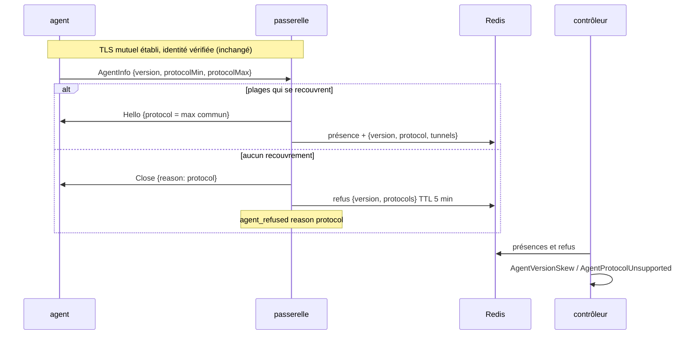
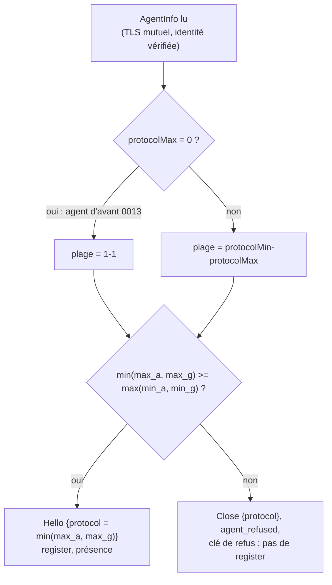
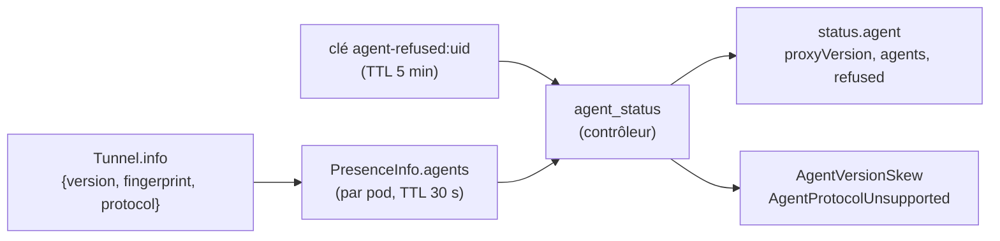
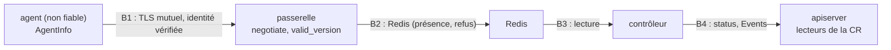

# RFC 0013 — Versions des agents : les voir, les comparer, refuser un protocole inconnu

| Field       | Value                                                                  |
| ----------- | ---------------------------------------------------------------------- |
| Status      | Implemented (2026-10-25 → 2026-10-27, PR #304) : phases 1 à 3, livraison en 0.4.1 ; écarts au §17 |
| Short       | Versions et protocole des agents                                       |
| Settles     | Savoir quelle version d'agent sert chaque cluster, et ce qui se passe quand elle ne parle plus le protocole du proxy |
| Author      | Max Batleforc <maxleriche.60@gmail.com>                                |
| Co-author   | Claude Opus 5.5 (1M context)                                           |
| Created     | 2026-10-25                                                             |
| Supersedes  | —                                                                      |
| Touches     | `libs/agent/proto/` (`AgentInfo`, `PROTOCOL_*`), `apps/agent/` (négociation, raison `protocol`, `build_info`, annonce surchargée sous la feature `it-announce`), `libs/server/api/src/agent/{listener,registry,presence}.rs` (négociation, validation de l'annonce, trace du refus), `libs/server/api/src/metrics.rs`, `libs/server/common/src/agent_gateway.rs` (`PresenceInfo`, clé de refus), `libs/server/crd/src/{lib.rs,status/mod.rs}` (`status.agent`, colonnes), `libs/server/controller/` (`AgentVersionSkew`, `AgentProtocolUnsupported`), CRD générée, `.it/up.sh`, `.it/images.lock`, `tests/integration/`, `docs/content/docs/` |
| Risk        | medium                                                                 |

> Document de référence (environ 6 000 mots) : §1 à §4 suffisent pour en
> discuter ; §5 à §16 servent à l'implémenter et à le relire.

---

## 1. Summary

Un agent annonce déjà sa version en ouvrant son tunnel (`AgentInfo.version`,
`apps/agent/src/lib.rs:800`), et le contrôleur la recopie dans
`status.agent.versions`. Mais personne ne la compare à celle du proxy, et le
numéro de protocole n'existe que dans un sens : la passerelle l'envoie dans
`Hello`, et seul l'agent le vérifie (`lib.rs:807`). Un agent qui ne le
reconnaît pas ferme le tunnel sans un mot, sous la raison générique `closed`,
puis recommence. Côté proxy, on ne voit qu'un `AgentNoTunnel`.

Cette RFC fait négocier le protocole, à l'intérieur du TLS mutuel, entre deux
plages annoncées par les deux bouts. Un protocole sans recouvrement est refusé
par la passerelle, qui le dit à l'agent, l'écrit dans l'audit et le laisse au
contrôleur pour qu'il apparaisse dans le statut. Elle ajoute aussi une
politique d'écart de versions, signalée par un avis (jamais un blocage), un
décompte des tunnels par version et deux colonnes `-o wide`. Enfin, elle
valide les chaînes que l'agent annonce, qui atteignent aujourd'hui le statut
de la CR sans aucune borne.

### Before / after

```text
# aujourd'hui : agent qui ne parle pas le protocole 1
$ kubectl -n team-a get proxykubeapi prod
NAME   READY   REASON          AGE
prod   False   AgentNoTunnel   3d
# (journal de l'agent : rien ; proxyauth_agent_reconnects_total{reason="closed"} monte)

# avec cette RFC
$ kubectl -n team-a get proxykubeapi prod -o wide
NAME   READY   REASON                     AGE   TUNNELS   AGENTS
prod   False   AgentProtocolUnsupported   3d    0         []
$ kubectl -n team-a get proxykubeapi prod -o jsonpath='{.status.agent.refused}'
{"reason":"protocol","version":"0.7.0","protocols":"2-3"}

# agents qui ont deux mineures de retard, protocole commun
NAME   READY   REASON       AGE   TUNNELS   AGENTS
prod   True    Reconciled   3d    2         ["0.3.0"]
# condition AgentVersionSkew=True, Event Normal :
#   agent 0.3.0 is more than one minor behind the proxy (0.5.0)
```



Le diagramme montre que la décision est prise **après** l'authentification
mutuelle et **avant** l'enregistrement du tunnel. Un tunnel refusé ne reçoit
donc jamais de flux, et seul un agent authentifié peut écrire un refus, et
seulement pour son propre cluster.

---

## 2. Motivation

1. **Un écart de protocole est invisible côté proxy.** Dans `run_tunnel`
   (`apps/agent/src/lib.rs:807-812`), un `Hello` dont le `protocol` diffère de
   `PROTOCOL_VERSION` tombe dans `_ => return Err("closed")` : pas de `Close`,
   pas de journal, raison `closed`. Le commentaire de `PROTOCOL_VERSION`
   (`libs/agent/proto/src/lib.rs:13-14`) promet pourtant un
   `Close { reason: "protocol" }`. La passerelle a déjà enregistré le tunnel
   (`listener.rs:425-441`) et écrit `agent_connected` : elle voit un tunnel qui
   s'ouvre et se ferme en boucle. Le premier `PROTOCOL_VERSION = 2` produira
   cette panne silencieuse sur chaque cluster dont l'agent n'aura pas été mis
   à jour en même temps.
2. **Les agents sont mis à jour par d'autres.** L'agent tourne dans le cluster
   distant, souvent administré par une autre équipe, avec son propre
   `helm upgrade`. Le proxy ne peut pas imposer la simultanéité. Il doit donc
   dire quel écart il tolère, et le signaler quand cet écart est dépassé.
3. **`status.agent.versions` ne dit ni combien ni par rapport à quoi.**
   `agent_status` (`libs/server/controller/src/proxy_kube_api/reconcile.rs:180-200`)
   trie et dédoublonne les versions. `["0.4.0", "0.5.0"]` ne dit pas combien
   d'agents restent en 0.4.0, ni quelle version le proxy considère comme la
   sienne.
4. **Des chaînes non bornées atteignent le statut.** `TunnelGuard::describe`
   (`libs/server/api/src/agent/registry.rs:68-80`) recopie la version et
   l'empreinte telles quelles. La seule borne est `MAX_CONTROL_BYTES`
   (64 Kio). Un agent authentifié peut ainsi écrire 64 Kio arbitraires, sauts
   de ligne compris, dans `status.agent` de sa CR et dans le record de
   présence. L'audit les filtre (`sanitize_audit_field`, `audit.rs:140`), mais
   pas le statut.

---

## 3. Goals / non-goals

**Goals**

- Un protocole incompatible est refusé explicitement, des deux côtés, avec la
  même raison `protocol`. Il est visible dans `Ready` et dans l'audit.
- Les deux bouts annoncent une **plage** de protocoles, si bien qu'une montée
  de protocole peut se faire sans casser les agents de la version précédente.
- Le statut de chaque `ProxyKubeApi` en `Agent` donne la version du proxy, et
  pour chaque couple (version, protocole) le nombre de tunnels.
- Une politique d'écart écrite : au-delà, un avis `AgentVersionSkew`.
- Les chaînes annoncées par l'agent sont validées avant d'atteindre Redis ou
  le statut.
- L'agent 0.4.0 publié reste compatible, sans changement.

**Non-goals**

- **Bloquer sur un écart de version.** Le protocole est le seul critère de
  compatibilité. Couper un cluster pour une version jugée trop vieille alors
  qu'il fonctionne serait pire que l'avis.
- **Mettre l'agent à jour depuis le proxy.** Le proxy n'écrit rien dans le
  cluster distant (RFC 0012, §3). Les mises à jour restent celles de
  l'opérateur de ce cluster.
- **Changer le protocole.** `PROTOCOL_VERSION` reste 1. Cette RFC installe le
  mécanisme dont la prochaine montée aura besoin.
- **Versionner le transport.** Le chemin `/agent/v1/connect` versionne déjà le
  WebSocket et le TLS. Ce qui passe dans le canal de contrôle relève du numéro
  de protocole.
- **Diagnostiquer tous les refus.** Seul le refus `protocol` est gardé pour le
  statut. Les autres (`epoch`, `subject`, `identity`) ont déjà leur ligne
  d'audit, et leur cause est côté proxy, donc lisible par l'opérateur du
  proxy.
- **Un label `version` sur les métriques de la passerelle.** La valeur vient
  de l'agent, et sa cardinalité serait celle qu'il choisit.

---

## 4. User-facing design

### 4.1 Configuration

Rien à configurer : la politique est fixe (décision 3), et les plages sont des
constantes de compilation.

```rust
// libs/agent/proto/src/lib.rs
pub const PROTOCOL_VERSION: u32 = 1;      // le plus haut que ce code parle
pub const PROTOCOL_MIN: u32 = 1;          // le plus bas qu'il accepte encore
```

Le statut gagne trois champs. `versions` reste, inchangé :

```yaml
status:
  agent:
    tunnels: 3
    gateways: ["proxyauthk8s-gateway-7d9…"]
    versions: ["0.4.0", "0.5.0"]          # inchangé
    caFingerprints: ["…"]
    proxyVersion: "0.5.0"                 # nouveau : la version du contrôleur qui compare
    agents:                               # nouveau : une ligne par (version, protocole)
      - { version: "0.4.0", protocol: 1, tunnels: 1 }
      - { version: "0.5.0", protocol: 1, tunnels: 2 }
    refused:                              # nouveau : seulement pendant qu'un refus vit
      reason: protocol
      version: "0.7.0"
      protocols: "2-3"
```

- Un champ **absent** n'a pas le même sens qu'un champ vide. `agents` absent
  signifie que Redis n'a pas pu être lu (comme `status.agent` aujourd'hui).
  `agents: []` signifie qu'aucun tunnel n'est ouvert. `refused` absent veut
  dire qu'aucun refus `protocol` n'a eu lieu dans les 5 dernières minutes.
- Aucun horodatage : une écriture de statut relance un reconcile
  (`status/mod.rs:32-34`). Le refus disparaît avec la clé qui le porte.
- Deux colonnes, en `-o wide` seulement (`priority: 1`) : `Tunnels`
  (`.status.agent.tunnels`) et `Agents` (`.status.agent.versions`).

### 4.2 Behaviour rules

- **Négociation.** L'agent annonce `[protocolMin, protocolMax]` et la
  passerelle a `[PROTOCOL_MIN, PROTOCOL_VERSION]`. Le protocole retenu est le
  plus haut des deux plafonds communs, `min(max_a, max_g)`, à condition qu'il
  ne soit pas inférieur à `max(min_a, min_g)`. Sinon, le tunnel est refusé.
- **Agent d'avant cette RFC.** Un agent 0.4.0 n'envoie pas les champs 3 et 4.
  prost les lit comme `0`, que la passerelle traduit par `[1, 1]` : c'est le
  seul protocole qui existait avant (décision 2). Elle répond `Hello` avec
  `protocol: 1`, que l'agent 0.4.0 accepte.
- **Passerelle d'avant cette RFC.** Une passerelle 0.4.0 ignore les champs
  inconnus et envoie `protocol: 1`. Un agent récent l'accepte, puisque
  `1 ∈ [PROTOCOL_MIN, PROTOCOL_VERSION]`.
- **Refus côté passerelle.** Il est envoyé avant `registry.register`, donc
  sans `agent_connected` ni présence. La passerelle envoie
  `Close { reason: "protocol" }` (chemin existant, `listener.rs:362-373`),
  écrit `agent_refused` reason `protocol` avec la version annoncée, et pose la
  clé de refus du cluster.
- **Refus côté agent.** Un `Hello` hors de la plage de l'agent provoque l'envoi
  de `Close { reason: "protocol" }`. Un `Close { reason: "protocol" }` reçu
  conduit au même traitement : un journal `error` qui nomme les deux plages, la
  raison `protocol` dans `proxyauth_agent_reconnects_total`, et une attente
  portée directement à `BACKOFF_MAX` (60 s), puisque recommencer à la seconde
  ne changera pas la plage.
- **Politique d'écart** (décision 3). Pour chaque version d'agent valide, il
  n'y a pas d'avis si elle a le même majeur que le proxy et un mineur égal ou
  inférieur d'une unité. Sinon, un avis `AgentVersionSkew` est émis, avec un
  message qui dit « behind » ou « newer ». Les versions de patch ne comptent
  pas. Les pré-versions (`0.5.0-rc.1`) se comparent sur leur `major.minor`.
- **Version invalide.** Si la version n'est pas un SemVer ou dépasse
  64 octets, elle est remplacée par `invalid` partout (statut, présence,
  journal). L'avis le nomme, et le tunnel est servi, parce que la version
  n'autorise rien (§7.1, T2).
- **Empreinte invalide.** Si elle n'est pas faite de 64 caractères
  hexadécimaux, elle est vidée. C'est déjà ce que vaut l'absence de CA
  (`ca_fingerprint`, `lib.rs:955`).
- **Priorité des raisons.** Sans tunnel ouvert et avec un refus `protocol`
  vivant, la raison de `Ready` est `AgentProtocolUnsupported`, qui remplace
  `AgentNoTunnel` : elle en dit la cause. Avec au moins un tunnel ouvert et un
  refus vivant (rollout à moitié fait), `Ready` est `True` et le refus
  apparaît dans le message de `AgentVersionSkew`.
- **Cas sans intérêt.** Un cluster qui n'est pas en `Agent` n'a toujours pas
  de `status.agent`, donc ni colonne remplie ni avis. Un cluster en `Agent`
  dont tous les agents sont à la version du proxy n'a aucun avis : son statut
  ne gagne que `proxyVersion` et `agents`.

### 4.3 Validation

Refusé à la poignée de main :

| Condition | Rationale |
| --- | --- |
| plages de protocole sans recouvrement | sinon l'un des deux bouts parlerait un canal de contrôle qu'il ne connaît pas ; le refus est explicite et attribué |
| `protocolMin > protocolMax` annoncés | une plage incohérente ne se négocie pas ; raison `protocol` |

Avertissements, et où l'opérateur les voit :

| Condition | Comportement | Visible dans |
| --- | --- | --- |
| version d'agent hors de la fenêtre | tunnel servi | condition `AgentVersionSkew`, Event `Normal`, `status.agent.agents` |
| version annoncée invalide | remplacée par `invalid`, tunnel servi | `AgentVersionSkew`, `status.agent.agents`, journal `warn` de la passerelle |
| empreinte invalide | vidée | `status.agent.caFingerprints` sans elle, journal `warn` |
| refus `protocol` avec des tunnels encore ouverts | trafic servi par les autres | message de `AgentVersionSkew`, `status.agent.refused` |

### 4.4 API surface

Pas de route nouvelle. Les seuls changements sont le canal de contrôle,
derrière le TLS mutuel de `GET /agent/v1/connect` (§6.1), et le schéma du
statut de la CRD (§6.4). La spec OpenAPI du serveur ne change pas.

---

## 5. Architecture

### 5.1 La négociation



Le schéma prouve qu'aucun chemin n'enregistre un tunnel sans protocole commun.
**Invariant** : parce que `negotiate` s'exécute avant `registry.register`, un
tunnel refusé ne figure ni dans le registre, ni dans la présence, ni dans un
`CONNECT`. Le proxy ne lui envoie donc jamais un octet utilisateur.

### 5.2 Du tunnel au statut



Le contrôleur reste le seul à écrire le statut (RFC 0011, décision 18). La
passerelle ne fait qu'écrire dans Redis, comme aujourd'hui. La version de
référence est celle du contrôleur (`CARGO_PKG_VERSION`, la même pour toutes
les crates du workspace grâce à `cargo set-version` dans `cog.toml`), pas
celle de la passerelle (décision 4).

---

## 6. Detailed design

### 6.1 Protocole (`libs/agent/proto/`)

- `AgentInfo` gagne `#[prost(uint32, tag = "3")] protocol_min` et
  `#[prost(uint32, tag = "4")] protocol_max`. Ce sont des tags nouveaux,
  ignorés par un pair 0.4.0. `Hello.protocol` (tag 3) devient « le protocole
  retenu ».
- `PROTOCOL_MIN: u32 = 1` à côté de `PROTOCOL_VERSION`. Le commentaire de
  `PROTOCOL_VERSION` est corrigé pour décrire la négociation.
- `pub fn negotiate(agent: (u32, u32), gateway: (u32, u32)) -> Option<u32>`
  est une fonction pure, partagée par les deux bouts. `(0, 0)` vaut `(1, 1)`.
- `pub fn valid_version(&str) -> Option<&str>` vérifie : 64 octets au plus,
  `semver::Version::parse` réussi, aucun caractère de contrôle.
  `pub fn valid_fingerprint(&str) -> bool` vérifie 64 caractères `[0-9a-f]`.

### 6.2 Agent (`apps/agent/`)

- `AgentInfo` porte `protocol_min`, `protocol_max` et la version.
- `run_tunnel` accepte `Hello` si `protocol ∈ [PROTOCOL_MIN, PROTOCOL_VERSION]`.
  Sinon, il envoie `Close { reason: "protocol" }` et renvoie `Err("protocol")`.
  `close_reason` (`lib.rs:947`) traduit `"protocol"` en `"protocol"`.
- `REASONS` gagne `"protocol"`. Un `"protocol"` règle l'attente à
  `BACKOFF_MAX`.
- `/metrics` gagne `proxyauth_agent_build_info{version,protocol_min,protocol_max} 1`.
  Ces valeurs sont celles du binaire lui-même, donc la cardinalité vaut 1.
- **Feature `it-announce`** (décision 5) : `AGENT_IT_ANNOUNCE_VERSION` et
  `AGENT_IT_ANNOUNCE_PROTOCOLS` (`min-max`) remplacent l'annonce. Elles sont
  lues seulement sous `#[cfg(feature = "it-announce")]`. Le Containerfile
  publié ne l'active pas. `.it/up.sh` construit une seconde image
  `localhost/proxyauthk8s/agent:it-announce` avec
  `--build-arg CARGO_FEATURES=it-announce`.

### 6.3 Passerelle (`libs/server/api/src/agent/`)

- `listener.rs`, `Gateway::session` : après la lecture de `AgentInfo`, la
  passerelle valide la version et l'empreinte (§6.1) puis appelle `negotiate`.
  Sur `None`, elle écrit la clé de refus, puis renvoie `Err("protocol")`, avant
  `registry.register`. Le chemin existant envoie déjà le `Close` et appelle
  `refused()`.
- `refused()` reçoit la version annoncée quand elle est connue
  (`.agent(epoch, Some(version))`, qui la filtre déjà par
  `sanitize_audit_field`).
- `registry.rs` : `Tunnel.info` devient `Option<Announced { version,
  fingerprint, protocol }>`. `identities()` remplit `PresenceInfo.agents`, une
  ligne par (version, protocole), comptée.
- `presence.rs` : inchangé, puisque le record est sérialisé tel quel.
- Clé de refus : `agent_refused_key(uid)` =
  `proxyauth:agent-refused:{uid}` dans `common::agent_gateway`, valeur JSON
  `{reason, version, protocols}`, posée par `SET … EX 300`. Elle est
  réécrite à chaque refus, si bien qu'elle vit tant que l'agent réessaie
  (au plus 60 s entre deux tentatives).
- `metrics.rs` : `proxyauth_agent_tunnel_refusals_total{reason}`. `reason`
  est l'un des `Reason` statiques de la passerelle (`&'static str`), donc un
  ensemble fermé.

### 6.4 CRD et contrôleur

- `AgentStatus` (`libs/server/crd/src/status/mod.rs:36`) gagne
  `proxy_version: Option<String>` (`proxyVersion`), `agents: Vec<AgentCount>`
  et `refused: Option<AgentRefusal>`. Tous les trois portent
  `#[serde(default, skip_serializing_if)]`.
- `PresenceInfo` (`common/src/agent_gateway.rs:68`) gagne
  `#[serde(default)] agents: Vec<AgentCount>`. Sans `default`, un contrôleur
  récent qui lit le record d'une passerelle 0.4.0 pendant un rolling upgrade
  échouerait à le désérialiser, retomberait sur `unwrap_or_default()`
  (`agent_gateway.rs:97`) et afficherait 0 tunnel.
- `printcolumn` (`libs/server/crd/src/lib.rs:47-49`) gagne `Tunnels` et
  `Agents`, en `priority: 1`.
- `reason.rs` gagne `AgentVersionSkew` (avis) et `AgentProtocolUnsupported`
  (bloquant). Le test du catalogue passe de 14 à 16 codes.
- `agent_status` (`reconcile.rs:180`) agrège `agents`, lit la clé de refus,
  pose `proxyVersion`, et renvoie de quoi pousser les deux codes dans
  `evaluation` à côté de `AgentLimitCapped` (`reconcile.rs:140-154`).
- `skew(proxy: &semver::Version, agent: &str) -> Option<String>` est une
  fonction pure, testée seule.

### 6.P Proof against a real client

Suite d'intégration de la RFC 0009 (`tests/integration/tests/rfc0013.rs`),
sur le banc de la RFC 0012 : même cluster k3d, namespace `it-remote`, agent
par `deploy/chart-agent`, kubectl épinglé (`mise.toml`). Trois agents
servent de clients réels :

- l'image de la branche (`agent:it`) ;
- **l'agent 0.4.0 publié**,
  `ghcr.io/batleforc/proxyauthk8s/agent:v0.4.0@sha256:cbb881b2201b06f1d752d8f32f0112a0d0474cfbb100b85bfe8242e39708eca4`,
  épinglé dans `.it/images.lock` (digest relevé le 2026-10-25 par
  `HEAD /v2/…/manifests/v0.4.0`) ;
- `agent:it-announce` pour les annonces surchargées.

La version du proxy est celle de la branche, notée `P` (`major.minor` lus
dans `Cargo.toml`).

1. `agent:it`, 2 replicas — `kubectl get pods` réussit ;
   `status.agent.proxyVersion == P` ; `agents == [{version: P, protocol: 1,
   tunnels: 2}]` ; aucune condition `AgentVersionSkew` ;
   `kubectl get proxykubeapi -o wide` affiche les colonnes `TUNNELS` à `2`
   et `AGENTS`.
2. **Agent 0.4.0 publié** contre la passerelle de la branche — le tunnel
   s'ouvre (`agent_connected`, version `0.4.0`), `kubectl get pods` réussit,
   et `agents` contient `{version: "0.4.0", protocol: 1}`. C'est la preuve
   qu'un agent qui n'envoie pas les tags 3 et 4 est traité en `1-1`. Avec
   `P = 0.4` (livraison en 0.4.1, décision 10), aucun avis, puisque le patch
   ne compte pas.
3. `agent:it-announce`, `AGENT_IT_ANNOUNCE_VERSION=0.1.0` — le trafic passe ;
   la condition `AgentVersionSkew` vaut `True` ; un Event `Normal`
   `AgentVersionSkew` dont le message contient `0.1.0` et `behind`.
4. `agent:it-announce`, version `99.0.0` — même chose avec `newer`.
5. **Refus** : `agent:it-announce`, `AGENT_IT_ANNOUNCE_PROTOCOLS=2-3`, seul
   agent du cluster —
   - `kubectl get pods` reçoit `503` `agent unavailable` ;
   - `Ready=False` raison `AgentProtocolUnsupported` ;
   - `status.agent.refused == {reason: protocol, protocols: "2-3", …}` ;
   - une ligne `agent_refused` reason `protocol` porte la version ;
   - **aucune** ligne `agent_connected` pour cette identité, ce qui prouve
     que le tunnel n'a jamais été enregistré ;
   - sur l'agent, `proxyauth_agent_reconnects_total{reason="protocol"} >= 1`
     et un journal `error` qui nomme `2-3` et `1-1`.
   Une fois l'agent remis en `agent:it`, `Ready` revient à `True` et
   `refused` disparaît en moins de 7 min (les 5 min de la clé, puis un requeue
   d'au plus 60 s).
6. **Refus** : `agent:it-announce`, version `0.5.0\n{"forged":1}` — le tunnel
   sert ; `agents[].version == "invalid"` ; la ligne `agent_connected` reste
   une seule ligne JSON, sans la clé `forged`.
7. **Refus** : l'image publiable `agent:it` avec
   `AGENT_IT_ANNOUNCE_VERSION=0.1.0` dans son `env` — elle annonce quand même
   `P` (`agents[].version == P`, pas d'avis). C'est la preuve que la
   surcharge n'existe pas hors de la feature.

**Deliberately untouched**, so reviewers do not go looking:

- `libs/server/api/src/agent/enroll.rs` — l'enrôlement ne parle pas le canal
  de contrôle. Un agent au mauvais protocole s'enrôle, puis se fait refuser
  son tunnel, et c'est voulu : son identité reste valable après sa mise à
  jour.
- `libs/server/api/src/agent/connect.rs` — le `CONNECT` du back vers la
  passerelle est interne, et ses deux bouts sont déployés par le même chart.
- `ws_io.rs`, `mux.rs` — le transport ne change pas (non-goal).
- `audit.rs` — `agent()` porte déjà la version et la filtre.

---

## 7. Security

**Rating:** medium — l'agent est un pair authentifié mais non fiable, et ses
annonces atteignent le statut de la CR, Redis et l'audit. La négociation a
lieu dans le canal authentifié et n'autorise rien.

### 7.1 Threat model

Actifs : la disponibilité des clusters en `Agent`, l'intégrité du statut des
CR et du record de présence, l'audit. Acteur nouveau : aucun. C'est l'agent
authentifié de la RFC 0012, dont l'annonce passe de « informative » à
« validée puis informative ».



| # | Threat (STRIDE) | Where | Mitigation | Residual risk |
| --- | --- | --- | --- | --- |
| T1 | Tampering : un agent écrit 64 Kio arbitraires (sauts de ligne, JSON) dans `status.agent` et le record de présence (constaté le 2026-10-25, `registry.rs:78`) | B1→B4 | `valid_version` et `valid_fingerprint` (§6.1) dans `Gateway::session`, avant `describe` ; `invalid` ou vide sinon | aucun pour la forme ; la valeur reste un mensonge possible (T2) |
| T2 | Spoofing : un agent annonce une fausse version, pour cacher son âge ou déclencher un avis | B1 | rien n'est décidé sur la version : seul le protocole est négocié, et un agent qui ment sur sa plage se refuse ensuite lui-même un canal qu'il ne parle pas | un avis faux ou absent ; accepté (mainteneur, décision 3) : la version est un renseignement, comme aujourd'hui |
| T3 | Tampering / downgrade : un tiers force un protocole plus bas | B1 | la négociation passe dans le TLS mutuel (mode `inner` : TLS interne ; `passthrough` : TLS de la passerelle) : il faut la clé de l'agent ; `PROTOCOL_MIN` retire un protocole jugé faible | celui qui a la clé de l'agent est l'agent (RFC 0012, T12) |
| T4 | Denial of service : un agent authentifié boucle sur des refus pour faire écrire Redis | B2 | la clé de refus n'est écrite qu'après l'identité vérifiée et `still_valid`, une par cluster, écrasée, TTL 5 min ; chaque essai coûte d'abord une poignée de main TLS à l'agent ; `limits.enrollPerMinute` ne s'applique pas ici, mais une poignée de main TLS coûte plus qu'un `SET` | un `SET` par poignée de main ; accepté (mainteneur) |
| T5 | Tampering : un agent écrit un refus pour un autre cluster | B2 | la clé est indexée par `identity.uid`, tiré du certificat vérifié et non de l'annonce | aucun |
| T6 | Information disclosure : la version des agents, visible de quiconque lit la CR, désigne un agent vulnérable | B4 | lire la CR exige déjà le RBAC qui montre `spec` (URL, CA) ; la version y est moins sensible ; aucune exposition nouvelle vers les utilisateurs du proxy | accepté (mainteneur) |
| T7 | Repudiation : un refus de protocole sans trace | B1 | `agent_refused` reason `protocol`, version filtrée, identité, IP cliente | aucun |
| T8 | Elevation : la surcharge `it-announce` livrée dans une image publiée | build | `#[cfg(feature = "it-announce")]` ; le Containerfile publié n'a pas la feature ; §6.P point 7 | une image construite à la main avec la feature ment sur sa version : c'est T2 |

### 7.2 Authentication and authorisation

- Pas de surface nouvelle : tout se passe après le TLS mutuel et `identify`
  (`listener.rs:217`, appelée à la ligne 327), inchangés. Un pair non authentifié n'atteint pas
  `AgentInfo`.
- Un contrôle contourné ne donne rien : la version n'autorise rien, et le
  protocole retenu ne fait que choisir un canal que l'agent doit ensuite
  parler lui-même.
- Côté statut, le contrôleur reste le seul à écrire, et la passerelle n'écrit
  que dans Redis.

### 7.3 Input handling and injection

- Version : 64 octets au plus, SemVer, aucun caractère de contrôle. Sinon
  `invalid`. Elle n'atteint jamais un nom de clé Redis ni un label de
  métrique.
- Empreinte : exactement 64 caractères `[0-9a-f]`, sinon vidée.
- Plages : deux `u32`. `min > max` ou un recouvrement vide donnent la raison
  `protocol`. `negotiate` est pure et ne peut ni paniquer ni déborder
  (comparaisons uniquement).
- Le décodage protobuf reste borné par `MAX_CONTROL_BYTES`. La cible
  `fuzz/fuzz_targets/fuzz_agent_control.rs` décode déjà des messages
  arbitraires, tags nouveaux compris, et `negotiate` reçoit un test de table
  exhaustif sur `0..=4` (§14).

### 7.4 Secrets and cryptography

Pas de secret nouveau ni de primitive nouvelle. L'empreinte reste le SHA-256
déjà calculé par l'agent. Elle est seulement validée.

### 7.5 Abuse and resource exhaustion

- Clé de refus : une par cluster, de taille bornée (version de 64 octets au
  plus, deux entiers), TTL 300 s.
- `PresenceInfo.agents` : une ligne par couple (version, protocole) distinct.
  Le nombre de lignes ne peut pas dépasser le nombre de tunnels de
  l'identité, que `tunnels_per_identity` borne déjà.
- Agent : l'attente à 60 s sur `protocol` évite une tempête de reconnexions
  vers la passerelle de la part d'un parc d'agents tous à la mauvaise
  version.

### 7.6 Existing defences that still hold

- L'identité vient du certificat et de la CR, jamais de l'annonce (RFC 0012,
  T3, T8).
- `MAX_CONTROL_BYTES`, `handshake_timeout`, `tunnels_per_identity`.
- `sanitize_audit_field` sur toutes les valeurs d'audit.
- L'adresse d'un pod de passerelle vient de l'EndpointSlice, jamais de Redis
  (RFC 0012, T19). Le record de présence agrandi n'y change rien.

---

## 8. Supply chain

| Dependency / image / tool | Version | Why this one | Licence | Known CVEs (`task audit`) | Maintenance |
| --- | --- | --- | --- | --- | --- |
| `semver` (crate, dépendance directe nouvelle de `agent_proto` et du contrôleur) | 1.0.28, déjà dans `Cargo.lock` par `kube-cel` | parser SemVer à la main pour comparer `major.minor` et refuser le reste, c'est réécrire la grammaire des pré-versions | MIT OR Apache-2.0 | aucune (`cargo deny check advisories` vert le 2026-10-25) | dtolnay, publié régulièrement, zéro dépendance |
| image `ghcr.io/batleforc/proxyauthk8s/agent:v0.4.0` (banc seul) | digest `sha256:cbb881b2…eca4` | le client réel d'avant cette RFC, pour la preuve de compatibilité | celle du projet | scannée à sa publication (trivy du workflow de release) ; jamais livrée | la nôtre |

- **Build and release** : le Containerfile de l'agent gagne
  `ARG CARGO_FEATURES=""`, passé à `cargo build --features`. L'image publiée
  est construite avec la valeur vide, donc identique à aujourd'hui. Pas de
  changement de CI, de permissions, de SBOM ni de signature.
- **Updates** : `semver` suit `cargo update` et Dependabot comme le reste.
  L'image 0.4.0 du banc reste figée à dessein, puisque c'est la version
  « d'avant » de la preuve. La prochaine montée de protocole ajoutera
  l'image de la version précédente.

---

## 9. Data and privacy

| Data | Personal? | Where stored | Retention | Who can read it | Leaves the instance? |
| --- | --- | --- | --- | --- | --- |
| `status.agent.proxyVersion`, `agents[]` (version, protocole, nombre de tunnels) | non | CRD | durée de l'objet | qui lit le `ProxyKubeApi` | non |
| `status.agent.refused` (raison, version, plage) | non | CRD | tant que la clé de refus vit | qui lit le `ProxyKubeApi` | non |
| clé `agent-refused:{uid}` | non | Redis | 300 s | le proxy, le contrôleur | non |
| `PresenceInfo.agents` | non | Redis | 30 s (TTL de présence) | le proxy, le contrôleur | non |
| `proxyauth_agent_build_info`, `tunnel_refusals_total{reason}` | non (pas de cluster, pas d'IP) | Prometheus | celle de Prometheus | qui lit les métriques | selon la collecte de l'opérateur |
| `agent_refused` reason `protocol` | l'IP cliente, déjà présente dans toute ligne `agent_*` | audit | celle de l'audit (RFC 0008) | l'opérateur | selon la collecte |

Pas de donnée personnelle nouvelle. L'IP cliente des lignes d'audit est celle
que la RFC 0012 déclare déjà. Une version de logiciel ne désigne personne.

---

## 10. Operability

### 10.1 Observability

- **Metrics** : passerelle,
  `proxyauth_agent_tunnel_refusals_total{reason}` (raisons statiques). Agent,
  `proxyauth_agent_reconnects_total{reason="protocol"}` (nouvelle valeur du
  label existant) et `proxyauth_agent_build_info{version,protocol_min,protocol_max}`.
  Pas de label `version` côté passerelle (non-goal).
- **Logs and audit trail** : `agent_refused` reason `protocol` avec la
  version. Passerelle, `warn` sur une version ou une empreinte invalide.
  Agent, `error` sur un refus de protocole, avec les deux plages.
- **Alerts** : aucune livrée, parce que le chart n'en livre aucune (seulement
  un `ServiceMonitor`). La doc donne l'exemple
  `increase(proxyauth_agent_tunnel_refusals_total{reason="protocol"}[15m]) > 0`
  et rappelle que `Ready=False` déclenche déjà les health checks d'Argo CD et
  de Flux.

### 10.2 Failure modes

| Failure | Detected by | Behaviour (fail open / closed) | Recovery |
| --- | --- | --- | --- |
| aucun protocole commun | passerelle ou agent | **fermé** : pas de tunnel, `503 agent unavailable` ; un protocole inconnu ne se devine pas | mettre à jour le bout en retard |
| écriture de la clé de refus impossible (Redis) | `warn` passerelle | le refus a lieu quand même (fermé) ; seule la cause manque au statut, qui reste `AgentNoTunnel` | au retour de Redis, au refus suivant (60 s au plus) |
| Redis illisible pour le contrôleur | `agent_status` renvoie `None` (inchangé) | pas d'avis d'écart (ouvert, mais sur un renseignement seulement) | au reconcile suivant |
| version annoncée invalide | `valid_version` | **ouvert** : tunnel servi, `invalid` affiché ; la version n'autorise rien (T2), et couper un cluster pour une chaîne mal formée punirait la disponibilité sans rien protéger | corriger l'agent |
| rolling upgrade : passerelle 0.4.0 et contrôleur récent | `#[serde(default)]` de `PresenceInfo.agents` | `agents` vide pour ce pod, `tunnels` exact | à la fin du rollout |

### 10.3 Performance and capacity

- Poignée de main : une lecture de deux `u32` et une comparaison. Ce n'est pas
  mesurable face au TLS.
- Redis : le record de présence grossit d'environ 50 octets par couple
  (version, protocole), et un rollout en compte deux. La clé de refus pèse
  moins de 200 octets, une par cluster refusé, avec au plus un `SET` par
  tentative, soit une par minute et par replica d'agent en régime de refus.
- Statut : environ 100 octets par couple. Il ne s'écrit que lorsque
  l'ensemble change, puisque les valeurs sont triées comme aujourd'hui.

---

## 11. Other concerns

- **Accessibility** : pas d'UI. Le front n'affiche pas `status.agent`.
- **Internationalisation** : les messages d'avis sont en anglais, comme les
  autres messages de condition du contrôleur. La doc est en français.
- **Compliance** : rien de touché. On note seulement que l'inventaire des
  versions déployées, côté agents, devient lisible.
- **Licensing** : `semver` est MIT OR Apache-2.0, deux licences que
  `deny.toml` admet déjà.
- **Documentation** :
  - `agent.mdx` gagne une section « Versions et compatibilité » (politique,
    négociation, `-o wide`, alerte d'exemple) ;
  - `status-and-events.mdx` reçoit les deux codes ;
  - la référence CRD est régénérée (`task docs:crds`) ;
  - le guide de migration n'a rien à ajouter, puisque le changement n'est pas
    cassant.

---

## 12. Alternatives considered

| Alternative | Why rejected |
| --- | --- |
| Ne rien faire, lire `agent_connected` dans l'audit (la version y est déjà) | il faut chercher dans l'audit par cluster ; le refus de protocole reste invisible, puisque c'est l'agent qui coupe sans le dire (§2.1) |
| Égalité stricte de version, refus sinon | chaque `helm upgrade` du proxy coupe tous les clusters dont l'agent n'a pas été mis à jour à la même minute, par une autre équipe |
| Un chemin par protocole (`/agent/v2/connect`) | une règle d'Ingress par version, côté chart et côté opérateur ; aucun statut de plus ; le chemin reste pour une rupture du transport |
| Négocier dans les en-têtes HTTP du WebSocket | en mode `inner`, ces en-têtes passent l'Ingress hors du TLS mutuel : un tiers sur le chemin pourrait les réécrire (downgrade, T3) |
| La passerelle écrit le statut de la CR | deux écrivains du statut, contre la RFC 0011 (décision 18), et des droits `patch` sur les CR pour la passerelle |
| Un label `version` sur `proxyauth_agent_tunnels` | cardinalité choisie par les agents ; le décompte est dans `status.agent.agents` |
| Surcharger l'annonce par une variable d'environnement dans toutes les images | un réglage de production qui fait mentir l'agent ; la feature `it-announce` ne coûte qu'une construction de plus sur le banc |
| Recopier la version du binaire de l'agent dans une ConfigMap du cluster distant | le proxy ne lit pas le cluster distant (RFC 0012, §3) |

---

## 13. Rollout and compatibility

- **Default behaviour** : rien à activer. Les clusters qui ne sont pas en
  `Agent` ne voient aucun changement.
- **Migration** : la CRD gagne des champs optionnels de `status` et deux
  colonnes. Comme toujours, `chart-crd` est appliqué avant le chart.
  L'opération est réversible, puisqu'une version antérieure ignore les champs
  inconnus.
- **Compatibilité du fil** :

  | Agent \ Passerelle | 0.4.0 | cette RFC |
  | --- | --- | --- |
  | 0.4.0 | protocole 1 | `0-0` lu `1-1`, protocole 1 (§6.P point 2) |
  | cette RFC | `Hello` 1, accepté | négocié |

- **Operator prerequisites** : aucun.
- **Rollback** : la passerelle d'avant ignore les tags 3 et 4, et le
  contrôleur d'avant laisse `proxyVersion`, `agents` et `refused` figés dans
  le statut jusqu'à la prochaine écriture (SSA, comme pour la RFC 0011,
  §13). Aucun risque de §7 rouvert, sauf T1, que le retour arrière rouvre
  par définition.
- **Ordre** : cette RFC sort en **0.4.1** (décision 10), avant la RFC 0010
  et avant toute version qui change `PROTOCOL_VERSION`. Le tag est forcé par
  `cog bump --patch`, ses commits `feat` n'étant pas cassants (décision 11).
  La première montée de protocole garde `PROTOCOL_MIN` à l'ancienne valeur
  pendant au moins une version mineure (décision 12).

---

## 14. Test plan

- **Unit** :
  - `agent_proto` : `negotiate`, avec une table exhaustive des plages
    `0..=4 × 0..=4` des deux côtés, `(0, 0)` lu `(1, 1)` et `min > max`
    refusé ; `valid_version`, avec SemVer, pré-versions, 64 et 65 octets, `\n`
    et `\0` ; `valid_fingerprint` ;
  - les tags 3 et 4 font l'aller-retour, et un `AgentInfo` encodé sans eux se
    décode en `0` ;
  - contrôleur : `skew`, avec même mineure, une de retard, deux de retard,
    plus récent, majeur différent, pré-version et `invalid` ;
  - `reason.rs` : catalogue de 16 codes, `AgentVersionSkew` en avis.
- **Integration** (envtest, `libs/server/api/tests/`) : `agent_tunnel`
  - deux agents de plages `1-1` et `2-3` : le second reçoit `Close`
    `protocol`, la clé de refus existe et le registre ne compte qu'un tunnel ;
  - un record `PresenceInfo` sans `agents` (format 0.4.0) se lit avec le bon
    `tunnels`.
- **Proof** : §6.P, `tests/integration/tests/rfc0013.rs`, points 1 à 7.
- **Security** :

  | Menace | Test | Ce qu'il tente, et ce qui le refuse |
  | --- | --- | --- |
  | T1 | §6.P point 6, et `valid_version` unitaire | la tentative est refusée |
  | T2 | — | accepté, rien à refuser ; `skew` prouve que la version ne change que l'avis |
  | T3 | `negotiate` unitaire | une plage disjointe est refusée ; la négociation n'existe que dans le canal authentifié, déjà prouvé par la RFC 0012 (p12) |
  | T4, T5 | envtest | la clé est indexée par l'UID du certificat ; un refus pour A n'écrit pas la clé de B |
  | T7 | §6.P point 5 | la ligne `agent_refused` est présente |
  | T8 | §6.P point 7 | la surcharge est absente de l'image publiable |

  - Fuzz : `fuzz_agent_control` appelle aussi `valid_version` et
    `valid_fingerprint` sur ce qu'il décode ; une cible `negotiate` est inutile, puisque la
    table est exhaustive.
- **Audit** : `task audit` vert (aucune crate nouvelle dans `Cargo.lock`).
- **Existing suites** : `rfc0012` complète, qui doit rester verte sans
  changement (même protocole 1, statut seulement agrandi) ; `cargo test` et
  envtest.

---

## 15. Decisions and open questions

### Resolved

| # | Question | Decision |
| --- | --- | --- |
| 1 | Où vit la compatibilité dure : version ou protocole ? | **Le protocole seul.** La version est annoncée par un pair non fiable et change à chaque patch ; le protocole décrit ce que le canal transporte. |
| 2 | Que vaut l'absence des tags 3 et 4 ? | **`1-1`.** C'est le seul protocole qui a existé avant cette RFC ; c'est ce qui rend l'agent 0.4.0 publié compatible sans le toucher. |
| 3 | Quelle politique d'écart ? | **Même majeur, mineur égal ou inférieur d'une unité, jamais plus récent ; au-delà, un avis, jamais un blocage.** C'est la règle kubelet / apiserver ramenée à un pas, que l'on pourra élargir après la 1.0 (décision 14). |
| 4 | Version de référence : contrôleur ou passerelle ? | **Le contrôleur**, qui écrit le statut. Le chart déploie le même `appVersion` partout ; pendant un rollout, un avis passager est acceptable. |
| 5 | Comment le banc fait-il annoncer une autre version ? | **La feature `it-announce`**, qui donne une seconde image sur le banc. Une variable lue par toutes les images serait un réglage de production pour mentir (T8). |
| 6 | Garder `status.agent.versions` ? | **Oui, inchangé.** Des `jsonpath` et la doc l'utilisent ; `agents` en est le détail. |
| 7 | Quels refus remontent au statut ? | **Le refus `protocol` seul.** Les autres (`epoch`, `subject`, `identity`) ont leur cause côté proxy et restent dans l'audit ; un `refused` générique exposerait des raisons de sécurité dans la CR. |
| 8 | Colonnes par défaut ou en `-o wide` ? | **`-o wide` (`priority: 1`).** Elles sont vides pour tout cluster qui n'est pas en `Agent`. |
| 9 | Attente de l'agent après un refus `protocol` ? | **`BACKOFF_MAX` (60 s) d'emblée.** Réessayer ne change pas la plage. |
| 10 | Livraison en 0.4.1 ou en 0.5.0 ? (question ouverte n°2) | **0.4.1, avant la RFC 0010.** T1 est un défaut de la 0.4.0, et le mécanisme doit précéder toute montée de protocole. |
| 11 | Numéro de version, alors que les commits sont des `feat` ? | **`cog bump --patch` forcé.** Champs optionnels, protocole 1 inchangé : rien n'est cassant, et la 0.5.0 reste à la RFC 0010. |
| 12 | Combien de temps garder un ancien protocole ? | **Au moins une mineure** après la montée, comme la fenêtre de la décision 3. |
| 13 | Un avis à part pour un refus `protocol` quand d'autres tunnels sont ouverts ? (question ouverte n°3) | **Non** : le refus va dans le message de `AgentVersionSkew`, pour garder un seul avis sur les versions et un seul code bloquant. |
| 14 | Fenêtre d'écart après la 1.0 ? (question ouverte n°1) | **Reportée** au guide de migration de la 1.0. |
| 15 | Durée de vie de la clé de refus ? | **5 min, réécrite à chaque refus.** Visible tant que l'agent insiste (au plus 60 s entre deux essais), disparue 5 min après le dernier. |
| 16 | Une PR ou trois ? | **Une seule, en trois commits verts** (§16) : les preuves arrivent avec le code. |

T2, T4 et T6 : risques résiduels acceptés par le mainteneur au grill du
2026-10-25.

### Still open

Aucune.

---

## 16. Implementation phases

Une seule PR, avec trois commits qui laissent chacun l'arbre vert :

| Phase | Content |
| --- | --- |
| 1 | `agent_proto` (`negotiate`, `valid_*`, tags 3 et 4), la passerelle (validation, refus avant `register`, clé de refus, métrique) et l'agent (`Close` `protocol`, attente, `build_info`, feature `it-announce`). T1 est fermé ici, et le contrôle de sécurité arrive avec la surface qu'il protège. Utile seule : le refus est explicite des deux côtés. |
| 2 | CRD (`proxyVersion`, `agents`, `refused`, colonnes), `PresenceInfo.agents`, contrôleur (`skew`, les deux codes), CRD et doc régénérées. |
| 3 | Banc : image `it-announce`, agent 0.4.0 épinglé, `rfc0013.rs` points 1 à 7, lignes de `MATRIX.md`, 0013 retirée de `PENDING`. |

---

## 17. Implementation notes

### État (2026-10-27)

| Phase | État | Où |
| --- | --- | --- |
| 1 | **faite** (`db58692`) : `agent_proto` 15/15, `agent` 13/13 avec et sans `it-announce`, `agent_tunnel` 36/36 sous nextest (dont `a_protocol_range_without_overlap_is_refused_before_register` et `an_invalid_announce_is_served_but_never_recorded_as_sent`) | PR #304 |
| 2 | **faite** (`6df5c43`, `eb9b0f7`) : `controller`, `api`, `crd`, `common`, `agent_proto`, `agent` : 642/642 sous nextest avec `REQUIRE_TEST_REDIS=1` ; CRD et doc régénérés | PR #304 |
| 3 | **faite** (`6df5c43`, `fad156a`, `4bfef44`, `5c5c72d`) : `rfc0013.rs` points 1 à 7 verts sur le banc, `agent:it-announce` dans `.it/up.sh`, `agent-v0.4.0` dans `.it/images.lock`, `MATRIX.md` en `suite`, 0013 hors de `PENDING` | PR #304 |

La CI de la PR #304 est verte au commit `eb9b0f7` : suite du workspace,
envtest, banc d'intégration, clippy, `cargo deny`, Trivy et CodeQL.

La suite locale a été arrêtée deux fois par le disque, pas par le code :
btrfs plein (93 %, 1 Mio non alloué), puis une récupération de blocs en
tâche de fond après la suppression de `dist/target/debug/incremental`. Sur ce
poste, vérifier `cat /proc/pressure/io` (`some avg10` sous environ 10) avant
une grosse compilation, et lancer les tests de `api` sous **nextest** : sous
`cargo test`, `the_enroll_route_is_rate_limited_before_any_write` et
`enrollment_and_tunnels_write_audit_events` partagent leurs lignes d'audit
dans un même processus et échouent.

Ce que contient la phase 2 :

- `crd::status` : `AgentStatus.{proxy_version, agents, refused}`,
  `AgentCount`, `AgentRefusal`, déplacé de `common` et réexporté par
  `common::agent_gateway` ;
- `PresenceInfo.agents` avec `#[serde(default)]`, et `count_agent` dans
  `common::agent_gateway`, partagé par la passerelle et le contrôleur ;
- `registry.rs` : `describe(version, fingerprint, protocol)`, et
  `identities()` compte par (version, protocole) ;
- colonnes `Tunnels` et `Agents` en `priority: 1` ;
- `reason.rs` : `AgentVersionSkew` (avis) et `AgentProtocolUnsupported`
  (bloquant), 16 codes ;
- `reconcile.rs` : `agent_versions`, `skew`, et `agent_status` qui pose
  `proxyVersion` et lit la clé de refus ; `semver` dans le contrôleur ;
- `controller/tests/reconcile.rs` : refus vers `AgentProtocolUnsupported`,
  record d'une passerelle 0.4.0 sans `agents`, comptage ;
- doc : section « Versions et compatibilité » dans `agent.mdx`, les deux
  codes dans `status-and-events.mdx`.

### Écarts

- `ProxyKubeApiStatus::fields` envoie à `null` les clés de `status.agent`
  qu'`AgentStatus` omet : sous le merge patch du kit, une clé omise restait,
  et `refused` ne disparaissait jamais (vu par §6.P point 5). Les listes de
  la RFC 0012 (`gateways`, `versions`, `caFingerprints`) avaient le même
  défaut une fois vidées.

- `Close` gagne `protocol_min` et `protocol_max` (tags 2 et 3), la plage de
  l'émetteur : sans eux, l'agent refusé ne pouvait pas nommer celle de la
  passerelle dans son journal (§6.P point 5). Une passerelle 0.4.0 envoie
  `0-0`.

- `refused()` de la passerelle délègue à `refused_announcing()`, qui porte
  la version annoncée : le refus `protocol` arrive après la lecture de
  `AgentInfo`.
- `AgentRefusal` vit dans `crd::status` et non dans `common` : c'est la
  forme que le statut affiche, et `common` dépend déjà de `crd`.
