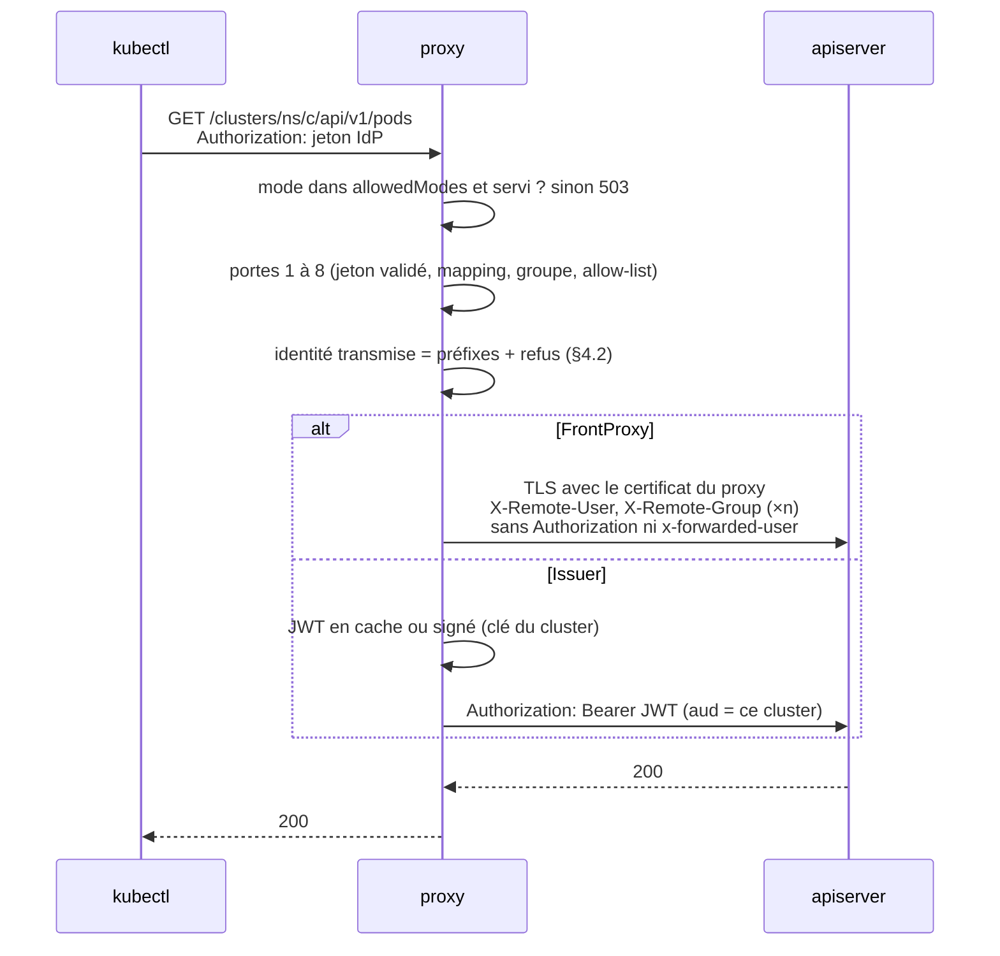
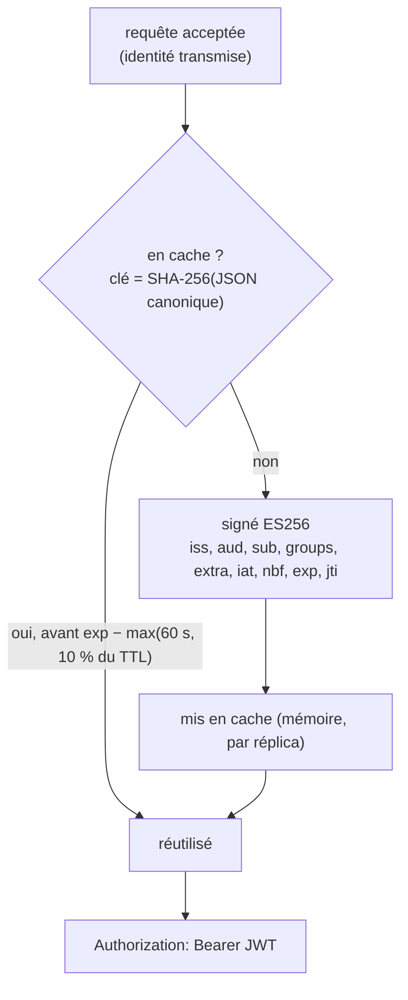
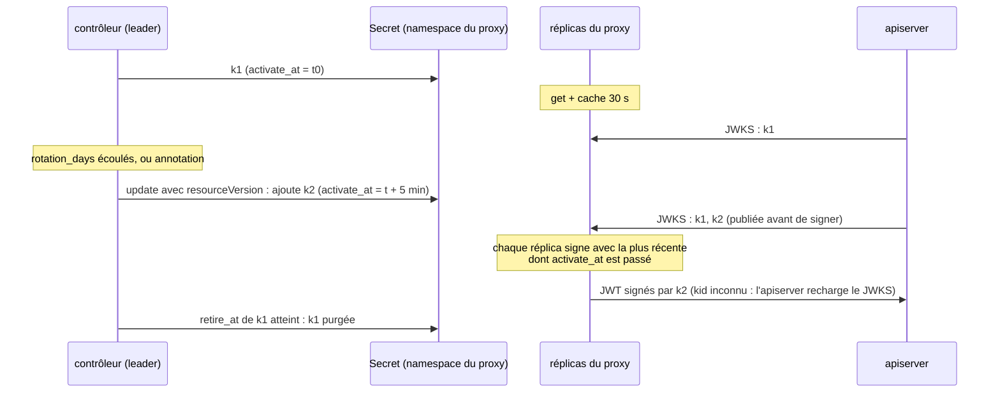
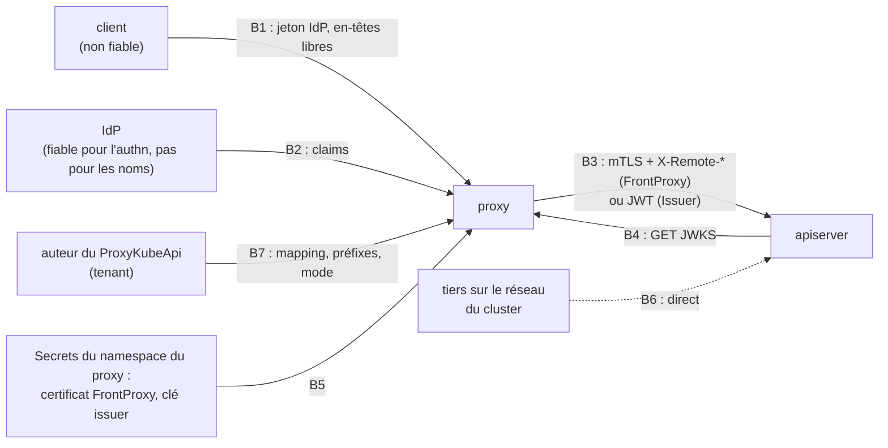

# RFC 0014 — Le proxy comme authentificateur de confiance

| Field       | Value                                                                  |
| ----------- | ---------------------------------------------------------------------- |
| Status      | In review                                                              |
| Short       | Authentificateur de confiance (front-proxy, émetteur)                  |
| Settles     | Ne plus déclarer l'IdP de chaque utilisateur dans chaque apiserver     |
| Author      | Max Batleforc <maxleriche.60@gmail.com>                                |
| Co-author   | Claude Opus 5.5 (1M context)                                           |
| Created     | 2026-10-27                                                             |
| Supersedes  | RFC 0010 §3, deux non-goals (« le proxy comme émetteur », « `X-Remote-*` ») ; amende RFC 0010 §4.1, §4.3, §4.4, §6.1, §6.3, §6.4 et §13 (emplacement de la config, `mode: TokenExchange` au lieu d'`enabled`, `UpstreamCredential::Bearer` ; décision 55) |
| Touches     | `libs/server/crd/src/{lib.rs,upstream_auth/ (nouveau),authentication_configuration/oidc_provider.rs,status/}`, `libs/server/api/src/model/{user.rs,user_claim.rs}`, `libs/server/api/src/cluster/redirect/{forwarded.rs,audit.rs,kube_redirect.rs,upstream_identity.rs (nouveau)}`, `…/kube_redirect/{context.rs,upstream.rs,standard.rs,upgrade/connect.rs,upgrade.rs,virtual_redirect/,list_fallback/}`, `libs/server/api/src/issuer/` (nouveau), `libs/server/api/src/metrics.rs`, le routeur qui monte `/issuer/*`, `libs/server/api/Cargo.toml` (`secrecy` en dépendance normale), `libs/server/api/tests/upstream_auth.rs` (nouveau), `libs/server/common/src/{config.rs,upstream_cache.rs,oidc_cache.rs,upstream_trust.rs}`, `libs/server/controller/{Cargo.toml,src/proxy_kube_api/}`, `libs/server/jwt_validator/` (`map_user` public, paramètre `trusted`), `deploy/chart/` (valeurs, `values.schema.json`), `fuzz/`, CRD générée, `.it/`, `tests/integration/`, `docs/content/docs/`, `libs/server/api/src/cluster/redirect/kube_redirect/tls.rs` (certificat `FrontProxy`), `deploy/chart/templates/rbac.operator.yaml` (Role des Secrets, `get` sur la CRD), `.rfc/0010-token-exchange.md` (texte amendé, décision 55), `.rfc/0014-trusted-authenticator-implementation.md` (annexe) ; la sonde et le signataire vivent dans `api` (décision 41) |
| Risk        | high                                                                   |

> Document de référence (environ 17 000 mots, plus l'annexe d'implémentation
> [`0014-trusted-authenticator-implementation.md`](0014-trusted-authenticator-implementation.md)) :
> le **contrat en une page** ci-dessous suffit pour décider ; §1 à §5 pour en
> discuter ; le reste pour l'implémenter et le relire.
>
> **Revue finale du 2026-10-29** (six relecteurs : expérience utilisateur,
> sécurité, résilience, qualité du code, stabilité, honnêteté) : les
> corrections sans décision sont faites dans le texte ; ce qui changeait la
> conception a été tranché au `/grill-me` du même jour (décisions 38 à 59,
> §15) et reporté dans le corps. La sonde k3s (décision 58) et la lecture des
> sources de l'apiserver (décision 59) closent *Still open*.
>
> **État de l'implémentation (2026-10-29)** : phases 1 et 2 codées sur la
> branche `probe/rfc0014-front-proxy`, suite d'intégration verte, en revue
> (`In review`) ; phase 3 (`Issuer`)
> non commencée, à construire quand un utilisateur la demande. Détail et
> écarts : §17.

---

## Contrat en une page

**Ce que ça fait.** Un champ `upstream_auth.mode` par `ProxyKubeApi` :
`Passthrough` (aujourd'hui, défaut), `FrontProxy` (mTLS + `X-Remote-*`) ou
`Issuer` (JWT signé par le proxy). Dans les deux modes nouveaux, l'apiserver
croit le proxy une fois pour toutes et n'a plus à connaître l'IdP ; le jeton
IdP de l'utilisateur ne quitte plus le proxy.

**Ce qui est garanti, et par quoi.**

1. Rien ne change sans l'admin du proxy : `upstreamAuth.allowedModes` vaut
   `[Passthrough]` par défaut ; un mode non permis ou non servi répond `503`,
   jamais un repli sur `Passthrough` (décisions 30, 34, 47).
2. L'identité transmise est toujours préfixée, mappée explicitement, jamais
   en `system:` (décisions 8, 36) ; en `Issuer`, l'apiserver le revérifie
   (`userValidationRules`, décision 28).
3. Aucun échec ne relaie le jeton IdP : en-têtes clients filtrés, sous-protocole
   WebSocket nettoyé dans tous les modes, anciens binaires aveugles aux
   clusters de confiance (décisions 39, 42).
4. Le certificat `FrontProxy` vit dans le namespace du proxy, nommé par
   `ns/nom`, lié à sa cible ; un tenant ne peut ni le nommer, ni le
   repointer (décisions 48, 49, 56).
5. Une confiance cassée se voit et ferme : sonde `UpstreamTrusted`,
   `Ready=False`, `503` lisible (décision 45).
6. Comportement de l'apiserver observé sur k3s et lu dans ses sources
   (décisions 58, 59).

**Ce qu'un adoptant accepte.**

- Le proxy devient la racine d'identité de ces clusters : sa compromission
  vaut administrateur de chacun d'eux (T8, T19). C'est le prix du mode, pas
  un défaut.
- Un certificat `FrontProxy` volé vaut cluster-admin jusqu'à son expiration,
  sans révocation : 24 h avec la recette cert-manager (T6, décision 57).
- Qui peut écrire un `ProxyKubeApi` dans ces modes administre le cluster
  cible sous le préfixe (T19) : n'activer les modes que si c'est voulu.
- En `Issuer`, un proxy injoignable bloque tout rechargement de
  l'`AuthenticationConfiguration` du cluster (décision 59).

**Ce qu'il ne faut pas faire.** Partager une CA entre apiservers, réutiliser
la CA d'agrégation ou `--client-ca-file`, laisser
`--requestheader-allowed-names` vide, mettre le cluster de gestion en
`Issuer` vers lui-même.

**Phases.** 1 : le champ, la garde, les correctifs utiles à tous (cache des
jetons, sous-protocole WebSocket) ; 2 : `FrontProxy` ; 3 : `Issuer`, à
construire quand un utilisateur le demande. Phases 1 et 2 codées, suite
d'intégration verte (§17) ; phase 3 non commencée.

---

## 1. Summary

Aujourd'hui, le proxy relaie tel quel le jeton de l'utilisateur
(`apply_forward_headers`, `kube_redirect/upstream.rs:130`) : l'apiserver ne
reconnaît la requête que si l'IdP de l'utilisateur est déclaré dans **son**
`AuthenticationConfiguration` (ou ses flags `--oidc-*`). Cette RFC ajoute, par
cluster, un champ `upstream_auth` qui dit **comment le proxy présente
l'identité** à l'apiserver. Deux modes nouveaux font du proxy l'intermédiaire
d'authentification de confiance :

- **`FrontProxy`** : le proxy s'authentifie par un certificat client mTLS
  dédié, rangé dans **son** namespace par l'admin du proxy (décision 49), et
  affirme l'identité dans `X-Remote-User`, `X-Remote-Group` et
  `X-Remote-Extra-*`, que l'apiserver croit parce qu'il fait confiance à la CA de ce certificat (`--requestheader-*`). Le jeton de
  l'utilisateur ne part plus.
- **`Issuer`** : le proxy signe un JWT court, avec une clé **propre au
  cluster**, et le met dans `Authorization` à la place du jeton de
  l'utilisateur. L'apiserver déclare une fois le proxy comme émetteur, et
  vérifie lui-même que l'identité porte le préfixe du proxy.

Dans les deux cas, l'apiserver est configuré **une fois** pour faire confiance
au proxy, et l'IdP des utilisateurs peut changer sans y toucher. Aucune
impersonation : le proxy ne détient aucun droit `impersonate`. L'identité
transmise est toujours préfixée et mappée explicitement ; un nom en `system:`
est refusé. Les deux modes sont fermés par défaut pour toute l'installation
(`upstreamAuth.allowedModes` du chart) : un tenant qui édite son
`ProxyKubeApi` ne peut pas les activer seul. Une sonde, sur le leader, vérifie,
cluster par cluster, que l'apiserver voit bien l'identité que le proxy
affirme (Condition `UpstreamTrusted`).

### Before / after

```yaml
# aujourd'hui : l'apiserver doit connaître l'IdP de l'utilisateur
# (AuthenticationConfiguration du cluster)
jwt:
  - issuer: { url: https://sso.example.com/realms/corp, audiences: [kube-prod] }
    claimMappings: { username: { claim: email, prefix: "oidc:" } }
# ProxyKubeApi : rien, le jeton est relayé

# avec cette RFC, mode FrontProxy
# chart (une fois, par l'admin du proxy) :
#   upstreamAuth.allowedModes: [Passthrough, FrontProxy]
#   Secret proxyauth-frontproxy-team-a.prod (tls.crt, tls.key) dans le
#   namespace du proxy, annoté de la cible (décision 56)
# apiserver (une fois, ne dépend plus de l'IdP) :
#   --requestheader-client-ca-file=/etc/kubernetes/proxyauth-ca.crt  # CA dédiée
#   --requestheader-allowed-names=proxyauth-team-a-prod
#   --requestheader-username-headers=X-Remote-User
#   --requestheader-group-headers=X-Remote-Group
#   --requestheader-extra-headers-prefix=X-Remote-Extra-
# ProxyKubeApi :
spec:
  # pas de client_cert : refusé en FrontProxy (décision 49)
  auth_config:
    validate_against: OidcProvider
    oidc_provider:
      enabled: true
      issuer_url: https://sso.example.com/realms/corp
      claim_mappings:                  # nouveau, requis en FrontProxy/Issuer
        username: { claim: sub, prefix: "" }
        groups: { claim: groups, prefix: "" }
  upstream_auth:
    mode: FrontProxy                   # Passthrough par défaut
    user_prefix: "proxyauth:"
    group_prefix: "proxyauth:"
```


Ce qui est nouvellement cru par l'apiserver : en `FrontProxy`, des en-têtes
`X-Remote-*` **seulement** sur une connexion qui présente le certificat du
proxy ; en `Issuer`, un JWT **seulement** s'il est signé par la clé de ce
cluster et que son identité porte le préfixe. Le jeton IdP de l'utilisateur
ne quitte plus le proxy.

---

## 2. Motivation

1. **Chaque apiserver doit connaître chaque IdP.** Pour qu'un jeton relayé
   soit reconnu, l'apiserver doit valider son émetteur : le banc lui-même le
   fait par une `AuthenticationConfiguration` qui nomme Dex
   (`.it/k3d.yaml.tpl:44-69`). Changer d'IdP, de client OIDC ou d'audience,
   c'est retoucher la configuration de **tous** les apiservers, sur des nœuds
   de control plane, souvent par une autre équipe.
2. **Le proxy décide déjà de l'identité, puis la laisse redécider.** Le proxy
   valide le jeton (`User::get_user_info_with_proxy`, `model/user.rs:209`),
   applique `proxy_group` et l'allow-list (`kube_redirect.rs:226`), puis
   l'apiserver refait une validation indépendante, avec ses propres préfixes
   et mappings. Les deux peuvent diverger : `OidcProvider` prend
   `preferred_username` en dur (`model/user.rs:446`), l'apiserver du banc prend
   `email`. L'audit du proxy et celui de l'apiserver ne nomment alors pas le
   même utilisateur.
3. **Le jeton IdP de l'utilisateur va jusqu'au cluster.** En `Passthrough`, le
   jeton qui ouvre le dashboard et tous les clusters de ce même IdP traverse
   chaque apiserver (et ses webhooks d'audit). Un cluster compromis récolte des
   jetons valables ailleurs.
4. **Le `client_cert` existe déjà sans rôle d'identité.** La CRD porte un
   certificat client mTLS (`ProxyKubeApiSpec::client_cert`, `crd/src/lib.rs`),
   présenté par `build_tls_config` (`kube_redirect/tls.rs:68`), et les
   commentaires parlent déjà d'une « front-proxy mTLS identity »
   (`upstream.rs:53`). Le proxy pose `x-forwarded-user` et `x-forwarded-groups`
   (`forwarded.rs:145`), qu'aucun apiserver ne lit. La moitié du mode
   `FrontProxy` est écrite et ne sert à rien. (Le certificat du mode, lui,
   quitte la CRD pour le namespace du proxy, décision 49 ; le chemin TLS qui
   le présente est celui qui existe.)

---

## 3. Goals / non-goals

**Goals**

- Un cluster en `FrontProxy` ou `Issuer` reconnaît les utilisateurs du proxy
  sans connaître leur IdP ; changer de client OIDC, d'audience ou d'URL d'IdP
  ne touche que la CRD. Changer d'IdP **lui-même** change le `sub` de chacun :
  les `RoleBinding` par utilisateur sont à réécrire, seuls ceux par groupe
  (noms stables) survivent (§13).
- L'identité vue par l'apiserver est celle que le proxy a validée et mappée
  explicitement, préfixée, jamais en `system:` ; en `Issuer`, l'apiserver le
  vérifie aussi.
- Le jeton IdP de l'utilisateur ne quitte pas le proxy dans ces modes.
- Un seul champ décide de ce que le proxy présente à l'apiserver, pour les
  quatre modes (avec `TokenExchange` de la RFC 0010).
- `OidcProvider` reçoit le même `claim_mappings` que `JwtAuthenticators`.
- Opt-in par installation **et** par cluster ; un cluster sans le champ se
  comporte exactement comme aujourd'hui.
- Une panne de confiance (apiserver mal réglé, issuer non déclaré) se voit
  sur le cluster concerné, pas seulement dans des `401` d'utilisateurs.

**Non-goals**

- **L'impersonation** (`Impersonate-*`, verbe RBAC `impersonate`) : elle
  donnerait au proxy le droit de devenir n'importe qui, `system:` compris. Le
  non-goal de la RFC 0010 tient pour elle ; `Impersonate-*` reste filtré.
- **Les clusters managés sans accès aux flags** (GKE, AKS) : ni
  `--requestheader-*` ni `AuthenticationConfiguration` n'y sont réglables ;
  ils restent en `Passthrough` ou `TokenExchange` (décision 1). EKS accepte un
  fournisseur OIDC associé : `Issuer` pourrait l'atteindre si l'issuer du
  proxy est public, sans `userValidationRules` (EKS ne les expose pas) ; non
  testé, non promis.
- **Une option pour transmettre un nom en `system:`** : aucune, même pour un
  administrateur. Qui veut `system:masters` passe par le kubeconfig admin.
- **Des noms d'en-têtes configurables** pour `FrontProxy` : les valeurs par
  défaut de kubeadm et de k3s (`X-Remote-User`, `X-Remote-Group`,
  `X-Remote-Extra-`) ; une configuration exotique de l'apiserver s'aligne sur
  elles (décision 11).
- **`X-Remote-Uid`** : `--requestheader-uid-headers` n'existe que depuis
  Kubernetes 1.32 ; l'uid n'est pas transmis, l'apiserver ne s'en sert pas
  pour le RBAC.
- **Un nouveau flux de connexion côté client** : le client présente le jeton
  que `auth_config` valide déjà ; la connexion par cluster
  (`kubectl-proxyauth login <cluster>`, via `oidc_provider`) reste. L'IdP
  disparaît de l'apiserver, pas de la CRD (décision 18).
- **Afficher le mode dans le dashboard** : le front ne lit du statut des CRD
  que `status.exposed` (`VisibleCluster`, `get_all_visible_cluster_model.rs:36-45`) ;
  le mode se lit par `kubectl get proxykubeapi -o wide`, les Conditions et les
  Events.
- **Rendre le JWT du proxy au client** : il servirait hors du proxy, ce que le
  mode veut justement empêcher (comme la RFC 0010, §12).

---

## 4. User-facing design

### 4.1 Configuration

Trois rôles, nommés partout de la même façon : l'**admin du proxy** (le
chart, `allowedModes`), l'**auteur du cluster** (qui écrit le `ProxyKubeApi`,
souvent un tenant) et l'**opérateur de l'apiserver** (flags,
`AuthenticationConfiguration`, RBAC du cluster cible).

**Chart** (par l'admin du proxy, une fois pour l'installation ; décision 30) :

```yaml
upstreamAuth:
  # Modes qu'un ProxyKubeApi a le droit de demander. FrontProxy et Issuer font
  # de quiconque édite un ProxyKubeApi l'auteur de l'identité vue par
  # l'apiserver cible (§7.1, T19) : ils sont fermés par défaut.
  # Passthrough est toujours permis : le schéma refuse une liste sans lui.
  allowedModes: [Passthrough]
```

Rendu en `UPSTREAM_AUTH_ALLOWED_MODES` (`common/src/config.rs`), valeurs
séparées par des virgules ; absente (image neuve, chart ancien), elle vaut
`Passthrough` ; une valeur inconnue arrête le démarrage avec un message qui
la nomme (décision 47). `TokenExchange` n'existe pas encore : il entre dans
l'énumération avec la RFC 0010, de façon additive.

**`ProxyKubeApi`**, un bloc `upstream_auth` au niveau de `spec` :

```yaml
upstream_auth:
  mode: Passthrough        # défaut ; FrontProxy | Issuer (TokenExchange : RFC 0010)
  user_prefix: ""          # requis, non vide, en FrontProxy et Issuer
  group_prefix: ""         # idem
  issuer_key:              # en Passthrough (préparation) ou Issuer
    issuer_url: https://api.example.com/issuer/team-a/prod   # requis (décision 53)
    token_ttl_seconds: 300 # durée de vie d'un JWT émis ; 60 à 900
    rotation_days: 30      # rotation automatique de la clé ; 1 à 365
```

La RFC 0010 ajoutera `token_exchange` à ce bloc, avec la valeur
`TokenExchange` du mode (décision 16, décision 47).

- **Absent** : identique à `mode: Passthrough`, le comportement d'aujourd'hui.
- **Un mode hors de `allowedModes`** : admis par l'admission (le chart ne
  peut pas modifier les règles CEL d'une CRD partagée), mais le contrôleur pose
  `Ready=False` (raison `UpstreamModeNotAllowed`) et le proxy répond `503` à
  toute requête vers ce cluster. Jamais de repli sur `Passthrough`.
- **`TokenExchange`** (RFC 0010, plus tard) : le bloc
  `auth_config.token_exchange` de la RFC 0010 déménagera ici (décision 16) ;
  la 0010 n'étant pas implémentée, aucune CRD publiée ne change. Les préfixes
  n'y servent pas : l'IdP du cluster décide du nom.
- **`FrontProxy`** : `client_cert` est **refusé** (décision 49). Le proxy lit
  le Secret `proxyauth-frontproxy-<ns>.<nom>` (clés `tls.crt`, `tls.key`), dans **son**
  namespace, posé par l'admin du proxy, avec le label
  `app.kubernetes.io/managed-by: proxyauthk8s` (pas de `cluster-uid` : le
  nom suffit, décision 56) et l'annotation `proxyauth.weebo.si.rs/front-proxy-target`, la
  forme canonique de `spec.service` que le statut affiche
  (`clientCertTarget`) ; le statut en donne aussi le nom exact (décision 56).
  Le nom se calcule avant que le `ProxyKubeApi` existe : le Secret se
  déclare dans Git, à côté du cluster.
  **Qui écrit ce Secret** n'importe pas au proxy (décision 57) : le contrat
  est un Secret `kubernetes.io/tls` avec ses labels et son annotation. La
  doc recommande cert-manager, avec un émetteur de CA privée (`CA`, Vault,
  step-ca), pour des certificats courts renouvelés seuls ; Vault Secrets
  Operator, External Secrets ou un pipeline conviennent aussi. Le proxy ne
  parle jamais à une PKI.

  ```yaml
  # exemple de la doc, posé par l'admin du proxy dans son namespace
  apiVersion: cert-manager.io/v1
  kind: Certificate
  metadata: { name: proxyauth-frontproxy-team-a.prod, namespace: proxyauth }
  spec:
    secretName: proxyauth-frontproxy-team-a.prod
    commonName: proxyauth-team-a-prod      # dans --requestheader-allowed-names
    usages: [client auth]
    duration: 24h
    renewBefore: 8h
    privateKey: { algorithm: ECDSA, size: 256, rotationPolicy: Always }
    issuerRef: { kind: Issuer, name: proxyauth-front-proxy-ca-team-a-prod }
    secretTemplate:
      labels: { app.kubernetes.io/managed-by: proxyauthk8s }
      annotations:
        proxyauth.weebo.si.rs/front-proxy-target: "external:https://10.0.0.10:6443"
  ```

  La clé privée de la CA vaut plus que tout certificat : quiconque la
  détient fabrique un certificat que tout apiserver qui croit cette CA
  accepte. La doc demande une CA par apiserver cible (ou un émetteur
  externe), jamais une CA partagée entre clusters. Il est sans ambiguïté, un nom de
  namespace ne contenant jamais de point : `team-a.prod` et `team.a-prod` ne
  se confondent pas. Un nom qui dépasserait 253 caractères donne
  `Ready=False` (`ClientCertNameTooLong`). Le
  certificat est signé par une **CA dédiée** que l'apiserver ne connaît que
  par `--requestheader-client-ca-file` (jamais par `--client-ca-file`, jamais
  la CA d'agrégation) ; son CN doit figurer dans
  `--requestheader-allowed-names` (décision 28). L'auteur du cluster ne peut
  donc nommer ni ce certificat ni celui d'un autre cluster.
- **`Issuer`** : `client_cert` est refusé aussi (décision 40 : x509 passerait
  avant le JWT). Le contrôleur crée la clé dès que `issuer_key` est présent,
  même en `Passthrough` : l'auteur du cluster écrit `issuer_key.issuer_url`,
  l'opérateur de l'apiserver déclare cet issuer et l'audience du statut, la
  sonde pose `UpstreamTrusted=True`, puis l'auteur bascule (décision 35).
  L'annotation `proxyauth.weebo.si.rs/rotate-issuer-key` force une rotation
  (décision 27) : le contrôleur retient dans le Secret la dernière valeur
  traitée et n'agit que sur une valeur nouvelle ; une seule clé en attente
  d'activation à la fois. Une valeur `revoke:<nonce>` révoque (décision 52,
  §5.3). Retirer `issuer_key` (nécessaire pour passer d'`Issuer` à
  `FrontProxy`) arrête la publication du JWKS et laisse le Secret au balayage
  des orphelins (§5.3).
- `user_prefix` et `group_prefix` n'ont **pas** de défaut : un préfixe est une
  décision de collision que personne n'a prise sinon (même argument que
  `PrefixedClaimOrExpression`, `claim_mappings.rs:33-45`).

`OidcProvider` gagne un champ `claim_mappings`, le même type que celui des
`JwtAuthenticators` (`ClaimMappings`, `claim_mappings.rs:14`), appliqué aux
claims **bruts** de `/userinfo` :

- **Absent, en `Passthrough` ou `TokenExchange`** : le comportement actuel,
  `preferred_username` et `groups` (`model/user.rs:440-452`) ; aucun cluster
  existant ne change.
- **Requis en `FrontProxy` et `Issuer`** (décision 36) : `preferred_username`
  est modifiable par l'utilisateur chez beaucoup d'IdP, et devient ici une
  identité que l'apiserver croit. La doc recommande `sub`.
- **Présent** : `username` requis, `groups`, `uid`, `extra` comme pour un
  `JwtAuthenticator`, évalués par le même `map_user`
  (`jwt_validator/src/validator.rs:332`). En `FrontProxy` et `Issuer`, un
  `username` tiré d'`email` (forme `claim: email` ou expression qui lit
  `claims.email`) exige `email_verified == true`, absent compris, ce qui est
  plus strict que l'apiserver, exprès (décision 51). La vérification vit dans
  `map_user`, pour `OidcProvider` et `JwtAuthenticators` ; en `Passthrough`,
  rien ne change (Entra ID n'émet pas le claim).

Défauts sûrs : `Passthrough` ne change rien ; activer `FrontProxy` ou `Issuer`
demande l'admin du proxy (chart) **et** l'auteur du cluster, des préfixes et
un mapping explicite.

### 4.2 Behaviour rules

- **Deux identités, nommées.** L'*identité du proxy* est celle que
  `auth_config` produit (après `claim_mappings`, y compris son `prefix`) :
  `proxy_group`, l'allow-list, les ports, les règles par verbe, le rate limit
  et l'audit `user` la voient, comme aujourd'hui. L'*identité transmise* est
  `user_prefix` + nom, `group_prefix` + chaque groupe, et les `extra` : seul
  l'apiserver la voit. Les deux préfixes s'empilent quand on met les deux ; la
  doc recommande `prefix: ""` dans `claim_mappings` et le préfixe dans
  `upstream_auth` seulement. Tableau dans la doc pour les trois
  `validate_against`.
- **Calcul après la dernière porte.** L'identité transmise se calcule après
  les portes 1 à 8 ; une requête refusée ne fait ni signer de JWT ni poser
  d'en-tête.
- **Refus**, en `403` avant tout appel en amont, avec un message `Status`
  lisible par kubectl qui ne renvoie jamais la valeur fautive :

  | Raison (audit, métrique) | Cas | Message renvoyé |
  | --- | --- | --- |
  | `system_prefix` | nom ou groupe transmis commençant par `system:` (insensible à la casse) | `the identity mapped for this cluster has a reserved system: name or group; ask the owner of ProxyKubeApi <ns>/<name>` |
  | `empty_username` | nom vide après mapping | `the identity mapped for this cluster has no username for the configured claim; ask the owner of ProxyKubeApi <ns>/<name> to check claim_mappings` |
  | `untransmittable` | caractère de contrôle, octet non transmissible, espace ou tabulation en début ou fin, groupe ou valeur `extra` vide, clé `extra` en majuscules ou dans le domaine `kubernetes.io` / `k8s.io` ou l'un de leurs sous-domaines | `the identity mapped for this cluster has a value it cannot forward; ask the owner of ProxyKubeApi <ns>/<name>` |
  | `too_large` | plus de 64 groupes ou 8 Kio d'identité | `the identity mapped for this cluster is too large to forward (more than 64 groups or 8 KiB); ask the owner of ProxyKubeApi <ns>/<name> to narrow the groups mapping` |

  Le `ns/nom` du cluster n'est pas un secret, la valeur fautive n'apparaît
  jamais. Le plafond de 64 groupes borne la taille d'en-tête (les apiservers
  et les Ingress refusent couramment au-delà de 8 à 16 Kio d'en-têtes) ; un
  annuaire Active Directory dépasse souvent 64 groupes : la doc recommande un
  `groups.expression` qui filtre, et §13 le signale.

  Les clés `extra` statiques (`claim_mappings.extra[].key`) sont aussi
  validées à l'admission (minuscules, préfixées par un domaine, hors des
  domaines réservés) : l'auteur du cluster l'apprend au `kubectl apply`, pas
  par les `403` de ses utilisateurs ; le refus à la requête reste, en défense.

  Le refus `system:` est redondant avec un préfixe qui ne commence pas par
  `system:`, et voulu : il ne dépend pas d'une règle de la CRD. Ces refus ne
  s'appliquent qu'en `FrontProxy` et `Issuer` (`UpstreamIdentity::from_user`
  n'est appelée que là) : un cluster en `Passthrough` garde le comportement
  d'aujourd'hui, y compris l'avertissement sur un `preferred_username` vide
  (`model/user.rs:446-451`). Les valeurs ne sont jamais
  nettoyées (comme `sanitize_header_value`, `forwarded.rs:136`) : nettoyer
  changerait l'identité en silence, et l'apiserver supprime les espaces de
  bord d'un en-tête, ce qui ferait de `proxyauth:bob ` le `proxyauth:bob` d'un
  autre.
- **`401` de l'apiserver en `FrontProxy` et `Issuer`** : jamais la faute de
  l'utilisateur (le proxy a validé son jeton), c'est une confiance cassée. Le
  proxy le traduit en `502` avec le `Status` `the cluster does not trust this
  proxy (see UpstreamTrusted on ProxyKubeApi <ns>/<name>); contact the cluster
  operator`, et le compte dans `proxyauth_upstream_rejected_total` (décision
  46). Un `Unauthorized` nu enverrait l'utilisateur se reconnecter pour rien ;
  le plugin, qui ne fait que relire le trousseau (`get_token.rs:143-173`), ne
  boucle pas, mais n'aide pas non plus. En `Passthrough`, le `401` est relayé
  comme aujourd'hui.
- **Les `503`** ont, eux aussi, un `Status` lisible par kubectl (construit
  comme `agent_unavailable()`, `status_response.rs:40`), qui nomme qui agit :

  | Cause | Message renvoyé |
  | --- | --- |
  | mode hors de `allowedModes` | `upstream mode <mode> is not enabled on this proxy installation; ask the proxy administrator (upstreamAuth.allowedModes)` |
  | mode non servi par ce réplica | `this proxy replica cannot serve upstream mode <mode> yet; retry once the upgrade completes` |
  | clé `Issuer` indisponible, certificat `FrontProxy` absent, ou confiance cassée (`Ready=False`, décision 45) | `this cluster is not ready for upstream mode <mode>: <reason>; ask the proxy administrator (see the conditions of ProxyKubeApi <ns>/<name>)` |
  | validation d'audience non stricte (décision 50) | `upstream mode <mode> requires OIDC audience validation; ask the proxy administrator (OIDC_AUDIENCE_VALIDATION=enforce)` |

- **`FrontProxy`** : toutes les valeurs `Authorization` du client sont
  retirées ; le proxy envoie un `X-Remote-User`, **un `X-Remote-Group` par
  groupe** (l'apiserver lit chaque valeur, une virgule dans un nom de groupe
  ne le coupe pas), et un `X-Remote-Extra-<clé>` par valeur `extra`, la clé
  encodée en pourcentage comme l'attend l'apiserver (un `%` littéral compris).
  Sur les deux chemins, chaque valeur répétée est **ajoutée** (`append`),
  jamais remplacée : `build_upgrade_request` fait aujourd'hui `insert`
  (`upgrade/connect.rs:224-229`), qui ne garderait que le dernier groupe.
- **`Issuer`** : toutes les valeurs `Authorization` du client sont remplacées
  par `Authorization: Bearer <JWT du proxy>`, marqué `set_sensitive(true)` ;
  aucun `X-Remote-*` n'est envoyé.
- **Le jeton dans `Sec-WebSocket-Protocol`** : l'apiserver accepte aussi un
  jeton passé en sous-protocole `base64url.bearer.authorization.k8s.io.<jeton>`,
  que le chemin upgrade relaie aujourd'hui tel quel
  (`is_dropped_request_header`, `upgrade/connect.rs:157-169`). Le proxy
  retire toute entrée `base64url.bearer.authorization.k8s.io.*` de
  `Sec-WebSocket-Protocol`, **dans tous les modes**, et garde les autres
  (`v5.channel.k8s.io`…) (décision 39). En `Passthrough`, ce jeton-là n'a
  jamais été validé par le proxy, qui ne lit que `Authorization`
  (`kube_redirect.rs:159`) ; en mode de confiance, il ferait partir le jeton
  IdP et, en `Issuer`, offrirait à l'apiserver un repli sur une identité
  brute. Changement visible listé en §13.
- **`x-forwarded-user` et `x-forwarded-groups`** : posés comme aujourd'hui en
  `Passthrough` et `TokenExchange` ; **retirés** en `FrontProxy` et `Issuer`
  (décision 32), où ils porteraient l'identité brute, non préfixée, sur la
  connexion que l'apiserver croit.
- **Tous les chemins** appliquent le même mode : relais standard
  (`standard.rs:177`), API virtuelles (`virtual_redirect/mod.rs:255`),
  revues faites pour l'appelant dans `list_fallback` (`review.rs:61`,
  `review.rs:198`), tous par `apply_forward_headers` ; upgrade (exec, attach,
  port-forward : `build_upgrade_request`, `upgrade/connect.rs:175`, appelé par
  `upgrade.rs:380`). L'appel au jeton de repli (`resolve.rs:50-60`) passe par
  `ca_only_client` (`upstream.rs:56`), qui ne présente aucun certificat client
  et ne reçoit **jamais** l'identité transmise.
- **Flux ouverts** : un `exec` ou un `watch` déjà ouvert garde l'identité de
  son ouverture, même si le certificat expire ou si la clé tourne entre-temps,
  comme aujourd'hui pour un jeton.

### 4.3 Validation

Rejeté par l'admission (règles CEL sur `ProxyKubeApiSpec`, comme celles de
`crd/src/lib.rs:55-66` ; longueurs en `maxLength` du schéma, pas en CEL, pour
borner le coût) et par `ProxyKubeApi::validate` :

| Condition | Rationale |
| --- | --- |
| `client_cert` en `FrontProxy` ou en `Issuer` | en `FrontProxy`, le certificat vit dans le namespace du proxy (décision 49) ; en `Issuer`, x509 passerait avant le JWT (décision 40) |
| `mode` `FrontProxy` ou `Issuer` et `validate_against: Kubernetes` | la `SelfSubjectReview` suppose que l'apiserver connaît l'IdP (décision 9) |
| `mode` `FrontProxy` ou `Issuer` et `disable_validation: true` (ou `auth_config` absent) | le proxy affirmerait une identité qu'il n'a pas vérifiée |
| `mode` `FrontProxy` ou `Issuer` avec `validate_against: OidcProvider` sans `oidc_provider.claim_mappings` | `preferred_username` ne doit pas devenir une identité de confiance (décision 36) |
| `user_prefix` ou `group_prefix` absent ou vide en `FrontProxy` ou `Issuer` | collision avec un utilisateur local (décision 8) |
| un préfixe qui commence par `system:` (`lowerAscii()`), contient un caractère de contrôle ou un espace de bord ; plus de 64 caractères (`maxLength`) | il fabriquerait des noms réservés, finit dans un en-tête |
| clé `claim_mappings.extra[].key` en majuscules, sans domaine, ou dans `kubernetes.io` / `k8s.io` et leurs sous-domaines | l'apiserver la réinterpréterait ou la réserve (§4.2) |
| `issuer_key` en `FrontProxy` ; `mode: Issuer` sans `issuer_key` ; `issuer_key.issuer_url` absent, non `https`, ou d'hôte loopback ; `token_ttl_seconds` hors de 60 à 900 ; `rotation_days` hors de 1 à 365 | bornes de T10 et de la rotation ; une URL que l'apiserver joint (décision 53) |

`ProxyKubeApi::validate` vérifie en plus ce que CEL ne voit pas (le namespace
de l'objet) : le chemin d'`issuer_key.issuer_url` finit par
`/issuer/<ns>/<nom>`, la route que le proxy sert, sinon `Ready=False`
(`IssuerUrlMismatch`). Les règles sur `TokenExchange` arrivent avec la
RFC 0010, quand le champ existe au schéma (décision 47).

Conditions et Events (RFC 0011), ajoutés au tableau des codes de
`docs/content/docs/status-and-events.mdx` avec leur sévérité ; la colonne
`Upstream` (`.status.upstreamAuth.mode`) rejoint `kubectl get proxykubeapi
-o wide` (`crd/src/lib.rs:47-52`). « Effectif » veut dire : le mode demandé
est `FrontProxy` ou `Issuer` ; « en préparation » : `Passthrough` avec
`issuer_key`, ou avec le Secret `proxyauth-frontproxy-<ns>.<nom>` présent et les
deux préfixes posés (décision 45).

| Condition (raison) | Sévérité | Quand | Effet |
| --- | --- | --- | --- |
| `Ready=False` (`UpstreamModeNotAllowed`) | erreur | mode hors de `allowedModes` | `503` sur ce cluster |
| `Ready=False` (`AudienceValidationRequired`) | erreur | mode effectif et `OIDC_AUDIENCE_VALIDATION` différent d'`enforce` (décision 50) | `503` |
| `Ready=False` (`IssuerUrlMismatch`) | erreur | chemin d'`issuer_key.issuer_url` différent de `/issuer/<ns>/<nom>` | `503` en `Issuer` ; avis en préparation |
| `Ready=False` (`IssuerKeyUnavailable`) | erreur | Secret de clé illisible ou qui échoue au contrôle de propriété (§5.3) ; le message nomme le Secret | `503` en `Issuer` ; avis en préparation |
| `Ready=False` (`ClientCertMissing`) | erreur | mode effectif `FrontProxy` et Secret `proxyauth-frontproxy-<ns>.<nom>` absent, illisible ou sans les labels attendus ; le message donne le nom exact | `503` |
| `Ready=False` (`ClientCertTargetMismatch`) | erreur | mode effectif `FrontProxy` et annotation `front-proxy-target` du Secret différente de la forme canonique de `spec.service` ; le message donne les deux | `503` ; avis en préparation |
| `Ready=False` (`ClientCertNameTooLong`) | erreur | `proxyauth-frontproxy-<ns>.<nom>` dépasse 253 caractères | `503` ; avis en préparation |
| `Ready=False` (`UpstreamIdentityNotHonoured`, `FrontProxyNotTrusted`, `IssuerNotTrusted`, `ClientCertSubjectReserved`) | erreur | mode effectif, et l'`UpstreamTrusted=False` de même raison, ou un CN ou O du certificat en `system:` | `503` (décision 45) |
| `UpstreamTrusted=False` (`UpstreamIdentityNotHonoured`) | erreur | la sonde (§5.4) voit une autre identité que celle affirmée ; le message nomme l'identité vue | voir `Ready` ; avis en préparation |
| `UpstreamTrusted=False` (`FrontProxyNotTrusted`) | erreur | la sonde reçoit `401` en `FrontProxy` (CA ou `allowed-names`) | idem |
| `UpstreamTrusted=False` (`IssuerNotTrusted`) | erreur | la sonde reçoit `401` en `Issuer`, ou une identité non préfixée est **acceptée** (`userValidationRules` absentes) ; le message donne issuer et audience à recopier | idem ; attendu en préparation tant que l'apiserver n'est pas configuré |
| `UpstreamTrusted=Unknown` (`ProbeFailed`) | avertissement | erreur de transport, `5xx`, agent absent, délai dépassé | relayé : une sonde qui ne voit rien ne ferme pas un cluster sain |
| `UpstreamTrusted=True` | — | la sonde voit l'identité affirmée, groupe et `extra` compris | — |
| `ClientCertExpiring` | avertissement | certificat `FrontProxy` à qui reste moins de `min(30 j, ⅓ de sa durée de vie)` : un certificat de 24 h, renouvelé par cert-manager, n'avertit pas en permanence | relayé |
| `ClientCertSubjectReserved` | avertissement | en préparation : CN ou O du certificat en `system:` | relayé ; bloquant à la bascule |
| `IssuerKeyRotationOverdue` | avertissement | la clé n'a pas tourné depuis `rotation_days` + 1 | relayé |
| `IssuerBehindAgent` | avertissement | `Issuer` avec `service: Agent` (décision 13) | relayé |

Les Conditions sur le certificat ne visent que `FrontProxy` et sa
préparation : un cluster en `Passthrough` avec `client_cert` ne change pas de
`Ready` (§13). `UpstreamTrusted` a une polarité inversée par rapport aux avis
de la RFC 0011 (`True` = sain) ; `status-and-events.mdx` l'écrit. La Condition et
son Event ne sont écrits qu'au changement d'état. La colonne `Upstream`
affiche toujours le mode, `Passthrough` compris ; vide signifie « contrôleur
trop ancien ».

### 4.4 API surface

| Method | Path | Auth | Who may call | Limit |
| --- | --- | --- | --- | --- |
| GET | `/issuer/{ns}/{cluster}/.well-known/openid-configuration` | aucune (documents publics) | tout appelant, en pratique l'apiserver | servi de la mémoire, jamais banni, sans limiteur (décision 44) ; `404` si le cluster n'a pas de clé publiée |
| GET | `/issuer/{ns}/{cluster}/jwks` | aucune | idem | idem |

- Le préfixe `/issuer/` est séparé de `/clusters/` exprès : sous
  `/clusters/{ns}/{cluster}/`, tout chemin est relayé à l'apiserver, et
  l'apiserver sert lui-même `/.well-known/openid-configuration` (l'issuer de
  ses ServiceAccounts). Les deux se masqueraient.
- La découverte ne contient que `issuer`, `jwks_uri`,
  `id_token_signing_alg_values_supported: [ES256]`,
  `response_types_supported: [id_token]` et
  `subject_types_supported: [public]` : l'apiserver ne lit que les deux
  premiers. Le champ `issuer` vaut `issuer_key.issuer_url` octet pour octet
  (barre finale comprise) : go-oidc refuse une découverte dont l'`issuer`
  diffère, et l'authentificateur reste alors non initialisé (décision 59).
- Servies depuis un cache en mémoire du processus, qui ne garde que des
  entrées positives (un `{ns}/{cluster}` inventé n'y entre pas, la mémoire est
  bornée par le nombre de clusters) ; pendant une panne Redis ou de l'API
  kube, un petit magasin « dernier bon document » sert encore, jusqu'au
  `retire_at` de la clé la plus récente qu'il publie, jamais au-delà
  (`TtlCache` ne sait pas servir une entrée expirée) ; une révocation
  (décision 52) le vide. Pas de limiteur par adresse : deux documents en
  mémoire, rien à protéger (décision 44). Pas le throttling Redis partagé
  (`throttle_oauth_as`, `cluster/auth/mod.rs:81-104`), qui pourrait bannir
  l'adresse de sortie d'un control plane qui recharge son JWKS (§7.1, T15).
- Ces routes ne servent que l'apiserver : hors de `swagger.json`, le client
  HeyApi n'est pas régénéré pour elles.

### 4.5 Statut et issuer

`status.upstreamAuth` (décision 19), en camelCase comme `observedGeneration`,
`caFingerprints` et `proxyVersion` (`status/mod.rs:24-58`), publié par
`fields()` et envoyé en `null` quand il disparaît (décision 54) :

```yaml
status:
  upstreamAuth:
    mode: Issuer
    issuerUrl: https://api.example.com/issuer/team-a/prod   # recopié de la spec
    audience: proxyk8sauth:team-a/prod
    jwksUri: https://api.example.com/issuer/team-a/prod/jwks
    keyId: 3f1c…             # kid de la clé qui signe
    keyRotatedAt: 2026-10-27T10:00:00Z
  # ou, en FrontProxy :
  upstreamAuth:
    mode: FrontProxy
    clientCertSecret: proxyauth/proxyauth-frontproxy-team-a.prod   # le nom à créer
    clientCertTarget: external:https://10.0.0.10:6443   # la valeur d'annotation attendue
    clientCertNotAfter: 2027-01-12T00:00:00Z
    clientCertSubject: CN=proxyauth-team-a-prod
```

- **L'URL de l'issuer est écrite par l'auteur du cluster**
  (`issuer_key.issuer_url`, requise ; décision 53). Le proxy signe avec elle,
  jamais avec une variable d'environnement : un redéploiement, une
  restauration de sauvegarde ou une recréation GitOps ne la change pas, elle
  vit dans Git avec le reste de la spec. Rien n'est figé ni recalculé ; le
  statut n'en est que le miroir. La doc donne la valeur à écrire
  (`<URL publique du proxy>/issuer/<ns>/<nom>`) et `validate` vérifie le
  chemin (§4.3).
- L'audience vaut `ProxyKubeApi::to_identifier()` (`crd/src/lib.rs:125`), déjà
  unique par cluster.

La doc donne le bloc `AuthenticationConfiguration` à recopier. L'apiserver y
**vérifie lui-même le préfixe** (décision 28) : une clé volée ne peut pas
signer `system:masters`, l'apiserver refuserait le jeton.

```yaml
jwt:
  - issuer:
      url: https://api.example.com/issuer/team-a/prod
      audiences: [proxyk8sauth:team-a/prod]
      certificateAuthority: |   # si l'URL publique n'est pas dans les racines du nœud
        …
    claimMappings:
      username: { claim: sub, prefix: "" }      # déjà préfixé par le proxy
      groups: { claim: groups, prefix: "" }
      extra:
        - key: example.com/team                  # une entrée par clé extra mappée
          # absente du JWT, une clé sans garde fait refuser le jeton
          valueExpression: "claims.?extra['example.com/team'].orValue([])"
    userValidationRules:
      - expression: "user.username.startsWith('proxyauth:')"
        message: "the proxy asserts prefixed users only"
      - expression: "user.groups.all(g, g.startsWith('proxyauth:'))"
        message: "the proxy asserts prefixed groups only"
```

En `FrontProxy`, l'apiserver n'a pas d'équivalent : ses options
`--requestheader-*` ne savent ni préfixer ni filtrer. Le préfixe n'y est tenu
que par le proxy, et le risque d'un certificat volé reste un accès
cluster-admin (§7.1, T6).

---

## 5. Architecture

### 5.1 Où se décide l'identité transmise



L'identité transmise se calcule après la dernière porte : une requête refusée
par la politique ne fait signer aucun JWT et ne pose aucun en-tête d'identité.

**Invariant 1** : parce que `is_upstream_auth_header` (`forwarded.rs:59`)
retire tout `X-Remote-*` et `Impersonate-*` du client **avant** que le proxy
pose les siens, et que seul le client qui présente le certificat
`FrontProxy` en reçoit, une identité affirmée à l'apiserver vient toujours du
proxy. Parce que ce certificat n'est lu que sous le nom dérivé du `ns/nom` du
cluster, dans le namespace du proxy, que `client_cert` est refusé dans ce
mode, et que l'annotation du Secret lie le certificat à une cible, l'auteur
d'un cluster ne peut présenter que le certificat de **son** cluster, et
seulement vers l'apiserver pour lequel l'admin l'a posé.

**Invariant 2** : parce que les préfixes sont non vides, ne commencent pas par
`system:`, et que le nom transmis est refusé s'il commence par `system:`, le
proxy n'affirme jamais `system:masters`, `system:admin` ni un compte de
service. En `Issuer`, l'apiserver le vérifie aussi (`userValidationRules`,
§4.5) : la propriété tient même si la clé fuit, **à condition** que
l'opérateur de l'apiserver ait recopié ces règles, ce que la sonde vérifie en
présentant une identité non préfixée qui doit être refusée (§5.4,
décision 45). En `FrontProxy`, elle ne tient que tant que le certificat ne
fuit pas.

### 5.2 Le JWT émis (`Issuer`)



- Signé par `jsonwebtoken` 11 (`aws_lc_rs`, déjà dépendance de `api`) en
  ES256, avec la clé courante du cluster (§5.3).
- Claims : `iss` (`spec.upstream_auth.issuer_key.issuer_url`), `aud` (une
  seule valeur, `to_identifier()`), `sub` (le nom transmis), `groups` (liste
  transmise), `extra` (objet, si mappé), `iat`, `nbf` (`iat` − 30 s), `exp` (`iat` +
  `token_ttl_seconds`), `jti` (aléatoire).
- **Indépendant de la RFC 0010** (décision 31) : un `TtlCache`
  (`common/src/oidc_cache.rs:55`) borné, sans verrou par clé (une signature
  coûte des microsecondes), qui remplit `UpstreamCredential::Bearer` (§6.3).
  La 0010 branchera son jeton échangé sur la même variante.
- Clé de cache : SHA-256 d'un **JSON canonique** `{"u": nom, "g": groupes
  triés et dédoublonnés, "x": extra trié, "c": UID du ProxyKubeApi, "i":
  issuer, "k": kid}`. Un changement de groupes chez l'IdP donne une autre clé,
  donc un autre JWT : le cache ne prolonge jamais des droits retirés. Aucune
  jointure par virgule (un nom de groupe peut en contenir).
- Réutilisé jusqu'à `exp − max(60 s, 10 % de token_ttl_seconds)` : la marge
  couvre un décalage d'horloge entre proxy et apiserver. La doc exige NTP sur
  les deux.

**Invariant 3** : parce que l'`aud` et la clé sont propres au cluster, et que
chaque apiserver ne déclare que l'issuer et l'audience de son cluster, un JWT
émis pour le cluster A est refusé par B, même s'il fuyait.

### 5.3 Clés et rotation

Où (décision 29) : un Secret `proxyauth-issuer-<UID du ProxyKubeApi>` dans le
**namespace du proxy**, pas dans celui du tenant : un admin de namespace ne
peut ni lire la clé, ni la remplacer, ni en déposer une à l'avance. Le Secret
porte les labels `app.kubernetes.io/managed-by: proxyauthk8s` et
`proxyauth.weebo.si.rs/cluster-uid`, et l'annotation du `ns/nom` du cluster.

- **Propriété** (décision 43) : un Secret est au proxy s'il porte les labels
  attendus **et** vit dans le namespace du proxy, que les tenants n'écrivent
  pas. Pas d'annotation `created-by` : l'UID du Deployment n'est pas exposé
  au pod (`dp.back.yaml:57-62`) et change à chaque réinstallation, ce qui
  rendrait toutes les clés « étrangères » d'un coup. Un Secret du bon nom sans
  les labels donne `IssuerKeyUnavailable`, dont le message nomme le Secret à
  supprimer ; le contrôleur ne le supprime, ne l'écrase ni ne l'adopte
  jamais.
- **Pas d'`ownerReference`** (elle ne traverse pas les namespaces) : le
  contrôleur balaie les Secrets `proxyauth-issuer-*` dont l'UID ne correspond
  plus à aucun `ProxyKubeApi`, **seulement après une liste complète et
  réussie** des `ProxyKubeApi` (une liste vide ou partielle ne balaie rien),
  en deux temps : une annotation `proxyauth.weebo.si.rs/orphaned-since`,
  écrite avec `resourceVersion`, puis la suppression 24 h plus tard si le
  Secret est toujours orphelin, avec `Preconditions{uid, resourceVersion}`
  (un ancien leader qui n'a pas vu la perte du bail ne supprime pas un
  Secret réécrit entre-temps). Le Secret `proxyauth-frontproxy-*`, posé par
  l'admin, n'est jamais balayé (il peut précéder son cluster, décision 56) :
  un orphelin de plus de 24 h donne un avis dans les logs du leader. Recréer un cluster sous le même nom donne un UID neuf, donc une clé
  neuve ; l'issuer (écrit dans la spec) et l'audience (calculée depuis
  `ns/nom`) ne changent pas.
- **Format déclaratif** (décision 37) : une seule clé de Secret `keys.json`,
  liste d'entrées `{kid, pkcs8 (base64), created_at, activate_at, retire_at}`.



- **Choix de la clé courante** : chaque réplica, indépendamment, prend la plus
  récente dont `activate_at ≤ maintenant` ; aucune étape du contrôleur ne
  décide de l'activation. Un changement de leader au milieu d'une rotation ne
  perd rien : l'état est dans le Secret.
- **Première clé** (création, ou recréation après perte du Secret) : aucune
  clé n'étant active, elle s'active tout de suite ; l'apiserver la charge au
  premier JWT, son cache de clés partant vide (décision 59). Le délai de
  5 min ne vaut que pour une rotation, quand une clé active existe déjà.
- **Délais** : `activate_at` = publication + 5 min (cache des réplicas 30 s +
  `Cache-Control: max-age=60` du JWKS + marge) ; le cache de 30 s est une
  constante, pas `PROXY_UPSTREAM_CLIENT_TTL` (300 s, réglable), qui mangerait
  la marge ; un test lie `activate_at ≥ 2 × cache + max-age + décalage`.
  Ce délai sert la cohérence **entre réplicas** : l'apiserver, lui, ne lit
  jamais le JWKS d'avance (décision 59). Il ne le recharge que quand aucune
  clé en cache ne vérifie un JWT **et** que son cache a moins de 30 s avant
  expiration ; avec `max-age=60`, c'est au plus un rechargement par 30 s et
  par apiserver. Le `max-age` est gardé exprès : sans lui, chaque JWT au
  `kid` inventé ferait recharger le JWKS (T15). Pour qu'un utilisateur ne
  tombe pas sur cette fenêtre de 30 s, la sonde envoie le **premier** JWT du
  nouveau `kid` juste après `activate_at` (§5.4).
  Le contrôleur se remet en file au plus tard à
  `min(prochaine rotation, prochain activate_at, prochain retire_at)` ;
  `retire_at` = activation de la suivante + `token_ttl_seconds` + 5 min. Les clés dont `retire_at` est
  passé sont **purgées** du Secret : une restauration de sauvegarde ne
  ressuscite pas une clé retirée, et le Secret n'a pas besoin de sauvegarde
  (le perdre ne casse que les JWT en cours, §10.2). Purger n'est **pas**
  révoquer : go-oidc n'évince jamais une clé de lui-même, l'apiserver garde
  la clé purgée jusqu'au prochain rechargement, déclenché par un `kid`
  inconnu (décision 59).
- **Révocation d'urgence** (décision 52) : l'annotation de rotation à la
  valeur `revoke:<nonce>` (jamais réutilisée, donc traitée une seule fois)
  retire **aussitôt** la clé active du Secret et du JWKS, sans attendre
  `retire_at`, et crée une clé neuve active tout de suite. La sonde part
  aussitôt avec un JWT signé par ce `kid` inconnu, ce qui force l'apiserver
  à recharger le JWKS, qui ne contient plus l'ancienne clé ; si l'apiserver
  a rechargé dans les 30 s d'avant, elle réessaie jusqu'à ce qu'il le fasse,
  sans attendre du trafic. Une clé révoquée reste donc crue au plus ~30 s,
  plus les 10 s du cache des jetons réussis de l'apiserver
  (`TokenSuccessCacheTTL`, décision 59). Les JWT en cours échouent jusqu'à leur
  re-signature (une requête, `401` traduit en `502`) ; le magasin « dernier
  bon document » des réplicas est vidé.
- **Écriture** : `update` avec `resourceVersion` (concurrence optimiste) ;
  deux leaders qui se chevauchent ne créent pas deux `k2`.
- **Lecture par le proxy** : un `get` par nom, derrière un cache de 30 s, pas
  de watch (le proxy n'en a aucun, et un watch demanderait `list`/`watch` sur
  les Secrets). Ce n'est pas le modèle de `cached_tls_config` (`tls.rs:18`) :
  `UpstreamCache` ne garde que les succès et n'a pas de vol unique
  (`upstream_cache.rs:20-27`), et `TtlCache::get` jette une entrée expirée.
  Donc (décision 44) : **un seul rafraîchissement par cluster** à la fois,
  les autres requêtes servent la valeur en main ; délai de 2 s par `get` ;
  reprise avec gigue après un échec ; sur erreur, la dernière `keys.json`
  valide reste servie jusqu'au `retire_at` de sa clé la plus récente, puis
  `IssuerKeyUnavailable`. Une API kube lente ne bloque donc aucune requête, et
  une API en panne ne reçoit qu'un appel par cluster et par période de
  reprise.
- **Retour à `Passthrough`** : le Secret et le JWKS restent publiés tant que
  `issuer_key` est présent ; repasser en `Issuer` ne change pas de clé.

### 5.4 La sonde de confiance

La sonde (décision 33) tourne dans le **processus `api`**, sur le réplica qui
détient le bail du leader (RFC 0011) (décision 41) : le client amont, la
passerelle d'agent et le signataire y vivent (`upstream_client` est
`pub(super)`, `upstream.rs:34`), le contrôleur ne peut pas importer `api`
(`api/Cargo.toml:99`), et contrôleur et API tournent toujours dans le même
Deployment (`dp.back.yaml`). Elle sonde chaque cluster en mode effectif ou
en préparation (§4.3) :

- Une `POST /apis/authentication.k8s.io/v1/selfsubjectreviews` (permise à tout
  utilisateur authentifié, sans RBAC) avec l'identité
  `<user_prefix>proxyauth-probe`, **un** groupe `<group_prefix>proxyauth-probe`
  et **une** valeur `extra` (`proxyauth.weebo.si.rs/probe`), présentée selon
  le mode visé : en-têtes sur le client à certificat, ou JWT signé par la clé
  **active** (`activate_at` passé, jamais une clé en attente). Groupe et
  `extra` doivent revenir : un apiserver sans `--requestheader-group-headers`
  ou sans préfixe `extra` est vu.
- En `Issuer`, une seconde revue présente une identité **non préfixée** ; elle
  doit recevoir `401`. Acceptée, elle prouve l'absence des
  `userValidationRules` (`IssuerNotTrusted`).
- Toutes les 5 minutes, avec une gigue sur l'intervalle et un départ étalé
  au changement de leader, et à chaque changement de spec, de certificat ou
  de clé, et juste après chaque `activate_at` et chaque révocation, avec le
  JWT du nouveau `kid`, pour que ce soit elle qui fasse recharger le JWKS
  (§5.3) ; huit sondes au plus en parallèle ; 10 s de délai total par sonde
  (le client amont ne borne que la connexion, `upstream.rs:117-121`). Le
  résultat pose `UpstreamTrusted` (§4.3), écrit au changement seulement.
  Erreur de transport, `5xx`, agent absent ou délai dépassé donnent
  `Unknown`, jamais `False` (décision 45).
- Ce qu'elle voit, avec la CA dédiée qu'exige §4.1 : un `allowed-names` qui
  ne contient pas le CN, ou une CA inconnue comme front-proxy, donnent un
  `401` (le certificat n'est vérifiable par aucun autre authentificateur, et
  k3s refuse l'anonyme) ; un certificat d'une CA `--client-ca-file` donne
  l'identité du CN/O (le message la nomme) ; en `Issuer`, un issuer pas
  encore déclaré ou un JWKS injoignable donnent `401`. Le `401` en
  `FrontProxy` donne `FrontProxyNotTrusted`. Observé sur le k3s du banc
  (décision 58) : sans certificat ou avec un CN hors `allowed-names`, `401` ;
  un certificat de `--client-ca-file` est authentifié sous son CN, les
  en-têtes ignorés.
- Sonder la **préparation** `FrontProxy` (Secret posé, mode encore
  `Passthrough`) supprime la fenêtre de `403` à la bascule : l'opérateur
  attend `UpstreamTrusted=True`, puis change le mode, comme en `Issuer`.

---

## 6. Detailed design

Le détail par fichier (anciens §6.1 à §6.6 : CRD, identité, `redirect`,
contrôleur, émetteur, banc) est dans l'annexe
[`0014-trusted-authenticator-implementation.md`](0014-trusted-authenticator-implementation.md),
sous les mêmes numéros ; les renvois « §6.1 » à « §6.6 » de ce document la
visent.

### 6.P Proof against a real client

Suite d'intégration de la RFC 0009 (`tests/integration/tests/rfc0014.rs`),
le kubectl épinglé du banc (`mise.toml`) et le CLI du dépôt, contre le k3s du
banc (`.it/images.lock`) et le Dex existant. Chaque test passe par le proxy ;
le kubeconfig admin ne sert qu'à préparer (RBAC, CRD, Secret `FrontProxy`,
lecture du Secret de clé pour les points 12 et 13).

1. Cluster en `Passthrough` avec `oidc_provider.claim_mappings` (`username:
   email`) : `kubectl get pods` réussit, et la ligne d'audit `request` porte
   l'e-mail du persona, plus `preferred_username` (phase 1).
2. **Refus** : un `ProxyKubeApi` en `FrontProxy` sur une installation dont
   `allowedModes` ne le permet pas — `kubectl get pods` reçoit `503` avec le
   message de §4.2, la Condition `Ready=False` porte `UpstreamModeNotAllowed`,
   et le journal d'audit de l'apiserver du banc (§6.6) n'a aucune entrée pour
   ce persona sur cette fenêtre (phase 1).
3. Cluster en `FrontProxy`, RBAC accordé au seul groupe
   `proxyauth:<groupe Dex>` : `kubectl auth whoami -o json` rend
   `username: proxyauth:<sub>` et ce groupe préfixé ; `kubectl get pods`
   réussit ; la Condition `UpstreamTrusted=True`. Le nom préfixé prouve que
   les en-têtes ont servi, **pas** que le jeton n'est pas parti (l'apiserver
   essaie l'en-tête avant le jeton et s'arrête au premier succès) : la même
   requête, rejouée par `curl` vers un écho en amont du banc, ne reçoit aucun
   `Authorization` ni `Sec-WebSocket-Protocol` porteur de jeton.
4. **Refus** : sur ce cluster, le persona ajoute `X-Remote-User:
   system:admin`, `X-Remote-Group: system:masters` et `Impersonate-User:
   admin` à sa requête (`kubectl --as` et un en-tête brut) — `whoami` rend
   toujours son identité préfixée, et `kubectl get secrets -A` reçoit le `403`
   de l'apiserver.
5. **Refus** : le persona dont Dex renvoie `system:masters`, avec
   `group_prefix: proxyauth:` — accepté avec `proxyauth:system:masters`
   (préfixé, donc inoffensif) ; puis le persona sans claim de nom — `403` du
   proxy avec le message `empty_username`, ligne d'audit
   `upstream_identity_refused`, et le journal d'audit de l'apiserver n'a
   aucune entrée pour ce persona (aucun appel en amont ;
   `proxyauth_upstream_rejected_total` ne compte que des `401` et ne prouve
   rien ici).
6. `kubectl exec` et `kubectl port-forward` sur un cluster en `FrontProxy` —
   le tunnel s'ouvre ; le RBAC qui l'autorise ne vise que le groupe préfixé.
7. Cluster en `FrontProxy` derrière un agent (`service: Agent`, RFC 0012) —
   `kubectl auth whoami` rend l'identité préfixée : le mTLS traverse le
   tunnel de bout en bout.
8. **Refus** : `curl` direct vers l'apiserver du banc (sans le proxy), sans
   certificat client, avec `X-Remote-User: proxyauth:<sub>` — `401` :
   l'apiserver ne croit pas les en-têtes sans le certificat.
9. **Refus** : un cluster en `FrontProxy` dont le certificat est signé par une
   CA que l'apiserver ne connaît pas comme front-proxy — la sonde reçoit `401`
   et la Condition passe à `UpstreamTrusted=False` (`FrontProxyNotTrusted`),
   `Ready=False`, et `kubectl get pods` reçoit `503` sans appel en amont ;
   avec un certificat de la CA `--client-ca-file`, la raison est
   `UpstreamIdentityNotHonoured` et le message nomme l'identité vue. Puis
   l'apiserver coupé : `UpstreamTrusted=Unknown` (`ProbeFailed`), le cluster
   reste servi.
10. Cluster en `Issuer`, préparé en `Passthrough` avec `issuer_key` puis
    basculé après `UpstreamTrusted=True` : `kubectl auth whoami` rend
    l'identité préfixée ; aucune requête n'a reçu `401` pendant la bascule ;
    dix `kubectl get pods` de suite ne signent qu'un JWT
    (`proxyauth_issuer_tokens_total{result="cache_hit"}` monte de 9).
11. **Refus** : `kubectl apply` d'un `ProxyKubeApi` en `Issuer` avec
    `validate_against: Kubernetes`, puis en `FrontProxy` **avec** un
    `client_cert`, puis en `Issuer` avec un `client_cert`, puis en
    `FrontProxy` sans `claim_mappings`, puis en `Issuer` sans
    `issuer_key.issuer_url` — refusés par l'admission ; les messages CEL de
    §4.3 sont cités.
12. **Refus** : deux clusters en `Issuer` vers le même apiserver ; un JWT
    signé avec la clé de A et l'`aud` de B, puis un JWT signé avec la clé de B
    portant `groups: [system:masters]` — tous deux `401` à l'apiserver (le
    second par la `userValidationRule`).
13. Rotation par l'annotation pendant une boucle de `kubectl get pods` —
    aucune requête en échec ; le JWKS a contenu les deux `kid` ; l'ancien en
    disparaît, et du Secret, après `retire_at`. Puis l'annotation
    `revoke:<nonce>` : un JWT signé avec la clé révoquée (copiée du Secret par
    le kubeconfig admin avant) reçoit `401` de l'apiserver dès la première
    requête signée par la clé neuve, et la boucle de `kubectl get pods` ne
    perd qu'une requête par réplica, en `502`.
14. La réponse relayée et les logs du proxy (`task it:logs`) ne contiennent
    ni le jeton Dex du persona au-delà de la porte 4, ni un JWT émis, ni la clé
    (recherche de leurs chaînes) ; en `FrontProxy`, le point 3 prouve par
    l'écho amont que le jeton Dex n'est pas parti.
15. **Refus** : deux clusters sur le même client Dex, A en `FrontProxy`
    (`username: sub`), B en `Passthrough` qui mappe tout le monde sur
    `admin` ; le persona appelle B puis A dans la durée du cache —
    `kubectl auth whoami` sur A rend `proxyauth:<sub>`, jamais
    `proxyauth:admin` (décision 38, phase 1).
16. **Refus** : `curl` d'un `exec` WebSocket avec le sous-protocole
    `base64url.bearer.authorization.k8s.io.<jeton Dex>` et
    `v5.channel.k8s.io`, sur un cluster en `Passthrough` puis en
    `FrontProxy`, vers l'écho amont — la poignée relayée ne garde que
    `v5.channel.k8s.io`, et `kubectl exec` (qui ne l'envoie pas) marche
    toujours (décision 39).
17. **Refus** : un binaire d'avant la phase 1 (l'image du proxy au tag
    précédent) démarré à côté, sur un cluster en `FrontProxy` — il
    répond « cluster inconnu », et l'écho amont ne reçoit rien de lui
    (décision 42).

**Deliberately untouched**, so reviewers do not go looking:

- `cluster/auth/oauth/*` et `libs/cli/cli/src/login/` — la connexion par
  cluster passe toujours par `oidc_provider` ; seul l'apiserver oublie l'IdP.
- `jwt_validator` — sa validation ne change pas ; `map_user` devient `pub`
  et gagne le paramètre `trusted` (décision 51), sans effet quand il est
  faux.
- `forwarded.rs::UPSTREAM_AUTH_PREFIXES` — les deux préfixes restent filtrés
  sur l'entrée client ; le proxy pose ses `X-Remote-*` après ce filtrage.
- `apps/agent` — l'agent ne termine pas le TLS (RFC 0012,
  `0012-agent-tunnel.md:32`) : il n'a rien à savoir du mode.
- `apps/front` — aucun nouveau flux, aucun affichage du mode (non-goal).

---

## 7. Security

**Rating:** high — le proxy devient la source d'identité de l'apiserver. Un
certificat `FrontProxy` volé vaut cluster-admin du cluster ; une clé
`Issuer` volée vaut tout utilisateur préfixé du cluster.

### 7.1 Threat model

Actifs : l'accès à chaque cluster ; le certificat client `FrontProxy` et la
clé `Issuer` de chaque cluster ; le jeton IdP de l'utilisateur ; les JWT émis.
Acteurs : un client authentifié, un client non autorisé, un IdP mal configuré
ou compromis, un tenant qui édite son `ProxyKubeApi`, un admin de namespace,
un tiers qui joint l'apiserver directement, un lecteur de logs.



| # | Threat (STRIDE) | Where | Mitigation | Residual risk |
| --- | --- | --- | --- | --- |
| T1 | Spoofing : le client envoie `X-Remote-User`, `X-Remote-Group` ou `Impersonate-*` | B1→B3 | retirés par `is_upstream_auth_header` (`forwarded.rs:59`) avant que le proxy pose les siens, sur tous les chemins | aucun |
| T2 | Elevation : l'IdP renvoie `system:masters` ou un nom en `system:` | B2 | préfixe obligatoire (CEL + `validate`) et refus `system:` en dur (`UpstreamIdentity::from_user`) ; en `Issuer`, aussi `userValidationRules` à l'apiserver | aucun |
| T3 | Elevation : collision avec un utilisateur local par préfixe vide ou `system:` | B7 | préfixe requis, non vide, sans `system:`, refusé à l'admission | un préfixe qui entre en collision avec un autre authentificateur du cluster ; accepté (admin du proxy), documenté |
| T4 | Tampering : un claim avec CR/LF ou un octet non transmissible injecte un en-tête | B2→B3 | valeur refusée en `403` (§4.2), pas nettoyée ; en-têtes construits par `HeaderValue::from_str` sur les deux chemins (hyper sérialise l'upgrade, `upgrade.rs:254`) | aucun |
| T5 | Info disclosure : le jeton IdP de l'utilisateur part vers l'apiserver | B3 | `FrontProxy` retire toutes les valeurs `Authorization` ; `Issuer` les remplace ; prédicat partagé aux deux boucles de copie (§6.3) ; entrées de jeton retirées de `Sec-WebSocket-Protocol` dans tous les modes (décision 39) | aucun |
| T6 | Spoofing / Elevation : vol du certificat `FrontProxy` d'un cluster | B5, B6 | Secret dans le namespace du proxy, posé par l'admin du proxy, lu par un nom dérivé du `ns/nom` et lié à une cible (décisions 49 et 56) ; CA dédiée exigée ; avertissements d'expiration ; sujet réservé bloquant à la bascule ; doc : certificat court, NetworkPolicy vers l'apiserver | **cluster-admin** : le détenteur envoie `X-Remote-Group: system:masters` directement, l'apiserver ne filtre pas ; jusqu'à l'expiration (pas de révocation), soit 24 h avec la recette cert-manager de la doc (décision 57). Accepté (admin du proxy, en autorisant `FrontProxy`) ; `Issuer` contient mieux ce vol |
| T7 | Spoofing : l'apiserver a `--requestheader-allowed-names` vide, ou le certificat vient de `--client-ca-file` (O=`system:masters` possible) | B6 | doc ; `ClientCertSubjectReserved` et `UpstreamIdentityNotHonoured` donnent `Ready=False` et `503` en mode effectif (décision 45) | un apiserver qui accepte tout CN de la CA dédiée (`allowed-names` vide) n'est pas visible à la sonde ; accepté (opérateur), documenté |
| T8 | Spoofing : vol de la clé `Issuer` d'un cluster | B5 | une clé par cluster, dans le namespace du proxy, jamais en log, rotation ; révocation d'urgence `revoke:<nonce>` qui force un `kid` neuf (décision 52) ; `aud` par cluster ; `userValidationRules` à l'apiserver, vérifiées par la sonde | le détenteur signe pour **ce** cluster tout utilisateur préfixé jusqu'à la révocation, plus ~40 s (une rotation simple ne suffit pas : go-oidc garde la clé jusqu'au prochain `kid` inconnu, décision 59) ; la compromission du processus proxy ouvre tous les clusters en `Issuer` et `FrontProxy` ; accepté (admin du proxy) |
| T9 | Elevation : un JWT émis pour A rejoué sur B | B3 | `aud` = `to_identifier()` de A, clé de A ; B ne déclare que son issuer | aucun |
| T10 | Elevation : un JWT émis sert hors du proxy | B3 | jamais dans une réponse ni un log (`SecretString`) ; TTL ≤ 900 s | s'il fuyait, valide jusqu'à son `exp` ; accepté |
| T11 | Elevation : un JWT en cache garde des groupes retirés | cache | clé de cache = hash du JSON canonique de l'identité transmise | la latence de validation du proxy (`OIDC_TOKEN_CACHE_TTL`, 30 s) ; inchangée |
| T12 | Info disclosure : un utilisateur reçoit le JWT d'un autre | cache | clé = identité + UID + issuer + `kid` | aucun |
| T13 | Spoofing : sans validation, le proxy affirme une identité non vérifiée | B1 | `disable_validation` et `auth_config` absent refusés avec ces modes (CEL) ; `from_user` exige `Some(user)` | aucun |
| T14 | Tampering : le JWKS servi à l'apiserver est remplacé | B4 | servi en HTTPS par le proxy, depuis le Secret seul ; l'apiserver épingle la CA (`certificateAuthority`) | qui contrôle l'Ingress du proxy contrôle déjà le proxy |
| T15 | DoS : des JWT au `kid` aléatoire font recharger le JWKS à l'apiserver, qui inonde `/issuer/*` ; énumération des clusters en `Issuer` | B4 | documents servis de la mémoire, entrées positives seulement, jamais bannis, sans limiteur (décision 44) ; l'apiserver garde ses clés pendant une panne | une panne du proxy bloque les rotations, pas les clés déjà connues ; l'existence d'un cluster en `Issuer` est visible, comme dans la config de son apiserver ; accepté |
| T16 | Repudiation : une action en amont qu'on ne relie pas à une personne | B3 | audit du proxy avec le mode et l'identité transmise (§10.1) ; l'apiserver journalise le même nom préfixé | aucun |
| T17 | Spoofing : le client à jeton de repli (`list_fallback`) porte une identité affirmée | B3 | `ca_only_client` ne présente aucun certificat client et ne reçoit jamais `Headers` | aucun |
| T18 | Tampering / Spoofing : un admin de namespace lit, remplace ou dépose à l'avance la clé `Issuer` ou le certificat `FrontProxy` | B5 | Secrets dans le namespace du proxy, que les tenants n'écrivent pas ; propriété = labels + namespace (décision 43) ; un Secret qui échoue au contrôle n'est jamais adopté ni écrasé ; le proxy n'écrit jamais la clé (code) | proxy et contrôleur partagent un ServiceAccount, dont `list`/`delete` couvrent tous les Secrets du namespace du proxy : le RBAC seul n'empêche ni la lecture ni l'écriture ; accepté (namespace de l'admin du proxy) |
| T19 | Elevation : qui édite un `ProxyKubeApi` choisit l'identité transmise (mapping CEL vers `admin`, groupes constants) | B7 | `allowedModes` du chart, fermé par défaut ; en `Issuer`, le préfixe vérifié par l'apiserver borne ce choix aux utilisateurs préfixés ; doc : « éditer un `ProxyKubeApi` en `FrontProxy` ou `Issuer` = être admin du cluster cible, sous le préfixe » | en `FrontProxy`, sans borne à l'apiserver hors `system:` ; accepté (admin du proxy, qui autorise le mode) |
| T20 | Info disclosure : pendant une mise à jour, un réplica v0.4.x ignore `upstream_auth` et relaie le jeton IdP | B3 | voir T26 : il ne trouve plus le cluster (décision 42) | aucun |
| T21 | Spoofing : `x-forwarded-user` porte l'identité brute sur la connexion de confiance, qu'un apiserver mal réglé croirait | B3 | retirés en `FrontProxy` et `Issuer` | aucun |
| T22 | Spoofing : espaces de bord ou clé `extra` en majuscules réinterprétés par l'apiserver (collision `proxyauth:bob ` / `proxyauth:bob`) | B3 | refusés (`untransmittable`) | aucun |
| T23 | Spoofing : identité tirée d'un `email` non vérifié | B2 | `map_user` exige `email_verified == true` en mode de confiance, pour `claim: email` et pour une expression qui lit `claims.email`, sur les deux `validate_against` (décision 51) ; mapping explicite exigé | une expression qui obtient l'e-mail sans écrire `claims.email` ; accepté, documenté |
| T24 | Spoofing / Elevation : un `User` mappé pour le cluster B est servi, depuis le cache des jetons validés, au cluster A du même IdP | B2, B7 | empreinte du `claim_mappings` dans `token_cache_key` (décision 38) | aucun |
| T25 | Spoofing : en `Issuer`, un `client_cert` présent fait authentifier la requête au nom du certificat (x509 passe avant le jeton), et le préfixe vérifié ne prouve plus rien | B3 | `client_cert` refusé en `Issuer` (CEL + `validate`, décision 40) | aucun |
| T26 | Info disclosure : un réplica d'avant la phase 1, ou une CRD rétrogradée qui élague `upstream_auth`, relaie le jeton IdP sans erreur | B3 | clusters hors `Passthrough` publiés sous une clé Redis que les anciens binaires ne lisent pas ; contrôleur qui refuse une CRD sans `upstream_auth` (décision 42) | une CRD rétrogradée pendant que le contrôleur tourne déjà, jusqu'à son redémarrage ; documenté (§13) |
| T27 | Spoofing / Elevation : qui lit les Secrets du namespace du `ProxyKubeApi` détient le certificat `FrontProxy` ; avec `PROXYAUTH_ALLOW_CROSS_NS_CERT`, un tenant vise le certificat d'un autre | B5, B7 | `client_cert` refusé en `FrontProxy` ; le certificat vit dans le namespace du proxy, sous un nom dérivé du `ns/nom`, sans ambiguïté (décisions 48, 49 et 56) | aucun |
| T29 | Elevation : un tenant repointe `spec.service` de son cluster `FrontProxy` vers un autre apiserver qui croit la même CA, ou reprend un namespace supprimé et hérite du certificat de l'ancien `ns/nom` | B5, B7 | annotation `front-proxy-target` du Secret, posée par l'admin, comparée à `spec.service` ; écart = `Ready=False` (`ClientCertTargetMismatch`) et `503` (décision 56) | un tenant qui reprend le même `ns/nom` **et** la même cible ; la doc dit de supprimer le Secret avec le cluster ; accepté (admin du proxy) |
| T28 | Spoofing : `OIDC_AUDIENCE_VALIDATION=off` fait accepter tout jeton de l'IdP, et en mode de confiance l'apiserver ne revérifie plus l'audience | B1 | `enforce` exigé en mode effectif, sinon `Ready=False` (`AudienceValidationRequired`) et `503` (décision 50) | aucun |

### 7.2 Authentication and authorisation

- La seule surface nouvelle sans authentification est `/issuer/*` : des clés
  publiques et deux URL ; elle ne dit rien d'un utilisateur (T15).
- Rien ne change dans l'autorisation du proxy : `proxy_group`, l'allow-list,
  les ports et les règles par verbe portent sur l'identité du proxy.
- Dans l'apiserver, le RBAC vise désormais des noms préfixés : c'est
  l'opérateur qui écrit ses `RoleBinding` pour `proxyauth:…`.
- Le droit d'écrire un `ProxyKubeApi` en `FrontProxy` ou `Issuer` équivaut à
  un droit d'administration sur le cluster cible, sous le préfixe (T19) ;
  `allowedModes` en fait un choix de l'admin du proxy.
- Un contournement de la porte 4 ne donne rien : sans utilisateur validé, la
  requête est refusée (T13).

### 7.3 Input handling and injection

- Les claims de l'IdP deviennent des en-têtes ou des claims JWT : refus des
  valeurs non transmissibles (T4, T22) ; groupes un par en-tête ; clés `extra`
  en minuscules, encodées en pourcentage, hors `kubernetes.io` et `k8s.io` ;
  64 groupes et 8 Kio au plus.
- `/userinfo` est lu brut quand il est mappé. Le client OIDC n'a **aucun**
  plafond de corps aujourd'hui (`common/src/oidc_conf.rs:97-111`,
  `model/user.rs:409` ; seul le JWKS en a un,
  `PROXY_JWKS_MAX_DOCUMENT_BYTES`) : la phase 1 en ajoute un, sur le modèle
  de celui du JWKS.
- `user_prefix`, `group_prefix`, `issuer_key.issuer_url`, les clés `extra` :
  schéma, CEL et `validate`.
- Aucune URL nouvelle contrôlée par un utilisateur et jointe par le proxy :
  l'issuer vient du champ `issuer_url` (auteur du cluster, `https` exigé,
  loopback refusé), que seul l'apiserver joint, jamais le proxy ; pas de
  nouveau SSRF.

### 7.4 Secrets and cryptography

- `FrontProxy` : un Secret TLS ordinaire (`tls.crt`, `tls.key`) dans le
  namespace du proxy, posé par l'admin du proxy (décision 49) ; jamais en log,
  métrique ou statut, seuls le sujet et `not_after` sont publiés.
- `Issuer` : ECDSA P-256 / SHA-256 (ES256), générée par `ring`, signée par
  `jsonwebtoken` 11 (backend `aws-lc-rs`) ; aucune crypto maison. PKCS#8 dans
  un Secret du namespace du proxy ; jamais dans Redis, un log, une métrique,
  le statut ou une réponse ; seul le `kid` (empreinte de la clé publique) est
  publié. Clés retirées purgées.
- Les JWT émis vivent en mémoire dans un `SecretString` (`secrecy` 0.10.3,
  qui passe en dépendance normale d'`api`, §8).
- Le jeton IdP de l'utilisateur n'est gardé que haché, comme aujourd'hui.

### 7.5 Abuse and resource exhaustion

- Une signature au plus par (identité, cluster, réplica) et par durée de vie,
  après toutes les portes : un appelant non autorisé ne fait rien signer.
- Signature ES256 : **estimée** de l'ordre de 50 µs, non mesurée ; un banc
  d'essai la mesure en phase 3 (§14), et l'absence de verrou par clé
  (décision 31) en dépend. Un cache plein (10 000 entrées, `oidc_cache.rs:49`)
  est vidé (`TtlCache`) et fait re-signer.
- Sonde : une requête par cluster toutes les 5 minutes.

### 7.6 Existing defences that still hold

- Le filtrage d'en-têtes de `forwarded.rs` (identité, impersonation, méthode).
- Le throttling, `is_caller_fault()`, fail2login, l'allow-list, les ports.
- Le refus des redirections en amont (`upstream.rs:116`), qui protège aussi
  le JWT émis.

---

## 8. Supply chain

| Dependency / image / tool | Version | Why this one | Licence | Known CVEs (`task audit`) | Maintenance |
| --- | --- | --- | --- | --- | --- |
| `jsonwebtoken` (déjà dépendance de `api`) | 11.1.0, `aws_lc_rs` | signer le JWT ; déjà utilisé pour valider | MIT | aucune (`task audit` vert au 2026-10-27, à relancer en phase 3) | inchangé |
| `ring` (déjà dépendance du contrôleur) | 0.17.14 | générer la clé P-256 en PKCS#8 | Apache-2.0 AND ISC | aucune | inchangé |
| `x509-parser` (**nouvelle dépendance directe** du contrôleur ; déjà dans `Cargo.lock` par `libs/agent/pki`) | 0.18.1 | lire `not_after`, CN et O du certificat `FrontProxy` | MIT OR Apache-2.0 | aucune | rusticata ; déjà utilisée par `libs/agent/pki` |
| `secrecy` (aujourd'hui en `[dev-dependencies]` d'`api`, `api/Cargo.toml:94` ; passe en `[dependencies]`, déjà dans `Cargo.lock` par `crd_runtime`) | 0.10.3 | JWT émis en mémoire ; `TtlCache` exige `V: Clone`, d'où un `Arc<SecretString>` si `SecretString` ne l'est pas | MIT OR Apache-2.0 | aucune | inchangé |
| cert-manager, Vault Secrets Operator, External Secrets (**optionnels**, installés par l'opérateur, jamais une dépendance du proxy) | celle de l'opérateur | écrire le Secret `FrontProxy` et le renouveler (décision 57) | Apache-2.0 (cert-manager) | hors de `task audit` : suivis par l'opérateur | projets CNCF / HashiCorp |
| k3s du banc | `.it/images.lock`, inchangé | ses flags front-proxy et `authentication-config` | Apache-2.0 | inchangé | inchangé |

- Aucune crate nouvelle dans `Cargo.lock`.
- **Build and release** : inchangés ; aucune image, aucune action CI. Le chart
  gagne une valeur (`upstreamAuth.allowedModes`), `values.schema.json` suit,
  et le RBAC un Role (Secrets du namespace du proxy) et un `get` nommé sur la
  CRD.
- **Updates** : rien de nouveau à suivre (Renovate couvre déjà ces crates).

---

## 9. Data and privacy

| Data | Personal? | Where stored | Retention | Who can read it | Leaves the instance? |
| --- | --- | --- | --- | --- | --- |
| identité transmise (nom, groupes, `extra` préfixés) | oui | en-têtes ou JWT, en transit | — | l'apiserver du cluster | **oui, vers l'apiserver** ; elle y allait déjà, dans le jeton IdP |
| claims bruts de `/userinfo` | oui | mémoire, le temps du mapping ; le `User` résultant dans le cache de validation existant | `OIDC_TOKEN_CACHE_TTL` | le processus | non |
| JWT émis | oui | mémoire du pod | ≤ `token_ttl_seconds` | le processus | vers l'apiserver seulement |
| clé privée du certificat `FrontProxy` | non | Secret du namespace du proxy | jusqu'à son remplacement par l'admin | proxy, admins du namespace du proxy | non |
| clé privée `Issuer` | non | Secret du namespace du proxy | jusqu'à `retire_at`, puis purgée | contrôleur, proxy, admins du namespace du proxy | non |
| clé publique, issuer, audience | non | JWKS, statut | tant que la clé est publiée | public / lecteurs de la CRD | oui (public) |
| `clientCertSubject`, `clientCertNotAfter`, `clientCertSecret` | non (identité du proxy) | statut | tant que le cluster existe | lecteurs de la CRD | non |
| champs d'audit `upstream_mode`, `upstream_user`, `upstream_groups` | oui | logs (cible `audit`) | celle des logs | l'opérateur | selon la collecte |

- Le changement net est une **réduction** : le jeton IdP, qui ouvre d'autres
  services, ne part plus vers les clusters ; seuls le nom et les groupes y
  vont, comme ils y allaient déjà à l'intérieur du jeton.
- Les métriques ne portent ni utilisateur ni cluster (§10.1).

---

## 10. Operability

### 10.1 Observability

- **Metrics** :
  - `proxyauth_upstream_identity_refused_total{reason}` (§4.2) ;
  - `proxyauth_upstream_rejected_total{mode}` : les `401` de l'apiserver en
    `FrontProxy` et `Issuer`. Il vaut zéro en régime normal (l'identité est
    validée avant) : toute valeur signale une confiance cassée ;
  - `proxyauth_issuer_tokens_total{result}`, `result` ∈ `signed`,
    `cache_hit`, `key_unavailable` ; histogramme
    `proxyauth_issuer_sign_duration_seconds` ;
  - `proxyauth_issuer_jwks_requests_total{document}`.
  - Pas de label `cluster` (cardinalité, comme la RFC 0010 décision 9) : le
    cluster en panne se lit dans sa Condition `UpstreamTrusted` (§5.4) et dans
    l'audit.
- **Logs and audit trail** (schéma de la RFC 0008, décision 20) : chaque
  ligne `request` gagne `upstream_mode` et, hors `Passthrough`,
  `upstream_user` et `upstream_groups` (l'identité préfixée réellement
  transmise) ; un refus de §4.2 écrit `request` avec `outcome: denied` et
  `reason: upstream_identity_refused` ; une rotation écrit
  `issuer_key_rotated` (cluster, ancien et nouveau `kid`), nouvelle variante
  d'`Event` et nouvelle valeur du label de la métrique d'audit ; un
  changement de `UpstreamTrusted` écrit un Event. Les champs sont ajoutés,
  rien n'est retiré : `audit_schema` reste à 1 (`audit.rs:24`). Jamais une
  clé, un certificat ou un jeton.
- **Alerts** : aucune livrée ; la doc propose
  `increase(proxyauth_upstream_rejected_total[5m]) > 0`, une alerte sur
  `UpstreamTrusted=False` et sur `ClientCertExpiring`.

### 10.2 Failure modes

| Failure | Detected by | Behaviour (fail open / closed) | Recovery |
| --- | --- | --- | --- |
| mode hors de `allowedModes`, ou réplica trop ancien pour le mode | config, version | **fermé** : `503`, jamais de repli sur `Passthrough` | autoriser le mode ; finir la mise à jour |
| Secret de clé `Issuer` absent | lecture | **fermé** : `503` le temps de la recréation | le contrôleur recrée la clé, active tout de suite (même issuer et audience : l'apiserver n'a rien à changer) ; les JWT en cours échouent jusqu'à re-signature |
| Secret de clé du bon nom mais sans les labels attendus | contrôle de propriété | **fermé** : `503`, `IssuerKeyUnavailable` qui nomme le Secret ; jamais adopté, écrasé ni supprimé (décision 43) | l'admin du proxy supprime le Secret ; le contrôleur en crée un neuf |
| réplicas en désaccord sur la clé courante (cache de 30 s) | — | sûr : `activate_at` est 5 min après la publication, tous les réplicas publient les deux clés avant | automatique |
| changement de leader pendant une rotation | — | sûr : l'état est dans le Secret, l'écriture vérifie `resourceVersion` | automatique |
| URL publique du proxy changée | — | sûr : l'issuer est écrit dans la spec, jamais dérivé d'une variable (décision 53) | changer `issuer_key.issuer_url`, avec une seconde entrée `jwt` à l'apiserver le temps de la migration (§13) |
| certificat `FrontProxy` illisible ou absent | Condition `ClientCertMissing` | **fermé** : `503`, le message donne le nom du Secret | l'admin du proxy pose le Secret |
| certificat `FrontProxy` expiré | Condition | **fermé** pour les nouvelles connexions : `401` de l'apiserver ; une connexion déjà ouverte reste authentifiée (le certificat n'est vérifié qu'à la poignée), jusqu'à sa fermeture, bornée par le TTL du client au `not_after` (§6.3) | renouveler ; nouvelles connexions en ≤ 300 s |
| API kube du cluster de gestion lente ou en panne | délai de 2 s sur la lecture du Secret de clé | sûr : la dernière `keys.json` valide reste servie jusqu'au `retire_at` de sa clé la plus récente, un seul rafraîchissement par cluster, reprise avec gigue ; ensuite **fermé**, `IssuerKeyUnavailable` (décision 44) | automatique au retour de l'API |
| réinstallation du chart | — | sûr : la propriété ne dépend que des labels et du namespace (décision 43) ; les clés restent | automatique |
| restauration de sauvegarde ou recréation GitOps du `ProxyKubeApi` | UID neuf | bref `503` en `Issuer` le temps d'une clé neuve, active tout de suite ; l'issuer vient de la spec, inchangé (décision 53) ; rien en `FrontProxy` : le Secret est nommé par `ns/nom` (décision 56) | automatique |
| apiserver mal réglé (`allowed-names`, CA) | sonde (`FrontProxyNotTrusted`, `UpstreamIdentityNotHonoured`) | **fermé** en mode effectif : `Ready=False` et `503` (décision 45) ; avis en préparation | corriger l'apiserver ; la Condition dit quoi |
| sonde qui n'aboutit pas (transport, `5xx`, agent absent, délai) | `UpstreamTrusted=Unknown` | relayé : une sonde aveugle ne ferme pas un cluster sain | automatique |
| l'apiserver ne joint pas le JWKS, ou l'issuer n'y est pas déclaré | sonde (`IssuerNotTrusted`), `upstream_rejected_total` | **fermé** : `502` avec un `Status` qui nomme `UpstreamTrusted` (décision 46), puis `503` dès que la sonde pose `Ready=False` ; au démarrage, l'apiserver ne bloque pas et retente la découverte toutes les 10 s ; à un **rechargement** de l'`AuthenticationConfiguration`, la nouvelle config est **refusée en bloc** tant que l'issuer ne répond pas (décision 59) | réseau, `certificateAuthority`, config |
| proxy ou Redis en panne pendant une rotation ou un redémarrage de l'apiserver | `upstream_rejected_total` | l'apiserver garde les clés déjà chargées ; une clé nouvelle ou un apiserver redémarré attendent le retour du JWKS | automatique ; le dernier bon document reste servi pendant une panne Redis, borné par `retire_at` |
| décalage d'horloge proxy / apiserver | `401` en fin de vie des JWT | `exp` sans aucune tolérance à l'apiserver, `nbf` à 1 min, `iat` non vérifié (décision 59) : la marge `max(60 s, 10 %)` avant `exp` couvre un décalage de moins de 60 s, `nbf` −30 s | NTP |
| proxy injoignable quand l'opérateur modifie l'`AuthenticationConfiguration` du cluster pour une autre raison | l'apiserver garde l'ancienne config, retente chaque minute | **couplage** : le rechargement est tout ou rien, un issuer du proxy injoignable bloque aussi les changements des autres issuers (décision 59) | rétablir le proxy ; la doc le dit dans le guide « émetteur » |
| identité refusée (§4.2) | `UpstreamIdentity::from_user` | **fermé** : `403`, hors fail2login (le jeton est valide, c'est le mapping qui ne l'est pas) | corriger le mapping ou l'IdP |
| cluster supprimé puis recréé sous le même nom | UID neuf | bref `503` le temps que le leader crée la clé et mette Redis à jour ; en `FrontProxy`, le Secret est repris tel quel | automatique ; issuer et audience inchangés, le JWKS publie la clé neuve |
| le cluster de gestion est lui-même la cible en `Issuer` | — | pas d'interblocage : l'apiserver démarre sans l'issuer et retente toutes les 10 s, les JWT du proxy échouent jusqu'à ce que le proxy réponde (décision 59) | déconseillé dans la doc ; préférer `FrontProxy` |

Toujours fermé : aucun échec de `FrontProxy` ou `Issuer` ne relaie le jeton
IdP de l'utilisateur. Un réplica trop ancien ne trouve pas le cluster, un
contrôleur refuse une CRD sans `upstream_auth` (décision 42), et le
sous-protocole WebSocket ne porte plus de jeton (décision 39). Le seul trou
restant est une CRD rétrogradée sous un contrôleur déjà démarré, jusqu'à son
redémarrage (T26).

### 10.3 Performance and capacity

- `FrontProxy` : aucun coût nouveau (des en-têtes) ; le chemin mTLS existait
  déjà, seul le Secret lu change.
- `Issuer` : une signature par (identité, cluster, réplica) et par durée de
  vie, puis une recherche en mémoire ; environ 1 Kio par entrée de cache ; la
  signature croît linéairement avec les réplicas (HPA), négligeable. JWKS : un
  fetch de l'apiserver par rotation ou démarrage.
- `OidcProvider` avec `claim_mappings` : une évaluation CEL par validation (le
  résultat est déjà mis en cache avec le jeton validé).
- Sonde : un appel par cluster et par 5 minutes, sur le leader seul.

---

## 11. Other concerns

- **Accessibility** : pas d'interface nouvelle.
- **Internationalisation** : aucune chaîne dans le front ; les messages de
  refus (§4.2) sont des `Status` Kubernetes en anglais, comme ceux qui
  existent.
- **Compliance** : réduit la circulation de jetons d'authentification
  réutilisables (ISO 27001 A.5.17, A.8.5) ; l'audit relie chaque requête en
  amont à une personne (A.8.15).
- **Licensing** : inchangé.
- **Documentation** (`docs/content/docs/`) :
  - page de sécurité : le nouveau modèle de confiance, T6, T8, T18 et T19 ;
  - référence CRD (régénérée) et `status-and-events.mdx` (toutes les raisons
    de §4.3 avec leur sévérité) ;
  - guide « configurer un apiserver en front-proxy » : CA dédiée,
    `allowed-names`, certificat court, NetworkPolicy, la recette
    cert-manager (une CA par apiserver cible, `rotationPolicy: Always`) et
    ses équivalents Vault, et le Secret
    `proxyauth-frontproxy-<ns>.<nom>` que l'admin du proxy pose, avec son annotation de
    cible, à la main ou par cert-manager ;
  - guide « déclarer le proxy comme émetteur » : la valeur
    d'`issuer_key.issuer_url` à écrire, bloc `AuthenticationConfiguration`
    avec `userValidationRules`, préparation en `Passthrough`, migration
    d'URL, révocation d'urgence (`revoke:<nonce>`), NTP, et le couplage du
    rechargement tout ou rien de l'`AuthenticationConfiguration` ;
  - page de migration : `allowedModes`, prérequis de version, `RoleBinding`
    préfixés, ce qu'affiche `kubectl auth whoami`, changement des noms quand
    on ajoute `claim_mappings` ;
  - runbook « diagnostiquer un 401 ou un 403 selon le mode » ;
  - page du plugin kubectl : `kubectl auth whoami` affiche le nom préfixé (le
    plugin n'affiche aucun nom) ; le résumé de cluster du dashboard
    (`ClusterNoSSOView.vue:62,112`) continue d'afficher l'identité du
    dashboard, pas celle que les `RoleBinding` doivent viser ;
  - tableau des deux préfixes (`claim_mappings` et `upstream_auth`) pour les
    trois `validate_against`.
  - La RFC 0010 est amendée dans son texte (décision 55), pas seulement son
    en-tête.

---

## 12. Alternatives considered

| Alternative | Why rejected |
| --- | --- |
| Impersonation (`Impersonate-*` avec un compte du proxy) | **Pour** : révocable par le RBAC, l'audit de l'apiserver nomme `impersonatedUser`, fonctionne sur GKE et AKS (la décision 1 les exclut sans elle). **Contre** : le rayon d'un vol est le même que pour `FrontProxy` (T6, cluster-admin), mais le droit vit dans le cluster cible, que le proxy ne contrôle pas, et un `resourceNames` d'impersonation ne sait pas exprimer « tout sauf `system:` » ; le jeton du compte est un secret de longue durée de plus, quand `FrontProxy` n'a qu'un certificat dédié et court. Rejeté avec la RFC 0010 et à nouveau ici (décision 2) ; la différence réelle est la révocabilité, dont l'absence en `FrontProxy` est un risque résiduel écrit (T6) |
| `FrontProxy` seul | ne couvre pas les apiservers dont les flags `--requestheader-*` sont réservés à l'agrégation ; ne permet pas à l'apiserver de vérifier le préfixe |
| `Issuer` seul | demande que l'apiserver joigne le proxy, ce qu'un cluster en mode agent derrière un NAT ne peut souvent pas ; une clé à gérer quand un certificat suffit à `FrontProxy` |
| Une clé `Issuer` par instance | une seule clé volée ouvrirait tous les clusters : l'objection de la RFC 0010 (décision 17) |
| Clé dans le namespace du `ProxyKubeApi`, avec `ownerReference` | l'admin du namespace lit, remplace ou dépose la clé (T18) (décision 29) |
| Les réplicas surveillent le Secret (watch) | demande `list`/`watch` sur les Secrets ; un `get` avec un cache de 30 s suffit, la rotation est réglée sur ce délai |
| Activation de la clé par une étape du contrôleur | un réplica en retard sert l'ancien JWKS pendant qu'un autre signe avec la nouvelle clé ; un changement de leader perd l'état (décision 37) |
| `Issuer` branché sur le pipeline de la RFC 0010 | un verrou par clé et un cache pensés pour un échange distant, pour une signature de quelques microsecondes ; bloquerait la phase 3 sur la 0010 (décision 31, revient sur la décision 15) |
| Issuer dérivé à chaque requête de la variable d'URL | un redéploiement avec une autre URL casse tous les clusters en `Issuer` à la fois (décision 35) ; l'URL est désormais écrite dans la spec (décision 53) |
| Issuer sous `/clusters/{ns}/{cluster}/.well-known/…` | masquerait la découverte des ServiceAccounts de l'apiserver, relayée sous ce même préfixe |
| `X-Remote-Group` en une valeur séparée par des virgules | un groupe qui contient une virgule serait coupé en deux groupes, dont l'un choisi par l'IdP |
| Nettoyer les valeurs non transmissibles | changerait l'identité en silence |
| Autoriser `FrontProxy`/`Issuer` par la seule CRD | tout tenant qui édite son `ProxyKubeApi` choisirait l'identité vue par l'apiserver cible (T19) (décision 30) |
| `ValidatingAdmissionPolicy` paramétrée, livrée par le chart, qui refuse un mode hors de `allowedModes` à l'admission | réponse immédiate au `kubectl apply` au lieu d'un `Ready=False` plus tard ; mais un second point d'application que la garde du proxy doit de toute façon doubler (une VAP peut être retirée ou mal liée), et une ressource de cluster de plus dans le chart ; retenue comme amélioration possible, pas comme contrôle : la garde `503` reste la seule qui ferme |
| Afficher le mode dans le dashboard | le front ne lit du statut des CRD que `status.exposed` ; `-o wide` et les Conditions suffisent à l'opérateur |
| Ne rien faire | chaque changement d'IdP touche chaque apiserver ; le jeton IdP reste dans chaque cluster |

---

## 13. Rollout and compatibility

- **Default behaviour** : inchangé ; `upstream_auth` absent vaut
  `Passthrough`, `claim_mappings` absent garde `preferred_username`,
  `allowedModes` ferme `FrontProxy` et `Issuer`. Deux changements visibles
  touchent pourtant tous les clusters : le sous-protocole WebSocket perd ses
  entrées de jeton (décision 39), et la clé du cache des jetons validés gagne
  l'empreinte du mapping (décision 38 ; vidage du cache au déploiement, une
  revalidation par utilisateur).
- **Prérequis de version** (décision 34) : finir la mise à jour avant qu'un
  cluster passe hors de `Passthrough` reste la consigne ; elle n'est plus le
  seul garde-fou, car un réplica d'avant la phase 1 ne trouve pas les
  clusters hors `Passthrough` (clé Redis nouvelle, décision 42) et répond
  « cluster inconnu » au lieu de relayer le jeton IdP. La RFC 0013 ne donne
  pas la version des réplicas `api`, seulement celle des agents et du
  contrôleur.
- **Ajouter `claim_mappings` à un cluster existant** change le nom vu par le
  proxy (par exemple de `preferred_username` à `sub`) : allow-lists par nom,
  rate limit par sujet et continuité de l'audit sont à revoir ; la doc le dit.
- **Plus de 64 groupes** : un utilisateur d'annuaire au-delà reçoit `403`
  (`too_large`) en `FrontProxy` et `Issuer` ; filtrer par
  `groups.expression` avant la bascule.
- **Changer d'IdP** (pas seulement de client) : le `sub` change, les
  `RoleBinding` par utilisateur sont à réécrire sur chaque cluster (§3).
- **Chart** : `deploy/chart/values.schema.json` a `additionalProperties:
  false` à la racine, `upstreamAuth` y entre avec une énumération pour
  `allowedModes`. Sans `UPSTREAM_AUTH_ALLOWED_MODES` (image neuve, chart
  ancien), la valeur est `Passthrough` ; une liste sans `Passthrough` est
  refusée par le schéma, une valeur inconnue arrête le démarrage
  (décision 47).
- **Rétrograder la CRD** (`helm rollback` de `chart-crd`) élague
  `upstream_auth` à la lecture : le contrôleur refuse alors de démarrer,
  et les anciens binaires ne trouvent pas les clusters hors `Passthrough`
  (décision 42) ; repasser chaque cluster en `Passthrough` avant reste la
  voie documentée.
- **Sous-protocole WebSocket** (décision 39), dans tous les modes : une
  entrée `base64url.bearer.authorization.k8s.io.*` n'est plus relayée. Un
  client qui ne s'authentifierait que par elle (aucun dans ce dépôt ; kubectl
  envoie `Authorization`) reçoit le `401` du proxy, qui ne l'a jamais lue.
- **Migration vers `FrontProxy`** : (1) `allowedModes` ; (2) poser les deux
  préfixes en restant en `Passthrough` ; l'admin du proxy crée le Secret
  `proxyauth-frontproxy-<ns>.<nom>` et son annotation de cible ; retirer `client_cert`
  s'il y en avait un ; (3) configurer l'apiserver (CA dédiée,
  `allowed-names`) sans retirer l'OIDC existant, et écrire les `RoleBinding`
  pour les noms préfixés ; (4) attendre `UpstreamTrusted=True` (la sonde
  sonde la préparation) ; (5) passer le mode. Aucune fenêtre de `403`.
  Réversible en repassant à `Passthrough`, tant que l'apiserver garde son
  OIDC.
- **Migration vers `Issuer`** : (1) `allowedModes` ; (2) ajouter `issuer_key`
  avec `issuer_url` en restant en `Passthrough`, et retirer `client_cert` :
  la clé et le JWKS sont publiés, le statut donne l'audience ; (3) déclarer
  l'issuer dans l'`AuthenticationConfiguration` et écrire le RBAC préfixé ; (4) attendre `UpstreamTrusted=True` ; (5) passer
  le mode. Aucune fenêtre de `401`.
- **Changer l'URL publique** d'un cluster en `Issuer` : (1) déclarer la
  nouvelle URL comme seconde entrée `jwt` de l'apiserver ; (2) changer
  `issuer_key.issuer_url` ; (3) retirer l'ancienne entrée après
  `UpstreamTrusted=True`.
- **Ce que l'apiserver suit seul, et ce qu'il faut lui dire** : il croit une
  CA et un CN (`FrontProxy`) ou une URL d'issuer (`Issuer`), jamais un
  certificat ni une clé précis.

  | Changement | Côté apiserver | Note |
  | --- | --- | --- |
  | certificat `FrontProxy` renouvelé, même CA et même CN | rien | cas de la recette cert-manager, toutes les 24 h |
  | CN du certificat changé | ajouter le CN à `--requestheader-allowed-names` avant | la doc dit de choisir un CN et de le garder |
  | CA `FrontProxy` changée | ancienne et nouvelle CA côte à côte dans `--requestheader-client-ca-file`, basculer l'émetteur, retirer l'ancienne | rechargement sans redémarrage, observé (décision 58) |
  | clé `Issuer` tournée ou révoquée | rien : rechargement du JWKS sur `kid` inconnu, déclenché par la sonde | lu dans les sources (décision 59) |
  | URL d'issuer changée | seconde entrée `jwt` le temps de la migration | voir plus bas |

  Un changement que l'apiserver refuse se voit à la sonde, relancée à chaque
  changement de certificat ou de clé : `UpstreamTrusted=False`, puis `503`
  lisible, jamais de repli sur le jeton de l'utilisateur.
- **Renouveler le certificat `FrontProxy`** : l'admin du proxy remplace le
  contenu du Secret ; le proxy le prend pour les nouvelles connexions en au
  plus 300 s (`PROXY_UPSTREAM_CLIENT_TTL`) ; renouveler avant
  `ClientCertExpiring` évite toute coupure.
- **Ce que voient les utilisateurs** : `kubectl auth whoami` affiche le nom
  préfixé ; un défaut de confiance donne un `502` lisible, pas un
  `Unauthorized` (décision 46) ; la connexion par cluster
  (`kubectl-proxyauth login <cluster>`) ne change pas.
- **RFC 0010** : son texte est amendé dans le même changement (décision 55) :
  bloc sous `upstream_auth`, `mode: TokenExchange` au lieu d'`enabled`,
  `UpstreamCredential::Bearer` ; aucune donnée à migrer.
- **Operator prerequisites** : accès aux flags ou à
  l'`AuthenticationConfiguration` de l'apiserver ; pour `FrontProxy`, une CA
  dédiée et un certificat client court, posé par l'admin du proxy dans son namespace ; pour `Issuer`, une
  URL publique du proxy joignable depuis l'apiserver, écrite dans
  `issuer_key.issuer_url`, et NTP ; pour les deux,
  `OIDC_AUDIENCE_VALIDATION=enforce`.
- **Rollback** : repasser en `Passthrough` ; la clé et le JWKS restent publiés
  tant que `issuer_key` est présent. Un rollback rouvre le flux du jeton IdP
  vers le cluster (T5), par choix. Un retour du binaire à une version
  antérieure à la phase 1, tant qu'un cluster est hors `Passthrough`, rend
  ces clusters injoignables (« cluster inconnu ») au lieu de relayer le jeton
  (décision 42) : fermé, pas sûr pour les utilisateurs ; la doc dit de
  repasser en `Passthrough` d'abord.
- **Feature flag** : `allowedModes` pour l'installation, le mode par cluster.

---

## 14. Test plan

- **Unit** (`libs/server/crd`) : règles CEL et `validate()` de §4.3, une par
  ligne ; sérialisation du statut ; colonne `-o wide`.
- **Unit** (`crd`) : chemin d'`issuer_url` contre `/issuer/<ns>/<nom>` ;
  clés `extra` réservées refusées à l'admission.
- **Unit** (`model/user.rs`) : empreinte du mapping dans la clé de cache ;
  `/userinfo` brut avec un claim personnalisé mappé ; `email_verified` exigé ; `extra` des `JwtAuthenticators` conservé.
- **Unit + fuzz** (`cluster/redirect/upstream_identity.rs`) : la cible
  `fuzz/fuzz_targets/fuzz_upstream_identity.rs` (avec son `[[bin]]` dans
  `fuzz/Cargo.toml`) sur `from_user` — pour tout nom, groupes et `extra`
  arbitraires, le résultat est soit un refus, soit une identité dont aucune
  valeur ne commence par `system:`, ne porte d'espace de bord, et dont chaque
  valeur est un `HeaderValue` valide.
- **Unit** (`issuer/`) : claims signés, `kid`, choix de la clé courante par
  `activate_at`, purge par `retire_at`, refus d'un Secret sans les labels
  attendus, clé de cache canonique (groupes à virgule), marge avant `exp`,
  vérification par `jwt_validator` d'un JWT émis (aller-retour) ;
  propriété par labels et namespace, sans `created-by` ; première
  clé active aussitôt ; annotation de rotation traitée une seule fois ; lien
  entre `activate_at` et la constante de cache.
- **Bench** (`issuer/` ; `criterion` absent, donc un test `#[ignore]`
  chronométré) : coût d'une signature ES256, pour valider l'estimation de §7.5.
- **Integration** (`libs/server/api/tests/upstream_auth.rs`, wiremock pour
  l'apiserver) : en-têtes reçus par l'apiserver simulé pour chaque mode et
  chaque chemin (standard, virtuel, upgrade, revues de `list_fallback`) ; ni
  jeton IdP ni `x-forwarded-user` en `FrontProxy` et `Issuer` ; plusieurs
  `X-Remote-Group` sur le chemin upgrade (`append`) ; clé de cache de
  `list_fallback` après un changement de mode ; `503` pour un mode non
  autorisé, avec son message.
- **Proof** : §6.P (`tests/integration/tests/rfc0014.rs`).
- **Security** (`libs/server/api/tests/upstream_auth.rs`), un test par ligne :
  - T1 `client_identity_headers_never_reach_the_apiserver_in_front_proxy`
  - T2 `a_system_group_from_the_idp_is_prefixed_or_refused`
  - T3 `an_empty_or_system_prefix_is_refused_at_admission`
  - T4 `a_claim_with_a_control_character_is_refused_not_cleaned`
  - T5 `front_proxy_strips_every_authorization_value`
  - T6 `front_proxy_headers_ride_only_the_certificate_connection` (demande un
    serveur mTLS de test, `rcgen` + `rustls`, déjà en dev-dependencies : le
    harnais wiremock pose `client_cert: None`, `harness/mod.rs:184`)
  - T7 `a_reserved_client_cert_subject_closes_an_effective_front_proxy`
    (contrôleur) ; la sonde, §6.P point 9
  - T8 `the_issuer_key_never_appears_in_logs_status_or_responses`
  - T9 `a_jwt_for_one_cluster_carries_only_its_audience`
  - T10 `the_issued_jwt_never_reaches_the_client`
  - T11 `a_group_change_never_reuses_a_cached_jwt`
  - T12 `two_identities_never_share_a_cached_jwt`
  - T13 `no_validated_user_means_no_asserted_identity`
  - T14 `jwks_is_served_from_the_secret_only`
  - T15 `issuer_routes_are_never_banned_and_served_from_memory`
  - T16 `an_upstream_request_audits_the_transmitted_identity`
  - T17 `the_fallback_token_client_never_carries_remote_headers`
  - T18 `a_secret_without_the_expected_labels_is_never_adopted`
  - T19 `a_mode_outside_allowed_modes_answers_503`
  - T20 `an_unserved_mode_answers_503_never_passthrough`
  - T21 `forwarded_identity_headers_are_dropped_in_trusted_modes`
  - T22 `edge_whitespace_and_uppercase_extra_keys_are_refused`
  - T23 `an_unverified_email_is_refused_as_username`
  - T24 `a_mapping_from_one_cluster_never_serves_another`
  - T25 `client_cert_is_refused_in_issuer_and_front_proxy`
  - T26 `a_pre_phase1_lookup_never_finds_a_trusted_cluster`, et
    `the_controller_refuses_a_crd_without_upstream_auth`
  - T27 `a_front_proxy_cert_is_read_only_from_the_proxy_namespace_by_name`
  - T29 `a_front_proxy_cert_for_another_target_closes_the_cluster`
  - T28 `audience_validation_off_closes_trusted_modes`
  - décision 39 `bearer_subprotocol_entries_are_stripped_in_every_mode`
  - décision 45 `a_probe_transport_error_is_unknown_never_false`
  - décision 46 `an_upstream_401_in_a_trusted_mode_becomes_502`
  - décision 43 `a_sweep_after_a_partial_list_deletes_nothing`
  - décision 44 `a_slow_kube_api_never_blocks_a_signed_request`
  - décision 52 `revoke_drops_the_key_and_signs_with_a_fresh_kid`
- **Audit** : `task audit` vert (aucune crate nouvelle dans `Cargo.lock`).
- **Existing suites** : `http_contract`, `proxy_security`, `proxy_upgrade`,
  envtest, `rfc0003`, `rfc0006`, `rfc0007`, `rfc0012` restent verts sans
  changement d'attente : un cluster en `Passthrough` se comporte comme avant.
  Les tests unitaires qui figent la signature d'`identity_headers`
  (`forwarded.rs:284,296`, `upgrade.rs:747,824`) changent avec elle (§6.3).

---

## 15. Decisions and open questions

### Resolved

Tranchées au `/grill-me` du 2026-10-27 (1 à 20), à la rédaction (21 à 27),
puis après les revues sécurité, expérience utilisateur, stabilité du code et
résilience du même jour (28 à 37), puis au `/grill-me` du 2026-10-29 sur les
questions ouvertes par la revue finale à six relecteurs (38 à 55 ; la
question d'origine est entre parenthèses), 56 qui rouvre la 49, 57 (source du certificat), 58 (sonde k3s) et 59 (sources de l'apiserver). Toutes suivent la recommandation
de la revue, sauf la 46 (prémisse corrigée) et la 53 (option nouvelle).

| # | Question | Decision |
| --- | --- | --- |
| 1 | Objectif | **Découpler les clusters de l'IdP.** Les clusters managés sans accès aux flags sont hors cible : les couvrir imposerait l'impersonation. |
| 2 | Impersonation | **Non, dans aucun mode.** Le proxy ne détient aucun droit `impersonate` ; `Impersonate-*` reste filtré. |
| 3 | Granularité | **Par cluster**, `Passthrough` par défaut (complétée par la décision 30). |
| 4 | Forme | **Une RFC** (celle-ci), avec ses preuves §6.P. |
| 5 | Audit de l'apiserver | **Le nom préfixé** y apparaît comme utilisateur authentifié ; pas de champ `impersonatedUser`, puisqu'il n'y a pas d'impersonation. |
| 6 | RFC séparée de la 0010 | **Oui**, la 0014 ; la 0010 reçoit un pointeur (puis un amendement de son texte, décision 55). |
| 7 | Mécanismes | **Les deux** : `FrontProxy` (mTLS + `X-Remote-*`) et `Issuer` (JWT signé par le proxy). |
| 8 | Préfixes | **Obligatoires, non vides, sans `system:`** ; refus en dur de tout nom transmis en `system:`. |
| 9 | Modes de validation | **`FrontProxy` et `Issuer` refusés avec `validate_against: Kubernetes`** ; `claim_mappings` ajouté à `OidcProvider`, dans le périmètre. |
| 10 | `Authorization` | **Retirée en `FrontProxy`, remplacée en `Issuer`** : le jeton IdP ne sort jamais du proxy. |
| 11 | Forme dans la CRD | **`upstream_auth { mode, user_prefix, group_prefix, … }`** ; en-têtes fixes, valeurs de kubeadm et k3s. |
| 12 | Jetons `Issuer` | **ES256, Secret géré par le contrôleur, rotation avec chevauchement, `aud` par cluster, TTL 5 min avec cache** ; préfixes et refus `system:` avant la signature. Clé ~~par instance~~ : par cluster, décision 17 ; rotation précisée par la décision 37. |
| 13 | `Issuer` en mode agent | **Permis, avec un avertissement** ; la doc recommande `FrontProxy`. |
| 14 | Découpage | **Trois phases** (§16). |
| 15 | Rapport avec la 0010 | ~~**`Issuer` est une source du pipeline de la 0010** ; la phase 3 suit l'implémentation de la 0010.~~ Remplacée par la décision 31. |
| 16 | Un seul champ de mode | **Oui** : la config de la 0010 déménage sous `upstream_auth`, avant son implémentation. |
| 17 | Clé `Issuer` | **Une par cluster** (revient sur la décision 12, qui disait « par instance ») : répond à l'objection de la 0010. |
| 18 | Flux client | **Aucun nouveau** : le client présente le jeton que `auth_config` valide. |
| 19 | Statut | **Issuer, audience, JWKS en `Issuer` ; expiration du certificat en `FrontProxy`**, par les Conditions de la 0011. |
| 20 | Audit | **Le mode et l'identité transmise** dans chaque ligne `request`. |
| 21 | Chemin de l'issuer | **`/issuer/{ns}/{cluster}`**, hors de `/clusters/` : l'apiserver sert sa propre découverte sous le préfixe relayé. |
| 22 | Clé de cache du JWT | **L'identité transmise en JSON canonique**, pas le jeton IdP : un changement de groupes change la clé (T11). |
| 23 | Groupes en `FrontProxy` | **Un en-tête par groupe**, jamais joints par des virgules. |
| 24 | Valeurs non transmissibles, nom vide | **Refus en `403`**, pas de nettoyage ; espaces de bord, clés `extra` en majuscules ou réservées compris. |
| 25 | Audience | **`ProxyKubeApi::to_identifier()`**, déjà unique par cluster. |
| 26 | `uid` et `extra` | **`uid` non transmis ; `extra` seulement depuis `claim_mappings.extra`.** |
| 27 | Rotation | **30 jours par défaut, annotation `proxyauth.weebo.si.rs/rotate-issuer-key`** ; délais fixés par la décision 37. |
| 28 | Protection côté apiserver | **En `Issuer`, `userValidationRules` sur le préfixe dans le modèle de la doc ; en `FrontProxy`, risque résiduel cluster-admin écrit, CA dédiée exigée, certificat court, avertissement sur un sujet `system:`** (devenu bloquant à la bascule, décision 45). Le refus `system:` du proxy seul ne survit pas à un vol. |
| 29 | Où vivent les clés | **Namespace du proxy, nommées par UID, jamais adoptées, lues par `get` avec cache.** Le namespace du tenant laissait l'admin du namespace lire ou déposer la clé. |
| 30 | Qui active les modes de confiance | **`upstreamAuth.allowedModes` du chart, fermé par défaut à `FrontProxy` et `Issuer`.** Éditer un `ProxyKubeApi` dans ces modes équivaut à administrer le cluster cible. |
| 31 | `Issuer` et la 0010 | **`Issuer` autonome** (`TtlCache`, `UpstreamCredential::Bearer`) ; la 0010 se branche plus tard sur la même variante. Revient sur la décision 15 : rien de technique ne liait les deux, et la phase 3 restait bloquée. |
| 32 | `x-forwarded-*` | **Retirés en `FrontProxy` et `Issuer`.** Ils porteraient l'identité brute, non préfixée, sur la connexion que l'apiserver croit. |
| 33 | Sonde de confiance | **Oui, `SelfSubjectReview` par le leader, Condition `UpstreamTrusted`.** Seul diagnostic par cluster, les métriques n'ayant pas de label `cluster`. |
| 34 | Mise à jour progressive | **La phase 1 livre la garde (`503` pour un mode non servi) ; tous les réplicas à cette version avant toute bascule.** Un réplica ancien relaierait le jeton IdP. Complétée par la décision 42, qui rend ce cas fermé dans le code. |
| 35 | Préparation et URL de l'issuer | **`issuer_key` permis en `Passthrough` ; ~~issuer figé dans le statut, `issuer_key.url` pour le changer ; base par défaut ou loopback refusée~~ ; bloc renommé `issuer_key`.** Supprime la fenêtre de `401`. La partie barrée est remplacée par la décision 53. |
| 36 | Mapping explicite | **`claim_mappings` requis en `FrontProxy` et `Issuer` ; `email_verified` exigé avec `claim: email` ; `sub` recommandé.** `preferred_username` est souvent modifiable par l'utilisateur. Étendue à `JwtAuthenticators` et à la forme `expression` par la décision 51. |
| 37 | Rotation déclarative | **`activate_at` et `retire_at` dans le Secret, activation à 5 min, écriture avec `resourceVersion`, purge des clés retirées, Secret conservé au retour à `Passthrough`.** Une activation par étape du contrôleur faisait signer un réplica avec une clé qu'un autre ne publiait pas encore. |
| 38 | Cache des jetons validés (Q3) | **Empreinte du `claim_mappings` dans `token_cache_key` ; absent = valeur fixe `legacy` ; phase 1.** Deux clusters au même mapping partagent l'entrée ; l'UID du cluster aurait multiplié les appels à l'IdP sans gain. |
| 39 | Jeton dans `Sec-WebSocket-Protocol` (Q4) | **Entrées `base64url.bearer.authorization.k8s.io.*` retirées dans tous les modes.** En `Passthrough`, le proxy ne valide que `Authorization` : un second jeton, jamais lu, n'a rien à faire en amont. Aucun client du dépôt ne s'en sert. |
| 40 | `Issuer` avec un `client_cert` (Q5) | **Refusé (CEL et `validate`).** x509 passerait avant le JWT ; un client CA seule de plus ajouterait une troisième identité TLS au cache, sans usage. |
| 41 | Où tourne la sonde (Q6) | **Dans le processus `api`, gardée par le bail du leader.** Client amont, passerelle et signataire y vivent ; contrôleur et API partagent toujours le Deployment (`dp.back.yaml`). |
| 42 | Réplica ancien, CRD rétrogradée (Q7) | **Clusters hors `Passthrough` publiés sous une clé Redis nouvelle ; contrôleur qui refuse une CRD sans `upstream_auth` ; phase 1.** Seule option fermée sans registre de versions des réplicas, que la RFC 0013 ne fournit pas. |
| 43 | Propriété des Secrets et balayage (Q8) | **Labels + namespace du proxy, sans `created-by` ; Secret qui échoue au contrôle jamais touché, Condition qui le nomme ; balayage après une liste complète, en deux temps (24 h, préconditions) ; `list`/`delete` larges acceptés (T18).** L'UID du Deployment n'est pas exposé et change à la réinstallation. |
| 44 | Résilience de la lecture de clé (Q9) | **Dernière `keys.json` valide jusqu'à son `retire_at` ; un rafraîchissement par cluster, 2 s, gigue ; magasin « dernier bon document » pour `/issuer/*` ; pas de limiteur.** Deux documents en mémoire n'ont rien à protéger. |
| 45 | Poids de la sonde (Q10) | **En mode effectif, écart, `401` ou sujet réservé : `Ready=False` et `503` ; transport, `5xx`, agent absent : `Unknown`, servi ; avis seulement en préparation ; préparation `FrontProxy` sondée ; groupe, `extra` et identité non préfixée sondés.** Un certificat d'O `system:masters` rend « relayé » inacceptable. |
| 46 | `401` amont en mode de confiance (Q11) | **Traduit en `502` avec un `Status` qui nomme `UpstreamTrusted`.** La revue craignait une boucle de connexion ; le plugin ne fait que relire le trousseau (`get_token.rs:143-173`), il n'y en a pas. Reste qu'un `Unauthorized` nu envoie l'utilisateur se reconnecter pour rien. |
| 47 | Sémantique d'`allowedModes` (Q12) | **`Passthrough` toujours permis, liste sans lui refusée ; virgules ; valeur inconnue = arrêt au démarrage ; énumération sans `TokenExchange` en phase 1, défaut `[Passthrough]`.** `TokenExchange` revient, additif, avec le schéma de la 0010. |
| 48 | Certificat `FrontProxy` hors du namespace du tenant (Q13) | **Dans le namespace du proxy, et toute référence inter-namespace refusée.** C'est un identifiant cluster-admin ; la décision 30 fait déjà du mode un choix de l'admin du proxy. |
| 49 | Comment un cluster `FrontProxy` trouve son certificat (Q13b) | **`client_cert` refusé en `FrontProxy` ; Secret ~~`proxyauth-frontproxy-<UID>`~~ dans le namespace du proxy, posé par l'admin, nommé dans le statut, `ClientCertMissing` sinon.** L'auteur du cluster ne peut nommer ni ce certificat ni celui d'un autre. Le nom par UID est remplacé par la décision 56. |
| 50 | Validation d'audience (Q14) | **`enforce` exigé en mode effectif, sinon `Ready=False` (`AudienceValidationRequired`) et `503`.** Le proxy y est le seul à vérifier l'audience. |
| 51 | Où vérifier `email_verified` (Q15) | **Dans `map_user`, formes `claim` et `expression`, seulement en mode de confiance ; absent refusé.** Un seul endroit, les deux chemins, aucun cluster existant ne change ; plus strict que l'apiserver, exprès. |
| 52 | Révoquer une clé (Q16) | **Annotation `revoke:<nonce>` : retrait immédiat, clé neuve active tout de suite, `kid` neuf qui force le rechargement du JWKS.** Sans elle, une clé fuitée restait crue jusqu'à 30 jours. |
| 53 | Durabilité de l'URL de l'issuer (Q17) | **`issuer_key.issuer_url` requis, écrit par l'auteur du cluster ; plus de gel ni de recalcul ; `IssuerUrlUnset` et `UPSTREAM_AUTH_ISSUER_BASE_URL` supprimés ; chemin vérifié par `validate`.** Revient en partie sur la décision 35 : le statut et `keys.json` disparaissaient avec l'UID à une restauration ; la spec vit dans Git. |
| 54 | Forme du statut (Q18) | **camelCase (`status.upstreamAuth.issuerUrl`…), `issuer_key.issuer_url` dans la spec, `null` par `fields()`.** Comme `observedGeneration`, `caFingerprints`, `proxyVersion` ; renommer après publication casserait l'API. |
| 55 | Texte de la RFC 0010 (Q19) | **Amendé dans le même changement : bloc sous `upstream_auth.token_exchange`, `UpstreamCredential::Bearer`, `enabled` remplacé par le mode, booléen `token_exchange` de `/api/v1/clusters` dérivé du mode.** Deux textes contradictoires coûteraient à qui l'implémente. |
| 56 | Nom du Secret `FrontProxy` (49 rouverte, 2026-10-29) | **`proxyauth-frontproxy-<ns>.<nom>`, et une annotation `proxyauth.weebo.si.rs/front-proxy-target` posée par l'admin, comparée à `spec.service` (`ClientCertTargetMismatch`) ; nom trop long : `ClientCertNameTooLong` ; jamais balayé.** Le nom par UID interdisait de déclarer le Secret avant le cluster et obligeait à le recopier à chaque restauration ou recréation. Le `ns/nom` est aussi sûr : un tenant ne crée de `ProxyKubeApi` que dans son namespace, et un nom de namespace n'a pas de point, donc pas de collision. Ce que l'UID protégeait en plus, un namespace repris par un autre tenant, et ce qu'il ne protégeait pas, un `spec.service` repointé vers un autre apiserver qui croit la même CA, l'annotation de cible le couvre (T29). |
| 57 | Source du certificat `FrontProxy` | **Au choix de l'admin : tout ce qui écrit un Secret `kubernetes.io/tls` avec les labels et l'annotation de cible ; cert-manager recommandé (CA privée, 24 h, `rotationPolicy: Always`, une CA par apiserver cible) ; Vault Secrets Operator, External Secrets ou un pipeline possibles ; le proxy ne parle jamais à une PKI et ne crée pas de `Certificate`.** Des certificats courts renouvelés seuls bornent T6 à un jour sans code. Un `Certificate` créé par le contrôleur ferait émettre un identifiant cluster-admin à quiconque peut demander `FrontProxy`, et ferait de cert-manager une dépendance ; un client Vault dans le proxy ajouterait un secret et une surface sortante pour remplacer un Secret que ces outils écrivent déjà. Que VSO et External Secrets posent labels et annotations sur le Secret écrit est à vérifier dans la doc. |
| 58 | Sonde k3s du front-proxy (ancien Still open 1, 2026-10-29) | **Tenu, observé sur `rancher/k3s:v1.35.9-k3s1` par `.it/probes/rfc0014-front-proxy.sh` (run CI 40855441199).** Avec la seule CA dédiée, l'agrégation (`metrics.k8s.io`) tombe ; avec la CA `request-header` de k3s (CN `system:auth-proxy`) concaténée, elle revient en 13 s et l'identité affirmée reste crue. Le fichier est rechargé sans redémarrage : une CA ajoutée est crue aussitôt, une CA retirée refusée. Sans certificat ou CN hors `allowed-names` : `401` (pas d'anonyme). Certificat de `--client-ca-file` avec `X-Remote-User` : authentifié sous son CN, en-têtes ignorés. Un `X-Remote-Group` par groupe, virgule non coupée ; clé `extra` décodée ; espace de fin de `X-Remote-User` supprimé, ce qui justifie le refus de §4.2. |
| 59 | Comportement de l'apiserver, lu dans les sources (ancien Still open 1, 2026-10-29) | **Tenu, avec des précisions reportées dans le corps.** Lu à Kubernetes v1.35.0 et `github.com/coreos/go-oidc` v2.3.0 (la version de son `go.mod`). (a) JWKS : rechargé seulement quand aucune clé en cache ne vérifie le JWT et que le cache est à moins de 30 s de son expiration (`jwks.go`, `keysExpiryDelta`) ; l'expiration vient de `Cache-Control` ; aucune clé n'est évincée sans rechargement ; d'où le premier JWT d'un nouveau `kid` envoyé par la sonde, et `max-age=60` gardé comme limite (T15). (b) `exp` sans tolérance, `nbf` à 1 min, `iat` non vérifié (`verify.go`). (c) Rechargement de l'`AuthenticationConfiguration` : tout ou rien, refusé tant qu'un issuer ne répond pas en 1 min, retenté chaque minute ; au démarrage, découverte asynchrone retentée toutes les 10 s, sans bloquer (`authenticator/config.go`, `options/authentication.go`, `oidc.go`). (d) Union : requestheader, x509, bearer, sous-protocole WebSocket, avec `FailOnError: false` : un JWT refusé laisse passer au jeton du sous-protocole (`union.go`) ; les décisions 39 et 40 sont nécessaires. (e) Cache des jetons de l'apiserver : succès 10 s, échecs 0 s par défaut ; une clé révoquée reste crue ~40 s au plus. |
| 60 | Suivre le verdict de la sonde (écart 1 de §17.2, 2026-10-29) | **`status.upstreamAuth.trust` (`Trusted`, `Rejected`, `NotHonoured`, `Unknown` ; absent tant qu'aucune sonde récente n'a conclu) et `trustSince` (début du verdict courant, pas de chaque tour), colonne `Trust` en `-o wide`.** Sans lui, une sonde réussie et une sonde pas encore passée ne posaient rien : l'opérateur basculait sur un critère indirect. La date du changement, pas du dernier tour, n'écrit le statut qu'à une transition. Remplace l'`UpstreamTrusted=True` que le kit ne sait pas porter. |

### Still open

Aucune.

---

## 16. Implementation phases

Dans l'annexe, §16, avec le contenu de chaque phase et l'ordre des
contrôles. En bref : phase 1, le champ, la garde et les correctifs utiles à
tous les clusters ; phase 2, `FrontProxy` ; phase 3, `Issuer`, à construire
quand un utilisateur le demande.

---

## 17. Revision against the tree (2026-10-29)

### 17.1 Phase 1

Phase 1 livrée sur la branche `probe/rfc0014-front-proxy` (à partir du
commit `57a3411`). Ce qui a été construit, et chaque écart au texte,
avec sa raison.

**Construit** : `upstream_auth` (CRD, règles CEL de §4.3, miroir dans
`validate`, `status.upstreamAuth.mode`, colonne `Upstream`) ;
`oidc_provider.claim_mappings` appliqué aux claims bruts de `/userinfo`
(`User::get_user_info_mapped`, `jwt_validator::map_user_for`) ; `User.extra` ;
empreinte du mapping dans la clé du cache des jetons (décision 38) ;
`email_verified` en mode de confiance (décision 51) ;
`UPSTREAM_AUTH_ALLOWED_MODES` et `upstreamAuth.allowedModes` du chart ; la
garde `503` avant la porte 1 ; `Ready=False` (`UpstreamModeNotAllowed`,
`UpstreamModeUnsupported`) ; la clé Redis `proxyk8sauth-upstream-auth` pour
les clusters de confiance et la lecture `get_proxy_from_redis` /
`list_proxies` sur tous les chemins (décision 42) ; le refus de démarrer du
contrôleur sur une CRD sans `upstream_auth` ; le nettoyage du
sous-protocole WebSocket (décision 39) ; `upstream_mode` dans l'audit.

**Écarts**

1. **Valeur inconnue dans `UPSTREAM_AUTH_ALLOWED_MODES`** : la décision 47
   disait « arrête le démarrage ». Le chargeur de configuration du dépôt ne
   sait qu'avertir et reprendre un défaut ; la valeur inconnue fait donc
   retomber sur `Passthrough` seul, avec un avertissement au démarrage :
   fermé, pas un arrêt. Le schéma du chart refuse la valeur avant qu'elle
   n'arrive. À trancher si l'arrêt dur est voulu malgré tout.
2. **Règles des clés `extra`** : dans `validate` seulement, pas en CEL (une
   règle sur la liste non bornée `extra` dépasserait le budget de coût de
   l'apiserver), et seulement en mode de confiance (un cluster
   `Passthrough` existant avec une clé `email` reste valide). L'auteur le
   voit en `Ready=False` (`InvalidSpec`), pas au `kubectl apply`.
3. **Mode non servi** : une raison à part, `UpstreamModeUnsupported`, à côté
   d'`UpstreamModeNotAllowed` (§4.3 ne nommait que la seconde) ;
   `SERVED_MODES` (`crd::upstream_auth`) vaut `[Passthrough]` en phase 1.
4. **Plafond de corps de `/userinfo`** : livré par un client HTTP qui lit
   la réponse par morceaux et la refuse au-delà de
   `PROXY_JWKS_MAX_DOCUMENT_BYTES` (64 Kio), réglage réutilisé plutôt
   qu'un nouveau ; il vaut pour les deux chemins, mappé et historique
   (`an_oversized_userinfo_body_is_refused`). Un dépassement est
   `UserInfoUnreachable`, la faute du fournisseur, jamais de l'appelant.
5. **Ligne d'audit du refus de mode** : la garde répond après la création
   du contexte d'audit ; un `503` de mode écrit une ligne `request` avec
   `upstream_mode` (§6.P point 2 le vérifie).
6. **Écriture Redis** : la clé de l'autre préfixe est supprimée **avant**
   l'écriture de la nouvelle, pour qu'un cluster qui passe en mode de
   confiance disparaisse des anciens binaires avant d'exister pour les
   nouveaux ; un `404` bref pendant la bascule en est le prix.
7. **RBAC** : le `get` sur les CRD existait déjà dans
   `rbac.operator.yaml` ; aucun changement de RBAC en phase 1.
8. **§6.P** : la phase 1 prouve les points 1, 2 et 15
   (`tests/integration/tests/rfc0014.rs`). Le point 2 prouve l'absence de
   relais par le message, propre au proxy, plutôt que par l'audit de
   l'apiserver, que le banc n'active pas encore. Le point 16 est couvert par
   le test unitaire `bearer_subprotocol_entries_are_stripped_in_every_mode`,
   le banc n'ayant pas d'écho amont ; le point 17 (binaire d'avant la
   phase 1) n'est pas encore prouvé.

**Tests de sécurité livrés** : T19 et T20
(`a_trusted_mode_outside_allowed_modes_is_refused_with_who_can_act`), T23
(`a_trusted_mode_refuses_an_unverified_email_as_username`,
`an_unverified_email_is_refused_as_username_in_a_trusted_mode`), T24
(`a_mapping_from_one_cluster_never_serves_another`, unitaire et §6.P 15),
T26 (`the_generated_crd_knows_upstream_auth_and_an_older_one_does_not`),
décision 39 (`bearer_subprotocol_entries_are_stripped_in_every_mode`).

**Supply chain** : aucune crate nouvelle ; `serde_yaml_ng` (déjà au
workspace) devient dev-dependency du contrôleur.

### 17.2 Phase 2 (`FrontProxy`)

Codée sur la même branche, commits `d688b48` à `f47ae51`.

**Construit**

- `UpstreamIdentity::from_user` (`cluster/redirect/upstream_identity.rs`) :
  préfixes, puis les refus de §4.2 (`system_prefix`, `empty_username`,
  `untransmittable`, `too_large`) en `403` avant tout appel en amont, avec le
  message qui nomme le `ProxyKubeApi`, la ligne d'audit
  `reason: upstream_identity_refused` et
  `proxyauth_upstream_identity_refused_total{reason}` ; cible de fuzz
  `fuzz_upstream_identity`.
- `Upstream` (`Passthrough` ou `Headers`) remplace l'`Option<&User>` à la
  couture : relais standard, API virtuelles (`Caller`), revues de
  `list_fallback` (`ListFallbackArgs`, clé de cache sur l'identité
  affirmée), upgrade. En `Headers` : toute valeur `Authorization` retirée,
  `X-Remote-User`, un `X-Remote-Group` par groupe, `X-Remote-Extra-<clé>`
  encodée, tous ajoutés (`append`) ; pas de `x-forwarded-*`. L'audit porte
  `upstream_user` et `upstream_groups`.
- Le certificat : `crd::upstream_auth::front_proxy` lit
  `proxyauth-frontproxy-<ns>.<nom>` dans le namespace du proxy, refusé sans
  le label `app.kubernetes.io/managed-by=proxyauthk8s` ou si l'annotation
  `proxyauth.weebo.si.rs/front-proxy-target` ne vaut pas la forme canonique
  de `spec.service` ; `build_tls_config` le présente en `FrontProxy`. En
  `FrontProxy`, la clé du cache des clients amont inclut `spec.service`.
- Le contrôleur (`proxy_kube_api/front_proxy.rs`) : Secret, certificat
  (`x509-parser`), statut `clientCertSecret`, `clientCertTarget`,
  `clientCertNotAfter`, `clientCertSubject` ; en mode effectif
  `Ready=False` (`ClientCertMissing`, `ClientCertTargetMismatch`,
  `ClientCertNameTooLong`, `ClientCertSubjectReserved`,
  `AudienceValidationRequired`) ; en préparation l'avis
  `FrontProxyNotReady` ; `ClientCertExpiring` à
  `min(30 j, ⅓ de la durée de vie)`.
- La sonde de confiance (`api::upstream_probe`) : sur le leader, une
  `SelfSubjectReview` par cluster `FrontProxy` (effectif ou en
  préparation), identité `<préfixe>proxyauth-probe`, un groupe, un `extra`
  `proxyauth.weebo.si.rs/probe`, sur la connexion qui présente le
  certificat ; réponse dans `common::upstream_trust`, lue par le
  contrôleur : `UpstreamIdentityNotHonoured`, `FrontProxyNotTrusted`
  (bloquants), `UpstreamTrustUnknown` (avis).
- Le proxy ferme un cluster de confiance non prêt (`503` avec la raison du
  contrôleur, décision 45) et sans `enforce` (décision 50) ; un `401` de
  l'apiserver à une identité affirmée devient `502`, sur les trois chemins,
  compté dans `proxyauth_upstream_rejected_total{mode}` (décision 46).
- `SERVED_MODES` : `Passthrough`, `FrontProxy`.
- Chart : `get` sur les Secrets du namespace de la release (le Role du
  bail), pour le cas `rbac.referencedNamespaces`.
- Banc : CA front-proxy dédiée générée par `it:up`, concaténée à la CA
  d'agrégation de k3s une fois celle-ci créée (décision 58), certificat
  `CN=proxyauth-it`, `FrontProxy` dans `allowedModes`.

**Écarts**

1. **Pas de Condition `UpstreamTrusted`** : le kit (`weebo-kit`) ne connaît
   que `Ready` et des avis de type égal à leur code ; la sonde s'y exprime
   par les raisons `UpstreamIdentityNotHonoured`, `FrontProxyNotTrusted`
   (sur `Ready`) et l'avis `UpstreamTrustUnknown`. Un résultat absent ou
   plus vieux que 15 min ne dit rien. Le succès se lit dans
   `status.upstreamAuth.trust` et `trustSince` (décision 60), prouvé au banc
   (`Trusted` au point 3, `Rejected` au point 9). Les champs de
   `status.upstreamAuth` partent à `null` quand ils disparaissent : le merge
   patch gardait sinon une valeur périmée (un `clientCertSubject` après le
   retrait du Secret).
2. **Rythme de la sonde** : un tour par minute, pas « 5 min et à chaque
   changement » ; sans flux de changements, le tour court en tient lieu.
   Le contrôleur remet en file les clusters `FrontProxy` chaque minute,
   pour que la réponse de la sonde atteigne la CR sans événement.
3. **Noms non ASCII** : transmis tels quels, pas refusés ; une valeur
   d'en-tête porte les octets UTF-8 et l'apiserver les relit (`élodie`
   devient `proxyauth:élodie`).
4. **`empty_username`** : `map_user` refuse déjà un nom vide à
   l'authentification (`401`) ; le refus de `from_user` reste, en défense.
5. **Label du Secret `FrontProxy`** : `managed-by` seul, sans
   `cluster-uid` (le nom suffit, décision 56).
6. **Deux défauts trouvés en écrivant les tests** : un groupe vide passait
   le contrôle une fois préfixé (corrigé, vérifié sur la valeur brute) ; le
   cache des clients amont aurait réutilisé, pendant 300 s, le certificat de
   l'ancienne cible après un changement de `spec.service` (corrigé, T29).
7. **Le message d'un `503` (ou `502`) n'atteint pas kubectl** quand tout le
   cluster est fermé : kubectl échoue dès la découverte d'API, que client-go
   lit brute, sans décoder le `Status` ; il n'affiche que
   `(ServiceUnavailable)`. Vu par la première exécution de la suite
   (`40867697092`, points 2, 9 et T29). Le message reste dans le corps de la
   réponse (`kubectl -v=8`), les Conditions et l'audit ; les tests le lisent
   par une requête directe, le runbook le dit. La promesse « lisible par
   kubectl » de §4.2 ne vaut que pour une requête après la découverte.

**Preuves**

- Unitaires et intégration en processus, verts en local et sur la CI
  (Rust tests, envtest, clippy) : T1, T2, T4, T5, T7, T18, T21, T22, T29,
  décisions 23, 45, 46 ; `bearer_subprotocol…`, `front_proxy_strips…`,
  `front_proxy_headers_replace_the_token_on_the_upgrade_path`, la sonde
  (`judge`), le certificat (`parse_cert`, `expiring`).
- §6.P contre le banc (`tests/integration/tests/rfc0014.rs`) : points 1, 2,
  3, 4, 6, 9, 11, 15 et T29 **observés verts** le 2026-10-29 sur `9b79d7e`
  (exécution `40874702974`, 93 tests, 93 passés). Le banc a vu l'identité
  préfixée côté apiserver (point 3), aucun en-tête d'identité client en amont
  (point 4), un `exec` par `FrontProxy` (point 6), et la sonde fermer un
  cluster au certificat d'une CA inconnue (`FrontProxyNotTrusted`, point 9)
  ou lié à une autre cible (`ClientCertTargetMismatch`, T29) en deux tours
  au plus.
- Non couverts par la suite : points 5 (persona `system:masters`), 7
  (`FrontProxy` derrière un agent), 8 (en-têtes sans certificat, observé
  par la sonde k3s, décision 58), 14 (absence du jeton dans les logs), 16
  (écho amont absent du banc), 17 (binaire d'avant la phase 1).

**Reste à faire avant de fusionner** : ouvrir la PR ; la mise à jour du
statut de la RFC. La documentation de §11 pour `FrontProxy` est écrite
(`front-proxy.mdx`, `migration/v0-5-0.mdx`, référence CRD régénérée) ; celle
de l'`Issuer` attend la phase 3.

### 17.3 Phase 3 (`Issuer`)

Non commencée.

### 17.4 Pour reprendre (état au 2026-10-29)

- **Branche** : `probe/rfc0014-front-proxy`, PR #323 vers `main`. RFC en `In review`.
- **CI** : verte sur `9b79d7e` (Rust tests, envtest, intégration
  `40874702974` : 93/93) ; la décision 60 (statut `trust`) est arrivée
  après, sa suite est à relancer sur la tête. Clippy et l'intégration ne
  partent que lancés à la main : `gh workflow run back-clippy.yaml --ref
  probe/rfc0014-front-proxy`, idem `integration.yaml`.
- **Documentation** : `front-proxy.mdx` (guide, recette cert-manager, suivi
  du verdict, runbook 401/403/502/503), `migration/v0-5-0.mdx` (numéro de
  version supposé), référence CRD régénérée ; sécurité, roadmap et plugin
  kubectl amendés.
- **Prochaines étapes** : la revue de la PR ; `Accepted` puis, à la fusion,
  `Implemented` pour les phases 1 et 2 (phase 3 seulement à la demande).
- **Contraintes de travail** : la machine ne tient pas les charges
  lourdes — en local seulement `cargo check`, `cargo clippy` et
  `cargo test -p <crate> --lib` (ou un binaire de test ciblé) ; la suite
  complète, envtest, le fuzz et l'intégration sur la CI. Les commits sont
  autorisés sur cette branche, signés, `Signed-off-by` de l'auteur ; faits
  avec `--no-verify` parce que le crochet pre-commit lance `task recu` et
  `task lint` (lourds), en lançant à la place `cog verify`, `gitleaks` sur
  l'index et `git diff --cached --check`. Penser à `Cargo.lock` (et
  `fuzz/Cargo.lock`) quand une dépendance bouge : le banc construit en
  `--locked`. Après une modification de la CRD : `task gen:crds-file`.
- **Hors périmètre de la branche, ne pas committer** : `.claude/settings.json`,
  `.claude/skills/graphify/.graphify_version`, la suppression de
  `.rfc/REVIEW-roadmap-readme.md` (antérieures à ce travail).
- **Décisions de l'auteur prises en route** : garder le repli fermé sur une
  valeur inconnue d'`UPSTREAM_AUTH_ALLOWED_MODES` (§17.1, écart 1) ;
  phase 3 seulement à la demande.
