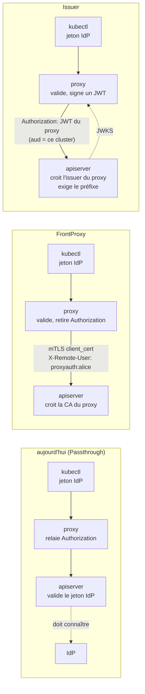
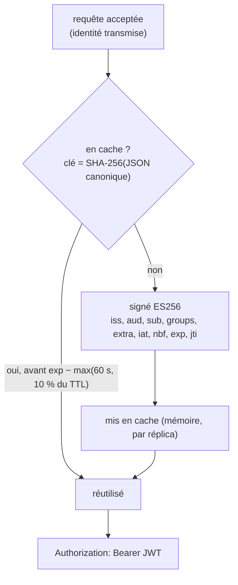
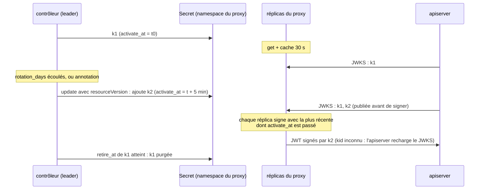
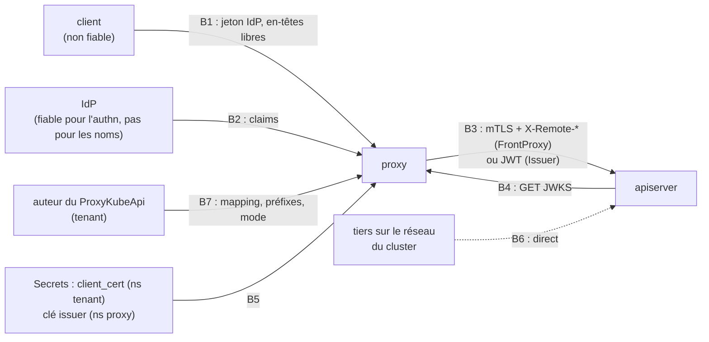

# RFC 0014 — Le proxy comme authentificateur de confiance

| Field       | Value                                                                  |
| ----------- | ---------------------------------------------------------------------- |
| Status      | Draft                                                                  |
| Short       | Authentificateur de confiance (front-proxy, émetteur)                  |
| Settles     | Ne plus déclarer l'IdP de chaque utilisateur dans chaque apiserver     |
| Author      | Max Batleforc <maxleriche.60@gmail.com>                                |
| Co-author   | Claude Opus 5.5 (1M context)                                           |
| Created     | 2026-10-27                                                             |
| Supersedes  | RFC 0010 §3, deux non-goals (« le proxy comme émetteur », « `X-Remote-*` ») ; amende RFC 0010 §4.1 et §6.3 (emplacement de la config, `UpstreamCredential::Bearer`) |
| Touches     | `libs/server/crd/src/{lib.rs,upstream_auth/ (nouveau),authentication_configuration/oidc_provider.rs,status/}`, `libs/server/api/src/model/{user.rs,user_claim.rs}`, `libs/server/api/src/cluster/redirect/{forwarded.rs,audit.rs,kube_redirect.rs,upstream_identity.rs (nouveau)}`, `…/kube_redirect/{context.rs,upstream.rs,standard.rs,upgrade/connect.rs,upgrade.rs,virtual_redirect/,list_fallback/}`, `libs/server/api/src/issuer/` (nouveau), `libs/server/common/src/{config.rs,upstream_cache.rs}`, `libs/server/controller/src/proxy_kube_api/`, `libs/server/jwt_validator/` (`map_user` public), `deploy/chart/` (valeurs, RBAC), `fuzz/`, CRD générée, `.it/`, `tests/integration/`, `docs/content/docs/` |
| Risk        | high                                                                   |

> Document de référence (environ 11 500 mots) : §1 à §4 suffisent pour en
> discuter ; §5 à §16 servent à l'implémenter et à le relire.

---

## 1. Summary

Aujourd'hui, le proxy relaie tel quel le jeton de l'utilisateur
(`apply_forward_headers`, `kube_redirect/upstream.rs:130`) : l'apiserver ne
reconnaît la requête que si l'IdP de l'utilisateur est déclaré dans **son**
`AuthenticationConfiguration` (ou ses flags `--oidc-*`). Cette RFC ajoute, par
cluster, un champ `upstream_auth` qui dit **comment le proxy présente
l'identité** à l'apiserver. Deux modes nouveaux font du proxy l'intermédiaire
d'authentification de confiance :

- **`FrontProxy`** : le proxy s'authentifie par son certificat client mTLS
  (le `client_cert` existant) et affirme l'identité dans `X-Remote-User`,
  `X-Remote-Group` et `X-Remote-Extra-*`, que l'apiserver croit parce qu'il
  fait confiance à la CA de ce certificat (`--requestheader-*`). Le jeton de
  l'utilisateur ne part plus.
- **`Issuer`** : le proxy signe un JWT court, avec une clé **propre au
  cluster**, et le met dans `Authorization` à la place du jeton de
  l'utilisateur. L'apiserver déclare une fois le proxy comme émetteur, et
  vérifie lui-même que l'identité porte le préfixe du proxy.

Dans les deux cas, l'apiserver est configuré **une fois** pour faire confiance
au proxy, et l'IdP des utilisateurs peut changer sans y toucher. Aucune
impersonation : le proxy ne détient aucun droit `impersonate`. L'identité
transmise est toujours préfixée et mappée explicitement ; un nom en `system:`
est refusé. Les deux modes sont fermés par défaut pour toute l'installation
(`upstreamAuth.allowedModes` du chart) : un tenant qui édite son
`ProxyKubeApi` ne peut pas les activer seul. Une sonde du contrôleur vérifie,
cluster par cluster, que l'apiserver voit bien l'identité que le proxy
affirme (Condition `UpstreamTrusted`).

### Before / after

```yaml
# aujourd'hui : l'apiserver doit connaître l'IdP de l'utilisateur
# (AuthenticationConfiguration du cluster)
jwt:
  - issuer: { url: https://sso.example.com/realms/corp, audiences: [kube-prod] }
    claimMappings: { username: { claim: email, prefix: "oidc:" } }
# ProxyKubeApi : rien, le jeton est relayé

# avec cette RFC, mode FrontProxy
# chart (une fois, par l'admin du proxy) :
#   upstreamAuth.allowedModes: [Passthrough, TokenExchange, FrontProxy]
# apiserver (une fois, ne dépend plus de l'IdP) :
#   --requestheader-client-ca-file=/etc/kubernetes/proxyauth-ca.crt  # CA dédiée
#   --requestheader-allowed-names=proxyauth-team-a-prod
#   --requestheader-username-headers=X-Remote-User
#   --requestheader-group-headers=X-Remote-Group
#   --requestheader-extra-headers-prefix=X-Remote-Extra-
# ProxyKubeApi :
spec:
  client_cert: { cert: { Secret: … }, key: { Secret: … } }
  auth_config:
    validate_against: OidcProvider
    oidc_provider:
      enabled: true
      issuer_url: https://sso.example.com/realms/corp
      claim_mappings:                  # nouveau, requis en FrontProxy/Issuer
        username: { claim: sub, prefix: "" }
        groups: { claim: groups, prefix: "" }
  upstream_auth:
    mode: FrontProxy                   # Passthrough par défaut
    user_prefix: "proxyauth:"
    group_prefix: "proxyauth:"
```



Ce qui est nouvellement cru par l'apiserver : en `FrontProxy`, des en-têtes
`X-Remote-*` **seulement** sur une connexion qui présente le certificat du
proxy ; en `Issuer`, un JWT **seulement** s'il est signé par la clé de ce
cluster et que son identité porte le préfixe. Le jeton IdP de l'utilisateur
ne quitte plus le proxy.

---

## 2. Motivation

1. **Chaque apiserver doit connaître chaque IdP.** Pour qu'un jeton relayé
   soit reconnu, l'apiserver doit valider son émetteur : le banc lui-même le
   fait par une `AuthenticationConfiguration` qui nomme Dex
   (`.it/k3d.yaml.tpl:44-69`). Changer d'IdP, de client OIDC ou d'audience,
   c'est retoucher la configuration de **tous** les apiservers, sur des nœuds
   de control plane, souvent par une autre équipe.
2. **Le proxy décide déjà de l'identité, puis la laisse redécider.** Le proxy
   valide le jeton (`User::get_user_info_with_proxy`, `model/user.rs:209`),
   applique `proxy_group` et l'allow-list (`kube_redirect.rs:226`), puis
   l'apiserver refait une validation indépendante, avec ses propres préfixes
   et mappings. Les deux peuvent diverger : `OidcProvider` prend
   `preferred_username` en dur (`model/user.rs:446`), l'apiserver du banc prend
   `email`. L'audit du proxy et celui de l'apiserver ne nomment alors pas le
   même utilisateur.
3. **Le jeton IdP de l'utilisateur va jusqu'au cluster.** En `Passthrough`, le
   jeton qui ouvre le dashboard et tous les clusters de ce même IdP traverse
   chaque apiserver (et ses webhooks d'audit). Un cluster compromis récolte des
   jetons valables ailleurs.
4. **Le `client_cert` existe déjà sans rôle d'identité.** La CRD porte un
   certificat client mTLS (`ProxyKubeApiSpec::client_cert`, `crd/src/lib.rs`),
   présenté par `build_tls_config` (`kube_redirect/tls.rs:68`), et les
   commentaires parlent déjà d'une « front-proxy mTLS identity »
   (`upstream.rs:53`). Le proxy pose `x-forwarded-user` et `x-forwarded-groups`
   (`forwarded.rs:145`), qu'aucun apiserver ne lit. La moitié du mode
   `FrontProxy` est écrite et ne sert à rien.

---

## 3. Goals / non-goals

**Goals**

- Un cluster en `FrontProxy` ou `Issuer` reconnaît les utilisateurs du proxy
  sans connaître leur IdP ; changer d'IdP ne touche que la CRD.
- L'identité vue par l'apiserver est celle que le proxy a validée et mappée
  explicitement, préfixée, jamais en `system:` ; en `Issuer`, l'apiserver le
  vérifie aussi.
- Le jeton IdP de l'utilisateur ne quitte pas le proxy dans ces modes.
- Un seul champ décide de ce que le proxy présente à l'apiserver, pour les
  quatre modes (avec `TokenExchange` de la RFC 0010).
- `OidcProvider` reçoit le même `claim_mappings` que `JwtAuthenticators`.
- Opt-in par installation **et** par cluster ; un cluster sans le champ se
  comporte exactement comme aujourd'hui.
- Une panne de confiance (apiserver mal réglé, issuer non déclaré) se voit
  sur le cluster concerné, pas seulement dans des `401` d'utilisateurs.

**Non-goals**

- **L'impersonation** (`Impersonate-*`, verbe RBAC `impersonate`) : elle
  donnerait au proxy le droit de devenir n'importe qui, `system:` compris. Le
  non-goal de la RFC 0010 tient pour elle ; `Impersonate-*` reste filtré.
- **Les clusters managés sans accès aux flags** (EKS, GKE, AKS) : ni
  `--requestheader-*` ni `AuthenticationConfiguration` n'y sont réglables
  partout ; ils restent en `Passthrough` ou `TokenExchange` (décision 1).
- **Une option pour transmettre un nom en `system:`** : aucune, même pour un
  administrateur. Qui veut `system:masters` passe par le kubeconfig admin.
- **Des noms d'en-têtes configurables** pour `FrontProxy` : les valeurs par
  défaut de kubeadm et de k3s (`X-Remote-User`, `X-Remote-Group`,
  `X-Remote-Extra-`) ; une configuration exotique de l'apiserver s'aligne sur
  elles (décision 11).
- **`X-Remote-Uid`** : `--requestheader-uid-headers` n'existe que depuis
  Kubernetes 1.32 ; l'uid n'est pas transmis, l'apiserver ne s'en sert pas
  pour le RBAC.
- **Un nouveau flux de connexion côté client** : le client présente le jeton
  que `auth_config` valide déjà ; la connexion par cluster
  (`kubectl-proxyauth login <cluster>`, via `oidc_provider`) reste. L'IdP
  disparaît de l'apiserver, pas de la CRD (décision 18).
- **Afficher le mode dans le dashboard** : le front ne lit pas le statut des
  CRD aujourd'hui (`VisibleCluster`, `get_all_visible_cluster_model.rs:36-45`) ;
  le mode se lit par `kubectl get proxykubeapi -o wide`, les Conditions et les
  Events.
- **Rendre le JWT du proxy au client** : il servirait hors du proxy, ce que le
  mode veut justement empêcher (comme la RFC 0010, §12).

---

## 4. User-facing design

### 4.1 Configuration

**Chart** (par l'admin du proxy, une fois pour l'installation ; décision 30) :

```yaml
upstreamAuth:
  # Modes qu'un ProxyKubeApi a le droit de demander. FrontProxy et Issuer font
  # de quiconque édite un ProxyKubeApi l'auteur de l'identité vue par
  # l'apiserver cible (§7.1, T19) : ils sont fermés par défaut.
  allowedModes: [Passthrough, TokenExchange]
  # Base publique des issuers (§4.5). Vide = API_CLUSTER_OIDC_BASE_REDIRECT_URL.
  issuerBaseUrl: ""
```

Rendu en `UPSTREAM_AUTH_ALLOWED_MODES` et `UPSTREAM_AUTH_ISSUER_BASE_URL`
(`common/src/config.rs`).

**`ProxyKubeApi`**, un bloc `upstream_auth` au niveau de `spec` :

```yaml
upstream_auth:
  mode: Passthrough        # défaut ; TokenExchange | FrontProxy | Issuer
  user_prefix: ""          # requis, non vide, en FrontProxy et Issuer
  group_prefix: ""         # idem
  token_exchange: {}       # RFC 0010, requis en TokenExchange (§4.1 de la 0010)
  issuer_key:              # en Passthrough (préparation) ou Issuer
    token_ttl_seconds: 300 # durée de vie d'un JWT émis ; 60 à 900
    rotation_days: 30      # rotation automatique de la clé ; 1 à 365
    url: ""                # vide = figée à la création (§4.5)
```

- **Absent** : identique à `mode: Passthrough`, le comportement d'aujourd'hui.
- **Un mode hors de `allowedModes`** : admis par l'admission (le chart ne
  peut pas modifier les règles CEL d'une CRD partagée), mais le contrôleur pose
  `Ready=False` (raison `UpstreamModeNotAllowed`) et le proxy répond `503` à
  toute requête vers ce cluster. Jamais de repli sur `Passthrough`.
- **`TokenExchange`** : le bloc `auth_config.token_exchange` de la RFC 0010
  déménage ici (décision 16) ; la 0010 n'étant pas implémentée, aucune CRD
  publiée ne change. Les préfixes n'y servent pas : l'IdP du cluster décide
  du nom.
- **`FrontProxy`** : exige `client_cert`, signé par une **CA dédiée** que
  l'apiserver ne connaît que par `--requestheader-client-ca-file` (jamais par
  `--client-ca-file`, jamais la CA d'agrégation) ; son CN doit figurer dans
  `--requestheader-allowed-names` (décision 28).
- **`Issuer`** : le contrôleur crée la clé dès que `issuer_key` est présent,
  même en `Passthrough` : l'opérateur prépare l'apiserver avec l'issuer et
  l'audience du statut, attend `UpstreamTrusted=True` par la sonde, puis
  bascule (décision 35).
- `user_prefix` et `group_prefix` n'ont **pas** de défaut : un préfixe est une
  décision de collision que personne n'a prise sinon (même argument que
  `PrefixedClaimOrExpression`, `claim_mappings.rs:33-45`).

`OidcProvider` gagne un champ `claim_mappings`, le même type que celui des
`JwtAuthenticators` (`ClaimMappings`, `claim_mappings.rs:14`), appliqué aux
claims **bruts** de `/userinfo` :

- **Absent, en `Passthrough` ou `TokenExchange`** : le comportement actuel,
  `preferred_username` et `groups` (`model/user.rs:440-452`) ; aucun cluster
  existant ne change.
- **Requis en `FrontProxy` et `Issuer`** (décision 36) : `preferred_username`
  est modifiable par l'utilisateur chez beaucoup d'IdP, et devient ici une
  identité que l'apiserver croit. La doc recommande `sub`.
- **Présent** : `username` requis, `groups`, `uid`, `extra` comme pour un
  `JwtAuthenticator`, évalués par le même `map_user`
  (`jwt_validator/src/validator.rs:332`). Avec `username: {claim: email}`,
  `email_verified` doit valoir `true`, comme l'exige l'apiserver pour ce claim.

Défauts sûrs : `Passthrough` ne change rien ; activer `FrontProxy` ou `Issuer`
demande l'admin du proxy (chart) **et** l'auteur du cluster, des préfixes et
un mapping explicite.

### 4.2 Behaviour rules

- **Deux identités, nommées.** L'*identité du proxy* est celle que
  `auth_config` produit (après `claim_mappings`, y compris son `prefix`) :
  `proxy_group`, l'allow-list, les ports, les règles par verbe, le rate limit
  et l'audit `user` la voient, comme aujourd'hui. L'*identité transmise* est
  `user_prefix` + nom, `group_prefix` + chaque groupe, et les `extra` : seul
  l'apiserver la voit. Les deux préfixes s'empilent quand on met les deux ; la
  doc recommande `prefix: ""` dans `claim_mappings` et le préfixe dans
  `upstream_auth` seulement. Tableau dans la doc pour les trois
  `validate_against`.
- **Calcul après la dernière porte.** L'identité transmise se calcule après
  les portes 1 à 8 ; une requête refusée ne fait ni signer de JWT ni poser
  d'en-tête.
- **Refus**, en `403` avant tout appel en amont, avec un message `Status`
  lisible par kubectl qui ne renvoie jamais la valeur fautive :

  | Raison (audit, métrique) | Cas | Message renvoyé |
  | --- | --- | --- |
  | `system_prefix` | nom ou groupe transmis commençant par `system:` (insensible à la casse) | `the identity provider returned a reserved system: group or name, which this cluster cannot receive` |
  | `empty_username` | nom vide après mapping | `the identity provider returned no username for the configured claim; ask the cluster operator to check claim_mappings` |
  | `untransmittable` | caractère de contrôle, octet non transmissible, espace ou tabulation en début ou fin, groupe ou valeur `extra` vide, clé `extra` en majuscules ou dans `kubernetes.io` / `k8s.io` | `the identity provider returned a value this cluster cannot receive; ask the cluster operator` |
  | `too_large` | plus de 64 groupes ou 8 Kio d'identité | `the identity is too large to forward` |

  Le refus `system:` est redondant avec un préfixe qui ne commence pas par
  `system:`, et voulu : il ne dépend pas d'une règle de la CRD. Le refus d'un
  nom vide est nouveau pour `OidcProvider` sans mapping ; `map_user` refuse
  déjà un nom vide (`validator.rs:345-349`). Les valeurs ne sont jamais
  nettoyées (comme `sanitize_header_value`, `forwarded.rs:136`) : nettoyer
  changerait l'identité en silence, et l'apiserver supprime les espaces de
  bord d'un en-tête, ce qui ferait de `proxyauth:bob ` le `proxyauth:bob` d'un
  autre.
- **`FrontProxy`** : toutes les valeurs `Authorization` du client sont
  retirées ; le proxy envoie un `X-Remote-User`, **un `X-Remote-Group` par
  groupe** (l'apiserver lit chaque valeur, une virgule dans un nom de groupe
  ne le coupe pas), et un `X-Remote-Extra-<clé>` par valeur `extra`, la clé
  encodée en pourcentage comme l'attend l'apiserver.
- **`Issuer`** : toutes les valeurs `Authorization` du client sont remplacées
  par `Authorization: Bearer <JWT du proxy>` ; aucun `X-Remote-*` n'est envoyé.
- **`x-forwarded-user` et `x-forwarded-groups`** : posés comme aujourd'hui en
  `Passthrough` et `TokenExchange` ; **retirés** en `FrontProxy` et `Issuer`
  (décision 32), où ils porteraient l'identité brute, non préfixée, sur la
  connexion que l'apiserver croit.
- **Tous les chemins** appliquent le même mode : relais standard
  (`standard.rs:177`), API virtuelles (`virtual_redirect/mod.rs:255`),
  revues faites pour l'appelant dans `list_fallback` (`review.rs:61`,
  `review.rs:198`), tous par `apply_forward_headers` ; upgrade (exec, attach,
  port-forward : `build_upgrade_request`, `upgrade/connect.rs:175`, appelé par
  `upgrade.rs:380`). L'appel au jeton de repli (`resolve.rs:50-60`) passe par
  `ca_only_client` (`upstream.rs:56`), qui ne présente pas `client_cert` et ne
  reçoit **jamais** l'identité transmise.
- **Flux ouverts** : un `exec` ou un `watch` déjà ouvert garde l'identité de
  son ouverture, même si le certificat expire ou si la clé tourne entre-temps,
  comme aujourd'hui pour un jeton.

### 4.3 Validation

Rejeté par l'admission (règles CEL sur `ProxyKubeApiSpec`, comme celles de
`crd/src/lib.rs:55-66` ; longueurs en `maxLength` du schéma, pas en CEL, pour
borner le coût) et par `ProxyKubeApi::validate` :

| Condition | Rationale |
| --- | --- |
| `mode: FrontProxy` sans `client_cert` | l'apiserver ne croirait aucun `X-Remote-*` |
| `mode` `FrontProxy` ou `Issuer` et `validate_against: Kubernetes` | la `SelfSubjectReview` suppose que l'apiserver connaît l'IdP (décision 9) |
| `mode` `FrontProxy` ou `Issuer` et `disable_validation: true` (ou `auth_config` absent) | le proxy affirmerait une identité qu'il n'a pas vérifiée |
| `mode` `FrontProxy` ou `Issuer` avec `validate_against: OidcProvider` sans `oidc_provider.claim_mappings` | `preferred_username` ne doit pas devenir une identité de confiance (décision 36) |
| `user_prefix` ou `group_prefix` absent ou vide en `FrontProxy` ou `Issuer` | collision avec un utilisateur local (décision 8) |
| un préfixe qui commence par `system:` (`lowerAscii()`), contient un caractère de contrôle ou un espace de bord ; plus de 64 caractères (`maxLength`) | il fabriquerait des noms réservés, finit dans un en-tête |
| `mode: TokenExchange` sans `token_exchange`, ou `token_exchange` hors de ce mode | une seule source de vérité pour l'`Authorization` (décision 16) |
| `issuer_key` en `FrontProxy` ou `TokenExchange` ; `mode: Issuer` sans `issuer_key` ; `token_ttl_seconds` hors de 60 à 900 ; `rotation_days` hors de 1 à 365 ; `url` non `https` | bornes de T10 et de la rotation |

Conditions et Events (RFC 0011), ajoutés au tableau des codes de
`docs/content/docs/status-and-events.mdx` avec leur sévérité ; la colonne
`Upstream` (`.status.upstream_auth.mode`) rejoint `kubectl get proxykubeapi
-o wide` (`crd/src/lib.rs:47-52`) :

| Condition (raison) | Sévérité | Quand | Effet |
| --- | --- | --- | --- |
| `Ready=False` (`UpstreamModeNotAllowed`) | erreur | mode hors de `allowedModes` | `503` sur ce cluster |
| `Ready=False` (`IssuerUrlUnset`) | erreur | `Issuer` (ou `issuer_key`) et base d'issuer vide, par défaut (`https://localhost:5437`, `config.rs:424-427`) ou loopback | pas de clé publiée ; `503` en `Issuer` |
| `Ready=False` (`IssuerKeyUnavailable`) | erreur | Secret de clé illisible ou refusé (§5.3) | `503` en `Issuer` |
| `Ready=False` (`ClientCertInvalid`) | erreur | `client_cert` illisible ou expiré | `502` (connexion TLS refusée) |
| `UpstreamTrusted=False` (`UpstreamIdentityNotHonoured`) | erreur | la sonde (§5.4) voit une autre identité que celle affirmée ; le message nomme l'identité vue | relayé ; à corriger avant la bascule |
| `UpstreamTrusted=False` (`IssuerNotTrusted`) | erreur | la sonde reçoit `401` en `Issuer` ; le message donne issuer et audience à recopier | relayé |
| `UpstreamTrusted=True` | — | la sonde voit l'identité affirmée | — |
| `ClientCertExpiring` | avertissement | `client_cert` expire dans moins de 30 jours | relayé |
| `ClientCertSubjectReserved` | avertissement | CN ou O du `client_cert` commence par `system:` | relayé ; doc : utiliser un certificat dédié |
| `IssuerKeyRotationOverdue` | avertissement | la clé n'a pas tourné depuis `rotation_days` + 1 | relayé |
| avertissement de statut | avertissement | `Issuer` avec `service: Agent` (décision 13) | relayé |

### 4.4 API surface

| Method | Path | Auth | Who may call | Limit |
| --- | --- | --- | --- | --- |
| GET | `/issuer/{ns}/{cluster}/.well-known/openid-configuration` | aucune (documents publics) | tout appelant, en pratique l'apiserver | limite par adresse dédiée, élevée, jamais bannie ; `404` si le cluster n'a pas de clé publiée |
| GET | `/issuer/{ns}/{cluster}/jwks` | aucune | idem | idem |

- Le préfixe `/issuer/` est séparé de `/clusters/` exprès : sous
  `/clusters/{ns}/{cluster}/`, tout chemin est relayé à l'apiserver, et
  l'apiserver sert lui-même `/.well-known/openid-configuration` (l'issuer de
  ses ServiceAccounts). Les deux se masqueraient.
- La découverte ne contient que `issuer`, `jwks_uri`,
  `id_token_signing_alg_values_supported: [ES256]`,
  `response_types_supported: [id_token]` et
  `subject_types_supported: [public]` : l'apiserver ne lit que les deux
  premiers.
- Servies depuis un cache en mémoire du processus (le dernier document servi
  reste servi si Redis tombe) ; pas le throttling Redis partagé
  (`throttle_oauth_as`, `cluster/auth/mod.rs:81-104`), qui pourrait bannir
  l'adresse de sortie d'un control plane qui recharge son JWKS (§7.1, T15).
- Ces routes ne servent que l'apiserver : hors de `swagger.json`, le client
  HeyApi n'est pas régénéré pour elles.

### 4.5 Statut et issuer

`status.upstream_auth` (décision 19) :

```yaml
status:
  upstream_auth:
    mode: Issuer
    issuer_url: https://api.example.com/issuer/team-a/prod
    audience: proxyk8sauth:team-a/prod
    jwks_uri: https://api.example.com/issuer/team-a/prod/jwks
    key_id: 3f1c…            # kid de la clé qui signe
    key_rotated_at: 2026-10-27T10:00:00Z
  # ou, en FrontProxy :
  upstream_auth:
    mode: FrontProxy
    client_cert_not_after: 2027-01-12T00:00:00Z
    client_cert_subject: CN=proxyauth-team-a-prod
```

- **L'URL de l'issuer est figée** (décision 35) : à la création de la clé, le
  contrôleur calcule `<base>/issuer/{ns}/{cluster}` (la base est
  `UPSTREAM_AUTH_ISSUER_BASE_URL`, sinon `API_CLUSTER_OIDC_BASE_REDIRECT_URL`,
  `common/src/config.rs:154`) et l'écrit dans `status.upstream_auth.issuer_url`.
  Elle ne change plus ensuite, même si la variable change ; seul
  `issuer_key.url` la change, explicitement. Le proxy signe avec l'URL du
  statut, pas avec la variable : un redéploiement ne casse aucun cluster.
- L'audience vaut `ProxyKubeApi::to_identifier()` (`crd/src/lib.rs:125`), déjà
  unique par cluster.

La doc donne le bloc `AuthenticationConfiguration` à recopier. L'apiserver y
**vérifie lui-même le préfixe** (décision 28) : une clé volée ne peut pas
signer `system:masters`, l'apiserver refuserait le jeton.

```yaml
jwt:
  - issuer:
      url: https://api.example.com/issuer/team-a/prod
      audiences: [proxyk8sauth:team-a/prod]
      certificateAuthority: |   # si l'URL publique n'est pas dans les racines du nœud
        …
    claimMappings:
      username: { claim: sub, prefix: "" }      # déjà préfixé par le proxy
      groups: { claim: groups, prefix: "" }
      extra:
        - key: example.com/team                  # une entrée par clé extra mappée
          valueExpression: "claims.extra['example.com/team']"
    userValidationRules:
      - expression: "user.username.startsWith('proxyauth:')"
        message: "the proxy asserts prefixed users only"
      - expression: "user.groups.all(g, g.startsWith('proxyauth:'))"
        message: "the proxy asserts prefixed groups only"
```

En `FrontProxy`, l'apiserver n'a pas d'équivalent : ses options
`--requestheader-*` ne savent ni préfixer ni filtrer. Le préfixe n'y est tenu
que par le proxy, et le risque d'un certificat volé reste un accès
cluster-admin (§7.1, T6).

---

## 5. Architecture

### 5.1 Où se décide l'identité transmise


L'identité transmise se calcule après la dernière porte : une requête refusée
par la politique ne fait signer aucun JWT et ne pose aucun en-tête d'identité.

**Invariant 1** : parce que `is_upstream_auth_header` (`forwarded.rs:59`)
retire tout `X-Remote-*` et `Impersonate-*` du client **avant** que le proxy
pose les siens, et que seul le client qui présente `client_cert` en reçoit,
une identité affirmée à l'apiserver vient toujours du proxy.

**Invariant 2** : parce que les préfixes sont non vides, ne commencent pas par
`system:`, et que le nom transmis est refusé s'il commence par `system:`, le
proxy n'affirme jamais `system:masters`, `system:admin` ni un compte de
service. En `Issuer`, l'apiserver le vérifie aussi (`userValidationRules`,
§4.5) : la propriété tient même si la clé fuit. En `FrontProxy`, elle ne tient
que tant que le certificat ne fuit pas.

### 5.2 Le JWT émis (`Issuer`)



- Signé par `jsonwebtoken` 11 (`aws_lc_rs`, déjà dépendance de `api`) en
  ES256, avec la clé courante du cluster (§5.3).
- Claims : `iss` (`status.upstream_auth.issuer_url`), `aud` (une seule valeur,
  `to_identifier()`), `sub` (le nom transmis), `groups` (liste transmise),
  `extra` (objet, si mappé), `iat`, `nbf` (`iat` − 30 s), `exp` (`iat` +
  `token_ttl_seconds`), `jti` (aléatoire).
- **Indépendant de la RFC 0010** (décision 31) : un `TtlCache`
  (`common/src/oidc_cache.rs:55`) borné, sans verrou par clé (une signature
  coûte des microsecondes), qui remplit `UpstreamCredential::Bearer` (§6.3).
  La 0010 branchera son jeton échangé sur la même variante.
- Clé de cache : SHA-256 d'un **JSON canonique** `{"u": nom, "g": groupes
  triés et dédoublonnés, "x": extra trié, "c": UID du ProxyKubeApi, "i":
  issuer, "k": kid}`. Un changement de groupes chez l'IdP donne une autre clé,
  donc un autre JWT : le cache ne prolonge jamais des droits retirés. Aucune
  jointure par virgule (un nom de groupe peut en contenir).
- Réutilisé jusqu'à `exp − max(60 s, 10 % de token_ttl_seconds)` : la marge
  couvre un décalage d'horloge entre proxy et apiserver. La doc exige NTP sur
  les deux.

**Invariant 3** : parce que l'`aud` et la clé sont propres au cluster, et que
chaque apiserver ne déclare que l'issuer et l'audience de son cluster, un JWT
émis pour le cluster A est refusé par B, même s'il fuyait.

### 5.3 Clés et rotation

Où (décision 29) : un Secret `proxyauth-issuer-<UID du ProxyKubeApi>` dans le
**namespace du proxy**, pas dans celui du tenant : un admin de namespace ne
peut ni lire la clé, ni la remplacer, ni en déposer une à l'avance. Le Secret
porte les labels `app.kubernetes.io/managed-by: proxyauthk8s` et
`proxyauth.weebo.si.rs/cluster-uid`, et l'annotation du `ns/nom` du cluster.

- **Jamais d'adoption** : le contrôleur ne lit qu'un Secret qu'il a créé
  (labels attendus **et** annotation `proxyauth.weebo.si.rs/created-by` égale à
  l'UID de son propre Deployment) ; un Secret du même nom qui ne passe pas ce
  contrôle donne `IssuerKeyUnavailable`, jamais une clé adoptée.
- **Pas d'`ownerReference`** (elle ne traverse pas les namespaces) : le
  contrôleur balaie les Secrets `proxyauth-issuer-*` dont l'UID ne correspond
  plus à aucun `ProxyKubeApi`, après le délai de rétention. Recréer un cluster
  sous le même nom donne un UID neuf, donc une clé neuve ; l'issuer et
  l'audience, calculés depuis `ns/nom`, ne changent pas.
- **Format déclaratif** (décision 37) : une seule clé de Secret `keys.json`,
  liste d'entrées `{kid, pkcs8 (base64), created_at, activate_at, retire_at}`.



- **Choix de la clé courante** : chaque réplica, indépendamment, prend la plus
  récente dont `activate_at ≤ maintenant` ; aucune étape du contrôleur ne
  décide de l'activation. Un changement de leader au milieu d'une rotation ne
  perd rien : l'état est dans le Secret.
- **Délais** : `activate_at` = publication + 5 min (cache des réplicas 30 s +
  `Cache-Control: max-age=60` du JWKS + marge) ; `retire_at` = activation de
  la suivante + `token_ttl_seconds` + 5 min. Les clés dont `retire_at` est
  passé sont **purgées** du Secret : une restauration de sauvegarde ne
  ressuscite pas une clé retirée, et le Secret n'a pas besoin de sauvegarde
  (le perdre ne casse que les JWT en cours, §10.2).
- **Écriture** : `update` avec `resourceVersion` (concurrence optimiste) ;
  deux leaders qui se chevauchent ne créent pas deux `k2`.
- **Lecture par le proxy** : un `get` par nom, derrière un cache de 30 s
  (comme `cached_tls_config`, `tls.rs:18`), pas de watch (le proxy n'en a
  aucun, et un watch demanderait `list`/`watch` sur les Secrets).
- **Retour à `Passthrough`** : le Secret et le JWKS restent publiés tant que
  `issuer_key` est présent ; repasser en `Issuer` ne change pas de clé.

### 5.4 La sonde de confiance

Le leader du contrôleur (RFC 0011) sonde chaque cluster en `FrontProxy` ou
`Issuer`, ou qui porte `issuer_key` (décision 33) :

- Une `POST /apis/authentication.k8s.io/v1/selfsubjectreviews` (permise à tout
  utilisateur authentifié, sans RBAC) avec l'identité
  `<user_prefix>proxyauth-probe`, sans groupe, présentée selon le mode visé :
  en-têtes sur le client à certificat, ou JWT signé par la clé courante. Elle
  passe par `upstream_client` (`upstream.rs:34`) et la passerelle d'agent si
  besoin.
- Toutes les 5 minutes, et à chaque changement de spec, de certificat ou de
  clé ; le résultat pose `UpstreamTrusted` (§4.3).
- Elle détecte : un `allowed-names` qui ne contient pas le CN (l'apiserver
  voit alors le CN du certificat, et le message le nomme) ; une CA
  `--client-ca-file` au lieu de `--requestheader-client-ca-file` (même
  symptôme) ; un issuer pas encore déclaré ou un JWKS injoignable (`401`) ; une
  URL d'issuer changée.

---

## 6. Detailed design

### 6.1 CRD (`libs/server/crd/src/`)

- `upstream_auth/mod.rs` (nouveau) : `UpstreamAuth { mode, user_prefix,
  group_prefix, token_exchange, issuer_key }`, `UpstreamAuthMode {
  Passthrough, TokenExchange, FrontProxy, Issuer }` (même style que
  `ValidateAgainst`), `IssuerKeySettings { token_ttl_seconds, rotation_days,
  url }`, avec `#[serde(default)]`, les règles CEL et les `maxLength` de §4.3.
- `lib.rs` : `ProxyKubeApiSpec::upstream_auth: Option<UpstreamAuth>` ;
  `ProxyKubeApi::validate` appelle `UpstreamAuth::validate(&self.spec)`, qui
  lit `client_cert` et `auth_config` (règles croisées) ; colonne `Upstream` en
  `-o wide`.
- `authentication_configuration/oidc_provider.rs` : `claim_mappings:
  Option<ClaimMappings>`.
- `status/mod.rs` : `upstream_auth: Option<UpstreamAuthStatus>` (§4.5),
  envoyé en `null` quand il disparaît (comme `warnings`,
  `status/mod.rs:105`).
- RFC 0010 : `TokenExchange` est déclaré dans `upstream_auth/token_exchange.rs`
  au lieu de `authentication_configuration/` ; son contenu est celui de la
  0010 §6.1.

### 6.2 L'identité (`libs/server/api/src/model/`)

- `User` reçoit `extra: BTreeMap<String, Vec<String>>` et
  `#[derive(Default)]` (`user.rs:136`) ; les six littéraux `User { … }`
  (`forwarded.rs:163,297`, `upgrade.rs:650`, `user.rs:252,312,454`) prennent
  `..Default::default()`.
- `JwtAuthenticators` : `mapped.extra`, aujourd'hui jeté (`user.rs:252-263`),
  remplit `User.extra`.
- `OidcProvider` : `/userinfo` est lu en `serde_json::Value` brut quand
  `claim_mappings` est présent : `GroupsUserInfoClaims` ne garde que `groups`
  (`user_claim.rs:5-21`), tout autre claim serait perdu. Les claims passent
  par `map_user`, rendu `pub` dans `jwt_validator` (il est `pub(crate)`) ; avec
  `username: {claim: email}`, `email_verified` doit valoir `true`. Sans
  mapping, le code actuel.
- `UpstreamIdentity::from_user(&User, &UpstreamAuth) -> Result<UpstreamIdentity,
  IdentityRefusal>` (nouveau, `cluster/redirect/upstream_identity.rs`, `pub`
  pour la cible de fuzz) : préfixes, puis refus de §4.2. Pure, sans E/S.

### 6.3 Dans `redirect` (`kube_redirect.rs`)

- Avant la porte 1 : un cluster dont le mode n'est pas dans `allowedModes`,
  ou que ce réplica ne sait pas servir, répond `503` (décision 34).
- Après la porte 8, en `FrontProxy` et `Issuer` : calcul d'`UpstreamIdentity` ;
  un `IdentityRefusal` donne le `403` de §4.2, sans appel en amont.
- `RedirectContext` (`kube_redirect/context.rs:23`) reçoit
  `upstream: UpstreamCredential` :
  `Passthrough | Bearer(SecretString) | Headers(UpstreamIdentity)`. La
  RFC 0010 y range son jeton échangé en `Bearer` (au lieu du champ
  `upstream_token` de son §6.3), l'`Issuer` aussi.
- Le point de couture unique est `identity_headers` (`forwarded.rs:145`),
  déjà appelé par `apply_forward_headers` (`upstream.rs:162`) et
  `build_upgrade_request` (`upgrade/connect.rs:224`) : il reçoit
  `&UpstreamCredential` et rend les en-têtes à poser et le traitement
  d'`Authorization` (copier, remplacer, retirer). Le filtrage
  `is_upstream_auth_header` reste appliqué avant, dans tous les cas.
- `list_fallback/cache.rs:21-58` : la clé de cache des résultats de revue
  inclut le mode et les préfixes, pour qu'un changement de mode ne serve pas
  des résultats calculés sous l'ancienne identité.
- `common/src/upstream_cache.rs` : l'entrée d'un client à certificat expire
  au plus tard au `not_after` du certificat (`min(ttl, not_after − now)`) ; un
  certificat renouvelé dans le même Secret est pris en compte en au plus
  `PROXY_UPSTREAM_CLIENT_TTL` (300 s, `upstream_cache.rs:15-18`), car
  l'empreinte du cache porte sur la référence, pas sur le contenu
  (`upstream_cache.rs:78-82`). Documenté (§13).

### 6.4 Contrôleur (`libs/server/controller/src/proxy_kube_api/`)

- `FrontProxy` : lit `client_cert`, parse le certificat (`x509-parser` 0.18,
  nouvelle dépendance directe du contrôleur, déjà dans `Cargo.lock` par
  `libs/agent/pki`) pour `not_after`, CN et O ; pose Conditions et statut
  (§4.3, §4.5). Requeue au plus tard à `not_after` et à J−30.
- `Issuer` / `issuer_key` : crée et fait tourner la clé (§5.3), calcule et fige
  `issuer_url`, publie `status.upstream_auth`, balaie les Secrets orphelins.
- Sonde (§5.4) sur le leader.
- `allowedModes` : `Ready=False` (`UpstreamModeNotAllowed`) hors liste.
- RBAC (`deploy/chart/templates/rbac.operator.yaml`) : un **Role** dans le
  namespace du proxy, hors de la condition `oneShotToken.enabled` (les verbes
  `create`/`patch` de la ligne 57 n'existent qu'avec elle), avec `get`,
  `create`, `update`, `delete` et `list` (pour le balayage, filtré par label)
  sur `secrets`. Aucun droit nouveau sur les Secrets des namespaces des
  tenants ; le `get` existant (lignes 63-75) reste `get` seul. Le proxy et le
  contrôleur partagent un ServiceAccount (`dp.back.yaml:23`) : « le proxy
  n'écrit jamais la clé » est tenu par le code, pas par le RBAC (§7.1, T18).

### 6.5 Émetteur (`libs/server/api/src/issuer/`)

- `discovery` et `jwks` : handlers axum sous `/issuer/{ns}/{cluster}`, hors
  utoipa ; répondent depuis le cache en mémoire (§4.4), `Cache-Control:
  max-age=60`. `{ns}/{cluster}` → UID par la recherche de cluster existante
  (Redis, `kube_redirect.rs:70`) ; si Redis ne répond pas, le dernier document
  servi pour ce chemin reste servi.
- `sign(identity, cluster) -> SecretString`, appelé par `redirect` pour
  `UpstreamCredential::Bearer`.

### 6.6 Banc (`.it/`)

- `FrontProxy` : une **CA dédiée** au run ; son certificat est concaténé à la
  `request-header-ca.crt` de k3s dans un fichier passé par
  `--kube-apiserver-arg=requestheader-client-ca-file=…` et
  `requestheader-allowed-names=system:auth-proxy,proxyauth-it` dans
  `.it/k3d.yaml.tpl` (qui ajoute déjà `authentication-config`), pour ne pas
  casser l'agrégation de k3s. `it:up` émet le certificat client
  `CN=proxyauth-it` dans un Secret du cluster de test. À sonder au début de la
  phase 2 (§15, Still open).
- `Issuer` : une entrée de plus dans l'`AuthenticationConfiguration` de
  `.it/k3d.yaml.tpl` (avec ses `userValidationRules`), issuer
  `https://proxyauth.k8s.localhost:8443/issuer/…`. Le nœud résout déjà ce nom
  vers Traefik (`hostAliases`, lignes 16-22) et la CA du run est déjà
  injectée (`__CA__`). L'apiserver recharge ce fichier à chaud (Kubernetes
  1.30 et plus).
- `.it/values.yaml` : `upstreamAuth.allowedModes` avec les quatre modes.
- Personas (`.it/personas.yaml`) : un persona dont Dex renvoie le groupe
  `system:masters`, un dont le claim de nom est absent.

### 6.P Proof against a real client

Suite d'intégration de la RFC 0009 (`tests/integration/tests/rfc0014.rs`),
le kubectl épinglé du banc (`mise.toml`) et le CLI du dépôt, contre le k3s du
banc (`.it/images.lock`) et le Dex existant. Chaque test passe par le proxy ;
le kubeconfig admin ne sert qu'à préparer (RBAC, CRD, lecture du Secret de clé
pour le point 12).

1. Cluster en `Passthrough` avec `oidc_provider.claim_mappings` (`username:
   email`) : `kubectl get pods` réussit, et la ligne d'audit `request` porte
   l'e-mail du persona, plus `preferred_username` (phase 1).
2. **Refus** : un `ProxyKubeApi` en `FrontProxy` sur une installation dont
   `allowedModes` ne le permet pas — `kubectl get pods` reçoit `503`, la
   Condition `Ready=False` porte `UpstreamModeNotAllowed`, et aucune requête
   n'atteint l'apiserver (phase 1).
3. Cluster en `FrontProxy`, RBAC accordé au seul groupe
   `proxyauth:<groupe Dex>` : `kubectl auth whoami -o json` rend
   `username: proxyauth:<sub>` et ce groupe préfixé ; `kubectl get pods`
   réussit ; la Condition `UpstreamTrusted=True`. Un nom préfixé ne peut venir
   que des en-têtes : le jeton Dex relayé donnerait l'e-mail nu.
4. **Refus** : sur ce cluster, le persona ajoute `X-Remote-User:
   system:admin`, `X-Remote-Group: system:masters` et `Impersonate-User:
   admin` à sa requête (`kubectl --as` et un en-tête brut) — `whoami` rend
   toujours son identité préfixée, et `kubectl get secrets -A` reçoit le `403`
   de l'apiserver.
5. **Refus** : le persona dont Dex renvoie `system:masters`, avec
   `group_prefix: proxyauth:` — accepté avec `proxyauth:system:masters`
   (préfixé, donc inoffensif) ; puis le persona sans claim de nom — `403` du
   proxy avec le message `empty_username`, ligne d'audit
   `upstream_identity_refused`, et `proxyauth_upstream_rejected_total` n'a pas
   bougé (aucun appel en amont).
6. `kubectl exec` et `kubectl port-forward` sur un cluster en `FrontProxy` —
   le tunnel s'ouvre ; le RBAC qui l'autorise ne vise que le groupe préfixé.
7. Cluster en `FrontProxy` derrière un agent (`service: Agent`, RFC 0012) —
   `kubectl auth whoami` rend l'identité préfixée : le mTLS traverse le
   tunnel de bout en bout.
8. **Refus** : `curl` direct vers l'apiserver du banc (sans le proxy), sans
   certificat client, avec `X-Remote-User: proxyauth:<sub>` — `401` :
   l'apiserver ne croit pas les en-têtes sans le certificat.
9. **Refus** : un cluster en `FrontProxy` dont le certificat est signé par une
   CA que l'apiserver ne connaît pas comme front-proxy — la Condition passe à
   `UpstreamTrusted=False` (`UpstreamIdentityNotHonoured`), le message nomme
   l'identité vue.
10. Cluster en `Issuer`, préparé en `Passthrough` avec `issuer_key` puis
    basculé après `UpstreamTrusted=True` : `kubectl auth whoami` rend
    l'identité préfixée ; aucune requête n'a reçu `401` pendant la bascule ;
    dix `kubectl get pods` de suite ne signent qu'un JWT
    (`proxyauth_issuer_tokens_total{result="cache_hit"}` monte de 9).
11. **Refus** : `kubectl apply` d'un `ProxyKubeApi` en `Issuer` avec
    `validate_against: Kubernetes`, puis en `FrontProxy` sans `client_cert`,
    puis en `FrontProxy` sans `claim_mappings` — refusés par l'admission ; les
    messages CEL de §4.3 sont cités.
12. **Refus** : deux clusters en `Issuer` vers le même apiserver ; un JWT
    signé avec la clé de A et l'`aud` de B, puis un JWT signé avec la clé de B
    portant `groups: [system:masters]` — tous deux `401` à l'apiserver (le
    second par la `userValidationRule`).
13. Rotation par l'annotation pendant une boucle de `kubectl get pods` —
    aucune requête en échec ; le JWKS a contenu les deux `kid` ; l'ancien en
    disparaît, et du Secret, après `retire_at`.
14. La réponse relayée et les logs du proxy (`task it:logs`) ne contiennent
    ni le jeton Dex du persona au-delà de la porte 4, ni un JWT émis, ni la clé
    (recherche de leurs chaînes) ; en `FrontProxy`, le point 3 prouve par le
    nom que le jeton Dex n'a pas servi à l'apiserver.

**Deliberately untouched**, so reviewers do not go looking:

- `cluster/auth/oauth/*` et `libs/cli/cli/src/login/` — la connexion par
  cluster passe toujours par `oidc_provider` ; seul l'apiserver oublie l'IdP.
- `jwt_validator` — sa validation ne change pas ; seul `map_user` devient
  `pub`.
- `forwarded.rs::UPSTREAM_AUTH_PREFIXES` — les deux préfixes restent filtrés
  sur l'entrée client ; le proxy pose ses `X-Remote-*` après ce filtrage.
- `apps/agent` — l'agent ne termine pas le TLS (RFC 0012,
  `0012-agent-tunnel.md:32`) : il n'a rien à savoir du mode.
- `apps/front` — aucun nouveau flux, aucun affichage du mode (non-goal).

---

## 7. Security

**Rating:** high — le proxy devient la source d'identité de l'apiserver. Un
certificat `FrontProxy` volé vaut cluster-admin du cluster ; une clé
`Issuer` volée vaut tout utilisateur préfixé du cluster.

### 7.1 Threat model

Actifs : l'accès à chaque cluster ; le certificat client `FrontProxy` et la
clé `Issuer` de chaque cluster ; le jeton IdP de l'utilisateur ; les JWT émis.
Acteurs : un client authentifié, un client non autorisé, un IdP mal configuré
ou compromis, un tenant qui édite son `ProxyKubeApi`, un admin de namespace,
un tiers qui joint l'apiserver directement, un lecteur de logs.



| # | Threat (STRIDE) | Where | Mitigation | Residual risk |
| --- | --- | --- | --- | --- |
| T1 | Spoofing : le client envoie `X-Remote-User`, `X-Remote-Group` ou `Impersonate-*` | B1→B3 | retirés par `is_upstream_auth_header` (`forwarded.rs:59`) avant que le proxy pose les siens, sur tous les chemins | aucun |
| T2 | Elevation : l'IdP renvoie `system:masters` ou un nom en `system:` | B2 | préfixe obligatoire (CEL + `validate`) et refus `system:` en dur (`UpstreamIdentity::from_user`) ; en `Issuer`, aussi `userValidationRules` à l'apiserver | aucun |
| T3 | Elevation : collision avec un utilisateur local par préfixe vide ou `system:` | B7 | préfixe requis, non vide, sans `system:`, refusé à l'admission | un préfixe qui entre en collision avec un autre authentificateur du cluster ; accepté (admin du proxy), documenté |
| T4 | Tampering : un claim avec CR/LF ou un octet non transmissible injecte un en-tête (chemin upgrade sérialisé à la main) | B2→B3 | valeur refusée en `403` (§4.2), pas nettoyée ; en-têtes construits par `HeaderValue` | aucun |
| T5 | Info disclosure : le jeton IdP de l'utilisateur part vers l'apiserver | B3 | `FrontProxy` retire toutes les valeurs `Authorization` ; `Issuer` les remplace | aucun |
| T6 | Spoofing / Elevation : vol du `client_cert` d'un cluster `FrontProxy` | B5, B6 | Secret géré par l'opérateur ; CA dédiée exigée ; avertissements d'expiration et de sujet réservé ; doc : certificat court, NetworkPolicy vers l'apiserver | **cluster-admin** : le détenteur envoie `X-Remote-Group: system:masters` directement, l'apiserver ne filtre pas ; jusqu'à l'expiration (pas de révocation). Accepté (admin du proxy, en autorisant `FrontProxy`) ; `Issuer` contient mieux ce vol |
| T7 | Spoofing : l'apiserver a `--requestheader-allowed-names` vide, ou le certificat vient de `--client-ca-file` (O=`system:masters` possible) | B6 | doc ; Condition `ClientCertSubjectReserved` ; la sonde voit l'écart (`UpstreamIdentityNotHonoured`) | dépend de l'apiserver ; accepté (opérateur) |
| T8 | Spoofing : vol de la clé `Issuer` d'un cluster | B5 | une clé par cluster, dans le namespace du proxy, jamais en log, rotation ; `aud` par cluster ; `userValidationRules` à l'apiserver | le détenteur signe pour **ce** cluster tout utilisateur préfixé jusqu'à la rotation ; la compromission du processus proxy ouvre tous les clusters en `Issuer` et `FrontProxy` ; accepté (admin du proxy) |
| T9 | Elevation : un JWT émis pour A rejoué sur B | B3 | `aud` = `to_identifier()` de A, clé de A ; B ne déclare que son issuer | aucun |
| T10 | Elevation : un JWT émis sert hors du proxy | B3 | jamais dans une réponse ni un log (`SecretString`) ; TTL ≤ 900 s | s'il fuyait, valide jusqu'à son `exp` ; accepté |
| T11 | Elevation : un JWT en cache garde des groupes retirés | cache | clé de cache = hash du JSON canonique de l'identité transmise | la latence de validation du proxy (`OIDC_TOKEN_CACHE_TTL`, 30 s) ; inchangée |
| T12 | Info disclosure : un utilisateur reçoit le JWT d'un autre | cache | clé = identité + UID + issuer + `kid` | aucun |
| T13 | Spoofing : sans validation, le proxy affirme une identité non vérifiée | B1 | `disable_validation` et `auth_config` absent refusés avec ces modes (CEL) ; `from_user` exige `Some(user)` | aucun |
| T14 | Tampering : le JWKS servi à l'apiserver est remplacé | B4 | servi en HTTPS par le proxy, depuis le Secret seul ; l'apiserver épingle la CA (`certificateAuthority`) | qui contrôle l'Ingress du proxy contrôle déjà le proxy |
| T15 | DoS : des JWT au `kid` aléatoire font recharger le JWKS à l'apiserver, qui inonde `/issuer/*` ; énumération des clusters en `Issuer` | B4 | cache en mémoire, limite dédiée jamais bannie (pas le bannissement Redis partagé) ; l'apiserver garde ses clés pendant une panne | une panne du proxy bloque les rotations, pas les clés déjà connues ; l'existence d'un cluster en `Issuer` est visible, comme dans la config de son apiserver ; accepté |
| T16 | Repudiation : une action en amont qu'on ne relie pas à une personne | B3 | audit du proxy avec le mode et l'identité transmise (§10.1) ; l'apiserver journalise le même nom préfixé | aucun |
| T17 | Spoofing : le client à jeton de repli (`list_fallback`) porte une identité affirmée | B3 | `ca_only_client` ne présente pas `client_cert` et ne reçoit jamais `Headers` | aucun |
| T18 | Tampering / Spoofing : un admin de namespace lit, remplace ou dépose à l'avance la clé `Issuer` | B5 | Secret dans le namespace du proxy ; jamais d'adoption (labels + annotation `created-by`) ; le proxy ne l'écrit jamais (code) | proxy et contrôleur partagent un ServiceAccount : le RBAC seul ne l'empêche pas d'écrire ; accepté |
| T19 | Elevation : qui édite un `ProxyKubeApi` choisit l'identité transmise (mapping CEL vers `admin`, groupes constants) | B7 | `allowedModes` du chart, fermé par défaut ; en `Issuer`, le préfixe vérifié par l'apiserver borne ce choix aux utilisateurs préfixés ; doc : « éditer un `ProxyKubeApi` en `FrontProxy` ou `Issuer` = être admin du cluster cible, sous le préfixe » | en `FrontProxy`, sans borne à l'apiserver hors `system:` ; accepté (admin du proxy, qui autorise le mode) |
| T20 | Info disclosure : pendant une mise à jour, un réplica v0.4.x ignore `upstream_auth` et relaie le jeton IdP avec `client_cert` | B3 | la phase 1 livre la garde (`503` pour un mode non servi) ; la doc exige tous les réplicas à cette version avant toute bascule (RFC 0013 pour la voir) | un opérateur qui saute une version ; documenté |
| T21 | Spoofing : `x-forwarded-user` porte l'identité brute sur la connexion de confiance, qu'un apiserver mal réglé croirait | B3 | retirés en `FrontProxy` et `Issuer` | aucun |
| T22 | Spoofing : espaces de bord ou clé `extra` en majuscules réinterprétés par l'apiserver (collision `proxyauth:bob ` / `proxyauth:bob`) | B3 | refusés (`untransmittable`) | aucun |
| T23 | Spoofing : identité tirée d'un `email` non vérifié | B2 | `email_verified` exigé avec `claim: email` ; mapping explicite exigé | aucun |

### 7.2 Authentication and authorisation

- La seule surface nouvelle sans authentification est `/issuer/*` : des clés
  publiques et deux URL ; elle ne dit rien d'un utilisateur (T15).
- Rien ne change dans l'autorisation du proxy : `proxy_group`, l'allow-list,
  les ports et les règles par verbe portent sur l'identité du proxy.
- Dans l'apiserver, le RBAC vise désormais des noms préfixés : c'est
  l'opérateur qui écrit ses `RoleBinding` pour `proxyauth:…`.
- Le droit d'écrire un `ProxyKubeApi` en `FrontProxy` ou `Issuer` équivaut à
  un droit d'administration sur le cluster cible, sous le préfixe (T19) ;
  `allowedModes` en fait un choix de l'admin du proxy.
- Un contournement de la porte 4 ne donne rien : sans utilisateur validé, la
  requête est refusée (T13).

### 7.3 Input handling and injection

- Les claims de l'IdP deviennent des en-têtes ou des claims JWT : refus des
  valeurs non transmissibles (T4, T22) ; groupes un par en-tête ; clés `extra`
  en minuscules, encodées en pourcentage, hors `kubernetes.io` et `k8s.io` ;
  64 groupes et 8 Kio au plus.
- `/userinfo` est lu brut quand il est mappé : borné par la limite de taille
  de réponse existante du client OIDC.
- `user_prefix`, `group_prefix`, `issuer_key.url` : schéma et CEL.
- Aucune URL nouvelle contrôlée par un utilisateur et jointe par le proxy :
  l'issuer vient de la config du proxy ou du champ `url` (auteur du cluster,
  `https` exigé), que seul l'apiserver joint ; pas de nouveau SSRF.

### 7.4 Secrets and cryptography

- `FrontProxy` : le `client_cert` existant, géré par l'opérateur ; aucune
  nouvelle forme de secret.
- `Issuer` : ECDSA P-256 / SHA-256 (ES256), générée par `ring`, signée par
  `jsonwebtoken` 11 (backend `aws-lc-rs`) ; aucune crypto maison. PKCS#8 dans
  un Secret du namespace du proxy ; jamais dans Redis, un log, une métrique,
  le statut ou une réponse ; seul le `kid` (empreinte de la clé publique) est
  publié. Clés retirées purgées.
- Les JWT émis vivent en mémoire dans un `SecretString` (`secrecy` 0.10.3, déjà
  dépendance directe de `api`).
- Le jeton IdP de l'utilisateur n'est gardé que haché, comme aujourd'hui.

### 7.5 Abuse and resource exhaustion

- Une signature au plus par (identité, cluster, réplica) et par durée de vie,
  après toutes les portes : un appelant non autorisé ne fait rien signer.
- Signature ES256 : de l'ordre de 50 µs, à mesurer en phase 3 ; un cache plein
  est vidé (`TtlCache`) et fait re-signer, coût négligeable.
- Sonde : une requête par cluster toutes les 5 minutes.

### 7.6 Existing defences that still hold

- Le filtrage d'en-têtes de `forwarded.rs` (identité, impersonation, méthode).
- Le throttling, `is_caller_fault()`, fail2login, l'allow-list, les ports.
- Le refus des redirections en amont (`upstream.rs:116`), qui protège aussi
  le JWT émis.

---

## 8. Supply chain

| Dependency / image / tool | Version | Why this one | Licence | Known CVEs (`task audit`) | Maintenance |
| --- | --- | --- | --- | --- | --- |
| `jsonwebtoken` (déjà dépendance de `api`) | 11.1.0, `aws_lc_rs` | signer le JWT ; déjà utilisé pour valider | MIT | aucune (`task audit` vert au 2026-10-27, à relancer en phase 3) | inchangé |
| `ring` (déjà dépendance du contrôleur) | 0.17.14 | générer la clé P-256 en PKCS#8 | Apache-2.0 AND ISC | aucune | inchangé |
| `x509-parser` (**nouvelle dépendance directe** du contrôleur ; déjà dans `Cargo.lock` par `libs/agent/pki`) | 0.18.1 | lire `not_after`, CN et O du `client_cert` | MIT OR Apache-2.0 | aucune | rusticata ; déjà utilisée par `libs/agent/pki` |
| `secrecy` (déjà dépendance de `api`) | 0.10.3 | JWT émis en mémoire | MIT OR Apache-2.0 | aucune | inchangé |
| k3s du banc | `.it/images.lock`, inchangé | ses flags front-proxy et `authentication-config` | Apache-2.0 | inchangé | inchangé |

- Aucune crate nouvelle dans `Cargo.lock`.
- **Build and release** : inchangés ; aucune image, aucune action CI. Le chart
  gagne deux valeurs (`upstreamAuth.*`) et `values.schema.json` suit.
- **Updates** : rien de nouveau à suivre (Renovate couvre déjà ces crates).

---

## 9. Data and privacy

| Data | Personal? | Where stored | Retention | Who can read it | Leaves the instance? |
| --- | --- | --- | --- | --- | --- |
| identité transmise (nom, groupes, `extra` préfixés) | oui | en-têtes ou JWT, en transit | — | l'apiserver du cluster | **oui, vers l'apiserver** ; elle y allait déjà, dans le jeton IdP |
| claims bruts de `/userinfo` | oui | mémoire, le temps du mapping ; le `User` résultant dans le cache de validation existant | `OIDC_TOKEN_CACHE_TTL` | le processus | non |
| JWT émis | oui | mémoire du pod | ≤ `token_ttl_seconds` | le processus | vers l'apiserver seulement |
| clé privée `Issuer` | non | Secret du namespace du proxy | jusqu'à `retire_at`, puis purgée | contrôleur, proxy, admins du namespace du proxy | non |
| clé publique, issuer, audience | non | JWKS, statut | tant que la clé est publiée | public / lecteurs de la CRD | oui (public) |
| `client_cert_subject`, `not_after` | non (identité du proxy) | statut | tant que le cluster existe | lecteurs de la CRD | non |
| champs d'audit `upstream_mode`, `upstream_user`, `upstream_groups` | oui | logs (cible `audit`) | celle des logs | l'opérateur | selon la collecte |

- Le changement net est une **réduction** : le jeton IdP, qui ouvre d'autres
  services, ne part plus vers les clusters ; seuls le nom et les groupes y
  vont, comme ils y allaient déjà à l'intérieur du jeton.
- Les métriques ne portent ni utilisateur ni cluster (§10.1).

---

## 10. Operability

### 10.1 Observability

- **Metrics** :
  - `proxyauth_upstream_identity_refused_total{reason}` (§4.2) ;
  - `proxyauth_upstream_rejected_total{mode}` : les `401` de l'apiserver en
    `FrontProxy` et `Issuer`. Il vaut zéro en régime normal (l'identité est
    validée avant) : toute valeur signale une confiance cassée ;
  - `proxyauth_issuer_tokens_total{result}`, `result` ∈ `signed`,
    `cache_hit`, `key_unavailable` ; histogramme
    `proxyauth_issuer_sign_duration_seconds` ;
  - `proxyauth_issuer_jwks_requests_total{document}`.
  - Pas de label `cluster` (cardinalité, comme la RFC 0010 décision 9) : le
    cluster en panne se lit dans sa Condition `UpstreamTrusted` (§5.4) et dans
    l'audit.
- **Logs and audit trail** (schéma de la RFC 0008, décision 20) : chaque
  ligne `request` gagne `upstream_mode` et, hors `Passthrough`,
  `upstream_user` et `upstream_groups` (l'identité préfixée réellement
  transmise) ; un refus de §4.2 écrit `request` avec `outcome: denied` et
  `reason: upstream_identity_refused` ; une rotation écrit
  `issuer_key_rotated` (cluster, ancien et nouveau `kid`) ; un changement de
  `UpstreamTrusted` écrit un Event. Jamais une clé, un certificat ou un jeton.
- **Alerts** : aucune livrée ; la doc propose
  `increase(proxyauth_upstream_rejected_total[5m]) > 0`, une alerte sur
  `UpstreamTrusted=False` et sur `ClientCertExpiring`.

### 10.2 Failure modes

| Failure | Detected by | Behaviour (fail open / closed) | Recovery |
| --- | --- | --- | --- |
| mode hors de `allowedModes`, ou réplica trop ancien pour le mode | config, version | **fermé** : `503`, jamais de repli sur `Passthrough` | autoriser le mode ; finir la mise à jour |
| Secret de clé `Issuer` absent, illisible ou non créé par le contrôleur | lecture | **fermé** : `503` | le contrôleur recrée la clé (même issuer et audience : l'apiserver n'a rien à changer) ; les JWT en cours échouent jusqu'à re-signature |
| réplicas en désaccord sur la clé courante (cache de 30 s) | — | sûr : `activate_at` est 5 min après la publication, tous les réplicas publient les deux clés avant | automatique |
| changement de leader pendant une rotation | — | sûr : l'état est dans le Secret, l'écriture vérifie `resourceVersion` | automatique |
| URL publique du proxy changée | — | sûr : l'issuer est figé dans le statut | changer `issuer_key.url` explicitement, avec une seconde entrée `jwt` à l'apiserver le temps de la migration (§13) |
| `client_cert` expiré ou absent | Condition, erreur TLS | **fermé** : `502`, ou `401` de l'apiserver sur une connexion déjà ouverte | renouveler ; pris en compte en ≤ 300 s |
| apiserver mal réglé (`allowed-names`, CA) | sonde (`UpstreamIdentityNotHonoured`) | relayé : les utilisateurs reçoivent des `403` au nom du certificat | corriger l'apiserver ; la Condition dit quoi |
| l'apiserver ne joint pas le JWKS, ou l'issuer n'y est pas déclaré | sonde (`IssuerNotTrusted`), `upstream_rejected_total` | **fermé** : `401` relayé ; l'authentificateur JWT de l'apiserver réessaie en tâche de fond sans bloquer son démarrage | réseau, `certificateAuthority`, config |
| proxy ou Redis en panne pendant une rotation ou un redémarrage de l'apiserver | `upstream_rejected_total` | l'apiserver garde les clés déjà chargées ; une clé nouvelle ou un apiserver redémarré attendent le retour du JWKS | automatique ; le dernier document servi reste servi pendant une panne Redis |
| décalage d'horloge proxy / apiserver | `401` en fin de vie des JWT | marge `max(60 s, 10 %)` avant `exp`, `nbf` −30 s | NTP |
| identité refusée (§4.2) | `UpstreamIdentity::from_user` | **fermé** : `403`, hors fail2login (le jeton est valide, c'est le mapping qui ne l'est pas) | corriger le mapping ou l'IdP |
| cluster supprimé puis recréé sous le même nom | UID neuf | bref `503` le temps que le leader crée la clé et mette Redis à jour | automatique ; issuer et audience inchangés, le JWKS publie la clé neuve |
| le cluster de gestion est lui-même la cible en `Issuer` | — | l'apiserver dépend du proxy qu'il héberge pour charger ses clés | déconseillé dans la doc ; préférer `FrontProxy` |

Toujours fermé : aucun échec de `FrontProxy` ou `Issuer` ne relaie le jeton
IdP de l'utilisateur.

### 10.3 Performance and capacity

- `FrontProxy` : aucun coût nouveau (des en-têtes) ; la connexion mTLS
  existait déjà.
- `Issuer` : une signature par (identité, cluster, réplica) et par durée de
  vie, puis une recherche en mémoire ; environ 1 Kio par entrée de cache ; la
  signature croît linéairement avec les réplicas (HPA), négligeable. JWKS : un
  fetch de l'apiserver par rotation ou démarrage.
- `OidcProvider` avec `claim_mappings` : une évaluation CEL par validation (le
  résultat est déjà mis en cache avec le jeton validé).
- Sonde : un appel par cluster et par 5 minutes, sur le leader seul.

---

## 11. Other concerns

- **Accessibility** : pas d'interface nouvelle.
- **Internationalisation** : aucune chaîne dans le front ; les messages de
  refus (§4.2) sont des `Status` Kubernetes en anglais, comme ceux qui
  existent.
- **Compliance** : réduit la circulation de jetons d'authentification
  réutilisables (ISO 27001 A.5.17, A.8.5) ; l'audit relie chaque requête en
  amont à une personne (A.8.15).
- **Licensing** : inchangé.
- **Documentation** (`docs/content/docs/`) :
  - page de sécurité : le nouveau modèle de confiance, T6, T8, T18 et T19 ;
  - référence CRD (régénérée) et `status-and-events.mdx` (toutes les raisons
    de §4.3 avec leur sévérité) ;
  - guide « configurer un apiserver en front-proxy » : CA dédiée,
    `allowed-names`, certificat court, NetworkPolicy ;
  - guide « déclarer le proxy comme émetteur » : bloc
    `AuthenticationConfiguration` avec `userValidationRules`, préparation en
    `Passthrough`, migration d'URL, NTP ;
  - page de migration : `allowedModes`, prérequis de version, `RoleBinding`
    préfixés, ce qu'affiche `kubectl auth whoami`, changement des noms quand
    on ajoute `claim_mappings` ;
  - runbook « diagnostiquer un 401 ou un 403 selon le mode » ;
  - page du plugin kubectl : le nom préfixé affiché ;
  - tableau des deux préfixes (`claim_mappings` et `upstream_auth`) pour les
    trois `validate_against`.
  - La RFC 0010 reçoit un pointeur d'en-tête vers celle-ci.

---

## 12. Alternatives considered

| Alternative | Why rejected |
| --- | --- |
| Impersonation (`Impersonate-*` avec un compte du proxy) | le droit `impersonate` couvre `system:` sauf RBAC très fin, et sa compromission ouvre tout le cluster ; rejeté avec la RFC 0010 et à nouveau ici (décision 2) |
| `FrontProxy` seul | ne couvre pas les apiservers dont les flags `--requestheader-*` sont réservés à l'agrégation ; ne permet pas à l'apiserver de vérifier le préfixe |
| `Issuer` seul | demande que l'apiserver joigne le proxy, ce qu'un cluster en mode agent derrière un NAT ne peut souvent pas ; une clé à gérer quand un certificat existe déjà |
| Une clé `Issuer` par instance | une seule clé volée ouvrirait tous les clusters : l'objection de la RFC 0010 (décision 17) |
| Clé dans le namespace du `ProxyKubeApi`, avec `ownerReference` | l'admin du namespace lit, remplace ou dépose la clé (T18) (décision 29) |
| Les réplicas surveillent le Secret (watch) | demande `list`/`watch` sur les Secrets ; un `get` avec un cache de 30 s suffit, la rotation est réglée sur ce délai |
| Activation de la clé par une étape du contrôleur | un réplica en retard sert l'ancien JWKS pendant qu'un autre signe avec la nouvelle clé ; un changement de leader perd l'état (décision 37) |
| `Issuer` branché sur le pipeline de la RFC 0010 | un verrou par clé et un cache pensés pour un échange distant, pour une signature de quelques microsecondes ; bloquerait la phase 3 sur la 0010 (décision 31, revient sur la décision 15) |
| Issuer dérivé à chaque requête de la variable d'URL | un redéploiement avec une autre URL casse tous les clusters en `Issuer` à la fois (décision 35) |
| Issuer sous `/clusters/{ns}/{cluster}/.well-known/…` | masquerait la découverte des ServiceAccounts de l'apiserver, relayée sous ce même préfixe |
| `X-Remote-Group` en une valeur séparée par des virgules | un groupe qui contient une virgule serait coupé en deux groupes, dont l'un choisi par l'IdP |
| Nettoyer les valeurs non transmissibles | changerait l'identité en silence |
| Autoriser `FrontProxy`/`Issuer` par la seule CRD | tout tenant qui édite son `ProxyKubeApi` choisirait l'identité vue par l'apiserver cible (T19) (décision 30) |
| Afficher le mode dans le dashboard | le front ne lit pas le statut des CRD ; `-o wide` et les Conditions suffisent à l'opérateur |
| Ne rien faire | chaque changement d'IdP touche chaque apiserver ; le jeton IdP reste dans chaque cluster |

---

## 13. Rollout and compatibility

- **Default behaviour** : inchangé ; `upstream_auth` absent vaut
  `Passthrough`, `claim_mappings` absent garde `preferred_username`,
  `allowedModes` ferme `FrontProxy` et `Issuer`.
- **Prérequis de version** (décision 34) : tous les réplicas doivent tourner
  au moins la version de la phase 1 avant qu'un cluster passe hors de
  `Passthrough` ; un réplica plus ancien ignorerait le champ et relaierait le
  jeton IdP (T20). La version des réplicas se lit par la RFC 0013.
- **Ajouter `claim_mappings` à un cluster existant** change le nom vu par le
  proxy (par exemple de `preferred_username` à `sub`) : allow-lists par nom,
  rate limit par sujet et continuité de l'audit sont à revoir ; la doc le dit.
- **Migration vers `FrontProxy`** : (1) `allowedModes` ; (2) configurer
  l'apiserver (CA dédiée, `allowed-names`) sans retirer l'OIDC existant ;
  (3) écrire les `RoleBinding` pour les noms préfixés ; (4) passer le mode ;
  (5) vérifier `UpstreamTrusted=True`. Réversible en repassant à
  `Passthrough`, tant que l'apiserver garde son OIDC.
- **Migration vers `Issuer`** : (1) `allowedModes` ; (2) ajouter `issuer_key`
  en restant en `Passthrough` : la clé et le JWKS sont publiés, le statut donne
  issuer et audience ; (3) déclarer l'issuer dans l'`AuthenticationConfiguration`
  et écrire le RBAC préfixé ; (4) attendre `UpstreamTrusted=True` ; (5) passer
  le mode. Aucune fenêtre de `401`.
- **Changer l'URL publique** d'un cluster en `Issuer` : (1) déclarer la nouvelle
  URL comme seconde entrée `jwt` de l'apiserver ; (2) poser `issuer_key.url` ;
  (3) retirer l'ancienne entrée après `UpstreamTrusted=True`.
- **Renouveler un `client_cert`** : remplacer le contenu du Secret ; le proxy le
  prend en au plus 300 s (`PROXY_UPSTREAM_CLIENT_TTL`) ; renouveler avant
  `ClientCertExpiring` évite toute coupure.
- **Ce que voient les utilisateurs** : `kubectl auth whoami` affiche le nom
  préfixé ; la connexion par cluster (`kubectl-proxyauth login <cluster>`) ne
  change pas.
- **RFC 0010** : son bloc de config change d'emplacement avant toute
  implémentation ; aucune donnée à migrer.
- **Operator prerequisites** : accès aux flags ou à l'`AuthenticationConfiguration`
  de l'apiserver ; pour `FrontProxy`, une CA dédiée et un certificat client
  court ; pour `Issuer`, une URL publique du proxy (pas la valeur par défaut)
  joignable depuis l'apiserver, et NTP.
- **Rollback** : repasser en `Passthrough` ; la clé et le JWKS restent publiés
  tant que `issuer_key` est présent. Un rollback rouvre le flux du jeton IdP
  vers le cluster (T5), par choix. Un retour du binaire à une version
  antérieure à la phase 1 est interdit tant qu'un cluster est hors
  `Passthrough` (T20).
- **Feature flag** : `allowedModes` pour l'installation, le mode par cluster.

---

## 14. Test plan

- **Unit** (`libs/server/crd`) : règles CEL et `validate()` de §4.3, une par
  ligne ; sérialisation du statut ; colonne `-o wide`.
- **Unit** (`model/user.rs`) : `/userinfo` brut avec un claim personnalisé
  mappé ; `email_verified` exigé ; `extra` des `JwtAuthenticators` conservé.
- **Unit + fuzz** (`cluster/redirect/upstream_identity.rs`) : la cible
  `fuzz/fuzz_targets/fuzz_upstream_identity.rs` (avec son `[[bin]]` dans
  `fuzz/Cargo.toml`) sur `from_user` — pour tout nom, groupes et `extra`
  arbitraires, le résultat est soit un refus, soit une identité dont aucune
  valeur ne commence par `system:`, ne porte d'espace de bord, et dont chaque
  valeur est un `HeaderValue` valide ; le corpus couvre aussi la sérialisation
  à la main du chemin upgrade.
- **Unit** (`issuer/`) : claims signés, `kid`, choix de la clé courante par
  `activate_at`, purge par `retire_at`, refus d'un Secret non créé par le
  contrôleur, clé de cache canonique (groupes à virgule), marge avant `exp`,
  vérification par `jwt_validator` d'un JWT émis (aller-retour).
- **Integration** (`libs/server/api/tests/upstream_auth.rs`, wiremock pour
  l'apiserver) : en-têtes reçus par l'apiserver simulé pour chaque mode et
  chaque chemin (standard, virtuel, upgrade, revues de `list_fallback`) ; ni
  jeton IdP ni `x-forwarded-user` en `FrontProxy` et `Issuer` ; clé de cache de
  `list_fallback` après un changement de mode ; `503` pour un mode non
  autorisé.
- **Proof** : §6.P (`tests/integration/tests/rfc0014.rs`).
- **Security** (`libs/server/api/tests/upstream_auth.rs`), un test par ligne :
  - T1 `client_identity_headers_never_reach_the_apiserver_in_front_proxy`
  - T2 `a_system_group_from_the_idp_is_prefixed_or_refused`
  - T3 `an_empty_or_system_prefix_is_refused_at_admission`
  - T4 `a_claim_with_a_control_character_is_refused_not_cleaned`
  - T5 `front_proxy_strips_every_authorization_value`
  - T6 `front_proxy_headers_ride_only_the_client_cert_connection`
  - T7 `a_reserved_client_cert_subject_warns` (contrôleur) ; la sonde, §6.P
    point 9
  - T8 `the_issuer_key_never_appears_in_logs_status_or_responses`
  - T9 `a_jwt_for_one_cluster_carries_only_its_audience`
  - T10 `the_issued_jwt_never_reaches_the_client`
  - T11 `a_group_change_never_reuses_a_cached_jwt`
  - T12 `two_identities_never_share_a_cached_jwt`
  - T13 `no_validated_user_means_no_asserted_identity`
  - T14 `jwks_is_served_from_the_secret_only`
  - T15 `issuer_routes_are_never_banned_and_served_from_memory`
  - T16 `an_upstream_request_audits_the_transmitted_identity`
  - T17 `the_fallback_token_client_never_carries_remote_headers`
  - T18 `a_secret_not_created_by_the_controller_is_never_adopted`
  - T19 `a_mode_outside_allowed_modes_answers_503`
  - T20 `an_unserved_mode_answers_503_never_passthrough`
  - T21 `forwarded_identity_headers_are_dropped_in_trusted_modes`
  - T22 `edge_whitespace_and_uppercase_extra_keys_are_refused`
  - T23 `an_unverified_email_is_refused_as_username`
- **Audit** : `task audit` vert (aucune crate nouvelle dans `Cargo.lock`).
- **Existing suites** : `http_contract`, `proxy_security`, `proxy_upgrade`,
  envtest, `rfc0003`, `rfc0006`, `rfc0007`, `rfc0012` inchangés : un cluster en
  `Passthrough` se comporte comme avant.

---

## 15. Decisions and open questions

### Resolved

Tranchées au `/grill-me` du 2026-10-27 (1 à 20), à la rédaction (21 à 27),
puis après les revues sécurité, expérience utilisateur, stabilité du code et
résilience du même jour (28 à 37).

| # | Question | Decision |
| --- | --- | --- |
| 1 | Objectif | **Découpler les clusters de l'IdP.** Les clusters managés sans accès aux flags sont hors cible : les couvrir imposerait l'impersonation. |
| 2 | Impersonation | **Non, dans aucun mode.** Le proxy ne détient aucun droit `impersonate` ; `Impersonate-*` reste filtré. |
| 3 | Granularité | **Par cluster**, `Passthrough` par défaut (complétée par la décision 30). |
| 4 | Forme | **Une RFC** (celle-ci), avec ses preuves §6.P. |
| 5 | Audit de l'apiserver | **Le nom préfixé** y apparaît comme utilisateur authentifié ; pas de champ `impersonatedUser`, puisqu'il n'y a pas d'impersonation. |
| 6 | RFC séparée de la 0010 | **Oui**, la 0014 ; la 0010 reçoit un pointeur. |
| 7 | Mécanismes | **Les deux** : `FrontProxy` (mTLS + `X-Remote-*`) et `Issuer` (JWT signé par le proxy). |
| 8 | Préfixes | **Obligatoires, non vides, sans `system:`** ; refus en dur de tout nom transmis en `system:`. |
| 9 | Modes de validation | **`FrontProxy` et `Issuer` refusés avec `validate_against: Kubernetes`** ; `claim_mappings` ajouté à `OidcProvider`, dans le périmètre. |
| 10 | `Authorization` | **Retirée en `FrontProxy`, remplacée en `Issuer`** : le jeton IdP ne sort jamais du proxy. |
| 11 | Forme dans la CRD | **`upstream_auth { mode, user_prefix, group_prefix, … }`** ; en-têtes fixes, valeurs de kubeadm et k3s. |
| 12 | Jetons `Issuer` | **ES256, Secret géré par le contrôleur, rotation avec chevauchement, `aud` par cluster, TTL 5 min avec cache** ; préfixes et refus `system:` avant la signature. |
| 13 | `Issuer` en mode agent | **Permis, avec un avertissement** ; la doc recommande `FrontProxy`. |
| 14 | Découpage | **Trois phases** (§16). |
| 15 | Rapport avec la 0010 | ~~**`Issuer` est une source du pipeline de la 0010** ; la phase 3 suit l'implémentation de la 0010.~~ Remplacée par la décision 31. |
| 16 | Un seul champ de mode | **Oui** : la config de la 0010 déménage sous `upstream_auth`, avant son implémentation. |
| 17 | Clé `Issuer` | **Une par cluster** (revient sur la décision 12, qui disait « par instance ») : répond à l'objection de la 0010. |
| 18 | Flux client | **Aucun nouveau** : le client présente le jeton que `auth_config` valide. |
| 19 | Statut | **Issuer, audience, JWKS en `Issuer` ; expiration du certificat en `FrontProxy`**, par les Conditions de la 0011. |
| 20 | Audit | **Le mode et l'identité transmise** dans chaque ligne `request`. |
| 21 | Chemin de l'issuer | **`/issuer/{ns}/{cluster}`**, hors de `/clusters/` : l'apiserver sert sa propre découverte sous le préfixe relayé. |
| 22 | Clé de cache du JWT | **L'identité transmise en JSON canonique**, pas le jeton IdP : un changement de groupes change la clé (T11). |
| 23 | Groupes en `FrontProxy` | **Un en-tête par groupe**, jamais joints par des virgules. |
| 24 | Valeurs non transmissibles, nom vide | **Refus en `403`**, pas de nettoyage ; espaces de bord, clés `extra` en majuscules ou réservées compris. |
| 25 | Audience | **`ProxyKubeApi::to_identifier()`**, déjà unique par cluster. |
| 26 | `uid` et `extra` | **`uid` non transmis ; `extra` seulement depuis `claim_mappings.extra`.** |
| 27 | Rotation | **30 jours par défaut, annotation `proxyauth.weebo.si.rs/rotate-issuer-key`** ; délais fixés par la décision 37. |
| 28 | Protection côté apiserver | **En `Issuer`, `userValidationRules` sur le préfixe dans le modèle de la doc ; en `FrontProxy`, risque résiduel cluster-admin écrit, CA dédiée exigée, certificat court, avertissement sur un sujet `system:`.** Le refus `system:` du proxy seul ne survit pas à un vol. |
| 29 | Où vivent les clés | **Namespace du proxy, nommées par UID, jamais adoptées, lues par `get` avec cache.** Le namespace du tenant laissait l'admin du namespace lire ou déposer la clé. |
| 30 | Qui active les modes de confiance | **`upstreamAuth.allowedModes` du chart, fermé par défaut à `FrontProxy` et `Issuer`.** Éditer un `ProxyKubeApi` dans ces modes équivaut à administrer le cluster cible. |
| 31 | `Issuer` et la 0010 | **`Issuer` autonome** (`TtlCache`, `UpstreamCredential::Bearer`) ; la 0010 se branche plus tard sur la même variante. Revient sur la décision 15 : rien de technique ne liait les deux, et la phase 3 restait bloquée. |
| 32 | `x-forwarded-*` | **Retirés en `FrontProxy` et `Issuer`.** Ils porteraient l'identité brute, non préfixée, sur la connexion que l'apiserver croit. |
| 33 | Sonde de confiance | **Oui, `SelfSubjectReview` par le leader, Condition `UpstreamTrusted`.** Seul diagnostic par cluster, les métriques n'ayant pas de label `cluster`. |
| 34 | Mise à jour progressive | **La phase 1 livre la garde (`503` pour un mode non servi) ; tous les réplicas à cette version avant toute bascule.** Un réplica ancien relaierait le jeton IdP. |
| 35 | Préparation et URL de l'issuer | **`issuer_key` permis en `Passthrough` ; issuer figé dans le statut, `issuer_key.url` pour le changer ; base par défaut ou loopback refusée ; bloc renommé `issuer_key`.** Supprime la fenêtre de `401` et la panne collective sur changement d'URL. |
| 36 | Mapping explicite | **`claim_mappings` requis en `FrontProxy` et `Issuer` ; `email_verified` exigé avec `claim: email` ; `sub` recommandé.** `preferred_username` est souvent modifiable par l'utilisateur. |
| 37 | Rotation déclarative | **`activate_at` et `retire_at` dans le Secret, activation à 5 min, écriture avec `resourceVersion`, purge des clés retirées, Secret conservé au retour à `Passthrough`.** Une activation par étape du contrôleur faisait signer un réplica avec une clé qu'un autre ne publiait pas encore. |

### Still open

1. **Sonde k3s (phase 2).** Que l'apiserver de k3s du banc accepte un
   `requestheader-client-ca-file` qui concatène sa CA d'agrégation et la CA
   dédiée du run, sans casser son agrégation, est tiré de la connaissance de
   k3s, pas d'une sonde. À vérifier avant la phase 2. Ne change pas la
   conception.
2. **Comportement de l'apiserver à vérifier sur les sources (phase 3)** :
   rechargement du JWKS sur `kid` inconnu (go-oidc `RemoteKeySet`), absence de
   tolérance sur `exp`, rechargement à chaud de l'`AuthenticationConfiguration`
   quand un nouvel issuer est injoignable. Les délais de §5.3 en dépendent ;
   ils sont choisis larges.

---

## 16. Implementation phases

| Phase | Content |
| --- | --- |
| 1 | `claim_mappings` sur `OidcProvider` (`/userinfo` brut, `map_user` public, `email_verified`) ; `User.extra` et `Default`, `extra` des `JwtAuthenticators` ; le champ `upstream_auth` (CRD, CEL, colonne `-o wide`, statut `mode`) avec `allowedModes` et la **garde** : `503` pour tout mode non autorisé ou non servi ; `upstream_mode` dans l'audit. §6.P points 1 et 2, T19, T20, T23. Utile seul : aligner le nom vu par le proxy, et rendre sûres les mises à jour suivantes. |
| 2 | `FrontProxy` : `UpstreamIdentity` et ses refus, `UpstreamCredential` dans `RedirectContext` par `identity_headers`, tous les chemins, clé de cache de `list_fallback`, retrait de `x-forwarded-*`, métriques ; contrôleur : certificat (`x509-parser`), Conditions, sonde `UpstreamTrusted` ; cache TLS borné par `not_after` ; tests T1 à T7, T13, T16, T17, T21, T22 ; fuzz ; banc (CA dédiée, persona `system:masters`) ; doc front-proxy, migration, runbook. §6.P points 3 à 9 et 11 (partie `FrontProxy`). |
| 3 | `Issuer`, indépendant de la RFC 0010 : clé déclarative et rotation (contrôleur, Role dans le namespace du proxy), issuer figé, routes `/issuer/*` et leur cache, signature et `TtlCache`, sonde en mode `Issuer`, statut, métriques, tests T8 à T12, T14, T15, T18 ; banc (`AuthenticationConfiguration` avec l'issuer du proxy et ses `userValidationRules`, deux clusters) ; doc émetteur. §6.P points 10 à 14. |

La RFC 0010 peut être livrée avant, entre ou après les phases 2 et 3 : elle
range sa config sous `upstream_auth` (décision 16) et son jeton dans
`UpstreamCredential::Bearer`.

Chaque contrôle arrive dans la phase de la surface qu'il protège : la garde
de version et `allowedModes` en phase 1, avant tout mode de confiance ; les
refus `system:`, nom vide et valeurs non transmissibles en phase 2 avec le
premier en-tête `X-Remote-*` ; la vérification d'`aud`, la clé par cluster et
la non-adoption en phase 3 avec le premier JWT.
