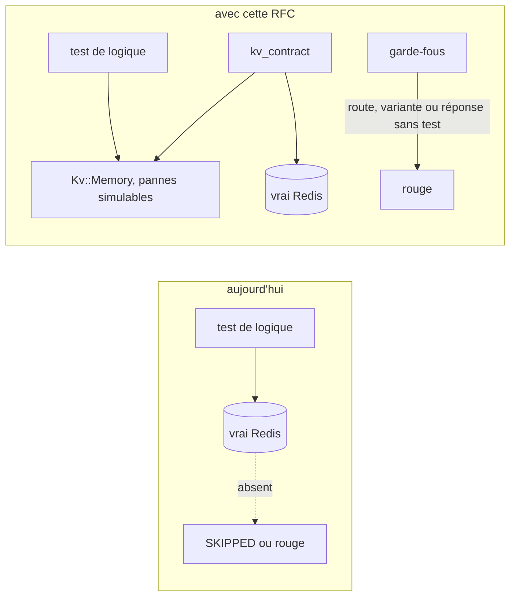
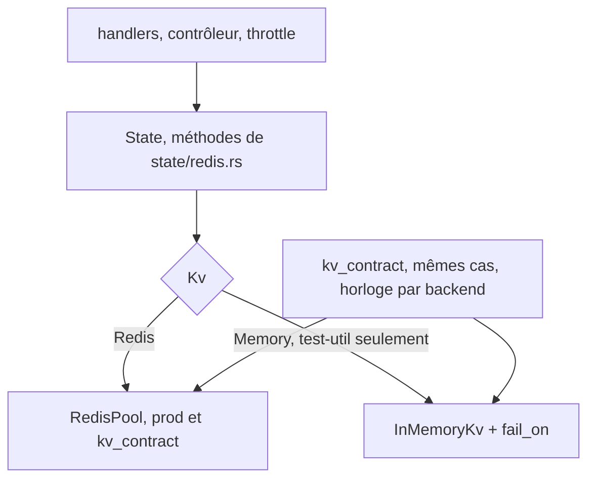
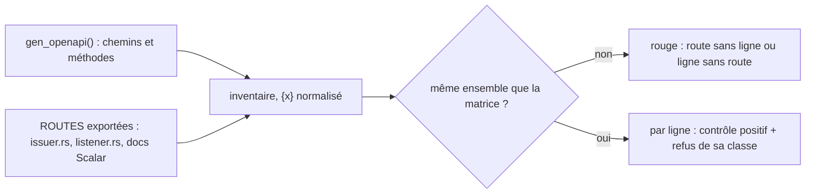
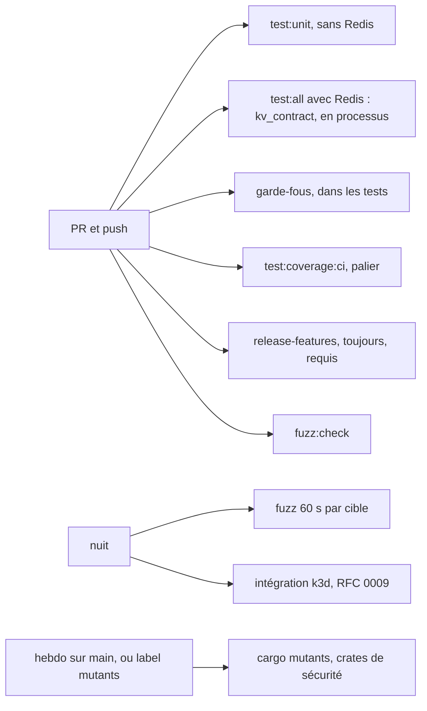
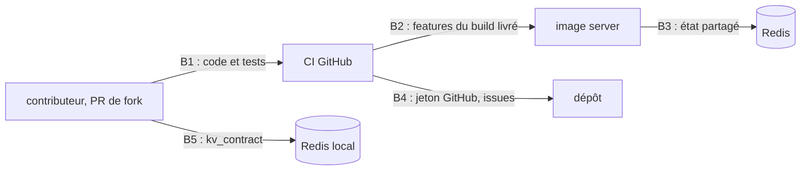

# RFC 0015 — Des tests unitaires et en processus plus profonds

| Field       | Value                                                                  |
| ----------- | ---------------------------------------------------------------------- |
| Status      | Accepted                                                               |
| Short       | Tests profonds (unitaires et en processus, Rust)                       |
| Settles     | Ce qui doit casser quand une régression entre, avant la suite d'intégration |
| Author      | Max Batleforc <maxleriche.60@gmail.com>                                |
| Co-author   | Claude Opus 5.5                                                        |
| Created     | 2026-10-30                                                             |
| Supersedes  | —                                                                      |
| Touches     | `libs/server/common/{Cargo.toml,src/state.rs,src/state/redis.rs,src/redis_pool.rs,src/kv_memory.rs (nouveau),src/oidc_cache.rs,src/upstream_trust.rs,tests/kv_contract.rs (nouveau)}`, `libs/server/api/{Cargo.toml,src/issuer.rs,src/agent/listener.rs,src/cluster/redirect/upstream_identity.rs,src/auth/oauth/jwks.rs,src/base.rs}`, `libs/server/api/tests/{harness/,authz_matrix.rs (nouveau),openapi_contract.rs (nouveau),…}`, `libs/server/jwt_validator/{Cargo.toml,src/}`, `libs/server/crd/src/upstream_auth/`, `libs/server/crd_runtime/{src/lib.rs,tests/runtime.rs}`, `libs/server/controller/{src/proxy_kube_api/mod.rs,tests/}`, `apps/agent/`, `Taskfile.yaml`, `.tasks/test.yaml`, `.tasks/mutants.yaml` (nouveau), `.cargo/mutants.toml` (nouveau), `.config/nextest.toml`, `.github/workflows/{back-cargo-test.yaml,mutants.yaml (nouveau)}`, `.github/PULL_REQUEST_TEMPLATE/bug_fix.md`, `.it/matrix.py`, `tests/SECURITY-MATRIX.md` (nouveau), `mise.toml`, `CLAUDE.md`, `CONTRIBUTING.md`, `docs/content/docs/developper-guide/{testing.mdx (nouveau),tasks.mdx,integration-tests.mdx}`, `docs/content/docs/roadmap.mdx`, `.rfc/0010-token-exchange.md` (§14, une ligne) |
| Risk        | medium                                                                 |

> Document de référence (environ 8 000 mots). §1 à §3 suffisent pour décider ;
> le reste pour l'implémenter et le relire. Les décisions 1 à 17 viennent du
> `/grill-me` du 2026-10-30 (§15).
>
> **Revue finale du 2026-10-30** (six relecteurs : expérience contributeur,
> sécurité, résilience, qualité du code, stabilité, honnêteté) : les
> corrections sans décision sont faites dans le texte (noms de tâches,
> comptes, signatures, horloge figée, workflow `mutants`, couverture) ; ce qui
> changeait la conception a été tranché au grill du même jour (décisions 18 à
> 25).

---

## 1. Summary

Batlehub tient presque sans régression parce que ses tests rapides sont
profonds : des adaptateurs en mémoire derrière ses ports, une fabrique
d'application partagée, des tests « garde-fous » qui cassent quand un cas
n'est pas couvert, des tests négatifs nommés pour chaque refus, un seuil de
couverture à 80 % avec une liste d'exclusions argumentée. Ce projet a la suite
d'intégration (RFC 0009) et envtest, mais une couche rapide plus mince :
couverture plancher à 62 % (63,18 % mesurés en août, avant les RFC 0011 à
0014), `jwt_validator` à 31 tests pour 1 750 lignes, deux garde-fous, des
tests de logique qui demandent un vrai Redis, et du code dépendant du temps
testé à l'heure qu'il est.

Cette RFC ajoute, côté Rust uniquement : un faux Redis en mémoire, capable de
simuler des pannes, derrière le champ `State::redis` ; l'heure passée en
argument là où les tests en dépendent ; trois garde-fous (matrice authz des
routes, contrat OpenAPI, variantes d'enum) ; des tests profonds sur les crates
de sécurité ; un rapport `cargo-mutants` hebdomadaire ; les règles écrites
(régression, nommage, exclusions). Le seuil monte par paliers jusqu'à 80 %.

### Before / after

```text
# aujourd'hui, sur un poste sans Redis
$ task test:unit        # --lib seulement : les 154 sites redis_or_skip! ne tournent pas
$ task test:all         # REQUIRE_TEST_REDIS=1 : rouge sans Redis
# une route ajoutée sans test d'autorisation : vert
# UpstreamAuthMode::TokenExchange ajouté (RFC 0010) sans test : vert
# la branche throttle_fail_closed (throttle.rs:81) : aucun test, vert

# avec cette RFC
$ task test:unit        # --lib --tests : la logique tourne sur Kv::Memory
$ task test:all         # + kv_contract contre le vrai Redis
authz_matrix: GET /api/v1/probe is served but has no row in ROUTES (add one, class: Public|Authenticated|ClusterScoped)
error[E0004]: non-exhaustive patterns: `UpstreamAuthMode::TokenExchange` not covered   # garde-fou des variantes
mutants (hebdo): libs/server/api/src/issuer.rs: replace < with <= in sign — caught by sign_caps_exp_at_the_source_token
```



Le schéma montre le déplacement : la logique ne dépend plus d'un Redis pour
tourner, et le contrat prouve que le faux et le vrai répondent pareil sur les
mêmes cas.

---

## 2. Motivation

1. **La couverture plancher n'a plus de marge connue.** `COVERAGE_MIN` vaut
   62 (`.tasks/test.yaml:30`) ; la dernière mesure, 63,18 %, date du
   2026-08-29, avant les RFC 0011 à 0014 (la seule fusion de la 0014 ajoute
   5 001 lignes sous `libs/` et `apps/`). Le chiffre actuel est inconnu ; P1
   le mesure. Le seuil maison est 80 %.
2. **Les crates de sécurité sont les moins testées pour leur taille.**
   `jwt_validator` : 31 tests pour 1 750 lignes ; `common` (caches OIDC, état
   de confiance, Redis) : 58 pour 4 300 ; `apps/agent` : 14 pour
   2 000 ; `controller` : 38 pour 2 300. `client_api` en a 0, mais il est
   généré.
3. **Les branches d'erreur de Redis ne sont pas testées.**
   `api/src/cluster/redirect/throttle.rs`
   choisit d'échouer ouvert ou fermé selon `throttle_fail_closed`
   (`throttle.rs:81`, `:97-107`), `record_auth_failure` ignore une erreur
   (`:129-133`), `agent_gateway.rs:237` trie les erreurs : aucun test ne
   distingue « Redis répond » de « une commande échoue », seulement « Redis
   injoignable » (`unreachable_state`). `throttle_fail_closed` n'a aucun test.
4. **La logique liée à Redis ne tourne qu'avec Redis.** 154 appels
   `redis_or_skip!`, macro recopiée dans 25 fichiers (`api/tests`, dont trois
   suites envtest, et `controller/tests/reconcile.rs`). `task test:unit` ne
   lance que `--lib` (`.tasks/test.yaml:59`) et ne les voit pas ; il faut un
   Redis local et `test:all` pour les lancer.
5. **Le temps se teste à l'heure qu'il est.** `issuer.rs` lit l'horloge à 6
   endroits, `oidc_cache.rs` à 5, `jwks.rs` à 3 ; les caches utilisent
   `std::time::Instant`, que `tokio::time::pause` ne fige pas. Les bornes
   (rotation, `exp` du JWT émis, TTL, plancher de rafraîchissement du JWKS)
   ne sont testées qu'aux instants que le test tombe à vivre.
6. **Ajouter un cas sans test passe.** Deux garde-fous existent
   (`controller/src/reason.rs:152`, `crd/…/oidc_provider.rs:308`). Une route
   ajoutée sans test d'autorisation, une variante d'`UpstreamAuthMode` (la
   RFC 0010 en annonce une) ou de `Verb` sans test, une réponse 2xx sans corps
   déclaré : tout passe au vert.
7. **La couverture compte les lignes exécutées, pas vérifiées.** Rien ne dit
   si un test casse quand on inverse une comparaison dans l'émetteur ou dans
   l'identité amont.
8. **Aucune règle n'est écrite.** `CLAUDE.md` n'a pas de règle de test ; le
   test de régression accompagne la plupart des correctifs Rust par habitude
   (5c28e4d, bcfd3f5, c79f579, 074b169), pas par règle.

---

## 3. Goals / non-goals

**Goals**

- La logique qui passe par Redis se teste sans Redis, y compris ses branches
  d'erreur, et le faux ne peut pas s'écarter du vrai sans qu'un test casse.
- Les bornes de temps dont le code du dépôt décide (rotation, `exp` émis, TTL)
  se testent à un instant choisi.
- Une route, une variante d'enum pilote ou une réponse ajoutée sans son test
  casse la CI.
- `jwt_validator`, l'identité amont et l'émetteur sont testés jusqu'à ce
  qu'aucun mutant n'y survive sans justification écrite.
- La couverture atteint 80 % des lignes, par paliers, sans jamais baisser le
  seuil.
- Les règles sont écrites et la page `testing.mdx` les tient.

**Non-goals**

- **Le front** (vitest, Playwright, scripts de build) : RFC 0017 (décision 2).
- **La suite heavy et la perf** (vrais clients, points 16 et 17 de la 0014,
  k6) : RFC 0016 (décision 1).
- **Raccourcir les dérogations nextest de 12 et 15 min** de la suite
  d'intégration : elles attendent un vrai apiserver (activation de clé,
  rechargement du JWKS par l'apiserver), qu'aucun test rapide ne remplace.
  La motivation 5 vise les tests rapides, pas ces deux-là.
- **Remplacer l'horloge de `jsonwebtoken`** : `exp` et `nbf` sont vérifiés par
  la bibliothèque (`validator.rs:94-95`) ; les réécrire pour les tester serait
  un contrôle maison de plus (décision 18).
- **Un faux client kube** : wiremock et envtest couvrent déjà l'apiserver
  (décision 6).
- **Le mode cluster Redis dans le contrat** : aucun job ne démarre un Redis
  cluster ; `testing.mdx` le note comme non couvert (le code lit
  `list_objects` clé par clé pour cette raison).
- **Réécrire ou déplacer les tests existants** : règle pour le code nouveau ;
  migration seulement des tests de logique (décision 12).
- **insta, criterion, quickcheck** : aucun besoin identifié (décision 11).
- **Un seuil par crate** : `cargo llvm-cov` n'en a pas ; les mutants et des
  cibles de comportement par crate (§16, P3) en tiennent lieu.
- **Un check bloquant pour la règle de régression** (décision 10).
- **Rendre `mutants` requis** (décision 11).

---

## 4. User-facing design

Les « utilisateurs » ici sont les contributeurs, humains et agents, et la CI.
Aucun comportement du produit ne change.

### 4.1 Configuration

```yaml
# .tasks/test.yaml (incluse sous le préfixe test:, d'où test:unit, test:coverage:ci…)
vars:
  # Palier courant ; le commentaire « Last measured » est mis à jour à chaque palier.
  COVERAGE_MIN: '{{ .COVERAGE_MIN | default "62" }}'
  # Chaque entrée a sa raison en commentaire. On exclut, on ne baisse pas.
  COVERAGE_EXCLUDE: '(libs/cli/client_api/|apps/server/src/main\.rs|apps/crdgen/|apps/swaggergen/|apps/kubectl_proxyauth/|libs/server/common/src/kv_memory\.rs)'
tasks:
  unit:
    desc: "Run the tests that need no Redis and no network (lib + in-process tests on Kv::Memory)"
    cmds:
      - cargo nextest run -p common -p crd -p api -p controller -p jwt_validator --lib --tests
```

```toml
# .cargo/mutants.toml
test_tool = "nextest"   # un processus par test : les statics globaux (issuer::SLOTS…) l'exigent
examine_globs = [
  "libs/server/api/src/cluster/redirect/upstream_identity.rs",
  "libs/server/api/src/issuer.rs",
  "libs/server/crd/src/upstream_auth/**/*.rs",
  "libs/server/jwt_validator/src/**/*.rs",
]
# Mutants équivalents : un par ligne, avec sa raison en commentaire.
exclude_re = []
```

```toml
# dev-dependencies de common, api et jwt_validator
tokio = { workspace = true, features = ["test-util"] }   # start_paused, advance
# dépendance normale de jwt_validator : ajouter la feature "time" (tokio::time::Instant)
```

- `test-util` de `common` reste absent du build livré ; seules les
  `dev-dependencies` l'activent. Il change déjà le comportement de test (les
  caches OIDC et amont sont coupés, `oidc_cache.rs:36`,
  `upstream_cache.rs:214`) ; il porte désormais aussi `Kv::Memory`.
- `REQUIRE_TEST_REDIS=1` garde son sens dans `test:all`, `test:server`,
  `test:integration` et `test:coverage*`. `test:unit` ne le met pas : les
  tests qui testent Redis y disent `SKIPPED:` ; `.config/nextest.toml` passe
  `success-output = "final"` pour ces binaires, sinon nextest masque la ligne.
- Contributeur dont le changement ne touche ni route, ni enum pilote, ni
  Redis : rien de nouveau à faire. `mise install` n'est utile que pour lancer
  `task mutants`.

### 4.2 Behaviour rules

Écrites dans `testing.mdx`, résumées dans `CLAUDE.md` :

- **Un correctif apporte son test de régression**, qui échoue sans le
  correctif. Exception : correctif de CI, de dépendance ou de doc, dit dans la
  PR.
- **Un refus a son test négatif**, nommé par le refus : `<cas>_refused`,
  `_rejected`, `_denied` (ou `_returns_4xx`).
- **Un saut n'est jamais silencieux** : `SKIPPED: <test> — <raison>` sur
  stderr (le message actuel, `harness/mod.rs:122`, gagne le nom du test), et
  la tâche qui promet ce test met la variable qui transforme le saut en échec.
- **On exclut, on ne baisse pas** : `COVERAGE_EXCLUDE` avec sa raison ;
  `COVERAGE_MIN` ne descend jamais.
- **L'heure entre par un argument** là où le code du dépôt décide d'une
  borne : la fonction reçoit `now` ou `at`, et seul le bord lit l'horloge.
  C'est la forme de `IssuerKeys::current(now)` (`issuer_key.rs:68`),
  `servable(at)` (`issuer.rs:77`) et `documents_for(…, at)` (`issuer.rs:320`).
- **Horloge figée sans réseau** : `start_paused` seulement autour d'une
  logique sans entrée-sortie (cache prérempli, `Kv::Memory`). Sous horloge
  figée, tokio avance l'heure dès que le runtime attend, ce qui déclenche les
  délais réels du code (`issuer.rs:40,148` : 2 s ; `oidc_cache.rs:202-203`)
  pendant qu'un wiremock répond. Un test qui a besoin d'I/O appelle
  `tokio::time::pause()` après elle, ou garde l'horloge réelle avec des TTL
  courts et vérifie l'appel (`expect(n)` de wiremock).
- **Rangement** : `mod tests` inline par défaut ; un `tests.rs` voisin quand la
  suite couvre plusieurs fichiers ; une fabrique partagée par crate de tests
  (`tests/harness/` pour `api`, à son nom actuel).
- **Le cas sans intérêt est testé** : option absente, liste vide, aucune règle,
  mode par défaut.

### 4.3 Validation

Ce qui fait échouer la CI, et le message attendu :

| Condition | Message | Rationale |
| --- | --- | --- |
| route servie sans ligne, ou ligne sans route | `authz_matrix: GET /x is served but has no row in ROUTES (add one, class: …)` / `… has a row but is not served` | une route sans test d'accès est un trou qui attend |
| ligne `Public` hors de la liste fermée des préfixes publics | `authz_matrix: GET /x is declared Public but is not under an allowed public prefix` | `Public` ne doit pas être la porte de sortie d'une route sensible |
| variante non couverte | erreur de compilation `non-exhaustive patterns`, au-dessus du `match` : « ajoutez un bras qui nomme le test de la variante » | la variante ajoutée doit être pensée dans les tests |
| réponse 2xx sans `body` | `openapi_contract: POST /x 200 declares no body (add body = T, or list it in NO_BODY with a reason)` | le client HeyApi recevrait `unknown` |
| couverture sous `COVERAGE_MIN` | sortie de `cargo llvm-cov report --fail-under-lines` | règle existante |
| `test-util` dans le build livré | `release-features: common/test-util reaches the release build through <crate>` | état en mémoire par pod en prod (§7, T1) |
| ligne STRIDE sans test ni raison (hors RFC `PENDING`) | `stride: RFC 0012 T7 names a test that does not exist: …` | §7 de chaque RFC promet un test négatif par ligne |

Ce qui avertit, et où :

| Condition | Comportement | Visible dans |
| --- | --- | --- |
| mutant survivant non listé (exécution planifiée sur `main`) | ouvre ou met à jour une issue `mutants` | issue GitHub, artefact |
| mutant survivant (exécution par label) | pas d'issue | résumé du job et artefact |
| test de Redis sauté dans `test:unit` | `SKIPPED:` affiché (success-output final) | sortie du terminal |

### 4.4 API surface

Aucune route ajoutée ou modifiée. Deux réponses gagnent leur `body` déclaré
dans utoipa (`oauth/jwks.rs:27`, `base.rs:26`) pour que le contrat soit vert ;
le document OpenAPI change, pas le comportement.

---

## 5. Architecture

### 5.1 Le faux Redis

En production, `State` garde un seul champ Redis (`state.rs:40`,
`redis: RedisPool`) ; tout accès passe par les méthodes de `state/redis.rs`
et seul ce fichier et `redis_pool.rs` importent `redis::`. (Les tests, eux,
alimentent Redis par un `deadpool_redis::Pool` brut : `harness/mod.rs:28-30`,
`seed_proxy` `:372`, `delete_proxy` `:393`, `virtual_api_support/mod.rs:24,41`
— voir §6.1.) Le champ devient une enum publique :

```rust
pub enum Kv {
    Redis(RedisPool),
    #[cfg(feature = "test-util")]
    Memory(InMemoryKv),
}
impl From<RedisPool> for Kv { … }
```

Chaque méthode de `state/redis.rs` délègue par un `match`. `InMemoryKv` est un
`Mutex<HashMap<String, Entry>>` ; les échéances sont lues sur
`tokio::time::Instant`, et les scores de présence (que le vrai calcule depuis
`redis.call('TIME')`, `state/redis.rs:317`) sur une horloge murale injectable.
Il porte un **mode panne** : `fail_on(op)` ou `fail_after(n)` rend
`RedisPoolError` pour l'opération choisie, Redis restant « joignable ».



**Invariant** : parce que la variante `Memory` n'existe que sous
`cfg(feature = "test-util")`, qu'aucune dépendance normale du workspace
n'active cette feature, et que `State::new` (`state.rs:86`) ne construit que
`RedisPool::from_url`, le binaire livré ne peut pas tenir un état en mémoire.
La deuxième condition est vérifiée sur la commande de build de l'image
(`cargo build --release --workspace`, `deploy/build/back/Containerfile:92,102`),
pas sur `-p server` (§6.1).

### 5.2 L'heure

- **Bornes que le dépôt décide** (rotation, `iat`/`exp` du JWT émis, jitter) :
  la logique reçoit l'instant. `issuer_key.rs`, `servable` et `documents_for`
  le font déjà ; restent `sign` (`issuer.rs:239`, `now()` pour `iat` et
  `exp`, `:252`) et le jitter (`SystemTime` à `issuer.rs:110`).
- **Bornes de `jsonwebtoken`** (`exp`, `nbf` des jetons reçus) : laissées à la
  bibliothèque (décision 18). La tolérance est fixée explicitement dans
  `validator.rs` au lieu du défaut implicite de 60 s, et testée avec des jetons
  signés à `now - 1`, `now + leeway ± 5`.
- **Caches à TTL** : `std::time::Instant` devient `tokio::time::Instant` dans
  `oidc_cache.rs`, `upstream_trust.rs`, `jwks.rs`, `issuer.rs`. Hors runtime
  tokio et hors test, les deux lisent la même horloge ; aucun site n'est dans
  le CLI. Les lectures `SystemTime` de `oidc_cache.rs:183,300` (expiration
  d'un jeton en secondes) et `upstream_trust.rs:45` (`since` affiché au
  statut) restent : la première se teste avec des jetons datés, la seconde
  n'a pas de borne.

Pas de trait `Clock` global (décision 6).

### 5.3 Les garde-fous



L'inventaire réunit le document OpenAPI (`app_router`, `lib.rs:80-91`) et des
listes `const` exportées par les fichiers qui montent des routes à la main,
listes que leur routeur lit aussi, ce qui empêche une route de manquer à
l'inventaire : `issuer::ROUTES` (`issuer.rs:427-433`), `listener::ROUTES`
(`/agent/v1/connect`, `/agent/v1/enroll`, `/healthz`, `/readyz`,
`listener.rs:791-798`) et la page Scalar (`server.rs:72`). Le catch-all est
dans le document OpenAPI comme `{path}` et dans le routeur comme `{*path}` :
l'inventaire normalise `{*x}` en `{x}` et ne le compte qu'une fois.

Chaque ligne déclare sa **classe d'accès**, parce que plusieurs routes sont
publiques par conception : `Public` (contrôle positif anonyme), `Authenticated`
(anonyme → 401), `ClusterScoped` (anonyme → 401, hors règles → 403),
`AgentEnrolled` (listener : sans certificat ou jeton d'inscription → refus).
`Public` n'est accepté que sous une **liste fermée de préfixes**
(`/management/`, la découverte et le JWKS OAuth, `/issuer/`, `/healthz`,
`/readyz`, la page Scalar) : une route `Public` ailleurs fait échouer le test.

### 5.4 Où chaque couche tourne



Rien de nouveau ne s'ajoute au chemin requis d'une PR, sauf
`release-features`, un job court sans filtre de chemins (décision 19).

---

## 6. Detailed design

### 6.1 `common` : `Kv`, `InMemoryKv`, le contrat, le harness

- `state.rs` : `redis: RedisPool` → `kv: Kv` ; `State::from_parts`
  (`state.rs:153`, sous `test-util`) prend `impl Into<Kv>`, ce qui garde ses
  10 appelants inchangés (`harness/mod.rs:75,150`, quatre `envtest_*.rs`,
  `crd_runtime/src/lib.rs:477`, `crd_runtime/tests/runtime.rs`,
  `controller/src/proxy_kube_api/mod.rs:154`, `controller/tests/support`).
  `State::in_memory(config)` sous `test-util`.
- `kv_memory.rs` (nouveau, sous `test-util`) : `InMemoryKv`, spécifié depuis le
  code, pas depuis la doc Redis :
  - `redis_take` = `GETDEL` ;
  - `incr_with_ttl` copie le script Lua (`state/redis.rs:99-109`) : `INCR`, puis
    `EXPIRE` quand `TTL < 0`, ce qui répare aussi un compteur sans échéance ;
  - `presence_refresh` / `presence_members` copient les scripts (`:310-361`),
    borne exclusive `(now` comprise ;
  - `redis_ping` répond (la sonde de disponibilité l'appelle, `base.rs:66`,
    `listener.rs:719`) ;
  - `fail_on(op)` / `fail_after(n)` pour les branches d'erreur.
- `common/tests/kv_contract.rs` (nouveau, `[[test]] required-features =
  ["test-util"]`) : une macro génère chaque cas pour `Memory` et pour un vrai
  Redis (`TEST_REDIS_URL`, `REQUIRE_TEST_REDIS`). Le temps passe par un
  `elapse(d)` propre au backend : `tokio::time::advance` pour `Memory`, une
  vraie attente de `d + 1 s` (sans horloge figée) pour Redis, qui compte en
  secondes. Clés préfixées par cas, jamais de `FLUSHDB`/`FLUSHALL`. Cas :
  TTL échu ; `take` atomique sous 16 appels concurrents (un seul gagne) ;
  `incr_with_ttl` ne repousse pas l'échéance ; compteur sans TTL réparé ;
  `index_remove` d'une clé absente ; `list_objects` avec un objet illisible ;
  membre de présence à exactement `now` ; membre échu.
- `test:release-features` (`.tasks/test.yaml`) :
  `cargo tree --workspace -e normal,build,features -i common` ne doit pas
  contenir `test-util` (les arêtes de dev-dependencies sont exclues, sinon
  `api`, `controller` et `crd_runtime` donneraient une fausse alerte).
  `--self-test` : un manifeste de fixture où un autre membre du workspace
  prend `common` avec `test-util` en dépendance normale doit faire échouer la
  commande cargo elle-même, pas seulement le grep. Le vérifier sur la sortie
  réelle de `cargo tree` avant de s'y fier.
- Harness d'`api` : `seed_proxy`, `delete_proxy` et `virtual_api_support`
  passent par les méthodes de `State` au lieu du `Pool` brut, ce qui les rend
  utilisables sur les deux backends ; `state_in_memory()` sert les tests de
  logique. Une seule macro `redis_or_skip!` dans le harness d'`api` et une
  dans `controller/tests/support` (qui ne peut pas importer celui d'`api`).
- Ce qui migre vers `Memory` : les tests de logique qui n'utilisent Redis que
  comme stockage. **Ce qui reste sur le vrai Redis** : les suites de sécurité
  qui en dépendent (`auth_login_throttle.rs`, `proxy_throttle.rs`,
  `oauth_as_token.rs`, `audit_trail.rs`), les suites envtest, `kv_contract`
  (décision 21).
- Branches d'erreur (motivation 3) : `throttle_fail_closed` à `true` et à
  `false` avec `fail_on(Exists)` (lecture du bannissement) ; `record_auth_failure` sur erreur ;
  `agent_gateway.rs:237` sur chaque variante d'erreur.

### 6.2 L'heure

- `issuer.rs` : `sign` reçoit l'instant ; le jitter de `issuer.rs:110` aussi.
  Tests (horloge passée en argument, pas d'I/O) : `exp` = échéance du jeton
  source, à une seconde près des deux côtés (décision 61 de la 0014) ; clé à
  `activate_at - 1` et `activate_at` ; JWKS après `retire_at`.
- `jwt_validator` : tolérance explicite dans `validator.rs` ; jetons signés aux
  bords de `exp` et `nbf` autour de cette tolérance ; aucune réécriture de la
  vérification (décision 18).
- `oidc_cache.rs`, `upstream_trust.rs`, `jwks.rs` : `tokio::time::Instant` ;
  tests `start_paused` sur cache prérempli, sans wiremock : entrée servie
  jusqu'à TTL-1, échue à TTL ; plancher de rafraîchissement du JWKS
  (`jwks.rs:217-223`) respecté. Ces tests vivent dans les `mod tests` de
  `common` et `jwt_validator`, compilés sans `test-util` de `common` (qui
  coupe les caches).
- `tokio` gagne `test-util` en dev-dependency de `common`, `api`,
  `jwt_validator`, et `time` en dépendance normale de `jwt_validator`.

### 6.3 Les garde-fous

- `api/tests/authz_matrix.rs` (nouveau) : `ROUTES: &[Row]` (méthode, chemin,
  classe, requête minimale valide) ; inventaire de §5.3 ; par ligne, contrôle
  positif et refus de la classe ; liste fermée des préfixes `Public`. Le
  contrôle positif est obligatoire : un refus seul passe aussi si la route est
  cassée.
- `api/tests/openapi_contract.rs` (nouveau) : sur `gen_openapi()`, chaque
  réponse 2xx a un `content`, sauf 204 et `NO_BODY` (le catch-all, qui relaie
  l'apiserver, `redirect/mod.rs:37`), chaque entrée avec sa raison. Les deux
  `body` manquants (`oauth/jwks.rs:27`, `base.rs:26`) sont déclarés dans la
  même phase, pour que le contrat naisse vert.
- Variantes : un test par enum avec un `match` exhaustif sans `_`, un bras par
  variante qui nomme le test qui la couvre, et un commentaire au-dessus :
  « ajoutez un bras qui nomme le test de la nouvelle variante ». Pas de liste
  de plus dans le code de prod : `UpstreamAuthMode` a déjà `SERVED_MODES`
  (`upstream_auth/mod.rs:56`), que le test compare aussi. Enums :
  `UpstreamAuthMode` (`mod.rs:17`), `Verb` (`security/verb.rs:13`),
  `UpstreamTrust` (`mod.rs:247`) ; aucun n'est `#[non_exhaustive]`.
  `AccessType` (`apps/crdgen/src/schematic.rs:30`) n'en est pas : il ne sert
  qu'au schéma du générateur, aucun comportement n'en dépend.
- RFC 0010 : sa variante `TokenExchange` ne compilera pas sans son bras ; une
  ligne est ajoutée à son §14 dans la PR de P1.
- Chaque garde-fou a son test « qui peut échouer » : la fonction de comparaison
  appelée sur un inventaire et une matrice qui divergent doit rendre l'écart.

### 6.4 Crates de sécurité (P2)

- `jwt_validator` : `alg: none`, `alg` hors liste, `kid` inconnu puis
  rafraîchissement unique, signature d'une autre clé du même JWKS, `aud` en
  tableau sans la valeur attendue, `iss` à un slash près, claim de groupes au
  mauvais type, bords de §6.2. (La borne de taille du JWKS est déjà testée,
  `jwks.rs:399`.)
- `upstream_identity.rs` : les refus de §4.2 de la 0014 (préfixe, `system:`,
  vide, plus de 64 groupes, CR/LF) un par un, et **proptest** : toute identité
  acceptée produit des en-têtes `X-Remote-*` qui se relisent en la même
  identité, et aucun en-tête produit ne contient un octet refusé par
  `HeaderValue`.
- Émetteur : §6.2, plus l'ordre des clés du JWKS indépendant de l'ordre
  d'insertion (proptest).
- Rattrapage STRIDE : `tests/SECURITY-MATRIX.md` (nouveau), une ligne par ligne
  T des §7.1 des RFC 0010 à 0014 (103), avec le test négatif qui la prouve ou
  `hors suite` et sa raison. Vérifié par `.it/matrix.py --stride`, qui
  réutilise son mécanisme `PENDING` (`matrix.py:30`) : une RFC listée peut
  dire `à écrire`. Tâche `it:stride` (avec `desc`) dans `task lint`, avec
  `--self-test`. `PENDING` contient 0010 tant qu'elle n'est pas codée, et
  0011 à 0014 jusqu'à la fin de P2 : le check ne bloque aucun commit avant que
  les tests existent.

### 6.5 `cargo-mutants`

- Outil dans `mise.toml` (`"cargo:cargo-mutants" = "latest"`, verrouillé par
  `mise.lock`, comme `cargo-llvm-cov`), config §4.1, tâches `mutants` et
  `mutants:diff BASE=…` dans `.tasks/mutants.yaml`, incluse dans
  `Taskfile.yaml`.
- `mutants.yaml` (nouveau) :
  - déclencheurs : `schedule` hebdomadaire, `pull_request` avec
    `types: [labeled]` et le label `mutants` (pas `pull_request_target`),
    `workflow_dispatch` ; groupe de concurrence par PR ;
  - service `redis:8-alpine` comme `back-cargo-test.yaml:34`,
    `REQUIRE_TEST_REDIS=1` : sans lui, des mutants « survivent » parce que
    leurs tests ont sauté ;
  - `timeout-minutes` sur l'étape `cargo mutants` sous celui du job ; envoi
    de l'artefact et résumé en `if: always()` ;
  - codes de sortie : 0 rien à signaler ; 2 survivants → issue (planifié) ;
    3 mutants hors délai → signalés à part, ni tués ni survivants ; 4 la
    base non mutée échoue → job rouge, jamais lu comme « zéro survivant » ;
  - `permissions: contents: read` pour la mutation ; l'issue est ouverte par
    un job séparé, `issues: write`, seulement si
    `github.event_name == 'schedule' && github.ref == 'refs/heads/main'` ; le
    texte des survivants passe par un fichier, jamais par `${{ }}` dans
    `run:` ; actions épinglées par SHA ;
  - si le périmètre dépasse durablement le budget : `--shard k/n` en matrice.
- Un mutant équivalent entre dans `exclude_re` avec sa raison (décision 16).

### 6.6 Couverture

- `COVERAGE_EXCLUDE` passé à `--ignore-filename-regex` sur la mesure **et** sur
  les deux appels `cargo llvm-cov report` de `test:coverage:ci`, raisons en
  commentaire : `client_api` généré, binaires minces, `kv_memory.rs` (code de
  test compilé sous `test-util`).
- Paliers (décision 14) : mesure **après** la migration de P1, avec les
  exclusions ; palier P1 = cette mesure arrondie au point inférieur ; P2 ≥ 72 ;
  P3 ≥ 80. Un palier non atteint laisse la phase ouverte.
- envtest dans la mesure : tenté en P1 ; s'il allonge `test:coverage:ci` de
  plus de 10 min, il reste hors mesure et `testing.mdx` le dit (décision 7).
- `back-cargo-test.yaml:15,23` filtre sur `.taskfile/test.yaml`, qui n'existe
  pas : corrigé en `.tasks/test.yaml`, plus `.cargo/mutants.toml` et
  `.config/nextest.toml`, en P1 — sinon une PR qui ne change qu'un palier ne
  lance pas la porte.

### 6.7 Règles et documentation

- `CLAUDE.md` : un paragraphe « Tests » qui renvoie à `testing.mdx` et pose les
  quatre règles de §4.2 les plus utiles à un agent.
- `developper-guide/testing.mdx` (nouveau, en français comme ses voisins) :
  seul propriétaire du tableau des commandes de test ; les couches (unitaire,
  en processus, envtest, intégration, fuzz, mutants, perf), où chacune tourne
  (§5.4), les règles, comment ajouter une ligne aux garde-fous et choisir une
  classe d'accès, ce qui n'est pas couvert (Redis cluster). `tasks.mdx` et
  l'intro d'`integration-tests.mdx` (« `task test` ») renvoient vers elle.
- `CONTRIBUTING.md` renvoie à `testing.mdx` ; `bug_fix.md` gagne la case « un
  test échoue sans ce correctif : `<nom>` ».

### 6.P Proof against a real client

Aucun client du produit ne voit ce changement : aucune route, aucun en-tête,
aucun comportement ne bouge (deux réponses gagnent seulement leur schéma dans
le document OpenAPI). Le seul consommateur est la chaîne de test — cargo,
nextest, cargo-llvm-cov, cargo-mutants et la CI GitHub — et c'est contre elle
que les observations se font. La suite d'intégration (RFC 0009) reste le
signal de régression du produit et doit rester verte sans modification.

1. `TEST_REDIS_URL=redis://127.0.0.1:1 task test:unit` — les tests migrés
   tournent (compte rendu par nextest), aucune ligne `SKIPPED:` pour eux, une
   par test resté sur Redis.
2. `task test:all` avec Redis — `kv_contract` rend le même verdict pour
   `memory` et `redis` sur chaque cas.
3. `fail_on(Exists)` avec `throttle_fail_closed = true` puis `false` — la
   requête est refusée comme un sujet banni, puis servie
   (`cluster/redirect/throttle.rs:97-107`).
4. **Refus** : une route `GET /api/v1/probe` ajoutée sans ligne —
   `authz_matrix` échoue avec le message de §4.3 ; retirée, vert.
5. **Refus** : la même route déclarée `Public` — échec « not under an allowed
   public prefix ».
6. **Refus** : `UpstreamAuthMode::TokenExchange` ajouté — le test du
   garde-fou ne compile plus (`non-exhaustive patterns`).
7. **Refus** : `apps/swaggergen` prend `common` avec `test-util` en dépendance
   normale — `release-features` échoue en nommant `swaggergen`, alors que
   `cargo tree -p server` resterait propre.
8. `cargo mutants -f libs/server/api/src/issuer.rs` sur la comparaison qui
   plafonne `exp` dans `sign` — `caught`, avec le nom du test.
9. `COVERAGE_MIN` relevé d'un point au-dessus de la mesure —
   `test:coverage:ci` sort en erreur avec le taux mesuré.
10. Une ligne de `SECURITY-MATRIX.md` d'une RFC hors `PENDING` qui nomme un
    test inexistant — `it:stride` échoue en nommant la ligne T et la RFC.

**Deliberately untouched**, so reviewers do not go looking:

- `tests/integration/` et ses dérogations nextest de 12 et 15 min — elles
  attendent un vrai apiserver.
- Les 13 suites `envtest*.rs` — elles restent sur le vrai Redis ; seuls leur
  appel à `from_parts` (inchangé grâce à `impl Into<Kv>`) et leur copie de la
  macro bougent.
- `fuzz/` — ses 7 cibles restent ; cette RFC n'ajoute pas de parseur.
- `jsonwebtoken` et sa vérification de `exp`/`nbf` — décision 18.
- `libs/cli/client_api` — généré ; exclu de la mesure.
- `apps/front`, `libs/front` — RFC 0017.

---

## 7. Security

**Rating:** medium — aucune surface nouvelle, mais le champ Redis de `State`
porte les révocations, les throttles et les nonces ; un faux qui fuirait en
prod, ou un refactor qui changerait une sémantique, affaiblirait des
contrôles existants.

### 7.1 Threat model

Actifs : l'état partagé entre réplicas (révocations `revoke:<nonce>`,
compteurs de throttle, nonces OAuth à usage unique, présence des agents), la
justesse des contrôles d'accès, la confiance dans la CI, le Redis local d'un
contributeur.



| # | Threat (STRIDE) | Where | Mitigation | Residual risk |
| --- | --- | --- | --- | --- |
| T1 | Elevation : `Kv::Memory` dans l'image, état par pod : un throttle ou une révocation se contourne en changeant de réplica | B2 | variante sous `cfg(feature = "test-util")` ; `State::new` ne construit que `RedisPool` ; `release-features` sur `--workspace -e normal,build,features`, comme le build de l'image, dans un job sans filtre de chemins et requis (décision 19) | aucun une fois le job requis ; tant qu'il ne l'est pas, accepté par l'auteur jusqu'à la fin de P1 |
| T2 | Tampering : le passage à `Kv` change une sémantique de sécurité (`take` non atomique, TTL repoussé, compteur sans échéance) | B3 | `kv_contract` sur ces cas contre le vrai Redis ; les suites de throttle, OAuth et audit restent sur le vrai Redis (décision 21) | un comportement Redis hors contrat ; accepté (auteur), le contrat grandit avec les méthodes |
| T3 | Tampering : le passage de l'heure en argument décale une borne (`exp` émis une seconde de trop, clé retirée encore servie) | B3 | tests de bord des deux côtés (§6.2) ; mutants sur `issuer.rs` ; `exp`/`nbf` reçus restent à `jsonwebtoken` (décision 18) | aucun |
| T4 | Elevation (indirecte) : un garde-fou qui ne peut pas échouer, ou une route sensible déclarée `Public` | B1 | test d'écart synthétique par garde-fou ; `match` exhaustif sans `_` ; listes `ROUTES` lues par les routeurs eux-mêmes ; préfixes `Public` en liste fermée | une route montée par un routeur qui n'exporte pas sa liste ; accepté, les trois points de montage connus l'exportent |
| T5 | Info disclosure : une fixture contient un vrai secret | B1 | clés générées à l'exécution (`rcgen`), gitleaks au pre-commit et en CI ; `harness/test_rsa_key.pem` reste une clé de test | aucun |
| T6 | Elevation : le workflow `mutants` lancé par une PR de fork reçoit un jeton en écriture, ou un texte injecte une commande | B4 | `pull_request` (pas `_target`), `contents: read` ; issue par un job séparé seulement sur `schedule` et `main` ; texte par fichier, pas `${{ }}` dans `run:` ; actions par SHA | aucun |
| T7 | Tampering / DoS local : `kv_contract` efface ou écrase les clés du Redis de développement d'un contributeur | B5 | clés préfixées par cas, aucun `FLUSHDB`/`FLUSHALL`, `TEST_REDIS_URL` distinct de la config du serveur | un contributeur qui pointe `TEST_REDIS_URL` sur un Redis partagé ; documenté dans `testing.mdx` |

### 7.2 Authentication and authorisation

Aucune surface nouvelle. La matrice authz prouve les contrôles existants sans
les modifier ; une route publique reste publique, déclarée `Public` sous un
préfixe autorisé.

### 7.3 Input handling and injection

Aucun parseur nouveau en prod. Le proptest de §6.4 renforce le refus des
octets interdits dans `X-Remote-*` (T4 de la 0014). Le workflow `mutants`
ne passe aucun texte de PR à un shell (T6).

### 7.4 Secrets and cryptography

Aucun secret ni primitive nouveaux. Aucune vérification cryptographique ou
temporelle n'est réécrite à la main : `exp`/`nbf` reçus restent à
`jsonwebtoken`.

### 7.5 Abuse and resource exhaustion

Sans objet pour le produit. CI : délai par étape sur `mutants`, périmètre
borné par `examine_globs`, déclenché par label `labeled` (pas à chaque push),
groupe de concurrence.

### 7.6 Existing defences that still hold

`REQUIRE_TEST_REDIS`, le check requis `integration`, `fuzz:check`, gitleaks,
les tests négatifs existants (`proxy_security.rs`, throttles, sur le vrai
Redis) — aucun n'est retiré ni assoupli.

---

## 8. Supply chain

| Dependency / image / tool | Version | Why this one | Licence | Known CVEs | Maintenance |
| --- | --- | --- | --- | --- | --- |
| `proptest` (dev-dependency, `api`) | 1.12.0 | génération et réduction de cas ; à la main, il faudrait refaire le shrinking | MIT OR Apache-2.0 | aucune advisory OSV (api.osv.dev, 2026-10-30) ; `task audit` à l'ajout | proptest-rs, publié régulièrement |
| `cargo-mutants` (outil, mise) | 27.1.0 | la seule mesure de la force des tests disponible pour Rust | MIT | aucune advisory OSV (2026-10-30) ; outil hors binaire livré | sourcefrog/cargo-mutants, publié régulièrement |
| feature `test-util` de `tokio` (dev) | celle du workspace | `start_paused`, `advance` | MIT | pas de nouvelle crate | — |
| feature `time` de `tokio` (`jwt_validator`) | celle du workspace | `tokio::time::Instant` | MIT | pas de nouvelle crate ; déjà compilée par `common` | — |

- **Build and release** : aucune image ni binaire livré ne change ; un
  workflow nouveau (`mutants.yaml`) et un job (`release-features`), actions
  épinglées par SHA.
- **Updates** : Dependabot pour `proptest` ; mise (`latest` + `mise.lock`)
  pour `cargo-mutants`.

---

## 9. Data and privacy

| Data | Personal? | Where stored | Retention | Who can read it | Leaves the instance? |
| --- | --- | --- | --- | --- | --- |
| rapport `mutants.out` | non : chemins, lignes, mutations | artefact GitHub Actions | rétention d'artefacts du dépôt | lecteurs du dépôt | non (GitHub) |
| issue `mutants` | non : fichier, ligne, mutation | issues GitHub | jusqu'à fermeture | public | non |

L'issue publique indique où les crates de sécurité sont le moins bien testées.
Le code est public, la carte s'en déduit déjà ; c'est accepté. Les données de
test sont synthétiques et générées à l'exécution.

---

## 10. Operability

### 10.1 Observability

- **Metrics** : aucune métrique du produit ne change.
- **Logs and audit trail** : aucun changement ; `audit_trail.rs` reste sur le
  vrai Redis.
- **Alerts** : l'issue `mutants` hebdomadaire ; l'issue de nuit de
  l'intégration existe déjà.

### 10.2 Failure modes

| Failure | Detected by | Behaviour (fail open / closed) | Recovery |
| --- | --- | --- | --- |
| Redis absent en local | `try_redis_pool` | `test:unit` : la logique tourne sur `Memory`, les tests de Redis disent `SKIPPED:` ; `test:all` : rouge | démarrer Redis (`.compose/compose.redis.yaml`) |
| Redis absent en CI | `REQUIRE_TEST_REDIS=1` | fermé | relancer le job |
| `Memory` et `Redis` divergent | `kv_contract` | fermé | aligner `InMemoryKv` sur les scripts réels, jamais l'inverse |
| horloge figée et I/O mélangées | délai qui expire au hasard | rouge intermittent | règle de §4.2 : pas d'I/O sous `start_paused` |
| base non mutée rouge (code 4) | `cargo mutants` | job rouge, pas d'issue « zéro survivant » | corriger la suite |
| `cargo mutants` dépasse son délai d'étape | `timeout-minutes` de l'étape | rapport partiel envoyé (`if: always()`) | `--shard` |
| faux positif d'un garde-fou | la PR qui ajoute la route | fermé | ajouter la ligne, choisir la classe |
| couverture sous le palier | `test:coverage:ci` | fermé | des tests, ou une exclusion argumentée |

### 10.3 Performance and capacity

- `test:unit` passe de `--lib` à `--lib --tests` sur cinq crates : plus long
  qu'aujourd'hui, plus court que `test:all` ; mesuré en P1, chiffre dans
  `testing.mdx`.
- `test:coverage:ci` : temps actuel mesuré en P1 ; plafond de +10 min pour y
  mettre envtest.
- `mutants` : nombre de mutants mesuré en P2 (`cargo mutants --list`), délai
  de l'étape fixé sur ce chiffre.

---

## 11. Other concerns

- **Accessibility** : pas d'UI.
- **Internationalisation** : pas de chaîne affichée ; `testing.mdx` en
  français.
- **Compliance** : pas de contrôle touché.
- **Licensing** : ajouts MIT / Apache-2.0, compatibles.
- **Documentation** : `testing.mdx` (nouveau), `tasks.mdx`,
  `integration-tests.mdx`, `CLAUDE.md`, `CONTRIBUTING.md`, `bug_fix.md`,
  `roadmap.mdx`, une ligne au §14 de la 0010.

---

## 12. Alternatives considered

| Alternative | Why rejected |
| --- | --- |
| Ne rien faire, garder 62 % | la marge est inconnue ; les motivations 3 à 7 restent entières |
| Seuil à 80 % d'un coup | rouge dès la fusion ; on finirait par l'abaisser |
| Toujours un vrai Redis local (compose, `redis-server` par mise, sidecar) au lieu d'un faux | règle la motivation 4 à moindre coût, mais ni la 3 (une commande qui échoue sur un Redis joignable ne se provoque pas), ni l'isolation entre tests parallèles, ni l'horloge (Redis compte en secondes réelles) ; le contrat garde le vrai Redis là où il compte (décision 22) |
| testcontainers pour Redis | demande un moteur de conteneurs en CI et en local ; même limite que la ligne au-dessus |
| `redis-test` (`MockRedisConnection`) | rejoue des commandes, sans sémantique : ni TTL ni scripts Lua |
| Trait `KvStore` | possible sans boxing en générique (`State<K>`) ou en `dyn` avec async natif ; mais un paramètre de type traverse `SharedState` et tous les handlers, et un `dyn` demande des futures boxées ; l'enum garde la signature de `State` (décision 15) |
| mockall partout | modèle par attentes : le test décrit l'implémentation, pas le comportement |
| Faux client kube | troisième modèle de l'apiserver après wiremock et envtest |
| Trait `Clock` global | 32 lectures de l'heure, la plupart sans borne testée ; l'argument suffit là où il compte |
| Réécrire `exp`/`nbf` pour injecter l'heure | un contrôle maison au lieu de celui de la bibliothèque ; décision 18 |
| Mutants requis sur chaque PR | durée et bruit sur le chemin requis |
| Une seule RFC test + heavy + perf | décision 1 |

---

## 13. Rollout and compatibility

- **Default behaviour** : le produit ne change pas.
- **Migration** : les tests de logique d'`api` migrent fichier par fichier ;
  `from_parts(…, RedisPool)` continue de compiler (`impl Into<Kv>`), donc un
  fichier non migré marche toujours.
- **Ordre avec la RFC 0010** : P1 de la 0015 avant le code de la 0010, qui ajoute alors son bras au garde-fou et ses tests (décision 23).
- **Required checks** : ajout de `release-features` au ruleset
  `main-integration` (décision 19), action du propriétaire du dépôt.
- **Rollback** : revert de la dernière phase ; P2 et P3 s'appuient sur `Kv` et
  `state_in_memory()`, donc revenir sur P1 après elles impose de les revertir
  aussi, dans l'ordre inverse. `COVERAGE_MIN` ne redescend que par le revert
  de la phase qui l'a monté.
- **Feature flag** : `test-util`, déjà existant.

---

## 14. Test plan

- **Unit** : `kv_memory.rs` ; `issuer.rs` (`sign`, rotation) ; `jwt_validator`
  (bords autour de la tolérance) ; `upstream_identity.rs` (refus un par un) ;
  `throttle.rs` (deux réglages de `throttle_fail_closed`).
- **Integration (en processus)** : `common/tests/kv_contract.rs` ;
  `api/tests/authz_matrix.rs` ; `api/tests/openapi_contract.rs` ; migration
  des tests de logique d'`api`.
- **Proof** : §6.P, points 1 à 10.
- **Security** : T1 → `release-features` et son `--self-test` (point 7) ; T2 →
  `kv_contract::take_is_atomic_*`, `incr_with_ttl_keeps_the_deadline_*`,
  `incr_with_ttl_heals_a_counter_without_ttl_*` ; T3 → bords de §6.2 et
  mutants (point 8) ; T4 → tests d'écart et préfixes `Public` (points 4, 5) ;
  T5 → gitleaks ; T6 → relecture du workflow dans la PR de P2 ; T7 → test du
  harness qui vérifie que chaque clé écrite par `kv_contract` porte le préfixe.
- **Property** : aller-retour `X-Remote-*`, octets refusés, ordre du JWKS.
- **Audit** : `task audit` vert avec `proptest`.
- **Existing suites** sans modification d'assertion : `task test:all`,
  `task envtest:run`, `fuzz:check`, l'intégration et `MATRIX.md`.

---

## 15. Decisions and open questions

### Resolved

| # | Question | Decision |
| --- | --- | --- |
| 1 | Une RFC ou deux ? | **0015 = tests unitaires et en processus ; 0016 = heavy et perf.** Coûts, déclencheurs et risques différents. |
| 2 | Le front ? | **RFC 0017, à part.** |
| 3 | Modifier le code de prod pour le tester ? | **Oui, au minimum, là où un test le demande, dans la même phase.** |
| 4 | Langue et forme ? | **Français, format `batlehub-rfc`, branche `rfc/0015-deep-tests`.** |
| 5 | Faux Redis ? | **Oui : `InMemoryKv` et un contrat lancé contre les deux.** Précisé par la revue : avec un mode panne (§6.1) ; confirmé par la décision 22. |
| 6 | Kube, IdP, horloge ? | **wiremock et envtest gardés ; horloge injectée seulement là où un test en dépend.** Précisé : argument `now`/`at` et `tokio::time::Instant` plutôt qu'un trait `Clock` (§5.2). |
| 7 | Couverture ? | **80 % des lignes en cible, par paliers, `COVERAGE_EXCLUDE` argumenté ; on ne baisse jamais.** envtest dans la mesure si +10 min au plus. |
| 8 | Ordre des crates ? | **`jwt_validator`, identité amont, émetteur ; puis `common`, `controller`, `apps/agent`.** |
| 9 | Garde-fous ? | **Matrice authz, contrat OpenAPI, variantes d'enum.** Précisé : classe d'accès par ligne et préfixes `Public` en liste fermée (§5.3) ; `AccessType` sort, `UpstreamTrust` entre ; listes `ROUTES` exportées par `issuer.rs` et `listener.rs`. |
| 10 | Règle de régression ? | **Écrite, pas de check bloquant ; nommage des tests négatifs ; rattrapage STRIDE des RFC 0010 à 0014.** Précisé : rattrapage non bloquant avant la fin de P2 (`PENDING`). |
| 11 | Au-delà de batlehub ? | **cargo-mutants en rapport sur les crates de sécurité ; proptest pour les invariants ; pas d'insta.** |
| 12 | Réorganiser l'existant ? | **Non ; fusion des helpers seulement là où le faux Redis passe.** |
| 13 | Phases ? | **P1 fondations et garde-fous, P2 sécurité et mutants, P3 le reste jusqu'à 80 %.** |
| 14 | Paliers ? | **P1 = mesure, P2 ≥ 72, P3 ≥ 80.** Précisé : mesure prise après la migration de P1. |
| 15 | Trait ou enum ? | **Enum `Kv`, publique, variante mémoire sous `test-util`, `impl From<RedisPool>`.** |
| 16 | Mutants survivants ? | **Tués ou listés équivalents avec leur raison ; zéro survivant non justifié en fin de P2.** |
| 17 | Documentation ? | **`developper-guide/testing.mdx`, seul propriétaire des commandes de test.** |
| 18 | `exp`/`nbf` des jetons reçus : bibliothèque ou code maison ? | **Bibliothèque (`jsonwebtoken`) gardée ; tolérance fixée explicitement dans `validator.rs` ; bords testés avec des jetons datés ; mutants sur le code qui émet (`issuer.rs`).** Réécrire la vérification pour injecter l'heure ajouterait un contrôle maison. Issue de la revue finale : le grill supposait une comparaison dans le crate. |
| 19 | Où tourne `release-features`, requis ou non ? | **Job court sans filtre de chemins, ajouté au ruleset `main-integration` par le propriétaire du dépôt.** Tant qu'il n'y est pas, T1 est accepté par l'auteur jusqu'à la fin de P1. |
| 20 | Mode panne du faux ? | **Oui, en P1, avec les tests de `throttle_fail_closed`.** Seul moyen de couvrir les branches fail-open/fail-closed. |
| 21 | Suites de sécurité : vrai Redis ou faux ? | **Vrai Redis** pour throttle, OAuth et audit ; seuls les tests de logique où Redis n'est qu'un stockage migrent. |
| 22 | Le faux tient-il sans l'argument « pas de Redis en local » ? | **Oui, gardé**, motivé par ce qu'un vrai Redis ne donne pas : pannes ciblées sur un Redis joignable, horloge figée, isolation des tests parallèles, vitesse. Décision 5 confirmée sur ces raisons. |
| 23 | Ordre avec la RFC 0010 et la 0.5.0 ? | **P1 de la 0015 avant le code de la 0010 ; P2 et P3 en parallèle ; la 0.5.0 n'attend pas la fin de la 0015.** |
| 24 | Listener des agents dans la matrice ? | **Oui, même test, classe `AgentEnrolled`, liste `listener::ROUTES` exportée.** |
| 25 | Cibles par crate pour la motivation 2 ? | **P3 étend le rapport `mutants` (informatif, sans issue) à `common`, `controller`, `apps/agent` ; `testing.mdx` liste les comportements visés par crate.** |

### Still open

Rien.

---

## 16. Implementation phases

| Phase | Content |
| --- | --- |
| 1 | `Kv` (publique, `From<RedisPool>`), `InMemoryKv` (scripts copiés, mode panne), `kv_contract`, `release-features` et son job ; harness qui alimente par `State`, macros uniques ; migration des tests de logique d'`api` ; tests de `throttle_fail_closed` ; `sign` et jitter de l'émetteur avec l'instant en argument, `tokio::time::Instant` dans les caches, features tokio ; les trois garde-fous (listes `ROUTES`, préfixes `Public`, deux `body` déclarés) avec leurs tests d'écart ; `test:unit` en `--lib --tests` ; correction du filtre `.taskfile` ; puis mesure, `COVERAGE_EXCLUDE` et palier P1 ; règles dans `CLAUDE.md`, `CONTRIBUTING.md`, `bug_fix.md`, `testing.mdx` ; ligne au §14 de la 0010. Utile seule : logique testée sans Redis, branches d'erreur couvertes, garde-fous actifs. |
| 2 | Tests profonds de `jwt_validator`, `upstream_identity`, émetteur ; proptest ; `SECURITY-MATRIX.md` et `it:stride` (0011 à 0014 sortent de `PENDING` à la fin) ; `cargo-mutants` (outil, config, tâches, workflow, issue) ; zéro survivant non justifié ; palier ≥ 72 %. |
| 3 | `common`, `controller`, `apps/agent` jusqu'au palier ≥ 80 % ; rapport `mutants` informatif sur ces crates (décision 25) ; `testing.mdx` complété des chiffres mesurés ; RFC `Implemented`. |

T1 (le faux en prod) est fermé en P1, dans la même phase que `Kv::Memory`.

---

## 17. Revision against the tree (2026-10-30)

Tout est livré dans la PR #324, celle de la RFC (décision 4 et accord du
propriétaire) : P1, P2 et P3. Ce paragraphe est l'écart au texte ; §1 à §16
ne sont pas réécrits.

### Ce qui a été observé

- **Couverture.** 84,63 % (run 41050492433) était mesuré *avant*
  `COVERAGE_EXCLUDE` : le client généré et les binaires minces comptaient.
  Avec les exclusions et les tests de P2, **88,14 %** des lignes (run
  41072375920). Les paliers 72 et 80 (décision 14) n'ont donc servi à rien ;
  le plancher passe directement à **85**, la cible fixée par le propriétaire
  le 2026-10-30, sans cibles par crate.
- **Mutants, premier run** (355 mutants) : 103 survivants, dont la plupart
  n'étaient jugés que par les tests de leur crate, alors que `jwt_validator`
  est exercé depuis `api` et `crd` depuis `api` et `controller`.
  `test_package` nomme désormais les quatre crates. Le partage `slice`
  laissait 5 parties sur 8 finir en 5 minutes : `--sharding round-robin`,
  environ une heure par partie.
- **Mutants, second run** (350) : 45 survivants, dont 23 déjà tués par les
  commits poussés pendant le run. Le reste a son test, ou sort du code
  (`cel_rules::type_name` remplacé par `Value::type_of` de `cel` ; un
  `JwtValidator::validate` sans appelant supprimé), ou est exclu avec sa
  raison dans `.cargo/mutants.toml` (sept entrées). Le run de contrôle après
  ces commits est le run 41094498785, sur `a029a97`.
- **P3 sans test de plus.** Par crate, sur le run 41074191335 : l'agent
  80,17 %, `controller` 84,77 %, `common` 93,92 %, tous au-dessus du palier
  de 80. Le rapport informatif (décision 25) est `.cargo/mutants-wide.toml` :
  675 mutants, jugés par les suites de `agent`, `api`, `common` et
  `controller`, `kv_memory.rs` exclu comme de la couverture ; le workflow
  passe à 16 parts par périmètre et ne le lance qu'en hebdomadaire ou à la
  main, jamais sur le label d'une PR.
- **Trous réels trouvés par les mutants**, chacun avec son test :
  l'émetteur (`issuer.rs`) n'avait aucun test en processus du chemin réussi
  (documents, signature, réutilisation, une lecture du Secret par 30 s),
  d'où `api/tests/issuer_flow.rs` contre un apiserver wiremock ; le repli
  JWKS expiré n'était borné par aucun test (`age < MAX_STALE` remplacé par
  `true` survivait) ; les bornes exactes de `upstream_identity` et du nom de
  Secret `FrontProxy`.
- **Constat hors périmètre, remis au propriétaire** : `reqwest` (rustls)
  accepte un `certificate_authority` illisible sans erreur et construit le
  client sans lui ; et une CA lisible *s'ajoute* aux racines système, elle ne
  les remplace pas. Aucune admission ne vérifie le PEM. Le mutant de
  `client_for` est exclu en renvoyant ici.

### Écarts au texte, avec leur raison

| Texte | Livré | Raison |
| --- | --- | --- |
| `[[test]] required-features` pour `kv_contract` | `#![cfg(feature = "test-util")]` dans le fichier | le build d'image exclut `tests/` et ne lit plus le manifeste |
| `State::in_memory` | `memory_store()` / `memory_state()` dans le harness, plus `memory_state_on_kube` | même effet sans API publique de plus dans `common` |
| Liste des tests ignorés en fin de suite | `$TEST_SKIP_LOG`, une écriture par skip ; l'URL Redis sans identifiants | des écritures concurrentes s'entrelaçaient ; un mot de passe fuyait dans le message |
| Jitter de l'émetteur avec l'instant en argument | jitter inchangé, testé sous sa borne ; `<`/`<=` sur des `Instant` exclus des mutants | une valeur de jitter n'a pas de « bonne » valeur ; l'égalité d'`Instant` n'est pas observable |
| proptest sur l'ordre du JWKS | abandonné | l'ordre n'est pas un invariant : l'apiserver choisit par `kid` |
| `auth/login` classé `Public` | `Authenticated` dans `authz_matrix` | il exige un jeton ; le test l'a montré |
| Deux `body` déclarés hors contrat OpenAPI | `NO_BODY` : `health`, `oauth/jwks` et cinq routes attrape-tout | ce que le code sert réellement |
| Matrice STRIDE | 76 lignes : 59 `test`, 5 `hors suite`, 12 `à écrire`, toutes de la 0010 (`PENDING`) | le code de la 0010 n'existe pas encore |
| `cargo-mutants` par `mise` | `taiki-e/install-action` en CI | le backend cargo de `mise` exige un Rust géré par `mise` |
| envtest dans la mesure (décision 7) | non tenté | la mesure dépasse déjà la cible sans lui |
| T28 de la 0014 | partiel : le refus côté proxy est prouvé, le `Ready=False` (`AudienceValidationRequired`) du contrôleur non | il dépend de `OIDC_AUDIENCE_VALIDATION`, lu dans l'environnement du processus |
| `release-features` requis (décision 19) | job en place, non requis | ajout au ruleset `main-integration` : action du propriétaire |

### Ce qui reste

1. Lire le run `mutants` de contrôle 41094498785 ; puis statut `Implemented`.
