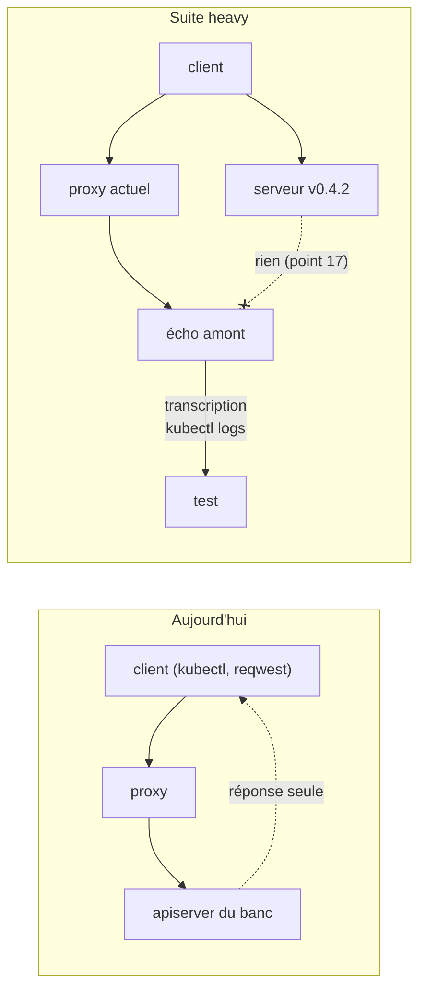
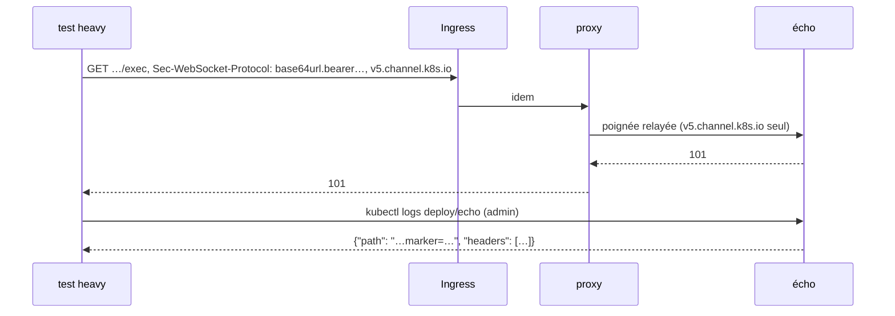
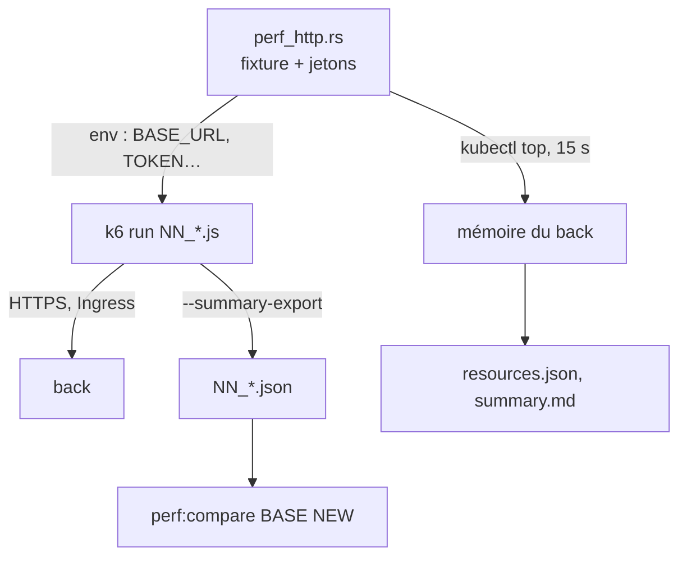
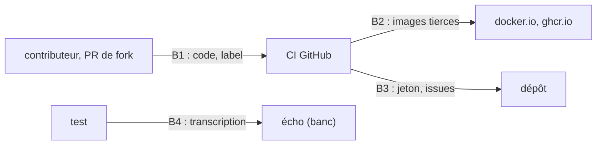

# RFC 0016 — Suite heavy et charge HTTP

| Field       | Value                                                                  |
| ----------- | ---------------------------------------------------------------------- |
| Status      | In review                                                              |
| Short       | Suite heavy et charge HTTP                                             |
| Settles     | Ce que le proxy relaie vraiment en amont, et comment il tient la charge |
| Author      | Max Batleforc <maxleriche.60@gmail.com>                                |
| Co-author   | Claude Opus 5.5                                                        |
| Created     | 2026-10-31                                                             |
| Supersedes  | —                                                                      |
| Touches     | `.it/heavy/echo.py` (nouveau), `.it/images.lock`, `.it/matrix.py`, `.it/perf_compare.py` (nouveau), `tests/integration/{Cargo.toml,MATRIX.md,src/lib.rs,src/fixture.rs,src/heavy.rs (nouveau),tests/heavy_rfc0014.rs (nouveau),tests/heavy_rfc0016.rs (nouveau),tests/perf_http.rs (nouveau),tests/rfc0014.rs}`, `tests/perf/k6/` (nouveau), `.config/nextest.toml`, `.tasks/{integration,perf}.yaml`, `Taskfile.yaml`, `mise.toml`, `.github/workflows/heavy.yaml` (nouveau), `docs/content/docs/developper-guide/{testing,integration-tests}.mdx`, `docs/content/docs/roadmap.mdx`, `.rfc/{README.md,0014-trusted-authenticator.md}` |
| Risk        | low                                                                    |

> Les décisions 1 à 12 ont été prises par le co-auteur dans la nuit du
> 2026-10-31, sans `/grill-me`, sur la demande de l'auteur d'écrire et de
> livrer la RFC d'une traite (§15). Chacune porte sa recommandation et son
> coût ; l'auteur les confirme ou les rouvre à la relecture de la PR.

---

## 1. Summary

La suite d'intégration (RFC 0009) prouve ce que voit un client : `kubectl`
reçoit `Forbidden`, ou sa liste. Elle ne voit pas ce que le proxy envoie en
amont, parce que l'amont est le vrai apiserver du banc, qui ne montre que sa
réponse. Deux points de la RFC 0014 sont restés hors suite pour cette raison
(16 : la poignée WebSocket relayée ; 17 : un binaire d'avant la phase 1 à
côté). Le seul test de performance mesure le contrôleur sous envtest
(RFC 0011) : rien ne charge le chemin du proxy.

Cette RFC ajoute deux couches, sur le même banc k3d :

- **la suite heavy** : un écho amont (un serveur HTTPS qui écrit chaque
  requête reçue) remplace l'apiserver derrière un cluster, et l'image du
  serveur de la version précédente tourne à côté de l'actuelle ; les tests
  lisent la transcription de l'écho ;
- **la charge HTTP** : des scénarios k6 à travers l'Ingress, la mémoire du
  back échantillonnée, un rapport par scénario et une comparaison à une base
  commitée.

Les deux tournent la nuit, à la main, et sur une PR étiquetée `heavy` ou
`perf`. Ni l'une ni l'autre n'est un check requis.

### Before / after

```bash
# aujourd'hui : on infère ce qui est relayé de la réponse de l'apiserver
task it:up && task it:test          # 0014 points 16, 17 : « hors suite »

# avec cette RFC
task it:up && task it:heavy         # l'écho lit la poignée relayée (16),
                                    # le serveur v0.4.2 à côté (17)
task it:up && task perf:http        # k6 : p95, débit, mémoire du back
task perf:compare BASE=tests/perf/baselines/0.5.0
```



Le premier schéma montre la limite : l'apiserver ne dit pas quels en-têtes
il a reçus. Le second montre la requête désormais lue à l'arrivée, et celle
qui ne doit jamais arriver (le serveur précédent sur un cluster
`FrontProxy`).

---

## 2. Motivation

1. **Deux points de sécurité de la RFC 0014 ne sont pas prouvés** sur un
   vrai chemin réseau : le retrait des entrées
   `base64url.bearer.authorization.k8s.io.*` du sous-protocole WebSocket
   (décision 39, seul `bearer_subprotocol_entries_are_stripped_in_every_mode`
   le teste, en unitaire) et le refus d'un binaire d'avant la phase 1
   (décision 42, aucun test) ; `tests/integration/MATRIX.md` les marque
   « hors suite, RFC 0016 ».
2. **Ce qui est relayé n'est vu qu'à travers l'apiserver.** Un en-tête
   `Impersonate-User` qui passerait serait refusé par le RBAC du banc
   (le persona n'a pas le droit d'impersonner) : le test passerait pour la
   mauvaise raison. `apply_forward_headers`
   (`cluster/redirect/kube_redirect/upstream.rs:141`) n'est testé qu'en
   unitaire.
3. **Aucun test ne charge le proxy.** `tests/perf/tests/perf.rs` mesure le
   contrôleur (requêtes à l'API, RSS au repos) ; le chemin
   `/clusters/{ns}/{cluster}/*` n'a ni latence ni débit mesurés, et une
   régression (un verrou, un tampon) passerait.
4. **Le throttle n'est testé qu'en série.** `proxy_throttle.rs` envoie ses
   requêtes une à une ; rien ne montre que le compteur Redis tient quand dix
   clients le frappent en même temps.

---

## 3. Goals / non-goals

**Goals**

- Prouver les points 16 et 17 de la RFC 0014 sur le banc.
- Lire ce que le proxy relaie, mode par mode, à l'arrivée.
- Mesurer le chemin du proxy sous charge, avec un rapport comparable d'une
  version à l'autre, et prouver un refus sous charge (le throttle).
- Garder le coût hors du chemin critique des PR : rien de requis.

**Non-goals**

- **Le mode `Issuer` face à l'écho** : l'écho ne valide pas de JWT ; la
  sonde conclurait `Rejected`. Le mode est prouvé contre le vrai apiserver
  (RFC 0014, points 10 à 13).
- **Un banc séparé** : la suite heavy réutilise `it:up` ; un second banc
  doublerait le coût de maintenance (décision 2).
- **Des suites bash** à la batlehub (`tests/heavy/*.sh`) : décision 3.
- **Le soak programmé** : la durée de la charge est un paramètre
  (`PERF_DURATION`) ; un soak de plusieurs heures se lance à la main
  (décision 8).
- **Un budget de latence bloquant** : les cibles de latence sont des cibles
  (`PERF_ENFORCE=1`), pas un gate ; seul le taux d'erreur l'est (décision 7).
- **Les tests front** : RFC 0017.

---

## 4. User-facing design

Les utilisateurs du produit ne voient rien : aucune route, aucun réglage. Les
utilisateurs de cette RFC sont les contributeurs et la CI.

### 4.1 Configuration

| Réglage | Défaut | Effet |
| --- | --- | --- |
| `PERF_DURATION` | `2m` | durée du palier de chaque scénario k6 |
| `PERF_VUS` | `10` | clients simultanés de chaque scénario |
| `PERF_ENFORCE` | absent | `1` : les cibles de latence deviennent des seuils |
| `PERF_OUT` | `.it/run/perf` | répertoire du rapport |
| label `heavy` / `perf` sur une PR | absent | lance le job du même nom sur la PR |
| entrées `perf_duration`, `perf_vus` du workflow | `2m`, `10` | idem, à la main |

### 4.2 Behaviour rules

- `task it:test` ne lance aucun binaire `heavy_*` ni `perf_*` (filtre du
  profil nextest `it`) ; `it:heavy` lance les premiers, `perf:http` les
  seconds, seuls (`test-threads = 1`).
- Un scénario sans base à comparer n'est pas une erreur : le résumé dit
  « No baseline yet ».
- Un test heavy qui ne trouve pas `mkcert` ou `k6` échoue, il ne saute pas :
  ces outils sont épinglés dans `mise.toml`, et le workflow les installe.
- L'écho n'est déployé que par les tests qui le demandent, dans leur
  namespace, et supprimé avec lui ; le serveur précédent est supprimé quand
  le test le libère (`Drop`), sauf avec `IT_KEEP`.

### 4.3 Validation

**Hard errors**

| Condition | Rationale |
| --- | --- |
| une ligne `heavy` de `MATRIX.md` qui nomme un test absent, ou un test qui n'est pas `heavy_*`/`perf_*` | `it:matrix` (dans `task lint`) : une preuve morte ou mal rangée ne tourne jamais |
| une ligne `suite` qui nomme un test `heavy_*` | `it:test` le laisse de côté : la ligne mentirait |
| un scénario k6 au-delà de 1 % de requêtes en échec | seuil `http_req_failed` toujours actif |
| un statut autre que `200` ou `429` dans le scénario du throttle | idem |

**Warnings**

| Condition | Behaviour | Surfaced in |
| --- | --- | --- |
| p95 au-delà de la marge face à la base | ligne `regression` | résumé du job `perf` ; `FAIL=1` en fait une erreur |
| un scénario absent d'un côté | ligne `missing from …` | idem |
| échec de nuit | issue `heavy-nightly` ouverte ou commentée | issues GitHub |

### 4.4 API surface

Aucune route nouvelle.

---

## 5. Architecture

### 5.1 L'écho amont

Un script Python de la bibliothèque standard (`.it/heavy/echo.py`), dans
l'image `python:3.14-alpine` épinglée, monté par ConfigMap. Il écoute en
HTTPS sur 8443 avec un certificat de la CA du banc (mkcert, comme `it:up`)
pour `echo.<ns>.svc`, et écrit une ligne JSON par requête
(`method`, `path`, `headers`) sur sa sortie. Il répond comme un apiserver là
seulement où le proxy en a besoin :

- `SelfSubjectReview` : il renvoie l'identité des `X-Remote-*` reçus, si bien
  que la sonde de confiance (`upstream_probe.rs`, `judge`) conclut `Trusted`
  pour un cluster `FrontProxy` sur l'écho ;
- poignée WebSocket : `101` avec le premier sous-protocole offert, puis la
  connexion se ferme ; seule la poignée intéresse le point 16 ;
- le reste : `200` et un corps JSON, ce qui suffit à la sonde
  d'accessibilité du contrôleur.

Le cluster de test est le `c` de la fixture (`fixture::proxied_through`), un
`ExternalService` sur `https://echo.<ns>.svc:8443`, sa CA dans la
ConfigMap `echo-ca` ; en `FrontProxy`, la cible du certificat est
`external:https://echo.<ns>.svc:8443` (`canonical_target`).



L'action passe par l'Ingress comme un client ; la lecture de la
transcription passe par le kubeconfig admin, comme les autres vérifications
indirectes de la suite (RFC 0009 §5.2).

### 5.2 Le serveur précédent

`heavy::Previous` copie le gabarit du Deployment du back (même compte de
service, mêmes variables, même Redis), remplace l'image par
`server-previous` de `.it/images.lock` (la v0.4.2, dernière avant la phase 1
de la 0014), lui donne son propre label pour que le Service ne lui envoie
rien, et ouvre un `port-forward` vers son port HTTP. L'élection de leader du
kit (RFC 0011) le garde suiveur : le contrôleur actuel tient le Lease.

L'invariant prouvé : un cluster hors `Passthrough` est publié sous une clé
Redis que le binaire précédent ne lit pas (décision 42 de la 0014) ; il ne
peut donc pas le servir, et l'écho le constate (aucune requête marquée).

### 5.3 La charge

`tests/integration/tests/perf_http.rs` prépare la fixture (cluster sur le
vrai apiserver, 50 ConfigMaps, `reader` connecté), obtient les jetons, puis
lance `k6 run` par scénario (`tests/perf/k6/scenarios/NN_*.js`) avec le
banc dans l'environnement ; un fil échantillonne `kubectl top` du back toutes
les 15 s. Le harness Rust est réutilisé plutôt que dupliqué en JS : la
connexion SSO du persona, la résolution des noms et la CA y sont déjà.



---

## 6. Detailed design

### 6.1 La suite heavy

- `tests/integration/src/heavy.rs` : `echoed`, `deploy_echo`, `transcript`,
  `relayed`, `websocket_handshake`, `Previous`, `eventually`.
- `fixture::proxied_through` devient public ; `wait_trust` passe de
  `rfc0014.rs` à `fixture` pour être partagé.
- Fichiers de test : `heavy_rfc0014.rs` (points 16 et 17 de la 0014),
  `heavy_rfc0016.rs` (points 1 et 2 ci-dessous). Les noms suivent la
  convention `pN_sujet` que lit `it:matrix`.
- Profil nextest `heavy` : `binary(/^heavy_/)`, quatre fils, arrêt à 10 min
  (une bascule `FrontProxy` attend une sonde et une remise en file).
- `task it:heavy` ; le profil `it` exclut `binary(/^(heavy|perf)_/)`.

### 6.2 `MATRIX.md`

Un statut nouveau, `heavy`, pour une preuve qui tourne dans `it:heavy` ou
`perf:http`. `it:matrix` vérifie que le test existe et que son binaire est
`heavy_*` ou `perf_*` ; une ligne `suite` ne peut plus nommer un tel test.

### 6.3 La charge HTTP

| Scénario | Ce qu'il mesure | Cible p95 / p99 |
| --- | --- | --- |
| `01_proxied_get` | lecture d'un objet (le coût de chaque `kubectl get`) | 300 / 800 ms |
| `02_proxied_list` | liste de ~50 ConfigMaps (le corps relayé) | 500 / 1 200 ms |
| `03_discovery` | `/api`, `/apis`, `/version` à la suite | 300 / 800 ms |
| `04_dashboard_clusters` | `/api/v1/clusters`, l'API du proxy seule | 200 / 500 ms |
| `05_rate_limit` | 10 clients 30 s sur un cluster à 120 req/min | refus attendu |

Chaque scénario : montée de 20 s, palier `PERF_DURATION`, descente de 10 s ;
`check()` sur le statut **et** le type du corps. Le seuil
`http_req_failed: rate<0.01` est toujours actif ; les cibles de latence le
sont avec `PERF_ENFORCE=1`. Les chiffres des cibles sont des hypothèses de
départ ; la première mesure sur le runner les remplace (§17).

Le rapport : `NN_*.json` (k6 `--summary-export`), `resources.json` (mémoire
du back avant, au pic, après, et les échantillons), `summary.md` (le tableau
publié dans le résumé du job). `perf:compare BASE NEW [MARGIN] [FAIL]`
(`.it/perf_compare.py`) compare les p95 ; une base par version se commite
dans `tests/perf/baselines/<version>/`.

### 6.4 CI

`.github/workflows/heavy.yaml`, deux jobs indépendants, chacun sur son banc
(`it:up`) : `heavy` (`task it:heavy`, 60 min) et `perf` (`task perf:http`,
90 min, comparaison à la dernière base, artefact `perf-http` gardé 30 jours).
Déclencheurs : la nuit sur `main`, `workflow_dispatch` (durée, clients), et
une PR étiquetée `heavy` ou `perf`. Un échec de nuit ouvre ou commente
l'issue `heavy-nightly`. Actions épinglées par SHA, `contents: read`, le
droit `issues: write` dans le seul job d'alerte.

Le workflow `perf.yml` (budget du contrôleur, RFC 0011) ne change pas.

### 6.P Proof against a real client

Les clients sont ceux du banc : `kubectl-proxyauth` pour la connexion SSO
et le jeton, un client HTTP/1.1 (`reqwest`) pour ce que kubectl n'envoie
pas (un en-tête usurpé, un sous-protocole porteur de jeton), k6 2.3 pour la
charge ; l'écho tient le rôle de l'apiserver qui témoigne.

1. Cluster en `Passthrough` sur l'écho : un `GET` qui ajoute
   `Impersonate-User: system:admin`, `Impersonate-Group: system:masters`,
   `X-Remote-User: system:admin`, `X-Remote-Group: system:masters`,
   `X-Forwarded-User: admin` et `X-HTTP-Method-Override: DELETE` répond
   `200` ; l'écho reçoit le jeton du persona dans `Authorization`, aucun
   `Impersonate-*` ni `X-Remote-*`, pas de surcharge de méthode, et un
   `X-Forwarded-User` qui n'est pas `admin`.
2. **Refus** : le même cluster passé en `FrontProxy`, la même requête :
   l'écho reçoit un seul `X-Remote-User`, `proxyauth:reader@it.local`, des
   groupes tous préfixés `proxyauth:`, aucun `Authorization`, aucun
   `Impersonate-*` — l'identité usurpée n'a jamais atteint l'amont.
3. `task perf:http` : les quatre scénarios tiennent leur palier avec moins
   de 1 % d'échecs, et le rapport donne p95, p99, débit et mémoire du back.
4. **Refus** : sous dix clients pendant 30 s, un cluster limité à 120
   requêtes par minute en accepte au plus 120 et répond `429` au reste.
5. Un échec de nuit du workflow `heavy` ouvre l'issue `heavy-nightly`, ou la
   commente quand elle est ouverte.
6. `perf:compare` sur une base et un rapport plus lent de 30 % : la ligne
   dit `regression`, et `FAIL=1` sort en erreur.
7. **Refus** : une ligne `suite` de `MATRIX.md` qui nomme un test
   `heavy_*` : `it:matrix` échoue en nommant la ligne.

**Deliberately untouched**, so reviewers do not go looking:

- `tests/perf/tests/perf.rs` et `perf.yml` — le budget du contrôleur reste
  tel quel.
- Le code du proxy — cette RFC n'en change aucune ligne ; si un test révèle
  un défaut, sa correction est une PR à part avec son test de régression.
- `.it/up.sh` — l'écho et le serveur précédent sont déployés par les tests,
  pas par le banc.
- La suite `it:test` et ses durées — seul son filtre exclut les nouveaux
  binaires.

---

## 7. Security

**Rating:** low — aucune surface du produit ne change ; la CI gagne un
workflow et deux images tierces, épinglées, qui ne sont jamais livrées.

### 7.1 Threat model

Actifs : le jeton GitHub de la CI, la confiance dans le banc (une preuve
qui passerait pour la mauvaise raison), le poste du contributeur.



| # | Threat (STRIDE) | Where | Mitigation | Residual risk |
| --- | --- | --- | --- | --- |
| T1 | Tampering : une image tierce remplacée sous son tag (python, serveur v0.4.2) | B2 | digest `@sha256` dans `.it/images.lock`, refusé sans digest par `fixture::image` | aucun |
| T2 | Elevation : une PR de fork étiquetée reçoit un jeton en écriture ou injecte une commande | B1, B3 | `pull_request` (pas `_target`), `contents: read` ; `issues: write` dans le job d'alerte, seulement sur `schedule` ; aucune donnée de PR dans un `run:` ; actions par SHA | aucun |
| T3 | Spoofing (de la preuve) : un test heavy passe parce que l'écho ment ou parce qu'il ne reçoit rien | B4 | chaque test exige d'abord la requête attendue (marqueur unique, `len == 1`) avant de regarder ses en-têtes ; le point 17 a son témoin (`Passthrough` servi par le serveur précédent) | un écho qui réécrirait les en-têtes ; il n'en réécrit aucun (stdlib, 100 lignes, relu) |
| T4 | Info disclosure : un jeton du persona dans les logs ou l'artefact | B4 | jetons de personas fictifs d'un banc jetable ; l'écho n'est pas dans les logs collectés tant que son namespace est supprimé en fin de test ; les rapports k6 ne contiennent pas d'en-têtes | un namespace gardé par `IT_KEEP` en local ; accepté (banc local) |
| T5 | DoS : la charge sature le runner et fait échouer autre chose | B1 | jobs à part, jamais requis, `timeout-minutes`, concurrence par ref | aucun |

Chaque ligne a son test ou son contrôle en §14.

### 7.2 Authentication and authorisation

Aucune surface nouvelle. Les tests utilisent les personas existants
(`.it/personas.yaml`) et le kubeconfig admin du banc pour les vérifications
indirectes, comme la RFC 0009.

### 7.3 Input handling and injection

L'écho lit des requêtes du proxy du banc ; il n'est joignable que dans le
cluster. Les marqueurs des tests sont des constantes. Aucun texte de PR
n'atteint un shell (T2).

### 7.4 Secrets and cryptography

Le certificat de l'écho vient de la CA du run (`CAROOT` sous `.it/run`, jamais
installée dans le magasin du poste, RFC 0009 T3). Aucune clé commitée.

### 7.5 Abuse and resource exhaustion

La charge vise le banc local du job. 10 clients par défaut ; une durée plus
longue se demande à la main.

### 7.6 Existing defences that still hold

`integration` reste le seul check requis ; `it:matrix` et `it:stride` dans
`task lint` ; gitleaks ; les tests unitaires de `apply_forward_headers` et de
`bearer_subprotocol_entries_are_stripped_in_every_mode` restent.

---

## 8. Supply chain

| Dependency / image / tool | Version | Why this one | Licence | Known CVEs (`task audit`) | Maintenance |
| --- | --- | --- | --- | --- | --- |
| `k6` (outil, mise) | 2.3 | l'outil de charge de la maison (skill `weebo-testing`) ; à la main, il faudrait écrire un générateur de charge | AGPL-3.0 (outil, jamais livré ni lié) | hors `task audit` (outil) ; aucune advisory GitHub ouverte à la date | Grafana Labs, publié régulièrement |
| image `python:3.14-alpine` | digest `eb2c6265…` | l'écho en stdlib, sans dépendance ; un écho en Rust demanderait une image construite à chaque run | PSF-2.0 / MIT (Alpine) | jamais livrée, non scannée par `task audit` (comme les images du banc, `.it/images.lock`) | Docker Official Images |
| image `ghcr.io/batleforc/proxyauthk8s/server:v0.4.2` | digest `0e6fad44…` | le binaire d'avant la phase 1 de la 0014, publié par ce dépôt | MIT | scannée à sa publication (Release Prepare v0.4.2) | ce dépôt |
| crate `base64` (dev, `integration`) | 0.22 | l'encodage du sous-protocole porteur de jeton (point 16) | MIT OR Apache-2.0 | déjà dans `Cargo.lock` | marshallpch |

- **Build and release** : aucune image ni binaire livré ne change ; un
  workflow nouveau, actions épinglées par SHA.
- **Updates** : mise pour k6 (version mineure épinglée) ; les digests de
  `.it/images.lock` à la main, une image par PR, comme les autres.

---

## 9. Data and privacy

| Data | Personal? | Where stored | Retention | Who can read it | Leaves the instance? |
| --- | --- | --- | --- | --- | --- |
| transcription de l'écho (en-têtes, dont le jeton du persona) | non : personas fictifs | log du pod, namespace du test | supprimée avec le namespace | admin du banc | non |
| rapport k6, `resources.json` | non : chiffres agrégés | artefact `perf-http` | 30 jours | lecteurs du dépôt | non (GitHub) |
| issue `heavy-nightly` | non : lien de run | issues GitHub | jusqu'à fermeture | public | non |

---

## 10. Operability

### 10.1 Observability

- **Metrics** : celles du rapport (p95, p99, débit, échecs, mémoire du
  back) ; aucune métrique du produit ne change.
- **Logs and audit trail** : `it:logs` collecte les journaux du banc après
  chaque job.
- **Alerts** : l'issue `heavy-nightly`.

### 10.2 Failure modes

| Failure | Detected by | Behaviour (fail open / closed) | Recovery |
| --- | --- | --- | --- |
| l'image précédente ne se tire pas (ghcr indisponible) | `rollout status` en 300 s | le test 17 échoue | relancer ; l'image est épinglée, pas reconstruite |
| metrics-server muet | `kubectl top` vide | la mémoire vaut `null` dans le rapport, la charge passe | aucune (rapport incomplet, dit tel quel) |
| k6 absent | `Command::new("k6")` | le test échoue (jamais de saut silencieux) | `mise install k6` |
| sonde qui ne conclut pas `Trusted` sur l'écho | `wait_trust`, 6 min | le test échoue | lire les journaux du back (`it:logs`) |
| runner plus lent qu'à la mesure de base | `perf:compare` | ligne `regression`, job vert sans `FAIL=1` | relancer, ou refaire la base sur le même runner |

### 10.3 Performance and capacity

- `heavy` : le montage du banc (≈ 15 à 20 min à froid) plus les quatre tests,
  chacun 3 à 6 min (deux attentes de sonde).
- `perf` : le montage, puis 4 × (`PERF_DURATION` + 30 s) et 30 s de rafale
  plus une minute d'attente de fenêtre : ≈ 13 min de charge par défaut.

---

## 11. Other concerns

- **Accessibility** : pas d'UI.
- **Internationalisation** : pas de chaîne affichée.
- **Compliance** : aucun contrôle touché.
- **Licensing** : k6 est AGPL-3.0, utilisé comme outil de CI, ni livré ni
  lié : pas d'obligation sur ce dépôt ; le reste est MIT / Apache-2.0 / PSF.
- **Documentation** : `testing.mdx` (deux couches), `integration-tests.mdx`
  (le statut `heavy`), `roadmap.mdx`, `MATRIX.md`.

---

## 12. Alternatives considered

| Alternative | Rejeté parce que |
| --- | --- |
| Suites bash (`tests/heavy/*.sh`, modèle batlehub) | la connexion SSO du persona (formulaire Dex, callback loopback, trousseau dédié), la CA et la résolution sont dans le harness Rust ; les refaire en bash, c'est deux implémentations à garder d'accord (décision 3) |
| Écho en Rust dans l'image du test | une image à construire à chaque run et un crate de plus ; le script stdlib fait 100 lignes (décision 4) |
| `traefik/whoami` comme écho | il ne renvoie pas d'identité au `SelfSubjectReview` : la sonde conclurait `NotHonoured` et le cluster `FrontProxy` serait fermé |
| Lire l'audit de l'apiserver du banc | k3s ne l'active pas au banc, et il journalise l'identité retenue, pas les en-têtes reçus |
| Points 16 et 17 dans `it:test` | `integration` est requis et déjà à 50 min sur 60 ; deux bascules `FrontProxy` de plus le pousseraient au-delà (décision 1) |
| Charge en Rust (goose, un client maison) | k6 est l'outil de la maison, ses rapports se comparent d'un dépôt à l'autre |
| Charge sur un back lancé hors cluster | la charge doit traverser l'Ingress et le vrai apiserver, comme un client |
| Ne rien faire | les deux points de la 0014 restent hors suite et le chemin du proxy sans mesure |

---

## 13. Rollout and compatibility

- Aucune migration. Les nouveaux binaires sont hors du profil `it` dès
  leur arrivée : `integration` ne change ni de durée ni de contenu.
- Les labels `heavy` et `perf` sont créés par la PR de cette RFC.
- La première base de charge (`tests/perf/baselines/0.5.0/`) se commite
  depuis le premier rapport vert du runner (§17).
- Retour arrière : supprimer le workflow ; le statut `heavy` de `MATRIX.md`
  rend alors deux lignes de la 0014 à `hors suite`.

---

## 14. Test plan

| Preuve | Où |
| --- | --- |
| points 1, 2 | `heavy_rfc0016::p1_passthrough_relays_the_token_and_no_smuggled_identity`, `heavy_rfc0016::p2_front_proxy_relays_only_the_asserted_identity` |
| points 3, 4 | `perf_http::p3_the_proxy_holds_the_load_without_errors`, `perf_http::p4_the_rate_limit_holds_under_concurrency` |
| 0014 points 16, 17 | `heavy_rfc0014::p16_the_bearer_subprotocol_never_reaches_upstream`, `heavy_rfc0014::p17_a_previous_server_never_serves_a_trusted_cluster` |
| point 6 | `task perf:compare-self-test` (dans `task lint`) |
| point 7 | `task it:matrix` `--self-test` (dans `task lint`) |
| T1 | `fixture::image` lit `.it/images.lock` ; `it:up` refuse une ligne sans digest |
| T2 | relecture du workflow ; `actionlint` dans `task lint` |
| T3 | les tests exigent leur requête marquée avant tout ; témoin du point 17 |
| T4, T5 | relecture ; jobs non requis |

---

## 15. Decisions and open questions

### Resolved

| # | Question | Décision |
| --- | --- | --- |
| 1 | Où tournent les points 16 et 17 ? | **Dans une suite à part (`it:heavy`), pas dans `it:test`.** `integration` est requis et proche de son plafond de 60 min. |
| 2 | Un banc à part ? | **Non : le même `it:up`, l'écho et le serveur précédent déployés par les tests.** Un seul banc à maintenir. |
| 3 | Bash ou Rust ? | **Rust, dans le crate `integration`, binaires `heavy_*` et `perf_*`.** Le harness (SSO, CA, résolution) existe ; va contre le modèle bash de batlehub, pour ce coût. |
| 4 | Quel écho ? | **Python stdlib, image épinglée, script en ConfigMap**, qui répond au `SelfSubjectReview` pour que la sonde conclue `Trusted`. |
| 5 | Quel binaire précédent ? | **La v0.4.2, épinglée**, et non « la version d'avant » : le point 17 parle d'un binaire d'avant la phase 1 de la 0014 ; la v0.5.0 connaît déjà `FrontProxy`. |
| 6 | Quand tournent-elles ? | **La nuit, à la main, et sur label `heavy`/`perf`** ; jamais requises, issue `heavy-nightly` en cas d'échec de nuit. |
| 7 | Quel seuil bloque ? | **Le taux d'erreur (< 1 %) et le refus du throttle** ; la latence est une cible (`PERF_ENFORCE=1`) et la comparaison à la base un avertissement (`FAIL=1` pour bloquer). Un runner partagé est trop bruité pour un gate de latence. |
| 8 | Soak ? | **Un paramètre (`PERF_DURATION`), pas un job programmé.** |
| 9 | Où vivent les scénarios ? | **`tests/perf/k6/`**, à côté du budget du contrôleur ; numérotés, un profil de trafic chacun. |
| 10 | Comment la matrice les connaît ? | **Statut `heavy`**, vérifié par `it:matrix` (le test existe et c'est un binaire `heavy_*`/`perf_*`). |
| 11 | Le mode `Issuer` face à l'écho ? | **Non** : l'écho ne vérifie pas de JWT ; prouvé contre le vrai apiserver par la 0014. |
| 12 | Une base de charge ? | **Une par version dans `tests/perf/baselines/<version>/`**, commitée depuis un rapport du runner CI, jamais d'un poste. |

### Still open

Aucune.

---

## 16. Implementation phases

Une seule phase, une PR : la suite heavy, la charge et le workflow arrivent
ensemble ; aucun ne touche le produit, et chacun laisse l'arbre vert seul.

---

## 17. Revision against the tree (2026-10-31)

Premier passage sur la CI : run `41155757037` du workflow `heavy.yaml`, sur
`80197b7` (PR #331, labels `heavy` et `perf`).

### Ce qui a été observé

- **Charge (job `perf`, vert)** : 2 tests, 2 passés, 11 min 39 s de charge.
  Taux d'échec à 0,00 % sur chaque scénario ; la base
  `tests/perf/baselines/0.5.0/` est ce rapport.

  | Scénario | req/s | p95 ms | p99 ms |
  | --- | --- | --- | --- |
  | `01_proxied_get` | 379 | 34 | 45 |
  | `02_proxied_list` | 267 | 61 | 80 |
  | `03_discovery` | 386 | 54 | 66 |
  | `04_dashboard_clusters` | 1 168 | 9 | 11 |

  Les cibles de §6.3 (p95 de 200 à 500 ms) sont 5 à 20 fois au-dessus de la
  mesure : elles restent des cibles larges, la comparaison à la base (25 %)
  est le signal fin. Mémoire du back (working set de metrics-server, pas le
  RSS) : 4 MiB avant, 10 au pic, 7 après.
- **Throttle sous charge (point 4)** : 120 requêtes acceptées, 12 590
  refusées en `429`, pour une limite de 120 par minute : le compteur Redis
  tient exactement sous dix clients.
- **Heavy (job `heavy`, rouge)** : le point 2 passe — l'écho reçoit
  `X-Remote-User: proxyauth:reader@it.local` seul, des groupes préfixés,
  ni jeton ni `Impersonate-*`, et la sonde conclut `Trusted` face à l'écho
  (102 s, une sonde et une remise en file). Les trois tests qui partent en
  `Passthrough` (0014 points 16 et 17, 0016 point 1) reçoivent `401` « the
  token could not be validated ».

### Écarts au texte, avec leur raison

1. **Validation du jeton sur les clusters de l'écho** : par défaut, le proxy
   fait relire le jeton par l'amont, et l'écho ne répond à aucune revue sans
   `X-Remote-User`. `heavy::echoed` règle donc
   `auth_config.validate_against: OidcProvider` (Dex, comme la fixture
   `FrontProxy`) ; seul le contrôle du jeton change, `Passthrough` le relaie
   toujours. La v0.4.2 connaît ce réglage.
2. **Mémoire** : `kubectl top` donne le working set, pas le RSS que la RFC
   annonçait en §5.3 ; le rapport le dit.

### Ce qui reste

- Repasser `heavy` avec l'écart 1 (commit en attente de signature : la clé
  GPG de l'auteur n'était plus déverrouillée dans la nuit).
- La confirmation des décisions 1 à 12 par l'auteur ; le statut passe alors
  à `Accepted`, puis `Implemented` une fois `heavy` vert.
