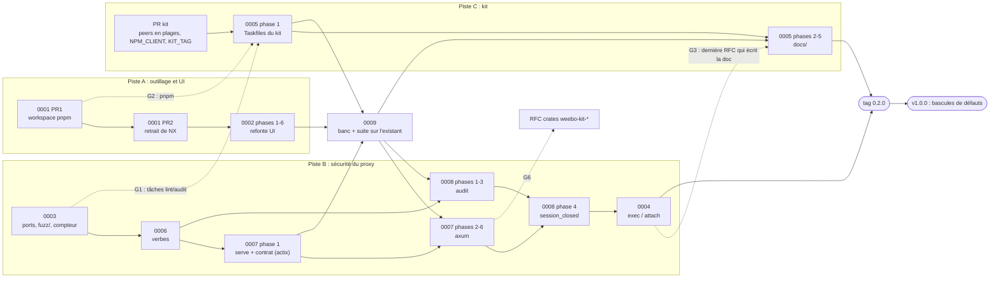

# Plan de livraison des RFC 0001 à 0009

Ordre d'exécution des RFC, avec les dépendances qui l'imposent et les points où
deux RFC touchent les mêmes fichiers. Chaque étape renvoie aux phases de sa RFC
(§16) ; ce plan ne les redécrit pas.

Depuis le 2026-10-17, **toutes les RFC partent dans une seule release, la
0.2.0**, et la suite d'intégration de la RFC 0009 conditionne le tag : chaque
étape restante n'est finie que lorsque ses lignes de
`tests/integration/MATRIX.md` sont vertes.

## Vue d'ensemble

Trois pistes avancent en parallèle et se rejoignent à des points de
synchronisation (G1, G2, G3, G5, G6) ; la RFC 0009 (étape 0) passe devant tout
ce qui reste à coder.

Les flèches pleines sont des dépendances strictes. Les pointillées sont des
points de synchronisation : l'étape d'arrivée attend que l'étape de départ soit
mergée.

## Étapes

| # | Étape | Piste | Prérequis | Livre | Critère de sortie | État |
| --- | --- | --- | --- | --- | --- | --- |
| 1 | **0001 PR1** (phases 1-3) | A | — | workspace pnpm, `allowBuilds`, `minimumReleaseAge`, CI sous pnpm | CI verte, NX encore présent | fait |
| 2 | **0003** (phases 1-3) | B | — | `port_target`, nouvelle union (R2), `restricts_ports`, `nodes/proxy`, politiques avant le contrôle websocket, `status.warnings`, workspace `fuzz/` + `.tasks/fuzz.yaml` + job nightly, compteur `proxyauth_policy_decisions_total` | §6.P points 1 à 7 ; `task fuzz:check` vert ; #265 fermée | fait |
| 3 | **PR kit** (0005 phase 0) | C | — | peers de la doc en plages, `NPM_CLIENT`, repli `KIT_TAG` ; release du kit | release publiée | en attente : les includes sont épinglés sur v0.17.0, contenu identique (0005 §17) |
| 4 | **0001 PR2** (phases 4-8) | A | 1 | contrat de scripts, `task js:*`, retrait de NX | CI verte sans NX | fait |
| 5 | **0006** (phases 1-4) | B | 2 | `request_info`, `verbs`, `restricts_verbs`, lecture seule implicite, `nodes/proxy` sous verbes, cible fuzz `request_info` | §6.P points 1 à 10 | fait |
| 6 | **0007 phase 1** | B | 5 | `serve(listener, state)` sur actix, `http_contract.rs` | contrat vert sur actix, mergé seul sur `main` | fait |
| 7 | **0002** (phases 1-6) | A | 4 | refonte UI, CSP | §6.P de la 0002 | fait |
| 9 | **0005 phase 1** | C | 1, 2, 3 (G1, G2) | includes `rust.yaml`/`repo.yaml`, `deny.toml`, outils dans `mise.toml`, workflows sur `task rust:*` | `task lint`, `task audit`, `coverage:ci` verts | fait |
| 0 | **0009** (phases 1-4) | — | 6, 7, 9 | banc k3d + Dex + chart, `tests/integration`, `e2e-it`, `MATRIX.md`, `it:matrix`, workflow requis | lignes de 0001, 0002, 0003, 0005, 0006 et 0007 phase 1 vertes ou hors suite justifiées | fait ; reste le check requis sur `main` après trois passages verts en CI (réglage GitHub, 0009 §17) |
| 10 | **0007 phases 2-6** | B | 0, 6 | migration axum, une PR, un commit par phase | contrat identique, diff `swagger.json` vide, lignes 0007 vertes sur le banc | à faire |
| 12b | **0008** (phases 1-3) | B | 0, 5 | schéma d'audit v1, couche audit insensible à `RUST_LOG`, évènements d'authentification et OAuth, `client_banned`, indice SPDY | lignes 0008 points 1 à 7 vertes ; peut avancer en parallèle de l'étape 10 | à faire |
| 12c | **0008** (phase 4) | B | 10, 12b | `session_closed` sur le tunnel hyper | ligne 0008 point 8 verte | à faire |
| 12 | **0004** (phases 1-3) | B | 10, 12c | politique `exec`, `restricts_exec`, `ExecChannelFilter`, audit de session, `mask_exec_secrets`, cibles fuzz | lignes 0004 points 1 à 13 vertes | à faire |
| 11 | **0005 phases 2-5** | C | 0, 9, 12 (G3) | `.docs` → `docs/`, `@weebo/operator-docs`, `kit:sync` | §6.P de la 0005 (hors suite, jobs CI) | à faire |
| 8 | **tag 0.2.0** | — | 11, 12 | — | `integration.yaml` vert sur le commit tagué, aucune ligne de matrice `à écrire` | à faire |
| 13 | **RFC crates `weebo-kit-*`** | C | 10 (G6) | à écrire | — | après la 0.2.0 |
| 14 | **v1.0.0** | — | 8 | bascules de défauts (§ « v1.0.0 ») | — | après la 0.2.0 |

Les numéros d'étape sont gardés pour les renvois des RFC ; la table suit
l'ordre d'exécution.

## Points de synchronisation

| # | Entre | Fichiers communs | Règle |
| --- | --- | --- | --- |
| G1 | 0003 et 0005 phase 1 | `.tasks/{lint,audit}.yaml`, `Taskfile.yaml` | 0005 phase 1 passe **après** 0003 : elle garde `fuzz:check` dans `task lint` et remplace `cargo audit -f fuzz/Cargo.lock` par `cargo deny --manifest-path fuzz/Cargo.toml check` (RFC 0005 §4.2) |
| G2 | 0001 PR1 et 0005 | tout le workspace JS | 0005 ne commence qu'avec pnpm en place (prérequis strict, 0005 R8) |
| G3 | 0002, 0003, 0004, 0006, 0008, 0009 et 0005 phases 2-5 | `.docs/content/docs/*` | le `git mv .docs docs` passe après la dernière RFC qui écrit dans `.docs/` (la 0004) ; il ne dépend plus d'un tag |
| G5 | 0001, 0003, 0005 et 0009 | `.github/workflows/*`, `mise.toml` | chaque RFC ajoute ses jobs (`fuzz` nightly pour la 0003, `task rust:*` pour la 0005, `integration` pour la 0009) ; celle qui merge en second rebase, sans réécrire les jobs de l'autre |
| G6 | 0007 et la RFC crates du kit | `libs/server/{trace,controller}` | la RFC crates n'est ouverte qu'après la 0007 (0005 R7) |

L'ancien G4 (migration axum après le tag 0.2.0) est retiré : la 0.2.0 contient
la migration, et c'est la suite de la 0009 qui protège contre le cumul de deux
refontes, à la place d'une release intermédiaire.

## Pourquoi cet ordre

- **0003 d'abord sur la piste B** : elle pose ce que les autres réutilisent
  (`restricts_*`, refus de `nodes/proxy`, `status.warnings`, workspace `fuzz/`,
  compteur partagé, politiques avant le contrôle websocket), et corrige seule
  une faille existante (R2).
- **0006 avant 0007** : le calcul du verbe ne dépend pas du framework, et il
  ferme T7 de la 0004 (création de pod, conteneur éphémère) au plus tôt.
- **0009 avant tout ce qui reste à coder** : la migration axum se prouve sur le
  banc avant et après (la suite est en boîte noire) ; 0008 et 0004 livrent
  leurs tests sur un banc déjà en place.
- **0004 en dernier** : elle s'écrit sur le tunnel hyper de la 0007, dépend des
  verbes de la 0006 et du `session_closed` de la 0008 ; sans eux, sa politique
  se contourne.
- **0005 coupée en deux** : ses Taskfiles (phase 1) n'ont besoin que de pnpm et
  de la 0003 ; le déplacement de la doc attend la dernière RFC qui l'écrit
  (G3).

## Release

| Release | Contenu | Nature |
| --- | --- | --- |
| 0.2.0 | 0001 à 0009 | `feat!:` : règles sans `allowed_ports` ou sans `verbs` restreintes sous restriction, `nodes/proxy` refusé, politique `exec`, schéma d'audit v1 ; serveur sur axum ; nouvelle UI |
| 1.0.0 | bascules | voir ci-dessous |

## v1.0.0 : bascules de défauts

Annoncées dans le CHANGELOG dès la RFC qui les introduit, appliquées ensemble :

- `verbs` absent vaut `[get, list, watch]` pour tous (0006 R4) ;
- `exec` absent : exec interdit sauf règle `exec` (0004, décision 1) ;
- suppression de l'alias `allowed_ressources`.

Hors de ce plan : le fail-open quand `allowed_resources` est vide (future RFC
`default: deny`, 0003 R9), les sujets sur les règles `Path` (0003 R14), et
`helm:crds` (0005 R5).
