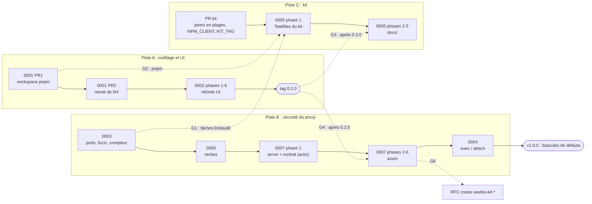

# Plan de livraison des RFC 0001 à 0007

Ordre d'exécution des sept RFC en `In review`, avec les dépendances qui
l'imposent et les points où deux RFC touchent les mêmes fichiers. Chaque étape
renvoie aux phases de sa RFC (§16) ; ce plan ne les redécrit pas.

## Vue d'ensemble

Trois pistes avancent en parallèle et se rejoignent à des points de
synchronisation (G1 à G6) :

- **A, outillage et UI** : 0001 puis 0002, jusqu'au tag 0.2.0.
- **B, sécurité du proxy** : 0003, 0006, 0007, puis 0004.
- **C, kit** : la PR sur weebo-operator-kit, puis 0005.

Les flèches pleines sont des dépendances strictes. Les pointillées sont des
points de synchronisation : l'étape d'arrivée attend que l'étape de départ soit
mergée.

## Étapes

| # | Étape | Piste | Prérequis | Livre | Critère de sortie |
| --- | --- | --- | --- | --- | --- |
| 1 | **0001 PR1** (phases 1-3) | A | — | workspace pnpm, `allowBuilds`, `minimumReleaseAge`, CI sous pnpm | CI verte, NX encore présent |
| 2 | **0003** (phases 1-3) | B | — | `port_target`, nouvelle union (R2), `restricts_ports`, `nodes/proxy`, politiques avant le contrôle websocket, `status.warnings`, workspace `fuzz/` + `.tasks/fuzz.yaml` + job nightly, compteur `proxyauth_policy_decisions_total` | §6.P points 1 à 7 ; `task fuzz:check` vert ; #265 fermée |
| 3 | **PR kit** (0005 phase 0) | C | — | peers de la doc en plages, `NPM_CLIENT`, repli `KIT_TAG` ; release du kit | release publiée |
| 4 | **0001 PR2** (phases 4-8) | A | 1 | contrat de scripts, `task js:*`, retrait de NX | CI verte sans NX |
| 5 | **0006** (phases 1-4) | B | 2 | `request_info`, `verbs`, `restricts_verbs`, lecture seule implicite, `nodes/proxy` sous verbes, cible fuzz `request_info` | §6.P points 1 à 10 |
| 6 | **0007 phase 1** | B | 5 | `serve(listener, state)` sur actix, `http_contract.rs` (limites, ALPN, chemin brut, CORS, apports de 0003/0006) | contrat vert sur actix, mergé seul sur `main` |
| 7 | **0002** (phases 1-6) | A | 4 | refonte UI, CSP | §6.P de la 0002 |
| 8 | **tag 0.2.0** | A | 7 | — | release publiée |
| 9 | **0005 phase 1** | C | 1, 2, 3 (G1, G2) | includes `rust.yaml`/`repo.yaml`, `deny.toml`, outils dans `mise.toml`, clippy `--all-targets` corrigé, workflows sur `task rust:*` | `task lint`, `task audit`, `coverage:ci` verts |
| 10 | **0007 phases 2-6** | B | 6, 8 (G4) | migration axum, une PR, un commit par phase | contrat identique, diff `swagger.json` vide, §6.P complet sur la recette puis 7 jours |
| 11 | **0005 phases 2-5** | C | 8, 9 (G3) | `.docs` → `docs/`, `@weebo/operator-docs`, `kit:sync` | §6.P de la 0005 |
| 12 | **0004** (phases 1-3) | B | 10 | politique `exec`, `restricts_exec`, `ExecChannelFilter`, audit de session, `mask_exec_secrets`, cibles fuzz | §6.P points 1 à 13 |
| 13 | **RFC crates `weebo-kit-*`** | C | 10 (G6) | à écrire | — |
| 14 | **v1.0.0** | — | 12 | bascules de défauts (§ « v1.0.0 ») | — |

Les étapes 1, 2 et 3 n'ont aucun prérequis et peuvent démarrer ensemble.

## Points de synchronisation

| # | Entre | Fichiers communs | Règle |
| --- | --- | --- | --- |
| G1 | 0003 et 0005 phase 1 | `.tasks/{lint,audit}.yaml`, `Taskfile.yaml` | 0005 phase 1 passe **après** 0003 : elle garde `fuzz:check` dans `task lint` et remplace `cargo audit -f fuzz/Cargo.lock` par `cargo deny --manifest-path fuzz/Cargo.toml check` (RFC 0005 §4.2) |
| G2 | 0001 PR1 et 0005 | tout le workspace JS | 0005 ne commence qu'avec pnpm en place (prérequis strict, 0005 R8) |
| G3 | 0002 et 0005 phases 2-5 | `.docs/content/docs/*` | le `git mv .docs docs` attend le tag 0.2.0 : la phase 6 de la 0002 et les phases doc des 0003 et 0006 écrivent encore dans `.docs/` |
| G4 | 0.2.0 et 0007 phases 2-6 | serveur entier | la migration axum sort dans la release qui suit la 0.2.0 (0007 R7) ; la phase 1 (contrat) peut être mergée avant |
| G5 | 0001, 0003 et 0005 | `.github/workflows/*`, `mise.toml` | chaque RFC ajoute ses jobs (`fuzz` nightly pour la 0003, `task rust:*` pour la 0005) ; celle qui merge en second rebase, sans réécrire les jobs de l'autre |
| G6 | 0007 et la RFC crates du kit | `libs/server/{trace,controller}` | la RFC crates n'est ouverte qu'après la 0007 (0005 R7) |

## Pourquoi cet ordre

- **0003 d'abord sur la piste B** : elle pose ce que les autres réutilisent
  (`restricts_*`, refus de `nodes/proxy`, `status.warnings`, workspace `fuzz/`,
  compteur partagé, politiques avant le contrôle websocket), et corrige seule
  une faille existante (R2).
- **0006 avant 0007** : le calcul du verbe ne dépend pas du framework, et il
  ferme T7 de la 0004 (création de pod, conteneur éphémère) au plus tôt.
- **Contrat de la 0007 avant la 0.2.0** : écrit sur actix, il fige le
  comportement de 0003 et 0006 pendant que la piste A finit. La migration
  elle-même attend la 0.2.0 pour ne pas cumuler deux refontes.
- **0004 en dernier** : elle s'écrit sur le tunnel hyper de la 0007 et dépend
  des verbes de la 0006 ; sans eux, sa politique se contourne.
- **0005 coupée en deux** : ses Taskfiles (phase 1) n'ont besoin que de pnpm et
  de la 0003 ; le déplacement de la doc attend la 0.2.0 (G3).

## Releases proposées

Les numéros sont une proposition, à confirmer au moment de taguer.

| Release | Contenu | Nature |
| --- | --- | --- |
| 0.2.0 | 0001, 0002 | outillage, UI |
| 0.3.0 | 0003, 0006 (et 0007 phase 1, sans effet visible) | `feat!:` : règles sans `allowed_ports` ou sans `verbs` restreintes sous restriction, `nodes/proxy` refusé |
| 0.4.0 | 0007 phases 2-6 | iso-fonctionnel (axum) |
| 0.5.0 | 0004 | `feat!:` : politique `exec`, argv dans l'audit |
| — | 0005 | outillage seulement : pas de release propre, part avec la release suivante |
| 1.0.0 | bascules | voir ci-dessous |

## v1.0.0 : bascules de défauts

Annoncées dans le CHANGELOG dès la RFC qui les introduit, appliquées ensemble :

- `verbs` absent vaut `[get, list, watch]` pour tous (0006 R4) ;
- `exec` absent : exec interdit sauf règle `exec` (0004, décision 1) ;
- suppression de l'alias `allowed_ressources`.

Hors de ce plan : le fail-open quand `allowed_resources` est vide (future RFC
`default: deny`, 0003 R9), les sujets sur les règles `Path` (0003 R14), et
`helm:crds` (0005 R5).
