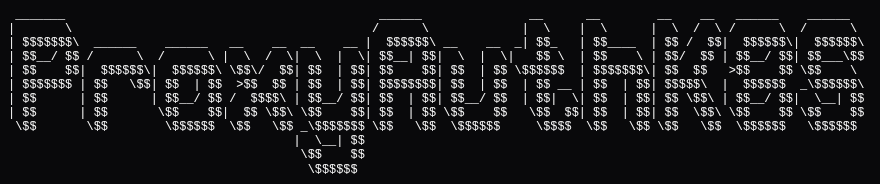
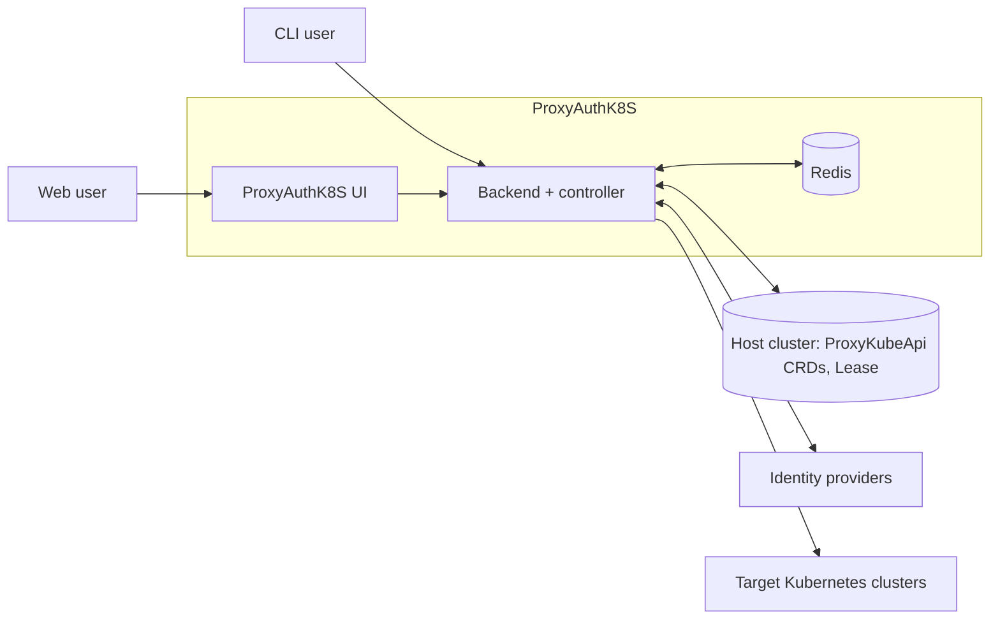

# ProxyAuthK8s

[](https://scorecard.dev/viewer/?uri=github.com/batleforc/ProxyAuthK8S)
[](LICENSE)



ProxyAuthK8S is part of the Weebo SI project. It exposes Kubernetes API servers
behind a single authenticating proxy, with a focus on security and ease of use,
and makes it easy to share kubeconfig files between users and teams.

**Documentation (French): <https://batleforc.github.io/ProxyAuthK8S/>**


## Features

- **One entry point for many clusters**: each target cluster is a `ProxyKubeApi`
  resource, reconciled by the built-in controller
  ([expose a cluster](https://batleforc.github.io/ProxyAuthK8S/docs/expose-cluster)).
- **OIDC login** for the UI and the CLI, with per-cluster group restrictions
  ([security model](https://batleforc.github.io/ProxyAuthK8S/docs/security)).
- **`kubectl proxyauth` plugin**: login, credential plugin and kubeconfig
  generation ([kubectl plugin](https://batleforc.github.io/ProxyAuthK8S/docs/kubectl-plugin)).
- **Request policy**: allow-listed resources, port-forward port filtering, rate
  limiting, fail2login and an audit event per proxied request.
- **Virtual APIs**, such as OpenShift project discovery
  ([virtual APIs](https://batleforc.github.io/ProxyAuthK8S/docs/virtual-apis)).
- **Web UI** listing the clusters you can reach and their kubeconfig.

## Install

Two Helm charts are published as OCI artifacts: the CRDs, then the application.

```sh
helm upgrade --install proxyauthk8s-crd \
  oci://ghcr.io/batleforc/proxyauthk8s/chart-crd:<version> --namespace <ns>
helm upgrade --install proxyauthk8s \
  oci://ghcr.io/batleforc/proxyauthk8s/chart:<version> --namespace <ns> \
  --values proxyauthk8s-values.yaml
```

The [Quick start](https://batleforc.github.io/ProxyAuthK8S/docs/quick-started)
covers Redis, the values file and a first cluster; the
[Helm chart](https://batleforc.github.io/ProxyAuthK8S/docs/helm-chart) page lists
every value. The kubectl plugin installs with krew; see the
[kubectl plugin](https://batleforc.github.io/ProxyAuthK8S/docs/kubectl-plugin)
page until it is published on the krew index.

Put an ingress or reverse proxy (TLS termination) in front of ProxyAuthK8S.

## Architecture



## Local development

The local stack (Traefik, Redis, an OIDC provider and a k3d cluster) is
described in the
[developer guide](https://batleforc.github.io/ProxyAuthK8S/docs/developper-guide/work-localy).
Authelia is the default identity provider; Keycloak and Dex are documented there
as alternatives.

## Roadmap

The roadmap (done, in progress and planned work) is maintained in a single place:
[the Roadmap page of the documentation](https://batleforc.github.io/ProxyAuthK8S/docs/roadmap)
(source: [`.docs/content/docs/roadmap.mdx`](.docs/content/docs/roadmap.mdx)).
Design decisions are written as RFCs in [`.rfc/`](.rfc/README.md).

## Contributing, security and license

- [Contributing](CONTRIBUTING.md)
- [Security policy](SECURITY.md)
- Licensed under the [GNU GPL v3.0](LICENSE).
