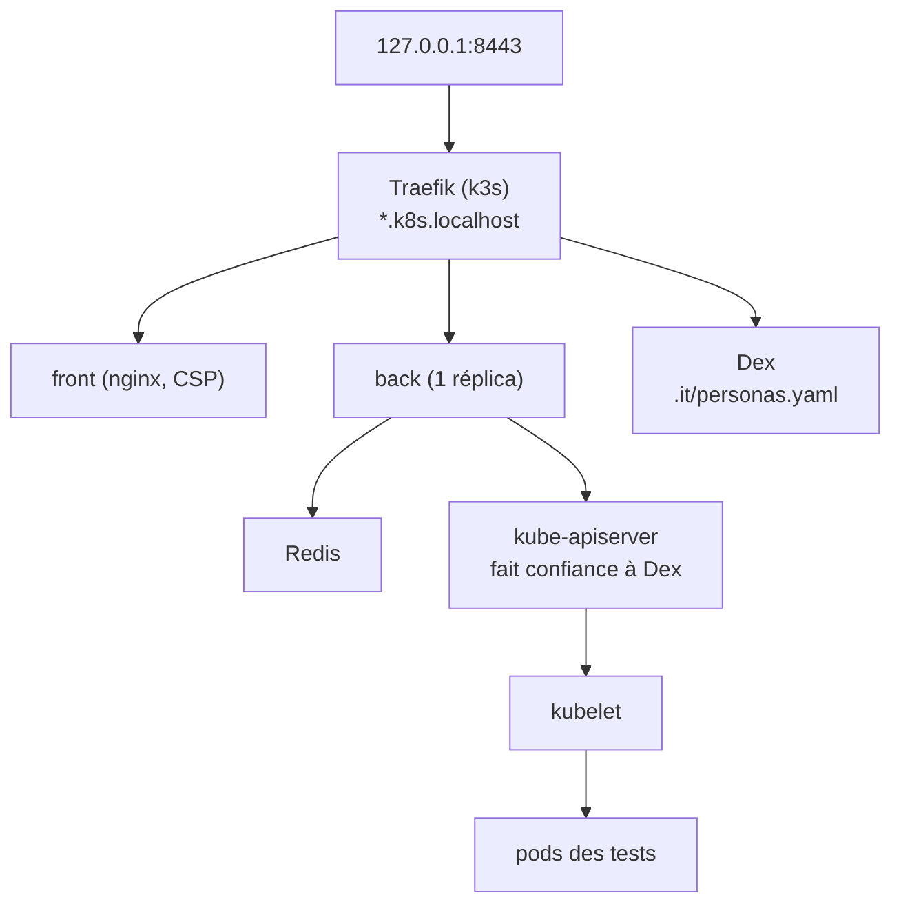

Les tests rapides (`task test`, envtest, la suite Playwright simulée) ne parlent jamais à un
vrai cluster avec kubelet. La suite d'intégration, si : elle monte la pile entière dans un
cluster k3d, puis la pilote comme un utilisateur, avec le vrai `kubectl`, le vrai
`kubectl-proxyauth` et Chromium. Chaque point de preuve (§6.P) d'une RFC y a un test, ou une
raison écrite de ne pas en avoir.

## Prérequis

- podman rootless (local) ou Docker (CI), et les outils de `mise.toml` (`k3d`, `kubectl` 1.35,
  `helm`, `mkcert`, `yq`, `uv`, `cargo-nextest`) ;
- `keyutils` (`keyctl`), présent par défaut sur Fedora ;
- Chromium de Playwright : `pnpm -C apps/front exec playwright install chromium`.

<Callout type="warn">
Sous podman rootless, k3s exige que le contrôleur cgroup `cpuset` soit délégué à votre
session. `task it:up` le vérifie et affiche la configuration à poser, une fois, en root :

```bash
mkdir -p /etc/systemd/system/user@.service.d
printf '[Service]\nDelegate=cpu cpuset io memory pids\n' > /etc/systemd/system/user@.service.d/delegate.conf
systemctl daemon-reload
```

puis déconnectez-vous et reconnectez-vous.
</Callout>

## Commandes

| Tâche                           | Effet                                                                              |
| ------------------------------- | ---------------------------------------------------------------------------------- |
| `task it:up`                    | CA du lancement, cluster k3d, images construites depuis l'arbre, Dex, Redis, chart |
| `task it:test`                  | Suite Rust (`tests/integration`) puis Playwright (`apps/front/e2e-it`)            |
| `task it:reload IMAGE=server`   | Reconstruit une image (`server` ou `front`), l'importe et redémarre son déploiement |
| `task it:logs`                  | Logs de tous les pods et évènements du cluster dans `.it/run/logs`                 |
| `task it:matrix`                | Vérifie `tests/integration/MATRIX.md` (aussi lancé par `task lint`)                |
| `task it:down`                  | Supprime le cluster et `.it/run`                                                   |

`IT_SKIP_BUILD=1 task it:up` réutilise les images déjà construites ; `IT_KEEP=1` garde les
namespaces des tests pour déboguer. Le banc publie `https://proxyauth.k8s.localhost:8443` et
`https://dex.k8s.localhost:8443` sur `127.0.0.1` seulement. Sa CA est dans
`.it/run/ca/rootCA.pem` et n'entre jamais dans le magasin de confiance du poste.

Pour un seul fichier de tests : `cargo nextest run -p integration --profile it -E
'binary(rfc0003)'`, dans `keyctl session -` pour que le trousseau de la CLI reste à part.

## Le banc



- `.it/k3d.yaml.tpl` : le cluster, avec l'`AuthenticationConfiguration` qui fait valider les
  jetons de Dex par l'apiserver ; `.it/traefik-config.yaml` met Traefik sur 8443 avec une IP
  fixe, pour que les mêmes URL marchent depuis l'hôte, les pods et l'apiserver.
- `.it/images.lock` : les images tierces, épinglées par digest (`it:up` refuse une étiquette).
- `.it/values.yaml` : les valeurs du chart, un fichier de valeurs ordinaire.
- `.it/personas.yaml` : les seuls utilisateurs connus, rendus dans Dex. `reader` est dans le
  groupe `it-readers`, `nogroup` dans aucun.

## Règles d'un test

- **L'action testée passe par le proxy.** Un test met en place et vérifie avec le kubeconfig
  admin (`Bench::admin`, `Bench::apply`), mais l'action qu'il prouve passe par l'Ingress, comme
  un client réel : `Session::kubectl`, `Session::port_forward`, ou `Bench::proxied` pour une
  requête que kubectl ne sait pas produire.
- **Aucune dépendance interne.** `tests/integration` ne dépend d'aucune crate du workspace
  (vérifié par `it:matrix`), et `e2e-it` n'intercepte rien (`page.route` y est interdit).
- **Un namespace par test.** `fixture::proxied("rfc0003-p1", security)` crée le namespace, une
  `ProxyKubeApi` `c` avec la `security_config` du test, le pod `web`, et connecte `reader` par
  le vrai flux SSO. Dans l'apiserver, `it-readers` est `admin` du namespace : un refus observé
  ne peut venir que du proxy.
- **Des écarts, pas des valeurs.** Un compteur se lit avec `observe::metric_delta`, l'audit
  avec `observe::audit_lines`, filtré par namespace.
- **Aucun retry.** Un test instable passe en quarantaine, avec une issue.

## Ajouter un test, une persona, une ligne

Une RFC livre ses tests dans la PR de son code :

1. un fichier `tests/integration/tests/rfcNNNN.rs`, un test par point §6.P nommé
   `pN_sujet`, ou une spec dans `apps/front/e2e-it/` ;
2. ses personas dans `.it/personas.yaml` (le hash est `bcrypt(password)`, coût 10) ;
3. ses lignes dans `tests/integration/MATRIX.md`, et le retrait de la RFC de `PENDING` dans
   `.it/matrix.py` quand son code est écrit.

`task it:matrix` refuse un point §6.P sans ligne, une ligne qui cite un test absent, un
`hors suite` sans renvoi, une `quarantaine` sans issue, et un `à écrire` pour une RFC dont le
code est écrit.

## En CI

Le workflow `integration.yaml` tourne sur les PR qui touchent le code, le chart ou la suite,
chaque nuit sur `main`, et à la demande. Il publie les logs du cluster et le rapport Playwright
en artefact (7 jours), et la durée de chaque phase dans le résumé du job. Un échec de nuit
ouvre ou commente l'issue `it-nightly`. La release exige un passage vert de la suite sur le
commit tagué.

`integration` est un check requis pour fusionner sur `main`. Une PR qui ne touche aucun de
ces chemins reçoit à la place le job du même nom d'`integration-skipped.yaml`, qui passe sans
rien lancer : les deux listes de chemins doivent rester identiques.
